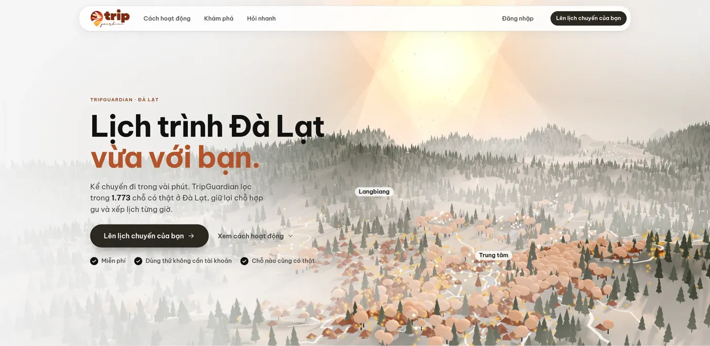
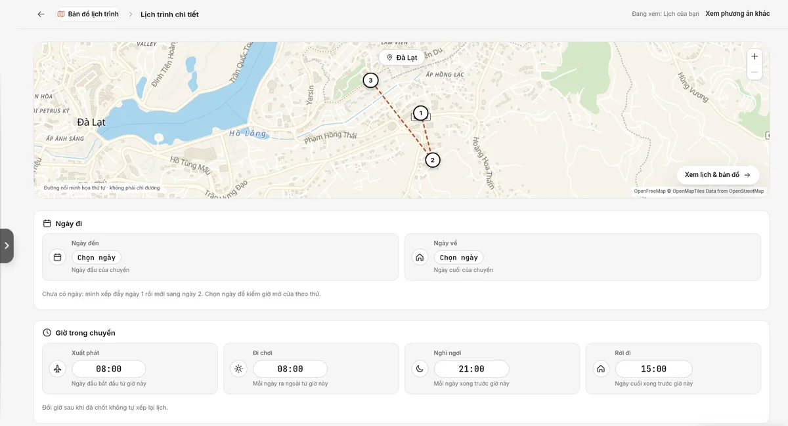
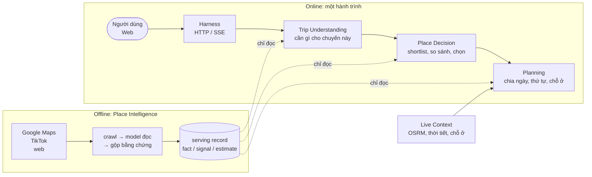

<p align="center"></p>

# TripGuardian

Trợ lý lên lịch du lịch tự túc ở Đà Lạt: **chọn đúng nơi trước, rồi mới xếp lịch**, và nói rõ vì sao.

**Dùng thử:** [tripguardian.visioncare-host.uk](https://tripguardian.visioncare-host.uk) (không cần tài khoản)

> **Fork cho đồ án NT548 nhóm 8:** phần vận hành ở [`docs/nt548/`](docs/nt548/README.md); chức năng giữ như TripGuardian.
>
> Dự án học tập, phi thương mại. Nội dung crawl (review Google Maps, video và bình luận TikTok) thuộc tác giả gốc, chỉ dùng cho nghiên cứu trong dự án này.

## TripGuardian làm gì

Người đi Đà Lạt không thiếu gợi ý. Cái khó là biết nơi nào hợp với chuyến này, và các nơi đã chọn có đi được cùng nhau không. TripGuardian trả lời ba câu đó:

- **Nơi nào hợp?** Bạn kể chuyến đi bằng lời (đi với ai, mấy ngày, thích gì, kiêng gì). Hệ thống lọc 3.168 địa điểm (bản serving 2026-11-03) và chỉ giữ nơi có bằng chứng phù hợp.
- **Vì sao nơi này?** Mỗi thẻ nơi ghi lý do hợp, điểm đánh đổi và độ tin cậy. Thông tin lấy từ review Maps và video TikTok đã được model đọc và kiểm, không bịa: thiếu bằng chứng thì ghi `unknown`.
- **Đi được cùng nhau không?** Lịch được xếp theo giờ mở cửa, thời gian di chuyển thật (OSRM), thời tiết và nhịp đi. Lịch vi phạm vẫn hiện, kèm cảnh báo; người dùng quyết định cuối.

<p align="center"></p>

## Cách hoạt động



Trip, Decision và Planning mỗi bên có một Agent (model + tool + skill) chạy trên lõi chung `src/agents/`; Harness giữ trạng thái hành trình, kiểm kết quả và ghi trace. Chi tiết: `docs/ARCHITECTURE.md`, `docs/LLM_ARCHITECTURE.md`.

## Thiết lập nhanh

Cần Python ≥ 3.12, Node ≥ 20.19, Docker. Dữ liệu không nằm trong git.

```sh
git clone https://github.com/hohoangluan/tripguardian && cd tripguardian
python -m venv .venv && source .venv/bin/activate
pip install -e ".[dev]" && (cd web && npm install)
cp .env.example .env                     # điền key model: docs/LLM_PROVIDER.md
python -m zipfile -e tripguardian-data-<ngày>.zip .   # gói dữ liệu tải từ Drive của nhóm
./run.sh db                              # Postgres trong Docker, chạy migration
./run.sh start                           # mở http://127.0.0.1:5173
```

Gói dữ liệu: [Drive của nhóm](https://drive.google.com/drive/folders/1LeEgIdoioyCAM64WV3VLGeKYA-X5yEGT?usp=sharing). OSRM, đăng nhập Google, web search, crawl và mọi biến môi trường: `docs/SETUP.md`.

## Tái lập kết quả

```sh
python -m pytest -q                      # test không gọi mạng
python scripts/journey_sim.py            # người dùng giả đi hết Trip → Decision → Planning, báo cáo data/journey_sim/report.json
python -m decision evaluate              # 30 chuyến ẩn → data/decision/eval.json
python -m planning evaluate              # 30 chuyến ẩn qua Decision → Planning (cần OSRM)
```

Cách đọc số đo: `docs/PLACE_DECISION.md` §17, `docs/PLANNING.md`. Trace từng lượt agent, bench trợ lý: `docs/LLM_ARCHITECTURE.md` §13. Báo cáo theo ngày: `docs/reports/`.

## Cấu trúc thư mục

| Thư mục | Chứa gì |
|---|---|
| `src/` | package Python. Bốn giai đoạn: `corpus` (Place Intelligence), `trip`, `decision`, `planning` + `live`. Dùng chung: `agents`, `harness`, `requirements`, `accounts`, `db`, `booking`, `journey`, `companion`, `notify`, `analytics`, `bench`, … |
| `tests/` | pytest, cùng tên thư mục với package |
| `web/` | React + Vite (`src/`), server public (`server.mjs`), viewer 3D (`space3d/`) |
| `config/` | mọi ngưỡng và tham số |
| `scripts/` | script chạy tay hoặc cron (`scripts/README.md`) |
| `migrations/` | SQL Postgres, `./run.sh db` chạy |
| `docs/` | tài liệu (bảng dưới); `design/` ảnh thiết kế, `plans/` spec đang làm, `reports/` báo cáo theo ngày, `log/` nhật ký |
| `submission/` | hồ sơ dự thi (`submission/README.md`) |
| `docker/`, `certs/` | cấu hình SearXNG, chứng chỉ CA cho endpoint UIT |

Không trong git: `data/`, `logs/`, `osrm-data/`, `.browser/` (profile crawl), `.prod_src/` (bản prod đông cứng), `frontend_images/` (ảnh UI chờ duyệt), symlink `.venv` / `.venv-vllm` / `.cache` (`docs/OPERATIONS.md` §2).

## Tài liệu

| Muốn biết | Đọc |
|---|---|
| Vì sao làm, cho ai, phạm vi MVP | `docs/Project_Context.md` |
| Toàn hệ thống, ranh giới module | `docs/ARCHITECTURE.md` |
| Agent, tool, skill, RAG, guard, trace | `docs/LLM_ARCHITECTURE.md`, `docs/AGENT_HARNESS.md` |
| Model nào cho vai trò nào, key | `docs/LLM_PROVIDER.md` |
| Từng giai đoạn | `docs/CORPUS.md`, `docs/TRIP_UNDERSTANDING.md`, `docs/TRIP_UNDERSTANDING_QA.md`, `docs/PLACE_DECISION.md`, `docs/PLANNING.md` |
| Tính năng phụ | `docs/ACCOUNTS.md`, `docs/BOOKING.md`, `docs/COMPANION.md`, `docs/ANALYTICS.md` |
| Bảo mật | `docs/SECURITY.md` |
| Giao diện | `docs/Role_Web_Functional_Design.md`, `docs/UX_Design_Brief.md`, `docs/UI_SPEC_USER_WEB.md`, `docs/UI_SPEC_FLOW_LAYOUT.md`, `docs/UI_SPEC_LANDING.md` |
| Cài đặt, chạy, test đầy đủ | `docs/SETUP.md` |
| Vận hành production | `docs/OPERATIONS.md` |
| Code đã làm gì; lỗi của coding agent | `docs/log/DEV_LOG.md`, `docs/log/AGENT_FAILURES.md` |
| Đồ án NT548 nhóm 8 (CI/CD, blue/green, canary, AI ops, DataOps) | `docs/nt548/README.md` |

Quy tắc làm việc: `RULE.md`. Hướng dẫn cho coding agent: `AGENTS.md`.

## Khai báo dùng AI

- **Trong sản phẩm:** model đóng vai Extractor, Judge, Agent và ASR; model nào cho vai trò nào ở `docs/LLM_PROVIDER.md`.
- **Khi làm dự án:** code và tài liệu được viết cùng coding agent (Claude Code, Codex). Thay đổi phải qua test; tác giả đọc và duyệt trước khi đưa lên production. Lỗi lặp lại của agent ghi ở `docs/log/AGENT_FAILURES.md`.

## Tác giả

[hohoangluan](https://github.com/hohoangluan) · [dinhlong06](https://github.com/dinhlong06) · [LuanLuKim](https://github.com/LuanLuKim) · [pngochuong](https://github.com/pngochuong). Kiểm thử: [DontMadWhenBad](https://github.com/DontMadWhenBad). Góp ý, báo lỗi: [Issues](https://github.com/hohoangluan/tripguardian/issues).
