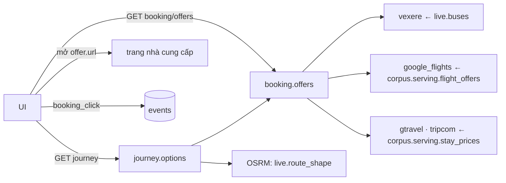

# Booking và đường tới chỗ ở

Hai module online, chỉ đọc: `src/booking/` (một hợp đồng `Offer`, mỗi nhà cung cấp một adapter) và `src/journey/` (các cách đi từ nhà tới chỗ ở, code quyết cái nào khả thi). Không ghi Place Intelligence, không ghi trạng thái chuyến.



## Offer

`Offer` chỉ mang điều link nói được hợp lệ; trường không biết là `None` (unknown), không suy ra.

| Loại | Adapter | Nguồn | Offer nói gì |
|---|---|---|---|
| `coach` | `vexere` | `live.buses` (một GET, cache) | mỗi chuyến trang liệt kê: nhà xe, giờ đi/đến, điểm đón/trả, giá vé nếu trang có. Đọc không được → một link không giờ, không giá. Không có chuyến → không offer |
| `flight` | `google_flights` | `corpus.serving.flight_offers` (file đã publish, `flight_max_age_h`) | mỗi chuyến đã crawl của ngày đó: hãng, số hiệu, giờ đi/đến, điểm dừng, giá, `observed_at`. Chưa có chuyến crawl (hoặc cũ hơn ngưỡng) → một link tìm chuyến điền sẵn, không giá/giờ/hãng |
| `stay` | `gtravel`, `tripcom` | `corpus.serving.stay_prices` (file đã publish, không crawl lại) | link + tổng giá + giá/đêm + `observed_at`, mỗi nguồn một offer. Chưa có giá → không offer. Giá cũ hơn `stay_max_age_h` → giữ link, bỏ giá |

`mode` hiện luôn là `deeplink`. Đổi sang API đối tác = viết adapter `api` (thêm `book()`), UI và hợp đồng giữ nguyên; chưa có thanh toán trong app. `offer_id` = băm ổn định của các trường offer nói. Mã affiliate: `config/booking.yaml` `affiliate.<provider>` khai tên tham số và tên biến `.env`; thiếu một trong hai thì không gắn.

## Journey

`journey.options(origin, day, dest=None, way="inbound"|"outbound")` trả bốn phương án theo thứ tự `car`, `motorbike`, `bus`, `plane`. `dest=None` → trung tâm thành phố (`dest_is_centre`). Mỗi `Option` có `feasible` (`True | False | None`), `reason` (mã ngắn, UI viết lời), `legs` (kèm `coords` để vẽ), `minutes` cửa tới cửa (chỉ khi mọi chặng đã biết), khoảng giá từ offer, `offers`.

| Phương án | `feasible` |
|---|---|
| `car` | `True` khi OSRM có đường; OSRM lỗi → `None` (`no_route`) |
| `motorbike` | như `car`, `False` (`too_far`) khi quãng đường vượt `motorbike_max_km` |
| `bus` | `False` nếu không có vùng Vexere trong `coach_region_max_km` hoặc không chuyến; `None` khi thiếu ngày hoặc trang không đọc được; `True` khi có chuyến thật. Điểm đón/trả chưa có toạ độ → không vẽ chặng, không tính cửa tới cửa |
| `plane` | `False` nếu đường thẳng dưới `plane.min_crow_km` hoặc không có sân bay nào trong `plane.airport_max_km`. Thử tối đa `plane.max_airports` sân bay gần nhất trong tầm (Huế: HUI chỉ có chuyến nối, Đà Nẵng có chuyến thẳng 65 phút); `True` **chỉ khi** có chuyến đã crawl cho đúng ngày và tuyến (có giờ đi và đến), lấy phương án cửa-tới-cửa ngắn nhất; chặng bay lấy phút của chuyến ít điểm dừng nhất, ngắn nhất. `minutes` = đường OSRM nhà ↔ sân bay ↔ chỗ ở + giờ bay + `airport_before_min` + `airport_after_min` (làm thủ tục, hành lý). Không có chuyến crawl → `None` (`flights_unchecked`, sân bay gần nhất): chưa có bằng chứng thì không đoán, không bao giờ `False` vì thiếu dữ liệu |

Ngưỡng ở `config/journey.yaml`; bảng sân bay ở `config/airports.yaml`.

## Chọn chuyến, nhà, đèo, đánh đổi

- `Offer.as_dict()["transit"]`: payload `Transit` của Trip (`mode`, `carrier`, giờ đi/đến, điểm đi/đến, giá, `stops`, `source`, `fetched_at`) khi offer nói đủ giờ; link không giờ thì `null`, không chọn được. Web gửi nguyên payload này làm câu trả lời `inbound` / `outbound` (`pick_transit` ghi `entry_point` / `exit_point`).
- `home_city` của hồ sơ: server geocode (`harness.booking_routes.home_point`) rồi `seed_profile` đặt `origin` với nguồn `profile` (prior, chuyến này nói gì thì thắng). Không geocode được thì không có prior.
- `Leg.via`: tên đèo mà đường OSRM đi qua (`entry_roads` trong `config/journey.yaml`, trong `entry_snap_km`); chỉ gắn nhãn, không đổi đường.
- `trip.domain.logistics.tradeoffs`: câu đánh đổi (`pass_motion_sick`, `small_kids_long_ride`, `overnight_bus`) chỉ khi chuyến có sự kiện tương ứng (tín hiệu say xe, trẻ nhỏ, xe đêm); view của Trip trả `tradeoffs`.

## API và sự kiện

| Route (đọc, cần phiên) | Việc |
|---|---|
| `GET /api/harness/booking/offers?kind=coach\|flight\|stay&…` | `coach`: `lat,lng` hoặc `origin`, `date`, `way`; `flight`: `src,dst,date`; `stay`: `fid,check_in,nights` |
| `GET /api/harness/journey?lat&lng\|origin&dest_lat&dest_lng&date&way` | `Journey.as_dict()`; chỉ có `origin` (chữ) thì tra bảng thành phố; tra không ra → `{origin: null, origin_text, options: [], reason: "unknown_origin"}` (không bịa toạ độ) |

Tham số sai → 400 (`booking.query_from_params`). Chỗ ở người dùng tự nhập (`fid` bắt đầu bằng `@`, ví dụ `@home`) không có offer: trả 200 `{"offers": [], "reason": "self_entered_lodging"}`, không phải lỗi. Bấm đặt: web mở `offer.url` rồi gửi `booking_click {offer_id, provider, kind}` qua `/api/harness/events` (`docs/ANALYTICS.md`); URL luôn do server dựng.

## Ranh giới và kiểm chứng

`booking` dùng `live` và `corpus.serving`; `journey` dùng `live` và `booking`; `harness/booking_routes.py` gọi cả hai. Chỉ qua `__init__.py`.

```bash
.venv/bin/python -m pytest --collect-in-virtualenv tests/booking tests/harness/test_booking_routes.py -q
```
