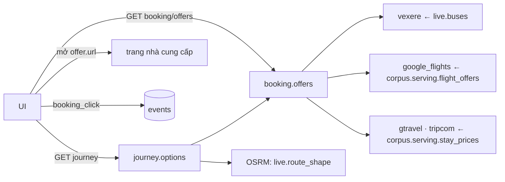

# Booking và đường tới chỗ ở

Hai module online, chỉ đọc: `src/booking/` (một hợp đồng `Offer`, mỗi nhà cung cấp một adapter) và `src/journey/` (các cách đi từ nhà tới chỗ ở, code quyết cái nào khả thi). Không ghi Place Intelligence, không ghi trạng thái chuyến.



## Offer

`Offer` chỉ mang điều link nói được hợp lệ; trường không biết là `None` (unknown), không suy ra.

| Loại | Adapter | Nguồn | Offer nói gì |
|---|---|---|---|
| `coach` | `vexere` | `live.buses` (một GET, cache) | mỗi chuyến trang liệt kê: nhà xe, giờ đi/đến, điểm đón/trả, giá vé nếu trang có. Đọc không được → một link không giờ, không giá. Không có chuyến → không offer |
| `flight` | `google_flights` | `corpus.serving.flight_offers` (file đã publish, `flight_max_age_h`) | mỗi chuyến đã crawl của ngày đó: hãng, số hiệu, giờ đi/đến, điểm dừng, giá, `observed_at`. Chưa có chuyến crawl (hoặc cũ hơn ngưỡng) → một link tìm chuyến điền sẵn, không giá/giờ/hãng |
| `stay` | `gtravel`, `tripcom` | `corpus.serving.stay_prices` (file đã publish, không crawl lại) | link + tổng giá + giá/đêm + `observed_at`, mỗi nguồn một offer. Chưa có giá → không offer. Giá cũ hơn `stay_max_age_h` → giữ link, bỏ giá |

`mode` hiện luôn là `deeplink`. Đổi sang API đối tác = viết adapter `api` (thêm `book()`), UI và hợp đồng giữ nguyên; chưa có thanh toán trong app. `offer_id` = băm ổn định của các trường offer nói. Mã affiliate: `config/booking.yaml` `affiliate.<provider>` khai tên tham số và tên biến `.env`; thiếu một trong hai thì không gắn.

## Journey

`journey.options(origin, day, dest=None, way="inbound"|"outbound")` trả bốn phương án theo thứ tự `car`, `motorbike`, `bus`, `plane`. `dest=None` → trung tâm thành phố (`dest_is_centre`). Mỗi `Option` có `feasible` (`True | False | None`), `reason` (mã ngắn, UI viết lời), `legs` (kèm `coords` để vẽ), `minutes` cửa tới cửa (chỉ khi mọi chặng đã biết), khoảng giá từ offer, `offers`.

| Phương án | `feasible` |
|---|---|
| `car` | `True` khi OSRM có đường; OSRM lỗi → `None` (`no_route`) |
| `motorbike` | như `car`, `False` (`too_far`) khi quãng đường vượt `motorbike_max_km` |
| `bus` | `False` nếu không có vùng Vexere trong `coach_region_max_km` hoặc không chuyến; `None` khi thiếu ngày hoặc trang không đọc được; `True` khi có chuyến thật. Điểm đón/trả chưa có toạ độ → không vẽ chặng, không tính cửa tới cửa |
| `plane` | `False` nếu đường thẳng dưới `plane.min_crow_km` hoặc không có sân bay nào trong `plane.airport_max_km`. Thử tối đa `plane.max_airports` sân bay gần nhất trong tầm (Huế: HUI chỉ có chuyến nối, Đà Nẵng có chuyến thẳng 65 phút); `True` **chỉ khi** có chuyến đã crawl cho đúng ngày và tuyến (có giờ đi và đến), lấy phương án cửa-tới-cửa ngắn nhất; chặng bay lấy phút của chuyến ít điểm dừng nhất, ngắn nhất. `minutes` = đường OSRM nhà ↔ sân bay ↔ chỗ ở + giờ bay + `airport_before_min` + `airport_after_min` (làm thủ tục, hành lý). Không có chuyến crawl → `None` (`flights_unchecked`, sân bay gần nhất): chưa có bằng chứng thì không đoán, không bao giờ `False` vì thiếu dữ liệu |

Ngưỡng ở `config/journey.yaml`; bảng sân bay ở `config/airports.yaml`.

## Gọi xe (Grab, Be, Xanh SM)

`journey.ride_quotes(legs)` (`src/journey/rides.py`) ước cước gọi xe cho từng chặng `(km, phút, điểm đón[, điểm trả])` theo **bảng giá hãng công bố**, đọc từ `config/rides_tariffs.json`. Không hãng nào có API giá, nên mọi số là ước tính: chưa gồm giờ cao điểm, khuyến mãi, phụ phí đêm.

### Bảng giá: dựng offline, xem diff rồi commit

`python -m journey.tariffs refresh` tải trang của từng hãng (mỗi trang tải hai lần; hai lần đọc khác nhau thì dừng, vì CDN từng trả bản cũ), lưu vào `data/rides/<grab|be|xanhsm|lado>/` (gitignored), rồi dựng bảng. `python -m journey.tariffs build` dựng lại từ trang đã lưu. Mỗi nguồn một bộ đọc trong `src/journey/tariffs/`:

| Hãng | Trang | Giữ | Bỏ có chủ đích |
|---|---|---|---|
| Grab (`grab.py`) | grab.com/vn/en/blog/bang-thong-tin-cac-dich-vu-tren-ung-dung-grab (bảng có cột "For cheaper fare") | GrabBike, GrabCar 4/6 chỗ; tuyến cố định (sân bay, liên tỉnh); phí nền tảng; phí sân bay 10k cho ô tô đón tại SGN/DAD/CXR/PQC | Plus, tiếng Anh, thú cưng, xe điện, thuê giờ, Đi Ghép, "Bãi Dài ⇒ Nha Trang" |
| Be (`be.py`) | be.com.vn/consumer/be-transport (34 tab tỉnh) | beBike, beCar 4/7, beCar Tiết Kiệm, beCar Economy, beTaxi 4/7, beAirport (Hà Nội ⇄ Nội Bài); phí đón tại sân bay TSN của beCar | Plus, đường dài, 2 chiều, thuê giờ; khối là gói ("Gói", "Từ 0-25km"); Tiết Kiệm không ghi giá (giá linh hoạt); "beTaxi" không ghi số chỗ; tuyến cố định sân bay Phù Cát (không có trong bảng sân bay) |
| Xanh SM (`xanhsm.py`) | greensm.com/vn-vi/greensm-car, /greensm-bike (JSON `__NEXT_DATA__`) | Green SM Car (khóa `taxi`), Green SM Bike (cột thường) | Premium, Luxury, 2 chiều, Bike Plus; Green SM Mini (trang không ghi số chỗ) |
| Lado (`lado.py`), gắn vào Xanh SM vùng `lam_dong` | ladotaxi.com | Taxi 4/7 chỗ; tuyến Đà Lạt → sân bay Liên Khương (một chiều) | Xe hợp đồng, tuyến liên tỉnh |

Quy tắc đọc:
- **Mỗi dòng có giá phải được một luật đọc.** Một dòng không luật nào hiểu thì bỏ cả khối và ghi báo cáo, không bao giờ mất một bậc km mà không ai biết. Nhãn sai của chính trang (Be Đà Nẵng ghi "1km đầu tiên" cho giá km tiếp theo; Huế ghi "Kilomet gói 1" cho km mở cửa) được hiểu lại theo luật viết sẵn và ghi vào báo cáo mục `reread`.
- Mốc bậc là km tuyệt đối. "sau 12km", "lớn hơn 12km" → bậc trước kết thúc ở 12; "Từ Km 31", "Km 31 trở đi", "km thứ 30 trở đi" → kết thúc ở km trước đó (30, 29). Bậc cuối có mốc mà không có gì sau → dùng tiếp giá đó và ghi báo cáo.
- Trang không ghi giá mở cửa đi được bao xa (Lado, Be Kon Tum) → `open_km: 0`, mọi km đều tính (dư vài nghìn, không bao giờ thiếu), ghi báo cáo.
- Vùng giá luôn là **tỉnh cũ** (63 tỉnh trước sáp nhập 2025 + Côn Đảo, khóa trong `config/provinces.yaml`). Nhãn một tên ("Gia Lai") chỉ áp cho tỉnh cũ cùng tên; nhãn liệt kê ("Khánh Hòa (Khánh Hòa cũ, Ninh Thuận)") áp cho đúng các tỉnh trong ngoặc; tỉnh vừa có dòng riêng vừa nằm trong một danh sách (Bình Phước) thì dòng riêng thắng.
- Chỉ giữ dịch vụ cơ bản: biến thể đắt hơn không bao giờ là rẻ nhất. Ghế: 4 chỗ = 4 khách, 6/7 chỗ = 6 khách.

Bảng sạch ghi vào `config/rides_tariffs.json` (trong git, xem diff mỗi lần cập nhật giá). Báo cáo (`data/rides/report.json`, in cả ra màn hình) liệt kê dòng bỏ qua, dòng hiểu lại, xung đột, và giá đổi quá 30% so với bảng cũ (đo ở 3, 10, 30 km). **Không ghi đè bảng cũ** khi: một trang không đọc được giá nào, một hãng mất quá 20% số vùng, hoặc có giá đổi quá 30% mà chưa chạy lại với `--accept` (người kiểm trên trang rồi mới chấp nhận).

### Vùng của một điểm

`journey.areas.area_of(lat, lng)`: trong bán kính `airport_km` (3 km) của một sân bay thì lấy tỉnh của sân bay (`airports.*.area`: Nội Bài nằm sát ranh Hà Nội – Vĩnh Phúc của đường biên giản lược); trong `box` của khu vực con (Phú Quốc, Sa Pa, Hội An) và đúng tỉnh cha thì lấy khu vực con; còn lại là tỉnh cũ chứa điểm theo `config/provinces.geojson`, điểm sát biển ngoài đường biên trong `snap_km` (15 km) thì lấy tỉnh gần nhất; ngoài Việt Nam → `None`. Ranh giới dựng bằng `python -m journey.tariffs boundaries <file>` từ geoBoundaries gbOpen VNM ADM1 (public domain): đủ 64 khóa, mỗi khóa đúng một vùng, tọa độ làm tròn 4 chữ số.

### Tính giá một chặng

- Chặng tính giá ở **nơi đón**. Khu vực con hãng không có dòng riêng thì lùi về dòng của tỉnh cha. Hãng không công bố bảng giá cho vùng đó → một dòng `service: null, vnd_min: null, reason: "no_table"`; không mượn giá vùng khác.
- Công thức: giá mở cửa cho `open_km` đầu; mỗi km sau theo bậc `per_km`; có `per_min` thì cộng phút sau `open_km` theo tỉ lệ quãng đường.
- Phí nền tảng Grab: khoảng cố định (xe máy / ô tô) tới ngày `until`, sau đó `after_pct`% giá cước. Phí đón sân bay: chỉ ô tô, chỉ khi điểm đón trong `airport_km` của sân bay đó (Grab theo hãng, Be theo dịch vụ).
- Tuyến cố định: áp khi điểm đón thuộc `from` và điểm trả khớp `to` (sân bay hoặc vùng), chiều ngược lại nếu `both_ways`. Giá `price` cho `min_km` đầu rồi cộng `per_km`; không có `per_km` thì chỉ áp khi km ≤ `min_km` × 1,15. Tuyến là một dòng riêng (`service: "<id>@route<n>"`, `route: true`), nên web tự chọn được dòng rẻ hơn giữa tuyến và tính km.
- `vnd_min..vnd_max` làm tròn lên 1.000đ.
- Lâm Đồng: Grab có xe máy và ô tô; Be có beCar 4/7, beCar Tiết Kiệm, beTaxi 4/7 (không có beBike); Xanh SM ở Lâm Đồng là taxi điện của đối tác Lado trên nền tảng Xanh SM (Green SM), tính theo bảng giá Lado, nhãn "Xanh SM · taxi Lado" (nguồn quan hệ đối tác: greensm.com, tin 08/10/2026).
- Web chọn trong mỗi hãng dịch vụ rẻ nhất đủ chỗ cho nhóm; hãng có bảng giá nhưng không có loại xe đang chọn hiện "không có xe máy" / "không có ô tô".
- Giữa các điểm trong lịch: Planning gắn `distance_km` vào item `travel` (`docs/PLANNING.md`); web cộng các item `travel` tới mỗi điểm thành một chặng, bỏ chặng đi bộ.

### Cửa tới cửa ở thẻ cách đi

`journey.options(..., with_rides=True)` (route web `/api/harness/journey` bật; Trip assistant không bật để ngữ cảnh gọn) gắn `rides` (cùng dạng một chặng của `/rides`) vào mỗi chặng `transfer`: nhà ↔ sân bay / bến, sân bay / bến Đà Lạt ↔ chỗ ở, tính từ điểm đầu tới điểm cuối của đường OSRM, ngày đi dùng cho phí nền tảng; `Journey.ride_brands` ghi nguồn. Thẻ máy bay / xe khách hiện **Cửa tới cửa** = gọi xe chặng đầu + vé rẻ nhất × số người + gọi xe chặng cuối, bấm để xem từng chặng. Mỗi chặng dùng hãng và loại xe người dùng đã chọn (`tg.ride.v1`); hãng đó không có giá ở chặng ấy thì lấy hãng rẻ nhất có giá và ghi rõ tên hãng. Chặng nào chưa có giá (vé chưa có giá, chưa tính được đường, không hãng nào công bố ở nơi đón) thì không ra tổng, chỉ nói chặng nào thiếu. Tự lái ô tô / xe máy: chỉ km và giờ đi, không ước xăng hay BOT.

## Chọn chuyến, nhà, đèo, đánh đổi

- `Offer.as_dict()["transit"]`: payload `Transit` của Trip (`mode`, `carrier`, giờ đi/đến, điểm đi/đến, giá, `stops`, `source`, `fetched_at`) khi offer nói đủ giờ; link không giờ thì `null`, không chọn được. Web gửi nguyên payload này làm câu trả lời `inbound` / `outbound` (`pick_transit` ghi `entry_point` / `exit_point`).
- `home_city` của hồ sơ: server geocode (`harness.booking_routes.home_point`) rồi `seed_profile` đặt `origin` với nguồn `profile` (prior, chuyến này nói gì thì thắng). Không geocode được thì không có prior.
- `Leg.via`: tên đèo mà đường OSRM đi qua (`entry_roads` trong `config/journey.yaml`, trong `entry_snap_km`); chỉ gắn nhãn, không đổi đường.
- `trip.domain.logistics.tradeoffs`: câu đánh đổi (`pass_motion_sick`, `small_kids_long_ride`, `overnight_bus`) chỉ khi chuyến có sự kiện tương ứng (tín hiệu say xe, trẻ nhỏ, xe đêm); view của Trip trả `tradeoffs`.

## API và sự kiện

| Route (đọc, cần phiên) | Việc |
|---|---|
| `GET /api/harness/booking/offers?kind=coach\|flight\|stay&…` | `coach`: `lat,lng` hoặc `origin`, `date`, `way`; `flight`: `src,dst,date`; `stay`: `fid,check_in,nights` |
| `GET /api/harness/rides?legs=km:phút:lat:lng[:lat2:lng2];…` | `{legs: [{km, minutes, region, region_name, quotes}], brands: {grab\|be\|xanhsm: {name, source, as_of, note}}}`; `lat2:lng2` là điểm trả (cần cho tuyến cố định); tối đa 200 chặng; chặng sai → 400 |
| `GET /api/harness/journey?lat&lng\|origin&dest_lat&dest_lng&date&way` | `Journey.as_dict()` kèm giá gọi xe trên chặng `transfer` (`legs[].rides`, `ride_brands`); chỉ có `origin` (chữ) thì tra bảng thành phố; tra không ra → `{origin: null, origin_text, options: [], reason: "unknown_origin"}` (không bịa toạ độ) |

Tham số sai → 400 (`booking.query_from_params`). Chỗ ở người dùng tự nhập (`fid` bắt đầu bằng `@`, ví dụ `@home`) không có offer: trả 200 `{"offers": [], "reason": "self_entered_lodging"}`, không phải lỗi. Bấm đặt: web mở `offer.url` rồi gửi `booking_click {offer_id, provider, kind}` qua `/api/harness/events` (`docs/ANALYTICS.md`); URL luôn do server dựng.

## Ranh giới và kiểm chứng

`booking` dùng `live` và `corpus.serving`; `journey` dùng `live` và `booking`; `harness/booking_routes.py` gọi cả hai. Chỉ qua `__init__.py`.

```bash
.venv/bin/python -m pytest --collect-in-virtualenv tests/booking tests/harness/test_booking_routes.py -q
```
