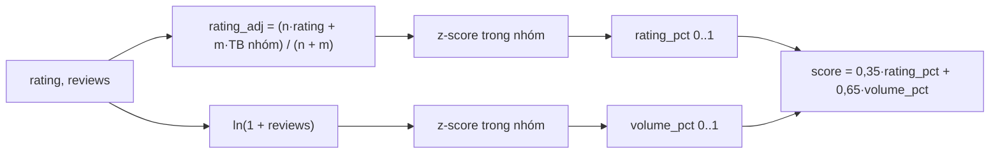
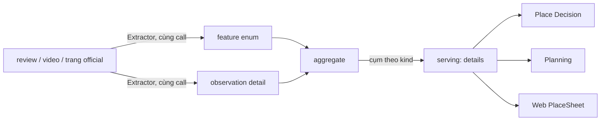
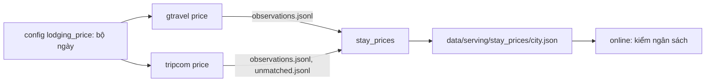
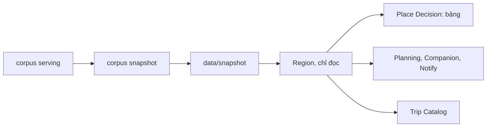
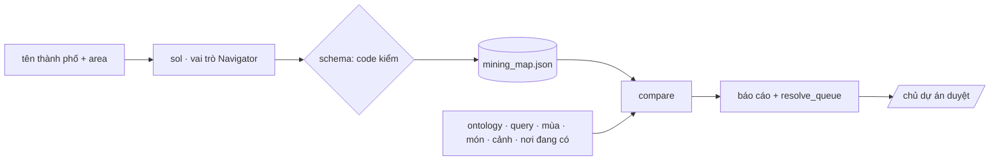
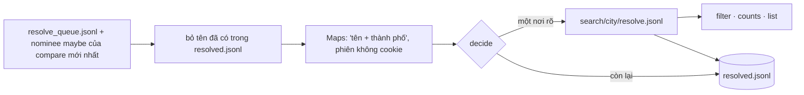
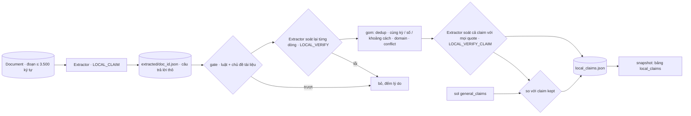
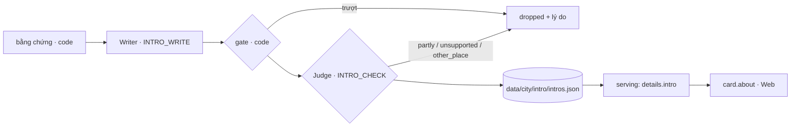
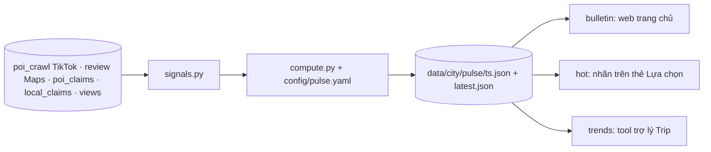

# Corpus Place Intelligence

Kho tri thức về địa điểm, xây **offline**, độc lập với mọi chuyến đi; Place Decision và Planning chỉ đọc nó. Vị trí trong luồng: `docs/ARCHITECTURE.md` §3. Code: `src/corpus/`. CLI ở §CLI.

```text
SOURCE ──► OBSERVATION ──► FACT / SIGNAL / ESTIMATE ──► PLACE INTELLIGENCE ──► SERVING INDEX
(review,    (một nhận định   (rule tổng hợp từ           (theo địa điểm,         (thứ Place
 ảnh, video, + span + bối     nhiều observation)          theo khía cạnh)         Decision đọc)
 comment,    cảnh)
 trang, provider)
```

Agent xây từ đầu đến cuối. Gate tất định kiểm soát mọi lần ghi. Người chỉ duyệt một hàng đợi nhỏ, xếp theo rủi ro, ở cuối. Mọi giá trị được phục vụ đều truy về một span nguồn: không có span thì không có observation, không có observation thì không có giá trị. Corpus không lưu dữ liệu người dùng và không coi input hay hành vi của người dùng là bằng chứng về địa điểm.

## Mục tiêu

Xây **corpus Place Intelligence** offline cho planner đọc. Agent xây từ đầu đến cuối; gate tất định kiểm soát mọi lần ghi; người chỉ duyệt một hàng đợi nhỏ, xếp theo rủi ro, ở cuối. Mọi giá trị được phục vụ đều truy về bằng chứng.

Đích: kiến trúc nhỏ nhất mà **đúng** (không bịa địa điểm hay fact), **rẻ** (model miễn phí hoặc rẻ cho khối lượng lớn, model mạnh chỉ ở chỗ cần phán đoán), và cho **output chất lượng cao**, đồng thời mở rộng ra thêm địa điểm và thành phố bằng config, không phải bằng code.

## Phạm vi

Trong: Đà Lạt; inventory Google Maps là **nguồn địa điểm** (địa điểm du lịch: tham quan, ăn uống, hoạt động, mua sắm, dịch vụ cho du khách) và **chỗ ở** (nhóm `stay`: khách sạn, homestay, villa, resort, nhà nghỉ — chỉ Planning đọc để gợi ý chỗ ở theo gu, `docs/PLANNING.md` ⓐ; Explore / Place Decision không bao giờ gợi ý, kể cả khi người dùng nêu tên); review Google Maps là bằng chứng trải nghiệm hiện tại; TikTok là bằng chứng trải nghiệm cho **địa điểm đã có trong tập** (tìm theo từng nơi, `place_search` → `observe`); trích xuất media; entity resolution (POI / ZONE); observation; tổng hợp thành fact / signal / estimate; kiểm tra và định tuyến theo rủi ro; duyệt cuối; serving index; refresh; resolve theo yêu cầu khi người dùng nhập một địa điểm.

Ngoài: mọi dữ liệu người dùng (corpus không lưu và không coi input người dùng là bằng chứng về địa điểm); độ phù hợp của gợi ý (thuộc online); live context (thời tiết, giao thông, thời gian di chuyển, giá phòng đúng ngày); phủ toàn quốc.

## Nguyên tắc

1. **Không bao giờ bịa entity.** Entity chỉ tồn tại sau khi resolve được về một thứ có thật.
2. **Không span, không observation.** Mọi observation trích nguồn và một span định vị (field + offset, hoặc segment + timestamp).
3. **Chưa biết thì giữ là chưa biết.** Thiếu bằng chứng là `unknown`, không bao giờ là `false` hay giá trị mặc định.
4. **Giữ xung đột.** Bất đồng cho ra `uncertain` và giữ lại xung đột.
5. **Model trích xuất; code quyết định.** Fact, signal, estimate chỉ do rule tổng hợp ghi. Không model nào ghi chúng.
6. **Cùng được nhắc không có nghĩa là ở gần nhau.** Xuất hiện trong một video không bao giờ là bằng chứng về khoảng cách.
7. **Vai trò nguồn tách biệt.** Google Maps quyết định tập địa điểm; nguồn khác chỉ thêm bằng chứng cho địa điểm có trong tập. Review Maps, ảnh Maps và TikTok mô tả trải nghiệm và môi trường; fact vận hành đến từ trang official và Google.
8. **Build không bao giờ chờ người.** Việc agent không giải quyết được sẽ kết thúc ở `UNRESOLVED` hoặc không được phục vụ, kèm lý do, và đi vào review.

## Nguồn và mỗi nguồn chứng minh điều gì

| Nguồn | Dùng cho | Không bao giờ dùng cho |
|---|---|---|
| Google Maps | **Tập địa điểm** (phase 1: top theo rating có trọng số số review mỗi category, không có chỗ ở); định danh, vị trí, loại, giờ, trạng thái, website; review và giờ cao điểm là bằng chứng trải nghiệm (xử lý như comment) | Rating dùng làm bằng chứng (chỉ dùng để xếp ứng viên phase 1) |
| Video TikTok | Trải nghiệm, môi trường, mức vận động cho địa điểm đã có | Tạo địa điểm mới; fact vận hành nếu chỉ có một mình nó |
| Comment TikTok | Tín hiệu trải nghiệm lặp lại (độ đông, yên tĩnh, đường đi) | Fact; hiển thị một comment đơn lẻ như sự thật |
| Website / trang chính thức | Giờ, giá, vé, đặt chỗ, quy định, đóng cửa tạm | — |
| Web (SearXNG) | URL video TikTok không qua ô search (không captcha); câu tìm thật (slug `/discover/`); trang báo / blog làm `Document` (đầu vào của tri thức bản địa) | Chi tiết một nơi (giờ, giá, đặc điểm); tạo hay xác nhận địa điểm; hiển thị nguyên văn trang cho người dùng |
| Google Search (trình duyệt) | Kết quả Google (vi, VN) khi SearXNG bị chặn: cùng vai trò với Web (URL video, trang đọc) | Như Web |
| Google Travel (`gtravel`) | Giá một đêm và phòng trống của chỗ ở **đã có trong corpus** cho đúng ngày đi (§Giá phòng theo ngày) | Tạo chỗ ở; danh sách chỗ ở; suy ra giá ngày khác |
| Trip.com (`tripcom`) | Đối chiếu giá với Google Travel cho các khách sạn nổi bật | Tạo chỗ ở; thay Google Travel |

Video tải về được giữ lại để xem lại nội dung: corpus giữ transcript, timestamp segment, keyframe nhỏ và URL TikTok. File video được giữ cho tới khi đã kiểm (`scripts/free_tiktok_clips.py` xóa sau đó), trừ clip `tiktok clips` chọn cho từng nơi: các clip này phát từ server của mình (`/media/tiktok/<id>/video.mp4`), nơi chưa có clip thì phát qua embed TikTok.

Dữ liệu thô của từng nguồn lưu file riêng theo nguồn (§1 Discover, Dữ liệu thô).

## Vai trò model

Spec ràng buộc **vai trò**, không ràng buộc model. Mỗi vai trò là một adapter có kiểu với output được validate theo schema; model nào đảm nhận là config, chọn theo **chất lượng trên nhãn review, sau đó đến chi phí trên mỗi entity được phục vụ**. Đổi model của một vai trò là đổi config, và phải qua bộ regression (§Đo chất lượng).

| Vai trò | Làm gì | Yêu cầu |
|---|---|---|
| **Code** | Chuẩn hóa, dedup, rule lọc spam, chấm điểm match, tổng hợp, gate, định tuyến rủi ro | Tất định, có test |
| **ASR** | Âm thanh → transcript có timestamp | Tiếng Việt, có timestamp |
| **Extractor** | Mọi việc model khối lượng lớn: `visible_text` + `visual_summary` của keyframe, mention, observation có span, độ liên quan / đối tượng / stance của comment, nhận định từ trang official, `LocalClaim` từ Document web (§Tri thức bản địa), kiểm tra span, đề xuất hành động trong vòng lặp tự động (§Vòng lặp tự động) | Nhận ảnh, output có cấu trúc, throughput cao, chi phí thấp hoặc bằng 0; mỗi call vừa một đơn vị tự nhiên (một video, một lô comment, một đoạn trang) |
| **Embedder** | Ảnh hoặc chữ → vector (§Chỉ mục ngữ nghĩa): offline cho ảnh và span của corpus, online cho câu / ảnh của user | Tất định với cùng model, chạy GPU local; vector chỉ để xếp hạng và gom cụm, không bao giờ là bằng chứng |
| **Judge** | Thay người duyệt (§6): gán nhãn từng nhận định của Extractor, phán nơi bị báo đóng cửa, phán hai mục Maps có phải một nơi; kiểm cấp địa điểm của `qc`. **Judge mạnh** cho giá trị cho phép và mọi quyết định đóng cửa / gộp nơi | Khả năng suy luận mạnh nhất có được, **khác họ model với Extractor** (GPT / Claude / Gemini so với Gemma, `docs/LLM_PROVIDER.md`) |
| **Writer** | Viết phần giới thiệu một nơi (§Giới thiệu địa điểm) bằng giọng hướng dẫn viên, **chỉ** từ bằng chứng đánh số, mỗi câu ghi id bằng chứng | Văn tiếng Việt tốt; mặc định sol qua 9router (`config/intro.yaml`), khác họ model với Judge kiểm lại nó |
| **Navigator** | Một call mỗi thành phố: sol đề xuất cần khai thác gì (`aspect`, query, nơi đề cử, kiến thức chung) chỉ từ tên thành phố + `area`, **không** xem kho (§sol dẫn đường) | Suy luận mạnh, kiến thức chung rộng; mặc định cùng đường 9router với Agent, đổi bằng `NAVIGATOR_*` |

Model đang đảm nhận từng vai trò và cách kết nối: `docs/LLM_PROVIDER.md`.

Chỉ thêm vai trò hoặc model thứ hai khi nhãn review cho thấy một bước mà các vai trò hiện tại làm chưa đủ tốt.

## Pipeline

```text
DISCOVER     phase 1: category × lưới ô trên Google Maps → Extractor bỏ nơi không dành cho du khách
             → mọi nơi ≥ min_reviews, không có chỗ ở = tập địa điểm
   ↓
EXTRACT      tải video (giữ lại) → segment → ASR → chữ trên keyframe + mô tả hình ảnh
             → mention địa điểm có span, loại POI / ZONE, quan hệ không gian được nói rõ
   ↓
RESOLVE      chuẩn hóa tên → match với Google (query kèm tên thành phố)
             match rõ → POI · khu vực / con đường / cảnh quan → ZONE
             chưa rõ → Judge chọn một phương án có sẵn hoặc bỏ phiếu trắng · không có → UNRESOLVED
   ↓
OBSERVE      review + ảnh Google Maps · segment, comment TikTok · trang official
             → observation (feature | fact_key, value, context, span), một format chung cho mọi nguồn
   ↓
AGGREGATE    chỉ bằng rule → Fact · Signal · Estimate, kèm các thành phần confidence
   ↓
CHECK        gate → định tuyến theo rủi ro → Judge audit entity rủi ro cao
   ↓
PUBLISH      rủi ro thấp + Judge pass → serving index · phần còn lại → hàng đợi review
   ↓
REFRESH      ledger chỉ chạy lại input đã đổi; nguồn quá hạn được tải lại
```

Một địa điểm là **POI** (một điểm xác định được) hoặc **ZONE** (khu vực, con đường, hay cảnh quan trải nghiệm, ví dụ khu săn mây Cầu Đất). Zone nối với POI qua quan hệ, nên "khu này hợp săn mây" không bao giờ thành "nông trại này là chỗ săn mây". Xuất hiện trong cùng một video không bao giờ là bằng chứng hai nơi gần nhau.

Mọi bước đi qua ledger (input hash × processor version): chỉ việc đã đổi mới chạy lại.

## CLI

```
python -m corpus login <tiktok|gmaps|gsearch> [--profile <tên>]  # đăng nhập tài khoản phụ (gsearch: giải captcha), một lần mỗi máy
python -m corpus <gmaps|tiktok> <phase|all> [--city dalat] [--headed] [--limit N]
python -m corpus judge <dedup|status|audit|all> [--city dalat] [--limit N]  # Judge thay người duyệt (§6)
python -m corpus build     [--city dalat] [--every N] [--skip <bước>…]  # một lần build tăng dần (dưới đây)
python -m corpus aggregate [--city dalat]                   # observation -> data/intel/places/
python -m corpus serving   [--city dalat]                   # intel -> data/serving/places.json, rồi snapshot
python -m corpus snapshot  [--city dalat]                   # data/serving/places.json -> data/snapshot/<version>/ (phần online đọc)
python -m corpus normalize [--city dalat] [--rebuild] [--publish]  # dữ liệu đã lưu → normalization/release offline
python -m corpus review    [--port 8765]                    # trang review cho người duyệt
python -m corpus index     [vectors|compile|all] [--kinds photos frames spans]  # chỉ mục ngữ nghĩa (§Chỉ mục ngữ nghĩa)
python -m corpus web <search|documents|all> [--city dalat] [--limit N]   # SearXNG, thiếu thì Google qua trình duyệt, rồi SerpApi: URL video / slug / Document (data/web/)
python -m corpus tiktok web_videos [--city dalat] [--limit N]   # video TikTok tìm thấy trên web (data/web/<city>/tiktok_urls.jsonl) → poi → nơi Maps để place_verify xét; logs/tiktok_web_videos_chain.sh <tag> chạy cả chuỗi
python -m corpus tiktok place_web [--city dalat] [--limit N]    # mỗi nơi chưa có clip: SearXNG `site:tiktok.com <tên> <thành phố>` → URL video có tên nơi trong tiêu đề → data/tiktok/place_web/<city>.jsonl (web_videos đọc); logs/tiktok_fill_chain.sh <tag> chạy vòng đầy đủ
python -m corpus tiktok place_web --backend gsearch --attach http://127.0.0.1:9533,http://127.0.0.1:9520,http://127.0.0.1:9521 [--pause 6] [--limit N]   # cùng việc, qua Google trên N cửa sổ đã đăng nhập (mỗi cửa sổ một tiến trình con, `--shard i/N`); không `--attach` thì chạy trong cửa sổ của `CORPUS_ATTACH_URL`
python -m corpus gsearch run (--query "..." … | --from-file <file>) [--pages N] [--city dalat] [--headed] [--profile gmaps_a]  # Google qua trình duyệt, tài khoản Maps (data/gsearch/)
python -m corpus gsearch places --kind <panel|fee|hours> [--limit N]   # mỗi nơi một query (bảng thông tin, giá vé, giờ mở cửa); dừng sau một lô khi có data/gsearch/<city>/STOP
python -m corpus gsearch observe [--limit N]   # bảng thông tin + snippet + Document web → giờ / giá vé (data/gsearch/observations/); Extractor `SEARCH_OBSERVE`
python -m corpus views <climate|calendar|restricted|all> [--city dalat]      # view toàn cầu (§View toàn cầu), data/<city>/views/
python -m corpus gmaps resolve [--city dalat] [--limit N]   # nominee sol đề cử → Maps (§sol dẫn đường)
python -m corpus navigate <plan|compare|seed> [--city dalat] [--map FILE] [--no-latest]   # plan/compare: sol dẫn đường; seed: danh sách tên chủ dự án duyệt trong config/navigate.yaml seed → resolve_queue.jsonl, rồi gmaps resolve quyết (§sol dẫn đường)
python -m corpus local <extract|verify|group> [--city dalat] [--limit N] [--docs FILE] [--parallel N] [--map FILE] [--out DIR]   # Document web → LocalClaim (§Tri thức bản địa), data/<city>/local/; `--out` ghi ra thư mục khác (chạy thử, không đụng file đang phục vụ)
python -m corpus intro <build|posts> [--city dalat] [--only FID ...] [--limit N]   # build: giới thiệu mỗi nơi serving; posts: bài biên tập cho nơi có 3D (§Giới thiệu địa điểm) → data/<city>/intro/; chạy lại chỉ hỏi model phần đã đổi; `corpus serving` gắn giới thiệu vào details.intro, `web/scripts/export_posts.py` đưa bài lên web
python -m corpus gtravel price [--city dalat] [--limit N] [--headed]   # giá theo ngày từ Google Travel (data/gtravel/), §Giá phòng theo ngày
python -m corpus tripcom price [--city dalat] [--limit N]              # đối chiếu Trip.com, HTTP không trình duyệt (data/tripcom/)
python -m corpus stay_prices [--city dalat]                            # quan sát mới nhất → data/serving/stay_prices/<city>.json
python -m corpus gflights offers [--city dalat] [--limit N] [--headed] # chuyến bay từ Google Flights (data/gflights/), §Giá chuyến bay
python -m corpus flight_offers [--city dalat]                          # quan sát mới nhất → data/serving/flight_offers/<city>.json
```

| Nguồn | Phase, theo thứ tự |
|---|---|
| `gmaps` | `search` → `filter` → `counts` → `list` (tập địa điểm) → `crawl` → `relevant` → `extremes` → `keywords` → `visit` → `qc` → `observe`; ảnh: `visit_observe` (thời gian tham quan từ review, §5), `photos` → `photo_observe`, `style_observe` (tag phong cách, §Chỉ mục ngữ nghĩa), `photo_scenes` (nhãn cảnh, người, mờ / tối, trùng gần của ảnh Maps; xem bullet Ảnh Google Maps, §4) → `photo_appeal` (điểm hấp dẫn ảnh thẻ) |
| `official` | `pages` → `observe` |
| `gtravel`, `tripcom` | `price` (rồi `python -m corpus stay_prices`); `logs/lodging_price_loop.sh [city]` lặp mỗi giờ cả ba bước |
| `gflights` | `offers` (rồi `python -m corpus flight_offers`); `logs/flight_price_loop.sh [city]` lặp mỗi giờ cả hai bước |
| `web` | `search` → `documents` (HTTP; `search` mở trình duyệt chỉ khi SearXNG bị chặn, qua `gsearch`) |
| `tiktok` | theo địa điểm: `place_search` → `place_filter` → `place_crawl` → `asr` → `asr_check` → `asr_alt` → `asr_check` → `place_verify` → `place_poi` → `poi_crawl` → `asr` → `asr_check` → `place_verify` → `clips` → `observe`; theo query (ngoài phạm vi hiện tại, code vẫn chạy được): `search` → `list` → `filter` → `crawl` → `comments_crawl` |
| `tiktok` video từ web | `web_videos` (sau `web search`) → `asr` → `asr_check` → `asr_alt` → `asr_check` → `place_verify` → `place_poi` → `poi_crawl` (`logs/tiktok_poi_loop.sh`) → `asr` → `asr_check` → `place_verify` → `clips`; `logs/tiktok_web_videos_chain.sh <tag> [city]` chạy đúng chuỗi này; `place_web` (tìm web theo từng nơi chưa có clip, kể cả chỗ ở) đứng trước `web_videos` và thêm nơi đã tìm làm ứng viên cho video (kể cả video không có POI), `place_verify` vẫn quyết |

`all` chạy mọi phase của nguồn đó theo thứ tự khai báo. `--headed` mở cửa sổ trình duyệt để tự giải captcha. `--limit N` chỉ cho `observe` / `photos` / `photo_observe` / `style_observe`, `web search` (N query chạm mạng mỗi lần chạy) và `web documents` (N trang mỗi lần chạy); `style_observe` nhận thêm `--shard i/n` để chia việc giữa host LAN và UIT (`EXTRACTOR_ON_UIT=1`). `--profile` và `--shard i/n` cho tài khoản TikTok thứ hai trên `place_search` / `place_crawl` / `comments_crawl`.

Phase cần Extractor (`observe`, `asr_check`, `place_verify`, `photo_observe`, `photo_scenes`, `qc`) cần mạng UIT; `judge` và phần kiểm địa điểm của `qc` cần 9router — xem `docs/LLM_PROVIDER.md`. Thứ tự một lần build: observe → `judge all` → `aggregate` → `serving`; `build` chạy đúng chuỗi đó (`src/corpus/build.py`): `gmaps qc` → `gmaps observe` → `gmaps photo_observe` → `tiktok observe` → `official observe` → `judge dedup` → `judge status` → `judge audit` → `aggregate` → `serving`. Mỗi bước bỏ qua phần input không đổi (qc, observe theo input hash; Judge bỏ nhận định đã có nhãn, cặp / nơi đã quyết), nên build sau một đợt crawl chỉ đọc, chấm và tổng hợp phần mới. Bước lỗi (mạng, quota) được báo, build đi tiếp với file đang có; lần build sau làm nốt. `--every N` lặp lại mỗi N phút khi crawl còn chạy; `--skip tiktok` / `--skip "gmaps qc"` bỏ nguồn hoặc bước.

## Ba loại output

| Loại | Ví dụ | Rule | Hiển thị |
|---|---|---|---|
| Fact | giờ, giá, đặt chỗ, quy định vào cửa | Official > provider; bất đồng → `uncertain` + giữ xung đột | Một giá trị, hoặc "chưa xác nhận" kèm cả hai giá trị |
| Signal | độ đông theo thời điểm, yên tĩnh / sôi động, view, đường dốc | Phân phối trên các observation liên quan (1 tác giả 1 phiếu), theo bối cảnh, kèm xu hướng nửa mới / nửa cũ | Một xu hướng kèm mẫu ("62% trong 123 comment về độ đông, 30 creator") |
| Estimate | thời gian tham quan min / typical / long | Rule trên observation | Luôn là một khoảng |

**Bối cảnh quan trọng.** "Đông vào sáng cuối tuần" được lưu là `crowd × weekend × morning`, không phải "đông".

**Confidence** giữ bốn thành phần, không gộp thành một số ẩn; **coverage** theo khía cạnh là `COMPLETE | PARTIAL | NONE`. Cách tính chính xác: §5 Aggregate. Địa điểm không có bằng chứng trải nghiệm (chỉ tìm thấy qua inventory Google) được dùng làm chỗ ăn, anchor, hoặc phương án dự phòng, không được gợi ý như một trải nghiệm.

## Bản ghi địa điểm

```text
Place
├── Identity      tên, alias, loại (POI | ZONE), category, vị trí / hình học
├── Operation     giờ, giá, đặt chỗ, thời gian tham quan (khoảng)
├── Experience    feature (thiên nhiên, view, cà phê, chụp ảnh, hoạt động, …)
├── Environment   trong nhà / ngoài trời, độ đông theo bối cảnh, yên tĩnh / sôi động, nhạy thời tiết
├── Effort        đi bộ, dốc, khó tiếp cận   (thuộc tính của địa điểm, không phải của chuyến đi)
├── Suitability   cặp đôi, gia đình, bạn bè, đi một mình, người lớn tuổi
├── Details       chữ tự do có nguồn: nổi tiếng vì gì, tổng tiền, giờ / mùa đẹp, hợp với ai (§Chi tiết địa điểm)
└── Provenance    tham chiếu bằng chứng, thành phần confidence, độ mới, xung đột, coverage, trạng thái
```

Feature lấy từ một **feature ontology** có version (`config/ontology.yaml`), dùng chung với User Profile. Hai bên dùng chung id, không dùng chung bản ghi: địa điểm lưu "có forest_view, kèm confidence"; profile lưu "thích forest_view, kèm affinity".

## Trạng thái — một bộ chung cho corpus, Admin Web, User Web

| Trạng thái | Ý nghĩa | Hiển thị cho người dùng? |
|---|---|---|
| `VERIFIED` | Qua gate và, nếu rủi ro cao, qua Judge hoặc người | Có |
| `UNCERTAIN` | Có xung đột hoặc bằng chứng yếu | Có, hiển thị là chưa chắc chắn |
| `OUTDATED` | Quá hạn độ mới | Có, kèm cảnh báo, cho đến khi được làm mới |
| `NEEDS_REVIEW` | Judge đánh dấu, hoặc đang chờ người kiểm tra bắt buộc | Không |
| `DISABLED` | Đã đóng cửa, trùng, không hợp lệ, hoặc bị người từ chối | Không |

Trạng thái giữ theo từng khía cạnh, nên một địa điểm có thể có định danh đã xác minh nhưng giờ mở cửa chưa chắc chắn.

## Data model

Lưu trữ là **file**: JSON cho các bước offline, LanceDB cho snapshot mà phần online đọc (xem §Sai lệch cho bản demo). Mỗi nguồn một thư mục, không gộp nguồn (`RULE.md` §2).

| Đường dẫn | Ghi bởi | Nội dung |
|---|---|---|
| `data/<source>/` (`gmaps/`, `tiktok/`) | `corpus.crawl` | dữ liệu thô đúng như nguồn trả: `search/`, `filter/`, `counts/`, `list/`, `places/`, `photos/`, `videos/` |
| `data/web/` | `corpus.crawl.web` | `cache/`, `engines.jsonl`, `budget.json`; theo thành phố `<city>/search/`, `tiktok_urls.jsonl`, `discover_slugs.jsonl`, `doc_urls.jsonl`, `documents/`, `query_yield.jsonl` |
| `data/gsearch/<city>/` | `corpus.crawl.gsearch` | `results.jsonl` (một dòng mỗi trang kết quả), `raw/<hash>_p<n>.html`, `throttle.json`, `errors.jsonl` |
| `data/<source>/observations/` | `corpus.observe` | observation theo format chung, một file mỗi địa điểm |
| `data/gmaps/photo_observations/` | `corpus.observe` | observation đọc từ ảnh Maps |
| `data/gmaps/visit_observations/` | `corpus.observe` | observation `visit_duration` có `detail.minutes` (thời gian ở lại nơi, đọc từ review Maps) |
| `data/gmaps/photo_scenes/` | `corpus.observe` | nhãn hiển thị mỗi ảnh Maps: cảnh, có người, mờ / tối, cụm gần trùng (không phải bằng chứng) |
| `data/gmaps/photo_appeal/` | `corpus.observe` | điểm beauty / shows_place của ảnh ứng viên thẻ (chỉ hiển thị) |
| `data/intel/places/<fid_dir>.json` + `summary.json` | `corpus.aggregate` | Fact / Signal / Estimate theo địa điểm |
| `data/serving/places.json` | `corpus.serving` | bản build offline của các bản ghi phục vụ; online không đọc file này |
| `data/snapshot/<version>/<region>/` | `corpus.snapshot` | bảng LanceDB của một vùng: `places` (một hàng mỗi nơi, cột đã tính sẵn), `features`, `feature_ctx`, `fit_verdicts`, `records` (bản ghi đầy đủ theo id), `intel` (phần Trip cần), `videos`; chỉ nơi `VERIFIED` / `UNCERTAIN` / `OUTDATED`, gồm cả chỗ ở |
| `data/snapshot/current` | `corpus.snapshot` | tên version đang dùng, ghi nguyên tử; giữ `snapshot_keep_versions` bản mới nhất (`config/serving.yaml`) |
| `data/review/` | `corpus.review` | quyết định và nhãn của người duyệt |
| `data/normalization/<id>/<source>/` + `manifest.json` | `corpus.normalize` | bản chuẩn hóa tách nguồn; hash input/reference, inventory/canonical ID, compatibility và lỗi; không sửa raw hoặc nhãn |
| `data/releases/<id>/` | `corpus.releases` | intel, serving, snapshot, semantic index, projection User Web và báo cáo chất lượng bất biến; manifest ghi input/artifact hash và fingerprint code/config |
| `data/releases/current` | `corpus.releases.publish` | pointer release ghi nguyên tử sau khi kiểm hash và eligible ID; rollback bằng publish release cũ, không xóa artifact |

Một **observation** (`src/corpus/observe/__init__.py`, dùng chung cho mọi nguồn):

```text
id · place_fid · feature · value · context{time_of_day, day_type, weather}
source_type · source_id · author · observed_at
span{quote, field, start_s, end_s}
extractor · ontology_version
```

`author` là đơn vị bỏ phiếu: một người một phiếu dù nhiều review, nhiều ảnh, hay nhiều video. `span` trỏ vào dữ liệu thô của nguồn, không bao giờ chép nội dung nguồn sang bản ghi địa điểm.

**Feature ontology** (`config/ontology.yaml`, có version): `id`, `group` (`experience` | `environment` | `service` | `effort` | `suitability`), giá trị cho phép, `contexts`, `verify` (`always` | `sampled`), `caution_values`, `check` (`span`), nhãn vi / en + từ đồng nghĩa.

Corpus và User Profile dùng chung **feature id**, không dùng chung bản ghi: corpus lưu `forest_view: present, confidence{…}`; profile lưu `forest_view: affinity, importance`.

## Chi tiết từng bước

### 1. Discover

- **Nội dung (TikTok) theo query — ngoài phạm vi hiện tại vì Google Maps quyết định tập địa điểm; code vẫn chạy được:** nhóm query (chung, category, trải nghiệm, đối tượng, ràng buộc, xu hướng) → thu video mới, caption, hashtag, toàn bộ comment kèm reply (trần tùy chọn `max_comments_per_video`). Search TikTok bằng Playwright với profile đã đăng nhập (bắt JSON API search); video tải từ `playAddr`; comment và reply bắt JSON API comment / reply (mở hết nút "Xem … câu trả lời"). Extractor đọc caption + hashtag của lô mới và đề xuất query mới (xu hướng, tên chỗ mới); code bỏ query trùng. Ngừng mở rộng một nhóm khi số ứng viên mới mỗi lô xuống dưới ngưỡng.
- **Phase 1 — danh sách địa điểm (output hiện tại):** `gmaps search` (+ `gmaps stay_search`) → `gmaps filter` → `gmaps counts` → `gmaps list`. Mỗi category (`config/queries.yaml`) search trên lưới ô tới `grid.max_zoom` = 14 (quét nông có chủ đích: đủ ứng viên, thời gian có giới hạn). `list` bỏ ngoài `area`, tách chỗ ở ra khỏi danh sách địa điểm (ô danh sách khách sạn `lodging` và category khớp khách sạn / nhà nghỉ / homestay / resort / villa / căn hộ…; một FID từng mang category chỗ ở ở bất kỳ lần thấy nào là chỗ ở: Maps xếp khách sạn có nhà hàng vào cả hai) — chỗ ở vào `list/<city>_stay.json` (`listing.build_stay`, cùng định dạng, ngưỡng `stay.min_reviews` = 30), gồm chỗ ở mọi lần search đã gặp và kết quả `stay_search` (khối `stay:` của `config/queries.yaml`: mỗi từ "khách sạn / homestay / villa / resort / nhà nghỉ" ghép theo từng phường / khu, vì danh sách khách sạn của Maps bỏ qua khung bản đồ nên chia theo tên khu chứ không theo ô lưới; ghi `search/<city>_stay/`). Chi tiết, review, ảnh, observe, aggregate của chỗ ở chạy y như nơi khác (`files.listed` đọc cả hai danh sách); nhóm `stay` (`config/category_defaults.yaml`, `usable_as: []`) chỉ giữ feature trong `stay_features` (`config/ontology.yaml`), feature khác bị aggregate bỏ. Với danh sách địa điểm, chấm `score` = trung bình Bayes `(v·R + m·C) / (v + m)` (R rating, v số review, C rating trung bình của category, m trung vị số review của category: ít review không vượt được nhiều review), chỉ xếp nơi `filter` giữ, gộp bản trùng (cùng tên sau khi bỏ dấu, hoa thường, dấu câu, tên thành phố, cách nhau ≤ `same_name_m` = 1000 m, khác FID: giữ bản nhiều review nhất; chỉ gần nhau mà khác tên thì không gộp vì nhiều quán chung một tòa nhà; cùng tên xa hơn là chi nhánh khác); mỗi FID lấy lần thấy có nhiều review nhất; Maps khi không đăng nhập đôi khi chỉ hiện "4,6 sao" không kèm "(124)" trên thẻ và không bao giờ hiện số trên trang chi tiết, nên `counts` mở trang chi tiết bằng profile đã đăng nhập cho mọi nơi `filter` giữ có rating mà không lần thấy nào có số review, ghi `counts/<city>.json`, `list` lấy số đó thay số trên thẻ; bỏ nơi dưới `min_reviews` = 50 review hoặc không có rating — ngưỡng chất lượng duy nhất, không cắt theo rating hay `score`, không giới hạn số nơi mỗi category (`top_per_category` bỏ trống; đặt số thì giữ chừng đó nơi `score` cao nhất mỗi category); `score` chỉ để xếp thứ tự. Output là tên + định danh, chưa crawl chi tiết / review. Maps không có sắp xếp theo rating nên phải quét lấy ứng viên rồi tự xếp.
- **Phase 2 — tìm chuyên sâu từng địa điểm** (sau phase 1): `gmaps crawl` (chi tiết, giờ, review) + `qc` trên danh sách phase 1; TikTok vào ở đây như nguồn bằng chứng: mỗi nơi trong list Maps → `tiktok place_search` (search `<tên> <thành phố>`, bỏ tên thành phố nếu tên đã có; giữ `videos_per_place` video đầu theo thứ tự TikTok) → `tiktok place_filter` (Extractor, `PLACE_VIDEO_FILTER`: caption + hashtag có nói về **đúng** nơi này không, kèm tên / category / địa chỉ Maps; `no` cho nơi trùng tên, chi nhánh khác, chủ đề khác, chỉ nói về thành phố) → `tiktok place_crawl` (chỉ `yes`: comment + mp4, cùng file với `crawl`) → `tiktok asr` (vai trò ASR: ffmpeg 16 kHz mono, Silero VAD bỏ đoạn không có tiếng người (đệm 0,2 s, gộp đoạn cách < 1 s), chép lời từng đoạn, timestamp theo video) → `tiktok asr_check` (Extractor, `ASR_CHECK`: segment + caption + hashtag + 4 keyframe → chữ trên màn hình `screen_text` và mỗi segment `ok | fixed | garbled | lyrics`; tên riêng chỉ sửa theo tên viết trong caption / hashtag / màn hình, tên place đã map chỉ là gợi ý; code (`guard`) hoàn tác mỗi chỗ thay từ không giống âm ASR (bỏ dấu, độ giống < 0,5; ≥ 0,3 nếu từ mới có trong ngữ cảnh), từ chèn thêm không có trong ASR2, xóa từ phủ định; bản `fixed` giữ < 50% từ ASR → `garbled`; giữ text ASR thô) → `tiktok asr_alt` (segment `garbled` hoặc bị hoàn tác → ASR thứ hai chép lại, `alt_text`) → `asr_check` lần nữa với ASR + ASR2 → `tiktok place_verify` (Extractor, `PLACE_VIDEO_VERIFY`: caption + hashtag + transcript đã kiểm + 4 keyframe + các nơi khác cùng video → video có nói / cho thấy đúng nơi đã map không, kèm bằng chứng; đọc chữ trên màn hình đúng như hiện, không theo cách viết của transcript; nơi được nhắc có thể chứa / thuộc nơi đã map mà không rõ quan hệ → `unsure`; chỉ `yes` là bằng chứng; `no` / `unsure` vào trang review loại `place_verify`, giữ / bỏ của người thắng, `place_verify.evidence_pairs()`) → `tiktok place_poi` (địa điểm TikTok (POI) của chính nơi đó, trang POI liệt kê video quay tại đó không cần search: ứng viên = POI gắn trên các video bằng chứng của nơi, nhiều video nhất trước, tối đa 3, không bao giờ là khu hành chính (thành phố, quận, tỉnh); Extractor `PLACE_POI_MATCH` đọc tên / category / địa chỉ hai bên hai lần, lần hai đảo thứ tự hai nơi; hai lần khác nhau → `unsure`; chỉ `same_place` được gán, `part_of` / `branch` / `different` / `unsure` / lỗi model thì không; một POI nhiều nơi cùng nhận `same_place` chỉ thuộc nơi có nhiều video gắn nó nhất, hòa thì không nơi nào (các mục Judge đã gộp, `judge dedup`, tính là một nơi), vì POI sai sẽ cho người dùng xem video của nơi khác) → `tiktok poi_crawl` (trang POI mở bằng phiên không đăng nhập, không captcha; `poi_list_items` video đầu được xếp hạng trong code: lượt lưu + chia sẻ + thích / 10, giảm nửa mỗi năm tuổi, ×4 khi caption / hashtag nhắc tên nơi; bỏ bài ảnh, quảng cáo, clip < 5 s hoặc > 180 s; mỗi tác giả một video; tải ngay `poi_download` video đầu trong cùng phiên vì `playAddr` gắn với cookie phiên; video đã có giữ `video.json` và chỉ lấy lại clip) → `asr` → `asr_check` → `place_verify` như trên (`places_by_video` đọc cả `poi_crawl/`) → `tiktok clips` (mỗi nơi: video bằng chứng `place_verify` còn file mp4, xếp hạng như `poi_crawl`, mỗi tác giả một video, tối đa `clips_per_place`; `free_tiktok_clips.py` không xóa các clip này).
- **Inventory (Google Maps):** cào Google Maps (mỗi category trên lưới ô bản đồ phủ `area`) bằng Playwright, không ngưỡng rating (search: không đăng nhập, mỗi ô một context mới không cookie vì Google giới hạn theo phiên và danh sách khi chưa đăng nhập vẫn đủ; crawl chi tiết + review: profile đã đăng nhập); FID Maps làm id ứng viên; chi tiết + review + giờ cao điểm lưu file. Đây là tập địa điểm của corpus: ưu tiên tìm đủ danh sách (search mọi category trước), rồi mới crawl chi tiết + review.
- Thành phố là **config** (`config/cities.yaml`): tên ghép vào query TikTok, và khung `area` [lat_min, lng_min, lat_max, lng_max]. Chỉ địa điểm Google nằm trong `area` thuộc thành phố (Maps trả cả địa điểm trùng tên ở tỉnh khác).
- **Mỗi nguồn chạy theo phase độc lập**, mỗi phase một module (`src/corpus/crawl/<source>/<phase>.py`, hàm `run`), chỉ đọc file của phase trước, ghi vào thư mục riêng của phase: `search` (chỉ tìm, lưu kết quả thô) → `list` (gộp, bỏ trùng, không mở trình duyệt) → `filter` (TikTok: Extractor đọc caption + hashtag, trả `yes | no | unsure`; `crawl` chỉ mở video `yes` / `unsure`, chỉ `no` khi caption rõ ràng là chủ đề khác. Maps: chạy trước `list`, Extractor đọc tên + category Maps của mỗi FID khác nhau trong search (trong `area`, không chỗ ở), `no` chỉ khi rõ ràng không dành cho du khách: công ty, cửa hàng gia dụng, bãi xe, cứu hộ…; `list` chỉ xếp `yes` / `unsure`) → `crawl` (mở từng mục trong list) → `qc` (Maps: luật + Judge đọc địa điểm cùng 12 review mẫu + Extractor `REVIEW_QC` đọc **mọi** review (newest, relevant, extremes; lô 25) và gắn cờ `owner_reply`, `spam` (kể cả review đổi lấy quà / giảm giá), `not_a_review`; review kể lạ — dịch máy, sai đơn vị tiền, rất ngắn — vẫn là review; `place.json` không đổi mà chỉ thêm review (relevant / extremes / keywords) → giữ phán quyết địa điểm cũ, Extractor chỉ đọc review chưa đọc (`screened`), không cần Judge). Prompt, schema và thiết lập của mọi task model nằm ở `src/corpus/llm/` (`roles.py`: `Role`; `tasks.py`: `Task`); kết quả lưu `prompt_hash`, đổi prompt thì task chạy lại. Maps `search`: mỗi category × ô bản đồ phủ `area`; cuộn danh sách tới dòng "Bạn đã xem hết danh sách này"; ô đạt `full_at` kết quả hoặc không cuộn tới dòng đó (`end = false`) thì chia 4 ô zoom sâu hơn; `list` bỏ trùng FID và bỏ ngoài `area`. TikTok `crawl` đọc item JSON mới trên trang video (stats và `playAddr` còn hạn). Chạy `python -m corpus <source> <phase|all> --city <key>`.

QC review vẫn lỗi nội dung sau lần gọi lại riêng (singleton) được ghi `qc_unscored` kèm lý do trong `llm.bad_reviews`; mọi bằng chứng, rating và voices liên quan bị loại như `spam`/`not_a_review`, kể cả cache observe và visit_observe (quyết định chủ dự án 04/11/2026).

#### Dữ liệu thô

Code: `src/corpus/crawl/<source>/` (phase như trên), phần dùng chung không theo nguồn ở `src/corpus/crawl/common/`; query và trần số lượng ở `config/queries.yaml`. Gốc `DATA_DIR` (`.env`, mặc định `data/`, gitignored); profile trình duyệt ở `.browser/<source>/` (gitignored).

```text
data/
  tiktok/
    search/<city>/<query_slug>.jsonl     {at, group, query, items:[{video_id, url, author_id, desc, created_at, hashtags, photo}]};
                                         query đã có file thì không search lại
    list/<city>.json                     {at, stats:{raw, duplicates, videos}, items:[{…, queries[]}]}; dựng lại từ search
    filter/<video_id>.json, summary.json {video_id, desc, checked_at, model, prompt_hash, llm:{relevance, reason}}; chấm lại
                                         khi caption hoặc prompt đổi; summary.dropped = video bị loại kèm lý do
    videos/<video_id>/
      info.json                          item JSON thô của trang video (đủ mọi field)
      video.json                         bản đọc được: {video_id, video_url, video_path (tương đối DATA_DIR), caption, hashtags,
                                         author_id, created_at, stats, poi:{id, name, address, category} (địa điểm TikTok gắn trên
                                         video, null nếu không gắn), queries, fetched_at, comments_complete, comments:[{comment_id,
                                         author_hash, text, created_at, likes, reply_count, replies:[…]}]}; reply mất comment cha nằm ở
                                         comments kèm reply_to; reply_count = số reply TikTok báo;
                                         transcript (phase asr + asr_check + asr_alt): {model, vad_model, alt_model, at, total_s,
                                         speech_s, text, segments:[{start_s, end_s, text (ASR thô), alt_text (ASR2), checked_text,
                                         status: ok|fixed|garbled|lyrics, rejected_edits, needs_alt}], check:{model, prompt_hash,
                                         quality: good|partial|unusable|no_speech, screen_text[], transcript_at, alt_hash, at}};
                                         places (phase place_verify): [{fid, name, verdict: yes|no|unsure, evidence:[{source, quote}],
                                         reason, model, prompt_hash, transcript_at, checked_at}]; chỉ `yes` là bằng chứng cho nơi đó
      frames/f1..f4.jpg                  keyframe cho asr_check (tên trên màn hình) và place_verify (rộng 512 px)
      video.mp4                          ghi cuối cùng = video đã xong
    place_search/<city>/<fid_dir>.json   {at, fid, name, category, query, items:[…như search]}; chỉ ghi khi TikTok báo hết danh sách
                                         hoặc đủ `videos_per_place`; nơi đã có file không search lại
    place_filter/<fid_dir>.json          {fid, name, category, address, query, checked_at, model, prompt_hash, videos:[{video_id, url,
                                         desc, hashtags, llm:{relevance, reason}}]}; chấm lại khi caption / địa chỉ / prompt đổi;
                                         liên kết nơi ↔ video nằm ở đây; summary.json
    place_poi/<city>.json                {at, model, prompt_hash, places:{fid:{name, category, address, poi:{id, name, address,
                                         category} | null, candidates:[{…poi, videos, relation, reason}], shared_with:[fid]}}}; chấm lại một ứng viên
                                         khi prompt / địa chỉ POI / địa chỉ Maps đổi
    web_videos/<city>.jsonl              {at, video_id, url, query, poi, mapped, places:[{fid, name, category, address}], downloaded}: mỗi video
                                         tìm từ web đã mở một lần; places = nơi place_poi đã nối với poi (mapped) hoặc tối đa 3 nơi Maps trùng cặp
                                         tên riêng với poi (chỉ là ứng viên, place_verify quyết); poi là khu vực hành chính thì không có nơi;
                                         video có nơi được tải vào videos/<id>/ như place_crawl; place_filter.places_by_video đọc file này
    web_videos_throttle.json             số tab hiện tại của phase web_videos (MissWatchThrottle)
    poi_crawl/<fid_dir>.json             {at, fid, name, category, address, poi, listed, videos:[{video_id, url, author_id, desc,
                                         hashtags, created_at, score}]}; ghi sau khi tải xong mọi video đã chọn = nơi đã xong
    clips/<city>.json                    {at, places:{fid:[{video_id, url, author_id, desc, score}]}}; dựng lại từ file mỗi lần
    errors.jsonl                         {at, id, stage, error}
  web/                                   SearXNG (corpus.crawl.web, cấu hình config/queries.yaml `web:`)
    cache/                               cache đĩa của client (search_page, read_document), hạn cache_ttl_days
    budget.json                          {day (UTC), used}: tối đa daily_queries (300) query tới engine mỗi ngày; cache hit
                                         miễn phí; hết → phase dừng gọn (stop_reason budget), ngày sau chạy tiếp
    engines.jsonl                        mỗi query thật một dòng {at, query, n, engines:{tên: số kết quả}, unresponsive:
                                         [[engine, lý do]]} hoặc {at, query, error}
    <city>/search/<query_hash>.json      {query, hash, group, source, searched_at, cached, results:[{url, title, snippet, engines,
                                         kind, reason}], unresponsive}; có file = query đã xong (không search lại; xóa để làm mới)
    <city>/tiktok_urls.jsonl             {url, video_id, author, title, query, found_at}: chỉ video chưa có trong data/tiktok/
                                         (thư mục videos/ và mọi "video_id" của place_search, poi_crawl, search); nguồn tiktok
                                         đọc file này, không import
    <city>/discover_slugs.jsonl          {slug, text, query, url, found_at}: câu tìm thật từ /discover/<slug>, chỉ slug nhắc tên
                                         thành phố; mỗi slug thành một query site:tiktok.com ở lần chạy sau
    <city>/doc_urls.jsonl                {url, doc_id, domain, title, snippet, query, found_at}; doc_id = sha1(URL chuẩn)[:16]
    <city>/documents/<doc_id>.json       Document {doc_id, source_url, domain, title, retrieved_at, lang, kind: web,
                                         sections:[{heading, text}], chars, cut, query}: chia theo heading, cắt doc_max_chars
                                         (40.000) và ghi cut; trang < doc_min_chars (300) hoặc lỗi → errors.jsonl, bỏ sau 2 lần
    <city>/query_yield.jsonl             mỗi query một dòng: results, videos_total, videos_new, docs_new, slugs_new, new,
                                         blocked_engines, cached; nhóm có new ≥ 2 × trung vị (hot_groups) chạy trước lần sau
    <city>/errors.jsonl                  {at, id, stage: search | document, error}
  gsearch/<city>/                        Google qua trình duyệt (corpus.crawl.gsearch)
    results.jsonl                        mỗi trang mở được một dòng: {at, query, page, url, n, results:[{rank, url,
                                         title, snippet}], related, has_next, captcha_wait_s, raw}
    raw/<hash>_p<page>.html              trang như đã tải; throttle.json; errors.jsonl {at, id: query#p<n>, stage, error}
  gmaps/
    search/<city>/<category_slug>.jsonl  append mỗi ô: {at, query, tile:[lat, lng, zoom], end, lodging, items:[{fid, name, url,
                                         category, rating, reviews, lat, lng}]}; chỉ chỗ trong area (Maps lấp danh sách ngắn bằng chỗ ở thành phố khác: bỏ); còn thô: trùng giữa các ô, chỗ ở, chỗ không liên quan; ô đã có
                                         (đủ end + rating) không tìm lại; dòng định dạng cũ bị bỏ qua
    filter/<fid_dir>.json, summary.json  {fid, name, category, url, checked_at, model, prompt_hash, llm:{relevance, reason}};
                                         chấm lại khi đổi tên / category / prompt; lỗi model → không có file (chấm lần sau)
    counts/<city>.json                   {at, items:{fid:{rating, reviews, at}}}; chỉ nơi thẻ search thiếu số review; nơi đã có không mở lại;
                                         trang không có số (phiên hết hạn) → dừng `LoginRequired`, không ghi
    list/<city>.json                     output phase 1: {at, stats:{raw, outside_area, lodging, duplicates, candidates, not_kept,
                                         same_place, few_reviews, places},
                                         items:[{fid, name, url, lat, lng, category, rating, reviews, score, queries[]}]}; score cao
                                         trước; queries = category mà nơi này lọt top; dựng lại toàn bộ từ search mỗi lần
    list/<city>_stay.json                chỗ ở, cùng dạng; mỗi dòng thêm price_vnd, price_at khi thẻ danh sách khách sạn của Maps
                                         có giá một đêm (thẻ mới nhất có giá; giá ngày mặc định của Maps, tham khảo)
    places/<fid_dir>/                    fid_dir = FID với ":" đổi thành "_" (Windows)
      reviews.json                       [{review_id, author_hash, author_meta, rating, text, details[], published_text, likes,
                                         photos}]; không lấy phản hồi của chủ (không phải bằng chứng); mới nhất
                                         trước; lấy hết review của nơi, tối đa `max_reviews_per_place` 5000 (`max_review_age_months` null = không cắt theo tuổi; đặt số tháng thì chỉ giữ review trẻ hơn, `min_reviews_per_place` 40 review mới nhất vẫn giữ). Place đã lưu bị cắt theo tuổi hoặc theo trần cũ, và có dưới 90% số review config bây giờ muốn, được crawl lại (`needs_deeper`); `place.json` ghi `reviews_full` = đã lấy hết, không bị cắt
      place.json                         fid, name, url, lat, lng, category, address, phone, website, description,
                                         hours[], status, attributes[], popular_times[], rating, review_count,
                                         rating_histogram[], price, plus_code, tickets, queries[], reviews_complete, reviews_full, reviews_age_cut, fetched_at;
                                         ghi cuối cùng = place đã xong
    qc/<fid_dir>.json, qc/summary.json   {fid, name, fetched_at, checked_at, model, checks[], llm:{tourism_relevant, in_city,
                                         category_ok, bad_reviews[], field_issues[], verdict}}; chấm lại khi fetched_at đổi
    errors.jsonl
  review/decisions.jsonl                 {at, kind, id, decision, note}; append, quyết định mới nhất của mỗi mục thắng
```

- **Web (SearXNG)** (`python -m corpus web <search|documents|all>`, code `src/corpus/crawl/web/`; Trip dùng cùng client qua `corpus.crawl.web`, cache riêng `data/web_cache`). Query `web search` theo thứ tự: bản đồ khai thác `data/<city>/navigate/mining_map.json` (aspect có `sources` chứa `tiktok` thêm query `site:tiktok.com`), không có thì 69 query hạt giống cố định (`queries.py`); rồi slug `/discover/` chưa tìm (tối đa `slug_queries_per_run`); rồi câu Trip không có dữ liệu (`data/trip/gaps.jsonl`, `kind = no_data`, nhiều lượt hỏi trước, tối đa `gap_queries_per_run`). Link chỉ được xếp theo URL: `tiktok.com/@u/video/<id>` → video; `/discover/<slug>` → câu tìm (bỏ slug không nhắc tên thành phố); bài ảnh, profile, link rút gọn TikTok, mạng xã hội, file và OTA bị bỏ (OTA có `/blog` được giữ); còn lại → trang đọc. Nghỉ `min_interval_s` (2 s) giữa hai query thật. Trang không có kết quả mà có engine `unresponsive` là bị chặn; khi đó SerpApi (Google, key `SerpAPI_API_KEY` trong `.env`) trả lời thay nếu tháng còn quota (`serpapi_monthly` 200, gói free 250 / tháng; đếm ở `data/web/serpapi.json`, kết quả có engine `serpapi`, được cache như trang thường). Thứ tự thật: SearXNG → (bị chặn hoặc dưới 3 kết quả) Google qua trình duyệt `gsearch.search_pages([query], city)`, hai nguồn gộp khi mỏng → SerpApi chỉ khi cả hai không ra kết quả; lỗi bất kỳ của gsearch (không mở được trình duyệt, profile đang bận) tính là engine `google-browser` không đáp, ghi `fallback_error` ở `engines.jsonl`, rồi sang SerpApi; Trip (không truyền city) không bao giờ mở trình duyệt. Chỉ một tab gsearch trên cả máy, không chạy khi crawl Maps đang dùng profile `gmaps_a`. Vẫn bị chặn thì: không cache, không ghi `search/`, `stop_after_blocked` (3) lần liên tiếp thì phase dừng (`engines_blocked`). Đo 50 query Đà Lạt 2026-10-28 (`logs/web_probe_50.py`): 40 query chạm engine rồi Google CSE báo quá tải, brave bị treo, duckduckgo CAPTCHA; 901 kết quả, 282/382 video mới, 335 URL trang, 37 slug, 39/40 trang đọc được.
- **Google Search qua trình duyệt** (`python -m corpus gsearch run`, code `src/corpus/crawl/gsearch/`): trang kết quả Google (`hl=vi`, `gl=vn`, trang 2 = `start=10`) mở bằng profile tài khoản Google đã đăng nhập của crawl Maps (`open_profile("gmaps_a")`, đổi bằng `--profile`; `CORPUS_PROFILE_STATE=1`, cookie ở `.browser/gmaps_a.json`; kiểm cookie `SID` trước), 1 tab, nghỉ 4–9 s giữa hai trang. Chỉ lấy kết quả tự nhiên trong `#rso` (bỏ quảng cáo, link của Google, URL trùng); "Mọi người cũng hỏi" giữ làm `related`; thiếu snippet thì để trống. Trang 2 chỉ mở khi trang 1 có link trang sau. (query, trang) đã có trong `results.jsonl` dưới 30 ngày thì không mở lại. Trang `/sorry/` ("lưu lượng truy cập bất thường"): tab chờ người giải (`wait_for_person`, không giới hạn; tab ở `chrome://inspect`, cổng `CORPUS_DEBUG_PORT`), rồi đọc tiếp trang vừa mở khóa, không thử lại; headless không có cổng thì dừng (`LoginRequired`). Có đăng nhập thì 2026-10-28 đo 30 query: 0 captcha, 8,9 kết quả và 10,3 s mỗi query (`logs/gsearch_probe_2026-10-28_gmaps.json`). Không dùng chung profile với crawl Maps đang chạy cùng lúc (hai bên cùng ghi file cookie). `corpus.crawl.web` dùng được qua `gsearch.search_pages(queries, city, pages)` → `SearchPage` (engine `google-browser`; query chưa mở được vì captcha → `blocked`). IP server 2026-10-28: query không đăng nhập đều ra `/sorry/` (30/30).

- **Giờ và giá vé theo từng nơi** (`gsearch places` + `gsearch observe`, code `src/corpus/crawl/gsearch/{places,panel}.py`, `src/corpus/observe/search/`). Nơi nhóm bán vé (`TICKET_GROUPS` + golf) và nơi Maps không có giờ (trừ chỗ ở) được hỏi tối đa ba query: `panel` = "<tên> <thành phố>", `fee` = "giá vé <tên> <thành phố> 2026" (chỉ nhóm bán vé), `hours` = "<tên> <thành phố> giờ mở cửa". Query đã có dưới 30 ngày không hỏi lại; chạy dở thì chạy tiếp được. `observe` đọc ba nguồn, mỗi nguồn một `basis`:
  - `google_panel`: bảng thông tin Google (`panel.parse`, thuần HTML). Tiêu đề bảng phải là nơi này (`panel_matches`: cùng từ riêng của tên). Lấy giờ cả tuần (cùng cấu trúc với giờ Maps, ngày không in = vắng, không phải đóng), dòng vé gắn "Trang web chính thức" (giá vé người lớn tiêu chuẩn Google đọc từ trang bán vé của chủ nơi; dòng đại lý Klook / Trip.com / Agoda không bao giờ lấy) và hộp chỉ có "Miễn phí".
  - `official_site`: snippet / đoạn Document từ chính domain (hay trang Facebook / TikTok của nơi) ghi ở `website` của Maps.
  - `web`: snippet của bất kỳ trang nào khác, và đoạn quanh tên nơi trong Document web (`data/web/<city>/documents`).
  Hai nguồn sau đi qua Extractor (`SEARCH_OBSERVE`, cùng schema với `OFFICIAL_OBSERVE`, nhưng "chỉ lấy số ghi cạnh tên nơi này"), rồi qua cổng của official (`gate`: quote nằm trong đoạn, số / giờ nằm trong quote, vé chỉ cho nhóm bán vé) cộng: tên nơi trong ±160 ký tự quanh quote, snippet ghi ngày cũ hơn 730 ngày bị bỏ, "miễn phí" kèm điều kiện (trẻ em, người già…) bị bỏ. Đầu ra `data/gsearch/observations/<fid_dir>.json` (`source = gsearch`): `place_facts` {`hours`, `tickets_vnd`, `entry_free`} mỗi cái kèm `*_evidence` {basis, url, quote, at, dated, domains}, `evidence` (mọi fact giữ lại), `tried` (nơi đó đã được hỏi gì, bao nhiêu kết quả liên quan, vì sao bỏ: "đã thử, không có" ghi theo nơi + nguồn). Giờ: bảng thông tin > trang chủ > các trang web đồng ý với nhau; các trang khác nhau thì `hours_conflict = pages_differ`, không có giờ. Giá: dòng chính thức của bảng > snippet của chủ > mỗi domain một số vé người lớn (aggregate lấy trung vị); có giá thì không có "miễn phí".
  - **Cổng nhãn (2026-10-30, `.superpowers/sdd/2026-10-30-fill-web/labels_web_v*.jsonl`).** Nhãn tay đọc quote + ngữ cảnh gốc, mỗi lần 60 giá trị. `web`: v1 51/60 (0,85; Wilson 0,74, trượt: 7/9 lỗi là số của nơi bên cạnh trong bài liệt kê), v2 55/60 (0,92; 0,82, trượt), sau khi thêm luật (tên nơi phải nằm trong quote hoặc ≤ 320 ký tự TRƯỚC quote; "từ N", khoảng giá, combo bị bỏ; khung giờ một buổi bị bỏ; giá vé web cần ≥ 2 domain khác nhau khớp trong 20 %) v3 57/60 (0,95; **Wilson 0,863, qua**). `google_panel` (36 bảng, 28 có giờ) và `official_site` (3 fact) chưa đủ 60 nhãn nên **tắt** (`config/gsearch.yaml` `enabled_bases`) cho tới khi crawl bảng đủ lượng. `web` qua cổng nhưng chỉ là ước tính: giờ `UNCERTAIN` + `kind = estimate`, vé `kind = estimate`; `fact_bases` rỗng.
  - **Vào aggregate / serving.** `aggregate_place` đọc `place_facts` của `gsearch` sau Maps và trang official: giờ chỉ lấp khi cả hai không có (`hours_source` = `google_panel` | `official_site` | `web`, `hours_as_of`, `hours_evidence`); `entry_fee` theo thứ tự: trang official > dòng chính thức của bảng Google / snippet của chủ (fact) > review (≥ 1 tác giả) > hai domain web trở lên đồng ý > một domain web > vé Maps US$ > "miễn phí" có bằng chứng (`free: true`, 0 / 0 / 0). Serving: `operation.hours` từ `web` là `UNCERTAIN`, `kind = estimate`, `reason = web_snippet` (Planning coi giờ `UNCERTAIN` là giờ lung lay, không loại nơi vì nó); từ bảng Google là `VERIFIED` / `OUTDATED` theo ngày đọc. `operation.entry_fee.kind = fact` khi nguồn là `official` | `google_panel` | `official_site` (kèm `status` theo ngày của bằng chứng, cửa sổ `price` 180 ngày), còn lại `estimate`; có `evidence` thì kèm `as_of` và `evidence` {url, quote, at}.
- **Video TikTok từ web** (`python -m corpus tiktok web_videos`, `src/corpus/crawl/tiktok/web_videos.py`): đọc `data/web/<city>/tiktok_urls.jsonl` như một file (không import `corpus.crawl.web`), bỏ video đã có `data/tiktok/videos/<id>/info.json` hoặc đã có dòng ở `data/tiktok/web_videos/<city>.jsonl`. Mở từng trang video trong một phiên ẩn danh (cùng đường với `poi_crawl`: `open_sessions`, `MissWatchThrottle` 2 → `poi_tabs` (3) tab, `ATTEMPTS` lần khi bị chặn; captcha ở headless dừng cả phase, không thử lại, không giải bằng code). Lấy `poi` từ JSON của trang: poi đã nối bởi `place_poi` → nơi Maps đó; poi khác (không phải khu vực hành chính) → tối đa 3 nơi Maps trùng cặp tên riêng (`poi_crawl.name_keys`); không poi → ghi lại, không có gì để xét. Video có nơi được tải ngay trong phiên (playAddr gắn với phiên) rồi qua `asr → asr_check → place_verify` như video của `place_crawl`. Trang không có item (xóa, riêng tư, hoặc khởi đầu của chặn) vào `errors.jsonl` và hỏi lại lần sau.
- **Giá vé / giờ qua SearXNG** (`python -m corpus web places [--shard i/n]`, `src/corpus/crawl/web/places.py`): hỏi SearXNG (`bing,yahoo,yandex`) đúng các truy vấn `fee` và `hours` mà `gsearch places` hỏi Google, ghi `data/web/<city>/place_snippets.jsonl` (`source: searxng`, tách khỏi `data/gsearch`); `search observe` đọc khi Google chưa có bản ghi cho truy vấn đó, bằng chứng mang `basis: web_searxng`. **Chưa qua gate** (3 vòng gán nhãn 2026-10-30: giờ 15/19 và 12/18 đúng, giá vé + miễn phí 53/60, Wilson LB 0,778 < 0,85): lỗi chính là trang nói về nơi khác trùng tên hoặc khác địa chỉ. Vì `web_searxng` không có trong `enabled_bases` (`config/gsearch.yaml`) nên aggregate bỏ qua; muốn bật cần kiểm địa chỉ trong trang so với địa chỉ nơi, rồi gán nhãn lại ≥ 60. Giờ mở cửa từ snippet SearXNG bị bỏ hẳn (`searxng_hours`).
- **Video TikTok theo từng nơi, qua web** (`python -m corpus tiktok place_web`, `src/corpus/crawl/tiktok/place_web.py`): với mỗi nơi chưa có clip bằng chứng (không kể nơi đã hỏi: `place_web/<city>_tried.jsonl`; nơi không phải chỗ ở trước, nhiều review trước), hỏi SearXNG `site:tiktok.com <tên đã bỏ ghi chú / khẩu hiệu> <thành phố>`; giữ kết quả là video TikTok mà **tiêu đề chứa mọi từ đặc trưng của tên nơi** (bỏ từ chung như khách sạn / quán / cafe; tên một từ cần từ đó ≥ 4 chữ), tối đa 3 video mỗi nơi, vào `place_web/<city>.jsonl`. Đây chỉ là ứng viên: `web_videos` mở trang video (ẩn danh, như trên), tải, rồi `asr → asr_check → place_verify` quyết; chỉ `yes` là clip. Engine chỉ `yahoo,yandex` (đo 25 nơi 2026-10-30: bing 0 video, duckduckgo bị từ chối). Nhịp tự điều chỉnh (`Pace`): `--pause` là điểm xuất phát, giảm 20% sau mỗi 20 truy vấn sạch tới sàn 1,5 s, nhân đôi (tối đa 60 s) khi một engine bắt đầu từ chối; 4 luồng đạt ~75 truy vấn/phút, 0 lần bị chặn; mọi engine bị tạm khoá → chờ 10 phút, 6 lần liên tiếp thì dừng. Tìm kiếm TikTok trực tiếp vẫn không dùng (captcha). **Backend `gsearch`** (`--backend gsearch`, cùng file ra và cùng bộ lọc): hỏi Google qua `corpus.crawl.gsearch` (chỉ API public `search_pages`) `site:tiktok.com "<tên đã làm sạch, tối đa 6 từ đầu>" <thành phố>`; khớp tên theo **tiêu đề + snippet** của kết quả (chuỗi đó lưu vào `title`), hàng thêm `engine: google-browser`. Mỗi lô 20 query một phiên trình duyệt; nghỉ `--pause` (mặc định 6 s, ngẫu nhiên 1–1,8 lần) giữa hai trang; `data/tiktok/place_web/STOP` dừng sau lô đang chạy. Google không báo "bị chặn": trang không đọc được (captcha chưa ai giải, cửa sổ đóng) không ghi và dừng tiến trình đó; trang 0 kết quả chỉ ghi `tried` khi một query sau đó trong lần chạy có kết quả, và 20 trang rỗng liên tiếp dừng tiến trình (các nơi đó hỏi lại lần sau). Captcha: tab chờ người giải ở `chrome://inspect` cổng của cửa sổ (dòng `[cổng] gsearch: captcha, open chrome://inspect on DevTools port <cổng>`), không thử lại. `--attach url1,url2,…` sinh một tiến trình con mỗi cửa sổ (`CORPUS_ATTACH_URL`, `CORPUS_DEBUG_PORT`, `CORPUS_PROFILE_STATE=1`, `--shard i/N`: các cửa sổ không bao giờ hỏi cùng một nơi, `--limit` chia đều), in log với tiền tố cổng. Không dùng chung cửa sổ đang crawl ảnh Maps.
- **asr_check theo cửa sổ**: transcript dài được gửi 40 segment mỗi lần (`asr_check.WINDOW`); trước đó 50 video dài (107–763 segment) vượt `max_tokens` / context nên câu trả lời bị cắt trước `screen_text`, và 161 video ngắn lặp khoảng trắng. Mỗi lần gọi kiểm số segment trả về, thử lại 4 lần (ấm + khung hình → ấm không khung hình → lạnh không khung hình); vẫn hỏng thì video giữ nguyên chưa kiểm, không bao giờ đánh dấu đã kiểm.

- **Review lúc crawl** (`python -m corpus review`, trang cục bộ `127.0.0.1:8765`, code `src/corpus/review/`): hàng đợi dựng lại từ file mỗi lần mở, chỉ gồm mục cần người: `video_filter`, `place_filter` (`no` / `unsure`: giữ / bỏ), `video_comments` (`comments_complete` false hoặc thiếu: crawl lại / chấp nhận), `place_qc` (qc khác `ok`, không cho du khách, lỗi model: chấp nhận / loại; nơi trong `area` mà ngoài địa giới thành phố — Nam Ban, K'rèn, đèo Ngoạn Mục — là nơi bình thường, không bị gắn cờ), `place_reviews` (`reviews_complete` false: crawl lại / chấp nhận). Quyết định là nhãn, không sửa giá trị đã crawl; `filter` (TikTok) và `list` (Maps) áp giữ / bỏ của người lên kết quả model, `crawl` lấy lại mục có `retry` mới hơn `fetched_at`.

- `.jsonl` chỉ append; file khác ghi `*.tmp` rồi `os.replace` (atomic). Không bước nào xóa file.
- Mục có file đánh dấu xong → bỏ qua; thiếu → lần chạy sau tải lại cả mục. Lỗi một mục → `errors.jsonl`, đi tiếp.
- Text Maps (`hours`, `status`, `attributes`, `popular_times`, `rating_histogram`, `price`, `tickets`, `author_meta`, `details`, `published_text`) giữ nguyên văn. Không lưu tên người comment / review: `author_hash` = sha256(id)[:16].
- Crawl thật chạy `--headed`: Maps headless trả trang thiếu (không review, không giờ cao điểm).
- **Rời trang theo tín hiệu kết thúc, không theo timeout.** TikTok: `comments_complete` = API comment trả `has_more=0`, mỗi comment có reply thì API reply của nó trả `has_more=0` (hoặc đủ `reply_count`), và không còn request API đang chờ; reply bị TikTok ẩn vẫn kết thúc danh sách với ít dòng hơn. Maps review (chưa xong thì thử lại, lần cuối lưu kèm cờ): dừng khi đủ `max_reviews_per_place`, đủ `review_count`, quá `max_review_age_months`, hoặc Maps làm rỗng ô loader cuối khung review (`reviews_complete`). Timeout (TikTok 10 vòng không có gì mới, Maps 15 s) chỉ là lưới an toàn và cho `…_complete = false`; TikTok chưa xong thì thử lại, lần cuối vẫn lưu kèm cờ và ghi `errors.jsonl`.
- **Bị chặn / đăng xuất:** TikTok chặn API comment bằng body rỗng (không captcha) → dừng trang ngay, nghỉ `cooldown_s` rồi thử lại. Google có thể kết thúc phiên mà vẫn giữ cookie `SID`; Maps khi đó trả ít kết quả hơn (vẫn có dòng hết danh sách) và không có review → trang nào có link đăng nhập (`accounts.google.com/ServiceLogin`) thì dừng với `LoginRequired`, không lưu.
- Review Maps có hai layout: thường (`aria-label` "… sao", ngày ở `.rsqaWe`) và lưu trú (khách sạn, homestay: điểm "4/5", ngày "… trước trên Google"); cả hai đều đọc được. Chữ icon-font (vùng Unicode riêng) bị bỏ khỏi `address` và `hours`.
- Gặp captcha: chạy `--headed` thì chờ người giải trong cửa sổ (tối đa 5 phút), headless thì dừng. Chưa đăng nhập hoặc hết thời gian chờ → dừng, báo chạy `python -m corpus login <source>`. Không tự động giải captcha. TikTok xử lý video song song, số tab tự dò trong khoảng 1..`tabs` (giảm nửa và nghỉ khi bị chặn; mức đạt lưu ở `tiktok/throttle.json`), mp4 tải ngoài tab; Maps cũng vậy cho place (mức đạt ở `gmaps/throttle.json`) và search (mức đạt ở `gmaps/search_throttle.json`; danh sách bị cắt ngang = bị chặn mềm). Nghỉ ngẫu nhiên `pause_s` giây giữa các mục (`config/queries.yaml`).

### 2. Extract (theo video)

Tải video → segment (theo cảnh + khoảng lặng ASR) → transcript ASR → 1–2 keyframe mỗi segment → Extractor trả `visible_text` (nguyên văn) + `visual_summary`. Giữ file video (để xem lại nội dung), transcript, segment, keyframe nhỏ, URL embed.

Sau đó Extractor đọc caption + transcript + visible text và trả các mention địa điểm, mỗi mention có span, loại đề xuất (`POI` cho một cơ sở có tên, `ZONE` cho khu vực / con đường / cảnh quan hoạt động), và mọi quan hệ không gian được **nói rõ** trong văn bản ("ngay cạnh", "cách 2 km").

### 3. Resolve

Tập đích là inventory Maps (§1). Mention từ nguồn khác (người dùng nhập; TikTok) chỉ match vào tập này hoặc tra thêm một địa điểm Maps theo tên; không có Place ID thì không có entity.

```text
mention → chuẩn hóa (bỏ quán/tiệm/cafe…, giữ dạng có dấu + không dấu làm alias)
  → Google Text Search "<tên> <tên thành phố>" → code chấm điểm:
      độ giống tên/alias · khớp category · quan hệ được nói rõ
  điểm ≥ T và cách biệt ≥ M      → POI (RESOLVED)
  có ứng viên nhưng chưa rõ      → AMBIGUOUS → Judge chọn một phương án có sẵn hoặc bỏ phiếu trắng
                                  (lựa chọn của Judge vẫn phải qua ngưỡng sàn T_min)
  khu vực / con đường / cảnh quan → ZONE (hình học = buffer / hành lang quanh các POI liên quan, code tính)
  còn lại                        → UNRESOLVED (giữ lại, không phục vụ, liệt kê trong review)
```

- `entity_id` là vĩnh viễn; Google Place ID là `ExternalIdentifier` có lịch sử, làm mới mỗi 12 tháng.
- Gắn nguồn với entity ở mức segment khi mention có timestamp; mức video khi video chỉ nói về một entity; nếu không thì gắn video với từng entity nhưng không gán comment nào cho riêng một entity.
- **Theo yêu cầu (online):** tên người dùng nhập chạy qua cùng bộ matcher. Chắc chắn → trả entity và chạy vòng lấp khoảng trống coverage cho entity đó (§Vòng lặp tự động). Không chắc → người dùng tự chọn. Những gì người dùng gõ không bao giờ là bằng chứng.

### 4. Observe

Mọi nguồn thành `Observation`; không gì ghi thẳng vào entity.

- **Segment** (Extractor): feature id + value + span + context.
- **Comment:** rule bỏ comment chỉ có emoji / trùng lặp → Extractor, mỗi call một lô comment của một video, trả cho từng comment: có liên quan không, entity đích (chọn trong các entity đã gắn với video, hoặc không có), feature + value + stance + context, với chính comment làm span. Tên địa điểm mới tìm thấy trong comment quay lại bước Resolve.
- **Review Google Maps** (bản demo, xem §Sai lệch; code `src/corpus/observe/gmaps/`, lệnh `python -m corpus gmaps observe [--limit N]`):
  - `details` có cấu trúc của Maps (Độ ồn, Thời gian đợi/chờ, Điểm đỗ xe, Thông tin đánh giá về mức giá, Đặt chỗ, Nên đặt vé trước, sao Đồ ăn / Dịch vụ) → observation bằng rule, không model; "Đã đến vào" thành `day_type` của mọi observation của review đó. Giá trị Maps cắt "…" chỉ dùng khi là tiền tố rõ nghĩa của đúng một nhãn ("Không rõ" cũng là nhãn, nên "Không…" bỏ).
  - Text: bỏ review rỗng, < 15 ký tự, trùng (tác giả + text), và review mà phase `qc` gắn cờ `owner_reply` / `spam` / `not_a_review`; còn lại → Extractor (`REVIEW_OBSERVE`), mỗi call một lô ≤ 15 review / ≤ 12.000 ký tự của một địa điểm, trả cho từng review nhiều observation (feature + value + context + quote) và `proposed_feature`. Một review cho nhiều observation; cùng feature khác bối cảnh được ghi riêng.
  - `attributes` của place (chủ quán / Google khai: "Phù hợp cho trẻ em", "Không có lối vào cho xe lăn", "Có chỗ ngồi ngoài trời", …) → observation bằng rule (`src/corpus/observe/gmaps/place_rules.py`), `source_type = gmaps_attribute`, một tác giả `gmaps:attributes` (một nguồn có thẩm quyền, xem §5). Lối vào quyết định `wheelchair`; nhà vệ sinh / chỗ ngồi / chỗ đỗ cho xe lăn riêng lẻ không map.
  - `popular_times` (độ đông tương đối theo giờ, 100 = đỉnh của chính nơi đó, Chủ nhật trước), `price` (khoảng giá / người), `hours` ({ngày: [[mở, đóng], …]}; `[]` = đóng cả ngày, `[["00:00", "24:00"]]` = mở cả ngày; dòng dạng lạ bỏ, ngày đó là unknown) và `closure` (`permanent` | `temporary` từ "Bị đóng vĩnh viễn" / "Tạm thời đóng cửa"; trạng thái tức thời như "Đang mở" bỏ) → `place_facts` của file observation, không phải observation. `place` = category, lat, lng, address. `voices` = số tác giả có `details` hoặc text được đọc: mẫu số của `mention_rate` (§5).
  - `price_night` của `place_facts` = giá một đêm của chỗ ở lấy từ `list/<city>_stay.json` `{vnd, at}`; giá trên danh sách đổi thì file observation được cập nhật trường này mà không gọi model. Aggregate giữ ở `operation.price_night`; serving ra `operation.price_per_night` `{value, status, as_of, source: gmaps_list, kind: estimate}` (quá cửa sổ `price` → `OUTDATED`). Đây là giá tham khảo theo ngày mặc định của Maps, không phải giá ngày đi. Chỗ ở mà thẻ danh sách khách sạn không có giá được `gmaps stay_price` bù: mở trang chi tiết (ngữ cảnh mới không cookie, như `stay_search`), đọc ô giá nằm ngay trên tab "Tổng quan" (giá một đêm cho ngày mặc định của Maps, kèm `stay_dates`), ghi `data/gmaps/stay_price/<city>.jsonl` (`{fid, at, price_vnd, stay_dates}`; không có phòng trống trên trang đặt phòng thì `price_vnd: null` và không mở lại); `listing.build_stay` dùng giá này cho chỗ không có thẻ nào có giá, thẻ danh sách khách sạn vẫn được ưu tiên. Không suy đoán hay lấy trung bình. Đo 2026-10-13: 782 trang, 103 có giá (≈ 13%), tổng chỗ ở có giá 741 → 844 / 1.524. Số tab `gmaps.stay_price_tabs` (8).
  - Câu hỏi dạng trả lời tự do trong `details` ("Độ thân thiện với trẻ em", "Tình trạng có lối đi cho xe lăn", "Các món chay") → `kids`, `wheelchair`, `vegetarian_options` theo bảng câu trả lời viết thường, so nguyên câu.
  - Gate: feature + value có trong ontology, context đúng enum, quote là chuỗi con của review sau chuẩn hóa NFC + khoảng trắng + hoa thường. Câu trả lời hỏng (JSON, schema) → chia đôi lô rồi thử lại, lô một review thử 2 lần; lỗi mạng / API → địa điểm thất bại ngay. Địa điểm thất bại không có file (file cũ bị xóa), ghi `data/gmaps/observe_errors.jsonl`, chạy lại lần sau.
  - Kiểm tra span: observation từ text của feature có `check: span` trong ontology (suitability, effort, `tourist_trap`, `entry_fee`, `condition_change`, `booking_needed`, `weather_exposed`) được đọc lại riêng bằng Extractor (`REVIEW_VERIFY`). Call thấy review (tối đa 1.200 ký tự quanh quote) và đúng một khẳng định: câu `claims[value]` của ontology cho giá trị cần kiểm ("người đi xe lăn không vào được nơi này") kèm quote; khẳng định phủ định mà review nói đúng là `supports`. Chỉ giữ `supports`; còn lại bỏ và đếm `span_check_<verdict>`; câu trả lời hỏng → bỏ observation đó (`span_check_error`), lỗi mạng / API → địa điểm thất bại. Bắt được phủ định ("hông chặt chém"), mỉa mai, nhận xét vị trí ("quán nằm ngay dốc"), ngoại lệ ("miễn phí bé dưới 80cm"). Effort có giá trị phủ định (`steep_or_stairs` / `long_walk` = `absent`, `weather_exposed` = `sheltered`) để sàng lọc cứng có bằng chứng `pass`, không chỉ `fail`; câu kể của người viết ("mình đặt bàn trước", "đường đi hơi xa" khi đi xe) không thành fact về địa điểm.
  - Chỉ xử lý place có trong `data/gmaps/list/<city>.json` (tập địa điểm); thư mục `places/` cũ của place đã bị list loại không được observe, file observation của chúng bị xóa.
  - Review bị qc gắn cờ không cho bằng chứng nào (cả `details` lẫn sao).
  - **Mẫu có chủ đích:** review chỉ đến từ `reviews_extremes.json` (thấp / cao sao nhất) hoặc `reviews_keywords.json` (tìm theo từ khóa) mang `sample = extremes | keywords` trên observation và sao của nó; tác giả của chúng đếm riêng ở `voices_targeted`, không vào `voices`. File observation dựng trước khi có nhãn này được gắn nhãn lại không gọi model.
  - Chạy lại một địa điểm chỉ khi `reviews.json` / `fetched_at` / cờ qc, hai prompt, text ontology (kể cả hint), version ontology hoặc version rule đổi. Cùng prompt + ontology mà có thêm review (relevant / extremes / keywords) → chỉ review mới (hoặc đổi chữ) đi qua model; review đã đọc (`read`: review_id → khóa nội dung) giữ nguyên observation và đề xuất, nên nhãn Judge trên các nhận định đó vẫn dùng được (`stats.reused`); file cũ chưa có `read` coi mọi review của các file review cũ hơn nó là đã đọc. Chỉ có thêm cờ qc mà review không đổi → cắt (`pruned`) observation, sao, `proposed_feature` và `voices` của review bị cờ khỏi file cũ, không gọi model; `qc_dropped` ghi các review đã cắt.
  - Output `data/gmaps/observations/<fid_dir>.json` theo format observation chung (`src/corpus/observe/__init__.py`); span = quote + review id (tham chiếu vào provider store, không chép sang entity). Review cũ hơn `max_review_age_months` chỉ có khi nằm trong 40 review mới nhất (§1 Dữ liệu thô) và được dùng như review mới; độ cũ hiện ở `freshness_days` và `trend.split_at`.
- **Video TikTok** (code `src/corpus/observe/tiktok/`, lệnh `python -m corpus tiktok observe [--limit N]`): chỉ cặp (video, địa điểm) trong `place_verify.evidence_pairs()` là bằng chứng (`yes` của `place_verify`, giữ / bỏ của người thắng). Mỗi cặp một call Extractor (`VIDEO_OBSERVE`): caption + hashtag, chữ trên màn hình, segment transcript `ok` / `fixed` của `asr_check` (đánh số, có giây) và 4 keyframe khi video chỉ được gắn với nơi này (video nhiều nơi: không gửi khung hình, vì không biết khung nào thuộc nơi nào). Gate: feature + value trong ontology, context đúng enum; `speech` → quote nằm trong đúng segment `ref`; `caption` → quote nằm trong caption / hashtag; `frame` → chỉ giá trị trong `FRAME_VALUES` (ảnh chứng minh được: bậc thang, trong nhà / ngoài trời, đông, view, hoa, thiên nhiên, chỗ ngồi ngoài trời, decor, cắm trại, đường xấu; không `absent`, không suitability / chất lượng, không "vắng" hay "rộng": video quảng cáo quay phòng trống, góc rộng). Feature `check: span` đọc lại (`VIDEO_VERIFY`, segment quanh quote ± 1 hoặc đúng khung hình), chỉ giữ `supports`. `source_type` = `tiktok_segment` | `tiktok_caption` | `tiktok_frame` (loại `video`), span có `start_s` / `end_s` (khung hình: giây giữa lát cắt), tác giả = `tiktok:<author_id>` (một phiếu mỗi người đăng dù nhiều video), `observed_at` = ngày đăng, `voices` = số người đăng. Chạy lại một địa điểm khi tập video, lần `asr_check`, hai prompt, `FRAME_VALUES` hoặc ontology đổi; lỗi một cặp → địa điểm không có file lần này, ghi `data/tiktok/observe_errors.jsonl`.
- **Trang official** (crawl `python -m corpus official pages`, `src/corpus/crawl/official/pages.py`; đọc `python -m corpus official observe`, `src/corpus/observe/official/`): website trong bản ghi Maps của nơi trong list là trang của chính nơi đó; trang mạng xã hội, đại lý vé / đặt phòng, link rút gọn không phải (`official_site`). Mở trang chủ không đăng nhập và tối đa 4 trang cùng site có link / địa chỉ nói giá vé, bảng giá, giờ, liên hệ, giới thiệu; đọc chữ hiển thị sau sự kiện `load`; trang chủ không tải được → không có file, ghi `data/official/errors.jsonl`, lần sau thử lại; tải lại sau 90 ngày. Ghi `data/official/pages/<fid_dir>.json` {fid, name, website, fetched_at, pages:[{url, title, text, cut}]}. Đọc: bỏ dòng lặp giữa các trang (menu, footer), cắt đoạn ≤ 6.000 ký tự, chỉ gửi đoạn có số tiền / giờ / chữ vé; Extractor (`OFFICIAL_OBSERVE`) trả vé (`adult` | `child` | `other`, số VND), vào cửa miễn phí cho mọi khách, giờ mở cửa (`HH:MM`, ngày áp dụng; giờ nhận khách cuối, giờ tour không phải). Gate: quote nằm trong trang, số tiền / giờ nằm trong quote, vé `other` bỏ; giá chỉ lấy cho nơi thuộc nhóm bán vé vào cửa (`TICKET_GROUPS`: nature, garden_farm, attraction, amusement, museum, religious, camping, other — trang nhà hàng, thuê xe, spa có bảng giá dịch vụ, không phải vé); site dùng chung cho nhiều nơi trong list (một đơn vị vận hành) chỉ giữ quote có từ riêng của tên nơi trong 500 ký tự quanh nó; miễn phí khi trang có vé người lớn là ngoại lệ (trẻ dưới 90 cm), bỏ. Output `data/official/observations/<fid_dir>.json` (`source = official`): observation `entry_fee` (`source_type = official_page`, một tác giả `official:<fid>`, nguồn có thẩm quyền như `gmaps_attribute`, §5) và `place_facts` {`hours` (ngày trang nêu; khoảng giờ chồng nhau = mâu thuẫn → không có giờ), `tickets_vnd` {adult, child}}. Đọc lại khi trang hoặc prompt đổi.
- **Context** trên mọi observation: `time_of_day`, `day_type`, `weather` (theo lời nguồn, không bao giờ là thời tiết thực tế), mỗi cái là enum hoặc `unknown`. "7h sáng hôm đó đông lắm" → `crowd = high`, `time_of_day = morning`, không phải `crowd = high` cho địa điểm.
- **Review theo từ khóa** (`python -m corpus gmaps keywords`, `src/corpus/crawl/gmaps/keywords.py`): review hiếm khi tự nói dốc, bậc, đi bộ, đối tượng phù hợp, vé hay đặt chỗ, nên ô "Tìm bài đánh giá" của chính Maps được gõ từng từ của `keyword_sets` (`config/queries.yaml`), mỗi bộ từ chỉ cho nơi thuộc nhóm category của nó: "dốc", "bậc thang", "đi bộ", "đường" và "người già", "lớn tuổi", "trẻ em", "em bé" cho nơi trải nghiệm; "vé" cho nơi bán vé vào cửa; "đặt bàn", "đặt trước" cho nhà hàng, quán cà phê, bar. Chỉ mở nơi Maps có nhiều review hơn số crawl giữ, và chỉ tìm từ chưa tìm (bộ từ mới được thêm vào file cũ); giữ `keyword_reviews_per_word` (20) review đầu mỗi từ; một từ xong khi đủ số hoặc Maps báo hết danh sách ("Không có bài đánh giá nào nhắc đến cụm từ …" khi không có kết quả). Ghi `reviews_keywords.json` {fetched_at, keywords:{từ:{complete, reviews}}}; qc, observe, Judge đọc như các file review khác; review của nó là mẫu `keywords` (§4 mẫu có chủ đích).
- **Thời gian khách thường ở** (`python -m corpus gmaps visit`, `src/corpus/crawl/gmaps/visit.py`): với nơi có biểu đồ giờ cao điểm, đọc dòng "Mọi người thường dành … ở đây" Maps in dưới biểu đồ (từ thời gian thực của nhiều khách) bằng regex trên chữ của trang, ghi nguyên văn `visit.json` {fetched_at, complete, text}; trang xong khi biểu đồ hiện (tín hiệu kết thúc), không hiện thì thử lại, lần cuối lưu `complete: false`. Observe đổi thành `place_facts.time_spent` {min_minutes, max_minutes} bằng luật ("tối đa X" → X/2–X; "X–Y giờ"; "Z phút"). Đo 2026-10-28: với nơi Đà Lạt Maps không in dòng này (6 nơi nhiều review nhất, 0 dòng; trước đó 30 nơi, 0 dòng) nên phase chỉ ghi `text: null` — không chạy hàng loạt. Khối biểu đồ `div.C7xf8b` cao 0 nên đợi bằng `state="attached"`; `--profile` / `--shard` như `photos`.
- **Thăm lại một lần** (`python -m corpus gmaps revisit`, `src/corpus/crawl/gmaps/revisit.py`; job `logs/fill_maps.sh`, hai tài khoản `gmaps_d` + `gmaps_b2`, 3 tab mỗi tài khoản): nơi đang phục vụ, không phải chỗ ở, mà `place.json` thiếu giờ hoặc biểu đồ giờ đông (nhóm tham quan trước). Mỗi nơi một lần mở trang, đợi biểu đồ (`attached`, tối đa 10 s), mở dropdown giờ, đọc giờ, giờ đông, khoảng giá, khung "Vé vào cửa" và dòng "thường dành" → `revisit.json` {fetched_at, place{hours,status,popular_times,price,tickets}, panels{graph,hours_button,hours_rows,ticket_box}, text}; `place.json` không đổi, nơi đã có `revisit.json` thì bỏ qua (chạy lại được). `panels` phân biệt "Maps không có" với "trang không tải" (`unknown`, không phải đóng cửa). Observe (`extract.maps_place` / `rule_facts`) chỉ lấy từ `revisit.json` phần `place.json` còn trống, rồi `gmaps observe` làm mới `place_facts` không gọi model (`revisit.json` không nằm trong `input_hash`). **Đo 2026-10-30** (46 trang sống, hai ngôn ngữ vi / en, 8 nhóm): (a) Maps không in dòng "thường dành / typically spend" cho bất kỳ nơi Đà Lạt nào (0/41, trong đó 19 nơi có biểu đồ) — không phải lỗi parser, trang không có; (b) giờ: nơi `place.json` thiếu giờ thì trang sống cũng không có nút giờ (nature, camping, đền chùa nhỏ…); 0 nơi có thêm giờ; (c) khung vé: 3/3 nơi sống đã có trong `place.json` (cả corpus 21 nơi), khung chỉ có ở ~0,3 % nơi; (d) biểu đồ giờ đông thi thoảng hiện muộn (1/31). **Lượt đầy đủ 2026-10-30** (570 nơi, 0 captcha, 0 lỗi): thêm biểu đồ giờ đông cho 88 nơi (cafe 24, dessert 10, spa 13, restaurant 18…), giờ cho 4 nơi, giá / vé / dòng "thường dành" 0; lượt hai (60 nơi vẫn thiếu) thêm 0 → bão hoà, dừng. Nơi còn thiếu giờ (nature, camping, đền chùa nhỏ, chỗ ở: Maps không có nút giờ) ghi `unknown`. Cổng chất lượng trên 60 giá trị ngẫu nhiên của `revisit.json` (47 dòng giờ, 13 ngày giờ đông): 60/60 đúng, Wilson LB 0,94 (`labels_revisit.jsonl`). Độ phủ phục vụ (đo trong thư mục tạm, `verify_temp.py`): giờ 1.435 → 1.439, giờ đông 1.195 → 1.283; cần `gmaps observe` rồi `aggregate` + `serving` trên dữ liệu thật để vào release.
- **Khung vé Maps** (`place_rules.parse_tickets`): chỉ dòng "Trang web chính thức" là giá vào cửa (US$, hoặc "Miễn phí"); dòng đại lý (Klook, Trip.com…) là tour / combo, không lấy (trước đây lấy US$ đầu tiên của khung: chùa Linh Ẩn miễn phí bị gán 4,94 US$ của đại lý). Đo precision của giá US$ → VND so với giá từ review / site chính thức (±30 %): 12/18, Wilson LB 0,44 < 0,85 → **tắt** làm nguồn `entry_fee` (`config/category_defaults.yaml: maps_tickets_entry_fee: false`), giá Maps là giá "từ" (vé trẻ em / rẻ nhất) và khung của chợ, glamping là sản phẩm tour / lưu trú. Nhãn: `.superpowers/sdd/2026-10-30-fill-maps/labels*.jsonl`.
- **Thời gian tham quan, thứ tự nguồn** (`aggregate/estimates.visit_minutes`): dòng Maps "thường dành" (`source: maps_time_spent`, hiện không nơi nào có) > review nhắc thời lượng (`reviews`, phase `visit_observe`) > mặc định theo nhóm (`category_default`). Chỉ khi nguồn trước không có thì dùng nguồn sau.
- **Thực đơn Google Maps** (crawl `python -m corpus gmaps menu`, `src/corpus/crawl/gmaps/menu.py`; tra cứu `src/corpus/serving/dishes.py`): để trả lời "quán nào có bánh bèo / sữa đậu nành / bánh canh". Với nơi thuộc `gmaps.menu_groups` (restaurant, cafe, dessert, bar), mở tab "Thực đơn" của trang Maps: `highlights` ("Điểm nổi bật", món Maps gắn "Phổ biến"), `sections` (mỗi chip nhóm món → tên món + dòng tiếng Anh; giá chỉ giữ nguyên chữ nếu trang có, không suy), và ảnh menu (carousel chỉ hiện 4 ảnh, nên mở ảnh đầu rồi bấm mũi tên phải tới đủ `menu_photos` = 12, lưu ảnh lớn nhất viewer tải, không tải lại). Nơi không có tab ghi `{"has_menu_tab": false}` để không mở lại. Ghi `menu.json` + `menu/`. Chưa đọc ảnh menu bằng model (món và giá chỉ có trên ảnh): làm sau khi host Gemma rảnh. Serving gắn `menu` {dishes[{name, name_en, section, popular, price}], photos} vào record (`dishes.attach`). Tra cứu ở `corpus.serving.dishes`: `index(records)` dựng một lần cho mỗi danh sách (khóa không dấu và có dấu, token → nơi; dựng lại khi `menu` / tên / `details.order` của record đổi), `search(records, "bánh bèo")` đi qua index (≈ 10–40 ms trên 3.172 nơi, trước là ~780 ms) và khớp theo cụm từ nguyên chữ, bỏ hoa thường; truy vấn có dấu thì so có dấu ("phở" không ra "phô mai"), không dấu thì so không dấu; nhóm đồng nghĩa ở `config/dishes.yaml` `same` (chỉ gộp khi hai tên là một món: `cà phê trứng` = `egg coffee`). Bằng chứng, xếp hạng từ cao xuống thấp: món "Phổ biến" của chủ quán (`menu_popular`) > nơi mang tên món (`name`: "Bánh bèo Bà Hường", chỉ nhóm `name_groups` = restaurant, cafe, dessert, bar; khách sạn tên "Bánh Bèo" không tính) > món trong thực đơn (`menu`) > món người review nói đã gọi (`review_order`, chỉ khi `details.order` được phục vụ: hiện precision đo 0,48 dưới gate nên rỗng). Cùng bằng chứng đó phục vụ `find(dish=…)` (`corpus.retrieval`) và `find_dishes` của Trip. Không có chữ nào ghi món = `unknown`, không phải "không bán" (`dishes.report(records, queries)` in số nơi ăn uống chưa có danh sách món). Đo 2026-10-28 (3.172 nơi serving, 1.017 nơi ăn uống, 899 có danh sách món): 15 món Đà Lạt thường gặp (`config/dishes.yaml` `probe`) đều ra nơi, từ 12 (bánh bèo) đến 168 (atiso). Món hiếm ra ít vì chỉ ít thực đơn ghi (bê thui 1, cao lầu 1, bánh canh cua 1), không phải vì lọc. Ảnh menu đọc bằng Extractor thử trên 30 ảnh của các nơi chỉ có ảnh: 28/30 trả danh sách, nhưng cùng một ảnh đọc hai lần ra tên khác nhau ("Coffe Dia Phương" / "Cà phê, thuốc lào") và không có đoạn trích để kiểm, nên chưa vào serving.
- **Ảnh Google Maps** (crawl `python -m corpus gmaps photos`, `src/corpus/crawl/gmaps/photos.py`; đọc `python -m corpus gmaps photo_observe`, `src/corpus/observe/gmaps/photos.py`): mỗi nơi trong list mở thư viện ảnh, tab "Mới nhất" (chỉ vài tháng gần đây) rồi "Tất cả" (thứ tự liên quan, có ảnh nhiều năm trước) tới đủ `photos_per_place` (12; điểm tham quan thuộc `photo_groups` — nature, garden_farm, attraction, amusement, camping, religious, museum — lấy `photos_per_sight` 30, vì bậc thang, lối đi thấy trong ảnh nhiều hơn trong review; nơi đã lưu dừng ở trần cũ, không phải hết gallery, được lấy lại với số mới, `photos.json` ghi `wanted`); mỗi ảnh mở ra để đọc người đăng (contrib id → `author_hash`, cùng hash với review nên một người một phiếu cho cả chữ lẫn ảnh) và tháng chụp ("Ảnh chụp vào: thg 9 2026", không có thì tháng đăng); bỏ ảnh cũ hơn 3 năm (`too_old`), tối đa 3 ảnh một người (`same_author`), metadata phải đọc giống nhau hai lần liên tiếp (header cập nhật từng phần); ảnh chủ quán gắn cờ `owner` (tên người đăng = tên nơi); tải ở 768 px qua tab trình duyệt (request trực tiếp tới máy chủ ảnh bị timeout), ghi `photos/` + `photos.json` (`tabs`, `complete`, `skipped`). Đọc: Extractor (`PHOTO_OBSERVE`) 4 ảnh một call, chỉ được báo `PHOTO_VALUES` (bậc thang dài / dốc phải leo, đường vào đất đá, rất đông, trong nhà / ngoài trời nhìn từ khu khách ngồi, view, biển mây, hoa, thiên nhiên, chỗ ngồi ngoài trời, decor, cắm trại, thú): không bao giờ `absent`, chất lượng, giá hay đối tượng phù hợp; một ảnh một giá trị mỗi feature (hai giá trị → bỏ, `mixed_values`); feature `check: span` đọc lại trên đúng ảnh (`PHOTO_VERIFY`). `source_type = gmaps_photo` (loại `photo`), `observed_at` = tháng chụp, ảnh chủ quán chung một tác giả `gmaps:owner:<fid>`; ghi `data/gmaps/photo_observations/<fid_dir>.json`, `aggregate` đọc cả thư mục này. Headless Chrome phải mang user agent Chrome thường: với "HeadlessChrome" Google trả Maps "chế độ bị hạn chế" (không review, ảnh, giờ) dù đã đăng nhập; `check_signed_in` dừng khi thấy thông báo này.
- **Thời gian tham quan từ review** (track fill-visit 2026-10-30; `python -m corpus gmaps visit_observe [--limit N]`, code `src/corpus/observe/gmaps/visit_observe.py` + bộ đọc số phút dùng chung `src/corpus/observe/visit_time.py`, ngưỡng `config/category_defaults.yaml` mục `visit_time`; nằm trong `build`): chỉ đoạn review có con số thời gian (tiếng / giờ / phút / "nửa ngày" / "cả buổi") đi qua Extractor (`VISIT_OBSERVE`, chạy theo nhóm ưu tiên attraction, garden_farm, amusement, museum, nature, religious, spa, camping, rồi quán); Extractor chỉ phân loại thời gian đó nói về cái gì (`own_stay`, `advised_stay` giữ; đi tới nơi, chờ, một bước trong chuyến, nơi khác, cả chuyến đi, giờ đồng hồ, "chơi được cả ngày không chán" bỏ). **Số phút do code đọc từ đoạn trích**, không do model: quote phải nguyên văn trong review và chỉ chứa đúng một thời lượng ("2,3 tiếng" mơ hồ → bỏ); đọc lại từng quote một lần nữa (`VISIT_VERIFY`, chỉ giữ `supports`); rồi luật rẻ có thể đổi mà không gọi model (`RULES_VERSION`): giờ đồng hồ dạng `h` dựa trên từ chỉ thời điểm và ngữ cảnh (kể cả giờ kết thúc), biểu thức mơ hồ không có ngữ cảnh thời lượng, "happy hour", "thêm 30 phút nữa", mức sàn ("không đủ", "chưa xong", "chưa được 15 phút"), khả năng ("có thể chơi cả ngày"). Bỏ nhóm stay và rental. Ghi `data/gmaps/visit_observations/<fid_dir>.json` (feature `visit_duration`, value = bucket, `detail.minutes` [lo, hi], `detail.kind`). Aggregate (`estimates.stays` / `visit_minutes`): một mốc mỗi tác giả (nhiều mốc → thấp nhất và cao nhất), typical = trung vị điểm giữa, short / long = tứ phân vị dưới của mốc thấp và trên của mốc cao, ≥ 4 mốc thì bỏ mốc quá 2,5 lần hoặc dưới 1/2,5 trung vị (`outliers`); một mốc thì short / long = ×0,75 / ×1,5; làm tròn 5 phút (< 1 giờ) hoặc 15 phút; thứ tự: `time_spent` của Maps > số phút review > bucket > mặc định nhóm. **Gate** (`.superpowers/sdd/2026-10-30-fill-visit/labels.jsonl`, đọc tay review gốc): mẫu mới ngẫu nhiên theo nhóm (seed 20261103) 63 / 67 đúng = 0,940, cận dưới Wilson 0,856 ≥ 0,85; trước đó các mẫu 0,775 → 0,933 → 0,914 → 0,926 dẫn tới các luật trên. Toán gộp: 200 / 200 nhãn đúng có số phút lệch ≤ ±30 % so với số phút đã đọc. Nguồn TikTok (27 quan sát), trang web và claim local **không bật** (`visit_time.sources` chỉ có `gmaps_review`): TikTok không đủ 60 mẫu để qua gate, còn thời lượng trong tài liệu web / claim local hầu hết là thời gian di chuyển hoặc giờ mở cửa.
- **Nhãn cảnh ảnh Maps** (`python -m corpus gmaps photo_scenes [--limit N] [--shard i/n]`, code `src/corpus/observe/gmaps/scenes.py`, ngưỡng `config/scenes.yaml`): chỉ để chọn ảnh hiển thị, không phải bằng chứng về nơi. Ghi `data/gmaps/photo_scenes/<fid_dir>.json` cạnh `photos.json` (không sửa file thô), mỗi ảnh: `scene` ∈ {exterior, interior, view, food, drink, menu, room, bathroom, amenity, crowd, other, unknown} và `person` {`value` true / false / null, `confidence`} do Extractor (`SCENE_OBSERVE`, 4 ảnh một call, schema chặt; không chắc → `unknown`, không bao giờ đoán; cảnh `crowd` mà `person = no` tự mâu thuẫn nên người = null), `blur` (phương sai Laplace ở bề rộng 384 px) và `brightness` (độ sáng trung bình 0–255) + `w`, `h` do code đo (không model), `cluster` / `keep`: ảnh cùng nơi có cosine SigLIP2 ≥ `cluster_cos` (0,95, dùng lại `data/gmaps/photo_vectors`) là một cụm gần trùng, ảnh nét nhất giữ lại. Cache theo sha256 của ảnh + hash prompt, nơi đổi `photos.json` / vector / prompt mới chạy lại, chạy lại lệnh thì chỉ ảnh mới gọi model. Chọn ảnh hiển thị (`corpus.serving.scenes`: `for_place`, `pick`, `coverage`; `RetrievalEngine.scene_photos(place_id)`; chủ dự án 2026-10-30: ảnh chỉ cần đúng loại nơi và hấp dẫn nhất, không cần nhiều cảnh khác nhau): chỉ ảnh giữ lại của cụm, không mờ / tối / cháy sáng theo `pick` trong `config/scenes.yaml`, không có người — trừ ảnh do chủ quán / chủ địa điểm đăng (`owner_people`); ảnh khách chụp cần `person = no` độ tin `medium` trở lên (`unknown` không phải "không có người"); cảnh phải thuộc `scene_order` của loại nơi (quán ăn chỉ có ảnh món vẫn đủ), hoặc cảnh khác mà model chấm `shows_place` ≥ `off_kind_min_shows` (6); ảnh model chấm `shows_place` < `min_shows` (3) là lạc đề, không bao giờ lên thẻ (mẫu ảnh điểm 2: máy sấy tóc, tay cầm ly, rau trên bàn). Nơi chưa đủ `min_photos` (3) ảnh được thêm ảnh khách chụp có người (không phải cảnh crowd, không cũ) khi model chấm `shows_place` ≥ 6 (người nhỏ, không chiếm khung); thư viện ảnh (`allowed_files`) vẫn giữ luật không người. Trong các ảnh đó, tối đa `show` (4) ảnh, xếp theo `beauty + shows_place` của bước `photo_appeal` (dưới) cộng độ nét / sáng; mỗi ảnh trùng cảnh đã chọn bị trừ `repeat_penalty` (3 điểm trên thang 2–20) nên đa dạng cảnh chỉ thắng khi điểm gần nhau; ảnh cũ (`old`) chỉ được chọn sau mọi ảnh trong hạn cùng cảnh. Nơi chưa chấm điểm xếp theo độ nét. Nơi chưa có nhãn trả `[]`, chỗ gọi giữ ảnh cũ. Đo 2026-10-28 (3172 nơi serving): 33.072 / 33.072 ảnh có nhãn, 628 ảnh gần trùng bị gộp, 22.803 `person = no`, 10.019 `yes`, 250 `unknown`; 1.475 / 3.172 nơi (46,5 %) có ≥ 3 cảnh hiển thị được (mức trung bình ~10 ảnh một nơi là giới hạn, không phải bộ lọc: nơi thiếu cảnh cần crawl thêm ảnh); mẫu 100 ảnh chấm tay: cảnh đúng 96/100, người đúng 96/100, trong 64 ảnh gắn "không người" có 63 đúng.
- **Điểm hấp dẫn ảnh thẻ** (`python -m corpus gmaps photo_appeal [--limit N] [--shard i/n]`, code `src/corpus/observe/gmaps/appeal.py`, `config/scenes.yaml` `appeal`): mỗi nơi gửi một call Extractor (`PHOTO_RANK`) tối đa `rank_max` (8) ảnh ứng viên nét nhất (thêm ảnh cảnh khác khi ứng viên ít hơn 8), nhận `beauty` 1–10 (ảnh đẹp) và `shows_place` 1–10 (nhìn là biết nơi ra sao; thực đơn, hoá đơn, người chiếm khung = 1). Ghi `data/gmaps/photo_appeal/<fid_dir>.json` (`photos`: photo_id → điểm + sha); chỉ để hiển thị. Bỏ qua nơi khi nhãn cảnh, nhóm loại nơi, prompt và config không đổi; ảnh giữ điểm khi sha và prompt không đổi. Chạy sau `photo_scenes`.
- **Bổ sung ảnh cho G3** (track fill-photos 2026-10-30, `logs/fill_photos.sh`, `scripts/photo_targets.py`): theo luật mới (đủ = thẻ hiện được ≥ `min_photos` 3 ảnh, không cần 3 cảnh) đã 2.578 / 3.167 nơi (81,4 %) trước khi crawl thêm; 589 nơi còn thiếu (155 không có ảnh nào, phần lớn còn lại toàn ảnh khách chụp có người hoặc cảnh `other`). Số đo theo luật cũ (3 cảnh khác nhau): 1.353 / 3.167 nơi chưa đủ (57,3 % đủ). Nguyên nhân: 450 nơi có < 3 ảnh dùng được (ít ảnh hoặc toàn ảnh có người), 745 nơi có ≥ 3 ảnh nhưng < 3 cảnh (quán ăn toàn ảnh món), 106 nơi có cảnh ngoài thứ tự của loại nơi, 159 nơi không có ảnh; 16.813 ảnh bị bỏ vì quá 3 năm (`too_old`) ở 1.072 nơi thiếu; mọi lần crawl chỉ đọc hai tab "Mới nhất" / "Tất cả". Mới thêm vào `crawl/gmaps/photos.py` (env `GMAPS_PHOTO_CHIPS=1`): đọc thêm tối đa 4 chip danh mục của thư viện (bỏ tab, video, thực đơn, 360, chip món ăn), `photos.json` ghi `chips`; lần chạy không mở được tab nào không bao giờ ghi đè `photos.json` đã có ảnh; trang không có thư viện mà có link "Đăng nhập" ném `LoginRequired` (cookie SID còn nhưng phiên đã mất: `gmaps_s0`, `gmaps_s2` đang đăng xuất, 2026-10-30, ẩn danh = không có thư viện ảnh). Thử nới `scene_order` (quán ăn + amenity, khác + bathroom, chỗ ở + food): 57,3 → 59,3 % nhưng chấm tay 64 ảnh mới được tính, cảnh đúng 58/64, riêng quán ăn + amenity 26/30 (Wilson LB 0,70 < 0,85; bếp, quầy, đĩa món bị gắn amenity) nên không giữ; người: 0/64 có người. **Ảnh cũ của điểm tham quan** (chủ dự án 2026-10-30): riêng khung cảnh ngoài trời (`view`, `exterior`) của nhóm attraction, garden_farm, nature, camping, religious, amusement, museum được dùng ảnh tới 6 năm (`config/scenes.yaml` `pick.old`); nội thất, món ăn, tiện ích và mọi chỗ ở giữ trần 3 năm. Crawl với `GMAPS_PHOTO_AGED=1` giữ các ảnh này (`stale` + `display_old`, tối đa 12 một nơi; không đọc làm bằng chứng); `photo_scenes` gắn nhãn và ghi `old: true`; `serving.scenes.allowed()` không bao giờ cho ảnh `old` đi vào thư viện, `photo_allow`, chỉ mục; chỉ `pick()` (thẻ Lựa chọn) trả ảnh này kèm `year`, ảnh trong hạn luôn thắng ảnh cũ cùng cảnh; web hiện nhãn "Ảnh 2021" trên ảnh đó (`Photo`); thẻ chat Trip (URL trần) bỏ ảnh cũ. Trước đợt này ảnh quá 3 năm chưa từng được tải (chỉ 549 ảnh `stale` nằm trên đĩa). Chưa chạy được: cần người đăng nhập lại `gmaps_s0` + `gmaps_s2`; chưa quyết: nới giới hạn 3 năm riêng cho cảnh view / exterior của điểm tham quan.
- Feature id ngoài ontology được ghi là `proposed_feature`; build vẫn tiếp tục. Judge ánh xạ nó vào một feature id có sẵn (đồng nghĩa) hoặc gom vào nhóm đề xuất mới; code kiểm id có trong ontology. Chỉ nhóm đề xuất mới có ≥ 3 nguồn độc lập mới vào review; ontology chỉ người sửa.

Hai nguồn món bổ sung (bật ở `config/dishes.yaml` `sources`, cần precision Wilson cận dưới ≥ 0,8 trên nhãn tay, không hạ ngưỡng; `dishes.attach` ở `src/corpus/serving/dishes.py`):
- `menu_photo` (`corpus gmaps menu_read`, `src/corpus/observe/gmaps/menu_read.py`): Extractor đọc mỗi ảnh menu hai lần; chỉ giữ tên món hai lần đọc cùng khớp, giá chỉ giữ khi hai lần bằng nhau và 5k–5M đ (ưu tiên precision hơn recall). Giá thành `menu.price_evidence` (p25–p75, cần ≥ 3 giá). Đo: tên 114/127 = 0,898 (cận dưới 0,833), giá 99/103 (cận dưới 0,904). Lỗi chính: đọc sai dấu, ảnh đọc ra món bịa cả hai lần, giá combo bị tính là giá món.
- `review_order` (`corpus gmaps dish_check`, `src/corpus/observe/gmaps/dish_check.py`): món người review nói đã gọi, có đoạn trích nguyên văn + Judge kiểm; bỏ từ chung chung và câu ước muốn (`generic`, `wish_prefix`). Đo: 108/118 = 0,915 (cận dưới 0,851). Judge gần như luôn trả "serves" nên bộ lọc yếu; chất lượng nằm ở đoạn trích và danh sách loại.
- Đường cũ `details.order` thô (precision 0,481) không còn là bằng chứng.
- Độ phủ (1.017 nơi ăn uống): có món 899 → 929; có bằng chứng giá thực đơn 0 → 765; có giá bất kỳ 894 → 955.

### 5. Aggregate (chỉ code)

**Tên địa điểm.** `place_name` của intel là tên đã chuẩn hóa (`corpus.aggregate.naming.display_name`, public `corpus.display_name`: viết hoa chữ đầu (cả sau dấu ngoặc kép), viết tắt không nguyên âm như `NVN`, `BBQ`, `KDL` giữ hoa; bỏ phần quảng cáo sau gạch / dấu hai chấm / ngoặc, nhưng giữ số chi nhánh ngay sau dấu gạch (`Chi nhánh 2`, `CS2`) và lấy phần sau dấu gạch khi phần trước chỉ toàn chữ chỉ loại nơi (`MASSAGE TRỊ LIỆU ĐÀ LẠT - LALITA SPA` → `Lalita Spa`, danh sách `GENERIC`); bỏ chữ ngoại ngữ, tối đa 44 ký tự cắt ở ranh giới từ; chỉ bỏ, đổi hoa thường, rút gọn, không thêm chữ). Tên gốc Google giữ ở `place_name_raw` (chỉ có khi khác) và trong observation. **Serving** (`serving/record.py`, `serving/run.py`) tự áp lại hàm này lên tên gốc nên không phụ thuộc intel dựng trước hay sau khi có luật, rồi `distinct_names` tách các nơi khác tên gốc mà trùng tên gọn (chi nhánh "Nature Hotel - Phan Bội Châu" / "- Lê Đại Hành" → "Nature Hotel Phan Bội Châu"…, dạng không dấu phân cách nên `display_name` giữ nguyên). Bản ghi serving: `identity.name` (tên gọn, duy nhất khi tên gốc khác nhau) và `identity.name_raw` (tên Google, chỉ khi khác). Mọi thứ sau serving (snapshot, card của Agent, Trip, Decision, Planning, Web, phần giới thiệu) đọc `identity.name`; tìm theo tên (`retrieval.search_names`, `NameRecord.raw`; `trip.domain.resolve`; resolve POI của §Tri thức bản địa) khớp cả tên gọn lẫn tên gốc. Catalog Trip dựng thẳng từ intel cũng dùng `corpus.distinct_names`. `web/src/data/placeName.ts` là cùng hàm `display_name` (cùng bảng test), áp thêm ở Web cho release cũ chưa chuẩn hóa; hai bản phải khớp trên toàn bộ tên corpus.

| Loại | Ví dụ | Rule |
|---|---|---|
| **Fact** | giờ, giá, đặt chỗ, quy định vào cửa | Ưu tiên: official verified > official probable > provider store. Đồng thuận → giá trị; bất đồng → `uncertain` + xung đột |
| **Signal** | độ đông theo bối cảnh, yên tĩnh/sôi động, view, đường dốc | Phân phối trong một nhóm bối cảnh; mẫu số = observation liên quan đến feature đó |
| **Estimate** | thời gian tham quan (min / typical / long) | Luôn hiển thị là khoảng, không bao giờ là fact |

**Confidence** lưu bốn thành phần (không có một số ẩn duy nhất):

```text
independent_sources   số creator / tác giả khác nhau (nhiều video của một creator = 1)
agreement             tỷ lệ observation đồng ý
freshness             tuổi so với cửa sổ của key (giờ 90 ngày, giá 180 ngày, độ đông 12 tháng)
source_type           official | provider | video | comment
```

**Coverage** theo khía cạnh (`identity`, `operation`, `experience`, `environment`, `effort`, `suitability`): `COMPLETE | PARTIAL | NONE`.

**Signal từ observation** (code `src/corpus/aggregate/`, lệnh `python -m corpus aggregate`): đọc mọi `data/*/observations/*.json`, không biết nguồn; file của version ontology cũ vẫn được đọc tới khi observe chạy lại (giá trị ontology đã bỏ bị loại; đếm `stale_files`, intel ghi `observation_versions`), để đổi ontology không xóa sạch intel; ghi `data/intel/places/<fid_dir>.json` và `data/intel/summary.json` (`places`, `stale_files`, `removed`, đếm coverage). File không thuộc lần build (nơi không còn file observation) bị xóa, đếm ở `removed`: thư mục luôn là đúng một lần build. Mỗi feature:
- Trước khi đếm: observation có nhãn `wrong` (người, nếu không thì Judge, §6) bị bỏ; nhãn `unsure` mà Judge mạnh đọc lại vẫn `unsure` (`unsure_again`) cũng bị bỏ: nguồn không đủ làm bằng chứng. Observation mẫu có chủ đích (`sample`, §4) chỉ được tính cho effort, `visit_duration` và fact của nơi (`entry_fee`, `booking_needed`, `cash_only`, `vegetarian_options`, `setting`, `weather_exposed`, `wheelchair`; `corpus.observe.targeted_ok`), với `voices + voices_targeted` làm mẫu số `mention_rate`; không bao giờ cho cảm nhận (chất lượng, phục vụ, giá trị, độ đông, đối tượng phù hợp) vì mẫu thấp / cao sao nhất làm lệch tỷ lệ, và sao của chúng không vào `rating_trend`. Judge audit không chấm các observation bị bỏ này. Nguồn của chính doanh nghiệp (tác giả `…:owner:…`: ảnh Maps chủ quán đăng, video TikTok từ tài khoản của nơi đó) chỉ được tính cho thứ nó cho thấy hoặc khai với tư cách người vận hành (`OWNER_FEATURES`: cảnh, hoạt động, không gian, đỗ xe, vé, đặt chỗ…; effort chỉ khi `present`), không bao giờ cho chất lượng, độ đông, ồn, sạch hay đối tượng phù hợp. Ảnh Maps không đọc được người đăng chung một tác giả mỗi nơi. Hai mục Maps Judge phán là một nơi (`place_merge`, §6) được tổng hợp dưới mục chuẩn (nhiều review hơn), mục kia không có file intel; `merged` liệt kê các mục đã gộp.
- Phiếu: 1 tác giả 1 phiếu; tác giả nói k giá trị khác nhau → mỗi giá trị 1/k; trùng (tác giả, value, bối cảnh) tính một. `n` = `independent_sources` = số tác giả. `by_context` đếm theo từng giá trị bối cảnh, `by_source` đếm observation thô.
- `agreement` = tỷ lệ giá trị đứng đầu; < 0.6 → `uncertain`, giữ nguyên phân phối.
- `trend`: cắt observation có ngày tại ngày trung vị (hai nửa không chung ngày, `split_at`); `rising | falling | stable` theo tỷ lệ giá trị đứng đầu khi mỗi nửa ≥ 5 tác giả, chênh ≥ 0.2; còn lại `insufficient`. Tương đối vì crawl giữ review mới nhất. `rating_trend` của địa điểm: sao trung bình hai nửa, chênh ≥ 0.5 sao.
- Nguồn có thẩm quyền (`gmaps_attribute`): giá trị nó khai được phục vụ không cần người khi không nguồn nào nói khác (`authority` = giá trị đó); có review (đã qua nhãn) nói khác → `uncertain`, `authority` = null, giữ cả hai phía, vẫn được phục vụ là `UNCERTAIN`. Observation của nguồn thẩm quyền không có ngày người nói: không tính vào `freshness_days` và `trend`.
- `mention_rate` = số tác giả (không tính nguồn thẩm quyền) nói feature / tổng `voices` của các file; `null` khi không có `voices`. Feature chỉ có `present` luôn có `agreement` = 1, nên độ mạnh của nó nằm ở `mention_rate`.
- `checked` = {`authors`: tác giả của giá trị đứng đầu có nhãn `correct`, `of`: số tác giả của giá trị đó (không tính nguồn thẩm quyền), `all`}. Feature `verify: always` không có nguồn thẩm quyền: giá trị cho phép `needs_review` (không phục vụ) tới khi mọi tác giả đã được kiểm đúng; giá trị cảnh báo cần ≥ 2 tác giả hoặc mọi tác giả đã kiểm đúng.
- `identity` của địa điểm: giá trị khác null đầu tiên của `place` qua các file (`category`, `lat`, `lng`, `address`, `phone`, `website`); khóa file observe thiếu hoặc null (file observe dựng trước khi observe chép `phone` / `website`) thì lấy từ `data/gmaps/places/<fid_dir>/place.json` (`aggregate.maps_identity`), không bao giờ ghi đè giá trị file observe đã có; Maps không có → vắng, không bịa. Trang official thắng Maps: `hours` của ngày trang nêu thay giờ Maps (`hours_source = official`), ngày hai bên nói khác giữ ở `hours_conflict`; `entry_fee` lấy `tickets_vnd` (typical = trung vị vé người lớn vì trang còn liệt kê combo / tour, min = vé thấp nhất kể cả trẻ em, `source = official`). `operation`: `price_range` (Maps, {min_vnd, max_vnd, per, reports} hoặc {level}), `hours`, `closure`, `popular_times` nguyên dạng, `crowd_by_time` = trung bình % độ đông theo `weekday | weekend` × `time_of_day` (giờ → buổi: 4–5 `early_morning`, 6–10 `morning`, 11–13 `noon`, 14–16 `afternoon`, 17–20 `evening`, còn lại `night`; giờ 0% coi là đóng cửa, bỏ — vì vậy trung bình có thể hơi cao ở giờ mở cửa mà vắng) + `peak` (ngày, giờ, %). Đây là độ đông tương đối của chính nơi đó, không so được tuyệt đối giữa hai nơi.
- Coverage theo nhóm ontology (gồm `operation`: `visit_duration`): `NONE` khi không feature nào, `COMPLETE` khi ≥ 3 feature có n ≥ 3, còn lại `PARTIAL`.
- Chất lượng đo được (§Đo chất lượng): `quality` = thống kê nhãn của giá trị đứng đầu (`review.label_stats()`: precision, cận dưới Wilson, `gate`); `servable` = giá trị được phục vụ một mình: có `authority`, hoặc qua ngưỡng nhãn (≥ 30 nhãn, cận dưới ≥ 0,8), hoặc mọi tác giả của nó đã được kiểm đúng (`checked.all`), hoặc người `accept`. Quyết định `feature_review` (id `<fid>#<feature>`, bản mới nhất, `undo` = không có): `disable` → `status = disabled`, `servable = false`; `accept` → `needs_review = false`; `report` / `refresh` → `needs_review = true`.
- `estimates` (`aggregate/estimates.py`, bảng `config/category_defaults.yaml`; luôn là Estimate, không bao giờ là fact hay bộ lọc cứng): `category_group` (cụm `match` khớp category Maps theo nguyên từ, cụm dài nhất thắng, hòa thì nhóm đứng trước; category không khớp cụm nào thì đọc tên nơi theo cùng luật; vẫn không thì `other` — `corpus/categories.py`), `visit_minutes` {short, typical, long, source} (`time_spent` của Maps trước, `source = maps_time_spent`; rồi **số phút review viết** (một người một mốc, ≥ 1 người viết số, từ chữ "cả ngày" / "nửa buổi" cần ≥ 3 người; `source = reviews`, `basis = durations`, kèm `n`, `outliers`, 3 `quotes`); rồi `visit_duration` bucket của review khi ≥ 3 tác giả và `signal`; còn lại mặc định của nhóm), `entry_fee` {min_vnd, typical_vnd, max_vnd, n, source} (số tiền trong quote `entry_fee = paid` nằm cùng mệnh đề với chữ vé / vào cổng / tham quan / ticket, không phải mệnh đề về chụp ảnh, gửi xe, thuê đồ, massage, giá theo kg: "50k", "160.000 đồng"…; mỗi tác giả số lớn nhất vì vé người lớn cao nhất; chỉ lấy quote trong 730 ngày gần nhất khi có ≥ 2 tác giả; không có thì vé Maps US$ × `usd_vnd`), `usable_as_default`, `effort_hint` (`low` chỉ cộng điểm xếp hạng: đo 2026-10-02, dốc có ở 16% nhà hàng và 37% quán cà phê có bằng chứng effort).

**Serving record** (code `src/corpus/serving/`, lệnh `python -m corpus serving` → `data/serving/places.json`; ngưỡng `config/serving.yaml`): bản ghi Place Decision đọc (`PLACE_DECISION.md` §2.2). Nơi có `closure` (tạm hoặc hẳn) hoặc Judge phán `closed` / `changed` (`place_status`, §6) là `DISABLED`, không vào file; chỗ ở (`stay`) trong `area` của một thành phố mà xa tâm hơn `stay_within.km` (`config/cities.yaml`, Đà Lạt 12 km: bỏ Nam Ban, D'Ran) cũng không vào file (`stay_outside_city`); Judge phán `unclear` → bản ghi `UNCERTAIN` (`closure_reported`). Feature theo khía cạnh (`experience`, `environment`, `service`, `effort`, `suitability`): `disabled` / `needs_review` (`unchecked`) → bỏ; `uncertain` → `UNCERTAIN` (`conflict` | `low_agreement`); chưa `servable` → `UNCERTAIN` (`unmeasured_precision`); `entry_fee = free` mà ước tính vé có `typical_vnd` > 0 → `UNCERTAIN` (`conflicts_entry_fee_estimate`, vẫn giữ giá trị `free`); còn lại `VERIFIED`, quá `freshness_days` (độ đông 365, khác 730) → `OUTDATED`. Mỗi feature giữ value, phân phối, n, `mention_rate`, confidence, bối cảnh, cận dưới precision, ≤ 5 id bằng chứng. `operation`: giờ (fact, kèm `source`; quá 90 ngày → `OUTDATED`; `hours_conflict` → `UNCERTAIN` kèm `conflict`), giá / người (180 ngày), giá vé (`kind = fact` khi lấy từ trang official, còn lại `estimate`) + thời gian tham quan (`kind = estimate`), đặt chỗ, độ đông theo giờ. `usable_as` = mặc định nhóm category, bỏ `experience` khi coverage experience `NONE`. `check(record, feature, forbidden)` = kiểm tra fail-closed của §6.2 Place Decision: `fail` khi giá trị cấm chắc chắn (`VERIFIED` / `OUTDATED`); `pass` khi giá trị khác chắc chắn và không tác giả nào nói giá trị cấm; còn lại (không bằng chứng, `UNCERTAIN`, có người nói ngược) `unknown`. `area` = khu vực (leader clustering: nơi có nhiều láng giềng nhất trong `area_km` làm tâm). `near_duplicate_group`: cùng nhóm category + cùng `usable_as` + Jaccard ≥ 0,6 trên cặp (feature, value) "loại nơi" (experience + environment trừ chất lượng / đông / sạch / đỗ xe / thời tiết / vệ sinh / muỗi) được ≥ 2 tác giả và ≥ 3% người viết nhắc, so với leader của nhóm (nơi nhiều feature nhất), không nối chuỗi. `mmr()` chọn shortlist: λ·điểm − (1−λ)·độ giống lớn nhất với nơi đã chọn.

**Uy tín** (`corpus.serving.reputation`, ngưỡng `config/serving.yaml` `reputation`; `python -m corpus serving` gắn vào mọi bản ghi): đo bằng số của chính Maps (`score`, `reviews` trong `data/gmaps/places/<fid>/place.json`, cả quần thể), không phải cỡ mẫu đã crawl. Ghi `identity.rating`, `identity.reviews` và `provenance.reputation` = `{score, rating, reviews, rating_adj, rating_pct, volume_pct, pool}`; thiếu rating hoặc review → `null`, không phải 0.



- Nhóm so sánh = thành phố × `category_group`; nhóm dưới `min_pool` (100) so với cả thành phố. `m` = `prior_strength` (20): 5,0 sao từ 3 review bị kéo về trung bình nhóm.
- Hai trục cùng một thước: z-score trong nhóm rồi cùng ép vào 0..1 (`z / (2·z_span) + 0,5`, `z_span` = 3, cắt ở hai đầu). Dùng percentile thì trục số review bão hòa ở đầu trên (3.000 và 500 review chỉ cách nhau vài phần trăm).
- Trọng số review (0,65) lớn hơn rating (0,35): 4,6 sao / 3.000 review cao hơn 4,7 / 1.000 và 4,9 / 500, và 4,0 / 1.500 vẫn thấp hơn 4,5 / 500. Các thứ tự này có test trên số thật của Đà Lạt (`tests/serving/test_reputation.py`). Đo 2026-10-29, điểm trong nhóm cả thành phố (3.172 nơi): 4,6/3000 = 0,795; 4,7/1000 = 0,727; 4,9/500 = 0,720; 4,8/300 = 0,647; 4,3/1500 = 0,652; 4,5/500 = 0,612; 4,0/1500 = 0,570; 4,0/20 = 0,267; 5,0/3 = 0,219.
- Snapshot có cột `reputation` (điểm) cho `decision.frame`; Decision dùng ở `PLACE_DECISION.md` §8, Planning ở `PLANNING.md` ⓐ.

**Độ tin của feature** (`corpus.serving.evidence`): dùng chung cho xếp hạng và cột `conf` của snapshot, công thức ở `PLACE_DECISION.md` §8. Ngưỡng trạng thái của serving không phụ thuộc số review: `servable` / `UNCERTAIN` theo `agreement` ≥ 0,6 (tỷ lệ), cổng nhãn và "mọi tác giả đã được kiểm"; chỉ `TREND_MIN` (5 tác giả mỗi nửa), `details.min_authors` (2) và `SILENCE_MIN_MENTIONS` (1) là số tác giả tuyệt đối.

**Silence là chưa rõ.** Tầng đọc `serving.record.feature` dùng một định nghĩa `observed`: reason `silence`, hoặc `n=0` cùng distribution/evidence rỗng, không phải feature có bằng chứng dù artifact ghi `absent`/`VERIFIED`. Trả `None`; `check` và requirements giữ `unknown`, không dùng giá trị đó để lọc, xếp gu hay fit. `Region.feature`, `ctx_top`, `verdict` kiểm cùng hàm serving trên record gốc trước khi dùng cột snapshot, xóa giá trị/conf/context/verdict tương ứng khỏi view trong RAM; không ghi lại hay rebuild corpus. `fit.<who>` và fit vô hướng/vector cũng đọc qua cùng cổng. Chính sách hiển thị safety chưa rõ ở `PLACE_DECISION.md` §6.2.

Serving record có đủ cho Place Decision hay không được đo bằng `python -m decision evaluate` (`docs/PLACE_DECISION.md` §17), chạy đúng pipeline thật trên 30 Trip State ẩn của `config/eval_trips.yaml`.

### 6. Kiểm tra và định tuyến

**Gate** (code; không model nào vượt qua được):

- Output đúng schema; span được trích tồn tại nguyên văn trong nguồn; timestamp nằm trong media.
- Feature id có trong ontology hiện tại.
- Match POI qua ngưỡng và cách biệt (hoặc `T_min` với lựa chọn của Judge).
- Hình học ZONE bao các POI liên quan.
- Fact / signal / estimate chỉ do rule tổng hợp ghi; nội dung Google chỉ nằm trong provider store (observation từ review Maps chỉ trỏ span vào đó).

**Kiểm tra span.** Với observation tác động cao (mọi `fact_key`, mọi feature có `check: span` trong ontology — an toàn, tiếp cận, đối tượng phù hợp, effort, chặt chém, vé), một call Extractor riêng chỉ thấy đoạn nguồn quanh span và một khẳng định cho đúng giá trị cần kiểm, rồi trả lời `supports | contradicts | insufficient`. Khác `supports` → bỏ, kèm lý do. Hiện làm cho review Maps (§4).

**Judge thay người duyệt** (code `src/corpus/judge/`, lệnh `python -m corpus judge <dedup|status|audit|all>`; prompt `OBS_AUDIT`, `PLACE_STATUS`, `SAME_PLACE` ở `src/corpus/llm/tasks.py`). Judge chỉ ghi nhãn và quyết định (`data/review/`), không bao giờ sửa giá trị; nhãn / quyết định của người cùng nội dung luôn thắng.

- `audit`: gán nhãn `correct | wrong | unsure` cho nhận định model của Extractor (review, ảnh, video; observation do luật — details, attributes — không gán). Đọc **toàn bộ** observation của feature rủi ro (nhóm `effort`, `suitability` và mọi feature `check: span`), mẫu mỗi (feature, value, thư mục nguồn) cho feature khác, lấy tuần tự **30 → 60 → 100** nhãn: dừng khi cận dưới Wilson ≥ 0,8 (qua), đọc **toàn bộ** tầng khi cận trên < 0,8 (trượt, xét từ 30 nhãn như ngưỡng nhãn) hoặc tới 100 nhãn vẫn chưa rõ — nhãn mẫu tính luôn vào phần đọc toàn bộ nên nới mẫu không tốn thêm call; tầng 90% đúng qua ở 100 nhãn thay vì bị đọc hết; lặp tới khi không còn gì (tối đa 5 vòng). Mỗi call ≤ 24 nhận định chữ (≤ 8 ảnh; từ 2026-10-06 để tiết kiệm quota Codex, chưa đo — 16 chữ đã đo), mỗi nhận định một khối đóng `<iN> … </iN>` mang đoạn nguồn riêng của nó (đo 2026-10-05 trên 161 nhận định chấm lại: 16 khối riêng sai 3, 8 như cũ sai 5, `cx/gpt-5.6-terra` sai 14 và chung quota với sol nên không dùng), nhận định của một nơi đi cùng nhau: nơi, định nghĩa feature (`hint` + `claims` của ontology), đoạn nguồn quanh quote (review ≤ 1.500 ký tự, segment ± 2, caption) hoặc chính ảnh / khung hình. `wrong` khi phủ định, mỉa mai, giả định, ngoại lệ, nói về nơi khác / thành phố / giao thông chung, hành động của người viết, quá yếu so với định nghĩa (đi bộ 20 m không phải đi xa; dốc chạy xe không phải bậc phải leo), ảnh không cho thấy; chấp nhận cách nói khác và hệ quả trực tiếp ("không hợp người khó di chuyển" vì nhiều bậc → xe lăn không vào được). Giá trị cho phép (`verify: always`, không phải `caution_values`) đi Judge mạnh. Nhãn ghi `data/review/judge_labels.jsonl` ngay khi về (`by` = model trả lời, `ph` = prompt hash); nhãn `wrong` của Judge dưới prompt cũ được hỏi lại khi prompt đổi. Sau các vòng, **đọc lần hai**: mọi nhận định Judge thường trả `unsure` (người trả `unsure` thì giữ) được gom cho Judge mạnh đọc lại (nhãn `look: 2`); vẫn `unsure` → aggregate bỏ như `wrong`.
  **Engine Gemma** (`JUDGE_ENGINE=gemma` trong `.env`, dùng khi hết quota Codex): cả audit chạy trên Gemma của Extractor (`OBS_AUDIT_GEMMA`), 8 nhận định một call, **một vòng**, không first reader, không Judge mạnh, không đọc lần hai. Prompt khắt khe: mỗi nhận định kèm câu `claims` của giá trị (`claim_text`), đoạn nguồn 500 ký tự, câu trả lời viết lý do nghi ngờ mạnh nhất trước verdict. Đo 2026-10-06 (`logs/judge_exp/gemma_eval.py`, 1.334 nhận định có nhãn sol, chia theo feature, dev/test khác nơi): để lọt 11–16% nhận định sai (prompt thường trên Gemma: 48%), bỏ nhầm ~30% nhận định đúng; ảnh lọt 35%. Vì sai ảnh hưởng thẳng người dùng còn thiếu thì crawl bù được: `wrong` của Gemma bỏ nhận định ngay; `unsure` ghi `look: 2` (aggregate bỏ); `correct` trên ảnh ghi thành `unsure` lượt 1 (giữ như chưa chấm). Khi engine về Codex, `current()` coi mọi nhãn không phải `correct` của Gemma (theo `ph`) là chưa chấm → sol đọc lại. Gemma chỉ chấm nhận định chưa có nhãn và nhãn Gemma không bao giờ thay nhãn người / Codex có trước (`review.labels.stand_in`). `JUDGE_ALSO_LAN=1` cùng `EXTRACTOR_ON_UIT=1`: audit Gemma chạy trên UIT và mượn thêm slot của host LAN, mỗi call đi endpoint nào đang rảnh (`audit.Pool`), nhãn vẫn do một tiến trình ghi. `JUDGE_READ_ALL=1` (biến môi trường của tiến trình) bỏ chọn mẫu: audit đọc mọi nhận định chưa có nhãn, kể cả tầng đã qua (người dùng 2026-10-07: ưu tiên dữ liệu sạch; nhận định đúng bị Gemma bỏ nhầm vớt lại sau, nhãn trước lần đọc này sao lưu ở `data/review/judge_labels.before_read_all.jsonl`). `dedup` và `status` không có engine Gemma (mẫu nhỏ, cần Judge Codex); build khi hết quota bỏ hai bước này (`--skip "judge dedup" "judge status"`).
  **Phục hồi lỗi output audit:** chunk lỗi `Runaway`, JSON hoặc schema được hỏi lại **từng nhận định**, mỗi nhận định đúng một attempt với output tối đa 1.000 token; endpoint guided nhận `frequency_penalty=0.3`, `presence_penalty=0.2` qua API OpenAI/vLLM. Prompt, schema và cấu hình chung không đổi. Nhận định vẫn lỗi ghi `unsure`, lý do `runaway` hoặc `invalid_json`; trên Gemma ghi `look: 2` để aggregate bỏ và lần build Gemma sau không hỏi lại, engine Codex vẫn đọc lại như nhãn Gemma chưa chắc chắn khác. Summary đếm `runaway_unsure` riêng. First reader lỗi vẫn chuyển Judge xác nhận; lỗi mạng, quota, xác thực và cấu hình không bị đổi thành phán quyết nội dung.
- `status`: nơi có observation `condition_change` báo đóng cửa / chuyển đi / đổi thành nơi khác → Judge cân báo cáo với 15 review mới nhất và trạng thái Maps theo ngày, theo cách khách dùng nơi đó (đồi, hồ, khu vẫn có khách thì vẫn `open` dù một cơ sở trên đó ngừng) → `open | closed | changed | unclear`. `closed` / `changed` chỉ đứng khi Judge mạnh đồng ý, không thì `unclear`. Ghi `decisions.jsonl` kind `place_status`; hỏi lại khi báo cáo, review mới nhất hoặc prompt đổi. Nơi Judge đã phán khác `open` mà nay không còn báo cáo nào (observe chạy lại, qc cắt review) trở về `open`; quyết định của người giữ nguyên.
- `dedup`: cặp mục Maps cách ≤ 300 m có tên chung phần lớn từ riêng (bỏ từ chung "quán", "spa", "thuê xe"…), hoặc trùng tên trong 1,5 km → Judge đọc hai thẻ (tên, category, địa chỉ, điện thoại, 4 đoạn review) → `same_place | part_of | branch | different`. `same_place` chỉ đứng khi Judge mạnh đồng ý; kind `place_merge`, id `<fid>|<fid>`, `note.canonical` = mục nhiều review hơn. `part_of` (bến thuyền của hồ, quán trong sở thú) và `branch` giữ hai nơi.

Giá trị **cảnh báo** hạn chế lựa chọn ("đường dốc", "không hợp người lớn tuổi"): sai chỉ làm mất một gợi ý. Giá trị **cho phép** mở rộng lựa chọn ("hợp người lớn tuổi", "an toàn cho trẻ em"): sai có thể gây hại. Ontology khai báo giá trị nào là cảnh báo (`caution_values`); code phân loại, không model nào quyết định.

Giá trị cho phép chưa được kiểm hết thì không phục vụ (`needs_review`); không còn bước nào chờ người.

### 7. Publish và review

**Serving record** (do `online/retrieval` đọc): entity id, loại, hình học, category; trường lọc được (giá, giờ, effort, trong nhà/ngoài trời, khoảng thời gian tham quan); feature kèm tham chiếu bằng chứng; thành phần confidence; coverage và trạng thái theo khía cạnh; `usable_as` (`experience | meal | anchor | backup`, tính từ category + coverage — nhà hàng chỉ có từ inventory là `meal/anchor/backup`, không phải `experience`).

**Trạng thái:** bộ chung cho corpus, Admin Web, User Web — `docs/CORPUS.md` §6. `NEEDS_REVIEW` và `DISABLED` không bao giờ được phục vụ.

**Người duyệt** không còn là bước bắt buộc: Judge (§6) quyết định mọi mục trước đây chờ người. Trang review (`python -m corpus review`) vẫn cho người gán nhãn và quyết định; nhãn / quyết định của người cùng nội dung thắng Judge, và là bộ regression để đo chính Judge (§Đo chất lượng).

### 8. Refresh

Ledger `PipelineArtifact`: `source_id, stage, input_hash, processor, processor_version, prompt_hash, ontology_version, status, usage (tokens, cost, latency)`. Một bước chỉ chạy lại khi input hoặc processor của nó đổi; đổi ontology thì chạy lại từ observation trở xuống, không chạy lại ASR.

Job định kỳ: làm mới provider store; làm mới Google ID (12 tháng); tải lại nguồn quá hạn; query xu hướng; quét inventory tìm chỗ mới mở. Observation mới được thêm, cũ được giữ; entity bị ảnh hưởng được tổng hợp lại, định tuyến lại, và publish lại.

## Membership tag offline

`corpus.tags.judge_places` chấm một call Judge/nơi cho mọi tag ứng viên, từ câu gốc và ảnh local của style. Output `yes/no/unclear` phải có quote đúng ứng viên; chỉ `yes` là membership, không đổi fact/VERIFIED hay ngưỡng release. Cache ở `data/tag_membership/`: `cache/` theo nơi+tag+hash bằng chứng/bản ghi/định nghĩa/prompt, `answers/` lưu đáp án gốc, `current.json` schema2 cho online chỉ đọc. Cache không gắn release; input đổi làm cache miss. Checkpoint nguyên tử cho phép tiếp tục batch bị ngắt.

`--reviewer secondary` dùng Judge độc lập khai báo riêng trong `tags.yaml` → `membership.secondary_judge`; không đổi Judge chung. Cache và đáp án thứ hai nằm trong `judges/secondary/`, thêm fingerprint cấu hình model/effort. Hai Judge chỉ đọc cùng nguồn, không thấy kết quả nhau hoặc gold. `compare` lưu `consensus.json`: đồng thuận giữ verdict, lệch/thiếu kết quả còn fresh là `unclear`, không tự phân xử. Mọi bất đồng ở `disagreements.jsonl`; `review.html` nhúng ảnh/câu gốc của tối đa60 mục, ưu tiên khác biệt yes/không-yes và tag thường dùng. Snapshot tổng ghi mỗi25 nơi và cuối lượt; cache từng tag ghi ngay nên phần đã xong vẫn tái dùng sau ngắt.

```bash
PYTHONPATH=src .venv/bin/python -m corpus tags export --inputs inputs.jsonl
PYTHONPATH=src .venv/bin/python -m corpus tags judge --inputs inputs.jsonl --parallel 1
PYTHONPATH=src .venv/bin/python -m corpus tags judge --inputs inputs.jsonl --reviewer secondary --parallel 8
PYTHONPATH=src .venv/bin/python -m corpus tags compare --inputs inputs.jsonl --out review
PYTHONPATH=src .venv/bin/python -m corpus tags audit --inputs inputs.jsonl --gold gold.jsonl --out audit --subset holdout --reviewer consensus
PYTHONPATH=src .venv/bin/python -m corpus tags audit --inputs full-inputs.jsonl --gold style-gold.jsonl --out style-audit --subset holdout --reviewer consensus
```

`export` chỉ đọc release hiện tại, span index và ảnh/observation style local; không gọi model hay lấy lại mẫu gold. Giữ input/gold đã đóng băng riêng khi đánh giá. `--inputs` là JSONL: `place_id`, `name`, `category`, serving `record`, `features` chứa quote/source/value gốc, `styles`, `style_evidence` theo style gồm đường ảnh tương đối trong DATA_DIR và quote gốc. Không dùng đường tuyệt đối/`..`. Judge/audit luôn xét vocabulary đang chờ duyệt trong context offline riêng; không bật cờ online. Audit xuất `metrics-<subset>.json`, `tree-after.txt`, `review.html` có ảnh nhúng; giới hạn recall phụ thuộc cách lấy gold, phải đọc trường `scope`, không suy thành city-wide recall. Chỉ tune dev; giữ holdout độc lập. Ngân sách model phải điều phối với các job khác, trần riêng lệnh là8. Cờ phục vụ và điều kiện bật: `docs/PLACE_DECISION.md` §20.

Audit nhận `--reviewer primary|secondary|consensus`, không thay cấu hình online. `membership.reader` chọn file đọc; vocabulary v2 đang chờ duyệt chọn `consensus`, cờ enabled vẫn tắt. Deploy cần giữ cả `data/tag_membership/` qua release; `cache/answers` cho chạy tiếp/audit, hai snapshot và `consensus.json` cho reader tương ứng, `covers.json` cùng đúng ảnh nguồn cho ảnh đã duyệt. Bằng chứng câu ngoài record được hash khi export/chấm lại; online chưa có fingerprint nguồn của từng release để phát hiện câu đổi mà record không đổi, nên chưa đủ điều kiện bật tự động cho trường hợp đó.

`save_cover_reviews(rows, reviews, root)` ghi snapshot `data/tag_membership/covers.json` schema1 từ review ảnh đã thực hiện, không tự duyệt theo scene. Mỗi review có `place_id/tag/file/verdict/reason/reviewed_by`; writer gắn hash ảnh, bản ghi, định nghĩa và prompt. Tùy chọn `merge=True` giữ nguyên stamp của review cũ không trùng khóa nơi+tag+file, không làm mới duyệt đã stale. `approved_covers(record, style_ids, ref, root)` chỉ trả đường ảnh tương đối khi cờ v2 bật, membership Judge còn fresh là `yes`, review là `yes` và các hash còn khớp; thiếu thì trả rỗng, không cho phép suy ảnh thay thế. API này chưa được nối vào consumer chọn ảnh của Trip.

`judge_cover_candidates(rows, requests, root, output, parallel=2)` dùng Judge thứ hai nhìn tối đa8 ảnh thật/nơi và chọn chỉ số ảnh cho từng tag theo định nghĩa. Request gồm `place_id/tags/files`; đường ảnh phải ở trong DATA_DIR. `cover_cache/` khóa theo pixel, bản ghi, định nghĩa, prompt ảnh và cấu hình role; kết quả chỉ là đề xuất trong `cover-proposals.json`, không tự ghi `covers.json` hay thay membership. Chỉ số sai/không chọn được giữ unresolved. Tổng call sol của mọi bước tag phải ≤8. Subtag cần nơi đúng cả hai ref và ảnh được duyệt cho cả hai; không duyệt tự động bằng nhãn scene.

Audit in `quality_gate` với đích cố định precision mỗi tag≥90%, tổng≥93%, recall mỗi tag có gold dương≥60%. Tag đang có nơi nhưng thiếu mẫu đo precision được liệt kê `unmeasured_precision`, không tính là đạt. Phải đọc số cặp/TP/FP/FN cùng tỷ lệ, không suy độ chắc thống kê hay recall toàn thành phố từ mẫu membership cũ.
Gold ảnh dùng cùng schema `place_id/tag/gold/split`; input phải giữ đúng ảnh bằng chứng đã đóng băng và đủ cả nơi thuộc nhóm chỗ ở nếu gold có chúng. Đo chữ và ảnh riêng, không trộn để che độ chính xác style.
`metrics-<subset>.json` có `tree` chứa ID nơi của từng tag và subtag sau policy thực tế; dùng đối chiếu cover của subtag theo giao hai ref, không suy từ nhãn ghép.

## Chi tiết địa điểm

Corpus trả lời 13 câu người đi Đà Lạt cần biết trước khi chọn và xếp lịch: nổi tiếng vì gì, gọi món / làm gì, mất bao lâu, tổng tiền thật, giờ và mùa đẹp, đường đi, trời xấu, hợp với ai (một mình hoặc bất kỳ x nào), chuẩn bị gì, chặt chém ở khâu nào, nơi tương tự, chi tiết chỗ ở, cảm giác khi ở đó. Thiếu bằng chứng là `unknown` / `null`, không bù bằng đoán; mục thiếu thì tăng nguồn (từ khóa Maps, trang official, TikTok), không bỏ mục.



**Ontology (version 12).** 14 feature enum mới (`car_access`, `coach_access`, `night_road_risk`, `rest_benches`, `stroller_access`, `fog_blocks_view`, `cold`, `toilet_available`, `heater`, `hot_water`, `kids_play_area`, `pets`, `scam_stage`, `breakfast`) đi đúng đường feature cũ (`features` → khía cạnh, `check()` fail-closed). Khối `details:` trong `config/ontology.yaml` khai 15 kind chữ tự do (`known_for`, `order`, `avoid`, `activity`, `photo_spot`, `fee`, `best_time`, `avoid_time`, `schedule`, `last_entry`, `access`, `booking`, `bring`, `situation`, `fit`), mỗi kind có `hint` (cho prompt), `claim` (câu Judge đọc), `audit` (`full` | `sampled`), `targeted` (mẫu `extremes` / `keywords` được tính), `owner` (nguồn của chính doanh nghiệp được tính), `needs` (trường bắt buộc). `config/companions.yaml` là từ vựng người đi cùng (`solo`, `partner`, `friends`, `kids`, `baby`, `parents`, `pregnant`, `wheelchair`, `pet`, `coworkers`, `large_group`), mỗi id có từ đồng nghĩa và feature suitability tương ứng; `sensitive` liệt kê x mà `fit = bad` là giá trị cảnh báo. `config/seasons.yaml` chỉ do người điền (cụm mùa → tháng, kèm url nguồn).

**Observation `detail`.** Cùng format `observation()`, ghi trong mảng `details` riêng của file observation (aggregate đọc `observations` cũ không đổi): `feature = "detail.<kind>"`, `value` là chuỗi con của quote, `detail = {amount_vnd, audience, unit, min_people, months, days, hour, who, verdict}`, id `<nguồn>:<id>:d<n>`. Maps và TikTok trích trong cùng call với feature (TikTok chỉ từ lời nói và caption, không từ frame). Trang official ghi `fee` (tên khoản, số tiền, đơn vị), vé `senior` (`place_facts.tickets_vnd.senior`) và `last_entry` (`place_facts.last_entry`, chỉ khi các trang không mâu thuẫn).

**Gate** (`observe/details_gate.py`), theo thứ tự: kind thuộc ontology → quote là chuỗi con của nguồn → `text` là chuỗi con của quote → trường `needs` có đủ → số tiền, số người, tháng ("tháng N"), thứ, giờ phải có trong quote. Lý do bỏ đếm thành `detail_<lý do>` trong `stats.dropped`. `who` đi qua `companions.yaml`: id hoặc từ đồng nghĩa thành id, còn lại giữ chữ gốc.

**Judge.** Nhãn của detail tính theo `(detail.<kind>, "*")`, không theo từng chữ. Kind `audit: full` được đọc hết, kind `sampled` được lấy mẫu theo tầng như feature; câu claim của kind điền `{text}` (và `{who}`, `{verdict}` cho `fit`).

**Aggregate** (`aggregate/details.py`). Theo (nơi, kind): bỏ observation Judge gọi `wrong` / `unsure_again`, mẫu có chủ đích với kind không `targeted`, nguồn của chính doanh nghiệp với kind không `owner`. Hai cách nói một việc gộp thành một cụm khi token (bỏ số tiền và từ đệm) trùng ≥ `cluster_jaccard` hoặc tập này chứa tập kia, so với leader, tất định; `fit` gộp theo `who` trước. Mỗi cụm có `n` (số tác giả, một tác giả một phiếu), `authority` (có trang official), `amount_vnd` (trung vị, mỗi tác giả một số), tháng / thứ / buổi đếm theo tác giả, `evidence` ≤ 5 id. `operation` mang thêm `tickets_vnd` và `last_entry` từ official.

**Serving** (`serving/details.py`, khối `details` của bản ghi). Một cụm được phục vụ khi có ≥ `min_authors` tác giả (hoặc một nguồn official); `VERIFIED` khi độ chính xác của kind qua cổng nhãn, `UNCERTAIN` (`unmeasured_precision`) khi chưa đo, không phục vụ khi kind đã có ≥ 30 nhãn mà không qua cổng. Khối: `known_for` (cụm hiếm trong nhóm category: `n × log(số nơi nhóm / (1 + số nơi khác có cụm trùng))`, cụm mọi nơi đều có điểm 0), các danh sách `order`, `avoid`, `activity`, `photo_spot`, `access`, `booking`, `bring`, `situation`, `cost` (vé theo đối tượng, gửi xe, khoản thêm, giá theo xe / nhóm, `total_vnd` {base, with_extras} cho một người, `fact` chỉ khi mọi phần từ official), `timing` (giờ đẹp / nên tránh, tháng chỉ khi ≥ 2 tác giả hoặc khớp `seasons.yaml`, lịch cố định, `last_entry` official thắng review), `fit` theo `who`, `relations` (vắng hơn / đông hơn khi số người viết và tỷ lệ `crowd = high` cùng chiều), `walk_to_night_market_min` (≤ `walk_max_min`, ước tính). `feature(record, "fit.<who>")` trả `details.fit[who]` nên `check(record, "fit.baby", "bad")` chạy như feature thường. Ngưỡng nằm ở `config/serving.yaml` khối `details`.

## Giá phòng theo ngày

Giá ở `list/<city>_stay.json` và `gmaps stay_price` là giá tham khảo theo ngày mặc định của Maps. Giá **đúng ngày đi** đến từ hai nguồn riêng, mỗi nguồn một module và một thư mục (`src/corpus/crawl/gtravel/`, `tripcom/`; helper chung `crawl/common/lodging.py`). Danh sách chỗ ở không crawl lại: chỉ làm tươi giá và phòng trống của chỗ ở đã có.



- **Bộ ngày** nằm ở `config/queries.yaml` khối `lodging_price`, theo thứ tự ưu tiên (ngày đầu = ngày dò): 1 thứ Ba, 4 thứ Bảy × 1 đêm, 2 thứ Sáu × 2 đêm, 2 thứ Ba, thứ Bảy gần nhất sau 30 và 60 ngày, 2 đợt nghỉ lễ kế tiếp trong `config/holidays.yaml` (từ tối hôm trước, tối đa 2 đêm); 2 người lớn. Không bao giờ lấy đêm hôm nay.
- **Google Travel (chính).** Mỗi (chỗ ở, ngày) một trang: URL dựng từ CID của `fid` Maps và tham số `ts` (ngày nhận / trả, số đêm), đã so từng byte với URL Google tự sinh (`gtravel/url.py`), nên không phải gõ ngày. Đọc ô giá ngay trên các tab: đó là **giá một đêm** đã gồm thuế cho đúng ngày (cùng một chỗ: 1 / 2 / 3 đêm → 1,72 / 2,08 / 2,0 triệu mỗi đêm), là giá "từ" thấp nhất Google hiện. `price_total_vnd` = giá đêm × số đêm (suy ra). Trang không có lựa chọn đặt phòng ("Liên hệ với khách sạn này…") → `price: null`, `available: null`: **không có offer ≠ hết phòng**, nên `available` không bao giờ là `false`. Trang hiện ngày khác ngày đã hỏi → không nhận giá. Không đăng nhập, mỗi trang một ngữ cảnh không cookie, ≤ 2 tab; captcha: chạy `--headed` thì chờ người giải, chạy ngầm thì dừng lượt đó (không retry, không giải bằng code).
- **Trip.com (đối chiếu).** Trang danh sách thành phố nhận `checkin` / `checkout` và render sẵn JSON (`hotelList`); chỉ ~12 khách sạn nổi bật mỗi lần gọi, thứ tự xáo, tham số `keyword` / trang bị bỏ qua, nên mỗi ngày gọi `calls_per_date` lần rồi gộp. Giá lấy là **tổng** có thuế (`Tổng giá: …`), giá đêm = tổng / số đêm. Khớp với chỗ ở trong corpus bằng tên đã gấp (bỏ dấu, bỏ "khách sạn", "hotel", tên thành phố) và khoảng cách; mơ hồ (hai chỗ gần như nhau, hoặc tên này nằm trong tên kia) thì không khớp, trừ khi một chỗ trùng tên hoàn toàn sau khi gấp và nằm trong `max_m`; số chi nhánh phải trùng khi cả hai tên đều có số ("Thanh Thanh 2" ≠ "Thanh Thanh 5"); "Du Parc" = "Duparc" (cùng chữ viết liền). Danh sách Trip.com bão hoà ở ~16 khách sạn mỗi ngày (thử 16 lần liên tiếp, các tham số lọc / sắp xếp chỉ đổi thứ tự), nên Trip.com chỉ phủ tối đa khoảng 75 khách sạn nổi bật của cả bộ ngày. Hàng không khớp vào `unmatched.jsonl`, **không bao giờ gắn vào địa điểm**.
- **Hàng quan sát** (`observations.jsonl`, chỉ ghi thêm): `fid, price_total_vnd, price_night_vnd, currency, available, stay_date, nights, adults, observed_at, source, url, matched_name, match_score`. Kiểm ở ranh giới ghi (`lodging.check`).
- **Trang đòi ở lâu hơn.** Trang không có ô giá nhưng ghi "có phòng trống cho các khách lưu trú 2 đêm" → hàng quan sát `min_nights: 2`, không giá, `available: null` (không phải hết phòng, cũng không lấy "giá trung bình mỗi đêm" của lần ở dài làm giá lần ở ngắn); lượt sau hỏi đúng lần ở dài đó. Trang không bao giờ vẽ offer → `note: "not_drawn"`, hỏi lại sau 6 giờ. (Hai loại này từng bị ghi là lỗi, mỗi trang mất 20 giây chờ, và cặp lỗi không được ghi nên đứng đầu hàng đợi mỗi giờ: 100/200 trang một lượt bị phí.)
- **Làm tươi (`lodging.queue`), phủ trước, sâu sau.** Mọi chỗ ở trong danh sách (`top_lodgings`, điểm cao nhất trước) được tính. Thứ tự: (0) chưa xem lần nào → chỉ ngày dò; (1) đã xem, chưa giá, chưa đủ 2 ngày "không offer" → thêm một ngày nữa; (2) đã có giá ở một ngày → các ngày còn lại (chưa thấy trước, rồi cũ nhất) và giá cũ hơn `fresh_h`; (3) chưa giá ở 2 ngày khác nhau = **không có trên OTA**, ghi là "Chưa rõ" và chỉ hỏi lại sau `dead_h` (14 ngày). Cặp không offer hỏi lại sau `no_offer_h`. Mỗi lượt tối đa `max_per_run` trang và dừng mở trang mới sau `budget_s` giây. Vòng `logs/lodging_price_loop.sh` chạy mỗi giờ: `gtravel price` → `tripcom price` → `stay_prices`.
- **Đo chất lượng (2026-10-30).** Google Travel: 78 cặp lấy ngẫu nhiên (seed cố định) mở lại trên trang thật, so tên chỗ ở, ngày và giá: 75 đúng, cận dưới Wilson 0,893 (3 cặp giá lấy là một offer có trên trang nhưng không phải offer rẻ nhất; 2 cặp trang không vẽ lại được thì không tính). Trip.com: 43/43 khách sạn khớp được xem tay, cận dưới Wilson 0,918; giá Trip.com (tổng có thuế) thường cao hơn giá Google 12–58 %, nên chỉ làm đối chiếu. Nhãn và script: `.superpowers/sdd/2026-10-30-fill-stay/`.
- **Serving** (`corpus.serving.stay_prices`). Quan sát mới nhất mỗi (`fid`, `stay_date`, `nights`) → `data/serving/stay_prices/<city>.json` `{items:[{…, source, cross_check:{tripcom:{…}}}]}`. Google Travel thắng; nguồn khác chỉ trả lời khi Google không thấy offer, và giá các nguồn còn lại đi kèm trong `cross_check`. Cặp không nguồn nào có giá thì không có trong file: unknown vẫn là unknown. Chỗ ở có ngày nhận phòng đã qua không được xuất bản. `stay_prices.load(city, max_age_h)` trả `{(fid, stay_date, nights): item}`; các API công khai của `live` và `corpus.retrieval` chưa đổi, phần kiểm ngân sách đọc dict này khi được nối.

## Vòng lặp tự động

Mọi vòng lặp dùng một khuôn: **code giữ vòng lặp, số bước tối đa, ngân sách, và điều kiện dừng; model chỉ đề xuất hành động trong một tập đóng, output được validate; code thực thi qua adapter và gate.** Không vòng nào ghi fact / signal / estimate hay tạo entity không có Place ID.

```text
while not stop(state) and budget and steps < N:
    action = model.propose(state, allowed_actions)
    state  = update(state, code.execute(action))
```

| Vòng | Model | Hành động được phép | Dừng khi |
|---|---|---|---|
| **Mở rộng query** (§1, TikTok theo query) | Extractor | đề xuất query TikTok mới từ caption + hashtag | số ứng viên mới mỗi lô < ngưỡng |
| **Tìm trang official** (§4) | Extractor | search web, chọn link, tải trang, đi theo link nội bộ thuộc whitelist | đủ loại trang whitelist, hoặc 5 trang |
| **Lấp khoảng trống coverage** | Extractor | lấy thêm review Maps (cũ hơn / sắp theo liên quan), tìm trang official, tìm thêm video TikTok `"<tên> <khía cạnh>"` | coverage khía cạnh tăng, hoặc 3 bước |
| **Làm giàu theo yêu cầu** (§3) | Extractor | như lấp khoảng trống coverage, cho entity người dùng vừa nhập | như trên |
| **Hiệu chỉnh** (ngoài build) | Judge | sinh biến thể prompt / ngưỡng → chạy bộ regression | không biến thể nào tốt hơn, hoặc N lượt |

Lấp khoảng trống coverage chạy sau Aggregate cho entity có khía cạnh `PARTIAL | NONE`, ưu tiên theo lưu lượng, và cho key bị Judge báo `contradiction` (§6). Hiệu chỉnh chỉ nhận biến thể khi precision trên bộ regression ≥ bản hiện tại và chi phí ≤ bản hiện tại; bản được nhận vẫn đổi `prompt_hash` / version nên ledger chạy lại phần bị ảnh hưởng.

## Place Decision dùng corpus thế nào

```text
Sở thích người dùng → truy xuất địa điểm (serving index) → địa điểm được gợi ý
   → Vì sao phù hợp: feature → segment video (embed tại timestamp) + xu hướng comment (kèm cỡ mẫu)
   → Giờ / giá / vị trí: bằng chứng official hoặc Google, không trộn với bằng chứng trải nghiệm TikTok
```

**Dữ liệu hiện có cho Place Decision** (`data/intel/places/<fid_dir>.json`, `python -m corpus aggregate`; quy tắc ở ``§4–5 dưới đây):

| Place Decision cần (`docs/PLACE_DECISION.md`) | Field | Nguồn chính | Lưu ý |
|---|---|---|---|
| Sàng lọc cứng §6: trẻ em, nhóm, xe lăn | `features.kids / groups / wheelchair` (`authority`, `needs_review`, `status`) | `attributes` Maps (thẩm quyền) + review đã kiểm span | Không có → `unknown`, fail-closed |
| Sàng lọc cứng §6: dốc, bậc, đường xấu, đi bộ xa | `features.steep_or_stairs / rough_road_access / long_walk` | Review đã kiểm span | Review hiếm khi nhắc → phần lớn `unknown` |
| Ngân sách | `operation.price_range`, `features.value_for_money / entry_fee / tourist_trap` | Maps + review | |
| Hợp bối cảnh §7: độ đông theo ngày / buổi | `operation.crowd_by_time`, `features.crowd.by_context` | `popular_times` Maps + review | % tương đối của chính nơi đó |
| Xếp hạng §8: `preference_fit` | `features.<id>.distribution / n / confidence` | Review + attributes | Review thiên tích cực: tín hiệu phân biệt nằm ở phiếu tiêu cực |
| Thẻ ứng viên §11: vì sao phù hợp, đánh đổi, độ tin cậy | `features.*.observation_ids` → quote, `trend`, `rating_trend`, `coverage` | | |

Planner chỉ đọc serving record; không bao giờ duyệt đồ thị bằng chứng. Online đọc chúng qua `corpus.snapshot.Region`: bảng nóng (`Region.places`, `feature(fid)`, `ctx_top`, `verdict`) cho lọc và xếp hạng mọi nơi một lượt; `Region.record(id)` / `records()` cho bản ghi đầy đủ (thẻ, Planning, Notify); `Region.intel()` / `videos` cho Trip `Catalog`. `corpus.serving.load()` trả các bản ghi của snapshot nên Planning, Companion, Notify và harness không đổi.



Snapshot được biên dịch ở cuối `corpus serving` (hoặc riêng bằng `corpus snapshot`) và là file bất biến theo version; server đọc lúc khởi động, build mới thì khởi động lại. Thiếu snapshot thì `Snapshot.open()` báo phải chạy `python -m corpus snapshot`. Vùng là key trong `config/cities.yaml`; vùng mặc định của online là `default_region` trong `config/serving.yaml`. Thời tiết, giao thông, thời gian di chuyển thực tế được lấy theo từng request và không bao giờ thành dữ liệu corpus.

Khi người dùng nhập một địa điểm chưa có trong registry, cùng bộ matcher chạy theo yêu cầu. Match chắc chắn thì trả về và xếp hàng làm giàu dữ liệu; nếu không, người dùng chọn từ các phương án. Không đoán gì cả.

## Chỉ mục ngữ nghĩa

`corpus.index` trả lời những câu ontology đóng không ánh xạ được ("vibe retro", một tấm ảnh "chỗ như này"). Offline ghi, online chỉ đọc; ảnh và câu của user không bao giờ vào chỉ mục.

| Lớp | Là gì | Ở đâu | Dùng để |
|---|---|---|---|
| B: tag phong cách | `config/styles.yaml` (`retro` > `retro_saigon`, `vintage_junk`, `french_colonial`; `indochine`, `minimal`, …): chỉ `present`, mỗi tag có `hint` là dấu hiệu nhìn thấy được. Nằm ngoài ontology nên thêm tag không làm trích lại corpus | `gmaps style_observe` (Extractor `STYLE_OBSERVE`, ảnh Maps theo lô 4, một người đăng một phiếu, ảnh chủ quán một phiếu mỗi nơi) → `data/gmaps/style_observations/<fid_dir>.json`. Một nơi mang tag khi ≥ `min_authors` người đăng; tag con tính cho tag cha | Gọi tên kiểu trên thẻ của Trip; sở thích mềm, không bao giờ lọc, không thấy tag ≠ không có phong cách |
| C: vector ảnh | SigLIP2 (`google/siglip2-so400m-patch16-384`), ảnh và chữ chung không gian | `data/gmaps/photo_vectors/`, `data/tiktok/frame_vectors/` (frame của video chỉ nói về một nơi, bỏ frame gần trùng) | ảnh → ảnh, chữ ("đèn vàng, ghế gỗ") → ảnh |
| C: vector chữ | bge-m3, mỗi câu trích dẫn của observation đã qua gate một vector (trùng câu thì một) | `data/intel/span_vectors/` | chữ → span |

Mỗi file vector `.npy` (float16) đi kèm `.json` (khóa = model + input; input không đổi thì không tính lại). `python -m corpus index vectors` chạy một process mỗi GPU (`config/index.yaml` `gpus`), chỉ cho các nơi trong serving; `compile` gộp thành `data/index/<version>/` (bảng LanceDB `photos`, `spans`; `places.json` với tag phong cách và bằng chứng; `styles.json`) và đổi `data/index/current` một cách nguyên tử. Trọng số model ở `.cache/hf` trong repo.

Public API (`corpus.index`): `Index.load()`, `embed_text`, `embed_image` (không lưu gì), `search_photos(vec, k, within)`, `search_spans`, `places_by_photos(hits)` (một nơi chỉ khớp qua ≥ `min_photos` ảnh của ≥ `min_authors` người đăng, ảnh chủ quán nhẹ ký hơn), `similar_places(id)` (bỏ chính nó và nhóm gần trùng), `clusters(place_ids, vec)` (k-means trên vector trung bình của nơi; kiểu dưới `min_places` nơi bị bỏ; mỗi kiểu kèm ảnh thật và tag phong cách trội), `dominant_style`, `best_photo`. Mọi kết quả trỏ về một ảnh hoặc một span có thật. Ngưỡng ở `config/index.yaml`.

**Độ giống vector không phải bằng chứng**: lớp B và C chỉ xếp hạng và gom cụm; lọc cứng chỉ đi qua feature có observation + span. Trip dùng chỉ mục cho thẻ phong cách và ảnh (`docs/TRIP_UNDERSTANDING.md` §18); Place Decision chỉ nhận danh sách nơi đã chọn (`docs/PLACE_DECISION.md` §8).

Public `corpus.retrieval` mở `RetrievalEngine.open(release_id, region, data_root=..., binding=...)`
hoặc tái dùng snapshot đã pin qua `from_snapshot(snapshot, region, binding=...)`. Factory kiểm
release root, manifest/artifact và version; index nạp khi cần. `search_names`, `semantic`,
`similar` bắt buộc `within`, giao với eligible region. Scope rỗng không gọi Embedder.
Tìm tên có public typed `NameRecord`/`NameHit` và hàm thuần `search_names`/`name_score`, không
cần semantic index. Chữ được so theo token có nghĩa, bỏ dấu/case và tên thành phố.

### Agent đọc kho: `card`, `find`, `vocabulary`

Chỉ đọc, không model, trả bản ghi nơi gọn cho Agent của Trip và Decision. Mọi giá trị chép từ serving record; thiếu thì bỏ khóa, không điền mặc định.

- `engine.card(id)` / `card(record)`: khóa dưới đây, khóa rỗng bị bỏ.

| Khóa | Nội dung |
|---|---|
| `id` `n` `cat` `g` `addr` | id, tên (tên đã chuẩn hóa, §Tên địa điểm), category Maps, nhóm, địa chỉ |
| `about` | phần tóm tắt của `details.intro` (§Giới thiệu địa điểm): câu đã qua gate và Judge, mỗi câu có nguồn ở serving |
| `h` (+ `h_status`) | giờ gộp theo ca: `{"06:30-21:30": "mon,tue"}`; `h_status` chỉ khi giờ không `VERIFIED`; ngày thiếu = không biết |
| `fee` | `min typ max src kind`; `conflict: true` khi vé `UNCERTAIN` vì `conflicts_entry_fee_estimate` |
| `price` `night` | khoảng giá / người, giá / đêm |
| `visit` + `visit_src` | [ngắn, thường, dài] phút và nguồn con số |
| `f` / `f?` | `fid=value` của feature `VERIFIED`/`OUTDATED` / của feature `UNCERTAIN`; compact card đọc qua public `corpus.serving.feature`, bỏ silence cùng định nghĩa serving/snapshot, kể cả artifact cũ |
| `known` `order` `avoid` `activity` `photo_spot` `access` `booking` `bring` `situation` | `details`: ≤ 3 mục `VERIFIED`/`OUTDATED` mỗi loại |
| `<k>?` (`order?`, `best?`…) | cùng loại nhưng mục `UNCERTAIN`; không bao giờ lẫn vào `<k>` |
| `best` `avoid_t` `months` `months_avoid` | giờ / tháng nên và nên tránh |
| `dishes` `peak` `trend` `voices` `status` | ≤ 8 món menu, giờ đông, xu hướng sao, số người viết, `status` bản ghi khi không `VERIFIED` |

- `engine.find(criteria, limit=8)` (`Criteria` hoặc dict; sai feature / value / nhóm / ngày / giờ / tháng → `ValueError`) → `FindResult(hits, maybe, unknown, release_id)`. Tiêu chí: `groups`, `must`, `prefer`, `open_at`, `opens_by`, `dish`, `month`, `near`, `text`. Chỉ `groups` chứa `stay` mới trả chỗ ở. `must` fail-closed như §6.2 Place Decision: `VERIFIED`/`OUTDATED` → `hits`; chỉ `UNCERTAIN` → `maybe`; không bằng chứng → đếm vào `unknown`, không trả; giá trị khác → loại. Giờ chỉ tính khi `hours` chắc chắn. `fit.<who>` lọc theo `details.fit`. `prefer`/`month`/`text` chỉ xếp hạng, không loại.
- `engine.vocabulary()`: nhóm + số nơi, feature + value + nhãn ngắn, companion; để Agent chỉ dùng từ có thật.
- `engine.warm()`: nạp cột feature và cache giờ / món / tháng; RSS tăng ~214 MB trên Đà Lạt (3172 nơi: ~182 MB parse record + ~33 MB cột).
- Ngân sách: `find` không `text`, kho nóng, p95 ≤ 30 ms; `card` p95 ≤ 1 ms và ≤ 2000 ký tự. Đo trên release thật bằng `python -m bench retrieval [--release <id>] [--out <dir>]` (ghi `data/bench/retrieval/`; kiểm từng hit trên record và recall so với duyệt toàn bộ); không thuộc §CLI của corpus.

Span release giữ `served=True` cho claim backing value đang phục vụ; `served=False` cho
claim normalized hợp lệ còn lại. Claim sai nguồn/quote, nhãn `wrong`/`unsure_again` hoặc vector
không tương thích bị loại khỏi cả hai. `Index.span_rows()` trả metadata có kiểu; `search_spans`
mặc định `served_only=True`. Retrieval semantic ghép photo/span, ontology chỉ boost hit đã có;
score và media/span pointer không phải Fact. `evidence(place_id, feature, context=..., limit=...)`
chỉ trả claim đúng value, observation ID và context đã có verdict serving; metadata thiếu
giữ `None`. Histogram context chưa có status riêng không chứng minh feature theo context.
`coverage` trả số nơi có photo/span/style và danh sách thiếu trong eligible scope; thiếu index
là unavailable, không sinh vector để lấp thiếu.

## Chuẩn hóa và release offline

`corpus.normalize.normalize(city, root=None, canonical=None, output_root=None)` đọc list trải nghiệm/chỗ ở, observation và nguồn đã lưu; output theo nguồn, ID tất định theo hash. Raw ngoài inventory là `historical`; backup chỉ được ghi tên, không khôi phục. Không có list dùng `legacy_unlisted`. Claim giữ ID, version gốc, author/sample/span; context thiếu thành `unknown`; ngày không parse được thành `null` kèm issue, độ chính xác tháng được giữ. Claim sai schema, trùng ID khác nội dung, nguồn/span thiếu hoặc không khớp bị loại với lý do. TikTok quote còn nguyên trong segment lệch tối đa 2 giây được reanchor, giữ mốc cũ trong provenance; không sửa quote cho khớp nguồn. Claim bị loại chặn suy `absent` từ im lặng. Khi claim bị bỏ có value khác top value còn lại, feature giữ `UNCERTAIN` (`invalidated_evidence`) để không nâng VERIFIED do mất xung đột. `aggregate.run()` tự chuẩn hóa khi input đổi; có `root`/`output_root` để build riêng.

`corpus.releases.rebuild(city, root=None, publish=False)` chỉ dùng dữ liệu đã lưu; không gọi crawl, Extractor/Judge/ASR/Embedder. Build tại `releases/.staging-*`, kiểm hash input trước/sau và đọc lại snapshot/index; release hoàn chỉnh mới có thể publish. `serving.run(root=..., source_root=..., publish=False)` và `compile_snapshot(root=..., source_root=..., publish=False)` không đổi pointer hoặc prune snapshot hiện hành. Release không bị pruning; bản staging lỗi giữ để kiểm tra.

Index release tái dùng `.npy`/metadata khi model, dimension, số hàng và place ID tương thích; file media thiếu hoặc span không qua gate bị loại với issue. Span không backing feature nhưng còn hợp lệ được giữ như §Chỉ mục ngữ nghĩa. Summary ghi hash input, model/dimension, số span served, coverage `stay`/`non_stay` và `ready`/`partial`/`unavailable` theo ảnh/span/style. Thiếu vector không loại place khỏi serving.

`Snapshot.open()` và `Index.load()` mặc định resolve cùng `releases/current`; root explicit
 giữ API độc lập. Có release active thì build standalone không đổi runtime cho đến khi publish.
`Binding`, `bind` (có `release_id` để mở release được chỉ định) và `resolve_binding` là public contract online: release/region/manifest hash
và version snapshot/index; kiểm artifact hash, không fallback raw khi release lỗi. `publish`
chỉ switch pointer sau validate; rollback bằng publish release cũ. Journey pin release và
reader version theo `docs/AGENT_HARNESS.md` §3; release cũ đang được tham chiếu phải giữ lại.
Process đã chạy cần restart để nhận code/factory mặc định mới; journey đã pin vẫn dùng release cũ.

`web/scripts/export_snapshot.py --view both` xuất `snapshot.json` từ `projection/serving.json` của release (đúng eligible ID, feature qua gate) và `snapshot-admin.json` riêng để Admin vẫn xem inventory/review. Admin đọc file riêng; build production bỏ file Admin. `scripts/pack_data.py` chỉ đóng gói release active và artifact trong manifest, nguồn/media đã lưu; loại normalization, staging, backup, session/account/live data. Không xóa release cũ hoặc dữ liệu gốc khi đóng gói.

## sol dẫn đường

`src/corpus/navigate/` (public `__init__.py`, offline). sol quyết **khai thác gì** cho một thành phố; code kiểm khuôn, rồi so với thứ kho đang giữ. sol không quyết dữ liệu nào đúng.

`navigate seed --city <city>` đưa danh sách tên chủ dự án duyệt trong `config/navigate.yaml` → `seed.<city>` vào `resolve_queue.jsonl` với `aspect: "seed"`, không lặp tên đã có theo `fold`; tên chỉ là yêu cầu tra cứu, rồi `gmaps resolve` quyết theo Maps và các cổng hiện có.



- **Mù có chủ ý.** Prompt của `NAVIGATOR_PLAN` (`corpus/llm/tasks.py`) chỉ có tên, `area` của `config/cities.yaml`; không có ontology, query hay nơi nào của kho. Một call mỗi lần chạy, khoảng 2–3 phút ở mức `low` (`Task.ask` thử lại tối đa 4 lần khi JSON sai khuôn, mỗi lần tốn thêm bấy nhiêu).
- **Bản đồ khai thác** `data/<city>/navigate/mining_map_<ts>.json` và `mining_map.json` (bản mới nhất; `navigate plan --no-latest` chỉ ghi file có dấu thời gian). `web search` đọc `mining_map.json` để lấy query (`aspect.key`, `queries`, `sources` có `tiktok`). Bản rỗng không bao giờ thay bản đang dùng.

| Trường | Ý |
|---|---|
| `aspects[].key` | snake_case tiếng Anh, duy nhất, 3–40 ký tự |
| `name_vi`, `why` | tên người Việt dùng, một câu lý do |
| `target.kind` / `ref` | `feature` (id sol đoán) · `local_claim` (một kind LocalClaim) · `media` (tên cảnh) · `new_feature` (key mới) |
| `target.new_feature` | chỉ khi `new_feature`: `{key, type presence\|rating\|category, values (đóng), hint}`; presence = `[present]`, rating = `[good, mixed, poor]`, category = 2–6 giá trị snake_case |
| `queries` ≤ 8, `sources`, `months` | câu tìm (3–120 ký tự), nguồn ∈ {maps, tiktok, web, official, news}, tháng cần |
| `nominees` ≤ 15 | `{name, area_hint}` nơi sol đề cử |
| `rejected[]` | mục sai khuôn bị bỏ, kèm `path` và lý do (key sai/trùng, thiếu `why`, hết query, `new_feature` sai khuôn, quá 40 aspect…) |

- **`general_claims`** (thành `LocalClaim` `origin = model`, §Tri thức bản địa): kiến thức chung sol nêu, mỗi claim `{claim_id, subject_kind city\|area\|dish\|phenomenon, subject, kind, text, when {months, days, hours, weather}, source: "model"}`. `kind` ∈ best_time, crowded_at, avoid, specialty, price_norm, access, if_rain, season, event, notice, tip. Không có `poi`: claim mà `subject` trùng tên nơi sol đề cử, `text` rỗng hoặc dài hơn 300 ký tự, `hours` sai dạng `HH:MM-HH:MM` đều bị bỏ. Trạng thái `confirmed` / `contradicted` / `unverified` do `local group` gắn (§Tri thức bản địa), không phải `navigate`. Đọc qua `navigate.general_claims(city)`.
- **`compare`** (`python -m corpus navigate compare`) chỉ **đọc** kho: aspect ↔ feature ontology (id trùng, hoặc fold dấu + Jaccard token ≥ 0,5 trên id / mảnh `hint` / `claims`, và phải trùng ít nhất hai từ trừ khi hai bên đều chỉ một từ; báo cáo ghi `match.text` để người duyệt tự xét, vì khớp chữ vẫn có thể sai), rồi ↔ query (`config/queries.yaml`, câu hạt giống của `web`), mùa (`config/seasons.yaml`), nhóm món (`config/dishes.yaml`), tên cảnh (`config/scenes.yaml`). Nhãn: `covered_feature`, `covered_query`, `new`. Mỗi query của sol được đếm đã có / mới. Nominee ↔ tên trong `data/serving/places.json` (`retrieval.search_names` + `name_score`): `held` khi `name_score` ≥ 0,7 và ít nhất nửa số từ của nominee có trong tên nơi (chặn kiểu "Nhà thờ Con Gà" ~ "Ga Đà Lạt"), `maybe` khi `name_score` ≥ 0,4, `missing` còn lại. Ngưỡng ở `config/navigate.yaml`.
- **Chỉ là đề xuất.** Aspect `new` và feature mới mang `approval: "pending"`; nominee `missing` vào `data/<city>/navigate/resolve_queue.jsonl` (`status: proposed`, `approval: pending`) cho bước resolve Maps. `compare` ghi đúng hai thứ: `compare_<ts>.json` và `resolve_queue.jsonl` trong `data/<city>/navigate/`. Không có đường code nào ghi `config/ontology.yaml`, `config/*.yaml` hay kho; feature mới chỉ vào ontology khi chủ dự án duyệt và sửa tay (bump `version`, `docs/CORPUS.md` §Chi tiết 4). sol đề cử không phải bằng chứng nơi có thật.

### Resolve nominee: `gmaps resolve`

`python -m corpus gmaps resolve --city dalat [--limit N] [--headed]` (code `src/corpus/crawl/gmaps/resolve.py`; phần quyết định, không trình duyệt, ở `src/corpus/navigate/resolve.py`). Nơi do sol đề cử chỉ vào kho khi **Maps** nói đó là đúng một nơi và nơi đó qua các cổng có sẵn; sol không phải bằng chứng.



- **Đầu vào**: nominee `missing` trong `resolve_queue.jsonl` và nominee `maybe` ở báo cáo `compare_<ts>.json` mới nhất (nơi gần trùng nơi đã có; Maps cho biết có phải cùng một FID). Tên đã có dòng trong `data/<city>/navigate/resolved.jsonl` không tra lại; muốn tra lại một tên thì xóa dòng của nó.
- **Tìm**: `search.search` (cùng hàm của phase `search`) với `<tên> <tên thành phố>`, khung nhìn ở tâm `area`, đọc tối đa `resolve.limit` (15) kết quả. Không cần profile Google: mỗi lần là một phiên không cookie như `stay_search`; số tab tối đa 2 (`resolve_throttle.json`, tự chỉnh như các phase search).
- **Khớp một nơi** (`navigate.decide_resolution`): kết quả khớp khi `name_score` ≥ `nominee.held` (0,7) và ít nhất `nominee.covered` (50%) số từ của nominee có trong tên kết quả, cùng ngưỡng với `compare`. Nhiều FID cùng tên bỏ dấu và cách nhau ≤ `same_name_m` (1.000 m) là một nơi (giữ FID nhiều review nhất). Còn ≥ 2 nơi khác nhau mà điểm tên của nơi tốt nhất không hơn nơi kế tiếp ≥ `resolve.margin` (0,25) thì `ambiguous`: chuỗi chi nhánh, tên chung, "X" cạnh "X Coffee" không bị đoán.
- **Cổng trước khi ghi** (rồi `list` vẫn kiểm lại): trong `area`; có rating; số review ≥ `gmaps.min_reviews` (chỗ ở: `stay.min_reviews`). Thẻ có rating nhưng giấu số review là `pending_count`: vẫn ghi, `counts` đọc số trên trang chi tiết, `list` quyết.
- **Ghi vào kho**: một bản ghi khuôn `search` (`end: true`, `tile: []`, `query: "resolve: <tên>"`, thêm `nominee`) vào `data/gmaps/search/<city>/resolve.jsonl`. Từ đó `filter` (Extractor đọc tên + category), `counts`, `list` (min_reviews, gộp bản sao, bỏ chỗ ở khỏi danh sách địa điểm / đưa vào `_stay`) xử lý như mọi nơi khác; `resolve` không ghi `list`, `places/`, `serving`.
- **Sổ** `data/<city>/navigate/resolved.jsonl`, mỗi nominee một dòng `{name, area_hint, aspect, query, status, reason, fid, matched_name, candidates[top 3: fid, name, score], city, at}`:

| status | nghĩa |
|---|---|
| `resolved` | một nơi rõ, đủ cổng; đã ghi vào `search/<city>/resolve.jsonl` |
| `pending_count` | như trên nhưng số review đang ẩn; chờ `counts` |
| `already_held` | nơi đó đã có trong `list` (giải quyết nominee `maybe`); không ghi lại |
| `ambiguous` | ≥ 2 nơi khác nhau khớp ngang nhau; chủ dự án xem `candidates` |
| `unresolved` | Maps không hiện nơi nào khớp tên đủ ngưỡng. **Không có nghĩa nơi đó không tồn tại** |
| `rejected` | khớp nhưng `reason` ∈ `outside_area`, `no_rating`, `few_reviews` (dưới bar của kho hiện tại) |

- Trang lỗi (timeout, mạng) hoặc Maps trả danh sách rỗng (bị giới hạn chứ không phải nơi vắng) **không** ghi dòng sổ, tên đó được tra lại ở lần sau; lỗi vào `data/gmaps/errors.jsonl` (`stage: resolve`).
- Số đo in cuối lần chạy: `{total, resolved, pending_count, already_held, ambiguous, unresolved, rejected, looked_up}`. Tỉ lệ resolve = (`resolved` + `pending_count` + `already_held`) / `looked_up`.
- Chạy thật theo thứ tự: `gmaps resolve` → `gmaps filter` → `gmaps counts` (chỉ khi có `pending_count`, cần profile đã đăng nhập) → `gmaps list` → các phase crawl thường (`crawl`, `relevant`, … ) cho nơi mới. Không chạy chung lúc một runner Maps khác đang dùng cùng IP nếu runner đó đang bị captcha: `resolve` dùng phiên không cookie của chính nó, nhưng Google giới hạn theo IP.

## Tri thức bản địa

`src/corpus/local/` (public `__init__.py`, offline) đọc Document web (`data/web/<city>/documents/`, phase `web documents`) thành `LocalClaim`: điều một nguồn nói về **khi nào, ở đâu, thế nào** ở cấp nơi, khu, món, hiện tượng, thành phố. Tên `LocalClaim` để khỏi trùng claim của `corpus.normalize`. Dữ liệu ở `data/<city>/local/`.



- **`local extract`**: mỗi Document cắt thành đoạn gồm nguyên mục (mục dài cắt theo đoạn văn), mỗi đoạn một call `LOCAL_CLAIM` (Extractor, `corpus/llm/tasks.py`; tắt thinking, field `when` để phẳng vì Gemma tự host lặp khoảng trắng với object lồng; tối đa 12 claim; bỏ giờ mở cửa / địa chỉ / menu của một nơi, quảng cáo, công thức nấu), mặc định 4 call song song. Câu trả lời **thô** cùng chữ của đoạn lưu ở `extracted/<doc_id>.json` theo hash (mục + cỡ đoạn + prompt); chạy lại không gọi model. Call lỗi → `errors.jsonl`, lần sau thử lại.
- **`local verify`** (Extractor, cấu hình ở `config/local.yaml` mục `verify`, tối đa 20 call song song trên lane LAN): lần đọc thứ hai, chỉ chạy trên dòng sẽ vào `kept`. (1) `LOCAL_VERIFY` đọc **từng dòng** (claim + quote + đoạn trang quanh quote) và trả `none` hoặc một lỗi (`subject_not_in_passage`, `other_place_or_topic`, `nickname_or_slogan`, `different_thing`, `number_mismatch`, `not_stated`, `too_vague`). (2) `LOCAL_VERIFY_CLAIM` đọc **cả claim đã gom** với mọi quote của nó và trả `none` hoặc `different_things`, `months_differ`, `amount_or_distance_differ`, `vague_or_hype`, `subject_mismatch`, `not_stated`. Schema chỉ có trường enum: thêm trường `reason` tự do làm Gemma lặp khoảng trắng ở 1/3 số call. Kết quả ghi `verified.jsonl` / `verified_claims.jsonl` (khóa = dòng / claim + quote + hash prompt, nên chạy lại không hỏi lại điều đã hỏi; call lỗi không ghi, lần sau hỏi lại). Chưa có verdict = chưa qua: **fail closed**.
- **`local group`** (chỉ code, đọc verdict nếu có) gate từng mục rồi gom:

| Bước | Luật |
|---|---|
| Gate: nguồn | `quote` (≤ 400 ký tự) là chuỗi con của đoạn; `text` là chuỗi con của `quote`; số tiền, tháng (cả khoảng "tháng A đến tháng B", danh sách "tháng 1, 2 và 3"), loại ngày, giờ `HH:MM-HH:MM`, thời tiết đều có trong `quote` (so khớp sau khi bỏ dấu nhấn markdown, đồng nhất gạch ngang và nháy cong). `text` không tự nêu số / tháng nó mang thì `text` := cả `quote`. Quote nêu giờ mở cửa của một nơi → bỏ (`venue_hours`: việc của Maps / trang chính thức) |
| Gate: chủ đề | Tài liệu không nói về thành phố (tiêu đề không có tên thành phố / mốc vùng và thân bài nhắc chúng < 2 lần; trang y tế, trang thành phố khác) → bỏ cả tài liệu (`off_topic_doc`). Subject phải nằm trong `quote`, tiêu đề trang, hoặc 800 ký tự đoạn trước quote (`subject_not_in_text`; quote chỉ nói "nơi đây" thì tên nằm ở tiêu đề mục). Subject `city` phải là thành phố (`subject_not_city`) |
| Gate: rác | Biệt danh / khẩu hiệu ("thành phố ngàn hoa", "lá phổi xanh", "thiên đường…", "hoa nở quanh năm") → `epithet`. `text` chỉ lặp lại subject, hoặc claim giá không nói giá *của gì* → `empty_claim`. Subject không phải tên (cụm "khu vực", "Khi phát hiện…", "tuyến đường này", danh sách có dấu phẩy, > 9 từ, "mưa") → `vague_subject` |
| POI | `subject_kind = poi` phải resolve vào nơi đang phục vụ trong `area` (`retrieval.search_names`, `name_score` ≥ 0,7 và ≥ nửa số từ của tên): có → `subject_id`; không → `poi_unresolved`, ghi `poi_unresolved.jsonl` (`approval: pending`) để resolve Maps, **không** vào snapshot |
| Gom | cùng `kind` + cùng subject và **cùng điều nói với dòng đầu của cụm**: Jaccard từ của `text` ≥ 0,6 (hoặc, với `season` / `best_time` / `event` của subject không phải thành phố, chỉ cần cùng kỳ); kỳ phải khớp (các tháng chạm nhau và hợp lại hơn tháng nhỏ hơn tối đa 1 tháng: "nở tháng 12" và "chớm nở tháng 1" gom, "tháng 6–9" và "tháng 5–10" không); khoảng giá `price_norm` phải giao nhau; khoảng cách / thời gian ("5–6 km", "10 km") phải giao nhau (nới 25 %). Nên `text`, tháng, số tiền của claim là lời của một nguồn, không phải hợp của nhiều nguồn. Cùng subject: nơi theo id; thành phố là một subject; còn lại theo từ đã bỏ dấu, bỏ tên thành phố như một cụm, giống nhau, hoặc tên này chứa tên kia khi tên ngắn có ≥ 2 từ, hoặc Jaccard ≥ 0,6. `claim_id` băm từ-sắp-xếp nên ổn định giữa các lần chạy (bản cũ băm `str(frozenset)`, đổi theo mỗi tiến trình) |
| Nguồn độc lập | domain khác nhau; **cùng một câu chép trên hai site là một nguồn** (`mirrors` ghi các site chép); một trang lặp quote là một bằng chứng; nguồn chính thức = domain `.gov.vn` |
| Trạng thái | `kept`: ≥ 2 domain đã qua `local verify`, hoặc 1 trang `.gov.vn` về `notice` / `event` / `avoid` / `if_rain` / `access` / `price_norm` của thành phố, khu, hiện tượng hoặc nơi đã resolve (không cho `specialty`, `tip`, tên chưa resolve, món). Chưa soát = `unverified` (một nguồn hoặc chưa có verdict). `conflict`: một claim cùng subject + kind + chủ đề từ domain khác (một trang không mâu thuẫn với chính nó), có ít nhất ngần ấy nguồn, nêu tháng cách ≥ 3 tháng, khoảng giá `price_norm` không giao hoặc khoảng cách không giao. Cách 2 tháng: không kết luận |
| Độ tin | `0,5 ^ (tuổi / nửa đời)`; nửa đời 365 ngày, `notice` và `event` 30 ngày; tuổi tính từ `retrieved_at` mới nhất (trang không có ngày đăng) |

- **Độ chính xác đo được (Dalat, 2026-10-30; nhãn tay `correct` / `partial` / `wrong` / `noise` đọc quote và đoạn gốc, `.superpowers/sdd/2026-10-30-local-gate/labels*.jsonl`)**: bộ `kept` chưa siết (1.257 claim) đúng **57/95 = 60 %** (Wilson 95 % cận dưới 0,50); bộ đang phục vụ trước đợt này (430 claim, dựng 10-29) đúng 9/15 mẫu. Bộ mới còn **482 claim `kept`**; hai mẫu mới bốc ngẫu nhiên sau khi siết (không dùng để chỉnh luật ngoài hai luật nhỏ cuối): 56/60 và 55/60, gộp **111/120 = 92,5 %, cận dưới 0,864** (từng mẫu riêng cận dưới 0,84 và 0,82). Recall: trong 57 claim đúng của bộ nhãn đầu chỉ giữ lại 23 (40 %); phần còn lại xuống `unverified` (vẫn phục vụ nhãn "tham khảo", không mất) vì một nguồn, hoặc hai nguồn khác kỳ / khác số. Lỗi còn lại: claim mơ hồ dạng mô tả ("món giòn tan"), claim hai nguồn lệch một tháng, trang đơn vị y tế tại Đà Lạt. Không có số đo cho `unverified` / `conflict`.

- **Claim của sol** (`navigate.general_claims`, `source = model`; `--map FILE` đọc một bản đồ cụ thể) chỉ so với claim `kept`: cùng `kind` + subject + chủ đề (từ trùng ≥ 60 % bên ngắn hơn; `season` / `best_time` / `event` / `specialty` của subject không phải thành phố: subject là đủ). Tháng cách ≤ 1 → khớp, ≥ 3 → trái, 2 → bỏ qua claim đó; khoảng giá `price_norm` (đọc từ `text` của sol) giao → khớp, không giao → trái; không có số → khớp. Chỉ khớp → `confirmed`; chỉ trái → `contradicted`; không có claim nào hoặc vừa khớp vừa trái → `unverified`. Claim sol không bao giờ có `evidence` riêng, `matched` trỏ tới claim Document.
- **Output**: `local_claims.json` (`stats`: số mục, qua gate, lý do bỏ, đếm trạng thái; `claims`: Document + sol), `poi_claims.json` (claim về nơi đã resolve; aggregate chưa đọc), `verified.jsonl` / `verified_claims.jsonl` (verdict của `local verify`; `local group` đọc, thiếu file = không soát), `poi_unresolved.jsonl`.

| Trường `LocalClaim` | Ý |
|---|---|
| `origin`, `status` | `document` (`kept` / `unverified` / `conflict`) · `model` (`confirmed` / `contradicted` / `unverified`) |
| `subject_kind`, `subject`, `subject_id` | `poi` (+ id) · `area` · `dish` · `phenomenon` · `city` |
| `kind`, `text`, `when`, `who` | `kind` như `general_claims` của §sol dẫn đường; `when {months, days, hours, weather}` |
| `amount_min_vnd`, `amount_max_vnd` | khoảng giá có trong quote, không có → `null` |
| `domains`, `sources`, `official`, `confidence` | nguồn độc lập và độ tin |
| `evidence[]` | `{doc_id, source_url, domain, retrieved_at, quote}` |
| `conflicts_with`, `matched` | id claim trái / claim Document mà claim sol khớp hoặc trái |

- **Công bố**: `compile_snapshot` (lệnh `snapshot`, cuối `serving`, và `releases.rebuild`) đọc `data/<city>/local/local_claims.json` vào bảng `local_claims` của region trùng tên thành phố (bỏ `poi_unresolved`; `fact` = `kept` hoặc `confirmed`). Release ghi file này vào `inputs` (hash). Snapshot cũ không có bảng → `Region.local_claims = []` (chưa biết, không phải "không có").
- **Đọc**: `corpus.retrieval.local_knowledge(region.local_claims, subject?, kind?, month?, facts_only=False)` — không bao giờ trả `contradicted`; claim không ghi tháng là cả năm; `fact` trước, rồi nhiều nguồn, độ tin cao. Mỗi dòng có `label`: `fact` (`kept`, `confirmed`), `reference` (`unverified`: chat nói là "tham khảo", số chỉ dạng khoảng), `disputed` (`conflict`). Không có đường nào biến claim của sol thành chi tiết một nơi (giờ, giá, có/không đặc điểm).
- **Cho trợ lý**: `RetrievalEngine.local_claims(subject?, kind?, month?, facts_only=False)` bọc `local_knowledge` trên LocalClaim của snapshot đang mở (rỗng nếu snapshot không có); tool `local_tips` của Trip gọi qua đây, không đọc file. Cùng quy tắc nhãn: `fact` / `reference` / `disputed`, không bao giờ `contradicted`.

## Giới thiệu địa điểm

`src/corpus/intro/` (public `__init__.py`, offline) viết phần giới thiệu ngắn của mỗi nơi serving: **tóm tắt** 2–3 câu (≤ 320 ký tự, khung giới thiệu đầu trang nơi, card của Agent) và **thuyết minh** 3–6 câu (lịch sử, kiến trúc, điểm đáng xem với di tích / thiên nhiên; không gian, món hay gọi, hợp với ai, giờ đẹp với quán; bối cảnh, điều khách khen với chỗ ở). Giọng hướng dẫn viên địa phương: ấm, cụ thể, không quảng cáo quá lời, không văn bách khoa. Chủ dự án yêu cầu 12/11/2026.



- **Bằng chứng** (`evidence.py`, mỗi nơi ≤ ~40 mục đánh số `e1…`): snippet kết quả Google của chính câu tìm nơi đó (`data/gsearch/<city>/results.jsonl`, câu `panel`; bỏ mạng xã hội), đoạn bài web đã crawl có nhắc tên nơi (`data/web/<city>/documents/`, ưu tiên đoạn có lịch sử / kiến trúc, ≤ 2 đoạn mỗi site, ≤ 12 đoạn; tên tìm gồm tên Maps, tên gọn và tên mà §Tri thức bản địa đã resolve về nơi đó), trang chính thức (`data/official/pages/`), mô tả của Google Maps, cụm `details` đang phục vụ (kèm `n` tác giả), ≤ 10 review Maps (một tác giả mỗi review). `authority` = Wikipedia, `.gov.vn`, trang chính thức của nơi. Dưới `min_items` mục (`config/intro.yaml`) thì không viết (`thin`).
- **Writer** (`INTRO_WRITE`, vai trò Writer: model, `reasoning_effort`, số call song song ở `config/intro.yaml`, key / endpoint `WRITER_*` hoặc của Agent): chỉ viết điều bằng chứng nói; mỗi câu ghi id. Năm, tên người, "đầu tiên / lớn nhất" chỉ khi có nguồn `authority` hoặc hai site khác nhau. Điều từ review cần ≥ 2 review (hoặc `n` ≥ 2); mô tả quan sát được (không gian, món, đường vào) kể thẳng, đánh giá (ngon, thân thiện) kể là lời khách. Không giờ mở cửa, giá vé, địa chỉ (trang nơi đã có, kèm nguồn riêng). Danh sách từ sáo bị cấm nằm trong prompt.
- **Gate** (`gate.py`, code, từng câu): id mà chữ Writer chép vào câu được tách ra (`tidy`), chữ ngoài hệ Latin bị bỏ; câu không có bằng chứng → `no_evidence`; có giá tiền → `price`; số không có trong bằng chứng được trích (trừ số trong chính tên nơi) → `number_not_in_evidence`; năm chỉ một site không `authority` → `year_one_source`; từ quá lời (`gate.hype`) mà bằng chứng không nói → `hype`; câu chỉ dựa review với < `min_review_authors` tác giả → `one_review`. Tóm tắt dài quá `summary_max_chars` thì bỏ câu cuối.
- **Judge** (`INTRO_CHECK`, Gemma trên UIT, khác họ model với Writer): đọc từng câu cùng đoạn bằng chứng nó trích, chỉ xét sự kiện (năm, số, tên, vật, món, so sánh, hợp với ai), không xét giọng: `supported` / `partly` / `unsupported` / `other_place`. Chỉ `supported` được phục vụ; không có verdict = không phục vụ (fail closed). Gặp HTTP 429 (key UIT dùng chung) thì chờ theo `judge.busy_wait_s` rồi mới bỏ nơi đó cho lần chạy sau.
- **Cache**: câu trả lời Writer ở `written/<fid>.json`, verdict Judge ở `checked/<fid>.json`, khóa băm theo bằng chứng + prompt + model; chạy lại chỉ hỏi phần đã đổi. Call lỗi ghi `errors.json`, giữ bản giới thiệu cũ của nơi đó.
- **Output** `data/<city>/intro/intros.json`: `{stats, intros: {fid: {kind, name, summary: [{text, sources}], story: [...], dropped: [{part, text, reason}], model, built_at}}}`. `sources` mỗi câu: một dòng mỗi site (`source`, `domain`, `url`, `title`) và một dòng review gộp `n`.
- **Phục vụ**: `corpus serving` gắn `details.intro = {kind, summary, story}` (null khi không có: chưa biết, không phải "không có gì hay"); `card` thêm `about` (câu tóm tắt); `web/scripts/export_snapshot.py` chép nguyên khối; Web (`Summary` của màn Bài viết, `PlaceDetails`) ưu tiên `intro`, rồi mới tới `About`.

### Bài biên tập

`python -m corpus intro posts` (`posts.py`) viết 2 bài cho mỗi nơi có mô hình 3D (`web/space3d/places.json`) không phải chỗ ở và đã có giới thiệu (loại nơi của giới thiệu chọn hai góc, `ANGLES`: di tích = câu chuyện / một buổi ghé cho trọn; quán = một buổi ngồi / gọi gì, ngồi đâu, giờ nào…). Chủ dự án 12/11/2026: giọng như bài PR du lịch, đứng tên hệ thống.

- Cùng bằng chứng với giới thiệu (thêm review: `posts.evidence` trong `config/intro.yaml`), mỗi call `INTRO_POSTS` (Writer) viết **một** bài (bài đôi trong một JSON hay bị cắt giữa chừng). Khối: `p` đoạn 2–4 câu có id bằng chứng, `h` tiêu đề phụ, `q` nguyên văn một review (một id).
- Kiểm: tiêu đề và mọi `p` qua cùng gate với câu giới thiệu; `q` phải là chuỗi con của đúng review nó trích (`quote_not_verbatim`); mọi `p` qua Judge (`INTRO_CHECK`). Khối trượt bị bỏ và ghi `dropped`; bài còn dưới 3 đoạn bị bỏ (`too_little_left`). Không có "tôi", không cảnh, người, lời thoại, lượt thích hay bình luận bịa.
- Code chèn ảnh `cover:<n>` (ảnh đã duyệt không có người, `photo_allow.json`) sau đoạn 1 và 3, không chú thích, và câu cuối mời xem tab Khám phá 3D.
- Output `data/<city>/intro/posts.json` (`posts`: `id` = `tg-<slug>-<n>`, `placeId`, `title`, `tags`, `blocks`, `sources` theo site, `review_count`, `author` = "TripGuardian", `kind` = `editorial`; `dropped`); cache mỗi nơi ở `posts/<fid>.json`. `web/scripts/export_posts.py` → `web/public/data/posts.json`; màn Bài viết hiện với nhãn "TripGuardian biên tập" và dòng nguồn cuối bài.

## View toàn cầu

`src/corpus/views/` (public `__init__.py`, offline, không model, không trình duyệt) tính ba view từ nguồn công khai cho **mọi** thành phố trong `config/cities.yaml`: `area` lấy từ config, không hard-code. Cài đặt ở `config/views.yaml`; output ở `data/<city>/views/` (`raw/` giữ phản hồi thô, dùng lại, chỉ lưu khi đã dựng được view hợp lệ). Mỗi request chạy tuần tự.

| View | Nguồn | File | Nội dung |
|---|---|---|---|
| `ClimateNormal` | Open-Meteo archive 2015–2025 tại tâm `area` | `climate.json` | mỗi tháng: trung vị `tmax_c` / `tmin_c`, `rain_prob` (tỷ lệ ngày mưa ≥ `rain_mm` = 1 mm), `fog_prob`, số ngày, số năm. Dưới `min_years` = 10 năm đủ dữ liệu cho một tháng → lỗi, không xuất. `fog_prob = null` khi nguồn không bao giờ báo sương mù (không coi là 0) |
| `CalendarDay` | thư viện `holidays` (mã nước `VN`, tên tiếng Việt) + `lunardate` | `calendar.json` | mỗi ngày 2025–2030: `lunar {year, month, day, leap}`, `holiday` (tên hoặc `null`). Tết 2026 = 17/2, 2027 = 6/2, 2028 = 26/1 (test) |
| `RestrictedArea` | Overpass theo bbox `area` | `restricted.geojson` | `FeatureCollection` đa giác: `landuse=military`, `military=*`, `access=no` (bỏ đường, rào, nhà). Mỗi feature có `bbox`, `properties {osm, kind: military \| no_access, name…}`. Nơi OSM không biết thì vắng mặt: không có vùng ≠ được vào |

Public API: `run(view, city)`, `climate_normals(city)`, `calendar_days(city)`, `restricted_areas(city)`, `restricted_hits(lat, lng, areas)`; view chưa dựng → `None` (chưa biết). Người dùng view: `live` đọc `climate.json` và `calendar.json` trước, YAML tay là lớp ghi đè (`docs/PLANNING.md` §Live Context); Planning đọc `restricted.geojson` ở `conditions.py` (cảnh báo, không loại).

## Nhịp Đà Lạt

`src/corpus/pulse/` (public `__init__.py`) tính **bản tin xu hướng** từ dữ liệu đã crawl, không model, không trình duyệt, không mạng. Offline ghi, online chỉ đọc.



- Chạy: `python -m corpus pulse --city dalat` (khoảng 40 s), mỗi 24 giờ bằng `scripts/pulse_daily.sh [city] [--once]` (không để chạy sẵn; hoặc cron). Giữ `keep_snapshots` file có dấu thời gian, `latest.json` luôn có.
- Mục (`kind`): `trend` (xếp hạng một điểm 0–100 trên mọi nguồn, xem "Hạng xu hướng" dưới), `hot` (video TikTok mới ở trang POI, ≥ `min_authors` tác giả khác nhau), `top` (≥ 2 trong 4 nguồn: video mới, review Maps mới, `rating_trend` đang tăng, web nhắc; web không có ngày nên chỉ đếm số site), `event` (ngày lễ của view `CalendarDay` + claim `event` có tháng, trong `horizon_days`), `season` (claim `season` / `best_time` của tháng hiện tại về một hiện tượng, hoặc claim `season` về một nơi; bỏ thành phố, khu, món và "thời điểm đẹp" của một nơi; các tên của cùng một mùa gộp một mục theo `season_key` (bỏ "mùa", "hoa", "đồi", "ở", cụm tên thành phố: "mùa hoa dã quỳ ở Đà Lạt" = "hoa dã quỳ"); bỏ tên chỉ là thời tiết hay một chữ chung ("Mùa khô", "hồng", "Tháng 10 - 12"); xếp theo số nguồn trước, trạng thái sau (từ 15/11/2026: "hoa dã quỳ" 51 nguồn chưa kiểm vẫn đứng trên một claim đã kiểm 2 nguồn; trước đó trạng thái đứng trước nên mùa chính tháng 11 bị loại); `max_items` 8; câu `summary` là câu trích của một trang, ưu tiên câu nêu đúng tháng, 40–240 ký tự; `see` = tối đa 3 nơi ngắm mùa đó (`compute.see_places`, không model: tối đa 2 nơi mang tên mùa như "Đồi Cỏ Hồng", "Vườn dâu tây…", rồi nơi mà toàn văn các trang nguồn của mùa (`signals.web_documents`, `data/web/<city>/documents/`) nhắc trong 350 ký tự quanh tên mùa, ở ≥ 2 trang và khả năng gặp ≥ 1,2 lần so với một trang bất kỳ của kho; chỉ nhóm nơi để ngắm / tham quan, không chỗ ở, quán, cửa hàng; tên có trong > 15 % trang của kho như "Rừng thông", "Hồ Xuân Hương" bị bỏ); kèm ảnh `corpus.events` tìm và video mới nhất nhắc đúng tên), `new` (review đầu tiên gần đây và corpus giữ gần đủ review), `closed` (Maps ghi đóng cửa vĩnh viễn, nơi có ≥ 30 review). Chỉ nơi có trong `data/serving/places.json` mới vào `hot` / `top` / `new`.
- Mỗi item: `id`, `kind`, `subject {type, id, name}`, `signals` (số liệu), `dates`, `evidence[]` (id video, link, ngày, số review, domain). Không có bằng chứng thì không có item; claim `conflict` / `contradicted` không phải bằng chứng.
- Item trong bản tin (`render.item`) giữ `title`, `text`, `place_id`, `sources` và thêm các field ngắn để trang không phải đọc `text`: `signal` (một câu ngắn, vd "8 clip TikTok mới", "287 đánh giá mới", "24/11"), `signal_kind`, `count`, `window_days`, `newest`, `on` (ngày chính xác của sự kiện), `rising` (điểm Maps đang tăng), `reference` (claim chưa kiểm).
- Chữ trong bản tin do mẫu câu (`render.py`) dựng từ field; model không viết. Ngày hiện dạng dd/mm tuyệt đối. "Đang vào mùa X", không bao giờ "đang nở". Claim chưa kiểm ghi "tham khảo, n nguồn".
- Ngưỡng ở `config/pulse.yaml`, đo trên dữ liệu 29/10/2026 (3172 nơi): `hot` 3 tác giả + 3 video trong 30 ngày (TREND_MIN = 5 chỉ còn 1 nơi; 3 còn 14); `top` 10 tác giả review trong 30 ngày (167 nơi) và ≥ 2 nguồn (24 nơi); `new` 29 nơi, review đầu cũ hơn 45 ngày chỉ chính xác theo tháng; `event` 45 ngày (30 ngày không thấy Festival Hoa đầu tháng 12); mùa chỉ tìm video cho tên ≥ 5 ký tự.
- Public API: `build(city)`, `load(city)` (`None` = job chưa chạy, không phải "không có gì hot"), `bulletin(city)` (có `stale` khi cũ hơn `stale_after_days`), `hot(city)` (`{place_id: {label, newest, videos, authors, window_days, as_of}}`, rỗng khi snapshot cũ hơn `hide_after_days`), `trends(city, kind?, month?, limit)`.
- **Hạng xu hướng** (`compute.trending`, `config/pulse.yaml` mục `trending`): mỗi nơi (không tính chỗ ở `stay` và thuê xe `rental`) có một điểm `score = 100 · Σ trọng_số·phần / Σ trọng_số`, mỗi phần trong 0..1 và bão hòa ở một ngưỡng (nhiều hơn ngưỡng không cộng thêm). Năm phần: `tiktok` (số tác giả clip khác nhau trong 30 ngày / 8, trọng số 40), `tiktok_recent` (tác giả clip trong 7 ngày gần nhất / 3, trọng số 20: đà tăng), `reviews` (tác giả review trong 30 ngày **chia cho tổng review của chính nơi đó** / 0,06, trọng số 20: nơi lớn lúc nào cũng nhiều review, chỉ cú nhảy so với lịch sử của nó mới là xu hướng), `rising` (`rating_trend` đang tăng, trọng số 10), `web` (số site nhắc / 4, trọng số 10). Ứng viên phải có đám đông thật (≥ 3 tác giả clip hoặc ≥ 15 tác giả review); `rising` và `web` chỉ cộng điểm, không tự làm một nơi thành xu hướng; dưới `min_score` = 25 thì chỉ là "có tiếng", không phải "đang lên". Xếp giảm dần theo điểm, hòa thì nhiều tác giả clip hơn rồi id. Mục `trend` giữ `signals.score`, `signals.parts` (từng phần 0..1), `lead` (phần đóng góp nhiều nhất) và bằng chứng như `hot` / `top`. Đo 2026-11-04 trên dữ liệu crawl 30/10: 5 nơi vượt ngưỡng; ngưỡng cố ý chặt, dữ liệu cũ đi thì danh sách ngắn lại thay vì kéo dài bằng nơi yếu. `hot` / `top` vẫn còn cho nhãn "đang hot" trên thẻ Lựa chọn và tool `trends` của trợ lý.
- Người dùng: harness `GET /api/harness/pulse` → khối "Trending" ở cột phải trang chủ (`web/src/user/home/Pulse.tsx`). Quyết định của chủ sản phẩm 2026-11-04: khối ngắn và hướng ảnh, **không "Xem thêm"**, không con số ("8 clip" không nói gì với người đang chọn chỗ đi). Vẽ tối đa 4 mục trong một danh sách xếp theo mức xu hướng 0–100: nơi của mục `trend` có ảnh được phép hiện (nơi không có ảnh bị bỏ, lấy nơi kế) lấy điểm `score` của server; sự kiện có ngày chính xác lấy 100 trừ 3 cho mỗi ngày còn lại (web tính, `levelOf` trong `Pulse.tsx`: không có đám đông để đếm, nên mức là độ gần). Mỗi mục một hàng một dòng như bảng xếp hạng (ảnh sát mép trái hoặc ô lịch cho sự kiện, số hạng, tên cắt bằng "…", loại + sao, một chip lý do vàng hổ phách với 1–3 ngọn lửa theo mức: từ 40 ba ngọn, từ 30 hai ngọn, còn lại một); mọi hàng cùng kiểu. Lý do là một cụm do server dựng từ `lead` (`render.TREND_LABELS`): "Hot tuần này", "Hot trên TikTok", "Khách đang đổ về", "Điểm đang lên", "Nhiều trang nhắc". Sự kiện chỉ nằm trong danh sách khi có ngày chính xác trong 45 ngày tới; sự kiện chỉ biết tháng thì không hiện. Mùa, `new`, `closed` và link nguồn không hiện ở khối. Harness cũ chưa có mục `trend` thì web tự xếp `hot` / `top` xen kẽ như trước; không có nơi nào đang nổi thì trang giữ "Top xu hướng". Decision đưa `hot` vào thẻ chỉ để hiển thị (không vào điểm, thứ hạng hay lọc: Lựa chọn không chặn, không đẩy); tool `trends` của trợ lý Trip (`docs/TRIP_UNDERSTANDING.md` §19).
- **Tag xu hướng** (`snapshot["tags"]`, `corpus.tags.trending`, `pulse.tag_trends(city)`): mỗi tag (feature, style, món, nhóm Maps; từ điển `config/tags.yaml`) có `places`, `clips` (clip TikTok khác nhau trong `trend.window_days` = 30 ngày ở các nơi mang tag), `authors`, `newest`, `top` (nơi có nhiều clip nhất). Hạng = `clips / sqrt(places)` (tag chiếm hơn 20 % số nơi không phải chủ đề; mỗi trục có trần; tag `home: false` bị bỏ). Đây là người đăng clip về các nơi, không phải người dùng TripGuardian. `tag_trends` trả `None` khi snapshot chưa có tags hoặc cũ hơn `hide_after_days`. Harness có `GET /api/harness/tags/trending` (mỗi tag kèm ảnh bìa của các nơi được đăng nhiều nhất; ảnh chọn theo `cover_scenes` của `config/tags.yaml`, "Săn mây" ra cảnh nhìn chứ không ra đĩa ăn, mọi tag `dish:*` ra ảnh món) và `GET /api/harness/tags?ref=<axis>:<key>` (tag tách thành subtag). Tag và subtag vẫn phục vụ Tìm hiểu chuyến đi và Lựa chọn (`docs/PLACE_DECISION.md` §20).
- **Crawl định kỳ** (`scripts/trends_daily.sh`, cron 04:00, `docs/OPERATIONS.md` §4): `corpus events` (§Sự kiện sắp tới) và `corpus tiktok poi_refresh` mỗi đêm, rồi `pulse`. `poi_refresh` mở lại trang nơi TikTok mà `poi_crawl` đã gắn (không đăng nhập, không tải video), giữ mọi video được liệt kê kèm ngày đăng vào `data/tiktok/poi_recent/<fid>.json`; mỗi đêm `poi_refresh_per_run` (200) nơi, nơi lâu chưa xem trước, nên một vòng 731 nơi mất khoảng 4 đêm. `signals.tiktok_videos` gộp `poi_crawl` và `poi_recent` theo id video. **Đánh giá Maps mới** (`python -m corpus gmaps refresh`, `src/corpus/crawl/gmaps/refresh.py`): mở lại các nơi bản phát hành đang phục vụ (chỗ ở sau cùng, nơi lâu chưa làm mới trước, `gmaps.refresh_per_run` / mặc định 300 nơi), có đăng nhập, sắp "Mới nhất", giữ đánh giá tới "một tháng trước" (tối đa 60), cùng điểm, số đánh giá và trạng thái Maps đang hiện → `data/gmaps/reviews_recent/<fid_dir>.json`; không gọi model. `signals.maps_reviews` gộp với `ratings` của observations (mỗi người một dòng, lần đọc sau thắng), `maps_places` lấy số đánh giá và trạng thái "đóng cửa vĩnh viễn" mới nhất. Chạy trong chính cửa sổ đăng nhập (`CORPUS_LOGIN_KEEP=1 CORPUS_DEBUG_PORT=9530 CORPUS_PROFILE_STATE=1 python -m corpus login gmaps --profile gmaps_e`, người đăng nhập qua `chrome://inspect` cổng 9530 bằng SSH forward; với `CORPUS_LOGIN_KEEP=1` đóng tab hay cửa sổ DevTools không tắt trình duyệt, chỉ kill tiến trình mới tắt, rồi `CORPUS_ATTACH_URL=http://127.0.0.1:9530`), vì Google hủy phiên khi cookie sang trình duyệt khác; `trends_daily.sh` bỏ qua bước này khi cửa sổ không mở. Không thuộc `gmaps all`. Đo 15/11/2026: 5 nơi đông nhất, 120 đánh giá mỗi nơi phủ 6 ngày – 1 tháng. `gmaps observe` đọc thêm các đánh giá này (mới nhất trước, ngày tính từ lần làm mới) và chỉ gửi model những đánh giá chưa đọc; `trends_daily.sh` chạy nó ngay sau `refresh`. Trần 60 đánh giá mỗi nơi (120 mất khoảng 2 phút một nơi đông). Ngày của web Documents chưa có (chỉ `retrieved_at`).

## Sự kiện sắp tới

`src/corpus/events/` (public `__init__.py`: `run`, `load`, `pictures`), CLI `python -m corpus events --city dalat`, config `config/web_events.yaml` (không phải `config/events.yaml`: đó là đợt đông khách nhập tay cho lập lịch). Offline ghi `data/<city>/events/{built_at}.json` + `latest.json`; online chỉ đọc qua `corpus.pulse`.

- Truy vấn có tháng và năm (tháng này, tháng sau, "festival {city} {năm}", chương trình nghệ thuật) lên SearXNG, 10 kết quả mỗi truy vấn, tối đa 2 mỗi site, cache tìm kiếm 1 ngày (`data/<city>/events/cache`). 14 trang xếp đầu được đọc đủ (chữ + `og:image`); mạng xã hội (Facebook, TikTok, …) và phần còn lại chỉ đọc tiêu đề + đoạn trích.
- Mỗi trang một call `EVENT_EXTRACT` (`corpus.llm`, vai trò Judge trên UIT: khối lượng nhỏ, endpoint Extractor LAN có lúc không phản hồi): tên, ngày bắt đầu / kết thúc, giờ, nơi diễn ra, một câu mô tả, câu trích. Bỏ hội thảo, sự kiện doanh nghiệp, meetup. Câu trả lời được cache theo trang + prompt + ngày (`extracted/`).
- Gate bằng code (`events/gate.py`): câu trích phải có trong trang; tên không phải chỉ một nơi, phường, mùa hay tháng; câu trích chứa phần lớn chữ của tên và ngày + tháng bắt đầu (tên tháng tiếng Anh "Nov 20" tính là tháng 11); chưa kết thúc; bắt đầu trong `horizon_days` (60). Giờ "00:00" coi là không có giờ.
- Gộp: hai trang có ngày chồng nhau và tên chung phần lớn chữ là một sự kiện (tối đa 3 nguồn, giữ khoảng ngày dài nhất "13–15/11" thay vì trang chỉ nói đêm chính); hàng chỉ có nguồn mạng xã hội bị bỏ khi một site có cùng sự kiện (bài tour hay ghi ngày chuyến của mình).
- Nhịp (`compute.events`): snapshot sự kiện trẻ hơn `event.web_fresh_days` (3) thay các sự kiện từ claim (chỉ biết tháng, tên có lúc là tên phường); chọn `max_items` sự kiện: nhiều site nhắc trước, rồi lễ hội / triển lãm / giải chạy / đêm nhạc, rồi sớm hơn; hiện theo ngày. Chữ: "13–15/11, 19:00 · Quảng trường Lâm Viên"; item có thêm `summary`, `image`; tool `trends` của trợ lý đọc chữ + mô tả.
- Ảnh (`events/picture.py`, `run.pictures`, từ 15/11/2026): mỗi sự kiện và mỗi mùa của bản Nhịp đêm trước được tìm ảnh qua SearXNG `categories=images` ("{tên} {thành phố}", `Web.images`, cache theo `ttl_days`). Ảnh đứng khi tiêu đề trang chứa ≥ 75 % chữ riêng của tên, không nêu năm khác; với sự kiện, năm mới nhất trong đường dẫn ảnh / trang không cũ hơn năm sự kiện − 1 (ảnh đăng năm 2018 là sự kiện khác hoặc nơi khác); ảnh https, cạnh ngắn ≥ 480 px, tỷ lệ 0,6–2,4; không phải ảnh / trang mạng xã hội, không phải logo / banner, chưa dùng cho hàng khác. Sự kiện ưu tiên ảnh tìm được, `og:image` chỉ là dự phòng (hay là banner của site). Snapshot ghi `image`, `image_from {url, domain}` cho sự kiện và `seasons {tên đã fold: {name, image, image_from}}`; `compute.seasons` gắn ảnh theo tên. Đo 15/11/2026: 27 ảnh / 34 lượt tìm.
- Đo 13/11/2026: 5 truy vấn, 14 trang + 22 đoạn trích, 81 mục model trả, 23 sự kiện qua gate; Nhịp chọn Festival Âm nhạc quốc tế Lang Biang (13–15/11, 3 site), K-Vietnam Wellness Festa & Expo (20/11), giải chạy (21/11), Festival Hoa Đà Lạt lần XI (19–31/12).

## Kiểm soát chi phí và hiệu năng

- **Rule trước model.** Spam, trùng lặp, chuẩn hóa, chấm điểm, tổng hợp đều là code.
- **Truy vấn corpus nhanh.** Online chỉ đọc snapshot; Place Decision tính sàng lọc, độ hợp và điểm cho mọi nơi bằng bảng, chỉ dựng thẻ cho vài chục nơi hiển thị. Ngân sách độ trễ (`create` ≤ 30 ms, `act` ≤ 15 ms ở 1 vùng Đà Lạt) và số đo từng lần nằm ở `python -m bench latency` (ghi `data/bench/latency/`).
- **Chỉ hai vai trò model trong build.** Extractor miễn phí hoặc rẻ cho mọi khối lượng; Judge chỉ cho entity rủi ro cao và match mơ hồ. (Agent không thuộc build, nó chạy trong phiên người dùng.)
- **Không trả tiền hai lần.** Mọi call model được khóa theo input hash + processor + prompt hash; call lặp lại trả kết quả đã lưu.
- **Gom lô mục nhỏ** (comment, kiểm tra span) theo số lượng; một video mỗi call Extractor; trang dài chia theo heading; input quá cỡ được chia nhỏ, không bao giờ bị cắt ngầm.
- **I/O gọn.** Id, enum, offset; `pass` là câu trả lời gần như rỗng; prefix prompt ổn định đặt trước để provider cache được.
- **Ngân sách mỗi build:** call Judge, call Google, bước của vòng lặp tự động. Hết ngân sách thì build dừng gọn và chạy tiếp ở lần sau; entity rủi ro cao chưa được audit giữ `NEEDS_REVIEW` (không bao giờ tự publish).
- Báo cáo mỗi build: chi phí và token theo model, **chi phí trên mỗi entity được phục vụ**, tỷ lệ tự publish, kích thước hàng đợi review.

## Đo chất lượng

Không có bộ benchmark gán nhãn tay từ đầu; nhãn đến từ Judge (§6) và từ người khi có. `review.label_stats()` tính precision và cận dưới Wilson theo (feature, value), tách theo thư mục nguồn; nhãn người trên mẫu nhãn Judge đo độ tin của chính Judge.

| Chỉ số | Nguồn |
|---|---|
| Precision của giá trị tự publish | Mẫu ngẫu nhiên ẩn trong review |
| Precision của giá trị qua Judge | Mẫu ngẫu nhiên ẩn trong review |
| Tỷ lệ Judge bắt lỗi | Tỷ lệ lỗi người xác nhận mà Judge đã đánh dấu |
| Tỷ lệ nhận định không có căn cứ | Phải bằng 0 — gate + test bất biến |
| Coverage | Theo khía cạnh; độ chồng lấn nội dung vs inventory theo category |
| Chi phí | Trên mỗi entity được phục vụ, theo model |

Nếu precision lấy mẫu của một bước rơi dưới ngưỡng, bước đó ngừng tự publish (entity của nó chuyển sang Judge) cho đến khi hiệu chỉnh lại.

**Test bất biến:** không observation nào thiếu span; không fact / signal / estimate nào thiếu observation hoặc do model ghi; xung đột không bao giờ bị làm phẳng; `unknown` không bao giờ thành `false`; nội dung Google chỉ nằm trong provider store; cùng được nhắc không bao giờ tạo quan hệ; `NEEDS_REVIEW` và `DISABLED` không bao giờ được phục vụ.

## Mở rộng

- Thành phố mới = thêm tên thành phố vào config; code không đổi.
- Mọi bước idempotent trên ledger, nên chạy song song theo video / theo entity và tiếp tục được sau lỗi.
- Công sức của người tăng theo **rủi ro và cỡ mẫu**, không theo số địa điểm.
- Đổi model là đổi adapter, phải qua bộ regression.

## Xử lý lỗi

Adapter retry có backoff; adapter TikTok giới hạn tốc độ và xoay session. Output trượt gate được thử lại một lần kèm lý do lỗi, sau đó bỏ kèm lý do (không bao giờ vá bằng cách đoán). Model không khả dụng thì các bước phụ thuộc tạm dừng; không bỏ qua mục nào. Bước lỗi để entry ledger ở `failed` cho lần chạy sau.

Trình duyệt nghi treo: chạy `logs/crawl_path_check.py` (đi qua `corpus.crawl.open_sessions`, đúng env của `logs/tiktok_poi_loop.sh`: `PLAYWRIGHT_BROWSERS_PATH=$PWD/.cache/ms-playwright CORPUS_BROWSER_CHANNEL=chromium`). Playwright gọi trần không phải đường crawl, nên treo ở đó không nói gì về crawl.

Chrome treo mà tiến trình chính ở trạng thái `D`, `wchan` = `wait_on_page_bit_common`: một trang của file Chromium trên NFS không đọc được (kiểm: `cat <chrome> > /dev/null` đứng ở cùng offset). Cách xử lý: đổi tên thư mục `chromium-1169` ra ngoài `.cache/ms-playwright`, cài lại bằng `PLAYWRIGHT_SKIP_BROWSER_GC=1 PLAYWRIGHT_BROWSERS_PATH=$PWD/.cache/ms-playwright .venv/bin/python -m playwright install chromium` (thiếu `PLAYWRIGHT_SKIP_BROWSER_GC=1` thì Playwright xóa các bản chromium khác trong thư mục đó).

## Sai lệch cho bản demo

| Sai lệch | Demo | Cách sửa khi thương mại |
|---|---|---|
| Nguồn Google | Cào Google Maps có đăng nhập; review Maps dùng làm bằng chứng | Places API theo điều khoản (review chỉ dùng trong phạm vi điều khoản cho phép) |
| Thu thập TikTok | Scraper Playwright có đăng nhập | Truy cập có license |
| Lưu trữ | Lưu file: JSON cho offline, LanceDB cho snapshot online (§Data model) | PostgreSQL + PostGIS |
| Hình học ZONE | Buffer / hành lang quanh POI liên quan | Dữ liệu bản đồ |

## Đầu vào cần có

API key của các model đang cấu hình trong `.env`; tài khoản TikTok phụ và tài khoản Google phụ (đăng nhập bằng `python -m corpus login`); trần ngân sách hàng tháng cho Judge; một người duyệt.

## Giá chuyến bay

Nguồn riêng `src/corpus/crawl/gflights/` → `data/gflights/<city>/` (`observations.jsonl`, `runs.jsonl`, `errors.jsonl`). Mỗi (sân bay đi, sân bay đến, ngày) một trang kết quả Google Flights, URL dựng sẵn; mỗi dòng kết quả được mở ra để đọc số hiệu chuyến. Tuyến và số ngày tìm ở `config/queries.yaml` `flight_price:` (hai chiều, từ các sân bay trong `config/airports.yaml`).

- Một quan sát = một lần tìm có ít nhất một chuyến: hãng, số hiệu, giờ đi/đến, số điểm dừng, giá VND, `observed_at`, `url`. Trang không hiện dòng nào (chưa vẽ xong, bị đổi, bị chặn) **không ghi gì**: không có dòng ≠ không có chuyến, nên không bao giờ có `false`.
- Làm tươi: tuyến chưa thấy trước, rồi cũ nhất; chạy lại sau `fresh_h`; tối đa `max_per_run` trang mỗi lượt. Không đăng nhập, ngữ cảnh không cookie, ≤ 2 tab. Captcha: chạy `--headed` thì chờ người giải; chạy ngầm thì dừng lượt đó (không retry, không giải bằng code).
- `python -m corpus flight_offers` xuất quan sát mới nhất ra `data/serving/flight_offers/<city>.json` cho online đọc (`booking.google_flights`, `journey`). Vòng `logs/flight_price_loop.sh` chạy mỗi giờ; dừng bằng `touch logs/flight_price_loop.stop`.

