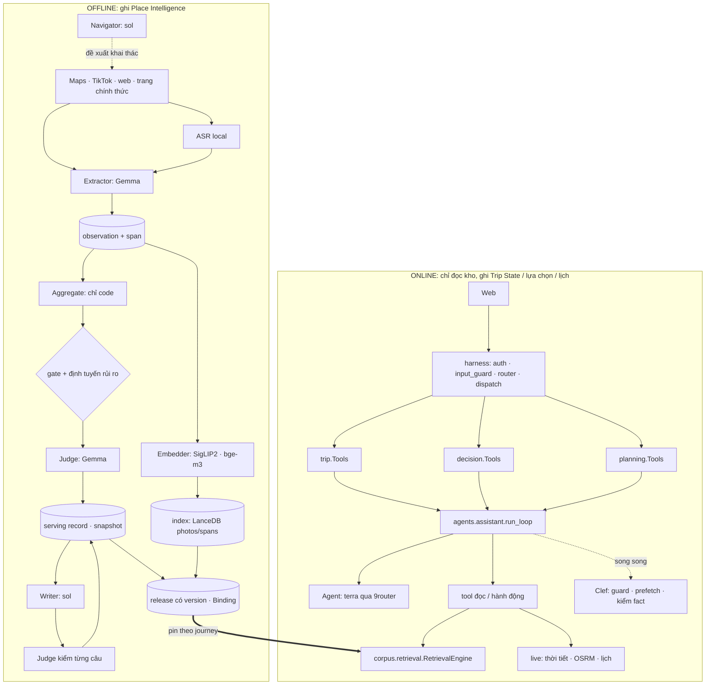
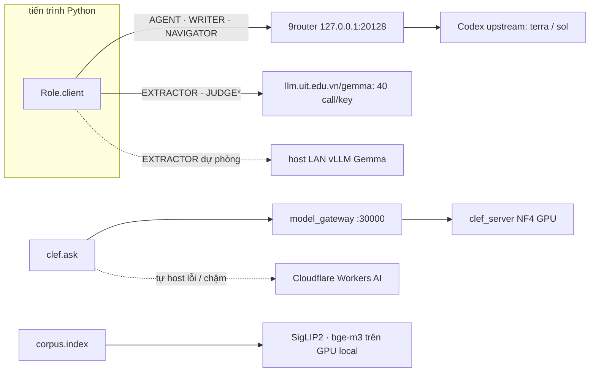
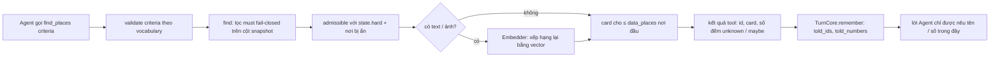
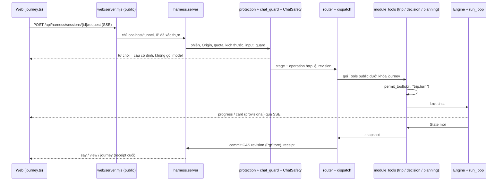
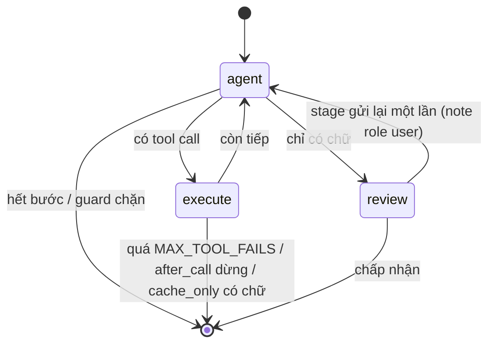
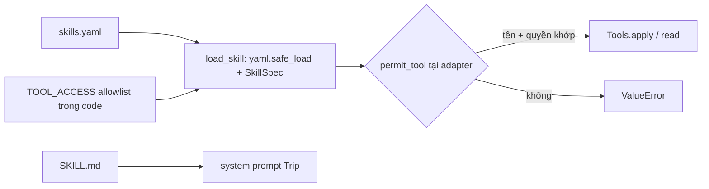
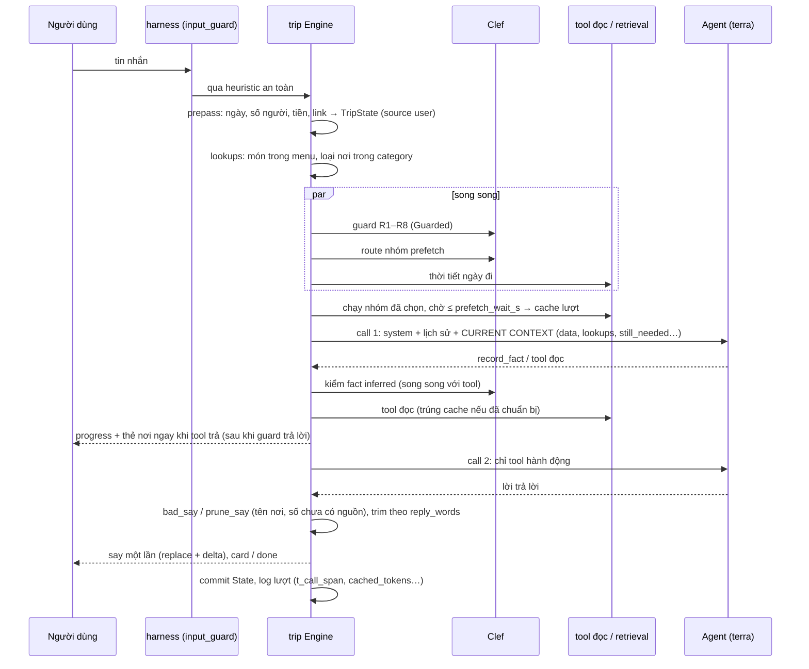

# Kiến trúc LLM

Bản đồ xuyên suốt mọi chỗ hệ thống dùng model: lớp vai trò / task, RAG (ghi offline, đọc online), harness, runtime agent, vòng tool, tool, skill, guard và fallback. Trang này nói **các mảnh nối nhau thế nào**; con số đo, prompt chi tiết và hành vi từng tool nằm ở tài liệu gốc được trỏ tới trong từng mục.

| Cần biết | Đọc |
|---|---|
| Model nào giữ vai nào, endpoint, key, số đo tốc độ | `docs/LLM_PROVIDER.md` |
| Định nghĩa vai trò model | `docs/CORPUS.md` §Vai trò model |
| Router, journey, revision, SSE, cổng an toàn | `docs/AGENT_HARNESS.md` |
| Vòng chat Trip, prefetch, Clef, ảnh / link | `docs/TRIP_UNDERSTANDING.md` §4, §19, §20 |
| Trợ lý Lựa chọn | `docs/PLACE_DECISION.md` §19 |
| Trợ lý Lịch trình, agent đề xuất nội bộ, Local Expert | `docs/PLANNING.md` |

## 1. Nguyên tắc

| Nguyên tắc | Hệ quả trong code |
|---|---|
| Gọi model theo **vai trò**, không theo tên model | Code chỉ thấy `Role` (`corpus.llm.roles`); model cụ thể ở `.env` |
| **Model trích xuất / đề xuất; code quyết định** | Fact, signal, estimate chỉ do rule tổng hợp ghi; Trip State chỉ đổi qua `guard`; lịch chỉ đổi qua `Engine.act` + validator |
| **Grounding bắt buộc** | Mọi fact cụ thể đến từ văn bản / bản ghi đưa vào prompt hoặc kết quả tool; không dựa kiến thức sẵn của model |
| Không bằng chứng → `unknown`, không phải `false` | Retrieval fail-closed với hard constraint; model không được lấp chỗ trống |
| Vector chỉ xếp hạng, không là bằng chứng | Lọc cứng chỉ qua feature có observation + span |
| Mọi thứ người dùng, trang web, ảnh, tool trả về là **dữ liệu không tin cậy** | `CHAT_POLICY` nói rõ; chữ trong ảnh gắn nhãn `untrusted data`; không có tool thực thi code / shell |
| Model online luôn có ngân sách thời gian | Hết giờ hoặc lỗi → fallback tất định (`policy.py`, baseline, câu cố định) |
| Kiểm chứng phụ trợ thì **fail-open**, ràng buộc dữ liệu thì **fail-closed** | Clef chậm / lỗi = không quyết gì; nơi thiếu bằng chứng cho hard constraint = không vào danh sách |

## 2. Bức tranh tổng thể



Hai nửa chỉ nối nhau qua **release**: offline build ra release bất biến, mỗi journey online pin một `Binding` (release, region, manifest hash, version snapshot / index) và đọc đúng bản đó suốt hành trình (`docs/AGENT_HARNESS.md` §3).

## 3. Lớp model: `Role` và `Task` (`src/corpus/llm/`)

Mọi prompt và tham số model nằm ở một chỗ. Package khác chỉ import `corpus.llm` qua public API.

### 3.1 `Role` (`roles.py`)

Một `Role` là bộ tên biến `.env`: key, base URL, model, số call đồng thời, mức reasoning, và vai trò dự phòng.

| Trường | Ý nghĩa |
|---|---|
| `key_env`, `base_url_env`, `model_env` | Tên biến `.env`; `client()` dựng `AsyncOpenAI` từ đó |
| `guided` | `True`: server nhận `response_format` `json_schema` strict (vLLM / Gemma). `False`: schema được chèn vào prompt (9router không ép schema) |
| `parallel_env`, `default_parallel` | Số call đồng thời mặc định của mọi task thuộc vai trò |
| `reasoning_env` | Có giá trị thì gửi `reasoning_effort` và `prompt_cache_key = tripguardian-<task>` (`cache_key()`) |
| `fallback` | Biến nào của vai trò này trống thì đọc biến tương ứng của vai trò khác (Navigator, Writer → Agent) |

Công tắc theo tiến trình (không đặt trong `.env`): `EXTRACTOR_ON_UIT`, `EXTRACTOR_ALSO_UIT`, `EXTRACTOR_ON_SELFHOST`, `EXTRACTOR_ALSO_SELFHOST` chuyển hoặc chia call Extractor sang endpoint khác (`docs/LLM_PROVIDER.md` §UIT API).

| Vai trò | Hằng số | Online / offline | Model đang giữ (nguồn sự thật: `docs/LLM_PROVIDER.md`) |
|---|---|---|---|
| ASR | `asr.py` (không phải `Role`) | offline | ChunkFormer, ASR2 PhoWhisper, GPU local |
| Extractor | `EXTRACTOR` | offline + vài việc online (đọc ảnh user, Local Expert) | Gemma 4 26B (UIT; host LAN dự phòng) |
| Embedder | `corpus.index` (không phải `Role`) | offline + online | SigLIP2 so400m (ảnh + chữ ngắn), bge-m3 (span), GPU local |
| Judge / Judge first / Judge mạnh | `JUDGE`, `JUDGE_FIRST`, `JUDGE_STRONG` | offline | Gemma 4 trên UIT |
| Agent | `AGENT` | online | `cx/gpt-6.1-terra` qua 9router, reasoning `low` |
| Writer | `WRITER` | offline | sol qua 9router (fallback Agent), `guided=False` |
| Navigator | `NAVIGATOR` | offline | cùng đường Agent trừ khi `NAVIGATOR_*` đặt khác |
| User sim | `USER_SIM` | chỉ bench | đóng vai khách từ chuyến ẩn |
| Clef | `trip/infrastructure/clef.py` (không phải `Role`) | online | `clef-flash` tự host sau gateway `:30000`, dự phòng Cloudflare Workers AI |

### 3.2 `Task` (`tasks.py`)

`Task(name, role, prompt, schema, max_tokens, temperature, parallel, extra_body)` là **một loại call**: template prompt (`str.format`), JSON schema của câu trả lời, tham số sinh. `prompt_hash` được lưu cùng kết quả, nên đổi prompt thì lần build sau chạy lại đúng task đó (ledger: input hash × processor × prompt hash, "không trả tiền hai lần").

Hai cách gọi:

| Hàm | Dùng cho | Hành vi |
|---|---|---|
| `Task.ask(client, model, images=..., **fields)` | Việc batch offline, việc nền | Stream; tối đa 4 lần thử (`ATTEMPTS`) khi JSON hỏng, sai schema, 429, lỗi mạng, body lạ (chờ 2 s, gấp đôi); phát hiện vòng khoảng trắng (`Runaway`, 300 ký tự) và chỉ hỏi lại một lần; ảnh gửi dạng `data:image/jpeg;base64`; `model` có thể là pool `a,b,c`: model báo hết quota được cho nghỉ (`_REST`) và model kế trả lời |
| `Task.stream(client, model, messages=...)` | Lượt online có cấu trúc | Trả từng delta, **không retry** (lượt online fallback thay vì chờ) |

`parse_answer` lấy object JSON ngoài cùng cuối cùng trong câu trả lời (model viết suy nghĩ hoặc code fence trước JSON); `validate` kiểm tập con JSON schema (type, enum, properties, required, items).

### 3.3 Danh mục task

| Nhóm | Task | Vai trò |
|---|---|---|
| Discover / lọc | `PLACE_FILTER`, `VIDEO_FILTER`, `PLACE_VIDEO_FILTER`, `PLACE_QC` | Extractor |
| Extract / resolve | `ASR_CHECK`, `PLACE_VIDEO_VERIFY`, `PLACE_POI_MATCH`, `SAME_PLACE(_STRONG)` | Extractor / Judge |
| Observe | `REVIEW_OBSERVE`, `VIDEO_OBSERVE`, `PHOTO_OBSERVE`, `OFFICIAL_OBSERVE`, `SEARCH_OBSERVE`, `VISIT_OBSERVE`, `MENU_READ(_AGAIN)`, `STYLE_OBSERVE`, `SCENE_OBSERVE` | Extractor |
| Kiểm span | `REVIEW_VERIFY`, `VIDEO_VERIFY`, `PHOTO_VERIFY`, `VISIT_VERIFY`, `DISH_REVIEW_CHECK`, `REVIEW_QC` | Extractor |
| Audit / phân xử | `OBS_AUDIT(_FIRST/_STRONG/_GEMMA)`, `PLACE_STATUS(_STRONG)` | Judge (hoặc Extractor khi `JUDGE_ENGINE=gemma`) |
| Tag offline | `TAG_MEMBERSHIP` (`corpus/tags/prompt.py`), `COVER_PROMPT` (`corpus/tags/cover_judge.py`) | Judge + Judge thứ hai (sol) |
| Tri thức bản địa | `LOCAL_CLAIM`, `LOCAL_VERIFY`, `LOCAL_VERIFY_CLAIM` | Extractor / Judge |
| Sự kiện, mùa | `EVENT_EXTRACT`, `SEASON_GROUP` | Judge |
| Giới thiệu, bài viết | `INTRO_WRITE`, `INTRO_POSTS` → `INTRO_CHECK` | Writer → Judge |
| Dẫn đường | `NAVIGATOR_PLAN` | Navigator |
| Ảnh cho web | `PHOTO_RANK` | Extractor |
| Online, đọc ảnh user | `PHOTO_CUES`, `PHOTO_READ` | Extractor |
| Online, lượt có cấu trúc (đường cũ) | `DECISION_TURN`, `PLANNING_TURN` | Agent |
| Online, nội bộ | `planning_proposal` (`planning/proposal.py`), `planning_summary` (`planning/summary.py`), `local_expert` (`planning/expert.py`) | Agent / Extractor |
| Hồ sơ, analytics | `PROFILE_AUDIT`, `INSIGHT_CLUSTER` | Judge / Extractor |
| Bench | `USER_SIM_BRIEF`, `USER_SIM_REPLY` | User sim |

### 3.4 Topo endpoint



Key UIT dùng chung 40 call cho Extractor và Judge; Agent cần function calling nên chỉ chạy qua 9router (vLLM của UIT trả 400 cho tool call).

## 4. RAG: kho tri thức và cách model đọc nó

Hệ thống không nhồi đoạn văn bản tìm được vào prompt theo kiểu RAG cổ điển. Nó là **RAG có cấu trúc, qua tool**: offline biến nguồn thành bản ghi có bằng chứng; online, Agent gọi tool đọc trả bản ghi gọn đã lọc theo ràng buộc của chuyến, và mọi tên nơi / con số trong lời trả lời phải có trong kết quả tool đó.

### 4.1 Các lớp tri thức (offline ghi)

| Lớp | Là gì | Model tham gia | Tài liệu |
|---|---|---|---|
| Serving record | Mỗi nơi: feature `fid=value` có status (`VERIFIED`/`OUTDATED`/`UNCERTAIN`), giờ, vé, giá, `details`, món, giờ đông | Extractor trích observation + span; **code** tổng hợp; Judge audit | `docs/CORPUS.md` §Bản ghi địa điểm |
| Snapshot | Bảng cột biên dịch từ serving, bất biến theo version | không | `docs/CORPUS.md` §Place Decision dùng corpus |
| Chỉ mục ngữ nghĩa | B: tag phong cách (`styles.yaml`); C: vector ảnh SigLIP2, vector span bge-m3 (LanceDB `photos`, `spans`) | Extractor (`STYLE_OBSERVE`), Embedder | `docs/CORPUS.md` §Chỉ mục ngữ nghĩa |
| `LocalClaim` | Tri thức bản địa từ bài web và kiến thức chung của sol, nhãn `fact` / `reference` / `disputed` | Extractor, Judge, Navigator | `docs/CORPUS.md` §Tri thức bản địa |
| `details.intro` | Tóm tắt + thuyết minh, mỗi câu có id bằng chứng, qua gate code + Judge | Writer, Judge | `docs/CORPUS.md` §Giới thiệu địa điểm |
| Nhịp Đà Lạt, sự kiện, view | Bản tin xu hướng, sự kiện sắp tới, khí hậu / lễ / vùng hạn chế | Judge (sự kiện, mùa); còn lại code | `docs/CORPUS.md` §Nhịp, §Sự kiện, §View |

### 4.2 Đọc online: `corpus.retrieval.RetrievalEngine`

Mở bằng `RetrievalEngine.open(release_id, region, binding=...)` hoặc `from_snapshot(...)`; factory kiểm manifest / hash, từ chối reader lệch binding. Ba module của một journey dùng chung một engine.

| API | Làm gì | Model |
|---|---|---|
| `card(id)` | Bản ghi gọn ≤ 2000 ký tự cho Agent (`n`, `cat`, `h`, `fee`, `f`, `f?`, `about`, `dishes`…); khóa thiếu bị bỏ, không điền mặc định | không |
| `find(criteria, limit)` | `groups`, `must`, `prefer`, `open_at`, `dish`, `month`, `near`, `text`. `must` fail-closed: `VERIFIED`/`OUTDATED` → `hits`, chỉ `UNCERTAIN` → `maybe`, không bằng chứng → đếm `unknown`, không trả | không (trừ `text`: Embedder) |
| `vocabulary()` | Nhóm, feature, value, nhãn: để Agent chỉ dùng từ có thật | không |
| `search_names`, `semantic`, `similar` | Tìm tên (token bỏ dấu), tìm ngữ nghĩa ảnh + span, nơi giống; bắt buộc `within` | Embedder cho `semantic` / `similar` |
| `evidence(place_id, feature, context)` | Claim backing đúng value đang phục vụ, kèm quote / nguồn | không |
| `local_claims(subject, kind, month)` | `LocalClaim` của snapshot, không bao giờ trả `contradicted` | không |



### 4.3 Grounding trong pipeline sinh chữ offline

Cùng mẫu "bằng chứng đánh số → model viết kèm id → code kiểm → model khác họ kiểm" lặp lại:

- **Giới thiệu / bài viết**: `evidence.py` dựng ≤ ~40 mục `e1…`; Writer viết mỗi câu kèm id; `gate.py` bỏ câu không id, có giá, số không có trong bằng chứng, năm một nguồn, từ quá lời; `INTRO_CHECK` (Gemma) chỉ cho câu `supported` qua (fail closed).
- **Local Expert** (`planning/expert.py`): fact chỉ do code đưa vào (sự kiện, lễ, mùa, `LocalClaim` kept, thời tiết); finding chỉ giữ khi `slot_ref` có thật và mọi `cites` là id fact trong prompt; gợi ý sửa phải qua `Engine.eve_trial` (cùng validator).
- **Navigator**: cố ý "mù" (chỉ tên thành phố + `area`); output là đề xuất `approval: pending`, không có đường code nào ghi ontology hay kho.

## 5. Harness: đường đi của một request



- Router **không gọi LLM** và không chọn agent từ lời model; stage quyết module.
- ID phiên do harness lấy từ journey đã xác thực, model không bao giờ cung cấp.
- Retry cùng `request_id` trả receipt, **không gọi lại model**; restart khôi phục từ snapshot, không replay LLM.
- Chi tiết revision, khóa, đọc song song, API: `docs/AGENT_HARNESS.md` §2–§4.

## 6. Runtime agent: hai kiểu gọi

### 6.1 `agents.run_structured` — một call có cấu trúc

Dùng cho call không có tool: `planning/proposal.py` (đề xuất nội bộ), và đường cũ `decision/agent.py` (`DECISION_TURN`) / `planning/agent.py` (`PLANNING_TURN`) khi cờ trợ lý tắt.

- Một call stream; `SayStream` rút chuỗi `"say"` ra khỏi JSON đang stream để hiện chữ sớm.
- Deadline `first_token_s` (token đầu) và `total_s` (cả call), đặt trong `config/{trip,decision,planning}.yaml`.
- Vòng khoảng trắng 32 ký tự → thử lại **một** lần, lần hai không stream `say` nữa.
- Output validate bằng Pydantic; sai → `AgentError` → module dùng fallback.
- Mọi call đi qua `ProcessLimiter` (`config/agents.yaml`: `max_parallel: 2`, `max_waiting: 16`); queue đầy hoặc hết deadline khi chờ → `AgentError`. Quota này chỉ trong một tiến trình.

### 6.2 `agents.assistant` — vòng tool dùng chung

Lõi chat của cả ba màn (Trip, Lựa chọn, Lịch trình). Module chỉ cắm tool hành động và khối `CURRENT CONTEXT` của mình.

| File | Trách nhiệm |
|---|---|
| `registry.py` | `REGISTRY`, decorator `read_tool`, `action_tool`, `context_block` |
| `turn.py` | `TurnCore`: cache theo lượt, ánh xạ tên nơi → id, thẻ trước, `told_ids` / `told_numbers`, timing |
| `lc.py` | Biến tool đã đăng ký thành LangChain tool, schema = model Pydantic đầu vào |
| `loop.py` | `langchain_chat` (một call stream) và `run_loop` (đồ thị LangGraph) |
| `context.py` | Cửa sổ lịch sử, message `CURRENT CONTEXT`, `last_shown` |
| `guard.py` | Guard rule Clef R1–R8 chạy luồng riêng |

**Một call model** (`langchain_chat`): `ChatOpenAI` trỏ vào `AGENT.client()`, `temperature 0.2`, `max_retries=0`, `stream_usage=True`, kèm `reasoning_effort`, `prompt_cache_key` theo stage (`trip_turn`, `decision_turn`…) và `service_tier` nếu cấu hình. Mỗi call một `httpx.AsyncClient` riêng (mỗi lượt chạy trong event loop mới). Khối suy nghĩ `<|channel>…<channel|>` bị lọc khi stream (`Visible`). Tham số tool đọc thô từ `tool_call_chunks` để JSON hỏng không bị LangChain biến thành `{}`.

**Đồ thị vòng** (`run_loop`):



| Luật | Giá trị / cơ chế |
|---|---|
| Số call tối đa | `max_steps` của stage (Trip `tool_steps: 6`; Decision, Planning `assistant.max_steps: 4`). Trip ở chế độ trợ lý: `ASSISTANT_CALLS = 2` |
| Call cuối của Trip | Chỉ đưa tool hành động (gồm `record_fact`); tool đọc model tự trả về cũng bị loại → đọc trước không làm mất fact ghi sau |
| Thực thi tool | Tuần tự theo thứ tự model trả, qua `ToolNode`; tham số không phải JSON object → lỗi cho đúng call đó; sai schema → model đọc lỗi validate, log `schema_refused` |
| Lỗi tool | Tool crash trả `{"error": ...}` cho model, không giết lượt; `MAX_TOOL_FAILS = 4` thì dừng |
| `cache_only` | Mọi call của một vòng đều trúng cache (dữ liệu đã có trong context): có chữ thì dừng, không thì call kế không còn tool đọc |
| Cơ hội thứ hai | `review` của stage có thể gửi lại lời một lần (`REPLY_NOTE`, `RETRY_NOTE`, `UNMAPPED_TEXT_NOTE`); `persisted` bỏ lời bị gửi lại và note khỏi lịch sử lưu |
| Checkpoint | `MemorySaver` theo node; engine luôn chạy mới, không resume |

### 6.3 Dựng ngữ cảnh và prompt cache

Thứ tự message mỗi call, để tiền tố không đổi giữa các lượt và người dùng:

```text
1. system   tĩnh: CHAT_POLICY + prompt của stage + SKILL.md (Trip) + FEATURES của ontology + danh sách tool
2. lịch sử  window(): tối đa 24 lượt user nguyên văn; vượt thì bỏ 12 lượt cũ nhất một lần
3. user     "CURRENT CONTEXT\n" + JSON các context_block của stage (state, today, reply, last_shown, slots…)
4. user     câu mới
```

- System prompt không chứa ngày, ngôn ngữ, độ dài: những thứ đó nằm trong `CURRENT CONTEXT` (Trip: `reply`, `today`).
- Danh sách tool giữ nguyên trên một màn; tool không hợp trạng thái **từ chối khi được gọi** thay vì biến mất (đổi danh sách = mất cache).
- `CURRENT CONTEXT` là message `user` vì 9router bỏ message `system` thứ hai; nó là nguồn sự thật khi transcript mâu thuẫn.
- Điều đã nói trong lượt bị cắt khỏi cửa sổ vẫn còn trong `TripState` mà context mang theo.
- Mỗi call ghi `cached_tokens a/b` vào log lượt khi endpoint gửi usage.

## 7. Tool

### 7.1 Cơ chế đăng ký

```python
@read_tool(FindPlaces, group="places", place_args=("near_place",))
def find_places(turn, inp: FindPlaces) -> dict: ...

@action_tool("decision", SelectPlace)
def select(turn, inp: SelectPlace) -> dict: ...

@context_block("decision", "view")
def view(turn) -> dict: ...
```

- Một tool = một model Pydantic (`tool_name` ClassVar, **docstring là lời model đọc**, field là schema) + một hàm.
- `read`: dùng chung mọi stage, cache theo lượt (khóa = tên + tham số; Trip thêm fingerprint TripState), không đổi state. `action`: thuộc một stage, không cache, có thể đổi state.
- `requires` (`assistant`, `cards`, `web`): tool chỉ được đưa khi lượt có cờ đó. `offered=False`: code chạy được nhưng không liệt kê cho model.
- `place_args`: tên nơi model viết được đổi sang id qua catalog; không khớp hoặc khớp nhiều nơi → lỗi "không có dữ liệu, đừng đoán".
- `cards`: id nơi trong kết quả được gửi thành thẻ **ngay khi call trả về** (`TurnCore.model_called` → `emit_cards`), sau khi guard Clef đã trả lời.
- Khóa kết quả bắt đầu bằng `_` (như `_cards`) chỉ dành cho code; `public()` bỏ chúng trước khi model đọc.

### 7.2 Danh mục tool

**Tool đọc dùng chung** (đăng ký ở `src/trip/agent/`, logic ở `trip/infrastructure/{knowledge,reads,perceive,browse}.py`; mọi danh sách qua `admissible` fail-closed):

| Nhóm | Tool |
|---|---|
| Nơi | `find_places`, `get_place`, `similar_places`, `more_like_shown`, `browse_tags`, `find_dishes`, `find_stays`, `find_services` |
| Chi tiết | `place_evidence`, `place_status`, `compare_places`, `place_photos` |
| Đi lại | `distance`, `route_time`, `journey` |
| Thời gian, xu hướng | `weather`, `climate`, `calendar`, `trends` |
| Chi phí, mẹo | `estimate_cost`, `local_tips`, `area_notice` |
| Ảnh / link user gửi | `photo_identify`, `photo_similar`, `link_resolve` |

**Tool của Trip** (`trip/agent/tool_schemas.py`, `knowledge_tools.py`):

| Loại | Tool |
|---|---|
| Ghi | `record_fact` (mọi fact của tin nhắn trong một call; kèm `say`, `ask_required`), `save_place`, `hide_place` |
| Hỏi (kết thúc lượt) | `ask` (thẻ `look` / `this_or_that`), `ask_user`, `ask_required` |
| Ngày | `resolve_relative_date`, `add_days`, `weekday_date`, `date_of` |
| Tra ontology / catalog | `search_places`, `search_features`, `find_kinds`, `suggest_directions` |
| Web | `web_search`, `web_read` (SearXNG tự host; chỉ đọc URL vừa tìm; không bao giờ là nguồn địa điểm) |
| Hiển thị | `show_places` (chỉ id đã thấy), `quick_replies`, `word_cards` (chữ của thẻ ảnh do trợ lý viết) |

**Tool của Lựa chọn** (`decision/assistant.py`): `select`, `drop`, `lock`, `visited`, `like`, `more_like`, `rerank`, `filter`, `unfilter`, `why_not`, `compare`, `group`, `trip` (đẩy mong muốn sang Trip), `swap_suggest`, `undo`. Tool đổi State cần `quote` nằm trong câu người dùng. Tool đọc dùng chung chạy trên `TurnTools` thật của Trip qua `Engine.trip_reader = trip.Tools.read_turn` (harness gắn); không có phiên Trip thì không có tool đọc.

**Tool của Lịch trình** (`planning/assistant.py`): đọc `plan`, `stop`, `why_here`, `diagnostics`, `options`, `spare_places`, `preview_edit`, `local_facts`, `lodging_options`; sửa `move_place`, `reorder_day`, `swap_place`, `add_place`, `remove_place`, `lock_place`, `unlock_place`, `set_pace`, `set_day_window`, `set_stop_time`, `set_visit_minutes`, `extend_days`, `pick_option`, `pick_lodging`, `set_lodging_budget`, `set_priority`, `undo`. Mọi sửa đi qua `Engine.act` như nút bấm; một lượt = một phiên bản; vi phạm chỉ cảnh báo (`serious` / `flagged`), không chặn.

**Context block**: Decision `today`, `trip`, `choices`, `places`, `data`, `corpus_evidence`; Planning `today`, `trip`, `plan`, `choices`, `corpus_evidence`; Trip dựng `CURRENT CONTEXT` trong `trip/agent/prompt.py` `build_messages`.

### 7.3 Tool không phải lối tắt ghi dữ liệu

Kết quả tool là dữ liệu; đường ghi duy nhất vẫn là code nghiệp vụ:

- Trip: `record_fact` → `domain/guard.record_fact`: `quote` phải nguyên văn lời user, `values.parse` hợp lệ, hard `=` cho feature nhóm `experience` bị từ chối, fact suy luận có thể bị Clef bác.
- Decision: `Engine._apply(strict=True)` cùng luật `curation.apply`; `Engine.effect` mô phỏng trên bản sao để trả "nơi vào / ra top" cho model.
- Planning: `Engine.act` + validator; physical constraint không có act nào nới.

## 8. Skill

Trong runtime có hai thứ gọi là skill, khác bản chất:

| Loại | Ở đâu | Bản chất | Ai đọc |
|---|---|---|---|
| **Khai báo năng lực** | `src/{trip,decision,planning}/skills.yaml` | YAML: `name`, `workflow` (tên bước), `tools` (`trip.turn: write`…). Nạp bằng `agents.load_skill` → `SkillSpec` (Pydantic, `extra='forbid'`), kiểm với allowlist cứng `agents.contracts.TOOL_ACCESS` | Code: adapter `Tools` gọi `permit_tool(skill, "trip.turn")` trước khi chạy |
| **Hướng dẫn cho model** | `src/trip/runtime_skills/interpret-trip-requirements/SKILL.md` | Văn bản: cách diễn giải meaning, strength, subject, scope, evidence, ambiguity; bảng ví dụ lời user → biểu diễn | Model: `trip/agent/prompt.py` nạp vào system prompt Trip |



Skill là khai báo do repo quản lý, **không bao giờ là code thực thi** hay thứ tải từ người dùng. Thêm tool cấp module (ví dụ `planning.set_stop_time`) phải khai cả `skills.yaml` lẫn `TOOL_ACCESS`. Tool LLM (§7) là tầng bên trong, đăng ký qua `REGISTRY`, không qua `skills.yaml`.

## 9. Clef: bộ phân loại quanh Agent

Clef-flash là model quyết định (không sinh chữ): một forward trả xác suất cho từng câu hỏi có kiểu (`choice` / `score` / `noul`). Client: `trip/infrastructure/clef.ask` (tự host trước, lỗi thì Cloudflare, tự host bị bỏ qua `SELF_PAUSE_S` = 30 s). Clef **không đứng trước Agent**; mọi việc của nó chạy song song và fail-open.

| Việc | Ở đâu | Khi chắc thì |
|---|---|---|
| Guard rule R1–R8 | `agents/assistant/guard.py` (`Guarded`, luồng riêng từ đầu lượt) | R1–R6: dừng vòng, không gửi thẻ, câu từ chối cố định, lượt không ghi gì; R7 / R8: câu cố định (R8 kèm 113, 115). Ngưỡng `assistant.guard_threshold` |
| Chọn nhóm prefetch | `trip/agent/prefetch.route` | Chuẩn bị nhóm `places` / `detail` / `weather` / `distance` khi P(có) ≥ `clef_threshold` |
| Kiểm fact suy luận | `Judge.unsupported` qua `TurnTools.prefetch` | Bác fact soft / hard `inferred` mà câu trích không nói (`clef_verify_min`) |
| Xếp feature | `Judge.features` | `search_features` không ra gì: xếp 20 feature gần nhất theo bge-m3, có lối `none` |

Lưu ý tên: lớp `Judge` trong `trip/infrastructure/clef.py` là **Clef**, không phải vai trò `JUDGE` (Gemma, offline).

## 10. Một lượt Trip từ đầu đến cuối



Khi có ảnh hoặc link: ảnh được mã hóa lại, bỏ EXIF, Extractor `PHOTO_READ` đọc kind / cues / chữ / tên, Embedder khớp pixel; ảnh và vector bỏ ngay, chỉ giữ bản ghi trong bộ nhớ; lượt đó không prefetch và không giấu tool (`docs/TRIP_UNDERSTANDING.md` §20).

Lựa chọn và Lịch trình đi cùng lõi nhưng khác ở đầu vào: Decision chạy heuristic tất định trước (`exact_command`, `common_wish`, `general_wish`) và chỉ câu còn lại mới vào `run_loop`; Planning luôn vào `run_loop` khi `assistant.enabled`. Cả hai gửi lời một lần dạng `replace`, kiểm số / tên nơi, sai thì gửi lại một lần rồi dùng câu cố định.

## 11. Các lớp bảo vệ

| Lớp | Đặt ở | Chặn gì | Gọi model? |
|---|---|---|---|
| Xác thực, Origin, quota, kích thước body | `harness/protection.py`, `server.py`, `config/security.yaml` | Lạm dụng HTTP | không |
| `input_guard.screen_input` | `agents/input_guard.py` qua `ChatSafety` | Ghi đè hướng dẫn, bí mật, shell / SQL / script, Base64, bài tập lập trình rõ ràng | không |
| `CHAT_POLICY` | đầu mọi system prompt online | Phạm vi; dữ liệu không tin cậy không phải lệnh | (trong call Agent) |
| Guard Clef R1–R8 | `agents/assistant/guard.py` | Nội dung cấm, jailbreak, thông tin riêng, thù ghét; R8 xử lý khủng hoảng | Clef, fail-open |
| Schema tool | `lc.py` (args_schema Pydantic) | Khóa lạ, kiểu sai, enum sai | không |
| `permit_tool` | adapter `Tools` | Gọi năng lực ngoài skill | không |
| Guard nghiệp vụ | `trip/domain/guard.py`, `decision` `_apply(strict)`, `planning` validator | Fact không có quote, act sai luật, lịch vi phạm vật lý | không |
| Grounding lời trả lời | `guard.bad_say`, `prune_say`, `TurnCore.told_*` | Tên nơi / số không có trong lời user, state hay kết quả tool | không |
| Retrieval fail-closed | `find`, `coverage.admissible` | Nơi trượt hoặc thiếu bằng chứng cho hard constraint | không |
| Fallback | `policy.py`, baseline, `FALLBACK_SAY` | Model lỗi / chậm / sai schema | không |

Heuristic và prompt phạm vi giảm rủi ro chứ không chứng minh chặn mọi prompt injection; ranh giới chính là schema, quyền tool, xác thực phiên và không thực thi dữ liệu (`docs/AGENT_HARNESS.md` §5).

## 12. Ngân sách, fallback và chi phí

| Chỗ | Ngân sách | Hết / lỗi thì |
|---|---|---|
| Call Agent online | `first_token_s`, `total_s` theo module; limiter 2 chạy / 16 chờ mỗi tiến trình | Trip: giữ fact đã ghi + prepass, câu bận; Decision: `policy.py` (lỗi sau khi act đã chạy thì giữ act); Planning nội bộ: baseline |
| Prefetch | `prefetch_wait_s` | Chỉ dùng kết quả đã xong; Agent vẫn có tool đọc |
| Guard Clef | chờ tối đa 2,5 s từ đầu lượt, chỉ khi sắp gửi thẻ / lời | Coi là `ok` |
| Clef từng call | `CLEF_TIMEOUT_S` | Không quyết gì |
| Local Expert | `timeout_s` mỗi đường (LAN rồi UIT), chạy nền trong worker `notify` | Lịch giữ nguyên |
| Batch offline | `parallel` theo vai trò; 429 tự giảm slot (`gmaps observe`); ngân sách call Judge / Google mỗi build | Build dừng gọn, chạy tiếp lần sau; entity rủi ro chưa audit giữ `NEEDS_REVIEW` |
| 9router hết quota | `_quota_rest` đọc "reset after …" | Model trong pool nghỉ, model kế trả lời; hết pool → `OutOfQuota` |

Tiết kiệm token và độ trễ: prefix prompt tĩnh để provider cache; prefetch thay call tra cứu; `record_fact` nhận danh sách (model trả một tool call mỗi lần); `hide_prepared_lookup`, `covered_tools` bỏ tool khi dữ liệu đã có; mục tiêu một call mỗi lượt.

## 13. Quan sát và đo

| Thứ | Ở đâu |
|---|---|
| Log từng lượt Trip | `logs/run/trip_turns.log`: `t_call_span` (ttft, dispatch, headers), `t_tool`, `t_read`, `t_guard`, `t_prefetch_clef`, `cached_tokens` |
| Trace đường xử lý | event nội bộ `trace {path}` (`agent` / `fallback` / `heuristic:*`) → Admin (`docs/ANALYTICS.md`) |
| Khoảng trống dữ liệu | `data/trip/gaps.jsonl` (`no_data`, `zero_hits`, `no_answer`, `unsourced_place`, `user_report`) |
| Bench trợ lý | `python -m bench assistant [--live] [--guard]`, `python -m decision bench`, `python -m planning bench --live` |
| Bench retrieval | `python -m bench retrieval` |
| Usage 9router | `~/.9router/db/data.sqlite`, bảng `usageHistory` |

## 14. Bản đồ code

| Đường dẫn | Vai trò |
|---|---|
| `src/corpus/llm/roles.py`, `tasks.py`, `policy.py`, `asr.py` | Vai trò, mọi task offline / online, `CHAT_POLICY`, ASR |
| `src/corpus/index/` | Embedder, vector, LanceDB, truy vấn ngữ nghĩa |
| `src/corpus/retrieval/` | `RetrievalEngine`: `card`, `find`, `vocabulary`, `evidence`, `local_claims` |
| `src/corpus/{judge,intro,navigate,local,events,tags}/` | Pipeline offline có model |
| `src/agents/runtime.py`, `limit.py` | `run_structured`, `SayStream`, limiter |
| `src/agents/contracts.py` | `SkillSpec`, `ToolSpec`, `TOOL_ACCESS`, `load_skill`, `permit_tool` |
| `src/agents/input_guard.py`, `safety.py` | Heuristic đầu vào, `ChatSafety`, `validate_public_url` |
| `src/agents/assistant/` | Lõi trợ lý: registry, turn, loop, context, guard |
| `src/trip/agent/` | Prompt, tool schema, tool Trip, prefetch, rules, tool đọc / ảnh / dịch vụ |
| `src/trip/infrastructure/clef.py` | Client Clef, lớp `Judge` (Clef) |
| `src/trip/infrastructure/{knowledge,reads,perceive,looks,browse,web}.py` | Logic tool đọc, đọc ảnh, tag, web |
| `src/trip/runtime_skills/*/SKILL.md` | Hướng dẫn nạp vào system prompt |
| `src/{trip,decision,planning}/skills.yaml` | Khai báo năng lực module |
| `src/decision/assistant.py`, `agent.py`, `heuristics.py`, `policy.py` | Trợ lý Lựa chọn, đường cũ, heuristic, fallback |
| `src/planning/assistant.py`, `proposal.py`, `expert.py`, `agent.py` | Trợ lý Lịch trình, đề xuất nội bộ, Local Expert, đường cũ |
| `src/harness/` | HTTP/SSE, router, dispatch, journey, bảo vệ |
| `scripts/model_gateway.py`, `clef_server.py`, `models_ctl.sh` | Gateway và host model tự chạy |
| `config/agents.yaml`, `security.yaml`, `trip.yaml`, `decision.yaml`, `planning.yaml`, `index.yaml`, `intro.yaml`, `tags.yaml` | Ngưỡng và cờ |

## 15. Thuật ngữ dễ nhầm

| Từ | Nghĩa ở đây |
|---|---|
| Judge | Vai trò offline (Gemma trên UIT) kiểm nhận định trước khi phục vụ. Lớp `Judge` trong `trip/infrastructure/clef.py` là Clef online, khác hẳn |
| Agent | Vai trò model online có function calling; "agent của module" là prompt + tool + guard của stage đó dùng chung vai trò này |
| Skill | Khai báo năng lực YAML (cho code) hoặc `SKILL.md` (cho model); không phải code thực thi |
| Tool | Hàm model gọi được, đăng ký qua `REGISTRY`; khác "tool" cấp module trong `skills.yaml` (`trip.turn`, `planning.propose`) |
| RAG | Retrieval có cấu trúc qua tool trên release đã pin; vector chỉ xếp hạng |
| Prefetch | Code + Clef chạy sẵn tool đọc trước call Agent; kết quả chỉ vào cache, Agent vẫn tự chọn tool |
| Fallback | Đường tất định khi model lỗi / chậm; không gọi model khác thay thế |
