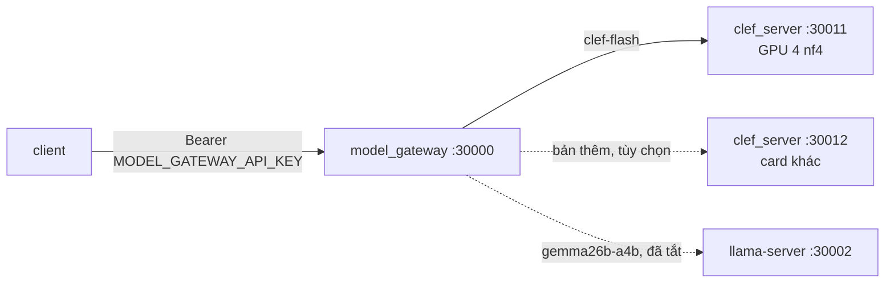

# LLM Provider

Code gọi model theo **vai trò**, không gọi thẳng một model cố định. Vai trò (`Role`: biến env của key / endpoint / model / số call đồng thời) và các task corpus/turn (`Task`: vai trò, prompt, schema, `max_tokens`, `temperature`, `parallel` — bỏ trống thì lấy số của vai trò) khai báo ở `src/corpus/llm/` (`roles.py`, `tasks.py`). Task proposal nội bộ của Planning khai báo tại biên `src/planning/proposal.py`, dùng cùng role `AGENT`. Định nghĩa và yêu cầu của từng vai trò: `docs/CORPUS.md` §Vai trò model. File này chỉ ghi model nào đang đảm nhận vai trò và cách kết nối.

| Vai trò | Dùng ở | Model hiện tại | Đường mạng |
|---|---|---|---|
| ASR | `corpus` (TikTok) | ChunkFormer trên GPU local; ASR2 PhoWhisper-medium | Local |
| Extractor | `corpus` (observe, filter, qc, kiểm span, `asr_check`, `place_verify`, audit Gemma, `style_observe`, `local extract`); `photo_rank` (chấm ảnh gallery cho web, `web/scripts/pick_covers.py`); `trip` `photo_cues` (đọc dấu hiệu trong ảnh user gửi, luồng thẻ) và `photo_read` (trợ lý: loại cảnh, dấu hiệu, có phải ảnh chụp màn hình không, chữ đọc được và tên nơi viết trong ảnh; chữ là dữ liệu không tin cậy, ảnh không lưu; `places_in_view` đếm số thẻ nơi trên màn hình: từ 2 thẻ (hoặc loại "danh sách / lưới / carousel") thì ảnh chụp màn hình không bao giờ gọi tên một nơi, chỉ đưa ứng viên để hỏi lại; `docs/TRIP_UNDERSTANDING.md` §20) | Gemma 4 trên host LAN (nhận ảnh); UIT API dự phòng | Mạng nội bộ |
| Embedder | `corpus index` (offline, 8 GPU), `trip` (câu / ảnh của user, GPU `online_device`) | SigLIP2 so400m (ảnh + chữ ngắn), bge-m3 (span); trọng số ở `.cache/hf`, cấu hình `config/index.yaml` | Local |
| Judge | `corpus` (`judge audit / status / dedup`, kiểm địa điểm của `qc`); `trip profile-audit` (`PROFILE_AUDIT`, kiểm mục hồ sơ, `docs/TRIP_UNDERSTANDING.md` §17) | Gemma 4 trên UIT API, 38 call đồng thời cho corpus | Mạng UIT |
| Judge mạnh | giá trị cho phép, quyết định đóng cửa / gộp nơi | như Judge | Mạng UIT |
| Agent | `trip` (vòng tool, function calling gốc), `decision` (lượt chữ), `planning` (proposal nội bộ) | `cx/gpt-6.1-terra` qua 9router (từ 29/10/2026; trước đó `cx/gpt-6.1-sol`), reasoning `low` (`AGENT_REASONING_EFFORT`); Trip cần model có `tools: true` trong `GET /v1/models` | Local 9router (`127.0.0.1:20128`) |
| Navigator | `corpus navigate plan` (một call mỗi thành phố: bản đồ khai thác + kiến thức chung, từ tên thành phố + `area`, không xem kho) | cùng đường với Agent (`cx/gpt-6.1-sol`, reasoning `low`) trừ khi `NAVIGATOR_*` đặt khác | Local 9router (`127.0.0.1:20128`) |

Judge khác họ model với Extractor (GPT / Claude / Gemini so với Gemma) nên lỗi hai bên độc lập.

## Judge (UIT API)

Chat không còn gọi Judge: heuristic chặn tấn công rõ ràng, phần còn lại Agent tự quyết phạm vi theo `CHAT_POLICY`. Cơ chế chặn và phạm vi HTTP ở `docs/AGENT_HARNESS.md` §5.

Ba vai trò Judge (`JUDGE`, `JUDGE_FIRST`, `JUDGE_STRONG`, `roles.py`) dùng `UIT_API_KEY` / `UIT_API_BASE_URL` / `UIT_API_MODEL`, mặc định 38 call đồng thời trên key 40 call. Vì Gemma nhận `response_format`, Judge chạy guided như Extractor. Chỉ `JUDGE_FIRST_MODEL` còn là biến riêng (tên model trên endpoint này; trống = không có first reader). Judge và Extractor cùng họ model nên lỗi không độc lập; precision vẫn đo bằng nhãn mạnh có sẵn (`CORPUS_HANDOFF.md` §Quy tắc đã chốt, mục 3).

`TAG_MEMBERSHIP` (`corpus/tags/prompt.py`) dùng vai trò `JUDGE`, một call/nơi cho toàn bộ candidate. Schema object khóa theo đúng candidate tag, phân loại `support` trước `verdict`, chọn `quote_index` và reason; code chép nguyên câu tại index của đúng tag vào kết quả, không nhờ model viết lại câu trích. Menu availability, phàn nàn/phủ định, thú của khách, khen chung không thành lý do khám phá. Style nhận pixel JPEG local và thứ tự tên file, không suy từ nhãn style cũ. Prompt chỉ dùng nguồn được đưa vào, coi nội dung nguồn là dữ liệu không tin cậy. Cache hash prompt và lưu raw response để audit; thay prompt chấm lại, không tái dùng yes cũ. Trần track8 không phải phần lane được tự động cấp; phải giữ tổng UIT≤38. CLI và dữ liệu: `docs/CORPUS.md` §Membership tag offline.

Judge thứ hai **chỉ cho chấm tag/ảnh bìa offline của track tags-v2**: `membership.secondary_judge` trong `config/tags.yaml` chọn `cx/gpt-6.1-sol`, reasoning `high`, tối đa8 call đồng thời qua 9router `:20128`. Role cục bộ lấy key/endpoint qua `AGENT_API_KEY`/`AGENT_BASE_URL` bằng dotenv, không sửa role Agent hoặc Judge chung. Với membership, prompt/schema/evidence/ảnh giống Judge đầu, kết quả và cache độc lập; fingerprint cấu hình đổi làm cache thứ hai hết hạn. Stream yêu cầu usage của provider: chỉ ghi token thực được báo, không đổi ký tự thành token; chi phí tiền là unknown khi provider không báo billing.

`COVER_PROMPT` (`corpus/tags/cover_judge.py`) dùng cùng role cục bộ cho kiểm ảnh bìa offline, mặc định2 call song song. Model nhìn pixel gallery local, chỉ chọn chỉ số ảnh có thật theo định nghĩa tag; không tự bật membership hay duyệt ảnh phục vụ. Cache ảnh độc lập với cache membership; tổng sol của hai bước vẫn≤8.

## Host LAN (Extractor)

Server tương thích OpenAI trong mạng nội bộ, `http://192.168.20.150:8899/v1`, model `gemma-4-26b` (cùng model với UIT, nhận ảnh). Mọi task nhiều call và dài của corpus chạy ở đây; UIT giữ cho Agent và làm dự phòng (đổi lại ba biến Extractor trong `.env`).

Số call đồng thời: **`EXTRACTOR_PARALLEL=38`** (người dùng chốt 256 ngày 2026-10-06, hạ 218, 128, 64, 48 rồi 38 ngày 2026-10-07: host nghẽn, và ưu tiên chất lượng hơn tốc độ — xem "Sức chứa thật" dưới). Mọi task Extractor không tự đặt `parallel` dùng số này; `gmaps observe` lấy nó làm số slot tối đa. Đo 2026-10-06 (`logs/llm_probe.py`, client `max_retries=2`, 0 lỗi ở mọi mức):

| Đồng thời | Prompt ngắn (~250 token vào, ~60 ra) | Prompt cỡ observe (~2k vào, 300 ra) |
|---|---|---|
| 128 | ~4.600 req/phút, p95 1,8 s | ~1.130 req/phút, p95 7 s |
| 192 | ~5.400 req/phút, p95 2,7 s | ~1.290 req/phút, p95 9 s |
| 256 | ~5.600 req/phút, p95 3,2 s | ~1.480 req/phút, p95 11 s |

Không có retry, 256 đồng thời rớt ~5% call vì lỗi kết nối, nên client giữ retry. Con số là cho **cả host**: hai lệnh nặng chạy cùng lúc thì chia nhau (đặt `EXTRACTOR_PARALLEL` thấp hơn cho lệnh phụ qua biến môi trường).

**Sự cố 2026-10-07 (host LAN chậm, chưa giải quyết).** Từ khoảng 07:00 giờ VN, call sinh chữ 3 token tới host timeout >90 s (UIT vẫn 0,1 s), `gmaps observe` ghi ~1 file/phút (hôm trước ~18 nơi/phút) và nhiều nơi lỗi `APITimeoutError`. `GET /v1/models` vẫn 200 trong 6 ms vì chỉ chạm web server, không chứng minh engine còn sinh được. Chẩn đoán từ `GET /metrics` của vLLM (không cần key; đo 08:54): chạy 55 request, xếp hàng 71 (lý do `deferred`, không phải `capacity`), **KV cache 97%**, **667 lần preemption**. Tức bộ nhớ KV của GPU đầy, vLLM đẩy request ra rồi tính lại, nên chỉ ~50 request chạy cùng lúc dù client gửi 128 / 218 / 256. Hạ `EXTRACTOR_PARALLEL` 256 → 218 → 128 không đổi tốc độ, nên nút cổ chai là bộ nhớ host, không phải số kết nối. Chưa biết có người khác dùng chung host hay không. Việc thử tiếp: hạ về ~48, hoặc giảm token mỗi lô observe (~2k vào, ~2,5k ra), hoặc chủ host tăng bộ nhớ KV / chỉnh `max-num-seqs`. Kiểm nhanh: `curl -s http://192.168.20.150:8899/metrics | grep -E "num_requests_(running|waiting)|kv_cache_usage|preemptions"`.

**Sức chứa thật (đo 2026-10-07 10:00–11:30, host không ai khác dùng).** Sau khi chủ host đổi cấu hình, `/metrics` báo `kv_cache_size_tokens` **52.058** (trước ~240.000). Một call `review_observe` 15 review tốn ~4,8k token vào + ~3k token ra, nên host chỉ chạy thật ~35 call; phần thừa chỉ xếp hàng (thời gian chờ tính vào timeout 240 s của client). Host bị giới hạn ở **sinh token**: ~30 token/s mỗi chuỗi, call trung vị ~96 s. Số đo (`logs/prefix_tput.py`, vòng kín 240 s, token sinh/giây của cả host):

| Cấu hình | Token sinh/s | Chạy thật / chờ | KV |
|---|---|---|---|
| template hiện tại, 24 đồng thời | 624 | 25 / 12 | 98% |
| template hiện tại, 48 | 749 | 35 / 36 | 100% |
| dòng `Place:` dời xuống ngay trước `Reviews:`, 24 | 724 | 24 / 0 | 57% |
| như trên, 48 | 942 | 48 / 11 | 100% |
| như trên, 72 | 937 | 56 / 34 | 100% |

Hai chỗ phía client lãng phí host, **chưa sửa** vì đổi output (`logs/prompt_equiv.py`, 40 lô thật, temperature 0, khớp ở mức (review, feature, value) so với template hiện tại; chạy lại chính template hiện tại chỉ khớp 82,8% vì suy luận theo batch không tất định):
- **Prefix cache không dùng được.** vLLM bật `enable_prefix_caching`, nhưng `REVIEW_OBSERVE` đặt `Place: {name}` ở dòng 3, trước 3.842 token tĩnh (hướng dẫn + ontology 2.686 token), nên các nơi khác nhau chỉ chung 46 token (prefix hit 1–5%). Dời dòng đó xuống cuối: hit ~75%, +26% token/s ở mức trần. `VIDEO_OBSERVE`, `PHOTO_OBSERVE`, `REVIEW_VERIFY`, `ASR_CHECK`, `PLACE_VIDEO_VERIFY`, `OBS_AUDIT_GEMMA` cùng kiểu (biến trước phần tĩnh).
- **JSON pretty-print.** Model trả JSON thụt lề; cùng nội dung viết gọn chỉ tốn 52% token. Cờ grammar của server (`disable_any_whitespace`, `whitespace_pattern`) không có tác dụng trên host này (vLLM 0.30.0); thêm câu "Write the JSON compact on one line: no indentation, no line breaks." vào cuối prompt thì có: 3.012 → 1.528 token/call. Ba trường ngữ cảnh (`time_of_day`, `day_type`, `weather`) bắt buộc trong mỗi observation chiếm thêm ~19 token dù chỉ 1–7% observation đặt giá trị khác `unknown`.
- Khớp với template hiện tại: JSON gọn 76,5%, dời `Place` + JSON gọn 79,0% (mốc nhiễu 82,8%), số observation −4%. Lệch hơn mốc nhiễu một chút, không nói được tốt hay xấu hơn: phải đo ở mức (nơi, feature, value) với nhãn mạnh trước khi áp.

## Host model tự chạy (gateway)

Chạy model open-weight trên GPU server (2080 Ti, 11 GB, không có bf16), một cổng OpenAI-compatible như 9router. Từ 30/10/2026 Clef (Judge, guard luật) chạy ở đây: một bản NF4 trên GPU 4. Cần thêm req/s thì thêm bản trên card khác. Gemma tự host đã bỏ ngày 29/10 vì chiếm GPU dùng chung; Extractor dùng UIT và host LAN.



| Endpoint | Việc |
|---|---|
| `POST /v1/chat/completions` | chọn model qua `model` |
| `POST /v1/clef-flash`, `/v1/clef-flash/chat/completions` | ép về Clef |
| `POST /v1/gemma26b-a4b`, `/v1/gemma26b-a4b/chat/completions` | ép về Gemma |
| `GET /v1/models` | danh sách |

Code: `scripts/model_gateway.py` (định tuyến, key `MODEL_GATEWAY_API_KEY` trong `.env`), `scripts/clef_server.py`, `scripts/gemma_server.sh`. Bật / tắt / xem trạng thái: `scripts/models_ctl.sh start|stop|status [clef|gemma|gateway|all]` (`all` = clef + gateway; bản Clef lấy từ `CLEF_REPLICAS`, mặc định `"0:30011"` (Clef chiếm GPU 0, GPU 1 dành cho harness); thêm bản: `CLEF_REPLICAS="0:30011 1:30012"` chỉ khi harness không dùng GPU 1, dạng `gpu:cổng`, rồi khởi động lại gateway). `./run.sh prod` và `logs/prod_restart_nobuild.sh` tự bật Clef + gateway trước harness khi `.env` trỏ `CLEF_BASE_URL` vào `:30000`; `prod-stop` để Clef chạy tiếp vì job offline cũng dùng. Lưu ý: `models_ctl.sh stop` dùng `pkill -f`, nên đừng gọi nó trong cùng dòng lệnh có chữ `scripts/clef_server.py`, kẻo nó giết luôn shell đang gọi. Trọng số và binary nằm trong `.cache/` (`HF_HOME=$PWD/.cache/hf`).

**Clef-flash.** Mô hình quyết định, không sinh chữ: một forward trả xác suất cho từng câu hỏi có kiểu (`noul` / `choice` / `score`). Cùng trọng số `Cloudflare/clef-flash` (Qwen3.5 ~9B lai: 24 lớp linear-attention Gated DeltaNet + 8 lớp full attention), nạp bằng `joint_schema_model.py` của model. Bản chạy từ 30/10: NF4 (bitsandbytes, ~8,8 GB lúc tải) trên GPU 4, sau gateway. Ngày 30/10 có chạy thử hai bản (GPU 4 + 6, ~9 req/s); chủ dự án bảo bỏ bản thứ hai vì không cần.

```bash
scripts/models_ctl.sh start          # = mỗi bản trong CLEF_REPLICAS:
CUDA_VISIBLE_DEVICES=4 PYTORCH_CUDA_ALLOC_CONF=expandable_segments:True HF_HOME=$PWD/.cache/hf \
  .venv/bin/python scripts/clef_server.py --host 127.0.0.1 --port 30011 --quant nf4 --gib-per-gpu 10.2 \
  --max-length 8192 --max-batch-tokens 4096
MODEL_GATEWAY_API_KEY=... .venv/bin/python scripts/model_gateway.py --port 30000 \
  --clef-url http://127.0.0.1:30011        # lặp --clef-url cho mỗi bản thêm
```

**Tăng tốc NF4 (30/10/2026).** Cách đo: `logs/clef/nf4_compare.py <mốc> <bản thử>` gửi 136 request (102 câu guard và 34 bản ghi trộn choice/score/noul) tới hai server, so xác suất, đếm số câu đổi đáp án, đo tốc độ ở 1/8/16/32 luồng. `logs/clef/nf4_profile.py` cho biết thời gian GPU đi vào đâu. Mốc so là bản cũ: NF4, double-quant, một request mỗi forward, 0,33 s/request, 3,1 req/s. Prompt guard ~540 token.

| Bước | 1 request | Thông lượng | So với mốc |
|---|---|---|---|
| Tắt double-quant, gom batch | 0,32 s | 4,2 req/s | lệch xác suất tối đa 0,015, 0 đổi đáp án |
| + GEMM cộng dồn fp16 (`allow_fp16_accumulation`) | 0,26 s | 5,2 req/s | tối đa 0,015, 0 đổi đáp án |
| Thử hai bản sau gateway (GPU 4 + 6; đã bỏ bản 2) | 0,27 s | ~9 req/s (16–32 luồng, p90 1,8 s ở 16) | như trên |

- Gate (`python -m bench assistant --guard`): 0/45 chặn nhầm, R1–R6 chặn đúng 95,3 % ở cả timeout 4 s lẫn 2 s. Bản cũ trượt ở 2 s; Cloudflare chỉ 90,7 %. `tests/trip/test_clef_live.py -m live` pass. Kết quả nằm ở `data/bench/assistant/guard-nf4-fast-t{4,2}.json` và `guard-nf4-2replicas-t4.json`.
- Vì sao chỉ ~1,6×: GPU đã chạy hết sức. Ở batch 8, GEMM chiếm ~58 % thời gian, phần elementwise/trsm của Gated DeltaNet (đường torch) ~20 %, giải nén nf4 13 % ở batch 1 nhưng chỉ 2 % ở batch 8. Gom batch chủ yếu ăn vào phần giải nén. Muốn thêm req/s thì thêm bản trên card khác.
- **Đã thử và bỏ:**
  - `flash-linear-attention` (kernel Triton cho DeltaNet): trên Turing chậm hơn đường torch (0,28 s so với 0,24 s; `chunk_fwd_kernel_o` chiếm 30 %). Mỗi độ dài chuỗi mới lại biên dịch, có request mất tới 27 s.
  - Prefix cache: prompt xếp `system → STATE → câu hỏi`, nên phần cố định nằm sau phần thay đổi và không có tiền tố chung để cache.
- Server gom mọi request đang chờ vào một forward. Giới hạn là số dòng × dòng dài nhất ≤ `--max-batch-tokens`. Bản ghi có ảnh chạy riêng. Gặp OOM thì thử lại từng request; bộ nhớ chỉ được trả sau khi thoát khối `except`, vì traceback còn giữ activation. Lúc khởi động, server warm-up ngay trên luồng forward, vì những forward đầu tốn ~3 s nạp kernel CUDA. Test: `tests/test_clef_server.py`, `tests/test_model_gateway.py`.
- Bản fp16 cũ chia hai card (`CUDA_VISIBLE_DEVICES=1,2`, `--port 30001`, không `--quant`): cờ `--fp32-accumulate` trả về cách cộng dồn cũ.

- `--gib-per-gpu` dưới ~10 làm `accelerate` đẩy `lm_head` ra disk → lỗi `Cannot copy out of meta tensor`; log có dòng "offloaded to the disk" là sai.
- fp16 vì Turing không có bf16 gốc. Clef 27B cần ~55 GB (6 GPU), chưa host.
- Qua chat-completions, Clef cần `questions` (top-level hoặc JSON `{state, questions}` trong tin user); đáp án nằm trong `message.content` (JSON) và trường `systemone`. Ảnh chỉ nhận `data:` URI; không có video.
- Workers AI bắt `instructions` cho câu `score`; model card ghi tùy chọn.

Đo 2026-10-27, 40 trạng thái × 3 câu (hỗ trợ / du lịch / review; tổng hợp), cùng body gửi Workers AI `@cf/cloudflare/clef-flash` và bản tự host:

| Chỉ số | Tự host so với Workers AI |
|---|---|
| Cùng đáp án (argmax) | 120/120 |
| Chênh xác suất, trung bình / p95 / lớn nhất | 0,019 / 0,073 / 0,105 |
| Độ trễ trung vị / p95 | Workers AI 568 / 2919 ms; tự host 209 / 242 ms |

Độ trễ Workers AI gồm mạng ra Cloudflare; bản tự host gọi qua localhost, một request mỗi lần. Mẫu nhỏ, chưa đo ca sát ngưỡng.

Đo 2026-10-27, 76 ca tiếng Việt có nhãn tay, đúng 4 câu hỏi của `Judge` (`support` 24/24, `promise` 16/16, `invent` 16/16, `clarity` 18/20; hai ca sai đều lệch về phía chat, độ tin 0,6 < ngưỡng 0,75). Tải song song: đáp án giống hệt lúc tuần tự ở 8, 32, 64, 128, 256 request đồng thời, 0 lỗi, bộ nhớ GPU không đổi. Một worker chạy mọi forward nên thông lượng cố định ~5–6 request/s (prompt ~200 token), độ trễ ≈ 0,17 s × số request đang chờ; prompt ~1,9k token: 0,85 s/request, ~1,2 request/s. Phiên bản trước dùng threadpool + khóa: mỗi luồng giữ thêm ~18 MiB GPU không bao giờ trả (workspace cuBLAS), nên ~30 request đồng thời làm CUDA OOM và mọi request sau đó (kể cả đơn lẻ) trả 500 đến khi khởi động lại. `--max-length 8192` và `--gib-per-gpu 10.2` chỉ chừa ~0,5 GB activation cho GPU 2; prompt gần 8k token có thể vẫn hết bộ nhớ (chưa đo).

**Gemma 4 26B-A4B.** `scripts/gemma_server.sh` chạy GGUF `ggml-org/gemma-4-26B-A4B-it-GGUF` Q8_0 (+ mmproj nhận ảnh) bằng llama.cpp trên GPU 3,4,5,7 (`GEMMA_GPUS`). Server là Ubuntu 20.04 (glibc 2.31): binary release GitHub cần glibc 2.38 nên không chạy; dùng build conda-forge `llama.cpp` 11860 CUDA 12.9 cùng `libstdcxx`, `libgcc`, `openssl` 3 của conda-forge giải nén vào `.cache/` (không cài hệ thống, không chạy micromamba).

- Binary thấy cả backend Vulkan (8 GPU, gồm GPU của người khác) lẫn CUDA; script ép `--device CUDA0..3`, không thì tải model lên Vulkan và hết bộ nhớ. Dùng ~29,5 GB trên 4 GPU.
- Thinking **bật mặc định** (`--jinja`): câu trả lời nằm ở `reasoning_content`, `content` rỗng nếu `max_tokens` nhỏ. Tắt theo request bằng `chat_template_kwargs: {"enable_thinking": false}`, như UIT.
- Đo 2026-10-27 (thinking tắt, temperature 0, 2 slot song song): 45/49 (91,8%) task có đáp án kiểm được: đọc chữ trên ảnh thực đơn 5/5, cảm xúc review 10/10, tính tiền 4/4, ý định tin nhắn 9/10, tính giờ 7/8, trích JSON từ review 10/12. Lỗi thật: ghi giờ đóng cửa (18:00) vào `open_time` (phải `null`), xếp "đi 3 người, ngân sách 4 triệu" là `ask_price`, cộng giờ sai (15:05 thay 14:55). Kết quả giống nhau ở 1–64 request đồng thời. Một request: ~67 token/s; tổng ~111 token/s từ 2 request trở lên (slot thứ 3 trở đi xếp hàng, 64 request đồng thời: 0 lỗi, trung vị 14 s trên prompt ngắn). Mỗi slot 8192 token (`-c 16384 -np 2`): prompt dài hơn trả HTTP 400. Không thay được host LAN cho `EXTRACTOR_PARALLEL=38`: vLLM ở đó gom batch liên tục trên KV phân trang và nhiều GPU hơn, còn đây chỉ 2 slot song song thật.
- `GGML_CUDA_DISABLE_GRAPHS=1` (đặt sẵn trong `gemma_server.sh`) là bắt buộc: bật CUDA graph, llama.cpp dựng thêm graph cho mỗi kích thước batch mới, GPU 4 (10,8/11,3 GB) hết bộ nhớ ở `cudaGraphInstantiate` và **cả tiến trình chết** khi có ~4 request đồng thời. Tắt graph không chậm đi đáng kể ở mức tải này.
- **So với UIT (2026-10-28).** Bản Q4_0 (`ggml-org` 14,6 GB, `GEMMA_QUANT=Q4_0 GEMMA_NP=4 GEMMA_CTX=32768 GEMMA_GPUS=4,7`, 4 slot × 8192, ~17,5 GB trên 2 card) và UIT chạy cùng `logs/gemma_q4_vs_uit.py` (58 task có đáp án: extract, sentiment, intent, time, math, support; temperature 0, thinking tắt). Độ chính xác ngang nhau: UIT 52/58, Q4_0 53/58 (1–4 request đồng thời), 51/58 (8–16); các ca sai gần như trùng (cộng giờ không suy luận, `Mình đi 3 người, ngân sách 4 triệu` → `ask_price`, `35k một cái` → giá null). Tốc độ thì kém: 58 task ngắn, UIT 8,1 req/s (1 luồng) → 34 req/s (8 luồng); Q4_0 5,3 → 8,3 req/s và **chững ở 4 slot** (8 và 16 luồng như nhau, p50 1,5 s ở 16 luồng, UIT 0,11 s ở 8). Prompt 2,6k token: UIT 349 tok/s ở 4 luồng, Q4_0 108 tok/s. JSON hợp lệ 8/8 cả hai. Chưa đo ảnh (mmproj) và chưa đo prompt Extractor thật ~3,8k vào / 1,5k ra. Kết luận: làm dự phòng Extractor/Judge được về chất lượng, không thay được UIT/host LAN ở `EXTRACTOR_PARALLEL=38` về thông lượng (~4× chậm hơn UIT khi 4–8 luồng). UIT dùng được (kiểm 2026-10-27: `/gemma/v1/models` và chat đều 200, vLLM, `max_model_len` 32768); key ở `UIT_API_KEY` trong `.env`.
- **Tăng tốc Q4_0 (2026-10-28, 2 card 2080 Ti, prompt 2,6k vào / ~160 ra, tổng tok/s).** 4 slot 112; **8 slot + KV q8_0 134 (tốt nhất, `GEMMA_NP=8 GEMMA_CTX=65536 GEMMA_EXTRA="-ctk q8_0 -ctv q8_0"`)**; 16 slot × 8192 hết bộ nhớ KV; `-sm tensor` 124 và short chậm đi một nửa (4,3 req/s); MTP (`--spec-type draft-mtp`, chấp nhận ~72%) không nhanh hơn khi nhiều luồng (105). Giới hạn là phần cứng + llama.cpp (2 card, MoE batch kém), không chỉnh tham số mà bằng UIT được. vLLM trên Turing + Gemma 4: xem mục tiếp theo (chạy được tới bước cấp KV, hết bộ nhớ ở 2 card). Còn một đòn không đụng phần cứng: bắt model viết JSON gọn (một dòng) giảm ~½ token ra, nhưng đổi output nên chưa áp.

- **vLLM thay llama.cpp (thử 2026-10-29, chưa chạy được trên 2 card).** Cài và khởi động được, nhưng 2 × 2080 Ti 11 GB không đủ chỗ cho KV nên **chưa đưa vào gateway**; llama.cpp Q4_0 vẫn là bản chạy. Công thức: `uv venv --python 3.12 .venv-vllm`, `UV_CACHE_DIR=$PWD/.cache/uv uv pip install --python .venv-vllm/bin/python vllm==0.32.0` (kéo `torch 2.13.0+cu130`, `transformers 5.19.0`, `triton 3.7.1`, `xgrammar 0.2.8`; ~37 phút vì cache và venv trên NFS), checkpoint `cyankiwi/gemma-4-26B-A4B-it-AWQ-4bit` (compressed-tensors w4a16 nhóm 32, 17,2 GB; phần dense / embed / vision vẫn bf16). Chạy bằng `scripts/vllm_server.sh` (cổng 30003, TP=2, fp16, tên phục vụ `gemma26b-a4b`), `scripts/models_ctl.sh start|stop vllm`. Các lỗi đã gặp và cách xử lý:
  - `ipc path ... is longer than 107 characters`: socket zmq của vLLM đặt theo `TMPDIR`; script đặt `VLLM_RPC_BASE_PATH=/tmp/tg_vllm_rpc`.
  - `OutOfResources: shared memory, Required: 98304, Hardware limit: 65536`: kernel Triton attention của vLLM (backend duy nhất cho Gemma 4 trên Turing, FA4 và FlashInfer không có) cần ~96 KB cho các lớp global attention `head_dim` 512 với tile 32; sm75 chỉ có 64 KB. `scripts/vllm_patch_sm75.py` (idempotent, sửa file trong `.venv-vllm`) hạ tile xuống 16 và 1 stage khi `head_size >= 512` và GPU dưới sm80; sau đó CUDA graph dựng được. Phải chạy lại sau mỗi lần cài lại vLLM.
  - Marlin chạy được trên sm75 cho cả linear w4a16 và MoE (`MarlinExperts`). TP=2 làm intermediate MoE 704 → 352 phải đệm lên bội 64, nên trọng số 9,51 GiB mỗi card; `--enable-expert-parallel` bỏ phần đệm: 9,06 GiB mỗi card. Card có 10,57 GiB dùng được, nên `--gpu-memory-utilization 0.96` còn **−0,13 GiB** KV (TP) hoặc **0,34 GiB** (EP) trong khi một request 16k cần 0,65 GiB. Còn thử: `--language-model-only` (bỏ vision, ~0,5 GiB), `--max-num-batched-tokens 1024`, util 0,985, `--max-model-len 8192` — chưa kiểm vì lần thử đó GPU 4 đã bị tiến trình người khác chiếm 2 GB. Dù đủ thì mỗi request ~4k token tốn ~0,1–0,15 GiB KV (25 lớp sliding window), tức chừng 8–10 request đồng thời: không hơn 8 slot của llama.cpp. vLLM cần ≥3–4 card 11 GB cho Gemma này.
  - Ghi chú vận hành: sau khi dừng llama.cpp, GPU 4 bị người dùng khác (`nguyenmv`, Qwen3-ASR) lấy 2 GB trong vài phút. Công thức llama.cpp trong `models_ctl.sh start gemma` nay có sẵn `-ts 40,60` (GPU 4 gánh ít hơn). Self-host ngừng khoảng 17:56–18:19 ngày 29/10.
  - Chưa đo (không dựng được server): thông lượng 8/16/32/38 luồng, độ chính xác trên `logs/gemma_q4_vs_uit.py`, guided JSON, ảnh, tool call. `logs/vllm/load_test.py` đã viết sẵn cho lần sau; `logs/gemma_q4_vs_uit.py --target '<base_url>|<model>'` nhận server OpenAI bất kỳ.
- **Gateway nhiều upstream (2026-10-29).** `scripts/model_gateway.py --gemma-url A --gemma-url B` chọn upstream ít request đang chờ nhất; upstream từ chối kết nối hoặc trả 502/503/504 bị bỏ qua `--cooldown` giây (mặc định 30) và request đi tiếp sang upstream khác (500/4xx trả nguyên). Test: `tests/test_model_gateway.py`. `models_ctl.sh` truyền `GEMMA_URL` (mặc định `http://127.0.0.1:30002`).

## UIT API

API tự host của UIT, tương thích OpenAI, tại `llm.uit.edu.vn`. **Chỉ truy cập được trong mạng campus UIT**, không có đường ra/vào Internet. Dùng chung một key, chung client SDK `openai`, chỉ đổi `base_url`.

| Model | Base URL | Giá trị `model` | Dùng trong dự án |
|---|---|---|---|
| Gemma 4 26B-A4B (Google, MoE) | `https://llm.uit.edu.vn/gemma/v1` | `gemma-4-26b` | Extractor, Judge |

Header xác thực: `Authorization: Bearer <LLM_API_KEY>`. Giới hạn: 32.768 token mỗi request (prompt + completion), tối đa 20 phút mỗi request.

Gemma: tối đa **40 request đồng thời mỗi key** (vượt → HTTP 429 "Too many concurrent requests"). Đo 2026-09-29 với `PLACE_FILTER` (prompt ngắn): 36 đồng thời → ~35 request/s, latency trung vị ~1 s, 0 lỗi; dùng UIT cho Extractor thì đặt `EXTRACTOR_PARALLEL=36` (cũng là mặc định khi thiếu biến). Nhận ảnh (đã kiểm tra: chép đúng chữ trên ảnh).

Thinking: bật bằng `extra_body={"chat_template_kwargs": {"enable_thinking": True}}`. Server không tách phần suy nghĩ ra field riêng; nó nằm trong `content` trước câu trả lời, nên code lấy khối JSON cuối cùng của `content` rồi mới validate.

`gmaps observe` kiểm tra endpoint bằng một call nhỏ khi bắt đầu (ngoài campus UIT trả trang chuyển hướng → dừng với thông báo rõ), rồi chạy `REVIEW_OBSERVE.parallel` (= `EXTRACTOR_PARALLEL`) call đồng thời; mỗi lô 15 review sinh ~2.500 token. Endpoint có thể dùng chung nên số slot tự điều chỉnh: gặp 429 → giảm còn 3/4 (tối thiểu 4), call đó chờ 20 s ngoài slot rồi thử lại (tối đa 30 lần, không đánh lỗi cả địa điểm); `cap` call liên tiếp thành công → thêm 1 slot, tối đa bằng số ban đầu. Mỗi call có timeout 240 s, tắt retry ngầm của SDK.

Biến môi trường của tiến trình (không đặt trong `.env`): `EXTRACTOR_ON_UIT=1` chuyển mọi task Extractor của tiến trình đó sang Gemma UIT (38 call); `EXTRACTOR_ALSO_UIT=1` cho `gmaps observe` dùng thêm UIT (38 slot) bên cạnh endpoint Extractor, các slot của hai endpoint chung một hàng như trên. Bật `EXTRACTOR_ALSO_UIT` thì không chạy Judge hay task `EXTRACTOR_ON_UIT` khác cùng lúc: key UIT chỉ nhận 40 call.

## Cấu hình

Cấu hình nằm trong `.env` ở root repo (đã gitignore), tạo từ mẫu `.env.example`:

| Biến | Dùng cho |
|---|---|
| `LLM_API_KEY` | Key của endpoint Extractor |
| `EXTRACTOR_BASE_URL`, `EXTRACTOR_MODEL` | Endpoint và model của Extractor |
| `EXTRACTOR_PARALLEL` | Số call đồng thời endpoint Extractor nhận (38 host LAN, 36 UIT; thiếu → 36) |
| `JUDGE_ENGINE`, `JUDGE_FIRST_MODEL` | `gemma`: audit chạy trên Extractor, một vòng; trống: audit chạy trên vai trò Judge. First reader tùy chọn |
| `UIT_API_KEY`, `UIT_API_BASE_URL`, `UIT_API_MODEL` | Key, endpoint và model UIT cho Judge và Extractor khi bật `EXTRACTOR_ON_UIT` |
| `AGENT_API_KEY`, `AGENT_BASE_URL`, `AGENT_MODEL` | Key, endpoint và model 9router cho agent Trip/Decision và Planning nội bộ; thiếu hoặc lỗi thì lượt chữ của Trip chỉ giữ phần `prepass` đã đọc, proposal giữ baseline tất định |
| `AGENT_REASONING_EFFORT` | Mức suy nghĩ gửi cho model Agent (`reasoning_effort`, hiện `low`); trống = không gửi (model không suy nghĩ như Gemma). Có giá trị thì mỗi call kèm `prompt_cache_key = tripguardian-<task>` (`Role.cache_key`) |
| `NAVIGATOR_API_KEY`, `NAVIGATOR_BASE_URL`, `NAVIGATOR_MODEL`, `NAVIGATOR_REASONING_EFFORT` | Vai trò Navigator; khóa nào thiếu thì lấy khóa `AGENT_*` tương ứng (`Role.fallback`), nên `.env` hiện không cần dòng nào. 9router không ép `json_schema` strict: sol có thể bỏ field rỗng, schema `NAVIGATOR_PLAN` chỉ bắt các field chính và code (`navigate/schema.py`) kiểm phần còn lại. Một call `navigate plan` cho Đà Lạt mất khoảng 2–3 phút ở mức `low` (đo 28/10/2026: câu trả lời ~24k ký tự, 26 aspect, 26 claim) |
| `CLEF_BASE_URL`, `CLEF_API_KEY` | Clef tự host qua gateway (`http://127.0.0.1:30000/v1/clef-flash`, key = `MODEL_GATEWAY_API_KEY`); có `CLEF_BASE_URL` thì mọi lời gọi Clef (`ask()`: Judge, guard, prefetch) gọi đây trước (NF4; từ 03/11 chạy trên GPU 6 :30011 vì GPU 4 có người khác dùng). Bản tự host sập, 502 hay quá hạn thì cùng câu hỏi chuyển sang Cloudflare, và bản tự host bị bỏ qua 30 giây (`SELF_PAUSE_S`) để lượt sau không phải chờ nó. Thiếu cả hai thì Clef không quyết định gì |
| `CLOUDFLARE_API_TOKEN`, `CLOUDFLARE_ACCOUNT_ID`, `CLEF_MODEL_ID` | Clef trên Cloudflare Workers AI (`@cf/cloudflare/clef-flash`); dự phòng khi Clef tự host không trả lời (03/11), hoặc dùng riêng khi `CLEF_BASE_URL` bị comment (ngày 29/10; guard chặn đúng 90,7 %, dưới gate) |
| `CLEF_MODEL`, `CLEF_TIMEOUT_S` | Tên model gửi kèm (mặc định `clef-flash`) và timeout của Clef (`.env` đặt 4 giây cho bản NF4: một request 0,26 s, 5,2 req/s; 32 luồng đồng thời thì request cuối chờ ~6 s và Judge bỏ qua câu đó; Cloudflare dùng 2 giây; quá hạn thì Clef không quyết định gì) |
| `MODEL_GATEWAY_API_KEY` | Key Bearer của `scripts/model_gateway.py` (§Host model tự chạy); trống = gateway không kiểm key |
| `DATA_DIR` | Gốc dữ liệu thô (mặc định `data`) |
| `LIVE_CONTACT` | Liên hệ gửi trong User-Agent của request live context (Nominatim yêu cầu) |

Đọc qua `os.environ[...]` / `python-dotenv`. Không bao giờ hardcode key trong source, test, hay tài liệu.

`ASR_MODEL`: model ASR (Hugging Face id, hiện `khanhld/chunkformer-ctc-large-vie`), tải về lần đầu dùng. `ASR_ALT_MODEL`: ASR thứ hai, chỉ cho segment ASR chính sai (`asr_alt`, hiện `vinai/PhoWhisper-medium`).

Extractor gọi host LAN, Agent gọi 9router local, ASR và Embedder trên GPU local, Judge gọi UIT (38 call). Agent cần function calling nên không chạy trên UIT (vLLM ở đó trả 400 cho tool call); việc Extractor chạy lâu mà không cần tool (như `style_observe`) chuyển sang UIT bằng `EXTRACTOR_ON_UIT=1` để host LAN còn chỗ cho lượt chat, nhưng chung key 40 call với Judge: chạy cùng Judge thì 429, làm lại phần lỗi trên host LAN với `EXTRACTOR_PARALLEL` thấp.

Task `decision_turn` trả update `select | drop | lock | travel | crowd | price | trip | visited`; gu và mong muốn về chuyến luôn là `trip` (đi sang Trip Understanding qua harness), không có op gu riêng ở Decision. Task `trip_turn` nhận thêm `compared_places` trong `CURRENT CONTEXT` (nơi người dùng so sánh "giống X" kèm nét nổi bật lấy từ catalog) và chỉ được viết soft `inferred` từ đúng các nét đó (`docs/TRIP_UNDERSTANDING.md` §4).

**Agent trên 9router (sol 6.1, reasoning `low`).** 9router (`npm i -g 9router`) chuyển request chat-completions sang Codex Responses; `./run.sh start` / `./run.sh prod` khởi động nó khi cổng của `AGENT_BASE_URL` chưa trả lời (log `logs/run/9router.log`), không tắt khi dừng stack vì Judge dùng chung. 9router coi `none` / `minimal` là `low`, nên `low` là mức thấp nhất. Đo 15/10/2026 (`logs/bench_trip/converse.py`, 5 người dùng mô phỏng): token đầu khoảng 2–6 s mỗi call; model trả **một** tool call mỗi lần dù bật `parallel_tool_calls`, nên Trip ghi mọi fact trong một `record_fact` (danh sách) để một lượt chỉ tốn khoảng hai call. Prompt cache dùng được: prompt tĩnh (system + tool, ~7k token) đứng đầu, `CURRENT CONTEXT` và câu mới ở cuối, cùng `prompt_cache_key` mỗi task; khoảng 85% token prompt được cache (9router ghi `cached_tokens` trong `~/.9router/db/data.sqlite`, bảng `usageHistory`; chat-completions không trả con số này về client). Thinking của sol không đi qua 9router (stream chỉ có `content`), nên khối "đang suy nghĩ" trên web là các bước tool do code viết (`docs/TRIP_UNDERSTANDING.md` §4).

**Tốc độ call Agent của trợ lý Trip (đo 28/10/2026, `python -m bench assistant --live`).** Một call sol (reasoning `low`) trung vị 5–7 s, p90 7–10 s, đuôi tới 11–27 s khi upstream chậm (cùng code, hai lần chạy lệch p50 nhiều giây). `config/trip.yaml` `assistant.service_tier: priority` được `langchain_chat` đặt vào `extra_body` của mọi call Agent khi trợ lý bật (trống thì không gửi). 9router chép `service_tier` từ body sang request Responses và chỉ giữ `priority` (`fast` → `priority`, giá trị khác bị xóa); body trả về không có trường này nên chỉ thấy qua độ trễ: trung vị 4,2–4,5 s so với 5,1–5,8 s (nhiễu, call lẻ 3,8–12 s). Mức `minimal` được nhận nhưng không nhanh hơn `low`; `verbosity` không nằm trong danh sách 9router cho qua. Các nút còn lại (`ask_words`, `reply_style`, `hide_prepared_lookup`, `prefetch_wait_s`, `covered_tools`) không đổi model hay key: `docs/TRIP_UNDERSTANDING.md` §19. Đổi model Agent cho trợ lý là quyết định của chủ sản phẩm; **Đổi sang `cx/gpt-6.1-terra` (29/10/2026)**: cùng bộ 30 ca, cùng máy (load ~9), chạy liền nhau. terra: p50 4,02 s, p90 5,34 s, 29/30 nhóm chủ đề, 0 số không nguồn, 1,07 call/lượt (93% lượt một call). sol: p50 4,63 s, p90 6,62 s, 29/30, 0 số không nguồn, 1,03 call/lượt (97%). Độ chính xác bằng nhau, terra nhanh hơn nên chọn terra; không cần đổi code. Quay lại sol: sửa `AGENT_MODEL` trong `.env` (bản cũ `.env.bak_20261029_terra`).

**Guard rule (Clef) và prompt cache của trợ lý (29/10/2026).** Clef (tự host qua gateway `CLEF_BASE_URL`) trả lời một câu `choice` với nhãn R1–R8 / `ok` cho mỗi tin nhắn (`src/agents/assistant/guard.py`, ngưỡng `config/trip.yaml` `assistant.guard_threshold`, cách hiệu chuẩn `docs/TRIP_UNDERSTANDING.md` §19). Đo 102 câu: trung vị 0,5 s mỗi call, tối đa 1,35 s (4 call đồng thời); chạy song song với call Agent nên không cộng vào độ trễ. Prompt `system` của trợ lý là một văn bản tĩnh (không chứa ngôn ngữ, độ dài, kiểu trả lời) để 9router / provider dùng chung cache giữa mọi người dùng; call gửi `prompt_cache_key` (`AGENT.cache_key`) và `stream_usage=True` để nhận usage. Mỗi call ghi `cached_tokens <đọc từ cache>/<token prompt>` vào log lượt. Kiểm 29/10 với một call terra thật qua 9router: usage về đầy đủ (`input_tokens` 11.647, `stream_usage` không làm hỏng stream), nhưng `input_token_details` rỗng ở call lạnh đầu tiên nên chưa thấy `cache_read`; cần đo lại bằng bench (`cached_ratio`) trước khi dựa vào số này.

Vai trò Agent chạy **trong một phiên người dùng**, có ngân sách thời gian: chờ token đầu `first_token_s` giây, cả call `total_s` giây (`config/trip.yaml`, `config/decision.yaml`, `config/planning.yaml`); quá thì Trip/Decision dùng `policy.py`, Planning nội bộ giữ baseline. Runtime chung `agents.run_structured` validate JSON/schema, giới hạn concurrency/queue qua `config/agents.yaml`; quota này chỉ trong tiến trình (`docs/AGENT_HARNESS.md` §5). Guard của module kiểm grounding/quyền; proposal Planning thử trên nháp rồi qua validator và điểm mục tiêu (`docs/PLANNING.md` §Agent đề xuất nội bộ).

## ASR local

ChunkFormer (`src/corpus/llm/asr.py`) chạy GPU khi `torch.cuda.is_available()`, không thì CPU. Cài: torch bản CUDA (`--index-url https://download.pytorch.org/whl/cu128`; index chưa có bản mới nhất thì pip giữ bản CPU cùng số phiên bản, cần ghi rõ phiên bản + `--force-reinstall`), `pip install chunkformer --no-deps` (phụ thuộc `deepspeed` chỉ dùng cho train, build lỗi trên Windows) rồi các phụ thuộc còn lại, `silero-vad`, `soundfile`, và `ffmpeg` trong PATH. Đọc / ghi âm thanh bằng `soundfile` vì torchaudio ≥ 2.9 cần `torchcodec` cho file. Đo 2026-09-30 trên RTX 3050 4 GB: 14,7 s âm thanh → 2,5 s.

So model ASR trên đoạn khó (2026-10-01): không model nào nghe đúng tên thương hiệu / từ mượn ("PiNi": ChunkFormer "mini", PhoWhisper-medium "bebé"); PhoWhisper bắt được từ ChunkFormer bỏ sót ("quỷ núi", "phương thức") nên làm ASR2; Whisper large-v3-turbo không dùng được cho tiếng Việt (mọi đoạn ra cùng câu bịa "Hãy subscribe cho kênh Ghiền Mì Gõ"). Gemma 4 26B trên UIT không nhận audio (HTTP 400 "does not have an audio tower"), chỉ sửa từ text + ảnh. `Task.ask` thử lại tối đa 4 lần khi JSON hỏng (guided decoding thỉnh thoảng lặp khoảng trắng tới hết `max_tokens`) và khi HTTP 429 / lỗi mạng (key 40 đồng thời dùng chung giữa các lệnh; chờ 2 s, gấp đôi mỗi lần).

## Chứng chỉ TLS

`llm.uit.edu.vn` dùng chuỗi chứng chỉ về **Sectigo Public Server Authentication Root E46**. CA store cũ (ví dụ Ubuntu 20.04, `ca-certificates` 2023) không có root này, nên gọi sẽ lỗi `unable to get local issuer certificate` dù đang ở trong mạng campus.

Cách sửa mà không tắt verify: `certs/sectigo-root-e46-cross-usertrust-ecc.pem` là E46 được cross-sign bởi **USERTrust ECC Certification Authority**, một root mà các store này đã tin. Thêm nó làm intermediate là đủ chuỗi.

```bash
# một lần mỗi máy (bundle đã gitignore)
cat /etc/ssl/certs/ca-certificates.crt certs/sectigo-root-e46-cross-usertrust-ecc.pem > certs/uit-ca-bundle.pem
```

Sau đó trỏ client vào bundle, ví dụ trong `.env`:

```bash
SSL_CERT_FILE=certs/uit-ca-bundle.pem   # Python ssl / httpx (openai SDK)
CURL_CA_BUNDLE=certs/uit-ca-bundle.pem  # curl
```

Không bao giờ dùng `verify=False` / `curl -k`. Máy có CA store mới không cần bước này.

## Grounding

Không dựa vào kiến thức sẵn có của model cho fact cụ thể hoặc thời sự. Luôn đưa văn bản nguồn vào prompt và yêu cầu model chỉ trả lời từ văn bản đó. Đây cũng là ranh giới dự án đã áp ở mức code: không bịa địa điểm, không có bằng chứng → không phải fact (xem `RULE.md`, `docs/ARCHITECTURE.md` §1).
