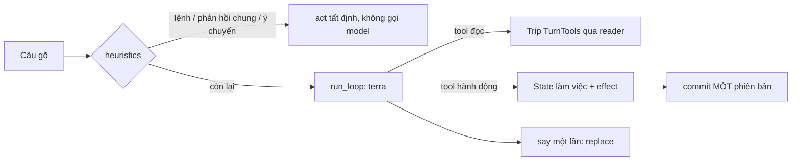
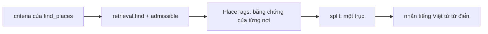

# Place Decision

Bước online thứ hai: từ **Search Input** của Trip Understanding và serving index của Place Intelligence, giúp người dùng chọn ra **tập địa điểm đã xác nhận** trước khi xếp lịch. Vị trí trong luồng: `docs/ARCHITECTURE.md` §3. Đầu vào: `docs/TRIP_UNDERSTANDING.md` §9. Nguyên tắc sản phẩm: `docs/Project_Context.md` §9, §14.

Code: `src/decision/`. CLI và API ở §18.

Factory nhận retrieval cùng binding. Context Agent bổ sung serving evidence tối đa ba nơi,
hai feature mỗi nơi và một quote mỗi feature (tối đa 500 ký tự), giữ status/release và
observation/source/time. Thiếu evidence giữ unknown; semantic không trở thành fact.


## 1. Place Decision là gì

```text
SEARCH INPUT ──┐
(Trip Under-   │
 standing §9)  ├──► RESOLVE ──► TRUY XUẤT ──► SÀNG LỌC ──► HỢP BỐI ──► XẾP HẠNG ──► SHORTLIST ──► NGƯỜI DÙNG ──► KHẢ THI ──► ĐỊA ĐIỂM
               │    anchor      ứng viên      constraint    CẢNH        + ĐA DẠNG    + SO SÁNH     TUYỂN CHỌN     TỔ HỢP      ĐÃ XÁC NHẬN
SERVING INDEX ─┘                              (fail-closed) (thô)                                                               → Planning
(Place Intelligence)
```

- Mục tiêu là **một tập quyết định nhỏ, hữu ích**, không phải danh sách dài. Hệ thống hỗ trợ chọn, không chọn thay.
- Constraint trước sở thích: bằng chứng trượt thì loại; safety chưa rõ vẫn hiện sau mọi nơi có bằng chứng đạt, trong cùng bậc giữ thứ tự gu (§6.2). Physical không nới.
- Không bịa: địa điểm thiếu bằng chứng cho một khía cạnh thì khía cạnh đó là `unknown`, không phải "không có".
- Chỉ đọc: Place Decision đọc serving record, không ghi Place Intelligence. Nó chỉ ghi Session Profile (từ thao tác tuyển chọn) và danh sách đã xác nhận.
- Chỉ dùng độ hợp không gian **thô**. Thời gian di chuyển thực tế, thời tiết, điều kiện tạm thời thuộc Live Context của bước Planning (`docs/PLANNING.md` §Live Context).

## 2. Đầu vào

### 2.1 Search Input

Mỗi field của Search Input (`TRIP_UNDERSTANDING.md` §9) được dùng ở một bước cố định:

| Field | Dùng ở | Cách dùng |
|---|---|---|
| `context` (dates, duration, base, mobility, companions) | Sàng lọc, Hợp bối cảnh, Khả thi | Ngày → giờ mở cửa trong chuyến; base + mobility → bán kính thô; companions → suitability |
| `hard_filters` | Sàng lọc | Bằng chứng trượt thì loại; safety chưa rõ vẫn hiện sau nơi đạt (§6) |
| `anchors` | Resolve, Hợp bối cảnh, Khả thi | Luôn giữ; làm tâm đánh giá không gian; chiếm thời gian cố định |
| `excluded_places` | Gợi ý | Không vào tab, shortlist, thẻ chat hay nơi tương tự; vẫn tìm bằng tên và tự chọn được, không kèm lời nhắc. Giữ nguyên trong `trip_context` sang Planning |
| `soft_weights` | Xếp hạng | Trọng số theo feature id |
| `pace` + travel / crowd tolerance | Hợp bối cảnh, Đa dạng, Khả thi | Bán kính chấp nhận, cỡ shortlist, số nơi mỗi ngày |
| `novelty` + danh sách đã đi | Xếp hạng | Giảm hoặc loại nơi đã đi |
| `wishes` (món, kiểu nơi, giống X), `vibes` (phong cách user chọn, `TRIP_UNDERSTANDING.md` §18) | Xếp hạng | Thành phần `wish` (§8); không loại nơi nào |
| `liked_groups` | Xếp hạng | `wish` mức thấp cho nơi thuộc nhóm đó; không ẩn nhóm khác |
| `context.purpose` | Xếp hạng | `wish` mức thấp nhất theo map trong config; là suy luận (✎ trên thẻ) |
| `unknowns` | Mọi bước | Không lọc, trọng số 0, gắn cờ khi giải thích |

Search Input có thể đổi giữa chừng (user sửa bản hiểu nhu cầu, trả lời thêm, Session Profile thay đổi). Khi đổi, luồng chạy lại từ bước sớm nhất bị ảnh hưởng (§14); lựa chọn đã khóa được giữ.

### 2.2 Serving record

Place Decision chỉ đọc serving record (`docs/CORPUS.md` §Bản ghi địa điểm), không duyệt đồ thị bằng chứng:

```text
Identity      id, POI | ZONE, category, vị trí / hình học, cụm / khu vực
Operation     giờ (Fact), giá (Fact), đặt chỗ, thời gian tham quan (Estimate: min / typical / long)
Experience    feature id + confidence
Environment   trong nhà / ngoài trời, độ đông theo bối cảnh (Signal), nhạy thời tiết
Effort        đi bộ, dốc, khó tiếp cận
Suitability   cặp đôi, gia đình, người lớn tuổi, …
Provenance    trạng thái theo khía cạnh, coverage theo khía cạnh, confidence 4 thành phần, tham chiếu bằng chứng
```

Chỉ record có trạng thái `VERIFIED`, `UNCERTAIN`, `OUTDATED` được dùng (`docs/CORPUS.md` §Trạng thái). `NEEDS_REVIEW` và `DISABLED` không bao giờ xuất hiện.

Place Decision đọc serving record qua snapshot (`corpus.snapshot`, `docs/CORPUS.md` §Place Decision dùng corpus thế nào). Đường đọc feature theo từng nơi dùng public `corpus.serving.feature`, kể cả chọn trải nghiệm nổi bật theo `n` cho neo theo buổi và lấy thuộc tính learner trước guard `VERIFIED`/`n > 0`/evidence; silence không tạo hay lấn át tín hiệu. Bước ③–⑤ tính cho mọi nơi một lượt bằng bảng (`decision.frame`: `screen_table`, `fit_table`, `score_table`); thẻ, so sánh và `why_not` dựng bằng các hàm theo từng nơi (`screen.py`, `fit.py`, `rank.py`), vẫn là định nghĩa của các con số. Hai bên được giữ khớp bằng oracle test `tests/decision/test_equivalence.py` (`tests/decision/reference.py` là bản `run` theo từng nơi). Chỗ ở (`stay`) có trong snapshot cho Planning, nhưng không bao giờ là ứng viên của Decision, kể cả khi user chọn hay đặt làm neo.

## 3. Luồng xử lý

```text
①  RESOLVE          anchor + địa điểm đã lưu / nhập tay → entity (§4)
②  TRUY XUẤT        tập ứng viên từ serving index + anchor + nơi user thêm (§5)
③  SÀNG LỌC         physical → user hard; ghi lý do loại (§6)
④  HỢP BỐI CẢNH     vị trí, cụm, đường vào, độ đông theo bối cảnh, anchor (§7)
⑤  XẾP HẠNG         điểm = bối cảnh + sở thích + tính mới + kinh nghiệm − bất định (§8)
⑥  ĐA DẠNG          gom nơi gần trùng thành nhóm; cắt shortlist theo cỡ (§9)
⑦  SO SÁNH          trong mỗi nhóm: A hơn ở đâu, B hơn ở đâu, hy sinh gì (§10)
⑧  TUYỂN CHỌN       user thêm / bỏ / khóa / so sánh → Session Profile → xếp hạng lại (§12)
⑨  KHẢ THI          đánh giá tổ hợp đã chọn, trực tiếp theo từng thao tác (§13)
⑩  XÁC NHẬN         danh sách đã xác nhận + pool dự phòng → Planning (§15)
```

⑧ ↔ ⑨ là vòng lặp chính. Planning không xếp được thì quay về ⑧ (`docs/ARCHITECTURE.md` §6).

Phân vai:

| Việc | Ai làm | Lý do |
|---|---|---|
| Resolve, truy xuất, sàng lọc, chấm điểm, đa dạng, khả thi | Rule tất định | Test được, tái lập được; AI không tự xác nhận khả thi (`docs/Project_Context.md` §14.7) |
| Chọn cặp so sánh, tính khác biệt giữa hai nơi | Rule tất định | Chỉ so trên khía cạnh có bằng chứng |
| Diễn đạt "vì sao phù hợp", "đánh đổi", lý do bỏ thành câu | LLM | Chỉ diễn đạt lại field của serving record và kết quả rule; không thêm nhận định mới |
| Hiểu lý do bỏ / critique nhập tự do ("xa quá", "muốn chỗ ít người hơn") | LLM | Chuẩn hóa về field của Search Input / Session Profile |

## 4. Resolve địa điểm của người dùng

Anchor, địa điểm đã lưu, địa điểm nhập tay đi qua cùng bộ matcher của corpus (`docs/CORPUS.md` §3 Resolve). Input của người dùng không bao giờ thành bằng chứng về địa điểm.

| Kết quả | Xử lý tiếp |
|---|---|
| Match chính xác | Địa điểm đã xác minh; dùng serving record |
| Match mơ hồ | Hỏi user chọn giữa các định danh (tên, khu vực, ảnh); không đoán |
| Match chắc với nhà cung cấp bản đồ nhưng chưa có trong registry | Dùng định danh + vị trí + giờ; các khía cạnh khác `unknown`; xếp hàng làm giàu dữ liệu |
| Không match | Địa điểm chưa xác minh; vẫn giữ nếu user muốn, mọi khía cạnh `unknown` |

Anchor không bị sàng lọc loại âm thầm. Nếu anchor vi phạm constraint, hệ thống cảnh báo và hỏi (§6.3). Input của user không bao giờ thành bằng chứng về địa điểm.

## 5. Truy xuất ứng viên

```text
nguồn ứng viên
├── khám phá từ serving index   theo feature id trong soft_weights, category, cụm quanh base / anchor
├── địa điểm đã lưu             sau resolve
├── nơi bắt buộc đến            sau resolve, luôn vào tập
├── lịch trình có sẵn           các nơi trong lịch, sau resolve
└── tìm kiếm của user           tìm tên / feature trong phiên
```

- Luồng bắt đầu theo **trạng thái bắt đầu** (`docs/TRIP_UNDERSTANDING.md` §2): khám phá → truy xuất rộng; đã lưu → tập = danh sách đã lưu, truy xuất thêm chỉ để có phương án thay thế; lịch có sẵn → đi thẳng tới ⑨ để phát hiện xung đột.
- Truy xuất rộng hơn shortlist nhiều lần để sàng lọc và đa dạng còn đủ chỗ chọn; cỡ nằm trong config.
- Coverage giới hạn vai trò: địa điểm `experience = NONE` chỉ được dùng làm chỗ ăn, anchor, hoặc dự phòng, không được gợi ý như một trải nghiệm (`docs/CORPUS.md` §Ba loại output).
- Không có chỗ ở trong ứng viên: chỗ ở không nằm trong Place Intelligence, Planning tra live theo request (`docs/PLANNING.md` §Chỗ ở (crawl live)).
- `Tools.create` / `Tools.rebase` nhận `hidden_ids` từ `TripState.meta.hidden_ids` qua harness (gồm chi nhánh Trip đã ẩn). Các ID này không vào gợi ý, danh sách/phân trang, tìm kiếm (kể cả `outside`), mục chưa xác minh hay phương án thay thế/pool dự phòng. Nơi người dùng tự chọn hoặc đặt làm neo vẫn giữ; báo cáo của người dùng không trở thành physical constraint hay fact trong corpus. Snapshot giữ `hidden_ids` ngoài lịch sử undo; rebase không truyền trường này giữ danh sách hiện có, truyền `[]` xóa danh sách. `DecisionOutput.hidden_ids` chuyển tiếp phạm vi ẩn cho ứng viên bổ sung của Planning.

## 6. Sàng lọc constraint

### 6.1 Thứ tự

```text
ứng viên
    ↓
physical constraint?   vi phạm → loại (không nới được)
    ↓
user hard constraint?  vi phạm → loại · anchor / nơi user khóa → giữ + hỏi nới (§6.3)
    ↓
unknown bằng chứng?    → không coi là an toàn (§6.2)
    ↓
qua sàng lọc
```

| Loại | Ví dụ ở bước này | Nguồn kiểm tra |
|---|---|---|
| Physical | `DISABLED` / đóng cửa hẳn; đóng cửa mọi ngày của chuyến; cấm loại phương tiện của user | Operation (Fact) × `context.dates`, `mobility` |
| User hard | dốc / bậc; đi bộ ≤ N phút; ngân sách trần; ăn kiêng; không hợp trẻ nhỏ | Effort, Suitability, Operation × `hard_filters` |

Khoảng cách và thời gian di chuyển chưa phải constraint ở đây; chúng thuộc Hợp bối cảnh (§7) và Khả thi (§13).

### 6.2 Ba giá trị của một kiểm tra

`requirements.hard_result` kiểm tra applicability theo `SearchInput.activities` rồi bằng chứng. Yêu cầu không liên quan trả `not_applicable` và không loại ứng viên; dietary chỉ áp dụng khi eating. Với yêu cầu có áp dụng, kết quả là `pass | fail | unknown`:

| Kết quả | Ứng viên thường | Anchor / nơi user khóa |
|---|---|---|
| `pass` | Tiếp tục | Tiếp tục |
| `fail` | Loại, ghi lý do | Giữ, cảnh báo, hỏi nới (§6.3) |
| `unknown` thuộc effort / suitability / `fit.<who>` (trừ pets theo quy tắc riêng dưới) | Vẫn trong tab, search và thẻ chat, sau mọi nơi đạt; không pill/banner hay mục chưa xác minh riêng | Giữ; cùng quy tắc Đánh đổi |
| `unknown` khác (giá, dietary…) | Theo `unknown_policy`, không suy đạt; `exclude` không vào danh sách chính | Giữ, nêu điều chưa xác minh |
| Giá trị `UNCERTAIN` (bằng chứng chưa chắc chắn) | Hard luôn `unknown`, không suy `pass` từ giá trị khác; áp quy tắc nhóm trên | Giữ, không biến thao tác chọn thành bằng chứng |

Thiếu bằng chứng không chứng minh an toàn: kết quả kiểm vẫn `unknown`, kể cả khi được liệt kê. Safety chưa rõ chỉ cảnh báo trong **một dòng Đánh đổi** trên thẻ nơi, ưu tiên trước đánh đổi khác; không nhắc/chặn ở danh sách hay khả thi của Decision. Planning kiểm và cảnh báo khi xếp lịch. Silence được đọc như không có feature ở cả serving và snapshot (`docs/CORPUS.md` §Độ tin của feature), không dùng làm bằng chứng lọc, fit hay gu. Field trong `unknowns` của Search Input không tạo kiểm tra nào.

**Bộ lọc cứng từ người đi cùng và xe.** Chip người đi cùng ghi kèm hard filter: `fit.baby`, `fit.parents`, `fit.pregnant`, `fit.wheelchair` `!= bad` (verdict của `details.fit[x]`, tên có tiền tố `fit.`), `pets != not_allowed` khi có thú cưng. Đi `car` với `people ≥ coach_min_people` (`config/trip.yaml`) thì Trip thêm `coach_access != no`, chính sách unknown mặc định `exclude`. Cả ba chạy qua `hard_result` như mọi feature; `fit.*` luôn là kiểm tra an toàn nên giá trị `UNCERTAIN` không bao giờ `pass`.

**Thú cưng:** Decision chuẩn hóa `context.companions` có `pet` thành `pets != not_allowed`, unknown `flag`, kể cả create, rebase và session cũ/restore; không nhân đôi filter đã có. Nơi biết cấm không vào gợi ý; thiếu hoặc chưa chắc bằng chứng chỉ vào nhóm chưa xác minh, ghi “Chưa rõ có cho mang thú cưng không”. `relaxed` không đưa nơi cấm trở lại gợi ý; thẻ chat do trợ lý đề xuất cũng loại nơi cấm (không can thiệp thao tác chọn). Thẻ chỉ nói “Cho mang thú cưng” / “Không cho mang thú cưng” khi serving feature có bằng chứng VERIFIED/OUTDATED, kèm số người và `sid=pets` để xem nguồn; fit hay thiếu dữ liệu không chứng minh được phép.

Riêng pets, người dùng vẫn tự tìm, chọn, khóa hoặc giữ chỗ ở cấm/chưa rõ; không popup, cảnh báo khả thi hay yêu cầu nới tại Lựa chọn. Thẻ giữ thông tin thật; handoff giữ pet context/filter để Planning tự kiểm trước khi xếp, không xem thao tác chọn là bằng chứng được phép.

`eq` cần giá trị VERIFIED/OUTDATED phù hợp và distribution không mâu thuẫn; `ne` dùng cùng semantics cho Decision và Planning. Dietary thiếu evidence không thành `not_applicable`. Soft ranking loại yêu cầu không liên quan khỏi cả tử số, mẫu số và uncertainty. Với activity `accommodation`, feature ontology ngoài tập `stay` là `not_applicable` theo public `requirements.applicable`; `fit.*` và structural constraint vẫn được kiểm. Bảng vector Decision dùng cùng semantics cho hard/soft. Wine preference đọc offering có evidence riêng, không suy việc user bắt buộc uống; coffee-only không bị wine requirement lọc. Contract ý định ở `docs/TRIP_UNDERSTANDING.md` §9.

### 6.3 Xung đột với địa điểm user chọn

```text
anchor / nơi khóa vi phạm
    ├─ physical   → không vào danh sách đã xác nhận; giữ ở wishlist; nói rõ lý do
    │               (ví dụ: đóng cửa mọi ngày 12–14/12)
    ├─ user hard  → hỏi có nới không, kèm cái giá cụ thể
    │               ("Nơi này có ~120 bậc thang. Giữ nó nghĩa là bỏ điều kiện tránh bậc cho riêng nơi này?")
    └─ unknown    → giữ, cảnh báo cần tự kiểm tra trước chuyến
```

Nới là quyết định của user, chỉ áp cho địa điểm đó trong chuyến này, không sửa `hard_filters` chung.

### 6.4 Lưu lý do loại

Mỗi ứng viên bị loại giữ `reason` (constraint, giá trị, bằng chứng). Dùng để:

- trả lời "vì sao không có nơi X?"; tool `why_not` trả `answer` đủ dấu câu từ lý do thật. Nơi tự bỏ/để dành/ẩn theo lọc/xếp thấp không bị diễn giải thành giới hạn cần nới; physical constraint không được gợi ý nới;
- dựng pool dự phòng cho Planning (`docs/PLANNING.md` ⓗ): ứng viên bị loại vì lý do theo ngữ cảnh (ví dụ ngoài trời) vẫn có thể là phương án thay thế trong điều kiện khác;
- đo chất lượng (§17).

## 7. Độ hợp bối cảnh

Đánh giá thô, rẻ, trước khi biết shortlist. Không gọi route service.

| Tín hiệu | Tính từ | Ví dụ |
|---|---|---|
| Khoảng cách tương đối | Vị trí × base / anchor, theo đường chim bay hoặc theo cụm | Xa mọi anchor và base → điểm thấp khi travel tolerance thấp |
| Khu vực / cụm | Cụm của Identity | Cùng cụm với anchor → cộng điểm |
| Đường vào | Effort, mobility | Đường đất dốc + xe máy số → cảnh báo |
| Độ đông dự kiến | Signal độ đông theo bối cảnh × ngày trong tuần / buổi của chuyến | `crowd × weekend × morning` cao + user muốn ít người → trừ điểm, gợi ý buổi khác |
| Nhạy mùa | Environment × tháng của chuyến | Ngoài trời vào mùa mưa → cờ "cần dự phòng" (không dùng dự báo thời tiết thật) |
| Anchor | Anchor có giờ cố định | Nơi xa anchor giờ cố định trong cùng ngày → trừ điểm |
| Hợp người đi cùng | `details.fit` của từng x trong chuyến: `companions`, x có hard filter `fit.<x>` (bà bầu, xe lăn), `large_group` khi `people ≥ coach_min_people`; cùng feature x cần | `good` đã xác minh cộng `good_bonus`; `bad` đã xác minh trừ `bad_penalty` và gắn cờ `fit_bad` kèm lý do; feature cần (trẻ / em bé: `kids_play_area`, `stroller_access`; bố mẹ: `rest_benches`, `toilet_available`) cộng `feature_bonus`. Giá trị chưa xác minh hoặc thiếu dữ liệu không đổi điểm (`details_fit` trong `config/decision.yaml`) |

Output: `context_fit` (điểm) + danh sách cờ. Ứng viên có `context_fit` dưới ngưỡng không vào shortlist nhưng vẫn giữ trong pool. Bán kính và ngưỡng theo `pace` và travel tolerance, trong config.

## 8. Xếp hạng

```text
score = w_ctx   · context_fit
      + w_pref  · preference_fit      Σ soft_weight(f) · có_feature(f) · confidence(f)
      + w_rec   · recent_interest     Recent Interests của profile (khi user đồng ý)
      + w_nov   · novelty             theo novelty + Experience History + Exploration Gap
      + w_exp   · experience_fit      visited rỗng: nơi đặc trưng được cộng; có visited: nơi khác visited được cộng
      + w_pop   · popularity          chỉ là một tín hiệu, trọng số nhỏ
      + w_wish  · wish                1 − Π(1 − a·strength) trên các mong muốn áp cho nơi đó (decision.wishes)
      + w_rep   · reputation          điểm uy tín Maps (rating + số review cùng thang) − 0,5; không có = 0
      + session · bounded_taste       học nhẹ từ chọn/bỏ trong phiên (§12.2), không phạt unknown
      − w_unc   · uncertainty         thiếu coverage / UNCERTAIN / OUTDATED ở khía cạnh quan trọng với user
```

Quy tắc:
- **Prior của hồ sơ nhẹ hơn tín hiệu chuyến này.** Soft có `source = profile` (hồ sơ dài hạn, `docs/TRIP_UNDERSTANDING.md` §17) nhân `prior_weight` = 0,4 (`config/decision.yaml`), và bị bỏ khi chuyến này có soft riêng cho cùng feature (đồng ý hay ngược đều thắng). Mẫu số của `preference_fit` vẫn tính prior là 1, nên prior đứng một mình chỉ cộng ≈ 0,4 · confidence, tín hiệu chuyến này cộng đủ. Thứ tự: tín hiệu chuyến này > prior > không có gì. Chọn 0,4: đủ để hai nơi ngang nhau nghiêng về gu cũ, không đủ vượt một tín hiệu hay mong muốn của chuyến này (`wish` 1,5; `pref` 2,0 trên tín hiệu đầy đủ).
- Feature id dùng chung với ontology của corpus (`docs/CORPUS.md` §Bản ghi địa điểm), nên `preference_fit` là phép khớp trực tiếp.
- Địa điểm **không có bằng chứng** cho một feature → đóng góp 0, không âm. Phần thiếu đi vào `uncertainty`, chỉ tính cho feature user quan tâm.
- Feature `off` cho chuyến này (ví dụ `hiking = off`) → không cộng; không loại trừ khi đó không phải hard filter.
- `novelty = high` → nơi trong Experience History bị giảm mạnh hoặc loại khỏi khám phá (không loại nếu user đưa vào anchor). Đã đến ≠ đã thích (`Project_Context.md` §11).
- Thứ tự ưu tiên khi hai nguồn trọng số mâu thuẫn giữ đúng `TRIP_UNDERSTANDING.md` §2.
- `wish` chỉ nâng, gom mọi mong muốn của Trip (`decision/wishes.py`): món (`place_ids` theo thứ tự, 1 → 0,5, mọi nơi có ghi món đó: quán cà phê có cà phê muối cũng được cộng), kiểu nơi (1), phong cách ảnh (1 → 0,5 theo hạng; độ giống ảnh không phải bằng chứng), giống X (`corpus.serving.similarity` ≥ `like_min`, trừ chính X; phần "nhưng" đã là `soft_weights`), `liked_groups` (cả nhóm, mức thấp), `purpose` (theo map, mức thấp nhất). Khớp nhiều mong muốn thì cao hơn; không khớp = 0, không âm, không loại; sàng lọc chạy trước; nơi chưa có bản ghi không được cộng. Mỗi ảnh user gửi và mỗi nơi tham chiếu là một mong muốn riêng. Mức `a`, `like_min`, map `purpose` ở `config/decision.yaml` `wish`. Danh sách mỗi nhóm vẫn đủ mọi nơi qua sàng lọc; không lọc theo ngưỡng điểm.
- `confidence(f)` của một feature = `agreement × support(n) × mention(rate) × trọng số trạng thái` (`corpus.serving.evidence`, `config/serving.yaml` `evidence`; snapshot lưu cùng hàm ở cột `conf`). `support(n)`: tuyến tính tới `base` (0,7) ở 3 tác giả, rồi tăng theo log tới 1,0 ở `ref_n` (300), nên 3 / 30 / 300 tác giả cùng agreement xếp đúng thứ tự. `mention(rate)`: tỷ lệ người đã đọc có nhắc; dưới `rate_ref` (2 %) trừ tối đa `rate_weight` (30 %), nên 6 lượt nhắc trong 3.000 review nhẹ hơn 6 trong 10. Tỷ lệ 0 / không biết (Maps attribute, chủ quán khai) không bị trừ. Chỉ xếp hạng dùng `confidence`; hard constraint (§6) không đọc nó.
- **Uy tín** (`rep`): `provenance.reputation.score` (0..1) của bản ghi, đặt `score − 0,5` nên trên giữa nhóm thì cộng, dưới thì trừ; thiếu rating hoặc số review → 0, không âm. Trọng số nhỏ (`w_rep` = 0,3 ở `config/decision.yaml`). Cách tính ở `docs/CORPUS.md` (Serving record, Uy tín). `pop` vẫn đo theo `voices` của corpus và chỉ là tín hiệu phụ.
- Trọng số `w_*` nằm trong config, có version; mỗi điểm lưu kèm từng thành phần để giải thích và debug.
- **Đi cùng thú cưng.** Trong từng tab, sau bậc chế độ ăn, ưu tiên nơi có `pets=allowed` VERIFIED/OUTDATED, có nguồn và người xác nhận, không có bằng chứng `not_allowed` mâu thuẫn; sau đó mới xét né đông và điểm. Tìm kiếm và thẻ chat Decision cũng đặt các nơi có bằng chứng này trước nơi chưa rõ, trước khi cắt số thẻ; chỉ sắp lại các kết quả khớp, không lấy nơi khác loại thay cho cà phê/đi dạo người dùng xin. Nơi chưa rõ không bị loại thêm hay được nói là cho phép. `decision.pet_access_priority(record, companions)` là API public trả bậc sắp xếp, không thay hard check hay điểm `wish`.
- **Né đông.** Khi user né đông (`profile.crowd_tolerance` hoặc `pace.crowd_tolerance` = `avoid`), mỗi tab xếp các nơi Google ghi là đông (≥ `crowd_busy_pct` ở khung giờ nào đó của loại ngày trong chuyến, hoặc cả hai loại ngày khi chưa biết ngày) sau mọi nơi còn lại, bất kể điểm; nơi không có popular times không bị coi là đông (`frame.busy_mask`).
- **Chế độ ăn** (`decision/diet.py`, chỉ tab `meal`, `snack`). Có yêu cầu chay (hard hoặc soft `vegetarian_options` / `vegan_options` = yes) hay ghi chú "dị ứng hải sản" ở `unmapped` (Trip không có feature dị ứng, chỉ giữ ghi chú): tab xếp theo bậc, rồi mới đến điểm. Bậc 0: nơi tự nhận là quán chay (tên hoặc category Google có "chay"). Bậc 1: không có gì trái chế độ (chay: đã verify `vegetarian_options` = yes). Bậc 2: chưa verify được món chay (chỉ xảy ra với yêu cầu soft; hard thì nơi này vào mục chưa xác minh). Bậc 3: tên hoặc category tự nhận là nơi nướng / thịt / hải sản… (chay) hoặc hải sản (dị ứng). Bậc ≥ 2 không bao giờ được "Hợp nhất"; bậc 3 không vào shortlist và thẻ có ghi chú; bậc 3 vẫn nằm trong tab (không có bằng chứng "chỉ có món mặn" ngoài tự nhận, nên không loại cứng). Thiếu bằng chứng là `unknown`, không bao giờ được xếp như "khớp".

## 9. Đa dạng và cỡ shortlist

### 9.1 Gom nơi gần trùng

Hai ứng viên là **gần trùng** khi cùng category, trùng phần lớn feature có bằng chứng, và vai trò trong chuyến như nhau (ví dụ hai quán cà phê view đồi, cùng kiểu ngồi lâu). Nơi gần trùng được gom thành một **nhóm**:

```text
Nhóm "cà phê view đồi, yên tĩnh"
├── đại diện  A   điểm cao nhất
└── thay thế  B, C   hiển thị khi mở nhóm hoặc so sánh
```

Chọn tiếp theo kiểu MMR (`corpus.serving.mmr`): mỗi lần chọn ứng viên có `score` cao nhưng khác nhất với các nơi đã chọn, để shortlist gồm các lựa chọn thực sự khác nhau.

### 9.2 Cỡ shortlist

```text
số chỗ cần ≈ số ngày khả dụng × số nơi mỗi ngày(pace) − số anchor
cỡ shortlist ≈ số chỗ cần × hệ số dư
```

| Pace | Nơi mỗi ngày (mặc định config) |
|---|---|
| thong thả | ít, ở lâu mỗi nơi |
| cân bằng | trung bình |
| đi nhiều | nhiều, vẫn không vi phạm physical |

Cỡ shortlist là số nơi MMR chọn ở mỗi vai trò; nó quyết định mỗi tab có bao nhiêu nơi mang `top: true` (web hiện nhãn "Hợp nhất", §9.3). Danh sách không dừng ở đó: mỗi tab có mọi nơi qua sàng lọc, xếp theo thứ tự ở §8. Nơi gần trùng vẫn có `alternatives` nhưng cũng nằm trong danh sách. View chỉ mang **trang đang hiện** của mỗi tab (§9.4) kèm `total` của tab. `first_shortlist` giữ cỡ shortlist đầu trong snapshot; không tạo lời nhắc khi bỏ nhiều.

### 9.3 Tab

Danh sách nằm trong các tab theo loại nơi (`config/decision.yaml` `tabs`: tab → nhóm category của corpus; nhóm không có trong tab nào → `sights`): Ăn uống, Ăn vặt và tráng miệng, Cà phê, Thiên nhiên và ngắm cảnh, Vườn và trang trại, Cắm trại, Điểm tham quan, Di tích / chùa / bảo tàng, Vui chơi, Bar và về đêm, Spa, Chợ và mua sắm (`frame.tabs`, `diversify.tab`). Tab không có nơi nào thì không hiện. Anchor luôn đứng đầu, tách riêng. `display_groups` (4 nhóm thô) chỉ dùng cho mong muốn `liked_groups` / `purpose` (§8 `wish`), không phải tab.

**Nơi quá xa bị ẩn** (fail-closed, không có đường nới): nơi có thời gian di chuyển từ tâm gần nhất trong các tâm của `fit` (chỗ ở / base nếu đã có, không thì tâm thành phố mà `fit.radius` đang dùng, cộng các nơi user đã đặt làm anchor; nơi gần một anchor thì với tới được) vượt `max_travel_min` (`config/decision.yaml`, mặc định 90 phút; công thức `geo.minutes`) không nằm trong tab nào, shortlist hay mục chưa xác minh. Ngoại lệ: nơi user đã chọn hoặc đặt làm anchor không bao giờ bị ẩn; nơi không có toạ độ không bị coi là xa (không có bằng chứng thì không loại). `why-not` của nơi bị ẩn nói rõ "Xa so với <tâm> (≈N phút, quá giới hạn 90 phút)" với N tính từ toạ độ thật. Số "N nơi hợp với chuyến" của Web là tổng `total` các tab nên đã không đếm nơi bị ẩn.

Mỗi tab liệt kê **mọi** nơi còn lại qua sàng lọc của nó (kể cả nơi có `context_fit` dưới `min_context_fit`; ngưỡng đó chỉ áp cho pool của shortlist), kể cả nơi user đã chọn. Bậc đầu là bằng chứng safety (§6.2): tất cả nơi đạt trước nơi chưa rõ; trong cùng bậc giữ thứ tự chế độ ăn, bằng chứng cho mang thú cưng, né đông và `score` ở §8. Search và thẻ chat cũng ưu tiên bằng chứng safety, không gán chưa rõ thành trượt. "Hợp nhất" (`top`) đánh dấu các nơi chưa chọn đứng đầu tab, đúng bằng số nơi MMR (§9.2) lấy từ tab đó.

### 9.4 Trang, tìm kiếm và lọc lại

Mỗi tab là thứ hạng của nó chia thành trang `page_size` nơi; user chọn trang (`State.page[tab]`, 0 = đầu; lưu trong phiên, không vào lịch sử hoàn tác). Ids trên màn nằm ở `State.shown[tab]`. View của tab mang `cards` (trang đang hiện), `total`, `page`, `pages`, `page_size`, `offset`. `Engine.page(sid, tab, n)` hiện trang `n` (1 = đầu; `None` = trang sau; quá cuối thì trang cuối).

Dựng lại (act, lượt chat, rebase) giữ số trang; trang được lấy lại từ thứ hạng mới (`window.window`). `change[tab] = {kept, added, removed, replaced_all}` so trang cũ với trang mới (`replaced_all` khi giữ dưới `replace_below` × trang cũ; tab chưa từng hiện thì không có thay đổi) để web chạy chuyển cảnh. Sau `rebase` (Search Input mới), `diff(..., rebuilt=True)` nói gọn điều đó: "Giữ 45 nơi, thay 3 nơi hợp hơn", "Danh sách đổi theo ý bạn: 24 nơi mới" hoặc "Các nơi đang gợi ý vẫn hợp, không cần đổi"; thay đổi không làm xê dịch gì thì `text` rỗng. `rebase` giữ lịch sử hoàn tác.

**Bộ lọc phiên** (`State.filters`, `decision/filters.py`): sau khi xếp hạng, mỗi tab chỉ giữ nơi qua mọi bộ lọc; thẻ ẩn không đổi `status`/`score`. Nơi qua bộ lọc phải có giá trị `VERIFIED`/`OUTDATED` khớp (feature) hoặc giờ mở có trạng thái đó; `unknown` không bao giờ qua (không coi là "có"). Nơi đã chọn / khóa luôn hiện. `total` và số trang của tab đếm sau lọc; "Hợp nhất" (`top`) chọn trong số nơi còn hiện. View có `filter = {active: [{key, value, label}], hidden: n}` và `likes` (id đã bấm "giống"), luôn có; `why-not` của nơi bị ẩn nói do bộ lọc.

`Engine.search(sid, q)`: mỗi chữ gõ (bỏ dấu, hoa thường) phải là đầu một chữ trong tên, category Maps hoặc tên tab của nơi; tìm trên mọi tab và mục chưa xác minh, ưu tiên bằng chứng cho mang thú cưng khi chuyến có `pet` rồi xếp theo `score`, tối đa 60 thẻ kèm `total`. `outside` = tối đa 8 nơi trong vùng có tên khớp mà không nằm trong danh sách (không tính chỗ ở), mỗi nơi kèm lý do của `why-not`. Với `excluded_places`, query loại/tab chung không làm nơi đó trở lại; query khớp tên riêng trả thẻ trực tiếp không kèm lời nhắc.

`why-not` của một nơi có trong danh sách trả `listed: true` và vị trí ("xếp thứ 41/60; ở trang 2"), kèm mong muốn user đã nói mà nơi đó chưa khớp, khi tab của nó có nơi khớp ("Chưa thấy ghi món bánh căn ở nơi này", "Chưa khớp mong muốn “karaoke”"); thiếu dữ liệu không bao giờ thành "không bán". Nơi bị loại chỉ nêu điều kiện đã loại nó. Prompt của agent có mọi nơi trên màn, nhưng lý do chỉ cho trang đầu mỗi tab và nơi đã chọn. `page_size` = 24, `replace_below` = 0.3 trong `config/decision.yaml`.

## 10. So sánh

Chỉ tạo so sánh khi có lựa chọn thật: trong một nhóm gần trùng, hoặc giữa hai nơi cạnh tranh cùng một chỗ.

```text
A vs B
├── A hơn ở       feature / signal có bằng chứng ở cả hai, A tốt hơn
├── B hơn ở       ngược lại
├── giống nhau    không nêu (không phải lý do chọn)
├── chưa biết     khía cạnh một bên unknown → nói rõ, không coi là thua
└── hy sinh gì    hệ quả với chuyến: khoảng cách tới anchor / cụm, độ đông theo buổi, effort
```

So sánh có thêm hàng "Nổi tiếng vì" (khi một bên có `known_for`; bên kia "chưa biết") và "Tổng tiền mỗi người" (`cost.total_vnd.base`, ở mục hy sinh). Kiểm tra ngân sách của tổ hợp (§13) dùng `cost.total_vnd.base` thay cho giá vé ước tính khi có.

Ví dụ:

```text
A: gần cụm trung tâm, đông cuối tuần buổi sáng (62% trong 40 review nói đông)
B: yên tĩnh hơn, xa base hơn, cùng cụm với anchor TikTok 2
→ Chọn B nếu đi ngày 2 cùng TikTok 2; chọn A nếu muốn đi đâu cũng gần
```

Mỗi so sánh chỉ dùng giá trị trong serving record. Tác động di chuyển ở đây là **ước lượng thô** theo cụm; con số phút chính xác chỉ có sau Planning. Chọn sau so sánh vẫn là tín hiệu nhẹ như thao tác chọn thông thường (§12.2); mở bảng so sánh không tạo tín hiệu gu.

## 11. Thẻ ứng viên

Mỗi ứng viên chỉ hiển thị thông tin phục vụ quyết định (`docs/Role_Web_Functional_Design.md` §2.5, `docs/UX_Design_Brief.md` §4):

| Mục | Nội dung | Nguồn |
|---|---|---|
| Vì sao phù hợp | Tối đa 3 dòng: mong muốn user nói ("Có bánh căn bạn muốn · theo menu", kiểu nơi, phong cách, giống X) → feature khớp `soft_weights` + bằng chứng (xu hướng review kèm cỡ mẫu) → `liked_groups` / `purpose` (✎) → vị trí. Không có dòng nào thì một dòng thật theo thành phần điểm lớn hơn (khoảng cách hoặc số người viết). Lưới và đĩa xoay cùng lấy dòng từ `web/src/user/ui/cardLines.ts`, chỉ khác cách vẽ | `wish`, Experience, Environment |
| Đánh đổi | Một dòng; safety chưa rõ ưu tiên trước cờ §7/điểm thua, ví dụ “Chưa rõ có dốc, nhiều bậc”; nhãn feature lấy từ config, không nhắc lại ở `unverified` hay banner | Kiểm tra §6.2, Hợp bối cảnh, So sánh |
| Thời gian ước tính | Khoảng min / typical / long | Estimate |
| Ảnh hưởng vị trí | "cùng cụm với X", "xa base", ước lượng thô | Hợp bối cảnh |
| Độ tin cậy | Trạng thái theo khía cạnh; `UNCERTAIN` / `OUTDATED` hiển thị rõ | Provenance |
| Phụ thuộc unknown | Không có: điều người dùng chưa nói (ngân sách…) do cổng hỏi, không phải đánh đổi của nơi nên thẻ không nêu; `depends_on_unknown` luôn `null`, giá vẫn hiện ở `price` | `unknowns` |
| Nổi tiếng vì | `known_for.headline` (cụm hiếm trong nhóm category) kèm số người nhắc | `details` |
| Tổng tiền | `cost.total_vnd` (một người: vé, gửi xe; kèm các khoản thêm) | `details` |
| Ảnh | `photos`: tối đa 4 ảnh, mỗi cảnh một ảnh, ảnh bìa đứng đầu; cảnh theo loại nơi (quán ăn / cà phê: interior, food, exterior, drink; chỗ ở: room, exterior, view; điểm tham quan: view, exterior, amenity). Chỉ ảnh không có người, không mờ / tối, không trùng gần (`corpus.serving.scenes`, `docs/CORPUS.md` §Ảnh Google Maps). Nơi chưa có nhãn cảnh: `photos` rỗng, web giữ ảnh của nó | `data/gmaps/photo_scenes` |

`photos` chỉ để hiển thị (`decision/cards.py` `scene_photos`): không điểm, thứ hạng hay lọc nào đọc nó. Web đưa ảnh này lên trước thư viện ảnh của nơi (`web/src/user/pd/api.ts` `withPhotos` → `setScenePhotos` trong `web/src/data/store.ts`), nên thẻ, đĩa xoay và sheet chi tiết dùng cùng ảnh: tối đa 4 cảnh đứng đầu (ảnh bìa là cảnh đầu), sau đó là phần còn lại của thư viện ảnh nơi đó, nên một nơi ít cảnh không bị mất ảnh.

Giờ / giá / vị trí lấy từ bằng chứng official hoặc Google, không trộn với bằng chứng trải nghiệm (`docs/CORPUS.md` §Place Decision dùng corpus thế nào). Không hiển thị một review đơn lẻ như sự thật.

## 12. Người dùng tuyển chọn

### 12.1 Thao tác

| Thao tác | Tác động |
|---|---|
| Thêm | Vào tập đã chọn; nơi mới → resolve (§4) |
| Bỏ | Ra khỏi tập; nhận lý do nếu người dùng cung cấp. Không hỏi lấp khoảng trống; phần thiếu do Lịch trình xử lý |
| Khóa | Giữ bắt buộc; xử lý xung đột theo §6.3, §13.3 |
| So sánh | Mở §10 |
| Thay | Đổi sang nơi thay thế trong nhóm |
| Xem thêm giống | Mở rộng nhóm / truy xuất thêm quanh feature đó |
| Ưu tiên | `prefer` `{feature, value, weight: ±1}`: đẩy nơi có (hoặc không có, `-1`) giá trị đó lên (xuống) trong thứ hạng. Chỉ đổi điểm của nơi chưa chọn; không nơi nào bị loại vì nó |
| Lọc | `filter` `{key, value}` (`key` là feature ontology, hoặc `opens_by` với `HH:MM`: giờ mở đầu tiên của một ngày trong chuyến không muộn hơn mốc đó); `unfilter` bỏ hết. Chỉ **ẩn** khỏi các tab (§9.4), không đổi `status` hay `score`; có undo |
| Kiếm kiểu này | `like` `{place_id}`: nơi đó thành mong muốn "giống X" của phiên (`State.likes` → `wishes.like`, cùng hệ số `a.like`, §8). Chỉ nâng nơi giống, không đẩy nơi nào xuống hay ra |
| Chọn chỗ ở | Cả chuyến có **một** chỗ ở (`view.lodging`: `booked` = đã nói ở Hiểu chuyến đi, `chosen` = chọn ở đây, thay `booked`; `needed` = chưa biết). Tab "Chỗ ở" luôn có: chỗ ở trong corpus quanh các nơi đã chọn (Planning xếp, `docs/PLANNING.md` ⓐ). Chưa có chỗ ở thì chọn ngay; đã có (đã đặt hoặc đã chọn) mà muốn đổi thì Web hỏi xác nhận trước khi gửi action. `set_lodging` `{lodging: {kind: corpus, id}}` (tên, toạ độ, giá một đêm đọc từ bản ghi `stay`) hoặc một điểm từ ô tìm `{kind, text, lat, lng}`; `clear_lodging` bỏ. Không xếp hạng lại nơi nào |

Không thao tác nào bị chặn vì lựa chọn quá tải, vướng điều kiện hay chưa có chỗ ở: Web báo cái giá và để người dùng tự quyết (nút "Lập lịch" luôn bấm được khi đã chọn ít nhất một nơi).

### 12.2 Tín hiệu và thích nghi trong phiên

`learning.py` là learner thuần, tất định, không model và không ghi hồ sơ dài hạn. Cờ `wish.session_learning.enabled` mặc định `false`: tắt là không có delta, giữ cách xếp hạng không learner. Khi bật, mỗi lần dựng view tính lại từ state hiện tại; undo hoặc chọn lại rút đúng tín hiệu cũ. Không tạo câu hỏi `pattern`/`rethink`, không hỏi xác nhận hay nhắc học gu, kể cả khi cờ tắt.

| Thao tác | Tín hiệu |
|---|---|
| Chọn / khóa | Cộng yếu các thuộc tính `VERIFIED`, `n > 0`, evidence không rỗng; anchor và `like` không trở thành select ngầm |
| Bỏ, lý do `dislike` | Trừ yếu các giá trị có bằng chứng của nơi đó ngay |
| Bỏ không lý do | Một lần không tính; chỉ giá trị chung của ít nhất `pattern_min` nơi bỏ mới trừ nhẹ, không gắn nhãn không thích |
| Bỏ vì xa / đắt / đã đến | Không dạy thuộc tính gu; feedback rõ vẫn đổi travel tolerance / price sensitivity / visited tương ứng; đã đến không phải đã thích |
| Feedback đông / `prefer` | Giữ đường phản hồi chủ động riêng; thuộc tính đã nói rõ không bị tín hiệu ngầm ghi đè |

Điểm `parts.session` là delta riêng, không nhập `soft_weights`, không thêm uncertainty penalty. Phiếu co theo `shrink`, cân confidence của nơi nhận. Tín hiệu dương chỉ lấy feature/value gu trong `taste_values` (trải nghiệm, không khí, view, món… từ ontology), không suy thích muỗi, ồn, đông hay khó đi. Một nơi chọn chỉ có `single_scale` (0,1); từ hai nơi trở lên cần ≥ `consistent_min` (2), ≥ `consistent_share` (0,6). So với pool cùng category group, tính đuôi binomial một phía với nền Laplace `(matches+1)/(pool+2)`; độ mạnh là `(1-tail) × n/(n+evidence_prior)`, không có ngưỡng lift cứng hay thưởng độ hiếm. Giá trị phổ biến vẫn học yếu nếu nhất quán, hai phiếu cho thuộc tính hiếm không mặc nhiên mạnh hơn sáu phiếu. Chỉ giữ `top_k` (3) tín hiệu dương mạnh nhất; tín hiệu âm giữ riêng. Trị tuyệt đối không quá `wish.session_learning.max_lift` (0,18). Tham số nằm cùng mục trong `config/decision.yaml`; không có đường tăng lên full weight. Feature có soft của chuyến (không phải prior), hard filter hoặc `prefer` bị bỏ khỏi learner. Nơi chưa rõ/không đủ bằng chứng nhận 0, không bị trừ.

Chỉ thay điểm/thứ tự; không đổi tập ứng viên, số đếm, hard filter hay tạo hard constraint. `like` vẫn là wish giống nơi riêng (§8); compare không học phần khác biệt. Không thao tác thì không có delta, giữ nguyên thứ tự. Feedback hiện có chỉ thuộc phiên; learner không gọi consumer hồ sơ dài hạn.

## 13. Khả thi của tổ hợp

Đánh giá các nơi đã chọn **như một nhóm**, chạy lại sau mỗi thao tác tuyển chọn và hiển thị trực tiếp.

### 13.1 Kiểm tra

| Kiểm tra | Cách tính (thô, tất định) |
|---|---|
| Tổng thời gian | Σ thời gian tham quan `typical` + ước lượng di chuyển theo cụm + đệm theo pace ≤ thời gian có (số ngày × khung ngày − anchor giờ cố định − giờ check-in/out, giờ rời Đà Lạt) |
| Anchor | Anchor giờ cố định không chồng nhau; nơi cùng ngày với anchor ở gần được |
| Giờ mở cửa | Mỗi nơi mở ít nhất một khung phù hợp trong các ngày của chuyến |
| Tải di chuyển | Số cụm cách xa ≤ số ngày; mỗi ngày không vượt travel tolerance thô |
| Ngân sách | Σ giá ước tính ≤ ngân sách (chỉ khi ngân sách đã biết; `unknown` → không kiểm, gắn cờ) |
| Số nơi mỗi ngày | Theo pace |

Giờ mở cửa `UNCERTAIN` / `OUTDATED` không làm fail; chúng tạo cảnh báo "kiểm tra lại trước chuyến".

### 13.2 Kết quả

```text
Khả thi           → handoff lựa chọn sang Planning
Khả thi một phần  → giữ xung đột trong output → Planning kiểm và xử lý từng nơi
Không khả thi     → giữ ước lượng quá tải trong output → Planning dựng phương án hợp lệ
```

Các trạng thái trên là ước lượng, không phải cổng handoff: harness vẫn chuyển lựa chọn sang Lịch trình để kiểm và xếp từng nơi. Không nới hard/physical constraint, không tự bỏ lựa chọn. `not_applicable` không tạo xung đột hoặc đề nghị nới; yêu cầu ăn chay chỉ kiểm khi eating.

### 13.3 Nơi user khóa gây xung đột

Theo đúng mô hình constraint (`docs/ARCHITECTURE.md` §2): chỉ vi phạm user constraint → hỏi nới kèm cái giá; vi phạm physical → không tạo tổ hợp giả vờ khả thi (giữ wishlist, đề xuất ngày khác, bỏ nơi khác); giờ chưa chắc → cho giữ kèm cảnh báo.

## 14. Chạy lại khi đầu vào đổi

| Thay đổi | Chạy lại từ |
|---|---|
| Sửa `hard_filters`, ngày, mobility | ③ Sàng lọc |
| Thêm / đổi anchor, base | ① Resolve (anchor) rồi ④ |
| Sửa `soft_weights`, novelty, Session Profile, `prefer`, `like` | ⑤ Xếp hạng |
| `filter` / `unfilter` | ⑥ (chỉ ẩn thẻ sau khi đã xếp hạng) |
| Sửa pace | ⑥ Đa dạng (cỡ shortlist) + ⑨ Khả thi |
| Thêm / bỏ / khóa | ⑨ Khả thi; ⑤–⑥ cho phần chưa chọn |
| Planning báo quá tải không hướng nào vừa (`back_to_decision`) | ⑧ Tuyển chọn, kèm nơi gây lỗi |

Nơi đã chọn / khóa không bị loại âm thầm khi chạy lại; nếu chúng vi phạm điều kiện mới, hệ thống báo và hỏi.

## 15. Output

Output cuối cùng, đầu vào của Planning & Validation (`docs/PLANNING.md` §Đầu vào).

`Tools.apply(sid, "confirm", {"for_planning": true}, emit)` dùng cho handoff nội bộ: giữ nguyên lựa chọn, `hard_filters`, `relaxed` và feasibility, kể cả khi có nơi fail/unknown; cờ từng nơi ghi rõ điều kiện chưa đạt/chưa xác minh để Planning kiểm trước khi xếp. Đây không phải xác nhận lịch khả thi. Confirm mặc định vẫn yêu cầu feasibility phù hợp.

Confirm và draft khả thi kiểm lại chỗ ở corpus đã chọn hoặc đã đặt theo hard requirements
hiện tại, kể cả sau rebase; pets chỉ giữ trong handoff để Planning kiểm, không chặn lựa chọn chỗ ở (§6.2). Không tự bỏ selection hoặc đổi chỗ ở khi kiểm fail/unknown;
confirm trả conflict, draft thường trả `None`. `draft(any=True)` giữ dữ liệu để tìm chỗ ở thay thế.

Câu trả lời ở cổng trước Lịch trình (hard constraint, đi cùng ai, ngày, di chuyển…) chạy `Tools.rebase`: `selected`, `locked`, `dropped`, chỗ ở đã chọn giữ nguyên, kể cả nơi trượt hoặc chưa xác minh được ràng buộc mới; Lựa chọn không nhắc hay chặn. Nơi đó hiện trong `feasibility` (conflict `relax:<id>:<feature>` hoặc cảnh báo "chưa xác minh được…") kèm tên nơi và lý do để Lịch trình xử lý. Khóa bằng `tests/decision/test_gate_keeps_selected.py`.

Read `Tools.read(sid, "evidence", {place, feature, context?})` trả public `PlaceEvidence`:
binding, value/status serving, quote/source/observation pointer và reason khi thiếu. Input validate
bằng `EvidenceInput`; không đọc corpus ngoài membership hoặc binding của phiên. UNCERTAIN/missing
không lấy semantic quote làm bằng chứng. Context thiếu verdict riêng giữ unknown; journey lịch sử
binding null trả `legacy_lineage_unavailable`. Lookup chỉ chạy khi được đọc, không ghi state/log.

```text
Decision Output
├── confirmed      nơi user xác nhận: entity id, vai trò (anchor | locked | selected),
│                  thời gian tham quan (khoảng), cờ cảnh báo, constraint đã nới (nếu có)
├── backup_pool    ứng viên cùng nhóm / bị loại vì lý do theo ngữ cảnh, kèm lý do → dùng cho dự phòng
├── wishlist       nơi user muốn nhưng vi phạm physical, kèm lý do
├── trip_context   Search Input tại thời điểm xác nhận (bản chụp)
├── decision_log   vì sao chọn, vì sao bỏ, đánh đổi user chấp nhận → để giải thích ở kế hoạch cuối
└── lodging        chỗ ở chọn ở tab "Chỗ ở" {kind, id?, text, lat, lng, price_vnd?} | null → nơi mọi ngày bắt đầu và kết thúc
```

`decision_log` giúp kế hoạch cuối trả lời "Vì sao chọn những nơi này?" và "Đã phải hy sinh gì?" (`docs/PLANNING.md` §Plan Output).

## 16. Ví dụ đầy đủ

Tiếp ví dụ `TRIP_UNDERSTANDING.md` §12. Search Input:

```text
context       12–14/12 · 3 ngày · base = trung tâm · ô tô riêng · bố mẹ
hard_filters  effort.slope = none · walk ≤ 15'
anchors       TikTok 1, TikTok 2
soft_weights  crowd_low↑ · view↑ · long_stay↑ · coffee↑ (profile) · hiking = off
pace          thong thả
novelty       mới; giảm Hồ Xuân Hương, Langbiang
unknowns      budget, dietary
```

```text
① Resolve       TikTok 1 → match chính xác, POI (quán cà phê, cụm A)
                TikTok 2 → mơ hồ giữa 2 định danh → user chọn → POI (cụm B)
② Truy xuất     ứng viên theo view, coffee, long_stay quanh trung tâm, cụm A, cụm B
③ Sàng lọc      nhiều nơi bị loại vì có dốc / bậc hoặc đi bộ > 15'
                một số nơi thiếu bằng chứng effort → "chưa xác minh được", không vào danh sách chính
                TikTok 1 có bằng chứng "nhiều bậc thang" → anchor vi phạm user hard
                → hỏi: "Giữ TikTok 1 nghĩa là bỏ điều kiện tránh bậc cho riêng nơi này?"  [Giữ · Bỏ]
                → user chọn Bỏ → TikTok 1 vào wishlist
④ Hợp bối cảnh  nơi cùng cụm B được cộng; nơi đông sáng cuối tuần bị trừ (13/12 là thứ Bảy)
⑤ Xếp hạng      Langbiang, Hồ Xuân Hương bị giảm (novelty); hiking không cộng
⑥ Đa dạng       4 quán cà phê view đồi gần trùng → 1 nhóm, đại diện + 3 thay thế
                shortlist nhỏ, chia nhóm: cà phê view · thiên nhiên dễ đi · ăn uống
⑦ So sánh       trong nhóm cà phê: A gần trung tâm nhưng đông; B yên tĩnh, cùng cụm TikTok 2
⑧ Tuyển chọn    user chọn B sau so sánh → tín hiệu nhẹ từ thuộc tính có bằng chứng; không suy quan hệ ưu tiên
                user bỏ một vườn hoa, lý do "Đông quá" → crowd tolerance ↓ → xếp lại phần chưa chọn
⑨ Khả thi       chọn 11 nơi, pace thong thả → khả thi một phần: ngày 2 dư thời gian cần
                gợi ý: bỏ 2 nơi ít điểm nhất ở cụm xa, hoặc chuyển sang ngày 3
                user bỏ 1, chuyển 1 → khả thi; cảnh báo: giờ mở cửa của 1 nơi là OUTDATED
⑩ Xác nhận      confirmed = TikTok 2 + 9 nơi · wishlist = TikTok 1 (bậc thang) · backup_pool = nhóm cà phê còn lại, …
```

Giá cả không được kiểm vì `budget` là `unknown`; thẻ ứng viên hiển thị khoảng giá để user tự cân nhắc.

## 17. Đánh giá — `python -m decision evaluate`

Mô phỏng offline trên các Trip State ẩn (dùng chung bộ mô phỏng với `TRIP_UNDERSTANDING.md` §13) + nhãn review của corpus. So với baseline trong `Project_Context.md` §19.

| Chỉ số | Đo gì |
|---|---|
| Hard constraint violation trong shortlist | Sàng lọc có fail-closed đúng không (mục tiêu: 0) |
| Unsupported claim rate trong thẻ / so sánh | Lời giải thích có bịa ngoài serving record không |
| Tỉ lệ user chọn được từ shortlist | Shortlist có hữu ích không |
| Số nơi user tự thêm từ ngoài | Truy xuất bỏ sót |
| Tỉ lệ nơi gần trùng trong shortlist | Kiểm soát đa dạng |
| Số vòng tuyển chọn ↔ khả thi trước khi xác nhận | Chi phí quyết định |
| Tỉ lệ tổ hợp "khả thi" bị Planning trả về | Độ chính xác của ước lượng thô |
| Kết quả đổi hợp lý khi đổi preference | Cá nhân hóa (`Project_Context.md` §18) |
| `wish_hit_rate` | Trong các mong muốn user nói (`dish`, `kind`, `like`, khai ở `wishes` của `config/eval_trips.yaml`) mà corpus có nơi qua sàng lọc, tỉ lệ có ≥ 1 nơi khớp trong "Hợp nhất" (`top`). Mục tiêu 1,0; cảnh báo (`wish_hit_warn`) dưới 0,9. Mong muốn corpus không có nơi nào thì vào `wishes_unresolved`, không tính |
| `wish_rank_median` | Trung vị, qua các mong muốn đó, của thứ hạng tốt nhất một nơi khớp có trong tab của nó. Mục tiêu ≤ `page_size` |
| `drop_one_changes` | Tỉ lệ mục Search Input (mỗi soft weight, mỗi mong muốn) mà bỏ đi thì thứ hạng một tab hoặc lý do `why` của thẻ đổi. Mục tiêu 1,0; mục không đổi gì được liệt kê ở `drop_one_unchanged` |
| `wish_penalized` | Số nơi bị mong muốn làm rơi khỏi danh sách, đổi `status` hoặc giảm điểm (so với chạy không có mong muốn). Mục tiêu 0 |
| `rebase_ms`, `text_turn_ms` | p50 / p95 trên phiên của 10 chuyến đầu: `Tools.rebase` trên phiên có sẵn (mục tiêu < 1.000 ms) và lượt chữ do từ khóa trả lời, không gọi model (mười câu cố định `TEXT_TURNS`, mục tiêu < 300 ms; `via_model` phải 0). `text_turn_ms.max` là lần đầu của tiến trình: bộ lọc giờ mở phải parse bản ghi của nơi có giờ mở chắc chắn, các lần sau dùng bản đã parse |

---

## 18. CLI và API

```
python -m decision evaluate            # 30 Trip State ẩn ở config/eval_trips.yaml (kèm mong muốn `wishes`), trong tiến trình
python -m decision serve [--port 8767] # HTTP + SSE độc lập
```

`Data.load(region=None, data_root=..., snapshot_version=...)` nạp một vùng của snapshot
(`default_region` khi không truyền) và làm nóng các cột bảng. Factory capture hoặc nhận public
corpus binding, đọc root/version đó; không chọn pointer độc lập. Thiếu snapshot trả lỗi.
`Data(records)` dựng một vùng trong RAM cho test. Mỗi phiên giữ memo ba tầng (screen, fit,
score) theo input của từng tầng (`frame.table`), nên `select` / `lock` / `undo` không tính lại
phần không đổi. Kết quả pipeline được giữ khi Search Input, State, hidden ids, history và cỡ shortlist đầu không đổi; đổi vùng snapshot hoặc config hủy memo. Restore/rebase không đổi đầu vào giữ kết quả, không dựng lại thẻ hay đa dạng hóa. Tìm tên lọc trên cột snapshot trước khi dựng ứng viên, chỉ tính ứng viên khớp. `corpus.ontology.load` parse YAML một lần cho mỗi phiên bản file (theo mtime và kích thước): mỗi request validate Search Input nhiều lần, parse lại tốn ~1,4 s ở lượt tạo phiên đầu.

Search Input, snapshot và Decision Output giữ binding của journey; adapter từ chối binding
lệch Engine, kể cả restore/rebase. Decision Output validate binding khớp `trip_context`, giữ
activity explicit/inferred và budget intent/provenance. Chọn chỗ ở corpus vẫn kiểm requirement
theo activity accommodation; evidence không đủ cho physical/suitability bị loại. Pin/legacy:
`docs/AGENT_HARNESS.md` §3.

User Web gọi Decision qua harness bằng journey chung (`docs/AGENT_HARNESS.md`); `advance` lấy Decision Output trên server để tạo Planning. Public API xuất `Tools`, `create_engine`, `DecisionOutput`; `tools.py` sở hữu snapshot/rebase, `contracts.py` validate output ở biên, `skills.yaml` giới hạn quyền. Agent dùng runtime public `agents`; heuristic cho lệnh tên chính xác ở `docs/AGENT_HARNESS.md` §5.

`serve` độc lập bind `127.0.0.1`. Cần `AGENT_*` trong `.env` (`docs/LLM_PROVIDER.md`); thiếu thì lượt chữ cần suy luận chạy bằng `policy.py`.

```
POST   /api/decision/sessions                   {search_input, trip_session?}
GET    /api/decision/sessions/<id>
POST   /api/decision/sessions/<id>/act          tất định; 400 khi act sai (state không đổi)
POST   /api/decision/sessions/<id>/turn         {text} → SSE: say(delta|replace) · view · done · error
GET    /api/decision/sessions/<id>/compare?a=&b=
GET    /api/decision/sessions/<id>/why-not/<place_id>
POST   /api/decision/sessions/<id>/confirm      → Decision Output; 409 khi chưa chốt được
```

Lỗi: 400 act sai hoặc `text` rỗng / > 1000 ký tự, 404 không có phiên, 409 version ontology của Search Input khác corpus hoặc chưa chốt được.

Lượt chữ: agent trả các update `select | drop | lock | visited | like` (một nơi trên màn), `travel | crowd | price` (phản hồi chung), `prefer | filter | unfilter` và `trip` — mong muốn về chuyến hoặc kiểu nơi ("yên tĩnh hơn", "không thích quán giống X"), quote là đúng lời người dùng. Engine áp các update nơi như act; các update `trip` không đổi phiên Decision mà phát event `trip {texts}` trước `view`. Harness chuyển chúng cho Trip Understanding (`refine`) rồi `rebase` Decision trên Search Input mới (`docs/AGENT_HARNESS.md` §2). `prefer` (`value` = `<feature>=<value>`, thêm `:avoid` để đẩy xuống) và `filter` (`<feature>=<value>` hoặc `opens_by=HH:MM`) chỉ qua guard khi cặp feature/giá trị có trong ontology (hoặc `HH:MM` hợp lệ); sai thì bỏ update và ghi log. Gu chung ("view đẹp") vẫn là `trip`, không thành `prefer` / `note`; `prefer` chỉ khi user đòi xếp lại danh sách đang xem theo một giá trị. Không gọi model khi: lệnh tên chính xác; toàn câu là phản hồi chung có sẵn ("ít đông", "yên tĩnh", "rẻ hơn", "gần trung tâm" → `feedback` crowded / pricey / far; "chỉ xem quán mở trước 7h" → `filter opens_by`; "bỏ lọc" → `unfilter`; `heuristics.common_wish`); hoặc câu không nêu nơi nào trên màn, không chọn / bỏ, không phải câu hỏi (`general_wish`): khi đó chuyển thẳng thành update `trip` cho Trip Understanding. Còn lại một lượt gọi model với prompt chỉ gồm nơi user nêu tên, nơi đã chọn và vài nơi đầu mỗi tab (`Engine._prompt_places`). Hỏi về một nơi ("quán này mở mấy giờ", tối đa 3 nơi user nêu tên): prompt có `DATA` = thẻ `corpus.retrieval.card` của nơi đó trong snapshot đang dùng (khóa ngắn, không cắt feature); agent chỉ trả lời từ `DATA` trong ≤ 60 từ, trường không có thì nói "chưa có thông tin", và số trong `DATA` được phép nhắc lại (`guard._bad_say`). Câu trả lời sau khi dựng lại danh sách nêu đúng số nơi ở tiêu đề trang (tổng các tab).

Act trên một địa điểm: `select`, `drop` (kèm `reason`: `far | crowded | pricey | dislike | visited`), `lock`, `unlock`, `swap`, `relax`, `wishlist`, `like`; ngoài ra `prefer`, `filter`, `unfilter`, `feedback`, `answer`, `undo`, `confirm`. `scope.replan_scope(act)` trả bước sớm nhất phải chạy lại theo bảng §14; `scope.input_scope(old, new)` làm điều đó khi người dùng sửa bản hiểu nhu cầu.

Module:

```
src/decision/
  model.py settings.py       kiểu dữ liệu; ngưỡng từ config/decision.yaml
  geo.py trip_days.py        khoảng cách thô theo cụm; các ngày của chuyến
  screen.py                  ③ sàng lọc fail-closed, nới theo từng nơi (§6)
  fit.py                     ④ độ hợp bối cảnh thô (§7)
  rank.py                    ⑤ điểm kèm từng thành phần (§8)
  wishes.py                  mong muốn của Trip → điểm wish (§8)
  diversify.py               ⑥ gom nơi gần trùng + MMR (§9)
  filters.py                 bộ lọc phiên: ẩn khỏi tab, không đổi điểm (§9.4)
  window.py                  trang của mỗi tab và thay đổi của nó sau khi dựng lại (§9.4)
  compare.py cards.py        ⑦ so sánh chỉ trên bằng chứng; thẻ ứng viên (§10, §11)
  curation.py                ⑧ act thuần sinh State mới + Session Profile nó dạy (§12)
  feasibility.py             ⑨ khả thi của tổ hợp (§13)
  frame.py                   ③–⑤ cho mọi nơi của một vùng bằng bảng; memo theo tầng (§2.2)
  pipeline.py                ① → ⑥ một đường, tất định
  output.py                  ⑩ Decision Output (§15)
  scope.py                   chạy lại từ bước nào (§14)
  agent.py guard.py policy.py  một call mỗi lượt chữ; guard; policy từ khóa khi agent lỗi
  assistant.py tool_schemas.py  trợ lý Lựa chọn trên lõi chung `agents.assistant`: tool hành động, ngữ cảnh, guard lời (§19)
  engine.py session.py server.py  phiên có phiên bản, HTTP + SSE, cổng 8767
  evaluate.py                đo offline (§17)
```

Test: `python -m pytest -q tests/decision`; gọi model thật: `python -m pytest -m live tests/decision/test_decision_live.py`.

Web: `web/src/user/pd/` (`types.ts`, `api.ts`, `decision.tsx` — `DecisionProvider` + `useDecision()`), màn `screens/Explore.tsx`, `PlaceDetail.tsx`, `Compare.tsx` và `ui/SelectedBar.tsx` (khả thi + lịch ngầm), `ui/Assistant.tsx` (lượt chat). `Engine.draft` trả Decision Output nháp không lưu, cho lịch ngầm của harness. Chức năng từng màn: `docs/Role_Web_Functional_Design.md` §2.5–2.9.

## 19. Trợ lý Lựa chọn (lõi chung với Tìm hiểu)

Chủ dự án 2026-10-29: chatbot Lựa chọn thông minh như Tìm hiểu và dùng chung lõi `src/agents/assistant/` (vòng tool `run_loop`, đăng ký tool, `window` lịch sử, `CURRENT CONTEXT`).



- **Thứ tự không đổi:** `exact_command`, `common_wish`, `general_wish` chạy trước và không gọi model. Câu còn lại vào `Engine._assist` khi `assistant.enabled` (config/decision.yaml) và có `Engine.assistant`; không bật thì đường `agent.py` cũ vẫn chạy. Terra trả MỘT tool call mỗi response nên vòng không dùng giới hạn 2 call của Tìm hiểu (`assistant = False` trên `DecisionTurn`, `assistant.max_steps` = 4): câu có hai ý được làm mỗi ý một call. Model lỗi trước khi làm gì: `policy.py` như cũ; lỗi sau khi tool đã đổi State thì giữ các act đã làm.
- **Tool hành động** (`tool_schemas.py`, docstring là lời model đọc; `place` = alias P#, id hoặc tên): `select`, `drop`, `lock`, `visited`, `like`, `more_like`, `rerank` (wishes theo ontology + feedback far / crowded / pricey), `filter` / `unfilter`, `why_not`, `compare` (2–3 nơi), `trip` (đẩy sang Trip Understanding, event `trip`), `swap_suggest` (không đổi State), `undo` (đứng một mình). Mỗi tool đổi State phải có `quote` nằm trong câu người dùng; `select` / `lock` còn cần người dùng nêu tên hoặc chỉ ("quán này", "quán đầu", "thứ hai"). Nơi chỉ nhận từ màn, kết quả tool hoặc tên người dùng vừa gõ (`DecisionTurn.place`).
- **Act tất định:** mỗi tool kiểm act bằng `Engine._apply(strict=True)` trên State làm việc (cùng luật `curation.apply`), rồi `Engine.effect` chạy pipeline trên bản sao (memo riêng, phiên không đổi) và trả cho model "nơi vào / ra top mỗi tab", "thêm / bớt shortlist", tổng phút. Model không viết điểm; `why_not` bị cắt `score` / `parts`. Cuối lượt engine ghi **một** phiên bản, nên một lần hoàn tác lấy lại cả lượt.
- **Tool đọc dùng chung** (`get_place`, `place_evidence`, `local_tips`, `distance`, `weather`, `place_photos`, …): chạy trên một `TurnTools` thật của Trip, lấy từ `Engine.trip_reader(trip_session, text)` = `trip.Tools.read_turn` (harness gắn). Không có phiên Trip thì không đưa tool đọc (fail-closed). Ẩn `photo_identify`, `photo_similar`, `link_resolve`, `more_like_shown` (Lựa chọn chưa có ô gửi ảnh / link). Thẻ không hiện trong chat Lựa chọn: kết quả đọc chỉ nuôi câu trả lời.
- **Không chặn, không đẩy:** prompt tĩnh cấm cảnh báo hay khuyên chọn; tool nhận mọi lựa chọn hợp lệ; bước nào bị từ chối (không nêu tên, quote lạ, nơi lạ) chỉ trả `error` cho model hỏi lại.
- **Lời trả lời:** gửi một lần dạng `{"replace": say}`. `guard._bad_say` kiểm số và tên nơi (cho phép số / nơi trong kết quả tool, màn hình, lời người dùng); sai thì gửi lại một lần (`[note]` role `user`), vẫn sai thì dùng câu cố định (`DONE` / `NONE`). Lịch sử: `say` được ghi vào log phiên và nạp lại qua `agents.assistant.window`.
- **Đo:** `python -m decision evaluate` không đổi (không đi qua trợ lý); bench Lựa chọn: `python -m decision bench [--live] [--model cx/gpt-6.1-terra] [--family f] [--limit n] [--trip]` (`src/decision/bench.py`, ca ở `config/bench_decision_assistant.yaml`: phiên Decision thật trên snapshot, `{p1}` = tên nơi đầu shortlist; không cờ = chỉ nạp ca; `--trip` dựng thêm Trip engine cho tool đọc dùng chung). Cổng: p50 ≤ 7,5 s, p90 ≤ 11 s, 0 số không nguồn, 0 câu chặn / răn người dùng, tool đúng ≥ 90 % mỗi nhóm.

## 20. Tag và subtag

Sở thích rộng ("tui thích săn mây, có kiểu nào hay") được chia thành vài **kiểu** (subtag), mỗi kiểu là nhóm nơi cùng loại, hiện thành thẻ; bấm thẻ mở dải thẻ nơi (`PlaceStage`). Chia bằng code thuần, không model: `src/corpus/tags/` (public `__init__.py`), từ điển và ngưỡng ở `config/tags.yaml`.



- **Bốn trục:** `category` (nhóm Maps), `experience` (feature `present` VERIFIED / OUTDATED, vd `cloud_hunting`, `sunset_view`, `flower_garden`), `style` (style tag đọc từ ảnh, `config/styles.yaml`), `dish` (món trên thực đơn, đơn trong review, tên quán; hỏi một món thì chia theo món con và biến thể "Bánh căn trứng cút"). Chưa có trục khu vực (dữ liệu chỉ có `area-N` không tên) và giờ mở cửa.
- **Chọn trục (`split`):** bỏ trục query đã cố định; trục đạt khi 3–6 nhóm, mỗi nhóm ≥ 3 nơi và ≤ 70 % tập, hợp phủ ≥ 50 %, chia đều (entropy ≥ 0,6), nơi nằm ở hai nhóm ≤ 50 % (không áp cho biến thể món); điểm cao nhất thắng. Tập < 12 nơi hoặc không trục đạt → danh sách phẳng.
- **Bằng chứng:** nơi vào nhóm chỉ khi có bằng chứng; `unknown` không vào nhóm nào; phần còn lại không thành nhóm giả. Danh sách nơi của nhóm giữ thứ tự xếp hạng của tập.
- **Cờ membership:** `config/tags.yaml` → `membership.enabled` mặc định `false`, dùng vocabulary và membership legacy. Khi `true`, dùng `vocabulary_v2`: tag là lý do đáng đến, chỉ nhận Judge `yes`; `no/unclear` không fallback, chưa chấm dùng feature n≥3 **và** mention_rate≥1%. Style cần ảnh đã chấm; món khám phá cần bằng chứng nổi bật, không đồng nhất với lookup món đích danh. Category chỉ overlay tầng tag, không đổi `category_group` phục vụ Decision. Cặp experience–category dùng whitelist `subtag_categories` ở cả hai chiều; style chỉ ghép nhóm có ý nghĩa thiết kế trong `membership.style_groups`, không chia chéo sang món/trải nghiệm không liên quan. Dữ liệu và lệnh offline: `docs/CORPUS.md` §Membership tag offline. Cờ chỉ được bật sau kiểm holdout và chủ dự án duyệt trang review.
- **Nhãn:** ghép từ từ điển, vd "Quán cà phê săn mây", "Cắm trại, sáng dậy thấy mây" (ghi đè trong `overrides`), "Quán cà phê kiểu Hàn", "Lẩu gà lá é".
- **Hai Judge offline:** vocabulary v2 cấu hình reader `consensus` nhưng cờ vẫn tắt; chỉ đồng thuận `yes` tự thành membership, lệch/thiếu kết quả còn fresh giữ `unclear` chờ chủ dự án. Audit đo riêng từng Judge và phần đồng thuận, không đổi gold/ngưỡng theo kết quả holdout. Dữ liệu và tập duyệt bất đồng tối đa60 mục: `docs/CORPUS.md` §Membership tag offline.
- **Hai tầng:** *tag* = một hướng lớn của thành phố (nhóm Maps hoặc trải nghiệm: "Quán cà phê", "Săn mây"), `corpus.tags.kinds`; *subtag* = các kiểu bên trong một sở thích, `corpus.tags.split`. Chọn tag mở subtag của nó, chọn subtag mở dải nơi.
- **Dùng ở đâu:** (1) Tìm hiểu chuyến đi: tool `browse_tags` của Agent và lượt bấm thẻ tag (`docs/TRIP_UNDERSTANDING.md` §19, chính sách *khi nào tag, khi nào subtag, khi nào danh sách* ở `src/trip/domain/tag_policy.py`); (2) Lựa chọn: tool `group_list` của trợ lý chia **một tab** đang dài theo kiểu (`src/decision/kinds.py` gọi `corpus.tags.split` trên các nơi của tab, đã trừ nơi ẩn / đã bỏ), trả nhãn, số nơi và 3 nơi ví dụ để trợ lý nêu "tab này có những kiểu nào" và người dùng tự chọn; tab ngắn (< 12 nơi) hoặc không trục nào chia tốt thì không có nhóm và trợ lý nói vậy. `browse_tags` bị ẩn khỏi trợ lý Lựa chọn (nó tạo thẻ trong chat Trip). Trang chủ: mỗi chủ đề gắn một tag (`web/src/user/home/themes.ts`, trường `ref`); trang của chủ đề hiện subtag của tag đó (`GET /api/harness/tags?ref=`) để người dùng chọn kiểu, các kiểu đã chọn nối vào câu mở đầu của Tìm hiểu. Mọi danh sách vẫn qua `coverage.admissible` và nơi người dùng ẩn.
