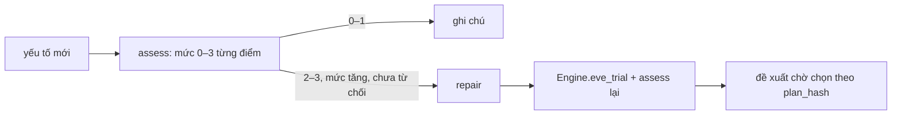
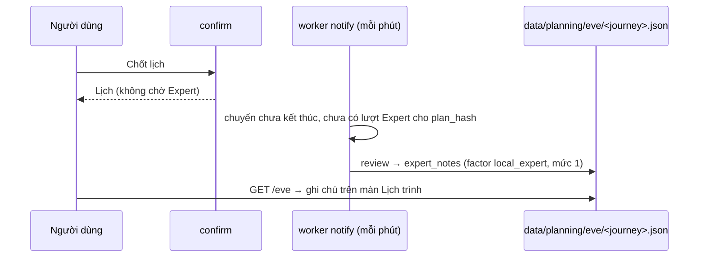
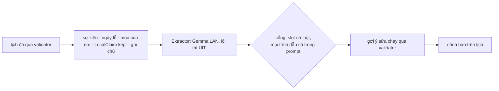

# Planning & Validation + Live Context

Bước online thứ ba và cuối. Vị trí trong luồng: `docs/ARCHITECTURE.md` §3. Đầu vào: `docs/PLACE_DECISION.md` §15. Code: `src/live/` (Live Context) + `src/planning/` (lịch trình); CLI và API ở §CLI và API.

Factory nhận public retrieval cùng binding. Proposal Agent nhận `corpus_binding` và
`corpus_context` bounded: tối đa ba nơi đã chọn, một feature/quote mỗi nơi, status và
observation/source/time. Context chỉ đọc; membership và validator vẫn kiểm proposal trước áp dụng.

## Mục tiêu

Từ **tập địa điểm đã xác nhận** của Place Decision, dựng 2–3 **phương án lịch trình** đã kiểm tra, mỗi phương án tối ưu một mục tiêu khác nhau, sau khi người dùng chọn **chỗ ở bắt buộc**, rồi để người dùng chọn phương án, sửa và chốt. Luồng Web: chọn địa điểm → chọn chỗ ở → phương án bình thường hoặc quá tải. Đổi chỗ ở phải quay lại màn chọn chỗ ở.

Đích: tối ưu có thật (đo được so với baseline), kiểm tra tất định (lịch trông hợp lý là chưa đủ), và giải thích được từng lựa chọn — kể cả cái đã phải hy sinh.

## Phạm vi

Trong: chia ngày; thứ tự trong ngày; khớp giờ mở cửa; chọn thời gian tham quan theo nhịp độ; thời gian đệm và nghỉ; đề xuất chỗ ở (tra live theo yêu cầu); điểm vào / ra thành phố; kiểm tra cuối; độ vững; kế hoạch dự phòng; 2–3 phương án theo mục tiêu; vòng người dùng sửa / góp ý / chọn; Live Context (thời gian di chuyển, thời tiết, chỗ ở, geocode, mặt trời, lễ).

Ngoài: booking và thanh toán; điều hướng turn-by-turn; traffic thời gian thực; giá phòng từ API OTA; nhiều thành phố; cộng tác nhóm; đưa chỗ ở vào Place Intelligence.

## Nguyên tắc

1. **Chỗ ở không bao giờ vào Place Intelligence.** Nó được tra live theo từng request, chỉ sống trong phiên, mang `source` + `fetched_at` (`docs/ARCHITECTURE.md` §1).
2. **Chỗ ở là biến trong bài tối ưu**, không phải danh sách gợi ý rời. Mỗi ứng viên được chấm bằng cách làm anchor đầu / cuối ngày rồi xếp lại cả lịch và đo.
3. **Solver và kiểm chứng tất định.** Agent nội bộ chỉ đề xuất bố trí trên phương án đã dựng; quyền, khả thi và điểm mục tiêu do rule kiểm trước khi áp dụng.
4. **Physical constraint không bao giờ nới ngầm.** Không có đường code nào nới nó.
5. **Không bịa.** Thiếu dữ liệu → `unknown` + gắn cờ, không điền giá trị. Thiếu quán ăn trong tập đã xác nhận → chừa khoảng trống, không tự thêm địa điểm.
6. **Số live luôn có nguồn và thời điểm.** Thời gian di chuyển, giá phòng, thời tiết đều gắn nhãn ước lượng / tham khảo, không phải Fact.
7. **Không xáo lịch âm thầm.** Mỗi thay đổi hiện qua diff; nơi đã khóa không bị dời.

## Ranh giới module

```
src/live/                      Live Context — gọi mạng, đọc-ghi cache; KHÔNG có đường ghi data/intel
  __init__.py                  public API: travel_matrix, route_shape, weather, lodging_near, lodging_seen, geocode,
                               geosearch, flights, flights_url, buses, buses_url, sun_times, holidays, events,
                               advisories, Unavailable
  http.py                      một GET (JSON hoặc trang HTML), một timeout, không retry; lỗi → Unavailable
  cache.py settings.py         cache theo key + TTL → data/live/<source>/; ngưỡng từ config/live.yaml
  osrm/                        ma trận thời gian (/table) + hình lộ trình (/route), service local
  weather/                     Open-Meteo: dự báo theo giờ trong tầm; ngoài tầm → khí hậu theo tháng
  lodging/                     crawl mặt lodging của Maps theo request (Planning không gọi; ứng viên lấy từ corpus)
  geocode/                     text → toạ độ (Nominatim); gợi ý khi gõ (Photon, lỗi → Nominatim)
  flights/                     chuyến bay một ngày từ Google Flights (không còn trong luồng người dùng)
  buses/                       xe khách một ngày từ Vexere (không còn trong luồng người dùng)
  sun.py                       mọc / lặn, công thức NOAA, tính local
  holidays.py events.py        holidays: view CalendarDay + config/holidays.yaml (lớp ghi đè); events: config/events.yaml (nhập tay)
  views.py                     đọc data/<city>/views/*.json (chỉ đọc; thành phố = `views_city` trong config/live.yaml, mặc định dalat)
  advisories.py                config/advisories.yaml (thông báo nhập tay, có nguồn)

src/planning/                  Planning & Validation — rule tất định
  model.py settings.py         kiểu dữ liệu; ngưỡng từ config/planning.yaml
  places.py                    Decision Output + serving record → nơi xếp được + điểm đầu / cuối chuyến
  frame.py                     các ngày của chuyến: ngày, thứ, khung giờ dùng được
  conditions.py                điều kiện từng ngày (DayCond) từ live; hazard, đông khách, đóng cửa dịp Tết; `fetch_live`
  travel.py                    một ma trận OSRM mỗi chuyến, chặng ngắn đi bộ, đường lui thô có nhãn
  traits.py                    fact của một nơi mà mục tiêu / độ vững / dự phòng dùng chung
  lodging.py                   ⓐ vùng tìm → nguồn (corpus `stay` hoặc live) → sàng → xếp theo gu → K ứng viên
  logistics.py                 tra cứu trước khi có phiên Planning: geo, chỗ ở theo tên (chỉ corpus)
  layout.py days.py route.py   ⓑ chia ngày (chèn rẻ nhất + đổi chỗ), số hạng rủi ro của ngày, thứ tự trong ngày
  schedule.py                  ⓒ khớp giờ mở, visit theo pace, đệm, nghỉ
  timefit.py                   độ phù hợp toàn khoảng ghé theo hoạt động, mục đích và ưu tiên buổi
  recommendations.py           gợi ý tùy chọn từ backup_pool, thử xếp và validate trước khi trả
  validate.py                  ⓔ kiểm tra cuối, fail-closed
  robustness.py                ⓕ độ vững 3 mức
  backup.py                    ⓗ dự phòng từ backup_pool
  eve.py                       đổi lịch tối trước mỗi ngày đi (D.3): mức ảnh hưởng, sửa tối thiểu, chống báo thừa
  objectives.py variants.py    ⓖ điểm theo mục tiêu; dựng 2–3 phương án
  build.py                     ghép một đường: prepare → schedule_trip → with_home
  repair.py scope.py           repair_day; phạm vi chạy lại
  output.py                    Plan Output
  session.py                   phiên có phiên bản, undo / redo
  agent.py guard.py policy.py  một call mỗi lượt chữ; guard; policy từ khóa khi agent lỗi
  proposal.py                 PlanningProposal và call Agent nội bộ, không chat
  tools.py skills.yaml        adapter public cho harness; quyền agent theo module
  engine.py server.py          HTTP + SSE, cổng 8768
  evaluate.py                  đo offline trên 30 chuyến ẩn
```

Phụ thuộc một hướng: `planning` → `live`, `decision`, `trip`, `corpus.serving`, `corpus.ontology`, `corpus.snapshot`, `corpus.releases`, `corpus.retrieval` (chỉ đọc; chỉ qua `__init__.py`; RULE §2). `live` không biết `planning`. `decision` không đổi.

Dữ liệu:

| Thư mục | Ghi bởi | Nội dung |
|---|---|---|
| `data/live/<source>/` | `src/live` | cache theo request, có TTL, mỗi mục mang `source` + `fetched_at` (`lodging`, `osrm`, `weather`, `geocode` — chỉ tạo khi nguồn đó được gọi) |
| `data/planning/sessions/` | `src/planning` | phiên API độc lập; `data/planning/eval.json` là kết quả `evaluate` |
| `data/intel/`, `data/serving/`, `data/gmaps/` | chỉ offline corpus | Planning chỉ đọc |

## Đầu vào

Decision Output nguyên dạng (`docs/PLACE_DECISION.md` §15): `confirmed` (id, role `anchor | locked | selected`, visit minutes, flags, relaxed), `backup_pool` (kèm `for` + `reason`), `wishlist`, `trip_context` (bản chụp Search Input), `decision_log`, `feasibility`, `lodging` (chỗ ở người dùng chọn ở Lựa chọn, hoặc `null`).

Quy ước: **mọi ngày bắt đầu và kết thúc ở chỗ ở**, kể cả ngày đầu và ngày cuối. `entry_point` / `exit_point` của Trip State không dời điểm đầu / cuối ngày; ngày đầu / cuối chỉ bị cắt theo `checkin_at` / `checkout_at`.

## Live Context

Mọi hàm trả `None` khi không có dữ liệu; không bịa. `src/live` không import `corpus.aggregate` / `corpus.serving` để ghi, và test khẳng định không có đường ghi tới `data/intel`, `data/serving`, `data/gmaps`.

| Nguồn | Public API | Cách lấy | TTL | Khi lỗi |
|---|---|---|---|---|
| `osrm/` | `travel_matrix(points, mode)`, `route_shape(points, mode)`, `route_steps(points, mode)` | OSRM local trên OSM Việt Nam; `/table` cho ma trận, `/route` cho hình đường của lịch đã chốt; `route_steps` = tên đường từng chặng (nhận chặng qua đèo) | 7 ngày | rơi về ước lượng thô của Planning (`travel.rough_minutes`: đường chim bay × `road_factor` ÷ `rough_speed_kmh`); plan gắn `travel_source = rough` + cảnh báo; độ vững trần "Khả thi" |
| `weather/` | `weather(lat, lng, dates)`, `weather_hourly(lat, lng, day)` | `weather_hourly`: theo giờ một ngày, hai model `best_match` + `gfs_seamless` (mưa %, mm, gió giật, dông, sương mù = mã 45/48 hoặc tầm nhìn < 1 km, `disagree` khi hai model lệch ≥ 0,5 hoặc lệch dông; ngoài tầm → `None`). `weather`: Open-Meteo forecast theo ngày (trong tầm 16 ngày): xác suất mưa, lượng mưa mm, gió giật, dông (`weather_code` 95–99). Ngoài tầm → xác suất mưa theo tháng: `rain_prob_override_by_month` trong `config/climate.yaml` (ghi đè tay) > view `ClimateNormal` (`docs/CORPUS.md` §View toàn cầu) > `rain_prob_by_month` (ước lượng tay, chỉ khi chưa dựng view) | 3 giờ / tĩnh | `None` → ngày đó không xét thời tiết, gắn cờ "chưa biết thời tiết"; số nguồn không cho giữ `None` |
| `lodging/` | `lodging_near(…)`, `lodging_seen()` | crawl mặt "Khách sạn" của Maps theo request; Planning **không** gọi (ứng viên chỗ ở chỉ lấy từ corpus, ⓐ) | 24 giờ | — |
| `geocode/` | `geocode(text)` | Nominatim, 1 req/s, User-Agent riêng của dự án | 30 ngày | `None` → hỏi lại người dùng |
| `geocode/` | `geosearch(text, limit=6)` | Photon (OSM, làm cho gõ-tới-đâu-gợi-ý-tới-đó), lỗi → Nominatim | 30 ngày | `Unavailable` → ô tìm hiện "không thấy" |
| `flights/` | `flights(src, dst, day, fetch=True)` | không còn trong luồng người dùng (không hỏi chuyến bay). Google Flights (`hl=vi`, `curr=VND`) qua `corpus.crawl.open_sessions`; đọc `aria-label` của từng dòng chuyến ("Từ … đồng … của <hãng>. Rời … lúc HH:MM … và đến … lúc HH:MM …") | 26 giờ | `Unavailable` (captcha, trang không có dòng nào, trình duyệt chết); không bao giờ trả chuyến giả |
| `buses/` | `buses(origin, day, way, fetch=True)` | không còn trong luồng người dùng (không hỏi chuyến xe). Trang tuyến của Vexere; trang render sẵn nên một GET HTTP stdlib là đủ, không cần trình duyệt: chuyến nằm trong `__NEXT_DATA__` `routeReducer.trips` (giờ đón / đến của `route.schedules[0]`, `fareLarge`, điểm đón / trả). `origin` là toạ độ (tỉnh gần nhất trong `config/live.yaml` `vexere_regions`) hoặc tên tỉnh | 26 giờ | `Unavailable` (trang đổi / bị chặn, tỉnh không có trong bảng) |
| `sun.py` | `sun_times(date, lat, lng)` | công thức NOAA, không mạng, không thêm dependency | — | — |
| `holidays.py` | `holidays(dates)` | view `CalendarDay` (thư viện `holidays` + âm lịch), `config/holidays.yaml` đè tên và thêm ngày | — | chưa dựng view → chỉ file |
| `events.py` | `events(dates)` | `config/events.yaml` (lễ hội, Noel, Tết; nhập tay): `crowd` busy / peak, `closure_risk` | — | ngày không liệt kê = chưa biết sự kiện nào, không phải ngày vắng |
| `advisories.py` | `advisories(dates)` | `config/advisories.yaml` (thông báo thiên tai / đường bị chặn, nhập tay từ thông báo chính thức, bắt buộc có `source`) | — | rỗng = chưa có thông báo trong dữ liệu, **không** phải an toàn |

### OSRM

Thiết lập một lần mỗi máy, `scripts/osrm_setup.sh` + mục trong `README.md`: tải `vietnam-latest.osm.pbf` (Geofabrik) → `osrm-extract` (profile `car`) → `osrm-partition` → `osrm-customize` → `osrm-routed --max-table-size 300`.

Mode: OSM không có profile xe máy chuẩn. Dùng profile `car` rồi nhân `mode_factor` (`config/live.yaml`: `car 1.0`, `motorbike 0.95`). Chặng ngắn hơn `walk_km` tính đi bộ bằng khoảng cách × `road_factor` ÷ tốc độ đi bộ. Mọi số này hiển thị là **ước lượng**, không nói là thời gian thật của một nhà cung cấp nào.

Một ma trận mỗi lượt cho tập điểm = `confirmed` + `backup_pool` có tọa độ + K chỗ ở + chỗ ở của người dùng. Mọi phương án và lần thử thêm backup dùng chung ma trận đó.

### Điều kiện từng ngày

Một ngày có thể đổi chính kế hoạch: thời tiết xấu hơn mức "xác suất mưa", cuối tuần / lễ / lễ hội làm đông, dịp Tết nhiều quán đóng cửa, thông báo thiên tai. Engine gọi `conditions.fetch_live` (một lần mỗi lần dựng) lấy `weather` và `signals` (`holiday`, `events`, `advisories` mỗi ngày) từ `src/live`; `prepare()` đổi chúng thành một `DayCond` cho từng ngày có ngày cụ thể. Ngày không có tín hiệu thì không có `DayCond` và lịch giữ nguyên như trước. Nguồn thời tiết không trả lời → `weather = None` (cờ "chưa biết thời tiết"); ba file nhập tay không bao giờ làm hỏng chuyến.

| Điều kiện | Cách đọc | Tác động |
|---|---|---|
| Thời tiết | `heavy`: dông hoặc mưa ≥ `heavy_rain_mm` hoặc gió giật ≥ `heavy_gust_kmh`; `severe`: mưa ≥ `severe_rain_mm` hoặc gió giật ≥ `severe_gust_kmh` | `heavy` tính như ngày mưa (`wet` ≥ `rain_high`): đệm lớn hơn, nơi ngoài trời bị phạt khi chia ngày, nơi nhạy cảm có dự phòng, mục tiêu `weather_robust`, kịch bản mưa của độ vững. `severe`: nơi `weather_exposed` **không được xếp** vào ngày đó |
| Thông báo | `advisories.yaml`, phạm vi `city` hoặc vòng tròn `lat, lng, radius_km` | `severe`: nơi trong phạm vi không được xếp (bão chỉ chặn nơi ngoài trời; ngập, sạt lở, cháy, đường bị chặn chặn mọi nơi trong vùng); thấp hơn `severe`: vẫn xếp, có cờ, nơi trong vùng là nhạy cảm (`advisory`) và dự phòng không lấy nơi cùng vùng |
| Vùng hạn chế | view `RestrictedArea` (`docs/CORPUS.md` §View toàn cầu) qua `corpus.views`, thành phố = `views_city` của `config/live.yaml`; chỉ có khi chuyến có ngày | chỉ cảnh báo, không bao giờ loại (OSM chưa đủ): nơi nằm trong vùng là nhạy cảm (`advisory`, mức `watch`) và dự phòng không lấy nơi cùng vùng; `build.restricted_warnings(ctxs, results)` thêm một câu `restricted_place` cho **mỗi nơi có trong lịch** (có `place_id`, nói loại vùng + tên, "kiểm tra trước khi đi", dữ liệu có thể chưa đủ), một lần cho cả chuyến chứ không lặp theo ngày; nơi chưa xếp hoặc đã bị bỏ thì không có câu (gọi từ thẻ phương án trong `schedule_trip`, từ view của engine cạnh `pin_warnings`, và từ `output.build` cho kế hoạch đã chốt); view chưa dựng = chưa biết, không phải không có vùng |
| Đông khách | cuối tuần = `busy`; ngày lễ hoặc sự kiện `peak` = `peak`; một nơi "đông" khi `crowd = high` đã xác minh hoặc `crowd_by_time` của chính nó ≥ `crowd_busy_pct` đúng loại ngày (`weekday` / `weekend` / `holiday`) | nơi đông: thời gian tham quan tăng `crowd_visit_pct`, đệm thêm `crowd_buffer_min`; chia ngày phạt `weights.crowd` × mức × (`crowd_avoid_factor` nếu người dùng tránh đông); ngày `peak` làm nơi đó nhạy cảm (`crowd`) và dự phòng không lấy nơi đông; `crowd_tips` nói giờ vắng nhất từ chính số liệu của nơi |
| Đóng cửa dịp Tết | sự kiện `closure_risk` | cờ mỗi ngày; nơi ăn uống được đệm thêm `closure_buffer_min` và nhạy cảm (`holiday_closure`), dự phòng phải có giờ đã xác minh. Không tự kết luận một quán đóng |

Validate là chỗ duy nhất quyết định: nơi bị hazard mà vẫn có trong lịch là vi phạm `hazard`; không ngày nào xếp được → `back_to_decision` như mọi vi phạm khác. Dữ liệu vắng thì không kết luận: ngày không có số đo không thành `severe`, và "không có thông báo" không bao giờ được viết thành "an toàn".

Plan Output (qua `shared_output` và view của Engine) thêm `day_conditions` (từng ngày, chỉ khi có điều kiện) và `crowd_tips`. Web hiện chúng trên ngày đang chọn (`web/src/user/screens/Plan.tsx`).

### Trạng thái vận hành theo thời điểm

`place_live_status(place)` (đóng cửa tạm, giờ ngày lễ) chỉ chạy ở bước xác nhận cuối, best-effort, timeout mỗi nơi, giới hạn số nơi mỗi phiên. Không tra được → giữ cảnh báo "kiểm tra lại trước chuyến" như giờ `UNCERTAIN` / `OUTDATED` đã có. Không bao giờ sửa giờ trong corpus.

## Thuật toán

### ⓐ Ứng viên chỗ ở — `lodging.py`

0. **Chỗ ở của người dùng:** Decision Output có `lodging` (chọn ở tab "Chỗ ở" của Lựa chọn, `docs/PLACE_DECISION.md` §15), hoặc Trip có `lodging_booked = yes` và `lodging` có toạ độ → chỗ ở đó là `base` (mọi ngày đi và về từ đó); phiên mở ra đã có `lodging_point` (`source: user`, kèm `price_vnd` và `place_id` khi là chỗ ở trong corpus), `lodging.status = booked`; không gợi ý. Đổi chỗ ở = quay lại tab "Chỗ ở" của Lựa chọn.
1. **Vùng tìm:** tâm trọng số của các nơi đã chọn (trọng số = `visit typical`); tách tối đa 2 tâm nếu đường kính cụm > `split_min`.
2. **Nguồn:** chỉ bản ghi serving nhóm `stay` trong vùng (≤ 2 × `radius_km` quanh một tâm),
   `source: corpus`. Giá đêm: nếu `corpus.serving.stay_prices` (qua `stayprice.overlay`) có giá của đúng
   chỗ ở, đúng ngày nhận phòng (`start_date`) và đúng số đêm, và `observed_at` không quá `stay_price_max_age_h`
   (`config/planning.yaml`) thì dùng giá đó (`price_kind: dated`, `price_at` = `observed_at`; thẻ thêm
   `price_age_h`). Không khớp (khác ngày, khác số đêm, quá cũ) thì rơi về `price_per_night` (giá tham khảo
   mặc định Maps, `price_kind: reference`, `price_at` là ngày đọc); không có cả hai thì `price_vnd` là
   unknown (`price_kind: null`), không đoán. Trần giá, điểm giá, thẻ và tổng chi phí đều dùng giá đã chọn
   này; không lấy giá/người làm giá/phòng/đêm. Trần tham khảo = `lodging_share ×
   trip.group_budget(context) ÷ trip.nights(context)` khi quy đổi được tổng nhóm/chuyến.
   Thiếu scope/days/people cần thiết giữ unknown; không suy số phòng/capacity/availability.
   Đây là trần tham khảo, không chứng minh đủ tiền phòng cho cả nhóm vào ngày đi.
   **Dòng tiền phòng theo đêm** (`validate.lodging_budget`, tách khỏi kiểm ngân sách từng ngày vì không
   chặn chốt): mỗi đêm một dòng `{night, date, price_vnd, price_kind, price_age_h, over_vnd}` + `total_vnd`,
   `per_night_cap_vnd` (chính trần ở trên), `over_budget`, `over_vnd`. Trả về trong thẻ phương án
   (`lodging_budget`) và kế hoạch đã chốt (`cost.lodging_nights`). Vượt trần chỉ là cảnh báo
   `lodging_over_budget` (nêu giá, trần, số vượt, nguồn giá + tuổi), không bỏ nơi nào, không thành
   vi phạm. Giá hoặc trần unknown thì `over_budget: null`, không đoán.
3. **Sàng tất định:** ngoài vùng hoặc dưới `min_reviews` → bỏ. Public `requirements` kiểm
   cả eq/ne, scope accommodation và unknown policy. Physical/suitability/fit unknown luôn
   fail-closed; feature thường dùng exclude/flag, legacy thiếu policy dùng flag. Unknown được
   phép giữ ghi `unverified`; không thành pass có bằng chứng. Chỗ ở corpus người dùng chọn
   vẫn phải qua kiểm requirement, không được bypass bằng trạng thái booked.
4. **Bể để xếp:** `lodging_pool` chỗ hợp gu nhất (gần hơn thắng khi bằng nhau) để ma trận di chuyển nhỏ.
5. **Xếp hạng** (sau khi ma trận có các ứng viên): `lodging_score = w_pref·pref_fit + w_loc·loc_fit + w_price·price_fit + w_rating·rating_fit` (`lodging_weights`, gu nặng hơn vị trí). `pref_fit` = tổng soft (`love` +1, `avoid` −1) và người đi cùng (`kids`, `parents` → `elderly`, `partner` → `couples` `=suitable`, +1) mà feature `VERIFIED` của chỗ ở khớp, chia số mong muốn; không có bằng chứng → 0, không bao giờ âm (`docs/PLACE_DECISION.md` §8). `loc_fit = 1 − phút trung bình tới các nơi đã chọn ÷ loc_ref_min` (≥ 0). `price_fit` theo trần giá, không giá → 0. `rating_fit` = `provenance.reputation.score` (0..1) của chỗ ở: rating và số review của Maps trên cùng một thang trong nhóm `stay` (`docs/CORPUS.md` Serving record, Uy tín), nên 4,6 sao / 3.000 review hơn 4,9 sao / 500; không có uy tín → rating Maps theo `(rating − 3,5) / 1,5` nếu có, không có → 0. Thẻ hiện rating và số review của Maps (`identity.rating`, `identity.reviews`). Giữ `lodging_k`. Mỗi thẻ mang `fit` ("hợp vì": nhãn feature + số đánh giá nhắc), `avg_min`, `unverified`, `price_at`, `address`.
6. **Trước khi có phiên:** `Engine.lodging_options(decision)` xếp đúng như trên cho bản nháp Decision Output (chưa chốt) để Lựa chọn hiện danh sách; không tạo phiên, cache theo tập nơi + bối cảnh chuyến. Trip đã có chỗ ở thì danh sách vẫn hiện (đổi được). Danh sách gồm **mọi** chỗ ở trong corpus qua được ràng buộc cứng và trần giá, trả theo trang (`offset`, `limit`, mặc định `lodging_list_k` thẻ; kèm `total`). Đã chọn nơi: tối đa `lodging_list_k` chỗ quanh các nơi đó lên đầu, xếp như trên (có `avg_min`); mọi chỗ còn lại theo sau, xếp theo gu rồi điểm đánh giá, không có `avg_min`. Chưa chọn nơi nào: cả danh sách xếp theo gu rồi điểm đánh giá. Mỗi thẻ có cùng trường với thẻ Place Decision (`category`, `area`, `rating`, `why`, `tradeoffs`, `location {center, km, minutes}`, `confidence`) để web vẽ bằng một `PlaceCard`: `why` = điều người dùng muốn (`fit`) rồi điểm mạnh VERIFIED từ 2 người nhắc (giá trị đầu của `polarity`, hoặc `present` / `suitable` / `good` / `included`; không tính `steep_or_stairs`, `cold`), thêm "Gần <tâm>" khi ≤ `near_min`; `tradeoffs` = mặt xấu VERIFIED (giá trị cuối của `polarity`) và "chưa biết ngân sách" khi chưa có ngân sách; `confidence` theo số người viết (≥ 40 cao, ≥ 10 vừa). Cấu hình `polarity`, `center`, `near_min`, `speed_kmh`, `road_factor` lấy từ `decision.load_settings()` qua `Engine(card_cfg=…)` (`tools.py`).
7. Không bắt buộc chỗ ở: thiếu thì lịch vẫn xếp (ngày bắt đầu ở nơi đầu tiên, cảnh báo `base_unknown`), Web chỉ nhắc chọn chỗ ở, không chặn.

### ⓑ Chia ngày — `layout.py`, `days.py`

- Khung ngày: ngày đầu từ `checkin_at`; ngày cuối đến `checkout_at`; ngày giữa `day_start..day_end`.
- `layout.assign`: mỗi ngày cắt thành các đoạn trống giữa những khối giờ cố định của người dùng; một đoạn chứa số phút còn lại sau bữa và nghỉ. Nơi khó xếp (có giờ trong ngày, ít ngày mở, xa chỗ ở) vào trước, mỗi nơi lấy đoạn và vị trí **thêm ít phút đường nhất** (cộng độ đầy của ngày, ngày lệch khu vực, mưa / đông của ngày theo mục tiêu), rồi đổi chỗ từng nơi giữa các ngày để cải thiện. Nơi thừa vẫn có thể vào khi một ngày nhường hết cho ngày khác hoặc hai ngày đổi nhau. Tất định. Không còn gom cụm và DP trên tập con (`cluster.py`, `assign_days` đã gỡ 2026-10-29).
- `days.py` chỉ còn các số hạng rủi ro mà `objectives.metrics` đọc: `day_risk`, `exposed_risk`, `repeats`, `pref_risk`.
- Ghim: anchor giờ cố định ghim ngày + giờ; nơi chỉ mở vài ngày trong chuyến ghim ngày; `locked` cùng ngày người dùng đã chỉ định không đổi. Nơi không vào được ngày nào trả về `leftover`, không bị bỏ ngầm; nơi người dùng bắt buộc đi vẫn được đặt dù không vừa (kiểm tra cuối nói rõ).

### ⓒ Thứ tự trong ngày — `route.py`

- Mỗi ngày mở và kết ở chỗ ở, kể cả ngày đầu và ngày cuối.
- n ≤ `exact_n` (7) nơi mỗi ngày → **vét cạn permutation** (≤ 5040), chấm bằng mô phỏng đầy đủ → tối ưu thật. n lớn hơn → nearest-neighbour + 2-opt + or-opt. Cả hai tất định. Mỗi lần tìm thứ tự tái sử dụng giờ mở, cửa sổ ghim và quy tắc giờ ghé của ngày; cache điểm theo nơi/giờ đến/giờ đi và chặng có hướng, mỗi bảng kết quả tối đa `cache_entries`. Cache này kết thúc cùng lần tìm thứ tự, không dùng lại qua thay đổi bối cảnh; validator vẫn kiểm độc lập.
- Buổi: `pins` (`config/planning.yaml`: `sunset_view`, `cloud_hunting`, `live_music`) + `sun_times` → hoàng hôn / đêm ghim cuối ngày; sương / bình minh ghim đầu ngày. Một nơi có nhiều tính năng theo giờ chỉ cần **một**, không lấy giao: nếu người dùng muốn (soft weight dương) một trong số đó thì chỉ giữ các ghim được muốn (`build.prepare`), còn lại ưu tiên khung nằm trong ngày. Khung mà giờ mở cửa của chính nơi đó không chứa nổi (nhạc 18:00 ở quán đóng 18:30) thì không ghim. Ngày nào vẫn hỏng vì hai nơi cùng muốn một buổi → bỏ ghim của nơi xếp muộn nhất trước, tới khi ngày đạt, kèm cảnh báo `pin_dropped`; nơi đó vẫn được ghé, chỉ không đúng giờ đẹp nhất.
- Bữa ăn: tối đa ba khung sáng / trưa / tối trong ngày thực tế. Mỗi điểm có activity `eating` chiếm một khung riêng, ưu tiên trưa / tối và phải hợp giờ mở, giờ ghim, ngày đến / đi. Các điểm ăn được xếp riêng để chia sang ngày có khung phù hợp; không còn khung thì báo `meal_window`, không chuyển ngầm thành tham quan. Validator kiểm tra lại độc lập.
- Activity đã chỉ định trong chuyến thắng mặc định của địa điểm. Khi chưa chỉ định, café dùng `coffee`, nhà hàng dùng `eating`; Decision ghi ý định suy ra vào output, không mở câu hỏi meal và không sửa Place Intelligence. `usable_as: meal` không tự biến café thành nhà hàng.
- Khung chưa có điểm ăn thành `meal_free`, thời lượng lấy từ `meal_durations`. Chừa bữa trước visit dài có thể nuốt hết khung; nếu chuyến tham quan kết sớm vẫn hiện bữa còn lại dưới dạng tùy chọn, trong giới hạn ngày. Không bịa nhà hàng. Web gợi ý ăn ngoài hoặc hỏi chỗ ở có phục vụ bữa đó; dịch vụ và giá chưa xác nhận.

### ⓓ Giờ, tham quan, đệm, nghỉ — `schedule.py`

Visit theo pace: thong thả → `long`, cân bằng → `typical`, đi nhiều nơi → `short`. Coffee, ăn và uống chỉ lấy `long` khi có sở thích dương khớp địa điểm đạt `duration_preference_weight`; pace thong thả đơn thuần dùng `typical`. Thời lượng là một khoảng ước tính: mức đã chọn không vừa ca mở cửa, khung bữa ăn hoặc phần còn lại của ngày thì rút dần về mức `short`, không thấp hơn. Kiểm tra độ vững (`robustness.py`) không rút, để "trễ 15 phút" vẫn đo đúng. Đến sớm → `wait`; quá giờ đóng → vi phạm. Đệm = `buffer_min[pace]` + phụ phí theo độ không chắc (mưa, chặng dài, giờ `UNCERTAIN`). Nghỉ chèn theo pace, và chặn "đi liên tục quá `max_consecutive_min` mà không nghỉ".

### Độ phù hợp giờ ghé — `timefit.py`, `recommendations.py`

Chấm **toàn khoảng visit** theo hoạt động đang chọn và `context.purpose`; không dùng độ nổi tiếng để suy ra giờ đẹp. Ưu tiên buổi có evidence của user thắng heuristic; ưu tiên riêng cho POI thắng ưu tiên chung cho hoạt động. Hoạt động đã chỉ định rõ không bị đổi theo category. Thiếu giờ mặt trời cho sunrise/sunset → chưa chấm được, không bịa giờ.

Mặc định mềm từ config: sáng 08:00–11:00 cho anchor/hoạt động tốn sức; giữa trưa 11:30–14:30 cho coffee/nghỉ; chiều 14:30–17:30 hoặc sáng cho đi dạo/vườn; tối từ 18:00 cho nightlife/bar. Chụp ảnh ngoài trời ưu tiên ánh sáng ban ngày; giờ ăn do `meal_windows` quyết định. Chợ không tự được coi là chợ đêm. Đây là ước lượng có thể cấu hình, không phải nghiên cứu sinh lý hay Fact của địa điểm.

Phạt tính theo phần visit ngoài cửa sổ và phần thời lượng đã rút. Bộ xếp giờ thử đến sớm nhất và đầu cửa sổ ưu tiên, có thể rút tới `short`, giữ giờ mở, bữa ăn, giờ ghim và constraint. Nếu chờ giờ đẹp gây vi phạm hoặc lỡ bữa, thử lịch đến sớm nhất. Phí này tham gia chọn thứ tự và chia ngày. Không tự bỏ nơi đã chọn; thiếu thời gian được báo qua overload.

`time_suitability` giải thích giờ ghé, phần phù hợp, nguồn user/heuristic và phút rút. `recommendations` báo khoảng trống hoặc quá tải. Gợi ý địa điểm chỉ lấy ID thật chưa ghé từ `backup_pool`, kế thừa hoạt động của nơi được thay; thử chèn rồi validate toàn lịch, hard constraint và ngân sách. Không có ứng viên phù hợp vẫn có thể gợi ý nghỉ. Chỉ act của user mới thêm nơi; thêm sẽ xếp lại ngày và có undo. Tắt `time_suitability.enabled` tắt cả scoring, phí rút và gợi ý này.

Các thẻ sau khi chọn chỗ ở giữ bản nháp theo neo, giá và ma trận có hướng. Khi đổi neo và chưa sửa pace, objective hoặc khung ngày, phương án quá tải được chọn lại tập con theo chỗ ở mới; selection gốc trong Decision Output giữ nguyên. Timeline đang chọn và các chỉnh sửa riêng vẫn được kiểm lại, không tự áp dụng tập con mới. Chọn thẻ chưa có chỉnh sửa riêng dùng đúng timeline đó; `metrics`, bảng so sánh và lịch chi tiết cùng nguồn. Giá chỗ ở cộng đúng một lần vào giá đã biết; chỗ ở chưa có giá được tính là unknown ở cả thẻ và kết quả chốt. `time_budget` khi chốt dùng khung ngày hiện tại sau sửa. Phút tham quan, di chuyển và bữa tự chọn được đo từ các item thực tế; giá bữa tự chọn chưa được xác nhận.

Giảm độ trễ: composer tái sử dụng lịch của cùng tập địa điểm trong một lượt tìm; thẻ theo chỗ ở và phần hiển thị của lịch hiện tại dùng cache có giới hạn. Read hoặc chọn thẻ không đổi bối cảnh không chạy lại bộ xếp lịch, robustness và backup. Đổi tọa độ, giá hoặc chặng di chuyển làm mất hiệu lực cache; validator vẫn kiểm lại trước khi chốt.

### Chi tiết địa điểm — `details.py`

Khối `details` của bản ghi serving (`docs/CORPUS.md` §Chi tiết địa điểm) đổi lịch như sau; nơi không có dữ liệu giữ hành vi cũ.

| Dữ liệu | Tác dụng | Nơi |
|---|---|---|
| `cost.total_vnd` | `cost_of` lấy `base` (vé + gửi xe, một người) thay cho giá vé ước tính; giá theo xe / nhóm (`per_party`) chia cho `people` của chuyến (đi một mình trả cả xe). `metrics.extras_max_vnd` = Σ (`with_extras` − `base`): tối đa các khoản thêm có thể cộng | `places.py`, `objectives.py` |
| `timing.best_time` / `avoid_time` | Điểm thưởng `timing_bonus` và phạt `timing_penalty` theo tỷ lệ **toàn bộ khoảng ghé** nằm trong buổi người đi trước khuyên / khuyên tránh. Phần giao của hai loại khung triệt tiêu; phần ngoài khung trung tính. Chỉ khi `time_suitability.enabled` | `timefit.py`, `details.py` |
| `timing.last_entry` | Nguồn official là giờ bắt đầu muộn nhất (cứng, nằm trong `pin_window`, nên cả bộ xếp lịch lẫn `validate` đều tôn trọng); nguồn review chỉ cảnh báo `last_entry_review` | `schedule.py`, `details.py` |
| `night_road_risk` | Xe máy + visit kết thúc sau hoàng hôn + giá trị đã xác minh: thêm `night_road_penalty` và cảnh báo `night_road` (không có giờ hoàng hôn thì không chấm) | `timefit.py`, `details.py` |
| `best_months` / `avoid_months` | Tháng của ngày trong `avoid_months`: cảnh báo `season_avoid` và lý do dự phòng `season` (nơi thay không được nằm trong tháng tránh); trong `best_months`: dòng "đúng mùa đẹp" ở checklist | `backup.py`, `details.py` |
| `relations.quieter` | Ngày `crowd = peak` và nơi nhạy đông: nơi vắng hơn cùng kiểu được xếp lên đầu danh sách thay | `backup.py` |
| `bring`, `booking`, `scam_stage`, `cold`, `fog_blocks_view`, `schedule` | `checklist` chuẩn bị theo ngày và nơi; dòng sương mù chỉ có khi nguồn thời tiết báo `fog` cho ngày đó (nguồn hiện tại chưa có trường này nên chưa bao giờ hiện); `schedule` khi thứ của ngày trùng lịch cố định | `details.py` |

Mỗi phương án (`variants.py`) mang `checklist` và các cảnh báo mới trong `warnings`; Plan Output giữ lại đúng những thứ đó.

### ⓔ Kiểm tra cuối — `validate.py`

Lịch đầy đủ (`DayCtx.require_meals = True`) phải có bữa tương ứng với khung ngày và mỗi visit dài ít nhất `visit.short`. Validator lấy visit từ `items`, kể cả khi `DayResult.order` trống. Cache kiểm ngày xét record của các visit thực tế và thời gian giữa các endpoint travel; đổi giờ mở, thời lượng hoặc chặng không dùng kết quả kiểm cũ.

Nơi **duy nhất** kết luận đạt / không đạt, và kết luận từ chính dòng thời gian cuối cùng. Tám kiểm tra: ngày đi · giờ mở cửa · chồng lấn · thời gian di chuyển · anchor · ngân sách (gồm tiền phòng khi đã biết giá) · hard constraint · địa điểm trùng (cùng **một** nơi xếp hai lần). Hai nơi "gần trùng" (cùng kiểu, `PLACE_DECISION.md` §9.1) mà người dùng vẫn giữ là lựa chọn của họ: chỉ cảnh báo `near_duplicate`, không chặn. Kiểm "đúng giờ đẹp nhất" (hoàng hôn, bình minh, nhạc): nơi nào bộ xếp lịch đã bỏ ghim giờ để vừa ngày (cảnh báo `pin_dropped`) được ghi trong `DayResult.unpinned`, và mọi lần kiểm lại, kể cả lúc xác nhận, tôn trọng đúng quyết định đó, nên kế hoạch đã hiện ra là hợp lệ thì xác nhận được. Cảnh báo `pin_dropped` viết ngắn ("{nơi} không kịp vào đúng giờ đẹp nhất, mình xếp lúc khác trong ngày"); chỉ thêm "Giữ giờ đó thì vướng …" khi lý do thật sự của nơi đó: giờ mở cửa chưa biết (`hours = None`) không bao giờ là lý do (không thể vi phạm điều chưa biết). Thêm một kiểm `hazard` (nơi bị thời tiết rất xấu hay thông báo `severe` loại khỏi ngày, xem §Điều kiện từng ngày). Trả `ok` + danh sách vi phạm, mỗi vi phạm có `physical: bool` và cái giá đã tính của từng cách sửa. Không phương án nào hợp lệ → trả về tầng Place Decision kèm nơi gây lỗi (`docs/PLACE_DECISION.md` §14, dòng "Planning báo không xếp được").

### ⓕ Độ vững — `robustness.py`

Nhiễu cố định trong config, không random: xuất phát trễ +15 / +30 phút; visit +20%; travel +25%; mưa theo xác suất dự báo. Mỗi kịch bản chạy lại thứ tự đã chọn của từng ngày và đếm số nơi bị mất (ngoài giờ mở, hoặc sau nó không kịp về điểm kết ngày; đệm là thứ hấp thụ trễ). Mưa không random: nơi phơi mưa ở ngày `rain_prob ≥ rain_high` tính là mất; không có dự báo thì bỏ kịch bản này và nói rõ. Ba mức — **Vững** (đủ đệm để chịu vài chậm trễ nhỏ), **Khả thi** (chạy được nếu phần lớn đúng giờ dự kiến), **Mong manh** (đúng về toán nhưng một chậm trễ nhỏ làm hỏng các điểm sau): Vững = mọi kịch bản mất ≤ `solid_max_lost`; Khả thi = các kịch bản `tier: small` mất ≤ `feasible_max_lost`; còn lại Mong manh. `travel_source = rough` → trần "Khả thi".

### ⓖ Mục tiêu và phương án — `objectives.py`, `variants.py`

**Nhịp độ và mục tiêu là hai thứ riêng.** Nhịp độ (`pace`: thong thả · cân bằng · đi nhiều) mô tả cường độ chuyến đi và đổi thành tham số: thời gian tham quan, số nơi mỗi ngày, thời gian nghỉ, độ lớn đệm, mức di chuyển chấp nhận. Mục tiêu mô tả tối ưu theo cái gì.

Năm mục tiêu: `least_travel`, `low_cost`, `weather_robust`, `diverse`, `preference_fit`. Chọn tối đa 3 bằng rule từ Trip State (pace; `budget_vnd` đã biết?; tháng mưa?; `soft_weights`) — không cố định trước.

`metrics.time_penalty` đo phí giờ ghé. `score` giữ hai thành phần: mục tiêu chính, rồi `travel_min + time_penalty` để phân biệt phương án cùng điểm chính.

```
for lodging in K+1 ứng viên:          # 6 + phương án không chỗ ở
    for obj in mục tiêu đã chọn:      # ≤ 3
        p = schedule(layout(places, lodging, obj), obj)
        if validate(p).ok:
            score[(obj, lodging)] = obj.score(p), robustness(p)
best mỗi obj → 2–3 phương án; bỏ phương án trùng (cùng chỗ ở + cùng thứ tự mọi ngày)
```

21 lần dựng lịch mỗi lượt (K+1 chỗ ở × tối đa 3 mục tiêu), dùng chung một ma trận OSRM (toạ độ ứng viên nằm
trong CÙNG ma trận đó) và cache thứ tự theo ngày (khung giờ, điểm mở/đóng), pace, mặt trời, mưa và tập nơi (activity, pins, visit, short) — đổi chỗ ở chỉ đổi
điểm mở/đóng ngày, không chia lại ngày. Mỗi mục tiêu giữ tổ hợp (chỗ ở, lịch) tốt nhất riêng cho nó.
Ngân sách: **< 2 s** khi cache nóng, đo trong `evaluate.py`.

### ⓗ Dự phòng — `backup.py`

Nơi nhạy cảm = ngoài trời + ngày mưa xác suất cao · giờ `UNCERTAIN` / `OUTDATED` · sát giờ đóng · ở khu vực xa. Thay thế lấy từ `backup_pool` (Decision đã kèm `for` + `reason`): cùng khu vực, cùng nhóm, qua được constraint. Không có → nêu rõ "không có phương án thay".

## Đổi lịch tối trước ngày đi — `eve.py`

Sau cờ `eve_replan.enabled` (`config/planning.yaml`). Đo trước khi bật: `tests/planning/eve_scenarios.py` (kết quả `logs/planning_eve/`); test `test_planning_eve_scenarios.py` không cho bật cờ khi bộ kịch bản trượt.



**Yếu tố** (`Factors`, mỗi nguyên nhân mang `source` + `retrieved_at`): thời tiết theo giờ ở toạ độ từng điểm (`live.weather_hourly`; giờ có số ngoài miền vật lý bị coi là chưa biết, xem cổng tool ở §Local Expert), `Notice` trên chặng qua đèo (bước OSRM có tên bắt đầu bằng `pass_prefixes`) hoặc ở chính điểm, `Event` peak, nơi đóng cửa, khung ngày mới khi giờ đến / đi đổi (`trip_windows`: đến muộn hơn hoặc đi sớm hơn lúc lập lịch, ở Trip hoặc ở màn lịch; đến sớm hơn, đi muộn hơn, giờ không rõ hay đổi sang ngày khác không tạo yếu tố). Nguyên nhân nơi đã bị gắn cờ trong `backups` lúc chốt hạ còn mức 1.

**Độ nhạy** (`sensitivity`, chỉ từ feature): `exposed` / `sheltered` (`weather_exposed`, rồi `setting`), `clear_sky` (`cloud_hunting`, `sunset_view`, `scenic_view`, `fog_blocks_view`), `slope` (`steep_or_stairs`, `rough_road_access`), `crowd` (`crowd = high` hoặc `crowd_by_time` ngày lễ ≥ `crowd_busy_pct`).

| Mức | Khi nào |
|---|---|
| 3 | ngoài trời + dông trong khung / mưa ngày ≥ `severe_rain_mm` / gió ≥ `severe_gust_kmh`; `Notice` severe trên chặng đèo hoặc ở điểm; đóng cửa; điểm rơi ngoài khung ngày mới |
| 2 | trong khung ghé mưa ≥ `rain_prob` **và** ≥ `rain_mm` mm với nơi ngoài trời, cần trời quang, hoặc dốc / bậc; gió ≥ `heavy_gust_kmh` (ngoài trời); sương mù ở nơi cần trời quang; mưa lớn giờ trước khi qua đèo; `Notice` thường trên chặng đèo; `Event` peak × người tránh đông × nơi đông |
| 1 | mưa nhẹ ở nơi ngoài trời; mưa ở nơi có mái / chưa rõ; lễ hội đông với người không tránh đông |

Thiếu dữ liệu không thành nguyên nhân: dự báo `None` không bao giờ thành báo động. Hai model lệch (`disagree`) → nguyên nhân thời tiết tối đa mức 1.

**Sửa tối thiểu** (`repair`, chỉ mức 2–3), thử theo thứ tự, mỗi loại giữ một phương án đổi ít điểm nhất: dời giờ trong ngày (`reorder`) → đổi chỗ với một điểm chưa bị ảnh hưởng của ngày khác chưa tới (hai `move_place`; nguyên nhân thời tiết thì ngày đích phải có dự báo cho điểm đó) → nơi trong `backup_pool` (có mái trước, `swap`) → bỏ điểm (`drop_place`, chỉ mức 3). Khi nguyên nhân là khung ngày mới, hai loại đứng trước: `relay` (xếp lại đúng các điểm đó trong khung mới) và `trim` (bỏ cùng lúc tập điểm nhỏ nhất không kịp trong khung, validator chấp nhận; tính một lần cho cả ngày). Nơi bắt buộc chỉ được dời, không thay, không bỏ. Mức 2 luôn có "Giữ nguyên" (mặc định); mức 3 không có. Mỗi phương án = lịch thử `Engine.eve_trial` (chỉ nhận bốn action trên, không có `relax` → physical constraint không nới; validator như mọi lần sửa, mọi nơi đã chọn phải còn chỗ) **và** `assess` lại với yếu tố mới: điểm được sửa còn < 2, không điểm nào khác lên ≥ 2. Lỗi bất kỳ → bỏ phương án. Chữ cho người đọc (`text` của nguyên nhân và phương án): tên nơi qua `placename.short_name` (bỏ chữ ngoài Latin, ngoặc rỗng, phần thành phố, câu quảng cáo sau dấu `-` / `|` / `,`; không thêm chữ nào ngoài tên trong corpus), nguồn và giờ tra nằm ở `source` / `retrieved_at`, không nằm trong câu. "Điểm bị đổi" = vào / ra lịch, đổi ngày, đổi thứ tự trong ngày; điểm chỉ lệch giờ theo hàng xóm nằm ở `shifted`.

**Chống báo thừa** (`check`): chỉ hỏi về ngày mai (`notify_days`), chỉ khi mức của một điểm tăng lên 2–3 so với lần kiểm trước của cùng `plan_hash`, và nguyên nhân (`key` = yếu tố:điểm:ngày) chưa bị từ chối; D-2..D-`note_days` và mức 1 chỉ là ghi chú. `Store` lưu `data/planning/eve/<journey>.json`: mức, đề xuất chờ chọn và `notes` (điều đã thấy nhưng không hỏi: mức 1, ngày xa) theo `plan_hash`, nguyên nhân đã từ chối theo journey.

**Thu yếu tố** (`gather`, biên I/O): `live.weather_hourly` theo ô lưới 0,02° mỗi ngày cho mọi điểm và nơi dự phòng; `live.events`, `live.advisories` (→ `notices`), `live.holidays` hoặc sự kiện `closure_risk` (→ `holiday`: ghi chú mức 1 cho nơi có giờ chưa xác minh, không phải đóng cửa); `live.route_steps` chỗ ở → các điểm (→ `passes`); `closed_now` = record đang phục vụ có giờ đã xác minh không phủ khung ghé hoặc trạng thái đóng (`CLOSED`, `PERMANENTLY_CLOSED`, `DISABLED`); ngày lễ chỉ là bằng chứng đóng cửa khi có một trong hai điều đó; giờ đến / đi đổi = `day_window_override` của phiên khác `time_budget` của lịch đã chốt, cộng `trip_windows` so Search Input hiện tại của journey (`outputs.trip`, notify truyền vào) với bối cảnh lúc lập lịch; mỗi phương án (trừ giữ nguyên) mang thêm action `set_day_window` đứng đầu, nên nhận phương án là ghi khung mới vào phiên. Nguồn lỗi → phần đó trống (chưa biết).

**Nối** (chỉ khi cờ bật): job `python -m notify run` gọi `check_eve` từ `eve_at` (20:00, `config/notifications.yaml`), mỗi chuyến mỗi tối một lần khi ngày mai là ngày của chuyến → `planning.eve_runner` → `run_eve` (khôi phục phiên Planning từ snapshot của journey, `gather`, `check`, lưu chờ chọn) → thông báo kiểu `eve_replan` khi có điều cần hỏi, theo giới hạn `notify.decide`. Harness: `GET /api/harness/sessions/<jid>/eve` (chờ chọn + `notes` của lịch hiện tại + có hoàn tác không; web hiện `notes` thành dòng lưu ý, tối đa 4), `POST` `operation`: `accept` (cần `confirmed: true`; các action của phương án rồi một lần chốt, lỗi thì hoàn lại), `decline` (chỉ mức 2; nhớ nguyên nhân), `undo` (về lịch trước phương án vừa nhận). `GET .../eve` luôn 200 `{enabled, pending, notes, undo}`: cờ tắt hoặc chưa chốt lịch thì `enabled: false` / danh sách rỗng, không phải lỗi (các `POST` vẫn 409 khi cờ tắt). Web: banner trên `/app/plan` (`web/src/user/screens/plan/EveBanner.tsx`), không hiện gì khi `pending` và `notes` rỗng.

Thông báo của chuyến mở màn lịch đã chốt `/app/plan?journey=<id>` (`config/notifications.yaml` `links`); thông báo tối trước chuyến đọc dự báo ở điểm đầu của ngày 1, không có thì ở chỗ ở, không có nữa thì không đoán (`notify.plan.trip_point`).

## Local Expert — `expert.py`

Một lượt LLM **sau validator**, trên lịch đã chốt, chạy **nền** trong worker `notify` (`Notify.check_expert` → `expert.run_expert`), **không bao giờ chặn lúc chốt**: `Tools.apply confirm` không gọi nó, thời gian chốt không đổi. Cờ `expert.enabled` trong `config/planning.yaml` **bật** từ 2026-10-29.



Kết quả vào **ghi chú** của màn Lịch trình (cùng chỗ ghi chú mức 1 của kiểm tra tối trước ngày đi; `EveStore.get` gộp `notes` + `expert_notes`, bản của Expert không bị ghi đè bởi các tối kiểm tra). Mỗi `plan_hash` chạy một lần; lỗi thì thử lại tới `expert.retries` lần rồi thôi. Gợi ý sửa không đưa thành lựa chọn ở đây: đổi lịch là việc của kiểm tra tối trước ngày đi.



- Model **không phải nguồn**: finding `{slot_ref, message, suggestion, cites}` chỉ giữ khi slot có trong lịch và mọi `cites` là id fact đã đưa vào prompt (claim → `doc_id` có thật). Không trích dẫn được → bỏ.
- Fact chỉ lấy từ code: sự kiện / ngày lễ (`live`, `CalendarDay`), mùa tốt / tránh của nơi, `LocalClaim` trạng thái `kept` / `confirmed` (chỉ claim về thành phố/khu vực theo ngày, hoặc claim nêu đúng tên một điểm dừng; claim "nếu mưa" chỉ khi ngày đó mưa chắc), thời tiết.
- Cổng tool (`expert.doubts`): thời tiết ngoài miền vật lý, lệch xa `ClimateNormal` của tháng (`gate.normal_gap`), hai model Open-Meteo lệch → fact gắn "nghi ngờ", model không được dựa vào. Cùng cổng chặn ở `eve.gather`: giờ có số ngoài miền vật lý thành "chưa biết"; độ lệch `ClimateNormal` áp ở `eve.assess`: xác suất mưa lệch ≥ `gate.normal_gap` so với mức thường của tháng (`Factors.normal`) mà **không** có cả hai model cùng xác nhận (`disagree` khác `False`) → nghi ngờ, nguyên nhân tối đa mức 1 (ghi chú, không báo động). Cả hai model đồng ý thì vẫn báo (mưa 85 % giữa mùa khô, hai model khớp → vẫn mức 2). Không có view `ClimateNormal` → không so.
- Gợi ý `move` / `drop` chỉ được kèm `actions` khi `Engine.eve_trial` (cùng validator) chấp nhận; không tự áp dụng; nơi bắt buộc đi (`anchor`) không bao giờ được gợi ý bỏ / dời.
- Giới hạn: `timeout_s` mỗi đường (LAN rồi UIT); lỗi / quá giờ / rỗng → lịch trả về nguyên vẹn.
- Đo 2026-10-29 (`tests/planning/expert_eval.py`, 4 chuyến tổng hợp, Gemma LAN thật, `EXTRACTOR_PARALLEL=8`, host đang chạy chuỗi build; log `logs/planning_expert/`): Noel 5,3 s · dã quỳ ngoài mùa 4,4 s · tháng 7 mưa 12,3 s (3 finding) · ngày yên tĩnh không có fact → không gọi model (0 s). 3/3 chuyến có finding đúng chủ đề, mọi trích dẫn có thật. Các con số này nay nằm trong worker nền, không cộng vào thời gian chốt; mỗi đường chờ tối đa `timeout_s` (LAN rồi UIT).

## Chỗ ở không làm người dùng chờ

Crawl Maps mất giây đến chục giây, nên không chặn màn hình:

```
xác nhận địa điểm → dựng nháp với base (chỗ ở), xếp chỗ ở trong corpus nền
                 → chọn chỗ ở bắt buộc (đã đặt và có tọa độ thì dùng sẵn)
                 → tính các thẻ theo chỗ ở đã chọn, dùng chung ma trận
                 → chọn phương án bình thường / quá tải → sửa → chốt
```

## Vòng người dùng sửa và góp ý

User Web chỉ nhận `act`, tất định, không gọi model cho mỗi nút/chip. Khi xác nhận Decision, Web mở màn chọn chỗ ở trước; sau đó mới hiện thẻ bình thường hoặc ba hướng quá tải. `recommend` trả `choose_hotel` khi phiên bắt buộc chỗ ở chưa có lựa chọn, và không tự chọn profile quá tải. “+ Thêm nơi” gửi `back` qua harness để về Decision trong cùng journey; lựa chọn được giữ. Contract và phiên ở `docs/AGENT_HARNESS.md`.

| Act | Việc | Chạy lại từ |
|---|---|---|
| `pick_variant(id)` | chọn một trong các phương án | — |
| `pick_lodging(id)`, `set_lodging(text, lat?, lng?)` | chọn chỗ ở ở màn riêng; tọa độ đã chọn hợp lệ được dùng trực tiếp, thiếu tọa độ mới `geocode`; `clear_lodging` bị chặn trong phiên bắt buộc chỗ ở | ⓑ |
| `set_lodging_budget(max_per_night)` | đổi trần giá → crawl lại | ⓐ |
| `move_place(place, day)`, `reorder(day, order)` | đổi ngày / thứ tự | ⓒ ngày liên quan |
| `drop_place(place, reason?)` | bỏ khỏi lịch | ⓔ + `repair_day` |
| `add_from_backup(place, day)`, `swap(a, b)` | thêm / thay từ `backup_pool` hoặc một nơi trong selection đã bị profile chừa | ⓒ–ⓔ ngày đó |
| `reoptimize` | dựng lại profile hiện tại quanh nơi đã khôi phục, khóa và nơi user đã bỏ | ⓑ |
| `make_room(edit, drop_places)` | áp dụng một chỉnh sửa cùng nhóm bỏ nơi do user chọn; chỉ nhận sau preview đã kiểm tra | ⓒ–ⓔ |
| `lock_slot(place)`, `unlock(place)` | ghim ngày / giờ | — |
| `set_pace`, `set_objective` | đổi tham số toàn chuyến | ⓑ |
| `set_day_window(day, start, end)` | đổi khung giờ một ngày | sửa ngày đó; không khả thi thì dựng lại phương án |
| `relax(constraint, scope)` | nới **user** constraint, luôn kèm cái giá đã tính | ⓔ |
| `undo`, `redo` | về phiên bản khác | — |
| `confirm` | chốt → Plan Output | ⓔ + `place_live_status` |

`relax` không tồn tại cho physical constraint.

Mọi chỉnh sửa có thể xem trước qua `Engine.preview_act(sid, action)` hoặc read `preview-act`. Preview chạy trên bản sao runtime, không ghi state/history/output và không gọi crawl hay model. Kết quả mang token ràng buộc action và context; harness trả thêm revision hành trình. Khi gửi token, `act` chỉ nhận token còn mới và đúng action; `make_room` bắt buộc có token, các act legacy vẫn dùng được không cần preview. Web chỉ giữ response mới nhất của đúng session, revision và view; edit, đổi phiên hoặc tải lại view đóng preview cũ, kể cả response lỗi. Kết quả gồm delta, violations, khả năng confirm và tối đa một số đề xuất `make_room` trong ngân sách tìm kiếm. Đề xuất không tự bỏ nơi; user phải chọn rồi preview/apply riêng. `reoptimize` giữ các nơi restored/locked/assignment như `must`, coi nơi user đã bỏ là `banned`, và không chấp nhận tham số optimizer từ client. Log phiên lưu action public để restart/replay dựng lại cùng kết quả.

`keep_all` là lịch đối chiếu riêng, có timeline, lỗi validator, độ vững và chi phí địa điểm đã biết. Web cho chọn Giữ tất cả khi lịch gốc hợp lệ; API cho mở draft để xem lỗi, nhưng không cho confirm lịch vi phạm hoặc thiếu nơi chưa xếp được. Khi sửa draft, khả năng confirm được tính lại từ lịch hiện tại. Delta so với selection giữ cùng basis: thiếu dữ liệu hoặc đổi home thì phần không so được là `unknown`. Backup không góp vào utility selection được giữ; utility của backup theo sở thích không được ghi nguồn `decision_score`.

Phương án tiết kiệm giữ ít nhất `composer.alpha` giá trị selection, kể cả khi đổi một nơi lấy nơi khác. Khi so tập nơi, ưu tiên giảm `cost_unestimated` rồi giảm `estimated_cost_vnd`: giá hoàn toàn chưa biết không được thắng giá có bằng chứng nhờ tổng thiếu khoản đó. Giá nội suy chỉ lấy median từ cùng nhóm địa điểm và vẫn giữ `cost_unknown`; không biến thành giá đã xác minh. Các khoản bữa tự chọn và di chuyển chưa có giá tiếp tục hiển thị là chưa tính.

Backup đã thêm/thay giữ activity trong state và qua replay phiên. Đổi pace, mục tiêu, khung ngày hoặc chọn lại variant dùng tập nơi đang hoạt động, bao gồm backup và loại các nơi đã bỏ.

### Tính lại và cache

Act dựng state nháp, timeline, validation và view trước khi lưu. `view.metrics`, `view.robustness`, `view.backups` và `active_variant` phản ánh lịch hiện tại, kể cả khi user drop/restore/swap. `view.violations` báo các xung đột còn lại. Giá thiếu giữ `cost_unknown`. Confirm luôn kiểm lại toàn lịch, không dùng cache validation.

`repair_day` giữ thứ tự còn lại khi bỏ nơi và thử vị trí chèn khi thêm/thay một nơi. Kết quả local chỉ được chọn khi không vi phạm, không lỡ bữa và qua kiểm ngày; phí giờ ghé và diff chọn giữa các kết quả này. Nếu chưa đủ, dùng exact khi toàn bộ permutation nằm trong `repair_search_limit`, hoặc 2-opt/or-opt có giới hạn. Reorder mô phỏng đúng thứ tự người dùng; ngày khóa giữ assignment. Ngưỡng ở `config/planning.yaml` (`repair_local_additions`, `repair_search_limit`).

Cache chỉ trong RAM, mỗi bảng tối đa `cache_entries`: route, repair, timeline/metrics ngày, kiểm ngày, độ vững, kết quả tổng hợp và gợi ý. Key xét tập nơi/thứ tự, record, activity và tính explicit, visit/pins/relaxed, pace, ngày/khung giờ, ưu tiên giờ, config, di chuyển và live context. Weights chia ngày không làm đổi mô phỏng một ngày có cùng membership. Gợi ý còn xét ngân sách, tập nơi toàn chuyến, backup pool và chặng tới các backup; sửa dữ liệu đó không dùng kết quả cũ. Duplicate giữa ngày và anchor được kiểm mỗi lần tổng hợp.

Bộ nhớ của một chuyến (`Trip.routes`: ngày đã bố trí và thứ tự trong ngày) có giới hạn riêng `route_cache_entries` (4096), vì tìm phương án khi quá tải thử hàng chục tập nơi và lặp lại cùng một ngày. Key thứ tự trong ngày chỉ bỏ qua thứ tự chèn khi ngày không quá `realistic.seeded_exact_n` nơi (vét cạn, hạt giống không đổi kết quả); trên mức đó hạt giống là một phần của key (`build._seed_key`), nên kế hoạch không phụ thuộc kích thước hay lịch sử bộ nhớ. `repair_day` dùng cùng `_SimulationCache` như `order_day`, nên sửa một ngày cho cùng kết quả mô phỏng với lúc dựng ngày đó. `fingerprint` dùng orjson; ontology đọc một lần mỗi tiến trình (`feature_ontology`).

Khi quá tải và `direction_workers` > 1 (`config/planning.yaml`), ba hướng `fit` / `travel` / `cost` và đề xuất kéo dài ngày (`overload._extend`) chạy cùng lúc, mỗi việc một tiến trình fork (`overload._in_children`), đều xuất phát từ lịch chính đã tính. Trong `_extend`, hai lần thử rộng nhất (sớm hơn / muộn hơn `realistic.extend_max_min`) cũng chạy song song. Việc nào lỗi hoặc quá `_FORK_WAIT_S` thì tính lại trong tiến trình chính, và tiến trình con bị bỏ cùng mọi tiến trình cháu của nó (con dẫn đầu một nhóm tiến trình, hết hạn thì kill cả nhóm; `tests/planning/test_planning_overload_parallel.py` kiểm không còn tiến trình sót); kết quả giống hệt khi chạy tuần tự. `schedule_calls` đếm mọi lượt `schedule_trip`, cả trong tiến trình con (bộ đếm chia sẻ bộ nhớ `_Runs.counter`); các con không chung memo nên tổng ≥ khi chạy tuần tự. Tiến trình con bị kill giữa lúc tăng bộ đếm chỉ làm mất lượt đó, không làm treo. `direction_workers: 1` chạy tất cả tuần tự. Khay nơi chưa xếp (`view.unplaced`) liệt kê theo thứ tự người dùng đã chọn, không theo thứ tự `set`, nên không đổi giữa các tiến trình (`PYTHONHASHSEED`); `tests/planning/test_planning_tray_order.py` chạy lại dưới nhiều seed.

Gợi ý tất định `recommendations.recommend` chạy trên snapshot ngoài khóa phiên, tối đa `suggestion_workers` worker đồng thời. `_view` không tìm gợi ý. `view.suggestions` và read `suggestions` trả `{status: pending|ready|unavailable, token, session_id, items}`; `recommendations` giữ danh sách tương ứng để tương thích. Token RAM đổi theo ngữ cảnh và mỗi act/undo/redo; restore đổi generation. Worker lỗi không hỏng lịch, kết quả chỉ hiện khi key khớp. `background=False` tính gợi ý đồng bộ ngoài `_view` cho CLI/test. Đây là gợi ý tùy chọn, khác proposal LLM `Engine.recommend`.

`Engine.timings` giữ số đo RAM của operation: layout, validation, metrics, suggestions, view, tổng thời gian và hit cache ngày. Benchmark synthetic không gọi mạng: `python tests/planning/bench_edits.py --runs 10`; thêm `--baseline <thư mục chứa src/planning và config/planning.yaml>` để so cùng fixture với bản đã lưu. Bootstrap, cold/warm edit, load và thời gian suggestions-ready được đo riêng; kèm lượt simulate, travel, timing penalty và số vi phạm. Benchmark dựng bảy ngày: `python tests/planning/bench_routes.py --runs 3` (4 hoặc 7 điểm/ngày, không mạng); `--baseline <thư mục source đã lưu>` so cùng fixture với bản gốc. Báo riêng tìm thứ tự và tạo phiên, kèm fingerprint toàn bộ kết quả để đối chiếu lịch, điểm và diagnostics.

API Planning độc lập có `turn`: một call Agent → guard → act; lỗi dùng `policy.py`. Các ví dụ hiểu câu tự do của API này:

| Người dùng nói | Agent làm |
|---|---|
| "ngày 2 nhiều quá" | `drop_place` nơi có điểm xếp hạng Place Decision thấp nhất trong cụm xa nhất của ngày đó, hoặc hỏi một câu khi hai nơi sát điểm |
| "sáng muốn cà phê trước" | `reorder` ngày đó, nêu cái giá nếu phá giờ mở của nơi khác |
| "chỗ ở gần chợ đêm hơn" | đặt chỗ ở thủ công đúng địa danh đó (`set_lodging`) → diff |
| "xa quá" (không nói nơi nào) | hỏi một câu: nơi nào, hay cả ngày nào |
| bỏ nhiều nơi qua nhiều lượt | dừng sửa lẻ, đề nghị quay về Place Decision chọn lại (`docs/PLACE_DECISION.md` §14) |
| "đổi hết đi" | không tự xoá; hỏi xác nhận, nêu hệ quả |

## Agent đề xuất nội bộ

Public API `PlanningProposal`, `run_proposal` và `Tools` dùng role `AGENT` chung qua runtime `agents`. Prompt/schema riêng nằm ở `proposal.py`; proposal không có lời chat `say`.

`Engine.recommend` dựng baseline tất định trước, gửi snapshot phương án, diagnostics, objective và fingerprint cho một lượt đề xuất; runtime chỉ retry vòng khoảng trắng tối đa một lần trong cùng deadline. Output chỉ gồm fingerprint, ID phương án đã có, act `move_place`/`reorder` và lý do tham chiếu ID diagnostics. Fingerprint hoặc ID không khớp bị từ chối.

Đề xuất chạy trên nháp; giữ membership, anchor, địa điểm role `locked` từ Decision và slot khóa trong Planning. Validator phải không có vi phạm; điểm tính bằng đúng `objectives.metrics/score` của objective đã cấu hình phải không kém baseline. Chỉ khi đạt các kiểm tra này mới lưu state đề xuất. Timeout, schema lỗi, hành động ngoài quyền hoặc lịch/điểm không đạt đều giữ baseline và ghi diagnostics. Replay log phiên không gọi lại LLM.

Agent nội bộ không chọn chỗ ở, đổi pace/day window, nới constraint, mở khóa, thay tập địa điểm hay confirm. Các việc đó cần act của người dùng và guard nghiệp vụ. Physical constraint không có đường nới.

## Guardrail

Mỗi `Place` giữ activity từ Search Input hoặc vai trò chọn để ghé. Validator và backup dùng `requirements` để kiểm tra scope trước evidence, áp dụng cả `eq`/`ne`: fail luôn chặn; unknown chặn với policy exclude, hoặc giữ khi user đã chọn flag. Backup cho bữa ăn được kiểm tra ở activity eating, kể cả café hỗ trợ cả meal/experience. Coffee-only và sightseeing không cần evidence món chay. Không suy vegan từ vegetarian hay wine tasting từ generic tasting. Contract ở `docs/TRIP_UNDERSTANDING.md` §9.

| Bất biến | Cách ép |
|---|---|
| Không xáo lịch âm thầm | `repair_day` phạt mỗi thay đổi so với phiên bản trước (trọng số trong config); mọi thay đổi đi qua diff |
| Nơi `locked` / anchor không bị dời | `repair_day` từ chối, lỗi nói rõ phải hỏi người dùng |
| Physical không nới | `validate` là nơi duy nhất kết luận pass / fail; không có act `relax` cho physical |
| Không bịa | mọi `place_id`, số phút, giá trong `say` phải có trong kết quả tool của phiên; số live phải mang `source` + `fetched_at` |
| Không nhận lịch chưa kiểm | `confirm` từ chối khi `validate` chưa `ok` |
| Lịch thô không được gắn "Vững" | `robustness` đọc `travel_source`, trần "Khả thi" |
| Live không thành tri thức lâu dài | `src/live` không có đường ghi `data/intel`; test khẳng định |
| Chỗ ở chỉ từ corpus | ứng viên là bản ghi serving nhóm `stay`; Planning không cào Maps khi chạy |

## Plan Output

Kế hoạch phải trả lời được cả "vì sao chọn những nơi này" và "đã phải hy sinh gì để khả thi":

```text
Plan Output
├── variants       2–3 phương án: mục tiêu, lịch trình, điểm, độ vững, bảng đánh đổi giữa các phương án
├── chosen         phương án người dùng chốt
├── itinerary      theo ngày: nơi, giờ đến / đi, chặng (phút, mode), chờ, đệm, nghỉ, bữa ăn
├── route          hình lộ trình từng ngày (OSRM /route)
├── lodging        đã chọn + ứng viên khác, mỗi cái: tổng phút di chuyển cả chuyến, giá (hoặc unknown), amenities
├── time_budget    quỹ thời gian: số ngày, số đêm (số người dùng nói, thiếu thì ngày − 1), cửa sổ và số phút dùng được mỗi ngày;
│                  ngày đầu mở lúc tới, ngày cuối đóng lúc rời nên tổng nhỏ hơn số ngày × độ dài một ngày
├── cost           chi phí ước tính: vé / đồ uống + tiền phòng (khi biết giá)
├── checklist     chuẩn bị theo ngày và nơi: mang gì, đặt gì, khâu dễ bị chặt chém, lạnh, sương mù, lịch cố định, đúng mùa
├── travel_load    phút di chuyển mỗi ngày, chặng dài nhất
├── time_suitability  độ phù hợp giờ ghé, nguồn ước lượng, phút rút và quá tải cửa sổ
├── recommendations  gợi ý tùy chọn cho khoảng trống/quá tải; ứng viên đã qua thử xếp và validate
├── reasons        vì sao chọn những nơi này (gộp `decision_log`) và vì sao xếp như vậy
├── tradeoffs      đã hy sinh gì để khả thi
├── warnings       giờ `UNCERTAIN` / `OUTDATED`, mưa, thời tiết xấu, thông báo, đông khách, đóng cửa dịp Tết, giá tham khảo, chỗ ở chưa xác minh
├── day_conditions điều kiện từng ngày (khi có): thời tiết, loại ngày, mức đông, thông báo
├── crowd_tips     giờ vắng nhất của nơi đông, từ số liệu của chính nơi đó
├── uncertainty    phần nào là ước lượng, `travel_source`
├── robustness     mức + lý do + kịch bản làm hỏng
├── backups        phương án thay cho từng nơi nhạy cảm
└── provenance     mỗi số live kèm `source` + `fetched_at`
```

## CLI và API

| Lệnh | Việc |
|---|---|
| `python -m planning build <decision_output.json>` | in một lịch trình đã kiểm (`--out` ghi Plan Output dạng json) |
| `python -m planning variants <decision_output.json>` | in 2–3 phương án theo mục tiêu, kèm độ vững và dự phòng (`--weather forecast.json`) |
| `python -m planning lodging <decision_output.json>` | như trên, cộng chỗ ở cạnh tranh làm neo mỗi ngày; cần Chrome đã đăng nhập `gmaps` |
| `python -m planning serve [--port 8768]` | HTTP + SSE độc lập |
| `python -m planning evaluate` | 30 chuyến ẩn qua Decision → Planning → `data/planning/eval.json` (§Đo) |

`build` / `variants` / `lodging` / `evaluate` cần OSRM đang chạy để có số thật; không có thì rơi về ước lượng thô kèm cảnh báo (§Live Context).

User Web gọi Planning qua harness (`docs/AGENT_HARNESS.md`), từ Decision Output server đã xác nhận. API độc lập `serve` bind `127.0.0.1:8768`; danh sách dưới đây thuộc API này, gồm `turn` không được router harness cung cấp.

Factory capture hoặc nhận public corpus binding, mở đúng snapshot/version/region đó.
Adapter kiểm binding của Decision Output trước create/preview/lodging/restore; Plan Output
giữ binding. Không đọc serving của root khác để lấp phần thiếu.

Danh sách lodging thay thế dựng matrix bằng bản sao không có lodging hiện tại; hard filters
vẫn áp cho từng ứng viên. Vì vậy lodging cũ fail sau rebase không chặn tìm nơi thay thế;
create/preview/confirm vẫn kiểm lodging được chọn theo input thật.

Preview cache key giữ release, context/activity/requirements, input feasibility thực sự được
composer dùng, config/live settings và dependency token. Log/wishlist/feasibility phụ không
làm mất hit. Factory của immutable release dùng manifest hash đã verify thay cho serialize
lại corpus; Engine mutable dùng fingerprint records. `live_dependency_version` cho caller
đổi token khi callback data đổi; khi không truyền token, TTL reuse là 900 giây. Preview hit
không sửa shared base; create chỉ gắn log mới sau khi nhận quyền sở hữu base từ cache.

```
POST   /api/planning/sessions              {decision_session_id | decision_output}
GET    /api/planning/sessions/<id>
POST   /api/planning/sessions/<id>/act     tất định; 400 khi act sai (state không đổi)
POST   /api/planning/sessions/<id>/turn    SSE: say(delta|replace) · view · progress · done · error
GET    /api/planning/sessions/<id>/variants
GET    /api/planning/sessions/<id>/lodging trạng thái + ứng viên đã xếp
GET    /api/planning/sessions/<id>/lodging/events  SSE khi danh sách chỗ ở xếp xong
POST   /api/planning/sessions/<id>/confirm → Plan Output; 409 khi chưa hợp lệ
```

Lỗi: 400 act sai, 404 không có phiên, 409 sai phiên bản hoặc chưa chốt được. Event `progress` là phần thêm so với `decision` (báo danh sách chỗ ở đang được xếp).

Web: `web/src/user/planning/` (`types.ts`, `api.ts`, `planning.tsx` — `PlanningProvider` + `usePlanning()`) và `web/src/user/screens/Plan.tsx` ở `/app/plan`. Màn gồm: chọn hành trình + bảng đánh đổi · timeline từng ngày (giờ, chặng, phút di chuyển, đệm, nghỉ) kèm điều kiện ngày · bản đồ Google · chỗ ở · dự phòng của ngày (`backups.places` / `on_delay`, thay bằng `swap`) · ngăn Tối ưu · dòng báo mỗi lần sửa + hoàn tác · nút chốt · “+ Thêm nơi”. Thanh "Đã chọn" ở Chọn nơi gọi handoff và một lần proposal (`web/src/user/pd/decision.tsx` `toPlan`, `web/src/user/planning/api.ts` `runRecommend`); lịch ngầm trước khi xác nhận dùng `Engine.preview` qua harness (`docs/AGENT_HARNESS.md` §2). Chức năng từng màn: `docs/Role_Web_Functional_Design.md` §2.10.

## Cấu hình — `config/planning.yaml`

Một chỗ duy nhất cho mọi ngưỡng của Planning:

| Nhóm | Khoá |
|---|---|
| Di chuyển | `road_factor`, `rough_speed_kmh` (đường lui khi OSRM chết), `walk_km`, `walk_kmh` |
| Khung ngày | `default_days`, `day_start`, `day_end`, `leave_at` |
| Nhịp độ | `visit_key`, `per_day`, `buffer_min` (+ phụ phí `long_leg_min`, `buffer_extra_long`, `buffer_extra_uncertain`, `buffer_extra_rain`), `rest_min`, `max_consecutive_min` |
| Bữa ăn, buổi | `meals_per_day`, `meal_min`, `meal_durations`, `meal_windows`, `pins` |
| Độ phù hợp giờ | `time_suitability`: `enabled`, `periods`, `sun_offsets`, `heuristic_weight`, `penalty_min`, `duration_loss_min`, `overload_weight`, `recommendation_gap_min`, `recommendations_per_gap`, `timing_bonus`, `timing_penalty`, `night_road_penalty`, `tod` |
| Ngày, thứ tự | `exact_n`, `improve_passes`, `weights` (`travel`, `overflow`, `count`, `closed`, `crowd`) |
| Mục tiêu, phương án | `objective_weights` (trộn lên `weights` khi chia ngày: `travel`, `exposed`, `repeat`, `pref_risk`) |
| Điều kiện ngày | `crowd_busy_pct`, `conditions` (`heavy_rain_mm`, `heavy_gust_kmh`, `severe_rain_mm`, `severe_gust_kmh`, `crowd_visit_pct`, `crowd_buffer_min`, `crowd_avoid_factor`, `closure_buffer_min`) |
| Độ vững | `rain_high`, `robustness` (kịch bản nhiễu có `tier` small / large, `solid_max_lost`, `feasible_max_lost`) |
| Dự phòng | `near_close_min`, `far_leg_min`, `backup_radius_min`, `backups_per_place` |
| Chỗ ở | `radius_km` theo mobility, `lodging_k`, `lodging_share`, `min_reviews`, `split_min`, `lodging_pool`, `lodging_weights` (`pref`, `loc`, `price`, `rating`), `loc_ref_min` |
| Phiên | trọng số phạt của `repair_day`, `decision_url` |

`version` ở đầu file.

TTL từng nguồn live và endpoint OSRM nằm ở `config/live.yaml`, không nằm ở đây: `src/live` không được đọc config của `planning` (phụ thuộc một hướng).

Thêm `config/climate.yaml` (ghi đè và ước lượng dự phòng cho khí hậu Đà Lạt theo tháng), `config/holidays.yaml` (lớp tay trên view lịch), `config/events.yaml` (lễ hội, Noel, Tết) và `config/advisories.yaml` (thông báo thiên tai; mặc định rỗng). Hai file `events.yaml`, `advisories.yaml` nhập tay và là toàn bộ sự thật: ngày không liệt kê là chưa biết, không phải bình thường.

## Test

| Mức | Nội dung |
|---|---|
| Unit | `layout`, `days` (số hạng rủi ro), `route` (vét cạn + 2-opt), `schedule` (chờ / đệm / nghỉ), `validate` (mỗi loại vi phạm), `robustness` (mỗi kịch bản), `lodging` (sàng), `objectives` — fixture thuần, không mạng |
| Fixture live | `travel_matrix`, `weather` lưu lại từ lần chạy thật (như `tests/fixtures/capture.py` của crawl, che tài khoản); test không gọi mạng |
| Golden | lịch của N chuyến mẫu; đổi thuật toán phải cập nhật golden có chủ ý |
| Bất biến | `src/live` không ghi `data/intel`; physical không có đường nới; `locked` không bị dời; `confirm` chặn khi chưa `ok`; `travel_source = rough` không được "Vững" |
| Live thật (`-m live`) | OSRM local, Open-Meteo, một lần crawl lodging — chạy tay, không trong CI |

## Đo — `python -m planning evaluate`

Dùng lại `config/eval_trips.yaml` (30 chuyến ẩn): Trip Understanding → Place Decision → `confirmed` → Planning.

| Chỉ số | Mục tiêu |
|---|---|
| Hard constraint violation trong lịch | 0 |
| Unsupported claim rate (`say` ngoài kết quả tool) | 0 |
| Feasible itinerary rate (tổ hợp Decision nói "khả thi" mà Planning xếp được) | cao; phần hụt là sai số ước lượng thô của Decision (`docs/PLACE_DECISION.md` §17) |
| Tỉ lệ Vững / Khả thi / Mong manh | báo cáo, chưa đặt ngưỡng trước pilot |
| Phút di chuyển so với baseline | baseline = nearest-neighbour + anchor `base`, không chọn chỗ ở. Thước đo "tối ưu" có thật |
| Chỗ ở giảm bao nhiêu phút mỗi ngày so với phương án không chỗ ở | báo cáo |
| Số lượt sửa trước `confirm` | giảm công sức |
| Độ trễ: dựng 21 phương án · xếp chỗ ở | < 2 s · báo cáo |

Hành vi agent không tất định nên đo bằng mô phỏng nhiều lần và so với `policy.py`, như `docs/PLACE_DECISION.md` §17; thêm số lần guardrail chặn, số tool-call mỗi lượt, độ trễ mỗi lượt.

## Giới hạn đã biết

- Tốc độ (`tests/planning/bench_realistic.py`, có OSRM, máy tải 13–20/40 lõi, 29/10): lịch đầu p50 0,13–0,17 s · p95 1,5–1,8 s; đổi khung ngày max 0,24 s; đổi chỗ ở max 0,34 s (số 0,85 s cũ đo lúc máy tải ~40/40). Ca dày `twenty_in_2` (19 nơi / 2 ngày) vẫn 3,7–4,3 s: lịch chính 1,5–1,8 s (vòng xếp lại nơi thừa trong `build.schedule_trip` và `build._unpin`: 18 lần `_unpin` ≈ 1,8 s, `route._heuristic` ≈ 2,6 s khi bật cProfile) cộng hướng `fit` 1,1–1,9 s (20 lần `schedule_trip`, mỗi lần 0,01–0,25 s). Đã thử 29/10: dùng chung một `cfg` cho `_route_ctx` để memo `pin_duration_floor` trúng — chỉ 8/185 lần trúng, không lợi, đã hoàn nguyên; trước đó (28/10) thử chạy trước các lần trả lại của `fit` ở 4 tiến trình — chậm hơn khi máy tải, đã gỡ. Nơi thừa bị loại chủ yếu vì vượt sức chứa ngày nhẹ (`within`) nên cận theo thời lượng tối thiểu không cắt được lần thử nào; chưa có cận chứng minh được để bỏ bớt mà không đổi kết quả, nên dừng ở đây (HANDOFF #1, #2 còn mở).
- Thời gian di chuyển không có traffic thời gian thực; profile xe máy là profile ô tô nhân hệ số.
- Giá phòng là giá OTA tại thời điểm crawl; homestay ngoài OTA không có giá.
- Mặt lodging của Maps không liệt kê đủ theo khung bản đồ.
- Vét cạn chỉ trong giới hạn `exact_n`; vượt thì rơi về heuristic và gắn cờ.
- Chưa có User Profile dài hạn nên `preference_fit` chỉ dùng `soft_weights` của phiên.
- Đổi lịch tối trước ngày đi: giao diện banner trên `/app/plan` đang có hai mẫu chờ chủ dự án chọn (`EVE_LOOK` trong `Plan.tsx`); chấp nhận một phương án làm mất các đề xuất khác còn chờ của cùng lịch (chúng thuộc `plan_hash` cũ), tối sau kiểm lại. Nghỉ lễ chỉ là ghi chú cho nơi có giờ chưa xác minh; chưa có nguồn đóng cửa ngày lễ theo từng nơi.
- Giá và tiện nghi của chỗ ở đọc bằng quét văn bản thô trên thẻ Maps (không phải DOM đã dò kỹ): có thể trống hoặc
sai nếu Maps đổi cách hiển thị; ngày check-in / check-out chưa đặt qua bộ lọc của Maps.
- Thông báo thiên tai là file nhập tay (`advisories.yaml`); chưa có nguồn tự động nên rỗng không có nghĩa an toàn. Lễ hội phải được nhập từ thông báo chính thức. Ngưỡng thời tiết và hệ số đông khách là ước lượng, chờ chỉnh sau pilot.
- `place_live_status` (đóng cửa tạm, giờ ngày lễ) chưa gọi mạng: chưa chọn được nguồn. `confirm` chỉ gom lại cờ
`UNCERTAIN` / `OUTDATED` đã có.
- `repair_day` ép "ghim ngày" của nơi `locked`, không ép cứng "ghim giờ" (vị trí chính xác trong ngày) — chỉ phạt
lệch qua `repair_diff_weight`.
- `Trip` / `Schedule` sống trong RAM của tiến trình server, không ghi đĩa: một restart rebuild lại từ `decision` +
`states[0..position]` (gọi `prepare()` một lần rồi phát lại từng version qua `_relayout` / `_rebuild_variant`) —
tốn thêm một lượt dựng Trip (mạng OSRM / geocode đã có cache theo TTL của `live.cache`), không tốn thêm lượt xếp chỗ ở.
- SSE `.../lodging/events` hiện poll nội bộ mỗi 50ms tới khi danh sách chỗ ở xếp xong hoặc tối đa 10s rồi vẫn phát `progress` với
candidates hiện có — chưa có callback trực tiếp từ thread nền; một `queue.Queue` giữa thread nền và handler sẽ
thay được chỗ poll này.
- `decision_session_id` yêu cầu server của `decision` đang chạy ở `decision_url` (`config/planning.yaml`); không có
cơ chế retry / backoff — một lần lỗi mạng trả thẳng `ActionError` cho người dùng thử lại.
- Sau khi danh sách chỗ ở xếp xong, các phương án đã dựng **không** tự chấm lại theo K ứng viên chỗ ở ("chấm lại K × mục
tiêu → diff" ở §Chỗ ở không làm người dùng chờ chưa có): người dùng vẫn chọn được chỗ ở qua `pick_lodging` /
`set_lodging` và lịch xếp lại đúng, nhưng chưa có bảng so sánh "đổi sang chỗ ở X: −N phút/ngày" tự động. `act`'s
`diff` hiện chỉ có `scope`, chưa phải diff đầy đủ như §Guardrail đòi. Plan Output's `lodging.candidates` luôn `[]`
(chỉ `lodging.chosen` có dữ liệu). Không có đường nào trả kết quả sai, chỉ thiếu tính năng so sánh.
- `lodging_near` (câu nói tới một địa danh) đặt chỗ ở thủ công đúng địa danh đó (`set_lodging`), chưa tìm lại K ứng
viên chỗ ở quanh một tâm mới — cần sửa `lodging.py` / `build.py`.
- "Bỏ nhiều nơi qua nhiều lượt -> đề nghị quay về Place Decision" chỉ hoạt động trong kênh gõ chữ (`turn`); các act
`drop_place` gửi qua chip không bị chặn bởi `rethink_drops` -- Planning chưa có cơ chế `Pending`/câu hỏi mở như
`decision.Session` có.
- `python -m planning evaluate` đo lịch dựng được (tỉ lệ có lịch khả thi, phút tiết kiệm so với baseline, chỗ ở tiết
kiệm bao nhiêu phút/ngày, Vững/Khả thi/Mong manh, độ trễ) nhưng **không** mô phỏng hội thoại nhiều lượt với agent
thật: "số lần guardrail chặn, số tool-call mỗi lượt, độ trễ mỗi lượt" chưa đo được, giống khoảng trống ở
`src/decision/evaluate.py`. `confirmed` của mỗi chuyến ẩn là shortlist hạng cao nhất tự động chấp nhận (không có
người dùng thật chọn/bỏ), nên số liệu phản ánh "Planning có xếp được thứ Decision xếp hạng cao không", không phản
ánh một phiên sửa thật.
- Baseline của `evaluate` là nearest-neighbour trên đúng nhóm nơi theo ngày của phương án đã chọn. Thứ tự của
Planning tối ưu cả giờ mở cửa, chờ và cửa sổ thời gian, không chỉ phút di chuyển, nên trên một số chuyến phút di
chuyển có thể dài hơn baseline; `avg_saved_vs_baseline_pct` có thể âm và được báo đúng dấu.

## Trợ lý Lịch trình — `assistant.py`

Chat gõ ở màn Lịch trình chạy trên lõi chung `src/agents/assistant` (thiết kế: `docs/superpowers/specs/2026-10-30-planning-assistant-design.md`). Tool đọc/ghi ở `assistant.py` + `tool_schemas.py` (stage `planning`); mọi sửa đổi đi qua `Engine.act` như nút bấm, một lượt = **một phiên bản** (`Engine.collapse`, log `{"type":"batch"}`). Vi phạm **vật lý** hoặc không thể có (`blocking_violations` trong `config/planning.yaml`: `hard`, `departure`, `duplicate`, `anchor`, `overlap`, `travel`, `hazard`) làm act bị hoàn tác ngay và báo lại; các vi phạm còn lại (ngày chạy quá giờ, nơi lệch giờ đẹp, ngoài giờ mở cửa do ngày đầy) **giữ nguyên trên lịch** như nút bấm (spec 2026-10-15 §8: đánh dấu ở đúng dòng, không chặn), tool trả `flagged` để trợ lý nói rõ, và lịch chưa chốt được cho tới khi sửa. Lý do: lịch bench đầy, mọi lệnh chuyển/đổi chỗ đều làm ngày chạy quá giờ nên bản cũ từ chối hết (move/reorder 0,0). Tool đọc địa điểm dùng chung Trip qua `Engine.trip_reader`. Cấu hình `assistant:` trong `config/planning.yaml`. Bench: `python -m planning bench --live` (`config/bench_planning_assistant.yaml`, 31 ca).
