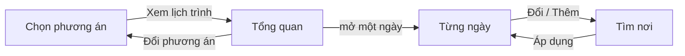

# TripGuardian — Đặc tả UI/UX: User Web (bản người dùng dùng hằng ngày)

Dành cho designer / Figma. Tài liệu này trả lời **cần thiết kế mấy trang, mỗi trang phải có mục gì, mỗi trang có mấy trạng thái phải vẽ**. Bố cục từng màn và luồng chuyển màn: `docs/UI_SPEC_FLOW_LAYOUT.md`. Phong cách hình ảnh, chi tiết grid và vi tương tác: **designer toàn quyền**. Mục tiêu là giao diện đẹp trên máy tính. Web không có bản điện thoại: điện thoại mở bất kỳ trang nào cũng thấy trang tải ứng dụng (`docs/UI_SPEC_LANDING.md` §5); ứng dụng làm sau.

Đọc kèm:
- `docs/UX_Design_Brief.md` — thiết kế cho ai, nguyên tắc, cách hiển thị chất lượng dữ liệu (§4), hệ thị giác đang dùng (§7).
- `docs/Role_Web_Functional_Design.md` §2 — chức năng đầy đủ từng màn (nguồn sự thật về chức năng).
- Bản đang chạy: `web/src/user/` (React). Dùng để đối chiếu nội dung thật, **không phải để copy layout** — layout chính là phần cần designer làm lại cho đẹp.

---

## 1. Phạm vi

Chỉ **User Web** — phần người dùng mở hằng ngày, tất cả nằm dưới `/app`. Ngoài phạm vi: landing `/` (`docs/UI_SPEC_LANDING.md`), Admin Web `/admin`.

- **Chỉ làm máy tính (desktop 1440).** Bề mặt rộng đủ chỗ đặt cạnh nhau "lý do phù hợp", "đánh đổi" và bằng chứng. Cửa sổ máy tính hẹp vẫn phải dùng được (khối xếp chồng, không cuộn ngang), nhưng không thiết kế riêng cho điện thoại — điện thoại dùng ứng dụng (làm sau).
- **Toàn bộ nội dung tiếng Việt**, từ ngữ đời thường, không thuật ngữ hệ thống.
- MVP một thành phố: **Đà Lạt**, chuyến 2–4 ngày, cặp đôi / nhóm bạn / gia đình nhỏ; xe máy, ô tô hoặc xe công nghệ.

## 2. Designer được tự do gì, phải giữ gì

| Toàn quyền sáng tạo | Phải giữ |
|---|---|
| Grid, khoảng trắng, cỡ chữ, tỉ lệ thẻ, bo góc, bóng, màu bổ sung | Danh sách trang và **mục bắt buộc** của mỗi trang ở §4 |
| Cách gom nhóm, thứ tự khối trong một trang, dùng tab / accordion / sheet / carousel | Thứ bậc quyết định: lý do phù hợp và đánh đổi luôn đi **cùng nhau**, không tách trang |
| Chuyển động, vi tương tác, cảm giác "sống" khi danh sách thay đổi | Quy tắc hiển thị dữ liệu ở §6 (fact / signal / estimate / độ tin cậy / chưa biết) |
| Thay hệ thị giác hiện tại bằng hướng mạnh hơn, nếu giữ được "poster du lịch Đà Lạt" và đọc tốt ngoài nắng | Mỗi trạng thái liệt kê ở §4 phải có một frame — kể cả trạng thái rỗng và lỗi |
| Icon set, minh họa, cách dùng ảnh poster | Tiếng Việt, giọng điệu ở §7 |

Không được làm: dùng số sao / phần trăm trần làm tín hiệu chính; trình bày ước lượng như sự thật đã xác nhận; gợi ý chỗ ở; thay bản đồ Google bằng nhà cung cấp khác; hiện transcript video.

## 3. Bản đồ trang

| Route `/app/…` | Tên trang | Người dùng làm gì ở đây | Khung |
|---|---|---|---|
| `login` (hoặc `/app` lần đầu, chưa có phiên) | Vào ứng dụng | Tiếp tục với Google, hoặc dùng thử không cần tài khoản (khách) | BARE |
| `` (gốc) | **Khám phá** | Gõ một câu / chủ đề (dán link, đính kèm file ở khung chat của Hiểu chuyến đi); người quay lại thấy chuyến đang lập | NAV |
| `understand` | Hiểu chuyến đi | Trả lời từng lượt hỏi của agent; soát và sửa vé | FLOW 1 |
| `explore` | **Chọn nơi** | Đọc tập nhỏ có lý do + đánh đổi; thêm / bỏ / khóa / so sánh; hỏi trợ lý; thanh "Đã chọn" báo khả thi và lịch ngầm | FLOW 2 |
| `explore/place/:id` | Chi tiết địa điểm | Thông tin thực tế ⟂ bằng chứng trải nghiệm; báo thông tin sai | FLOW 2 |
| `explore/compare/:ids` | So sánh | 2–3 nơi cạnh nhau, chỉ điểm khác nhau | FLOW 2 |
| `plan` | Lịch trình | Chọn hành trình, đọc từng ngày, chỗ nghỉ, dự phòng, Tối ưu, chốt | FLOW 3 |
| `done` | Phản hồi | Vài câu ngắn sau khi chốt | FLOW (3 bước xong) |
| `trips` | Chuyến của tôi | Đang lập · sắp tới · đã đi; đi tiếp hoặc mở lại lịch | NAV |
| `saved` | Đã lưu | Nơi đã thả tim; thêm vào chuyến khi nơi đó nằm trong gợi ý | NAV |
| `profile` | Hồ sơ | Tài khoản, sở thích của chuyến hiện tại, nguồn kết nối (sắp có) | NAV |

**Không có trang Khả thi riêng.** Khả thi được Decision kiểm sau mỗi thao tác và lịch được dựng ngầm; kết quả nằm trên thanh "Đã chọn" (§4).

**Khung — hai chế độ, không bao giờ hiện cả hai:**

```text
NAV   rail trái: logo · Khám phá · Chuyến của tôi · Đã lưu · Hồ sơ · avatar
FLOW  Hiểu chuyến đi / Chọn nơi / Lịch trình: rail trái có thêm ba nút kề nhau "Trò chuyện", "Lựa chọn", "Lịch trình" (bước chưa tới thì mờ), không có thanh trên
CHAT  Hiểu chuyến đi: rail homepage + lịch sử | chat | tiến độ (Trang 3)
```

Từ Lịch trình bấm "Lựa chọn" là lùi một bước: hành trình trên máy chủ lùi theo (`back`), không bao giờ tiến hộ; từ Lựa chọn bấm "Lịch trình" thì các nơi đã chọn được chuyển sang Planning trước (`useFlowNav` ở `user/ui/Shell.tsx`). Vé đầy đủ của Hiểu chuyến đi mở từ `Sửa` / `Xem đầy đủ`; tiến độ tám nhóm nằm cố định ở cột phải.

---

## 4. Từng trang: mục bắt buộc và trạng thái phải vẽ

### Vào ứng dụng (`/app/login`)

Hai lối: `Tiếp tục với Google` (nút chính) và `Dùng thử, không cần tài khoản` (khách: không lưu lịch sử, chuyến xóa sau 24 giờ không hoạt động; `docs/ACCOUNTS.md` §7). Khách đang dùng mở lại trang này thì chỉ còn đường đăng nhập Google để giữ chuyến.

### Khám phá (`/app`)

Hero ảnh Đà Lạt + **một ô nhập tự do** (Enter để bắt đầu; câu gõ thành lượt đầu của Hiểu chuyến đi) + chip gợi ý · ba thẻ chủ đề (*theo khu · theo thời tiết · theo giờ trong ngày*), mỗi thẻ là **một câu mở đầu**, không phải bài đọc.
- Người quay lại (đã có chuyến): thẻ **Chuyến đang lập** — ảnh nơi đã chọn, ngày, số nơi, tiến độ 3 đoạn, cảnh báo nếu còn chỗ cần chú ý, **Đi tiếp**; lối tắt *Theo gu quen thuộc / Lần này khác*; dải *Chuyến mới*.
- Không hỏi "đã đến Đà Lạt chưa"; không feed, không danh sách vô tận.

### Trang 3 — Hiểu chuyến đi (`/app/understand`) — trang khó nhất

**Chế độ khám phá (`view.discovery=True`, bật trong `config/trip.yaml` từ 16/11/2026):** backend là nguồn cờ duy nhất. Lời chào chỉ mở khám phá gu; không hỏi ngày/người/phương tiện/ngân sách trong chat. Ảnh thật dùng `PhotoStage` hiện có, mở khía cạnh chưa rõ; gu/subtag từ hộp tạo chuyến được xem là câu trả lời đầu tiên. Chọn ảnh → một câu gu ngắn, phỏng đoán và sửa được; bỏ qua → không ép câu kế. Cột phải thêm “Gu của chuyến” dùng hàng vé sẵn có, nút Xoá; dữ kiện thiếu ghi “Chưa chia sẻ”, không giục. Giữ vòng đếm nhóm và nút “Tiếp tục đến chọn nơi”; cổng trước Lịch trình chỉ hỏi ngày đi và care còn thiếu, không có bước đọc lại. Không đổi component, palette hay hộp tạo chuyến. Các mô tả `ask_required` bên dưới là luồng cờ tắt.

Giới hạn cảnh báo khi bổ sung sức khỏe ở cổng sau khi đã chọn nơi: `docs/TRIP_UNDERSTANDING.md` §5.

Không gian trò chuyện theo mẫu người dùng duyệt ngày 15/10/2026, dùng font Be Vietnam Pro, nền sáng trắng/xám, thẻ kính và nút đen đồng nhất homepage. Hành vi phía máy chủ: `docs/TRIP_UNDERSTANDING.md` §4, §18.

```text
┌──────┬─────────────────┬───────────────────────────┬────────────────────┐
│ logo │ Lịch sử chat  + │ Lời chào + 4 thẻ gợi ý    │ Những nơi đang hợp │
│      │ tìm kiếm        │ (nền xám sáng) hoặc hội  │ N địa điểm         │
│ nav  │ các chuyến thật │ thoại có thẻ chọn         │ Vé: vòng N/8 +     │
│      │                 │                           │ 8 mục timeline     │
│      │                 │ nhắn…                     │ [Tiếp tục chọn nơi]│
│ thoát│                 │ [file][ảnh]         [gửi] │ lời giải thích     │
└──────┴─────────────────┴───────────────────────────┴────────────────────┘
```

- Thanh điều hướng icon dùng chung `Sidebar` của homepage. Lịch sử là danh sách gọn nền giấy kem, không bóng: mỗi chuyến một dòng cao khoảng 36 px, tiêu đề dài cắt bằng dấu `…`, mọi dòng cùng màu chữ thường (chuyến cũ không làm mờ, chân danh sách không phủ mờ; chủ dự án 16/11/2026), tooltip chứa tên đầy đủ và thông tin chuyến; chỉ thêm nhãn nhỏ `Đã chốt` khi đã chốt. Hàng đang mở tô nhẹ, hover nhạt hơn. Hai hàng đầu có icon + chữ `Cuộc trò chuyện mới` và `Tìm kiếm`; bấm tìm mở ô nhập tại chỗ, Esc đóng và trả focus về nút tìm. Dữ liệu thật từ `GET /api/harness/trips`, giữ lọc chat trống và nhóm Hôm nay / 7 ngày qua / Cũ hơn bằng nhãn nhỏ không viết hoa. Mở chuyến ở đúng stage, tạo mới giữ chuyến cũ trên server; có trạng thái đang tải, rỗng, không tìm thấy, lỗi/thử lại và dòng riêng tư nhẹ ở chân. Quyết định chủ dự án 10/11/2026.
- **Chat:** chưa có hội thoại thì hiện lời chào theo tên tài khoản (khách dùng lời chào chung) và bốn thẻ gợi ý xếp lệch (Săn mây, Sống chậm, Cả nhà cùng đi, Ăn cho đã): bấm thẻ chỉ điền câu mở đầu vào ô nhắn, người dùng vẫn tự gửi. Khung chat nền xám sáng phẳng (không lưới). Khi bắt đầu kể thì hiện hội thoại, có khung avatar tròn trống (không hình) cạnh lời bot và lời người dùng (không còn thanh tóm tắt `Sửa` phía trên; sửa thông tin ở cột phải). Mục lịch sử không hiện dòng trạng thái khi chuyến còn ở bước tìm hiểu. Phiên mở lại dựng chat từ transcript; thẻ cũ thành chữ. Không đổi SSE, trả lời nhanh, chỉnh vé hay handoff.
- **Chuyển chat:** rail và cột lịch sử nằm ngoài phiên chat (`Understand` trong `screens/Understand.tsx`), nên đổi chat chỉ dựng lại cột chat; danh sách giữ nguyên vị trí cuộn. Chat đang được đọc từ máy chủ hiện khung chờ hình bong bóng (`.tg-cx__loading`), không bao giờ chớp canvas chào; chat mở từ lịch sử đọc view song song với journey; chat đã xem trong lần mở trang này vẽ ngay từ bản giữ trong bộ nhớ. Mở xong thì nhảy thẳng tới cuối, không cuộn trượt cả đoạn; lượt mới vẫn trượt nhẹ.
- **Lịch sử chat (cột trái):** màu khung giữ như thiết kế cũ (nền xám tím dịu); mỗi chuyến một dòng, rê vào hiện nút ba chấm với *Ghim* / *Bỏ ghim* và *Xóa*. Chuyến ghim lên nhóm *Đã ghim* (nhớ trong trình duyệt này). *Xóa* hỏi lại, rồi gọi `DELETE /api/harness/sessions/<id>`: chuyến rời tài khoản và không mở lại được, dữ liệu dùng cho thống kê vẫn còn (`Harness.discard`). Xóa chuyến đang mở thì chuyển sang chat mới (chủ dự án 10/11/2026).
- **Dấu chờ:** chỉ hiện chấm động trong lúc bot đang trả lời, có `role=status` và `aria-busy`; xong lượt thì biến mất. Không hiện dòng tiến trình hay khối trace mở lại; sự kiện backend vẫn giữ.
- **Mỗi lượt tối đa một câu hỏi** (`docs/TRIP_UNDERSTANDING.md` §5). Câu hỏi bằng chữ của agent là dòng cuối lời nó, ô nhắn mở. Câu hỏi có lựa chọn hiện như một dòng chat đậm, và khi lượt đã xong thì nổi thành **bảng câu hỏi** (`AskSheet` trong `screens/understand/Ask.tsx`) neo trên ô nhắn, khung chat phía sau mờ (blur 7 px, phủ kem 40%), như bảng hỏi nhanh của trợ lý: chip tên mục, gợi ý `Chọn một` / `Chọn bao nhiêu cũng được`, câu hỏi chữ lớn, dòng `vì sao`, các lựa chọn đánh số, ô `Khác`, chân `Bỏ qua` + `Gửi` dính đáy. Không câu nào bắt buộc: `Để sau`, Esc hoặc bấm vào chat mờ thu bảng thành một dòng trong chat (`Câu hỏi đang chờ, bạn trả lời lúc nào cũng được` · `Trả lời`), ô nhắn dùng tiếp được; bấm dòng đó mở lại. Chỉ câu hỏi của tin cuối mới nổi; trả lời xong bảng biến mất, tin co thành `✓ lựa chọn`, rồi agent phản hồi; có thể gợi mở tiếp, không bắt buộc hỏi. Câu hỏi gu (`ask_user` chỉ ghi soft / nhóm nơi) luôn chọn được nhiều (`domain/ask.py`):

| Thẻ | Khi nào | Hình dạng |
|---|---|---|
| Câu hỏi (`AskSheet` bọc `AskCard`) | Câu đào sâu của agent (`ask_user`), mục bắt buộc agent chọn (`ask_required`), hoặc câu app chọn khi lời agent không hỏi gì | Bảng trắng bo 26 px nổi trên chat mờ, trượt lên khi vào; bên trong (màn không có chỗ neo thì là thẻ trắng viền mảnh trong chat, đầu thẻ icon + tên mục + `Chọn một` / `Chọn một hoặc nhiều`): tối đa 3 lựa chọn đánh số 1–3 (nhãn + mô tả một dòng, ✎ cho lựa chọn code đoán), dòng 4 là ô `Khác: gõ câu trả lời…` gửi bằng Enter (đi vào chat như lời người dùng); phím 1–4 chọn. Chọn một và không có ô nhập thì gửi ngay (dòng được chọn sáng lên ~180 ms, các dòng khác mờ đi); chọn nhiều hoặc có ô nhập (ngày, giờ, số người, số tiền, tìm chỗ ở: mỗi ô một hàng) thì `Gửi`; `Bỏ qua` ở chân thẻ. Thẻ vào bằng trượt nhẹ, các dòng xuất hiện so le 45 ms |
| Khung chọn ảnh (`PhotoStage`) | Drill ảnh (`visual`) | Thẻ drill **không tự mở**: nằm gập dưới lời trợ lý thành một dòng có ảnh thu nhỏ (`Kiểu ngắm đồi · N kiểu nơi có ảnh thật · bấm để xem`); bấm, hoặc gõ "có" / "xem thử", thì mở (không gọi model); câu hỏi `ask_user` có ảnh vẫn tự mở. Khi mở: trên toàn màn, nền phía sau mờ (blur 14 px, phủ tối 34%) để người dùng chỉ nhìn các nơi; tiêu đề (câu agent viết, không có thì nhãn thẻ; không có câu mặc định) + `vì sao` chữ trắng; **mọi kiểu có ảnh thật** (tối đa 6, không cắt còn 3) xếp hàng ngang, thẻ giữa nổi lên, thẻ hai bên nhỏ dần, xoay nhẹ và mờ hơn, thẻ xa hơn hai bước ẩn (chuyển 560 ms); mỗi thẻ gọn: ảnh thật, tên kiểu, một dòng `N nơi · tên nơi trong ảnh`, nút tròn `+` / `✓` để chọn; **lăn chuột để xoay** (một nấc một thẻ, nghỉ 260 ms giữa hai lần), mũi tên ‹ › và phím ← →, Space chọn, Esc để sau (khung co thành một dòng trong chat có ảnh thu nhỏ, bấm mở lại); dưới hàng thẻ là chấm vị trí và dòng hướng dẫn có biểu tượng chuột `Lăn chuột hoặc dùng ← → để xoay · bấm thẻ giữa để chọn · 3/5`; thanh dưới: `Khác: tả kiểu bạn thích…`, `Bỏ qua`, `Chọn N kiểu`. Ra nhanh hơn vào (220 ms) |
| Dấu hiệu (`cues`) | Agent đoán một phong cách | `DẤU HIỆU MÌNH SẼ TÌM`: chip có ×, chip đã bỏ gạch ngang (bấm + để thêm lại), `+ thêm dấu hiệu`; `CÓ VÀI KIỂU … KHÁC NHAU`: mỗi kiểu một ảnh thật + tên + số nơi; `Đúng rồi, xem ảnh các kiểu` · `Gửi ảnh mẫu thay vì chọn`; hộp `Nguồn mình đã đọc` (gập) kèm câu cố định "Nguồn web chỉ dùng để hiểu từ … Nơi được gợi ý luôn lấy từ dữ liệu đã kiểm chứng." |
| Các kiểu (`kinds`) | Sau thẻ dấu hiệu, hoặc ảnh user gửi | Lưới thẻ: một ảnh lớn + hai ảnh nhỏ của các nơi thật, vòng tích khi chọn, tên kiểu, tên vài nơi, số nơi; ô `Gửi ảnh kiểu bạn thích`; `Xong (N)` · `Không kiểu nào giống`. Bấm ảnh mở chi tiết nơi đó |
| Có phải nơi này? (`photo_pick`) | Ảnh user gửi khớp rõ một nơi | Ảnh + tên nơi (mở chi tiết); `Đúng nơi này` · `Không phải` |

- **Chat gọn**: không nhắc lại thông tin đã nằm ở cột phải; giữ câu xác nhận khi hiểu từ mơ hồ theo một nghĩa cụ thể. Chưa có bước nào thì chỉ có dấu đang xử lý (`role="status"`, `aria-busy`); khi server gửi tiến trình thì khối bước (`Turn.tsx` `Steps`) mở sẵn trong lúc xử lý để người dùng thấy bot hiểu gì và tìm gì (ghi nhận từng điều bạn nói, tìm quán có món / loại nơi, tìm trên web, thời tiết, đường đi); các bước máy móc lặp mỗi lượt (`read`, `split`, `cues`, `find:`) bị ẩn, lượt không còn bước nào đáng mở thì không có khối; tiêu đề chạy ánh sáng; xong lượt thì gấp lại thành một dòng "Đã xử lý trong N giây", bấm để mở lại. Khối món chỉ dành cho món cụ thể người dùng nêu, không cho kiểu quán; chat giữ lối mở thẻ nơi, không in link Maps hay trích thực đơn dài. Chi tiết mở trong sheet nơi khi bấm. Bỏ qua thẻ đáp một câu ngắn, hành vi không đổi; trước lịch đầu tiên không hỏi gì (§Trước khi lập lịch).

- **Ô nhắn** là một thẻ trắng cố định cuối cột: chữ nhắn ở trên, hàng nút bên dưới (kẹp giấy, ảnh ở trái, gửi ở phải); kẹp giấy (danh sách nơi dạng file, đọc ở trình duyệt), ảnh, kéo-thả, dán; Enter gửi. Dòng nhỏ dưới ô: "Ảnh bạn gửi chỉ dùng trong chuyến này."

**Đầu khung chat, avatar và cột phải** (`screens/understand/TopBar.tsx`, `SidePanel.tsx`, `Turn.tsx`)
- Khung chat chiếm toàn bộ bề ngang còn lại cạnh danh sách chat; nội dung chat và ô nhắn nằm ở một cột đọc giữa khung (chat và ô nhắn cùng rộng tối đa 780px).
- **Top bar** ở đầu khung chat: tên chat (câu đầu người dùng, chưa có thì "Cuộc trò chuyện mới"); khi cột lịch sử đóng, bên trái có ba nút (mở thanh bên, chat mới, tìm). Không còn nút `Thông tin chuyến` và `Tiếp tục đến chọn nơi`: sang Lựa chọn do agent tự chốt hoặc bấm bước *Lựa chọn* trên tai thỏ.
- **Thanh ba bước ("tai thỏ")** (`home/Frame.tsx` `FlowNotch`, mọi màn của luồng chuyến): ba bước Trò chuyện / Lựa chọn / Lịch trình treo dính mép trên giữa màn hình như tai thỏ (đáy bo tròn, hai tai cong liền vào mép; màu xám đất ấm cùng tông chat); bước đang đứng hiện tên; Lựa chọn luôn mở được kể cả khi chưa nhắn gì (chưa có chuyến thì màn vẫn là "Chưa có gợi ý" như trước), Lịch trình chỉ mờ và không mở khi chưa chọn nơi; rê chuột vào một bước hiện thẻ đen có tên và một câu giải thích (không dùng bong bóng `title` của trình duyệt). Thẻ rê chuột dùng chung là thuộc tính `data-tag` (`css/base.css`), rail trái dùng `data-tip`. Rail bên trái không còn ba bước này. Rail chỉ mở khi con trỏ vào chính mũi tên (không mở khi rê dọc mép trái).
- **Avatar**: lượt của trợ lý có mặt mascot (`BotAvatar`, nhấp nháy khi đang trả lời), lượt của người dùng có ảnh tài khoản, chưa có ảnh thì chữ cái đầu của tên.
- **Không có cột phải** (17/11/2026): chat chỉ có một cột. Tool `show_aside` và `SidePanel` đã bỏ; thứ trợ lý muốn cho xem nằm ngay dưới câu trả lời, trên sân khấu ảnh (nơi, kiểu nơi, sự kiện). Transcript cũ còn dòng `kind: aside` thì bị bỏ qua.
- Chữ trong chat dùng Be Vietnam Pro (`--tg-sans` của `.tg-workspace`).
- Câu hỏi nơi lưu trú tùy chọn (chat, vé): người dùng hỏi tới đây là vì chưa có khách sạn, nên **không bắt gõ**. Hiện dải thẻ chỗ ở cùng kiểu thẻ địa điểm (ảnh, loại, tên, khu · điểm, giá/đêm hoặc *Chưa có giá*, lý do hợp), khung xương trong lúc chờ; *Chọn chỗ này* ghi chỗ ở và đi tiếp ngay, *Cứ xếp giúp* để app tự chọn, liên kết *Mình đã có chỗ ở rồi* mới mở ô gõ tên. Thẻ chỉ lấy từ corpus; không tải được danh sách thì hiện ô gõ. Cài ở `user/screens/understand/LodgingCards.tsx`.
Trạng thái: chưa nối được máy chủ (`Thử lại`) · đang chuyển sang Chọn nơi · chỉ mục ảnh chưa sẵn (thẻ dấu hiệu không có ảnh kiểu) · tìm web lỗi (bước hổ phách, lượt vẫn tiếp) · ảnh hỏng hoặc quá lớn (báo trong chat, không gửi).

### Chọn nơi (`/app/explore`)

Tiêu đề: *"Gợi ý cho chuyến của bạn"*.

Mục bắt buộc:
1. **Nơi bắt buộc đến** (nhóm `anchors` của Decision) lên trên cùng.
2. **Cột lọc bên trái + lưới thẻ** (trang trải hết bề ngang, chừa lề phải cho nút trợ lý nổi để nó không đè lên thẻ): tiêu đề chỉ một dòng, không có nút về chat (thanh bước ở đỉnh tự ẩn trên Lựa chọn, rê chuột lên mép trên hoặc Tab tới thì hiện). Cột lọc (`ui/ExploreSide.tsx`; dưới 960px xếp lên trên lưới) gồm ô *Tìm theo tên*, *Nhóm địa điểm* (*Tất cả* đứng đầu, mở sẵn: trang đầu của mọi nhóm xếp theo điểm hệ thống rồi tới các nơi lưu trú (cùng thẻ, chọn / đổi chỗ ở ngay tại đó; số đếm gồm cả nơi lưu trú), ghi "hiện N nơi đầu, chọn một nhóm để xem hết", mỗi lần hiện 48 nơi, nút *Xem thêm* hiện 48 nơi tiếp theo, hết thì dặn chọn một nhóm; rồi từng nhóm của Decision, mỗi dòng có tổng số nơi `total`; ↑ ↓ đổi nhóm), *Giới hạn của bạn* (mỗi giới hạn một dòng kèm số nơi đã loại, ghi ở mục 7) và *Khu vực*. Trên lưới là thanh "N nơi · nhóm" (kèm "+N / −N nơi" khi danh sách vừa đổi sau một lượt chat), ô *Sắp xếp* (*Hợp nhất* = thứ tự Decision đã xếp; *Đánh giá tốt nhất* = điểm Google, nơi chưa có điểm xếp sau; *Tên A → Z*; *Tên Z → A*; trên Tất cả, thứ tự khác "Hợp nhất" trộn cả nơi lưu trú) và chip khu vực đang lọc, bỏ từng chip hoặc *Xóa bộ lọc*. Khu vực và sắp xếp chỉ tác động lên trang đang xem (máy chủ xếp hạng và chia trang theo nhóm), thanh đếm ghi rõ "M trong N nơi đang hiện"; đổi nhóm thì khu vực về trống.
3. **Thẻ địa điểm** (thoáng, chữ nhẹ, các thẻ cùng hàng cao bằng nhau; mỗi dòng chữ chỉ một hàng, dài quá thì cắt bằng "…", đủ chữ ở tooltip): ảnh thật (ghi nguồn) với nhãn "Hợp nhất" cho nơi `top` và trái tim lưu · khu, ★ điểm Google và độ tin cậy (ba vạch, chữ ở tooltip) · tên · loại và thời gian (khoảng) · một hàng ghi chú: *Đánh đổi* (hổ phách, chỉ hiện khi có) cùng hàng với ghi chú thú cưng (bấm để mở lời người đã đi, mở ra phía trên hàng, đè lên tên chứ không che nút, không đẩy thẻ cao thêm) · chân thẻ: ba nút tròn nhỏ `Khóa · So sánh · Bỏ` bên trái, nút `Thêm` / `Đã chọn` bên phải. Thẻ không in giá (dữ liệu giá còn thiếu nhiều); giá vẫn ở tờ chi tiết. Lý do phù hợp (✓) xem ở tờ chi tiết, không nằm trên thẻ. Điểm hệ thống (`score`) chỉ quyết định thứ tự, không in lên thẻ. Thẻ nơi lưu trú cùng khuôn (giá/đêm chỉ hiện khi có, `Thêm` / `Đổi`).
4. **Câu hỏi làm hẹp** (`pending`) chen trong lưới, một câu, bỏ qua được. So sánh mở từ nút nổi "So sánh N nơi".
5. **Tab "Chỗ ở"** (luôn có; nhãn *cần chọn* khi chưa có chỗ ở, ✓ khi đã có; cả chuyến một chỗ ở, đổi chỗ ở đã đặt hoặc đã chọn thì hỏi *"Đổi chỗ ở? … Giữ chỗ cũ / Xác nhận đổi"*, bỏ lựa chọn cũng hỏi): thẻ chỗ ở **cùng kiểu thẻ địa điểm** (ảnh, nhãn *Chỗ ở*, *Hợp nhất* khi hợp gu nhất, tên, điểm, giá/đêm + *"giá tham khảo trên Maps ngày dd/mm; kiểm lại khi đặt"* hoặc *"chưa có giá"*, *"Hợp vì: …"*, số phút trung bình tới các nơi đã chọn; thẻ đầu *"Hợp gu bạn nhất"* khi có bằng chứng gu; bấm ảnh mở `PlaceSheet`; nút *Thêm* khi chưa có chỗ ở; đã có thì thẻ đang chọn là *Đã chọn* và các thẻ còn lại hiện *Đổi sang chỗ này* (không phải thêm), bấm thì hỏi xác nhận; *Tìm chỗ ở khác*; dải *"Bạn ở X · giá/đêm. Mọi ngày bắt đầu và kết thúc ở đây."* + *Đổi*. Danh sách luôn hiện: chưa chọn nơi nào thì xếp theo gu, chọn rồi thì xếp thêm theo độ gần các nơi đó. Chỗ ở đang chọn là một dòng đầu trong giỏ (*Chỗ ở · mọi ngày bắt đầu và kết thúc ở đây*, nút *Đổi*).
6. **Không chặn**: quá tải, vướng điều kiện, chưa có chỗ ở chỉ hiện thông báo; *Lập lịch* luôn bấm được khi đã chọn ít nhất một nơi, chưa có chỗ ở thì cạnh nút có *Chưa chọn chỗ ở*.
7. **Giới hạn đã loại N nơi** — mục "Giới hạn của bạn" ở cuối cột lọc, mỗi giới hạn một dòng kèm số nơi bị loại; `Nới giới hạn` đưa về Hiểu chuyến đi.
8. **Chưa xác minh được điều kiện của bạn** gập lại.
9. **Trợ lý "Hỏi TripGuardian"**: tab nhỏ mép phải (phím `/`), mở thành ngăn 380px không phủ mờ, ghim được (lưới còn 2 cột). Gõ tự do đi qua lượt chat của Decision; thay đổi hiện ngay trên lưới và thanh "Đã chọn", kèm chip tối đa 6 nơi mới vào và hoàn tác (không có hoàn tác cho lần lọc lại theo mong muốn: câu trả lời kết bằng "Giữ N nơi, thay M nơi hợp hơn"). *"Vì sao không gợi ý X?"* được trả lời từ dữ liệu (`why-not`), không qua agent. Không tự mở; chỉ hiện một chấm + dòng gợi ý tắt được.

Trạng thái: bình thường · quá ít kết quả · mọi nơi bị giới hạn loại (rỗng) · sheet lý do bỏ (*Quá xa / Quá đông / Quá đắt / Không thích / Đã đi rồi*, không bắt buộc) · nút nổi "So sánh N nơi" · đang tải (khung xương) · lỗi tải (thử lại).
Frame: 5.

### Chi tiết địa điểm (`/app/explore/place/:id`)

Nguyên tắc: **mọi nhận định cách bằng chứng một chạm**.

Mục bắt buộc:
1. **Thông tin thực tế** — giờ, giá, đặt chỗ: giá trị + nguồn (chính thức / Google) + ngày kiểm tra. Xung đột thì hiện **cả hai giá trị**, đánh dấu chưa xác nhận.
2. **Trải nghiệm** — mỗi nhận định mở ra bằng chứng: clip TikTok phát **đúng đoạn**, và xu hướng comment kèm **cỡ mẫu**: *"62% trong 123 comment về độ đông, từ 30 creator"*, cùng 2–3 comment gốc có link về video.
3. **Mức vận động** — đi bộ, dốc, đường vào.
4. **Hợp với ai** — cặp đôi, trẻ em, người lớn tuổi.
5. **Bản đồ Google** khi dữ liệu đến từ Google.
6. Nút **Báo thông tin sai** — nhẹ, không phải nút chính; gửi `POST /api/harness/reports` kèm mã ẩn danh của trình duyệt. Chỉ khi đủ nhiều người khác nhau cùng báo một điều thì corpus mới đổi (`docs/CORPUS.md`).
7. Thao tác dính dưới: Thêm vào danh sách chọn · Bỏ · Khóa.

Thông tin thực tế và bằng chứng trải nghiệm **phải tách rõ về mặt hình ảnh** — hai loại sự thật khác nhau.

Frame: (1) trang chi tiết · (2) bằng chứng mở (clip + comment) · (3) có xung đột giá trị + báo sai.

### So sánh (`/app/explore/compare/:ids`)

Mục: 2 (tối đa 3) nơi cạnh nhau; **chỉ hiện thuộc tính khác nhau** (trải nghiệm, di chuyển, độ đông, chi phí, thời điểm đẹp nhất) · một câu hỏi chốt (*"Ưu tiên ít di chuyển hay chỗ yên tĩnh hơn?"*) · chọn xong cập nhật chuyến đi ngay, hệ thống không chọn thay.

Frame: (1) 2 nơi · (2) 3 nơi.

### Thanh "Đã chọn" (dính đáy Chọn nơi, Chi tiết, So sánh) — thay trang Khả thi

Luôn hiện: số nơi · tổng giờ tham quan · di chuyển ước tính · chi phí (khi lịch ngầm có) · nút **Xem lịch trình →**. Mỗi thay đổi hiện **dòng chênh lệch** (*"+1 nơi, +90 phút tham quan, +24 phút đi lại"*) kèm **Hoàn tác**; không chặn thao tác.

Bốn trạng thái:

| Trạng thái | Nguồn | Hiện |
|---|---|---|
| **Đang xếp lịch** | lịch ngầm đang dựng (`preview`, debounce 350 ms) | khung xương mảnh |
| **Lịch N ngày sẵn sàng** | `preview` = `ready` | số liệu của phương án ít di chuyển nhất |
| **Cần chú ý** | Decision `partial`, hoặc `preview` = `failed` | dải hổ phách nổi lên: mỗi xung đột = *tên nơi + quy tắc + các cách sửa*, mỗi cách sửa một hàng bấm được kèm cái giá; nút Xem lịch trình khóa đến khi sửa |
| **Chưa đi được** | Decision `infeasible` | dải mận đậm mở sẵn: *"Cần ~X, chuyến đi có Y"* + cách sửa; vẫn chọn tiếp được |

Xung đột với giới hạn người dùng có hàng *nới* đưa về vé chuyến; xung đột vật lý **không** có hàng nới. Cuối danh sách: *"Để dành cho dịp khác"*. Bấm thân thanh mở danh sách đã chọn (khóa / bỏ từng nơi, cảnh báo cần kiểm tra trước khi đi). Thông báo là vùng `aria-live="polite"`.

### Trước khi lập lịch (hộp thoại khi bấm *Lập lịch*, `ui/ReadbackSheet.tsx`)

Bấm *Lập lịch* là xếp lịch ngay, không hỏi ngày đi hay lưu ý (chủ dự án 18/11/2026, thay quyết định 10/11/2026). Hộp thoại kem (`css/gate.css`, `ui/Gate.tsx`) chỉ còn mở khi máy chủ trả `409 trip_incomplete` vì người dùng đã tự nhắc một vấn đề sức khỏe / ăn uống chưa rõ ("mẹ ăn chay ngày rằm"); thẻ hỏi đúng điều đó, *Khác, tự gõ* mở ô gõ ngay trên thẻ (không chuyển về trò chuyện), *Xong* gửi lựa chọn kèm chữ.

Trả lời xong, hộp thoại hiện **Tóm tắt chuyến đi**: mỗi chủ đề một hàng (Ngày đi, Đi với, Phương tiện, Nơi ở, Nhịp độ, Ngân sách, Lưu ý), cột trái tên chủ đề, cột phải các dòng của `Readback.lines`, nút *Sửa* mở trình sửa của vé chuyến ngay tại hàng. Không có nhãn *Bạn nói / Mình đoán / Mặc định*; dòng cần xem lại chỉ có dấu cảnh báo nhỏ.

### Lịch trình (`/app/plan`)

Bố cục theo mẫu `docs/design/mock/designs/itinerary/`, tràn hết bề ngang màn hình (tối đa 1840 px), chữ và ảnh lớn. Bốn màn trong một route, đổi bằng trạng thái (không đổi URL):



- **Chọn phương án** (chủ dự án 13/11/2026; ba hướng từ 18/11/2026): tối đa **3** phương án, đúng ba hướng của server: *Tiết kiệm nhất* · *Giữ nhiều nơi bạn chọn nhất* (nhiều trải nghiệm nhất) · *Giữ nơi hợp gu nhất*; không còn *Di chuyển thuận lợi nhất* (ít đi xe là thuộc tính của mọi phương án). Tốt nhất trước (dùng được trước, giữ nhiều nơi đã chọn nhất, hợp gu hơn, ít đi lại hơn); hai hướng ra cùng một lịch là một thẻ, mang tên hướng đầu (server không ghép tên nữa), nên màn chỉ hiện các phương án khác nhau. Quá tải chỉ khi đã rút thời gian ghé của mọi nơi về mức tối thiểu mà vẫn không vừa (`docs/PLANNING.md` §ⓓ). Lần đầu vào, các thẻ nằm **mờ** sau tấm bưu thiếp *vì sao có N phương án* (mỗi phương án một dòng: tên, lợi ích chính, bao nhiêu nơi giữ hay bỏ); bấm *Xem N phương án* thì các thẻ hiện ra. Thẻ trắng: ảnh đại diện có nhãn *Tạm bỏ N nơi* / *Giữ đủ các nơi*, tên + ý, ba số (nơi ghé, đi lại, chi phí), khối **Lợi ích / Hạn chế** (chỉ từ số liệu các thẻ: đi lại ít nhất, chi phí thấp nhất, ghé nhiều nơi nhất, tạm bỏ N nơi, đi lại nhiều hơn bao nhiêu, lịch mong manh), các nơi tạm bỏ kèm lý do. Bấm thẻ là **xem lịch trình** của phương án đó như thường; *Xem phương án khác* / nút quay lại ở Tổng quan đưa về các thẻ để xem phương án khác; chỉ *Chốt* mới xong. *So sánh chi tiết* mở bảng đánh đổi.
- **Tổng quan**: bản đồ cả chuyến, rồi đến / chỗ nghỉ / thẻ từng ngày / về; thanh dưới có chi phí đã biết, *Chốt kế hoạch*, *Xem lịch từng ngày*.
- **Ngày đi** (chủ dự án 18/11/2026): khối cùng kiểu *Giờ trong chuyến* (`plan/fill.tsx` `TripDates`), hai ô *Ngày đến* / *Ngày về*; rê chuột hay bấm mở lịch chọn khoảng (`RangeCalendar` của `ui/Gate.tsx`), *Lưu ngày* xếp lại lịch. Chưa có ngày thì ghi rõ lịch xếp đầy ngày 1 rồi mới sang ngày 2. *Lưu ý* là một hàng như *Đi với*, *Ngân sách* (`FillRows`). Bản đồ không còn dải trắng khi khung rộng hơn vùng Đà Lạt; màu nước, rừng, đường tươi hơn nền positron. Thẻ bên không còn *Phương án dự phòng* và *Độ tin cậy của lịch*; *Lưu ý cả chuyến* nói việc người dùng làm được ("mang áo khoác và áo mưa", "chọn chỗ ở để tính cả đường đi về").
- **Điểm xuất phát** và **Đến Đà Lạt** (chủ dự án 11/11 và 13/11/2026): *Điểm xuất phát* là mục riêng đứng trước *Đến Đà Lạt* (chưa có thì hàng *Bạn khởi hành từ đâu?* có sẵn ô gõ địa chỉ như bản đồ, kể cả số nhà; có rồi thì tên nơi + *Đổi*; chọn gợi ý là gửi `decision.trip` `{kind:"edit", target:"origin"}`). *Đến Đà Lạt* giữ hàng *Di chuyển đến Đà Lạt* và, khi chưa trả lời, hàng *Phương tiện lên Đà Lạt* với các lựa chọn *Máy bay / Xe khách / Tự đi, xe máy / Tự đi, ô tô* (`arrival_tab`, `deck.build(at="plan")`). Các hàng *Thông tin chuyến* (Đi với, Nhịp độ, Ngân sách, …) và hàng *Phương tiện lên Đà Lạt* mở sẵn lựa chọn ngay trong hàng khi rê chuột hoặc focus (màn cảm ứng thì luôn mở): bấm một lựa chọn là lưu và lịch được xếp lại; Ngân sách có thêm ô số tiền (triệu đồng) + *Lưu*; điều cần nhiều bước (nhiều người, nhiều ý, phạm vi ngân sách) mở thẻ bên phải qua *Chi tiết*. Chuyến không có xe riêng thì ngày có thanh *Gọi xe giữa các điểm* và mỗi chặng có hàng ghost so cước Grab / Be / Xanh SM (`docs/BOOKING.md` §Gọi xe). Tự đi thì ghi luôn phương tiện (`mobility`) và hàng *Phương tiện* không hiện; máy bay hoặc xe khách thì hàng *Phương tiện* (đi lại trong Đà Lạt) hiện ra sau. Có điểm xuất phát thì danh sách cách đi (`WayIn`) hiện dưới; *Đường về* không hỏi lại. Điểm xuất phát (từ nhà) chỉ để ước giờ; trong chuyến mỗi ngày bắt đầu ở chỗ ở.
- **Chỗ nghỉ**: gợi ý ngay trong hàng *Chỗ nghỉ* dưới dạng thẻ ghost (`LodgingGhost`, cùng kiểu quạt thẻ của ô trống từng ngày; nút tròn "+" ở thẻ trước = chọn), không còn thẻ *Gợi ý chỗ ở* phía trên.
- **Giờ trong chuyến** (chỉ thành viên, kế hoạch đã chốt; `EveTimes`): bốn ô ngắn *Đến* / *Đi chơi* / *Về nghỉ* / *Rời đi* (hai ô giữa chỉ khi chuyến nhiều ngày), mỗi ô một nút giờ mở bảng chọn giờ (lưới 24 giờ) và phút (:00 :15 :30 :45), thay cho hai ô xổ xuống (`ui/TimePick.tsx`). *Đi chơi* / *Về nghỉ* là giờ ra ngoài và giờ nghỉ của mỗi ngày (`trip_times` với `start` / `end`); ngày đầu không bắt đầu trước giờ đến, ngày cuối không kết thúc sau giờ rời đi.
- **Thông tin chuyến** (chỉ hiện khi còn nhóm trống): dòng nằm sau *Chỗ nghỉ*, mỗi nhóm tùy chọn chưa điền (Đi với, Phương tiện, Nhịp độ, Ngân sách) là một hàng có nút *Thêm*. Bấm mở thẻ hỏi cùng kiểu hộp trước lịch trình (`screens/plan/fill.tsx`, `GateAsk`); trả lời xong lịch được xếp lại từ câu trả lời đó. Lịch vẫn xếp và chốt được khi các nhóm này còn trống (chủ dự án 10/11/2026). Server: `GET …/read/trip/readback` trả thêm `fill` (bộ thẻ `at="plan"`), câu trả lời gửi qua `decision.trip` với `at: "plan"`; xếp lại làm mất chỉnh sửa tay trên lịch cũ.
- **Từng ngày**: danh sách trái (thanh ngày cố định, cuộn riêng), bản đồ phải. Kéo thẻ hoặc ảnh (giữ ~150 ms), tay nắm, hoặc nút lên / xuống để đổi thứ tự (`reorder`); Esc hủy kéo; giảm chuyển động thì bỏ animation. Nơi bắt buộc không có Đổi / Bỏ nhưng vẫn đổi được thứ tự.
- **Tìm nơi**: ô tìm, bộ lọc trái, kết quả phải; chỉ gồm nơi trong lựa chọn hoặc nơi dự phòng đã kiểm tra; chọn → xem trước thay đổi → áp dụng.

Các mục dưới đây vẫn đúng; "tab phương án / tab ngày / hai cách xem" nay là các màn trên (sơ đồ *Hành trình* mở từ Tổng quan).

Mục bắt buộc:
1. **Tab phương án** + **bảng đánh đổi** giữa các phương án (mỗi phương án tối ưu một mục tiêu khác: ít di chuyển / nhiều trải nghiệm / rẻ hơn…), có cột chi phí (*"Một phần chưa có giá"* khi thiếu).
2. **Tab ngày** (Ngày 1, Ngày 2… kèm thứ + ngày).
3. **Dòng thời gian một ngày**: giờ đến, thời gian ở lại, di chuyển giữa các điểm, cùng các khối *Ăn (tự chọn) · Nghỉ · Chờ · Đệm*. **Cảnh báo nằm tại đúng điểm dừng**, không dồn xuống cuối.
4. **Bản đồ lộ trình** (Google) + tổng di chuyển ước tính của ngày.
5. **Panel chỗ nghỉ đêm** — chỗ ở đã đặt, hoặc các chỗ ở gợi ý, giá/đêm nếu có, đổi được; đổi thì giờ di chuyển tính lại.
6. **Nhãn độ vững mỗi ngày**: Vững / Khả thi / Mong manh + lý do một câu.
7. Không hiện phương án dự phòng (chủ dự án 18/11/2026); thay đổi do thời tiết đến qua banner đêm trước.
8. **Không có ô nhắn** — màn này chỉ nhận thao tác (chọn phương án, đổi chỗ nghỉ, dùng dự phòng, `+ Thêm nơi`); mỗi thao tác kèm dòng báo đã làm gì (*"Đã xếp lại một vài ngày bị ảnh hưởng"*).
9. Thông tin chưa xác nhận vẫn đánh dấu tại chỗ: *"Giờ mở cửa chưa xác nhận — kiểm tra trước khi đi"*.
10. **Hai cách xem**: *Theo giờ* (tab ngày + timeline + bản đồ Google + cột bên) và *Hành trình* (sơ đồ thẻ ảnh theo thứ tự đi, từng ngày hoặc cả chuyến).
11. **Tối ưu lịch** (nút ở chân màn ngày; từ 18/11/2026 là bộ tìm tất định, không model: `docs/PLANNING.md` §Tối ưu lịch). Lịch có chỗ người dùng tự đổi ngày hoặc tự sắp thứ tự thì hỏi trước: *"Tối ưu cả những chỗ bạn đã tự sắp?"* · **Giữ chỗ tôi đã sắp** (`scope: keep_mine`) · **Tối ưu cả lịch** (`scope: all`); không có thì chạy ngay (`all`). Ngăn kết quả: tốt hơn thì *"Mình xếp lại được tốt hơn"*, thanh trước → sau khi phút xe giảm (tính cả đường đi về chỗ ở), các điều tốt hơn khác (ngày đều tay hơn, đúng giờ đẹp hơn, đúng nhịp hơn, bớt chỗ vướng), *"không đi xe nhiều hơn lịch cũ"*, **Giữ lịch cũ** (= hoàn tác) · **Giữ cách xếp mới**; đã tốt nhất thì nói rõ và giữ lịch. Biểu ngữ *"Mình đã tìm được cách xếp tốt hơn"* khi người dùng đóng ngăn chưa xem. Ảnh: `frontend_images/web-optimize-2026-11-18/`.
12. Thanh đáy: dòng báo đã làm gì + **Hoàn tác** · **Chốt kế hoạch này**. `+ Thêm nơi` quay về Chọn nơi (hành trình lùi về `decision`, giữ lựa chọn).

Luôn ghi rõ: *"Giờ giấc và đường đi là ước tính."*

Trạng thái: chưa có chỗ ở (dải *"Chưa chọn chỗ ở: lịch chưa tính đường đi từ chỗ ở…"* + *Chọn chỗ ở* về tab "Chỗ ở" của Chọn nơi; lịch vẫn hiện) · chọn hành trình (thẻ ảnh lớn, hover xem trước theo ngày + bảng đánh đổi; chỉ hiện khi có ≥2 phương án và chưa chọn) · lịch một ngày · chỗ nghỉ đang tra · "Chưa xếp được lịch" (có lối quay lại) · sau một thao tác · ngăn Tối ưu (tốt hơn / không / bị chặn).

### Chuyến của tôi (`/app/trips`)

Các hành trình trình duyệt này đã bắt đầu (`GET /api/harness/trips`): ảnh bìa (nơi đã chọn đầu tiên), ngày, số người, số nơi, trạng thái *Đang lập · Đã chốt · Đã đi* (đã chốt và ngày cuối đã qua), tiến độ 3 đoạn cho chuyến đang lập. Đang lập → **Đi tiếp** (đúng bước); đã chốt → **Xem lịch** / **Sửa lại**; đã đi → **Xem lại lịch** / **Phản hồi**. *Ẩn khỏi danh sách* chỉ xóa khỏi trình duyệt. Rỗng dẫn về Khám phá.

### Đã lưu (`/app/saved`)

Nơi đã thả tim, lưu trong trình duyệt; lọc theo nhóm. Nơi đã lưu **không tự vào lịch**: *Thêm vào chuyến* chỉ bật khi nơi đó nằm trong gợi ý của chuyến hiện tại.

### Hồ sơ (`/app/profile`)

Tài khoản (hoặc "đang dùng thử") · **Sở thích của chuyến hiện tại** kèm nguồn (*từ lời bạn / từ hồ sơ*), sửa ở vé · nguồn kết nối TikTok / Google `sắp có` · chuyến đang lập. Ghi rõ: hồ sơ dài hạn gắn với tài khoản (sắp có); tín hiệu sức khỏe chỉ dùng trong phiên.

### Phản hồi (`/app/done`)

Tiêu đề *"Kế hoạch đã chốt."* → *"Cảm ơn bạn."* · bốn thang 1–5 (đúng gu, lý do dễ hiểu, lịch thực tế, tự tin hơn) · *còn phải tìm chỗ khác?* · góp ý · bỏ qua được. Gửi `POST /api/harness/sessions/<id>/feedback`.

---

## 5. Thành phần dùng chung (thiết kế một lần, dùng mọi nơi)

| Thành phần | Trạng thái cần có |
|---|---|
| Thẻ địa điểm | mặc định · đã chọn · đã khóa · đang so sánh · chưa xác minh · độ tin cậy thấp |
| Nhãn độ tin cậy | Cao / Trung bình / Thấp + chạm mở lý do một dòng (*"3 nguồn độc lập, kiểm tra tháng này"*) |
| Dấu "chưa xác nhận" | trên một giá trị, chạm mở lý do |
| Dấu "quá hạn" | *"có thể đã thay đổi — kiểm tra lần cuối <ngày>"* |
| Chip giới hạn cứng | nền đặc + khóa; đang áp dụng / vừa nới |
| Chip sở thích mềm | viền đứt; từ hồ sơ / người dùng tự nói · bỏ được |
| Khối bằng chứng | clip (ảnh bìa + @creator + link gốc) · comment gốc · trích đoạn nguồn chính thức |
| Trình phát clip | phát từ đúng đoạn; dọc, không transcript |
| Xu hướng comment | bản gọn cho thẻ nhỏ và bản đầy cho trang chi tiết, luôn có cỡ mẫu |
| Dòng chênh lệch | tăng / giảm / cảnh báo |
| Cảnh báo tại điểm dừng | nhẹ / nặng |
| Bong bóng hội thoại + chip trả lời | câu hỏi · đang nghĩ · đã trả lời (sửa được) |
| Bottom sheet | nhiều độ cao; dùng cho panel hiểu chuyến đi, lý do bỏ, danh sách đã chọn |
| Ba nút của luồng ở rail | "Trò chuyện" · "Lựa chọn" · "Lịch trình", chỉ trên màn của luồng: màn đang mở nền đậm; bấm để chuyển nhanh; bước chưa tới thì mờ |
| Trạng thái rỗng | mỗi loại một câu dẫn hành động, có minh họa |
| Đang tải | dữ liệu địa điểm · một lượt hỏi · đang xếp lịch |
| Lỗi | lỗi tải dữ liệu · lỗi một hành động (thử lại được) |

## 6. Quy tắc hiển thị dữ liệu (áp dụng mọi trang, không thương lượng)

| Trạng thái | Người dùng thấy |
|---|---|
| Đã xác minh | Giá trị, bình thường |
| Chưa chắc chắn | Giá trị + dấu "chưa xác nhận"; chạm xem lý do |
| Quá hạn | Giá trị + "có thể đã thay đổi — kiểm tra lần cuối <ngày>" |
| Chưa biết | **"Chưa có thông tin"** — không bao giờ là giá trị mặc định, không bao giờ là "không" |

| Loại giá trị | Cách trình bày |
|---|---|
| **Fact** (giờ, giá) | Giá trị chính xác + nguồn + ngày |
| **Signal** (độ đông, yên tĩnh) | Xu hướng + bối cảnh + cỡ mẫu: *"sáng cuối tuần: đông · 123 comment, 30 creator"* |
| **Estimate** (thời gian tham quan, di chuyển) | **Luôn là khoảng**: "60–90 phút", "≈35 phút" |
| **Độ tin cậy** | Cao / Trung bình / Thấp + lý do một dòng |

Thông tin thực tế (chính thức / Google) và bằng chứng trải nghiệm (TikTok) phải **tách rõ về mặt hình ảnh**.

## 7. Giọng điệu nội dung

- Câu ngắn, như một người bạn hiểu Đà Lạt nói. Không "hệ thống đã xử lý", không "vui lòng".
- Mọi gợi ý có **cả hai phía**: vì sao phù hợp *và* đánh đổi.
- Mọi xung đột nêu **tên địa điểm + quy tắc bị vi phạm + cách khắc phục**.
- Không bao giờ lặng lẽ bỏ nơi người dùng đã chọn; nới giới hạn phải do người dùng xác nhận.
- Câu hỏi nào cũng bỏ qua được và có "Chưa chắc".

## 8. Hệ thị giác — nền giấy, Thông / Nắng

Hướng **editorial dẫn bằng ảnh thật**, nền sáng. Tông **trắng–đen cơ bản** (2026-10-14, thẻ trắng, nút đen, viền xám nhạt) cho mọi trang của app. Landing mặc lại bộ hồng mận riêng từ 2026-10-17 (`docs/UI_SPEC_LANDING.md` §2 *Chữ và màu*), chỉ trên `.tg.tg-landing`. Màu và khoảng cách là biến CSS trong `web/src/user/css/tokens.css`; component không hard-code màu.

**Màu thương hiệu** (2026-10-15): đất nung hoàng hôn, màu của logo và linh vật (`web/public/img/brand/`). Chỉ là điểm nhấn nhỏ, không làm nền mảng lớn; nút và chữ giữ `--tg-brown` / `--tg-ink`.

| Token | Giá trị | Dùng cho |
|---|---|---|
| `--tg-brand` | `#b4532a` (5,0:1 trên trắng) | logo, linh vật, chấm bước đang chọn, số trên ghim, tuyến chấm, giờ đang tới |
| `--tg-brand-soft` | `#f4c9ae` | má linh vật, quầng quanh chấm brand; nền nhạt rất ít chỗ |

| Vai trò | Giá trị | Tương phản |
|---|---|---|
| Nền / bề mặt / hairline | `#FAF7F2` / `#FFFFFF` / `#E7E1D6` | — |
| Mực / mực phụ / chú thích | `#1B2A2F` / `#4A5A60` / `#6B787D` | 13,9 · 6,7 · 4,56 |
| **Thông** (nút chính, tab chọn, tuyến, focus) | `#0F5F5A`, nhạt `#E3F1EE` | chữ trắng 7,5 |
| **Nắng** (ghim, trái tim, tiến độ — nét, không chữ nhỏ) | `#E8590C`; chữ `#B8420A` | nét 3,6 · chữ 5,5 |
| Hổ phách (đánh đổi, cảnh báo) | chữ `#8A5A00` trên `#FFF4DC` | 5,4 |
| Nguy hiểm | `#B42318` | 6,6 |

- Chữ: tiêu đề **Playfair Display**, nội dung **Inter**, số / giờ / giá / cỡ mẫu **JetBrains Mono**. Nội dung ≥16px, chú thích ≥12px.
- Bo 16–20px, bóng rất nhẹ, icon SVG nét mảnh tự vẽ (`user/ui/icons.tsx`), không emoji. Cảnh báo / đánh đổi luôn có icon và chữ, không chỉ dựa vào màu.
- Ảnh bìa và gallery (tab Hình ảnh của `PlaceSheet`: mọi ảnh qua luật không người; ảnh đầu trang chi tiết chỉ vài ảnh đẹp nhất) là **ảnh thật của chính nơi đó** (Google Maps hoặc frame clip, chọn offline bằng `web/scripts/pick_covers.py`: không người chiếm khung, bỏ ảnh gần trùng, Gemma xếp ảnh đẹp và thể hiện đúng nơi lên trước), luôn ghi nguồn. Ảnh sinh (`web/scripts/gen_ui_images.py`, `web/public/img/gen/`) chỉ dùng cho không khí và minh họa (hero, bìa hành trình), không bao giờ làm ảnh của một nơi có tên, không ghi nhãn trên giao diện; nguồn gốc nằm trong `manifest.json`.
- Chuyển cảnh: sang bước mờ + dịch 24px 280ms · chờ máy dùng khung xương và chữ nói đúng việc đang làm (không % giả) · lớp phủ 240ms · cập nhật tại chỗ nháy nền nhạt 600ms. `prefers-reduced-motion` tắt hết.

## 9. Khung và kích thước

| Bề mặt | Khung | Vòng này |
|---|---|---|
| **Desktop** | **1920 × 1080** (mốc tối ưu), co giãn 1024–2560 | Cột nội dung co giãn ≈84% bề rộng, tối đa 1760; lưới thêm cột từ 1600 (`docs/UI_SPEC_FLOW_LAYOUT.md` §4) |
| Laptop nhỏ | 1024–1180 | Rớt từ 3 cột xuống 2; thanh bước gọn lại |
| Điện thoại | — | Không có bản web: trang tải ứng dụng (`docs/UI_SPEC_LANDING.md` §5) |

Sáng / tối: không bắt buộc cho MVP. Làm thì làm đủ, không nửa vời.

### 9.1 Những thứ chỉ desktop mới có — phải dùng

| | Yêu cầu |
|---|---|
| Nhiều cột | Shortlist 3 cột thẻ · Chi tiết địa điểm **chia đôi**: thông tin thực tế bên trái, bằng chứng trải nghiệm bên phải · Lịch trình 3 cột: dòng thời gian, bản đồ, chỗ nghỉ + dự phòng · Hiểu chuyến đi: hội thoại bên trái, panel "Mình đang hiểu" dính bên phải |
| Panel dính | Panel "Mình đang hiểu" và thanh "Đã chọn" không bị cuộn mất; trên desktop thanh "Đã chọn" là thanh dính dưới full width, **không** phải bottom sheet |
| Hover | Thẻ địa điểm hover hiện đủ thao tác (Thêm / Bỏ / Khóa / So sánh); dấu "chưa xác nhận", nhãn độ tin cậy và cỡ mẫu comment mở bằng hover tooltip **ngoài ra vẫn phải mở được bằng click** (mobile không có hover) |
| So sánh | 3 nơi cạnh nhau thoải mái, cột thuộc tính bên trái dính khi cuộn ngang |
| Thanh trên | Không có; luồng và ngoài luồng cùng dùng rail trái (§3) |
| Bàn phím | Tab đi đúng thứ tự đọc; `Enter` chọn; `Esc` đóng sheet; mũi tên đổi tab nhóm / tab ngày. Vẽ rõ **focus ring** — đây là bề mặt có bàn phím |
| Mật độ | Dày hơn mobile nhưng **không dày như Admin Web**: đây vẫn là sản phẩm người dùng, không phải phòng điều khiển |
| Chiều cao | Trang dài cuộn được là bình thường; đừng nhồi mọi thứ vào một màn 900px |

## 10. Cần giao gì

1. **Một Figma page cho mỗi trang ở §3** (11 page), đặt tên theo route: `explore — /app/explore`.
2. Trong mỗi page: các frame trạng thái liệt kê ở §4 ở khung 1440, mỗi frame có nhãn trạng thái + một dòng "khi hẹp lại: …".
3. **Một page thành phần** (§5) với variant đầy đủ.
4. **Một page nền tảng**: màu, chữ, khoảng cách, icon, bo góc, bóng.
5. Luồng chính nối bằng prototype: Bắt đầu → Hiểu chuyến đi → Gợi ý → Chi tiết → So sánh → Khả thi → Lịch trình → Chốt.
6. Ghi chú ngắn cạnh frame cho mỗi quyết định khác đặc tả này, kèm lý do.

Dùng **nội dung tiếng Việt thật** (tên địa điểm Đà Lạt thật, câu lý do thật như trong tài liệu này). Không lorem ipsum, không "Place Name 1".

## 11. Năm câu hỏi mở — designer trả lời bằng thiết kế

1. Thanh "Đã chọn" dính đáy trên desktop: đặt bao nhiêu thông tin là đủ mà không thành thanh trạng thái của Admin?
2. Đánh dấu sở thích "từ hồ sơ của bạn" thế nào để đọc như **suy đoán sửa được**, không phải cài đặt?
3. Cách nhẹ nhất để hiện xu hướng comment **kèm cỡ mẫu** trên một thẻ nhỏ?
4. Người dùng đi từ một xung đột đến cách sửa của nó trong **một bước** thế nào?
5. Panel "Mình đang hiểu" ở cột bên: làm sao thấy **nó vừa hiểu thêm** sau mỗi câu trả lời, mà không nhảy giật khi cuộn?
