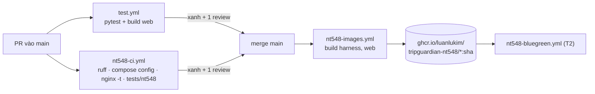

# 01. CI/CD trên GitHub Actions (T1, LuanLuKim)

Đọc xong làm được: CI xanh cho mọi PR, mỗi lần merge `main` có image theo sha trên GHCR, `main` được bảo vệ.

## Luồng



## Nghiên cứu

| Câu hỏi | Kết luận |
|---|---|
| Runner nào | `ubuntu-latest` của GitHub: repo public chạy không giới hạn phút, 4 vCPU, 16 GB RAM, không GPU |
| Registry | GHCR: miễn phí cho package public, đăng nhập bằng `GITHUB_TOKEN` (cần `permissions: packages: write`) |
| Tag image | `:<sha đầy đủ>` (bất biến, dùng để rollback) + `:main` (mới nhất). Không dùng `:latest` để deploy |
| Cache build | `docker/build-push-action` với `cache-from/to: type=gha` |
| Test chậm | pytest toàn bộ ~6.300 test; trên gpu156 > 40 phút vì máy tải cao. Trên runner chưa đo được (đỏ ở bước nạp test). Đo lại sau bước 1 |

## Các bước

1. **Sửa dependency thiếu.** Thêm `trafilatura`, `cryptography`, `fastapi` vào `dependencies` trong `pyproject.toml`, chạy `uv lock`. Đây là file của TripGuardian: mở PR lên `hohoangluan/tripguardian`, đồng thời merge cùng thay đổi vào fork để CI chạy được.
2. **Test cần `torch` / `soundfile`** (2 file, extra `asr`): thêm `pytest.importorskip("torch")` ở đầu file. Cũng là thay đổi của TripGuardian → cùng PR với bước 1.
3. Chạy lại `test.yml`, ghi vào issue: số test, thời gian, test nào đỏ. Test đo thời gian (`tests/agents/test_runtime.py`, `tests/planning/test_planning_overload_parallel.py`, …) có thể đỏ ngẫu nhiên; liệt kê, đừng sửa code sản phẩm.
4. `nt548-ci.yml` (`pull_request`, `push: main`), hai job:
   - `lint-test`: `ruff check --select F,E9 ops/nt548 tests/nt548`, `pytest tests/nt548`, `docker compose … config` của `app.yml`;
   - `app-smoke`: build ba image từ commit, chạy `app.yml` một màu, kiểm `GET /` trên `:8080` trả 200, stub harness báo đúng màu, gateway trả lời qua LLM giả và có `/metrics`, image không chứa `.env` / `data/`.
   - `app-real`: cùng stack đó, nhưng chạy **harness thật**. Các bước:
     - dữ liệu mẫu do `make.py` (T5) dựng, qua `data_check`, mount chỉ đọc;
     - Postgres chạy cạnh stack (`app.db.yml`; trên AWS là máy ops);
     - `data_release.py smoke` tìm từng nơi của `r-a` qua `:8080` và không thấy nơi chỉ `r-b` có;
     - tạo journey cho guest, khởi động lại harness, mở lại journey đó (journey nằm trong Postgres).

     Stack chạy đúng như trên máy EC2, chỉ thiếu ALB. Harness thật cần `APP_BASE_URL` bằng địa chỉ công khai (`http://<alb dns>` trên AWS). Thiếu biến này thì mọi thao tác ghi (đăng nhập guest, tạo journey) bị từ chối, vì web đổi header `Host` khi chuyển request vào.
   Khi có `docker-compose.yml` hai màu (#2) thì thêm `config` của nó và `nginx -t`.
5. `nt548-images.yml` (`push: main`, `workflow_dispatch`): build `harness`, `web`, `llm-fake` (bảng ở `02-bluegreen-lb.md` §Image), push `ghcr.io/luanlukim/tripguardian-nt548/<image>:<sha đầy đủ>` và `:main`, label `org.opencontainers.image.revision`. Cache theo image (`type=gha`). Lần push đầu tiên, admin vào trang package trên GitHub đặt **Public** cho cả ba (package mới mặc định private), để máy app kéo được mà không cần đăng nhập.
6. Bảo vệ nhánh `main` (Settings → Branches): bắt PR, 1 review, check `pytest`, `web`, `nt548-ci` xanh.

## Deploy lên AWS (#29)

`.github/workflows/nt548-deploy-aws.yml` gọi `ops/nt548/deploy_aws.sh`. Script chỉ thay đổi AWS qua `terraform apply` của `envs/demo` (hợp đồng §7.1 với T8). Các lệnh gọi thẳng AWS đều chỉ đọc: `describe-target-health`, `describe-instance-refreshes`, và metric CloudWatch trong `canary_watch.py`. State nằm trong bucket của bootstrap, nên trước lần chạy đầu cần `ops/nt548/aws.sh init` (workflow tự làm).

```sh
ops/nt548/deploy_aws.sh deploy <sha>   # màu rảnh nhận <sha> → healthy → canary 10 % → theo dõi → promote, lỗi thì lùi
ops/nt548/deploy_aws.sh rollback       # dồn 100 % về màu kia (vẫn chạy sha cũ), in số giây
ops/nt548/deploy_aws.sh status
```

Một lần `deploy`, khi blue đang live:

| Bước | `image_tag_blue` | `image_tag_green` | `weight_blue` | Chuyển bước khi |
|---|---|---|---|---|
| 1. Màu rảnh lên sha mới | cũ | **mới** | 100 | instance refresh của ASG green xong (`Successful`), rồi mọi target của TG green `healthy` (mỗi bước tối đa `HEALTH_TIMEOUT`, 600 s). Phải chờ refresh vì trong lúc refresh máy cũ vẫn healthy |
| 2. Canary | cũ | mới | 90 | `canary_watch.py cloudwatch` qua: sau `CANARY_SECONDS` (300 s), so 5xx và p95 của TG green với TG blue trên metric ALB, cùng ngưỡng `canary.yaml` như trên Compose (#3); green vẫn healthy |
| 3. Promote | cũ | mới | 0 | xong; blue giữ sha cũ để lùi |
| Lỗi ở bước 2 | cũ | mới | 100 | dừng, job đỏ |

Lần sau green là màu live, vai trò đảo lại. Lần đầu (state trống) cả hai màu nhận cùng sha, blue nhận toàn bộ traffic.

Hợp đồng với T8 (đã có ở #74–#78): `envs/demo` xuất lại các biến đầu vào (`image_tag_*`, `weight_blue`, `data_release_*`), nên script đọc màu đang live từ state Terraform. Nó cũng xuất `asg_name_*` (để chờ refresh), `alb_arn_suffix` và `target_group_arn_suffix_*` (chiều metric cho canary).

Workflow:
- **Kích hoạt:** tự chạy khi `nt548-images` xong và xanh trên `main` (`workflow_run`). Chạy tay qua `workflow_dispatch`: `action` = `deploy` / `rollback` / `status`, `sha` tùy chọn.
- **Công tắc:** không job nào chạy khi biến repo `NT548_DEPLOY_ENABLED` khác `true`. Admin bật biến này khi runner và `envs/demo` đã có; trước đó các lần merge không để lại job treo chờ runner.
- **An toàn runner:** không có trigger `pull_request`, nên code của PR không bao giờ chạy trên runner self-hosted. Có `concurrency` để hai lần deploy không chồng nhau. Sha nhập tay phải có dạng tag Docker.
- **Dự phòng khi runner hỏng:** `runner=github`. Job chạy trên `ubuntu-latest` với credential tạm của lab trong Environment `nt548-aws`; chỉ admin đặt Environment này, và nên bật "required reviewers".
- **Kiểm không cần AWS:** `tests/nt548/test_deploy_aws.py` (12 test) chạy script với `terraform`, `aws` và canary giả. Các test kiểm:
  - thứ tự trọng số;
  - màu không healthy hoặc refresh hỏng thì không nhận traffic;
  - canary so đúng TG mới với TG đang live, và kết luận rollback thì lùi;
  - rollback chỉ đổi trọng số;
  - tag lạ bị từ chối.

  Phần CloudWatch của `canary_watch.py` có test riêng trong `test_canary_watch.py`.

Còn lại:
- Chạy thật trên lab, cần T8 xong #22 (runner), #24 (ALB) và `envs/demo`.
- Đo thời gian rollback tay (mục tiêu < 1 phút).
- `canary_watch.py` thật (#3, DontMadWhenBad).

## Bật Actions

Push lên fork chưa tự tạo run (20/11): quyền Actions đã bật, workflow `active`, nhưng chỉ `workflow_dispatch` chạy. Vào tab **Actions** của fork, nếu có nút "I understand my workflows, go ahead and enable them" thì bấm. Sau đó push thử một commit và kiểm có run `push` không. Tạm thời chạy tay: Actions → test → Run workflow.

## Kiểm thử

| Kiểm | Cách |
|---|---|
| CI chặn được lỗi | PR cố ý làm hỏng một test → không merge được |
| Image đúng sha | `docker pull ghcr.io/luanlukim/tripguardian-nt548/web:<sha>`; `docker inspect` có label `org.opencontainers.image.revision=<sha>` |
| Không lộ secret | `docker run --rm <image> sh -c 'ls -a / /app; env'` không có `.env`, key |

## Xong khi

`test.yml` xanh (hoặc chỉ còn test đo thời gian đã liệt kê và đánh dấu bỏ qua trong CI), `nt548-ci.yml` và `nt548-images.yml` chạy trên `main`, `main` được bảo vệ.
