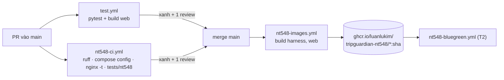

# 01. CI/CD trên GitHub Actions (T1, LuanLuKim)

Đọc xong làm được: CI xanh cho mọi PR, mỗi lần merge `main` có image theo sha trên GHCR, `main` được bảo vệ.

## Luồng

## Nghiên cứu

| Câu hỏi | Kết luận |
|---|---|
| Runner nào | `ubuntu-latest` của GitHub: repo public chạy không giới hạn phút, 4 vCPU, 16 GB RAM, không GPU |
| Registry | GHCR: miễn phí cho package public, đăng nhập bằng `GITHUB_TOKEN` (cần `permissions: packages: write`) |
| Tag image | `:<sha đầy đủ>` (bất biến, dùng để rollback) + `:main` (mới nhất). Không dùng `:latest` để deploy |
| Cache build | `docker/build-push-action` với `cache-from/to: type=gha` |
| Test chậm | pytest toàn bộ ~6.300 test; trên gpu156 > 40 phút vì máy tải cao. Trên runner chưa đo được (đỏ ở bước nạp test). Đo lại sau bước 1 |

## Các bước

1. **Sửa dependency thiếu.** Thêm `trafilatura`, `cryptography`, `fastapi` vào `dependencies` trong `pyproject.toml`, chạy `uv lock`. Đây là file của TripGuardian: mở PR lên `hohoangluan/tripguardian`, đồng thời merge cùng thay đổi vào fork để CI chạy được.
2. **Test cần `torch` / `soundfile`** (2 file, extra `asr`): thêm `pytest.importorskip("torch")` ở đầu file. Cũng là thay đổi của TripGuardian → cùng PR với bước 1.
3. Chạy lại `test.yml`, ghi vào issue: số test, thời gian, test nào đỏ. Test đo thời gian (`tests/agents/test_runtime.py`, `tests/planning/test_planning_overload_parallel.py`, …) có thể đỏ ngẫu nhiên; liệt kê, đừng sửa code sản phẩm.
4. `nt548-ci.yml`: chạy trên `pull_request` và `push: main`; job `ruff check --select F,E9 ops/nt548 tests/nt548`, `docker compose -f ops/nt548/compose/docker-compose.yml config`, `nginx -t` trong container `nginx:1.27-alpine`, `pytest tests/nt548`.
5. `nt548-images.yml`: trên `push: main` và `workflow_dispatch`. Build `ops/nt548/compose/harness.Dockerfile` và `web.Dockerfile`, push `:sha` + `:main`. Image **không** chứa `data/`, `.env`, key.
6. Bảo vệ nhánh `main` (Settings → Branches): bắt PR, 1 review, check `pytest`, `web`, `nt548-ci` xanh.

## Bật Actions

Push lên fork chưa tự tạo run (20/11): quyền Actions đã bật, workflow `active`, nhưng chỉ `workflow_dispatch` chạy. Vào tab **Actions** của fork, nếu có nút "I understand my workflows, go ahead and enable them" thì bấm. Sau đó push thử một commit và kiểm có run `push` không. Tạm thời chạy tay: Actions → test → Run workflow.

## Kiểm thử

| Kiểm | Cách |
|---|---|
| CI chặn được lỗi | PR cố ý làm hỏng một test → không merge được |
| Image đúng sha | `docker pull ghcr.io/luanlukim/tripguardian-nt548/web:<sha>`; `docker inspect` có label `org.opencontainers.image.revision=<sha>` |
| Không lộ secret | `docker run --rm <image> sh -c 'ls -a / /app; env'` không có `.env`, key |

## Xong khi

`test.yml` xanh (hoặc chỉ còn test đo thời gian đã liệt kê và đánh dấu bỏ qua trong CI), `nt548-ci.yml` và `nt548-images.yml` chạy trên `main`, `main` được bảo vệ.
