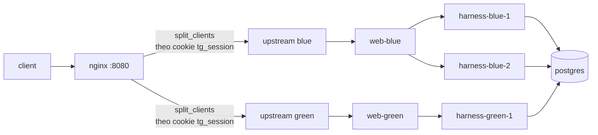

# 02. Load balancer và blue/green bằng Compose + Nginx (T2, Đình Long)

Đọc xong làm được: một lệnh dựng stack hai màu, đổi traffic giữa hai màu không rớt request, rollback < 1 phút, và workflow diễn tập toàn bộ trong CI.

## Kiến trúc



| Thành phần trong TripGuardian | Sự thật cần biết |
|---|---|
| `web/server.mjs` | Phục vụ web đã build, proxy `/api/harness/*` và `/api/auth/*` tới `HARNESS_PORT` (mặc định 8769). Không giữ trạng thái |
| `python -m harness serve --port N` | API chính. **Giữ phiên Planning trong RAM** (`src/planning/session.py`, `Store._mem`); restart thì dựng lại từ Postgres |
| Cookie `tg_session` | Định danh người dùng (`src/harness/server.py:58`). Dùng làm khóa sticky |
| Health | Chưa có `/healthz`. `GET /api/harness/me` không đăng nhập trả 401: coi 401 là "sống" cho tới khi có `/readyz` |

## Nghiên cứu cần ghi vào báo cáo

| Chủ đề | Nội dung |
|---|---|
| Blue/green vs rolling vs canary | Blue/green: hai bản đầy đủ, đổi một lần, lùi tức thì, tốn gấp đôi tài nguyên. Canary: blue/green + đổi dần theo %. Rolling: thay từng bản, lùi chậm |
| Nginx vs HAProxy vs Traefik | Chọn Nginx: `split_clients` cho chia %, `hash ... consistent` cho sticky, `nginx -s reload` không rớt kết nối. Ghi lý do loại hai cái còn lại |
| Sticky session | Vì phiên ở RAM: không sticky thì hai request của một người rơi vào hai harness, phiên bị dựng lại liên tục |
| Migration khi hai màu chung DB | Chỉ migration "mở rộng" (thêm cột / bảng); "thu hẹp" (xóa / đổi tên) để sang lần deploy sau |

## Cấu hình chính

Chia luồng theo cookie: một người luôn ở cùng một màu trong lúc canary.

```nginx
split_clients "${cookie_tg_session}" $color {
    10%  green;      # deploy.sh sửa con số này
    *    blue;
}
upstream blue  { hash $cookie_tg_session consistent; server web-blue:28899;  }
upstream green { hash $cookie_tg_session consistent; server web-green:28899; }
log_format nt548 escape=json '{"t":"$time_iso8601","color":"$color","status":$status,'
                             '"ms":$request_time,"up":"$upstream_addr","path":"$uri"}';
```

Người chưa có cookie: `split_clients` nhận chuỗi rỗng → luôn rơi cùng một màu. Cân nhắc dùng thêm `$request_id` cho khách mới; ghi lựa chọn vào báo cáo.

Khi một màu có N harness, `web/server.mjs` chỉ biết một `HARNESS_PORT`. Hai cách, chọn một và ghi lý do: (a) Nginx route thẳng `/api/harness/*` tới nhóm harness của màu, sticky theo cookie; (b) mỗi web đi kèm một harness, scale theo cặp.

## Các bước

1. `ops/nt548/compose/harness.Dockerfile` (python:3.12-slim, `pip install .`, `online_device: cpu`) và `web.Dockerfile` (node:24, `npm ci && npm run build:prod`, chạy `node web/server.mjs`).
2. `ops/nt548/compose/docker-compose.yml`: `postgres:16`, `nginx`, `web-blue`, `harness-blue`, `web-green`, `harness-green`. Mỗi màu đọc tag image từ biến (`BLUE_TAG`, `GREEN_TAG`). Migration: chạy `migrations/*.sql` một lần lúc `postgres` lên.
3. Dữ liệu: mount `ops/nt548/sample-data/` (T5 làm) chỉ đọc. Chưa có thì dùng harness stub (`ops/nt548/compose/harness_stub.py`: trả 200 / 401 cho đúng các route web gọi, có header `X-Color`) để làm tiếp phần LB.
4. `ops/nt548/deploy.sh`:

   | Lệnh | Làm gì |
   |---|---|
   | `up <color> <tag>` | `docker compose up -d` màu đó với tag, chờ healthcheck |
   | `weight <green%>` | ghi `ops/nt548/state/weight.conf`, `nginx -s reload` |
   | `promote` | `weight 100` (hoặc 0 nếu màu mới là blue), ghi `state/active` |
   | `rollback` | trọng số về màu cũ |
   | `status` | màu, tag, trọng số, health |

5. `.github/workflows/nt548-bluegreen.yml`: chạy sau `nt548-images.yml` và trên PR chạm `ops/nt548/**`. Dựng blue (tag cũ), bắn tải nền, `up green <sha>`, `weight 10`, `weight 100`, `rollback`, kiểm không có request lỗi do đổi màu.

## Kiểm thử

| Kiểm | Cách | Đạt |
|---|---|---|
| Sticky | 100 request cùng cookie | cùng một `color` và `up` trong log |
| Chia đúng % | 1.000 cookie ngẫu nhiên, `weight 10` | 7–13 % sang green |
| Không rớt khi đổi | vòng `curl` / k6 chạy suốt `weight` và `rollback` | 0 lỗi kết nối, 0 status 502 |
| Rollback nhanh | đo thời gian lệnh `rollback` tới khi 100 % về màu cũ | < 1 phút (thường vài giây) |

## Xong khi

`nt548-bluegreen.yml` xanh trên `main`; README của mảng (file này) khớp lệnh thật.
