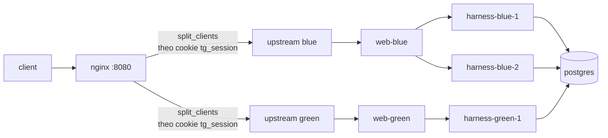
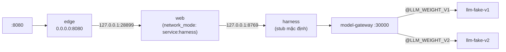

# 02. Load balancer và blue/green bằng Compose + Nginx (T2, DontMadWhenBad)

Đọc xong làm được: một lệnh dựng stack hai màu, đổi traffic giữa hai màu không rớt request, rollback < 1 phút, và workflow diễn tập toàn bộ trong CI.

## Kiến trúc



| Thành phần trong TripGuardian | Sự thật cần biết |
|---|---|
| `web/server.mjs` | Phục vụ web đã build, proxy `/api/harness/*` và `/api/auth/*` tới `HARNESS_PORT` (mặc định 8769). Không giữ trạng thái |
| `python -m harness serve --port N` | API chính. **Giữ phiên Planning trong RAM** (`src/planning/session.py`, `Store._mem`); restart thì dựng lại từ Postgres |
| Cookie `tg_session` | Định danh người dùng (`src/harness/server.py:58`). Dùng làm khóa sticky |
| Health | Chưa có `/healthz`. `GET /api/harness/me` không đăng nhập trả 401: coi 401 là "sống" cho tới khi có `/readyz` |

## Nghiên cứu cần ghi vào báo cáo

| Chủ đề | Nội dung |
|---|---|
| Blue/green vs rolling vs canary | Blue/green: hai bản đầy đủ, đổi một lần, lùi tức thì, tốn gấp đôi tài nguyên. Canary: blue/green + đổi dần theo %. Rolling: thay từng bản, lùi chậm |
| Nginx vs HAProxy vs Traefik | Chọn Nginx: `split_clients` cho chia %, `hash ... consistent` cho sticky, `nginx -s reload` không rớt kết nối. Ghi lý do loại hai cái còn lại |
| Sticky session | Vì phiên ở RAM: không sticky thì hai request của một người rơi vào hai harness, phiên bị dựng lại liên tục |
| Migration khi hai màu chung DB | Chỉ migration "mở rộng" (thêm cột / bảng); "thu hẹp" (xóa / đổi tên) để sang lần deploy sau |

## Cấu hình chính

Chia luồng theo cookie: một người luôn ở cùng một màu trong lúc canary.

```nginx
split_clients "${cookie_tg_session}" $color {
    10%  green;      # deploy.sh sửa con số này
    *    blue;
}
upstream blue  { hash $cookie_tg_session consistent; server web-blue:28899;  }
upstream green { hash $cookie_tg_session consistent; server web-green:28899; }
log_format nt548 escape=json '{"t":"$time_iso8601","color":"$color","status":$status,'
                             '"ms":$request_time,"up":"$upstream_addr","path":"$uri"}';
```

Người chưa có cookie: `split_clients` nhận chuỗi rỗng → luôn rơi cùng một màu. Cân nhắc dùng thêm `$request_id` cho khách mới; ghi lựa chọn vào báo cáo.

Khi một màu có N harness, `web/server.mjs` chỉ biết một `HARNESS_PORT`. Hai cách, chọn một và ghi lý do: (a) Nginx route thẳng `/api/harness/*` tới nhóm harness của màu, sticky theo cookie; (b) mỗi web đi kèm một harness, scale theo cặp.

## Image

Build context là gốc repo (riêng `llm-fake` là `ops/nt548/llm_fake`). Mỗi Dockerfile có file `<tên>.dockerignore` dạng allowlist, nên `data/`, `.env`, `web/public/data` không vào image.

| Image | Dockerfile | Chạy |
|---|---|---|
| `harness` | `ops/nt548/compose/harness.Dockerfile` (python:3.12-slim, cài dependency của `pyproject.toml` + fastapi, uvicorn; `PYTHONPATH=/app/src`) | mặc định `harness_stub.py`; `python -m harness serve` khi có dữ liệu mẫu; cũng chạy `scripts/model_gateway.py` |
| `web` | `ops/nt548/compose/web.Dockerfile` (node:24-slim, `npm ci && npm run build:prod`) | `node server.mjs` trên `127.0.0.1:PORT` (28899); `node edge.mjs` mở ra `0.0.0.0:8080` |
| `llm-fake` | `ops/nt548/llm_fake/Dockerfile` | `server.py` cổng 8000 (`04-aiops.md` §LLM giả) |

`web/public/data` không có trong git nên web trong image chưa có dữ liệu địa điểm; giao diện vẫn lên, `GET /` trả 200.

## `app.yml`: một màu trên một máy (hợp đồng với T8)

```sh
COLOR=blue IMAGE_TAG=<sha> docker compose -f ops/nt548/compose/app.yml up -d
# build từ checkout thay vì kéo GHCR:
docker compose -f ops/nt548/compose/app.yml -f ops/nt548/compose/app.build.yml up -d --build
```



- `web/server.mjs` chỉ nghe và chỉ gọi harness trên `127.0.0.1`, nên web, `edge` và harness dùng chung một network namespace; `edge` (`ops/nt548/compose/edge.mjs`, TCP pass-through) mở `0.0.0.0:8080`, publish trên service `harness`.
- Biến: `COLOR`, `IMAGE_TAG` (mặc định `main`), `REGISTRY`, `HARNESS_CMD` (mặc định là stub), `DATABASE_URL` (chỉ harness thật), `DATA_RELEASE` (mặc định `r-a`, mount `ops/nt548/sample-data/<release>` chỉ đọc vào `/data`), `LLM_WEIGHT_V1` / `LLM_WEIGHT_V2`, `FAKE_V{1,2}_DELAY_MS` / `_ERROR_RATE` / `_ERROR_STATUS` để bơm lỗi (#39).
- Stub (`ops/nt548/compose/harness_stub.py`): `/api/harness/me`, `/api/auth/*` trả 401; `/api/harness/*` khác trả 200; mọi trả lời có header `X-Color`, `X-Image-Tag`; `GET /api/harness/nt548-version` trả màu và tag.

## Các bước

1. Image và `app.yml`: đã có, xem §Image và §`app.yml`.
2. Hai màu trên một máy, đã làm (#2). Không viết một `docker-compose.yml` hai màu riêng. Mỗi màu là một stack `app.yml` (project `tg-blue`, `tg-green`), cổng máy lấy từ biến `HOST_PORT`; Nginx (`ops/nt548/lb/`) đứng trước, gọi vào `host.docker.internal`. Lý do: máy app của T8 và buổi diễn tập chạy **cùng** một file, không có hai cấu hình phải giữ khớp nhau.

   ```mermaid
   flowchart LR
     C[client] --> N["nginx :8080<br/>split_clients theo tg_session"]
     N -->|"upstream blue<br/>hash consistent"| B1["tg-blue :8081"] & B2["tg-blue-2 :8091"]
     N -->|upstream green| G1["tg-green :8082"]
   ```

   - Một màu nhiều bản: `deploy.sh up blue <tag> 2` thêm `tg-blue-2` trên cổng 8091. Nginx giữ người dùng trên một bản (`hash $split_key consistent`), nên phiên trong RAM không bị dựng lại liên tục. Đây là cách (a) của §Cấu hình chính: Nginx chọn cặp web + harness của màu.
   - Khách chưa có cookie: khóa chia là `$request_id`, nghĩa là mỗi request chia riêng theo %.
   - Postgres chung hai màu: chưa làm, vì stub không cần DB. Làm khi harness thật chạy hai màu (sau #63, `app.db.yml`).
3. Dữ liệu: stub mặc định; `HARNESS_CMD` + `DATA_RELEASE` cho harness thật (05-dataops.md).
4. `ops/nt548/deploy.sh`:

   | Lệnh | Làm gì |
   |---|---|
   | `up <color> <tag> [n]` | `docker compose up -d --wait` màu đó với tag, n bản; ghi lại upstream của Nginx |
   | `lb` | dựng Nginx; toàn bộ traffic vào màu active (mặc định blue) |
   | `weight <pct>` | pct % người dùng sang màu **mới** (màu chưa active); `nginx -t`, `nginx -s reload`, chờ tới khi worker mới phục vụ |
   | `promote` | màu mới nhận 100 % và thành màu active |
   | `rollback` | 0 % sang màu mới: mọi người về màu active |
   | `status` | JSON: màu active, trọng số, tag và mã HTTP của từng bản |
   | `down [color]` | dừng một màu, hoặc tất cả |

   Trạng thái (trọng số, màu active, file include của Nginx, access log) nằm trong `NT548_STATE`, mặc định `ops/nt548/state/`, không vào git.
   `nginx -s reload` chỉ là một tín hiệu. Ngay sau lệnh, worker cũ vẫn phục vụ thêm một lúc: lần chạy CI đầu đo được chỉ 84,5 % sang green sau `weight 100`. Vì vậy `deploy.sh` chỉ trả về khi không còn worker cũ nào phục vụ.
5. `.github/workflows/nt548-bluegreen.yml`: chạy trên PR chạm `ops/nt548/**` và trên `main`. Build image một lần, gắn hai tag `old` và `new`, rồi chạy `ops/nt548/bluegreen_rehearsal.sh` (chạy được trên máy bằng đúng lệnh đó). Stub trả `IMAGE_TAG`, nên phân biệt được hai màu.

## Kiểm thử

| Kiểm | Cách (`ops/nt548/lb_check.py`) | Đạt | CI 26/11 (PR #68) |
|---|---|---|---|
| Sticky | `sticky`: 20 người dùng × 100 request | mỗi người một màu | 0 / 20 người bị đổi màu |
| Chia đúng % | `split`: 1.000 cookie mới, `weight 10` | 7–13 % sang green | 9,1 % |
| Không rớt khi đổi | `load` chạy suốt `weight 10` → `100` → `rollback` → `promote` | 0 lỗi kết nối, 0 5xx | 5.726 request, 0 lỗi kết nối, 0 5xx |
| Rollback nhanh | `wait-color` sau `deploy.sh rollback` | < 1 phút | lệnh 0,8 s, 100 % về blue sau thêm 0,1 s |

## Xong khi

`nt548-bluegreen.yml` xanh trên `main`; README của mảng (file này) khớp lệnh thật.
