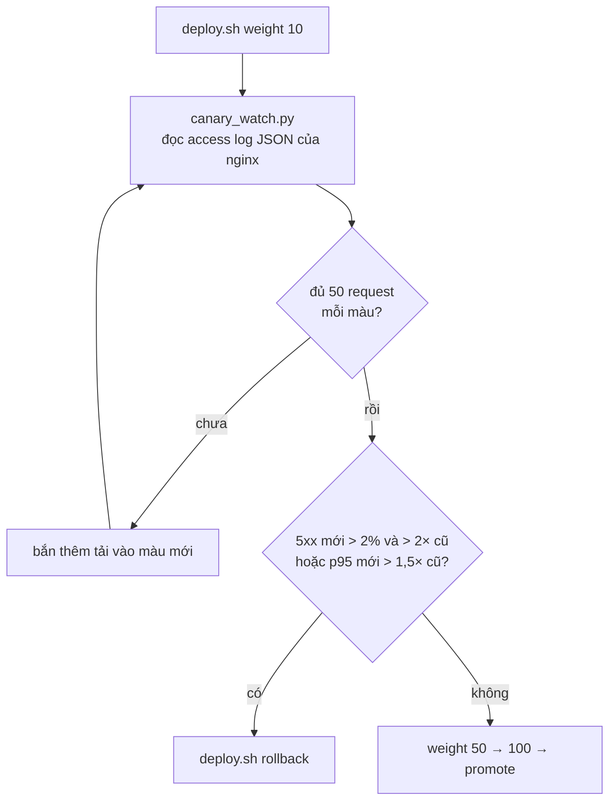
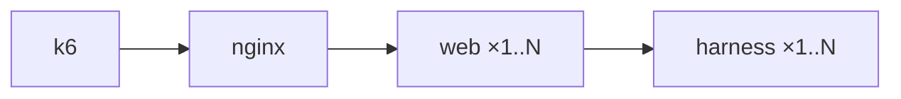

# 03. Canary tự động và scale (T3, DontMadWhenBad)

Đọc xong làm được: canary tự promote hoặc tự rollback dựa trên số đo; scale harness / web lên N bản và có bảng số đo trước / sau.

## Canary tự động



So màu mới với màu cũ **cùng lúc**, không so với ngưỡng tuyệt đối: máy (hay runner) chậm thì cả hai màu cùng chậm, canary không rollback nhầm.

| File | Nội dung |
|---|---|
| `ops/nt548/canary.yaml` | `min_requests: 50`, `max_5xx_ratio: 0.02`, `max_5xx_vs_old: 2.0`, `max_p95_vs_old: 1.5`, `steps: [10, 50, 100]`, `step_seconds: 120` |
| `ops/nt548/canary_watch.py` | đọc log từ một mốc thời gian, tính theo `color`, in quyết định dạng JSON, mã thoát 0 = promote, 1 = rollback |
| `tests/nt548/test_canary_watch.py` | log giả: màu mới tốt → 0; nhiều 500 → 1; ít request → chờ |

Nghiên cứu ghi vào báo cáo: canary analysis (Argo Rollouts / Flagger làm gì, vì sao nhóm tự viết bản nhỏ), chọn chỉ số (lỗi, độ trễ, bão hòa), vì sao cần số request tối thiểu.

## Scale



1. Web không giữ trạng thái: thêm bản là thêm `server` vào `upstream`.
2. Harness: thêm bản vào nhóm của màu, sticky theo `tg_session` (02). Bản mới không có phiên trong RAM thì dựng lại từ Postgres.
3. Đo bằng k6 (`ops/nt548/load/journey.js`): kịch bản mở trang, đăng nhập khách, gọi vài API đọc. Chưa có dữ liệu mẫu thì đo trên stub và ghi rõ.

| Cấu hình | Người dùng ảo | p50 | p95 | lỗi % | req/s |
|---|---|---|---|---|---|
| 1 web + 1 harness | 20 / 50 / 100 | | | | |
| 2 web + 2 harness | 20 / 50 / 100 | | | | |

Điền bảng vào `docs/reports/<ngày>-nt548-scale.md`, ghi máy đo (runner GitHub hay máy cá nhân, CPU, RAM).

## Kiểm thử

| Kiểm | Đạt |
|---|---|
| Image cố ý trả 500 ở một route (biến môi trường `NT548_FAULT=500`) | `canary_watch` rollback, màu cũ không có lỗi |
| Image cố ý chậm (`NT548_FAULT=delay:800`) | rollback vì p95 |
| Bản tốt | promote đủ 3 bước |

`NT548_FAULT` chỉ có trong harness stub hoặc một middleware của NT548, không sửa code sản phẩm.

## Đã làm (#3, 26/11)

```sh
python ops/nt548/canary_watch.py check --since <epoch ms>   # một quyết định, JSON; mã thoát 0 promote / 1 rollback / 2 chờ
python ops/nt548/canary_watch.py run                        # weight 10 → 50 → promote, rollback ngay khi một bước hỏng
OLD_TAG=old NEW_TAG=new STEP_SECONDS=15 ops/nt548/canary_rehearsal.sh   # ba ca của §Kiểm thử
TAG=new VUS="20 50 100" ops/nt548/scale_bench.sh                         # bảng scale
```

- Ngưỡng nằm trong `ops/nt548/canary.yaml`, khớp bảng ở trên, thêm hai ngưỡng:
  - `min_p95_gap_ms: 100`. Luật p95 chỉ áp khi màu mới **cũng** chậm hơn ít nhất 100 ms. Stub trả lời trong 2–3 ms, nên chênh 1 ms đã là 1,5 lần, mà đó chỉ là nhiễu.
  - `max_wait_seconds`. Hết thời gian mà vẫn chưa đủ 50 request mỗi màu thì rollback. Không có dữ liệu thì không chứng minh được bản mới tốt.
- `NT548_FAULT` nằm trong stub: `500`, `503@0.3` (30 % request), `delay:800`. Route `nt548-version` không bị bơm, để vẫn nhận ra màu.
- Workflow `nt548-bluegreen.yml` chạy canary sau diễn tập blue/green; job `scale` chạy k6.

Kết quả CI 26/11 (PR #69, bước 15 s):

| Ca | Ứng viên | Mong đợi | Kết quả | Thời gian ra quyết định | 5xx ở màu cũ | Lý do |
|---|---|---|---|---|---|---|
| Bản tốt | image mới | promote | promote (2 bước) | 33 s | 0 | 5xx 0 % / 0 %, p95 3 / 3 ms |
| `NT548_FAULT=500` | blue | rollback | rollback ở bước 10 % | 17 s | 0 | 5xx 52,7 % ở màu mới, 0 % ở màu cũ |
| `NT548_FAULT=delay:800` | blue | rollback | rollback ở bước 10 % | 16 s | 0 | p95 803 ms so với 2 ms |

Scale, CI 26/11 (runner GitHub 4 vCPU, stub, k6 chạy cùng máy, 20 s mỗi dòng):

| Cấu hình | Người dùng ảo | p50 ms | p95 ms | lỗi % | req/s |
|---|---|---|---|---|---|
| 1 web + 1 harness | 20 / 50 / 100 | 1,1 / 1,3 / 1,7 | 2,6 / 4,2 / 5,8 | 0 / 0 / 0,04 | 386 / 898 / 1.509 |
| 2 web + 2 harness | 20 / 50 / 100 | 1,2 / 1,2 / 1,8 | 3,5 / 5,0 / 8,5 | 0 / 0 / 0 | 382 / 892 / 1.621 |

Đọc số: trên một máy, thêm bản không tăng thông lượng, vì k6, Nginx và hai bản tranh nhau cùng 4 vCPU. p95 còn tăng nhẹ vì thêm tiến trình. Scale có ích khi mỗi bản là một máy riêng, tức ASG trên AWS (#25). Bảng scale-out 1 → 3 máy vẫn chờ ALB / ASG.

Còn lại: nguồn số liệu CloudWatch theo target group (cần #24) và k6 vào URL ALB (cần #25).

## Xong khi

`canary_watch` chạy trong `nt548-bluegreen.yml` thay cho bước đổi trọng số cố định; có báo cáo scale.
