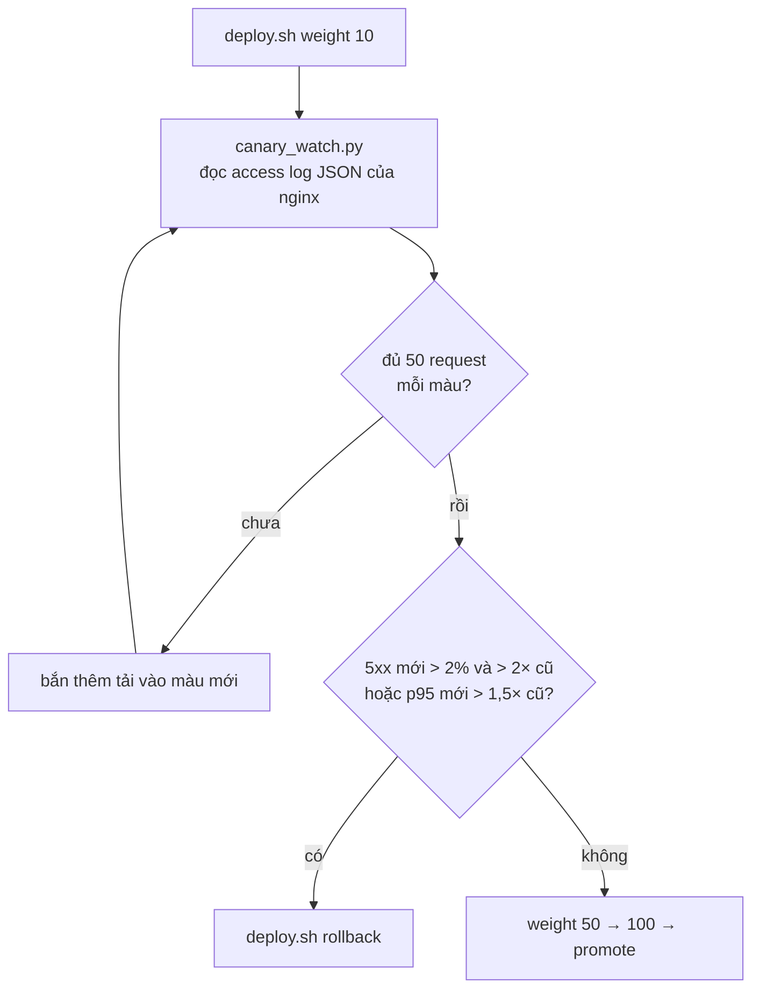
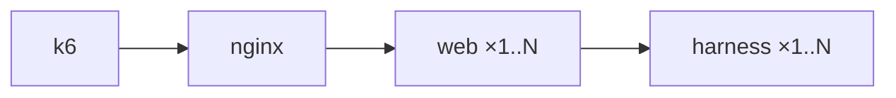

# 03. Canary tự động và scale (T3, Quỳnh)

Đọc xong làm được: canary tự promote hoặc tự rollback dựa trên số đo; scale harness / web lên N bản và có bảng số đo trước / sau.

## Canary tự động

So màu mới với màu cũ **cùng lúc**, không so với ngưỡng tuyệt đối: máy (hay runner) chậm thì cả hai màu cùng chậm, canary không rollback nhầm.

| File | Nội dung |
|---|---|
| `ops/nt548/canary.yaml` | `min_requests: 50`, `max_5xx_ratio: 0.02`, `max_5xx_vs_old: 2.0`, `max_p95_vs_old: 1.5`, `steps: [10, 50, 100]`, `step_seconds: 120` |
| `ops/nt548/canary_watch.py` | đọc log từ một mốc thời gian, tính theo `color`, in quyết định dạng JSON, mã thoát 0 = promote, 1 = rollback |
| `tests/nt548/test_canary_watch.py` | log giả: màu mới tốt → 0; nhiều 500 → 1; ít request → chờ |

Nghiên cứu ghi vào báo cáo: canary analysis (Argo Rollouts / Flagger làm gì, vì sao nhóm tự viết bản nhỏ), chọn chỉ số (lỗi, độ trễ, bão hòa), vì sao cần số request tối thiểu.

## Scale

1. Web không giữ trạng thái: thêm bản là thêm `server` vào `upstream`.
2. Harness: thêm bản vào nhóm của màu, sticky theo `tg_session` (02). Bản mới không có phiên trong RAM thì dựng lại từ Postgres.
3. Đo bằng k6 (`ops/nt548/load/journey.js`): kịch bản mở trang, đăng nhập khách, gọi vài API đọc. Chưa có dữ liệu mẫu thì đo trên stub và ghi rõ.

| Cấu hình | Người dùng ảo | p50 | p95 | lỗi % | req/s |
|---|---|---|---|---|---|
| 1 web + 1 harness | 20 / 50 / 100 | | | | |
| 2 web + 2 harness | 20 / 50 / 100 | | | | |

Điền bảng vào `docs/reports/<ngày>-nt548-scale.md`, ghi máy đo (runner GitHub hay máy cá nhân, CPU, RAM).

## Kiểm thử

| Kiểm | Đạt |
|---|---|
| Image cố ý trả 500 ở một route (biến môi trường `NT548_FAULT=500`) | `canary_watch` rollback, màu cũ không có lỗi |
| Image cố ý chậm (`NT548_FAULT=delay:800`) | rollback vì p95 |
| Bản tốt | promote đủ 3 bước |

`NT548_FAULT` chỉ có trong harness stub hoặc một middleware của NT548, không sửa code sản phẩm.

## Xong khi

`canary_watch` chạy trong `nt548-bluegreen.yml` thay cho bước đổi trọng số cố định; có báo cáo scale.
