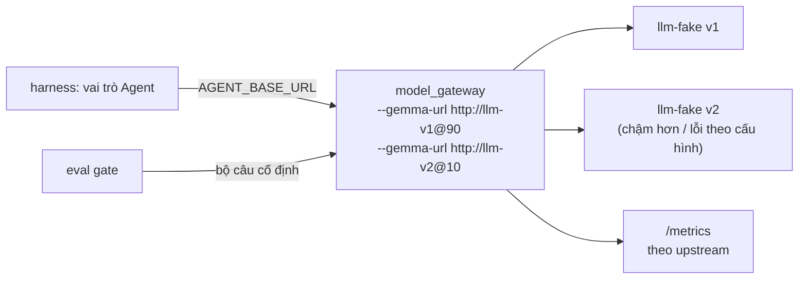

# 04. AI ops: chia luồng model và chặn bằng eval (T4, hohoangluan)

Đọc xong làm được: đổi model / prompt theo kiểu canary như đổi code; có số liệu theo từng bản model; bản model kém không được nhận toàn bộ traffic.

## Ở TripGuardian đã có gì

Code gọi model theo **vai trò** (Agent, Extractor, Judge, ASR); model cụ thể nằm trong config, key trong `.env` (`docs/LLM_PROVIDER.md`). `scripts/model_gateway.py` là cổng tương thích OpenAI đứng trước các model tự host:

| Có sẵn | Thiếu (NT548 thêm) |
|---|---|
| Nhiều upstream (`--gemma-url` lặp lại), chọn upstream có ít request đang chờ nhất | Trọng số theo upstream (canary 10 %) |
| Upstream lỗi kết nối / 502 / 503 / 504 bị bỏ qua `--cooldown` giây | Đếm request, lỗi, độ trễ theo upstream, xuất ra `/metrics` |
| `GET /v1/models` | Ghi bản model đang chạy vào nhãn image / `RELEASE.json` |

## Kiến trúc

## LLM giả

CI công khai không giữ được key model, và đồ án không chấm chất lượng câu trả lời. Viết `ops/nt548/llm_fake/server.py` (FastAPI, tương thích `POST /v1/chat/completions`, có stream):
- trả câu cố định theo `model` + hash của prompt (tất định, test được);
- `FAKE_DELAY_MS`, `FAKE_ERROR_RATE`, `FAKE_VERSION` qua biến môi trường để giả bản model tốt / xấu.

## Các bước

1. Thêm cú pháp `URL@weight` cho `--gemma-url` và `--clef-url`: chọn upstream theo trọng số trong số upstream đang không cooldown; không ghi trọng số thì như cũ. Giữ hành vi cũ để PR được lên TripGuardian. Test ở `tests/test_model_gateway.py` (đã có) thêm ca trọng số.
2. Đếm theo upstream; `GET /metrics` dạng Prometheus text (`gateway_requests_total{upstream=…,status=…}`, `gateway_latency_seconds_bucket`).
3. Thêm `llm-fake-v1`, `llm-fake-v2`, `model-gateway` vào compose (02); trỏ `AGENT_BASE_URL` và các `*_BASE_URL` khác của harness vào gateway.
4. **Eval gate** (`ops/nt548/eval_gate.py`): gửi bộ câu cố định qua gateway tới từng upstream, đo tỷ lệ trả lời hợp lệ (JSON đúng schema khi vai trò yêu cầu), lỗi, p95. Dưới ngưỡng thì không tăng trọng số. Bộ câu lấy dạng từ `config/bench_assistant*.yaml`, không chép nội dung crawl.
5. Workflow `nt548-model-canary.yml` (`workflow_dispatch`, input: upstream mới, trọng số): dựng gateway + 2 fake, eval gate, tăng 10 → 50 → 100 hoặc rollback; in bảng `/metrics`.

## Nghiên cứu ghi vào báo cáo

- MLOps / LLMOps khác DevOps ở đâu: model và prompt là "phiên bản" giống code; chất lượng phải đo bằng eval, không chỉ bằng HTTP 200.
- Shadow traffic (gửi song song, không trả cho người dùng) vs canary: ưu nhược, vì sao chọn canary.
- Với model thật (ngoài phạm vi CI): eval gate dùng `config/prod_journey_cases.yaml` + `scripts/prod_journey_e2e.py --only <tập nhỏ>`; chỉ chạy khi có key, không chạy trên PR.

## Kiểm thử

| Kiểm | Đạt |
|---|---|
| Trọng số 90/10, 1.000 request | v2 nhận 7–13 % |
| v2 lỗi 30 % | eval gate chặn, trọng số giữ 0 |
| v2 sập | gateway cooldown v2, 100 % về v1, không lỗi phía harness |

## Xong khi

`nt548-model-canary.yml` chạy xanh với v2 tốt và chặn được v2 xấu; PR trọng số gửi lên TripGuardian.
