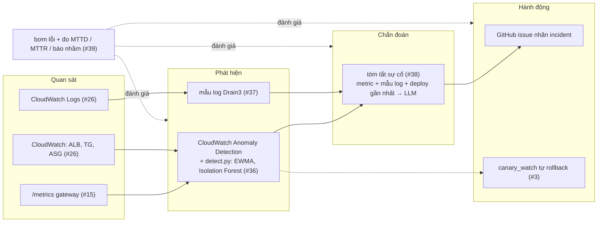

# 04. AI ops: AIOps cho TripGuardian (T4, LuanLuKim + DontMadWhenBad)

Chủ dự án chốt 21/11: **AI ops của đồ án = AIOps**, tức dùng AI / ML để vận hành hệ thống. Phần LLMOps cũ (eval gate #16, canary model #17) thành không bắt buộc. Issue cha: #4.

Đọc xong làm được: hệ thống tự phát hiện bất thường trên metric và log, tự viết tóm tắt sự cố, và có số đo chứng minh cách đó phát hiện sớm hơn ngưỡng tĩnh.

## Chuỗi AIOps của đồ án

## Ở TripGuardian đã có gì

| Có sẵn | NT548 thêm |
|---|---|
| `scripts/model_gateway.py`: nhiều upstream, cooldown khi lỗi, trọng số `URL@weight` (#14) | `/metrics` theo upstream (#15) |
| `scikit-learn` trong dependency | Detector của #36 |
| Workers AI làm dự phòng cho Clef (`docs/LLM_PROVIDER.md`) | Dùng cho tóm tắt sự cố (#38) khi có key trong GitHub Secret |

## `/metrics` của gateway (#15)

Định dạng Prometheus text. Khi có `MODEL_GATEWAY_API_KEY` thì cần gửi cùng bearer key.

| Metric | Loại | Ý nghĩa |
|---|---|---|
| `gateway_requests_total{model,upstream,status}` | counter | `status` là mã HTTP; `error` khi upstream không trả lời; upstream `none` khi không còn upstream nào |
| `gateway_upstream_latency_seconds{model,upstream}` | histogram | Thời gian tới khi upstream trả status (với Gemma stream là tới byte đầu) |
| `gateway_upstream_up` | gauge | 1 khi upstream không trong cooldown |
| `gateway_upstream_outstanding` | gauge | Số request đang chờ |
| `gateway_upstream_weight` | gauge | Trọng số (1 khi không dùng `@weight`) |

## Các bước

1. **#36 phát hiện bất thường trên metric (LuanLuKim):**
   - Alarm CloudWatch Anomaly Detection cho độ trễ p95, 5xx và số request theo target group (module `ops/nt548/terraform/modules/aiops`).
   - Script `ops/nt548/aiops/detect.py` dùng EWMA / z-score và Isolation Forest, so với ngưỡng tĩnh trên cùng dữ liệu.
2. **#37 gom mẫu log (DontMadWhenBad):** Drain3 trên log container. Mẫu mới xuất hiện hoặc mẫu lỗi tăng đột biến được tính là bất thường. So với lệnh `pattern` của CloudWatch Logs Insights.
3. **#38 tóm tắt sự cố (LuanLuKim):**
   - Workflow chạy định kỳ trên runner `nt548-aws`. Khi alarm chuyển sang ALARM, workflow gom metric, top mẫu log và các lần deploy gần nhất.
   - LLM viết tóm tắt cùng giả thuyết nguyên nhân, rồi mở issue nhãn `incident`.
   - Lệnh gợi ý không tự chạy. Chỉ `canary_watch` được tự rollback.
4. **#39 bơm lỗi và đánh giá (DontMadWhenBad):**
   - Kịch bản: LLM giả lỗi 30 %, chậm thêm 2 s, tắt một máy app, deploy bản trả 500, tải tăng đột biến.
   - Đo MTTD của từng cách phát hiện, MTTR có tự động và không tự động, và số lần báo nhầm khi tải bình thường.

## Nghiên cứu ghi vào báo cáo (#18)

- AIOps: chuỗi quan sát → phát hiện → chẩn đoán → hành động; các chỉ số MTTD, MTTR, báo nhầm.
- Phát hiện bất thường: ngưỡng tĩnh, thống kê, ML; ưu nhược của từng cách.
- Log: thuật toán Drain.
- Phân tích canary tự động: Kayenta, Argo Rollouts.
- LLM trong xử lý sự cố, và rủi ro bịa nguyên nhân.
- Công cụ thương mại (DevOps Guru, Datadog Watchdog, Dynatrace Davis) và vì sao nhóm không dùng.
- Predictive scaling: nêu làm hướng mở rộng.
- LLMOps khác AIOps ở đâu.

## Kiểm thử

| Kiểm | Đạt |
|---|---|
| Chuỗi tổng hợp có gai | `detect.py` báo đúng điểm gai, không báo ở đoạn ổn định |
| LLM giả lỗi 30 % trên stack | Có ít nhất một cách phát hiện báo trong vài phút; mẫu log lỗi lên đầu danh sách |
| Sự cố giả | Issue `incident` tự mở, nêu đúng nguyên nhân đã gây ra |
| Đủ kịch bản #39 | Bảng MTTD / MTTR / báo nhầm chạy lại được bằng một lệnh |

## Xong khi

Bảng số của #39 có trong `REPORT.md` §6 và cho thấy cách nào phát hiện tốt hơn ngưỡng tĩnh (hoặc kết luận rõ là không tốt hơn).
