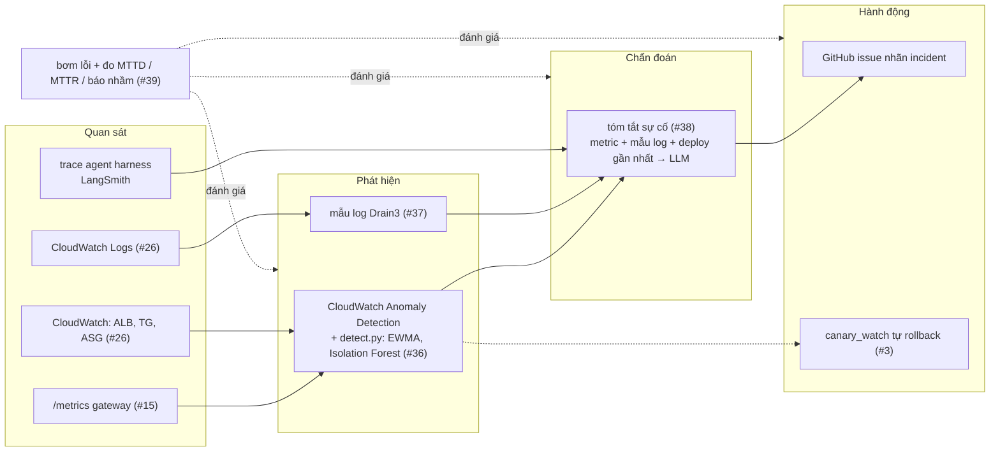

# 04. AI ops: AIOps cho TripGuardian (T4, LuanLuKim + DontMadWhenBad)

Chủ dự án chốt 21/11: **AI ops của đồ án = AIOps**, tức dùng AI / ML để vận hành hệ thống. Phần LLMOps cũ (eval gate #16, canary model #17) thành không bắt buộc. Issue cha: #4.

Đọc xong làm được: hệ thống tự phát hiện bất thường trên metric và log, tự viết tóm tắt sự cố, và có số đo chứng minh cách đó phát hiện sớm hơn ngưỡng tĩnh.

## Chuỗi AIOps của đồ án



## Ở TripGuardian đã có gì

| Có sẵn | NT548 thêm |
|---|---|
| `scripts/model_gateway.py`: nhiều upstream, cooldown khi lỗi, trọng số `URL@weight` (#14) | `/metrics` theo upstream (#15) |
| `scikit-learn` trong dependency | Detector của #36 |
| Workers AI làm dự phòng cho Clef (`docs/LLM_PROVIDER.md`) | Dùng cho tóm tắt sự cố (#38) khi có key trong GitHub Secret |

## LLM giả (#13)

`ops/nt548/llm_fake/server.py` (FastAPI) đứng sau `model_gateway` thay cho model thật: `GET /v1/models`, `POST /v1/chat/completions` (thường và stream), `GET /healthz`. Cùng `model` + `messages` thì cùng câu trả lời; câu trả lời mở đầu bằng `[fake <version>]` nên đếm được bản nào phục vụ.

| Biến | Mặc định | Dùng để |
|---|---|---|
| `FAKE_VERSION` | `v1` | tên bản, có trong câu trả lời, header `X-Fake-Version`, `system_fingerprint` |
| `FAKE_MODELS` | `gemma26b-a4b` | danh sách của `/v1/models` (model khác vẫn được trả lời) |
| `FAKE_DELAY_MS` | `0` | chậm thêm mỗi lần gọi |
| `FAKE_ERROR_RATE` | `0` | tỉ lệ lần gọi trả lỗi (0–1) |
| `FAKE_ERROR_STATUS` | `500` | mã lỗi; `502` / `503` / `504` làm gateway cho upstream nghỉ (cooldown) |
| `FAKE_SEED` | ngẫu nhiên | lặp lại được chuỗi lỗi |

```sh
docker build -t llm-fake ops/nt548/llm_fake
docker run -p 8000:8000 -e FAKE_VERSION=v2 -e FAKE_ERROR_RATE=0.3 llm-fake
```

Test (`tests/nt548/test_llm_fake.py`) chạy cả gateway thật trước hai bản giả: chia 90/10 đúng tỉ lệ, và bản canary trả 503 thì gateway chuyển sang v1, người gọi không thấy lỗi.

## `/metrics` của gateway (#15)

Định dạng Prometheus text. Khi có `MODEL_GATEWAY_API_KEY` thì cần gửi cùng bearer key.

| Metric | Loại | Ý nghĩa |
|---|---|---|
| `gateway_requests_total{model,upstream,status}` | counter | `status` là mã HTTP; `error` khi upstream không trả lời; upstream `none` khi không còn upstream nào |
| `gateway_upstream_latency_seconds{model,upstream}` | histogram | Thời gian tới khi upstream trả status (với Gemma stream là tới byte đầu) |
| `gateway_upstream_up` | gauge | 1 khi upstream không trong cooldown |
| `gateway_upstream_outstanding` | gauge | Số request đang chờ |
| `gateway_upstream_weight` | gauge | Trọng số (1 khi không dùng `@weight`) |

## Phát hiện bất thường trên metric (#36)

`ops/nt548/aiops/detect.py` (numpy + scikit-learn, không cần AWS trừ lệnh `cloudwatch`):

```sh
python ops/nt548/aiops/detect.py synth spike --seed 1 --out spike.csv   # chuỗi tổng hợp t,value,label
python ops/nt548/aiops/detect.py run spike.csv                           # alarm của từng detector, chấm điểm nếu có nhãn
python ops/nt548/aiops/detect.py compare --seeds 20                      # bảng dưới
python ops/nt548/aiops/detect.py cloudwatch --metric TargetResponseTime --stat p95     --dim TargetGroup=<…> --dim LoadBalancer=<…> --minutes 180 --out tg.csv   # trên runner, LabInstanceProfile
```

- Mỗi detector học "bình thường" từ `--train` điểm đầu (mặc định 200). Alarm bật khi `--persist` điểm liên tiếp bị gắn cờ (mặc định 2, kiểu "M of M datapoints" của CloudWatch).
- `static`: ngưỡng cố định, mặc định 1,5 × max của đoạn train, như người vận hành đặt tay.
- `ewma`: trung bình và phương sai EWMA (α = 0,05), cờ khi lệch quá 4 sd. Điểm bị cờ không cập nhật ước lượng.
- `iforest`: Isolation Forest trên giá trị, độ thay đổi, độ lệch so với trung bình trượt, và pha chu kỳ (khi biết `--period`).
- `combined`: `ewma` hoặc `iforest`. Đây là tín hiệu mà tóm tắt sự cố (#38) nghe.
- Chấm điểm: sự cố được tính là bắt được nếu alarm bật trong lúc lỗi hoặc tối đa 10 điểm sau đó. Alarm bật ở chỗ không có lỗi là báo nhầm.

Chuỗi tổng hợp giống độ trễ: nền 200, nhiễu sd 10, 720 điểm, một lỗi sau 1/3 chuỗi. Các kịch bản: `spike` (+150 trong 5 điểm), `drift` (+0,5 mỗi điểm trong 200 điểm rồi giữ +100), `seasonal_spike` (chu kỳ biên độ 60, gai +120 ở đáy chu kỳ), `level_shift` (+60 từ đó trở đi), `quiet` (không lỗi). Kết quả `compare --seeds 20` (21/11/2026), độ trễ tính bằng số điểm:

| scenario | detector | detected / faults | median delay (points) | false alarms |
|---|---|---|---|---|
| spike | static | 18 / 20 | 1 | 0 |
| spike | ewma | 20 / 20 | 1 | 0 |
| spike | iforest | 16 / 20 | 1 | 6 |
| spike | combined | 20 / 20 | 1 | 6 |
| drift | static | 0 / 20 | - | 0 |
| drift | ewma | 0 / 20 | - | 0 |
| drift | iforest | 15 / 20 | 117 | 0 |
| drift | combined | 15 / 20 | 117 | 0 |
| seasonal_spike | static | 0 / 20 | - | 0 |
| seasonal_spike | ewma | 0 / 20 | - | 0 |
| seasonal_spike | iforest | 16 / 20 | 1 | 3 |
| seasonal_spike | combined | 16 / 20 | 1 | 3 |
| level_shift | static | 0 / 20 | - | 0 |
| level_shift | ewma | 20 / 20 | 1 | 0 |
| level_shift | iforest | 17 / 20 | 1 | 0 |
| level_shift | combined | 20 / 20 | 1 | 0 |
| quiet | static | 0 / 0 | - | 0 |
| quiet | ewma | 0 / 0 | - | 0 |
| quiet | iforest | 0 / 0 | - | 6 |
| quiet | combined | 0 / 0 | - | 6 |

Đọc bảng:
- Ngưỡng tĩnh chỉ bắt được gai lớn. Nó không thấy mức tăng +60 hay rò rỉ chậm dưới vạch, và không thấy gai nằm dưới đỉnh chu kỳ.
- EWMA nhanh, không báo nhầm, nhưng tự thích nghi theo rò rỉ chậm nên bỏ sót `drift`, và nhiễu bởi chu kỳ.
- Isolation Forest là cách duy nhất bắt được `drift` và `seasonal_spike`. Đổi lại nó báo nhầm khoảng 6 lần trên 20 chuỗi × ~520 điểm, và bỏ sót vài gai vượt ra ngoài miền dữ liệu train (cây chỉ chia trong miền đã thấy).
- Ghép hai cách (`combined`) bắt đủ `spike` và `level_shift`, giữ được phần mạnh của iforest; báo nhầm bằng của iforest.
- Số trên metric thật của lab chưa có. Số khi bơm lỗi trên stack Compose (#39): `REPORT.md` §6.4.

### Trên AWS: CloudWatch Anomaly Detection (module `aiops`)

`ops/nt548/terraform/modules/aiops` tạo, cho **mỗi màu × mỗi metric**, một alarm có ngưỡng là dải dự báo `ANOMALY_DETECTION_BAND(m1, band_width)`. CloudWatch tự học dải này từ lịch sử của chính metric. Alarm bật khi 2 trong 3 điểm một phút nằm ngoài dải.

| Khóa | Metric (`AWS/ApplicationELB`, theo `TargetGroup` + `LoadBalancer`) | Bật khi |
|---|---|---|
| `<màu>-latency` | `TargetResponseTime` p95 | trên dải |
| `<màu>-errors` | `HTTPCode_Target_5XX_Count` Sum | trên dải |
| `<màu>-requests` | `RequestCount` Sum | ngoài dải, cả hai phía (mất traffic cũng là sự cố) |

Tên alarm là `<name_prefix>-<màu>-<khóa>-anomaly`. Đây là tiền tố mà `incident.py watch --prefix` đọc (#38). T8 gắn module vào `envs/demo` cạnh ALB:

```hcl
module "aiops" {
  source         = "../../modules/aiops"
  name_prefix    = var.name_prefix
  alb_arn_suffix = module.alb.alb_arn_suffix                       # aws_lb.arn_suffix
  target_groups  = { blue = module.alb.tg_arn_suffix_blue, green = module.alb.tg_arn_suffix_green }
  alarm_actions  = []                                              # hoặc SNS topic của #26
}
```

- Tên output của module `alb` ở trên chỉ là ví dụ, T8 đặt tên thật. Module cần `arn_suffix`, không cần ARN.
- Kiểm không cần AWS: `terraform -chdir=ops/nt548/terraform/modules/aiops init -backend=false`, rồi `validate` và `test` (3 test, provider giả).
- Giới hạn trên Learner Lab: `nt548-aws-down` xóa ALB mỗi buổi, nên mỗi buổi là một metric mới, chưa có lịch sử. Dải của CloudWatch rộng và kém tin cậy trong những giờ đầu (CloudWatch học từ tối đa 2 tuần dữ liệu). Vì vậy so sánh trên lab dựa vào `detect.py`: nó học "bình thường" từ chính các phút đầu của buổi. Kết quả của alarm CloudWatch được ghi riêng.
- Chi phí (ước tính, kiểm lại): mỗi alarm anomaly tính như 3 metric alarm, khoảng 0,30 USD/tháng. 6 alarm tính theo giờ thì không đáng kể so với ALB.
- R2: cần `cloudwatch:PutMetricAlarm` trong `LabRole`. Ghi vào bảng quyền của #22.

## Các bước

1. **#36 phát hiện bất thường trên metric (LuanLuKim):**
   - Alarm CloudWatch Anomaly Detection cho độ trễ p95, 5xx và số request theo target group (module `ops/nt548/terraform/modules/aiops`).
   - Script `ops/nt548/aiops/detect.py` dùng EWMA / z-score và Isolation Forest, so với ngưỡng tĩnh trên cùng dữ liệu.
2. **#37 gom mẫu log (DontMadWhenBad):** Drain3 trên log container. Mẫu mới xuất hiện hoặc mẫu lỗi tăng đột biến được tính là bất thường. So với lệnh `pattern` của CloudWatch Logs Insights.
   - Đã có `ops/nt548/aiops/log_patterns.py`. Script đếm từng mẫu trong `--window-min` phút cuối, so với cùng mẫu ở cửa sổ ngay trước đó (baseline), và xuất JSON đúng đầu vào `incident.py --logs`:

     ```sh
     docker compose -p tg-blue logs --timestamps --no-color --since 30m > blue.log
     python ops/nt548/aiops/log_patterns.py top blue.log --window-min 10 --out patterns.json
     ```

   - Một mẫu là bất thường khi:
     - `new`: không có dòng nào ở baseline, trong khi baseline có log. Buổi vừa bật, chưa có baseline, thì không mẫu nào bị tính là mới;
     - `spike`: mẫu mức ERROR tăng tới ít nhất `--spike` lần (mặc định 3) so với baseline.
   - Phần biến đổi được che: số thành `<NUM>`, địa chỉ thành `<IP>`, id thành `<ID>`. Mã HTTP 3 chữ số được giữ, vì nó phân biệt lượt lỗi với lượt thành công. Số thứ tự bản sao của Compose (`web-1`, `web-2`) bị bỏ khỏi tên service.
   - Test `tests/nt548/test_log_patterns.py` dùng log giả theo đúng dạng `llm-fake` in ra khi bật `FAKE_ERROR_RATE=0.3`. Kết quả: hai mẫu lỗi (`injected error status=500` và dòng access `500 Internal Server Error`) đứng đầu danh sách, nhãn `new`.
   - Mức log đứng đầu chuỗi đem gom. Nếu không, Drain gộp `... HTTP/1.1" 200 -` với `... HTTP/1.1" 502 -` (chỉ khác một từ), và lỗi bị giấu trong mẫu của lượt thành công.
   - CloudWatch Logs: `log_patterns.py top --log-group /nt548/app-blue --minutes 20` đọc log group của lab, lấy tên service từ log stream. `incident.py watch --log-group /nt548/app-{color}` đưa top mẫu log của 10 phút cuối vào bằng chứng; màu lấy từ tên alarm.
   - Còn lại cho #37: chạy thật trên lab (cần log group của #26); so với lệnh `pattern` của Logs Insights.
3. **#38 tóm tắt sự cố (LuanLuKim), bản tổng hợp xong, xem §Tóm tắt sự cố:**
   - Workflow chạy định kỳ trên runner `nt548-aws`. Khi alarm chuyển sang ALARM, workflow gom metric, top mẫu log và các lần deploy gần nhất.
   - LLM viết tóm tắt cùng giả thuyết nguyên nhân, rồi mở issue nhãn `incident`.
   - Lệnh gợi ý không tự chạy. Chỉ `canary_watch` được tự rollback.
4. **#39 bơm lỗi và đánh giá (DontMadWhenBad):**
   - Kịch bản: LLM giả lỗi 30 %, chậm thêm 2 s, tắt một máy app, deploy bản trả 500, tải tăng đột biến.
   - Đo MTTD của từng cách phát hiện, MTTR có tự động và không tự động, và số lần báo nhầm khi tải bình thường.
   - Đã có `ops/nt548/aiops/fault_eval.py` và workflow `nt548-fault-eval`:
     - `run` dựng stack blue (hai bản app) sau Nginx, chạy tải nền suốt buổi, rồi bơm lần lượt từng lỗi. Mỗi kịch bản có 90 s bình thường, sau đó là lỗi, rồi phục hồi.
     - `analyze` đọc access log của Nginx, chia thành chuỗi theo từng ô 5 s, chạy `detect.py` (học từ 90 s đầu của kịch bản) và `log_patterns.py` trên log container.
     - Một alarm chỉ được tính khi lỗi kéo dài 2 ô liên tiếp.

     ```sh
     python ops/nt548/aiops/fault_eval.py run --out run --quiet-s 300
     python ops/nt548/aiops/fault_eval.py analyze run --out run/results.json --md run/table.md
     ```

   - Log container được lưu trước bước phục hồi, vì phục hồi của `bad_deploy` xóa màu green cùng log của nó.
   - Bảng kết quả và cách đọc: `REPORT.md` §6.4.

## Tóm tắt sự cố (#38)

`ops/nt548/aiops/incident.py` nối phần phát hiện với phần hành động: alarm → bằng chứng → tóm tắt → issue GitHub nhãn `incident`. Workflow: `.github/workflows/nt548-incident.yml`.

```sh
python ops/nt548/aiops/incident.py demo deploy_500                 # sự cố tổng hợp: deploy hỏng, 5xx tăng
python ops/nt548/aiops/incident.py demo llm_slow                   # LLM chậm, deploy cũ 3 giờ trước không bị đổ lỗi
python ops/nt548/aiops/incident.py demo traffic                    # tải tăng, gợi ý kiểm ASG
python ops/nt548/aiops/incident.py demo llm_errors                 # LLM giả lỗi 30 % (#39): chỉ trace chỉ ra nguyên nhân
python ops/nt548/aiops/incident.py summarize --series tg.csv --alarm alarm.json --logs patterns.json --deploys runs.json --traces traces.json
python ops/nt548/aiops/incident.py watch --prefix nt548- --repo LuanLuKim/tripguardian-nt548 --post   # trên runner
```

Các bước:

1. **Gom bằng chứng, đánh số E1…En:**
   - alarm (tên, metric, lúc vào ALARM);
   - metric trước và sau alarm: trung vị, tỉ lệ, đỉnh;
   - `detect.py` trên cùng metric: detector nào bắt, lúc nào; ngưỡng tĩnh có bắt không;
   - mẫu log tăng (đầu vào của #37);
   - các lần chạy `nt548-deploy-aws` kết thúc trong 30 phút trước alarm (`gh run list`);
   - trace của agent, nếu có (xem §Trace của agent).
2. **Viết tóm tắt:**
   - Luật cố định luôn chạy và sinh giả thuyết + lệnh gợi ý. Ví dụ: có deploy ngay trước alarm thì giả thuyết đầu là deploy đó, lệnh gợi ý là rollback.
   - Có LLM (biến `INCIDENT_LLM_BASE_URL`, `INCIDENT_LLM_MODEL`, secret `INCIDENT_LLM_API_KEY`; endpoint kiểu OpenAI, ví dụ Workers AI) thì LLM viết lại tóm tắt và thêm giả thuyết **chỉ từ danh sách bằng chứng**.
   - Giả thuyết của luật luôn được giữ và đứng đầu. Giả thuyết của LLM nối sau. Mỗi dòng ghi nguồn (`rule` / `LLM`).
3. **Mở issue:** mỗi alarm một issue đang mở. Alarm lặp lại thì comment vào issue đó, nhận ra nhờ dấu `<!-- nt548-incident: <alarm> -->` trong thân issue.

Giảm rủi ro LLM bịa nguyên nhân:
- Prompt chỉ chứa số liệu đã gom, không có câu hỏi mở.
- Mỗi giả thuyết phải dẫn mã bằng chứng. Thiếu dẫn, dẫn mã không có, JSON hỏng, hoặc gọi LLM lỗi thì bỏ **cả** câu trả lời, dùng mẫu cố định. Issue ghi rõ ai viết và vì sao bỏ LLM.
- Lời gọi bật JSON mode (`response_format`; endpoint từ chối thì gọi lại không có) và `max_tokens` 1024. JSON hỏng hoặc bị cắt được hỏi lại **một** lần. Dẫn mã bằng chứng không có thì không hỏi lại, vì hỏi lại chỉ để LLM bịa một nguyên nhân khác.
- Lệnh gợi ý chỉ lấy từ luật cố định. LLM không đề xuất lệnh. Không lệnh nào tự chạy; chỉ `canary_watch` (#3) được tự rollback.
- Log và commit message được đưa vào issue dưới dạng code inline, nên không phá được markdown.

Cách chạy:
- Workflow `nt548-incident`, chạy tay: `source=demo` chạy trên runner GitHub, không cần AWS, tóm tắt hiện ở job summary; `post=true` thì mở issue thật.
- `source=watch` chạy trên runner `nt548-aws` (#22). Thêm `schedule` vài phút một lần khi runner đã có.

Thử với LLM thật ngày 24/11, ba sự cố demo, chạy trên máy:

| LLM | Đường gọi | Kết quả |
|---|---|---|
| `cx/gpt-6.1-sol` | 9router của chủ dự án (chỉ gọi được từ máy trong tailnet, runner GitHub không tới được) | 3 / 3 câu trả lời qua kiểm; tóm tắt đủ số liệu hơn mẫu cố định. Rất thận trọng: mỗi ca chỉ 1 giả thuyết, độ tin `medium`, kể cả ca deploy hỏng mà luật chấm `high` |
| `@cf/meta/llama-3.3-70b-instruct-fp8-fast` | Cloudflare Workers AI (endpoint công khai, workflow gọi được nếu có secret) | Trước khi sửa: 1 / 2 qua. JSON bị cắt, vì mặc định Workers AI chỉ trả 256 token. Sau khi thêm JSON mode + `max_tokens`: 10 / 10 qua. Kết luận quyết đoán hơn sol, nhưng có câu suy diễn yếu (ba detector cùng báo → "có thể do chính metric") |

Vì sol hay rào đón, còn Llama đôi khi kết luận quá tay, nên giả thuyết của luật luôn được giữ ở đầu danh sách. LLM chỉ làm tóm tắt dễ đọc hơn và thêm góc nhìn, không thay kết luận của luật.

Còn lại:
- Chạy `watch` trên alarm thật của lab: cần ALB (#24) và module `aiops` (#36).
- Đầu vào mẫu log thật từ #37. Định dạng: `[{pattern, count, baseline, level}]`; `baseline` là số dòng của cùng mẫu ở cửa sổ trước đó.
- Kiểm "nêu đúng nguyên nhân" bằng sự cố bơm thật (#39).

## Trace của agent (LangSmith)

Metric và log cho biết **có** sự cố. Trace cho biết lượt chat nào hỏng và hỏng ở bước nào: lần gọi model, tool nào, mất bao lâu. Harness đã chạy trên LangGraph + `langchain_openai`, và gói `langsmith` đi kèm `langchain_core`. Vì vậy bật trace chỉ cần biến môi trường, không sửa code sản phẩm.

| Biến (`ops/nt548/compose/app.yml`, service `harness`) | Mặc định | Ý nghĩa |
|---|---|---|
| `LANGSMITH_TRACING` | `false` | `true` để gửi trace |
| `LANGSMITH_API_KEY` | trống | key của LangSmith |
| `LANGSMITH_PROJECT` | `nt548-<màu>` | mỗi màu một project, nên so được blue với green |
| `LANGSMITH_HIDE_INPUTS` / `LANGSMITH_HIDE_OUTPUTS` | `true` | không gửi tin nhắn và câu trả lời |
| `LANGSMITH_ENDPOINT` | `https://api.smith.langchain.com` | đổi khi dùng vùng khác |

Dữ liệu gửi đi (kiểm ngày 25/11 bằng một endpoint giả ghi lại request):
- **Có gửi:** tên run (`LangGraph`, `ChatOpenAI`, tên tool), loại run, thời gian, token, chuỗi lỗi.
- **Không gửi:** `inputs` / `outputs` là `{}`. Chữ người dùng gõ không có trong dữ liệu.
- Không bật trên prod khi chủ dự án chưa đồng ý.

`incident.py` dùng trace như sau:
- Bằng chứng `trace`: trong 30 phút trước alarm so với sau alarm, gồm số lượt, tỉ lệ lượt lỗi, p95 thời gian một lượt, trung vị một lần gọi model.
- Bằng chứng `trace_error`: tối đa 3 nhóm run lỗi sau alarm, gom theo loại, tên và dòng đầu của lỗi (cắt trước `Traceback`).
- Luật:
  - lần gọi model lỗi → giả thuyết "model sau `model-gateway` lỗi" (độ tin `high` khi không có deploy trước đó);
  - tool lỗi → nêu tên tool;
  - gọi model chậm gấp ≥ 2 lần → giả thuyết "thời gian nằm ở LLM, không ở app".

  Lệnh gợi ý là xem `/metrics` của gateway.
- `watch` đọc trace khi có `LANGSMITH_API_KEY` (secret của workflow). Project lấy theo màu trong tên alarm (`--traces-project nt548-{color}`). Đọc lỗi thì tóm tắt vẫn được viết, chỉ thiếu trace.
- `summarize --traces runs.json` nhận cùng dạng: `[{run_type, name, start_time, end_time, error, root, url?}]`.

Ví dụ `demo llm_errors`: 5xx tăng, không có deploy, không có mẫu log. Không có trace thì luật chỉ nói được "bằng chứng không chỉ ra nguyên nhân". Có trace thì giả thuyết đầu là "lần gọi model lỗi (20 run `ChatOpenAI` lỗi `Error code: 500`)".

Giới hạn:
- Chỉ harness thật (`HARNESS_CMD="python -m harness serve"`) mới có trace; stub thì không.
- Tool bị crash được `src/agents/assistant/lc.py` bắt lại và trả JSON lỗi cho model đọc, nên LangSmith ghi run đó là **thành công**. Muốn thấy phải sửa code sản phẩm, việc này nằm ngoài phạm vi đồ án.
- Gói miễn phí giới hạn số trace mỗi tháng và thời gian lưu (kiểm lại trên trang giá của LangSmith). Tự host LangSmith cần bản enterprise. Nếu cần tự host thì Langfuse là lựa chọn mã nguồn mở tương đương.
- Chưa chạy với LangSmith thật (chưa có key), và chưa có trên lab (chờ ASG #25 đưa biến vào máy app).

## Nghiên cứu ghi vào báo cáo (#18)

- AIOps: chuỗi quan sát → phát hiện → chẩn đoán → hành động; các chỉ số MTTD, MTTR, báo nhầm.
- Phát hiện bất thường: ngưỡng tĩnh, thống kê, ML; ưu nhược của từng cách.
- Log: thuật toán Drain.
- Phân tích canary tự động: Kayenta, Argo Rollouts.
- LLM trong xử lý sự cố, và rủi ro bịa nguyên nhân.
- Công cụ thương mại (DevOps Guru, Datadog Watchdog, Dynatrace Davis) và vì sao nhóm không dùng.
- Predictive scaling: nêu làm hướng mở rộng.
- LLMOps khác AIOps ở đâu.

## Kiểm thử

| Kiểm | Đạt |
|---|---|
| Chuỗi tổng hợp có gai | `detect.py` báo đúng điểm gai, không báo ở đoạn ổn định |
| LLM giả lỗi 30 % trên stack | Có ít nhất một cách phát hiện báo trong vài phút; mẫu log lỗi lên đầu danh sách |
| Sự cố giả | Issue `incident` tự mở, nêu đúng nguyên nhân đã gây ra |
| Đủ kịch bản #39 | Bảng MTTD / MTTR / báo nhầm chạy lại được bằng một lệnh |

## Xong khi

Bảng số của #39 có trong `REPORT.md` §6 và cho thấy cách nào phát hiện tốt hơn ngưỡng tĩnh (hoặc kết luận rõ là không tốt hơn).
