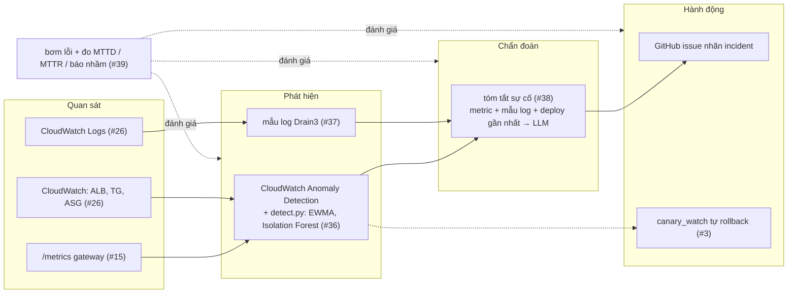

# 04. AI ops: AIOps cho TripGuardian (T4, LuanLuKim + DontMadWhenBad)

Chủ dự án chốt 21/11: **AI ops của đồ án = AIOps**, tức dùng AI / ML để vận hành hệ thống. Phần LLMOps cũ (eval gate #16, canary model #17) thành không bắt buộc. Issue cha: #4.

Đọc xong làm được: hệ thống tự phát hiện bất thường trên metric và log, tự viết tóm tắt sự cố, và có số đo chứng minh cách đó phát hiện sớm hơn ngưỡng tĩnh.

## Chuỗi AIOps của đồ án



## Ở TripGuardian đã có gì

| Có sẵn | NT548 thêm |
|---|---|
| `scripts/model_gateway.py`: nhiều upstream, cooldown khi lỗi, trọng số `URL@weight` (#14) | `/metrics` theo upstream (#15) |
| `scikit-learn` trong dependency | Detector của #36 |
| Workers AI làm dự phòng cho Clef (`docs/LLM_PROVIDER.md`) | Dùng cho tóm tắt sự cố (#38) khi có key trong GitHub Secret |

## `/metrics` của gateway (#15)

Định dạng Prometheus text. Khi có `MODEL_GATEWAY_API_KEY` thì cần gửi cùng bearer key.

| Metric | Loại | Ý nghĩa |
|---|---|---|
| `gateway_requests_total{model,upstream,status}` | counter | `status` là mã HTTP; `error` khi upstream không trả lời; upstream `none` khi không còn upstream nào |
| `gateway_upstream_latency_seconds{model,upstream}` | histogram | Thời gian tới khi upstream trả status (với Gemma stream là tới byte đầu) |
| `gateway_upstream_up` | gauge | 1 khi upstream không trong cooldown |
| `gateway_upstream_outstanding` | gauge | Số request đang chờ |
| `gateway_upstream_weight` | gauge | Trọng số (1 khi không dùng `@weight`) |

## Phát hiện bất thường trên metric (#36)

`ops/nt548/aiops/detect.py` (numpy + scikit-learn, không cần AWS trừ lệnh `cloudwatch`):

```sh
python ops/nt548/aiops/detect.py synth spike --seed 1 --out spike.csv   # chuỗi tổng hợp t,value,label
python ops/nt548/aiops/detect.py run spike.csv                           # alarm của từng detector, chấm điểm nếu có nhãn
python ops/nt548/aiops/detect.py compare --seeds 20                      # bảng dưới
python ops/nt548/aiops/detect.py cloudwatch --metric TargetResponseTime --stat p95     --dim TargetGroup=<…> --dim LoadBalancer=<…> --minutes 180 --out tg.csv   # trên runner, LabInstanceProfile
```

- Mỗi detector học "bình thường" từ `--train` điểm đầu (mặc định 200). Alarm bật khi `--persist` điểm liên tiếp bị gắn cờ (mặc định 2, kiểu "M of M datapoints" của CloudWatch).
- `static`: ngưỡng cố định, mặc định 1,5 × max của đoạn train, như người vận hành đặt tay.
- `ewma`: trung bình và phương sai EWMA (α = 0,05), cờ khi lệch quá 4 sd. Điểm bị cờ không cập nhật ước lượng.
- `iforest`: Isolation Forest trên giá trị, độ thay đổi, độ lệch so với trung bình trượt, và pha chu kỳ (khi biết `--period`).
- `combined`: `ewma` hoặc `iforest`. Đây là tín hiệu mà tóm tắt sự cố (#38) nghe.
- Chấm điểm: sự cố được tính là bắt được nếu alarm bật trong lúc lỗi hoặc tối đa 10 điểm sau đó. Alarm bật ở chỗ không có lỗi là báo nhầm.

Chuỗi tổng hợp giống độ trễ: nền 200, nhiễu sd 10, 720 điểm, một lỗi sau 1/3 chuỗi. Các kịch bản: `spike` (+150 trong 5 điểm), `drift` (+0,5 mỗi điểm trong 200 điểm rồi giữ +100), `seasonal_spike` (chu kỳ biên độ 60, gai +120 ở đáy chu kỳ), `level_shift` (+60 từ đó trở đi), `quiet` (không lỗi). Kết quả `compare --seeds 20` (21/11/2026), độ trễ tính bằng số điểm:

| scenario | detector | detected / faults | median delay (points) | false alarms |
|---|---|---|---|---|
| spike | static | 18 / 20 | 1 | 0 |
| spike | ewma | 20 / 20 | 1 | 0 |
| spike | iforest | 16 / 20 | 1 | 6 |
| spike | combined | 20 / 20 | 1 | 6 |
| drift | static | 0 / 20 | - | 0 |
| drift | ewma | 0 / 20 | - | 0 |
| drift | iforest | 15 / 20 | 117 | 0 |
| drift | combined | 15 / 20 | 117 | 0 |
| seasonal_spike | static | 0 / 20 | - | 0 |
| seasonal_spike | ewma | 0 / 20 | - | 0 |
| seasonal_spike | iforest | 16 / 20 | 1 | 3 |
| seasonal_spike | combined | 16 / 20 | 1 | 3 |
| level_shift | static | 0 / 20 | - | 0 |
| level_shift | ewma | 20 / 20 | 1 | 0 |
| level_shift | iforest | 17 / 20 | 1 | 0 |
| level_shift | combined | 20 / 20 | 1 | 0 |
| quiet | static | 0 / 0 | - | 0 |
| quiet | ewma | 0 / 0 | - | 0 |
| quiet | iforest | 0 / 0 | - | 6 |
| quiet | combined | 0 / 0 | - | 6 |

Đọc bảng:
- Ngưỡng tĩnh chỉ bắt được gai lớn. Nó không thấy mức tăng +60 hay rò rỉ chậm dưới vạch, và không thấy gai nằm dưới đỉnh chu kỳ.
- EWMA nhanh, không báo nhầm, nhưng tự thích nghi theo rò rỉ chậm nên bỏ sót `drift`, và nhiễu bởi chu kỳ.
- Isolation Forest là cách duy nhất bắt được `drift` và `seasonal_spike`. Đổi lại nó báo nhầm khoảng 6 lần trên 20 chuỗi × ~520 điểm, và bỏ sót vài gai vượt ra ngoài miền dữ liệu train (cây chỉ chia trong miền đã thấy).
- Ghép hai cách (`combined`) bắt đủ `spike` và `level_shift`, giữ được phần mạnh của iforest; báo nhầm bằng của iforest.
- Số trên metric thật của lab và số bơm lỗi (#39) chưa có.

## Các bước

1. **#36 phát hiện bất thường trên metric (LuanLuKim):**
   - Alarm CloudWatch Anomaly Detection cho độ trễ p95, 5xx và số request theo target group (module `ops/nt548/terraform/modules/aiops`).
   - Script `ops/nt548/aiops/detect.py` dùng EWMA / z-score và Isolation Forest, so với ngưỡng tĩnh trên cùng dữ liệu.
2. **#37 gom mẫu log (DontMadWhenBad):** Drain3 trên log container. Mẫu mới xuất hiện hoặc mẫu lỗi tăng đột biến được tính là bất thường. So với lệnh `pattern` của CloudWatch Logs Insights.
3. **#38 tóm tắt sự cố (LuanLuKim), bản tổng hợp xong, xem §Tóm tắt sự cố:**
   - Workflow chạy định kỳ trên runner `nt548-aws`. Khi alarm chuyển sang ALARM, workflow gom metric, top mẫu log và các lần deploy gần nhất.
   - LLM viết tóm tắt cùng giả thuyết nguyên nhân, rồi mở issue nhãn `incident`.
   - Lệnh gợi ý không tự chạy. Chỉ `canary_watch` được tự rollback.
4. **#39 bơm lỗi và đánh giá (DontMadWhenBad):**
   - Kịch bản: LLM giả lỗi 30 %, chậm thêm 2 s, tắt một máy app, deploy bản trả 500, tải tăng đột biến.
   - Đo MTTD của từng cách phát hiện, MTTR có tự động và không tự động, và số lần báo nhầm khi tải bình thường.

## Tóm tắt sự cố (#38)

`ops/nt548/aiops/incident.py` nối phần phát hiện với phần hành động: alarm → bằng chứng → tóm tắt → issue GitHub nhãn `incident`. Workflow: `.github/workflows/nt548-incident.yml`.

```sh
python ops/nt548/aiops/incident.py demo deploy_500                 # sự cố tổng hợp: deploy hỏng, 5xx tăng
python ops/nt548/aiops/incident.py demo llm_slow                   # LLM chậm, deploy cũ 3 giờ trước không bị đổ lỗi
python ops/nt548/aiops/incident.py demo traffic                    # tải tăng, gợi ý kiểm ASG
python ops/nt548/aiops/incident.py summarize --series tg.csv --alarm alarm.json --logs patterns.json --deploys runs.json
python ops/nt548/aiops/incident.py watch --prefix nt548- --repo LuanLuKim/tripguardian-nt548 --post   # trên runner
```

Các bước:

1. **Gom bằng chứng, đánh số E1…En:**
   - alarm (tên, metric, lúc vào ALARM);
   - metric trước và sau alarm: trung vị, tỉ lệ, đỉnh;
   - `detect.py` trên cùng metric: detector nào bắt, lúc nào; ngưỡng tĩnh có bắt không;
   - mẫu log tăng (đầu vào của #37);
   - các lần chạy `nt548-deploy-aws` kết thúc trong 30 phút trước alarm (`gh run list`).
2. **Viết tóm tắt:**
   - Luật cố định luôn chạy và sinh giả thuyết + lệnh gợi ý. Ví dụ: có deploy ngay trước alarm thì giả thuyết đầu là deploy đó, lệnh gợi ý là rollback.
   - Có LLM (biến `INCIDENT_LLM_BASE_URL`, `INCIDENT_LLM_MODEL`, secret `INCIDENT_LLM_API_KEY`; endpoint kiểu OpenAI, ví dụ Workers AI) thì LLM viết lại tóm tắt và giả thuyết **chỉ từ danh sách bằng chứng**.
3. **Mở issue:** mỗi alarm một issue đang mở. Alarm lặp lại thì comment vào issue đó, nhận ra nhờ dấu `<!-- nt548-incident: <alarm> -->` trong thân issue.

Giảm rủi ro LLM bịa nguyên nhân:
- Prompt chỉ chứa số liệu đã gom, không có câu hỏi mở.
- Mỗi giả thuyết phải dẫn mã bằng chứng. Thiếu dẫn, dẫn mã không có, JSON hỏng, hoặc gọi LLM lỗi thì bỏ **cả** câu trả lời, dùng mẫu cố định. Issue ghi rõ ai viết và vì sao bỏ LLM.
- Lệnh gợi ý chỉ lấy từ luật cố định. LLM không đề xuất lệnh. Không lệnh nào tự chạy; chỉ `canary_watch` (#3) được tự rollback.
- Log và commit message được đưa vào issue dưới dạng code inline, nên không phá được markdown.

Cách chạy:
- Workflow `nt548-incident`, chạy tay: `source=demo` chạy trên runner GitHub, không cần AWS, tóm tắt hiện ở job summary; `post=true` thì mở issue thật.
- `source=watch` chạy trên runner `nt548-aws` (#22). Thêm `schedule` vài phút một lần khi runner đã có.

Còn lại:
- Chạy `watch` trên alarm thật của lab: cần ALB (#24) và module `aiops` (#36).
- Đầu vào mẫu log thật từ #37. Định dạng: `[{pattern, count, baseline, level}]`; `baseline` là số dòng của cùng mẫu ở cửa sổ trước đó.
- Kiểm "nêu đúng nguyên nhân" bằng sự cố bơm thật (#39).

## Nghiên cứu ghi vào báo cáo (#18)

- AIOps: chuỗi quan sát → phát hiện → chẩn đoán → hành động; các chỉ số MTTD, MTTR, báo nhầm.
- Phát hiện bất thường: ngưỡng tĩnh, thống kê, ML; ưu nhược của từng cách.
- Log: thuật toán Drain.
- Phân tích canary tự động: Kayenta, Argo Rollouts.
- LLM trong xử lý sự cố, và rủi ro bịa nguyên nhân.
- Công cụ thương mại (DevOps Guru, Datadog Watchdog, Dynatrace Davis) và vì sao nhóm không dùng.
- Predictive scaling: nêu làm hướng mở rộng.
- LLMOps khác AIOps ở đâu.

## Kiểm thử

| Kiểm | Đạt |
|---|---|
| Chuỗi tổng hợp có gai | `detect.py` báo đúng điểm gai, không báo ở đoạn ổn định |
| LLM giả lỗi 30 % trên stack | Có ít nhất một cách phát hiện báo trong vài phút; mẫu log lỗi lên đầu danh sách |
| Sự cố giả | Issue `incident` tự mở, nêu đúng nguyên nhân đã gây ra |
| Đủ kịch bản #39 | Bảng MTTD / MTTR / báo nhầm chạy lại được bằng một lệnh |

## Xong khi

Bảng số của #39 có trong `REPORT.md` §6 và cho thấy cách nào phát hiện tốt hơn ngưỡng tĩnh (hoặc kết luận rõ là không tốt hơn).
