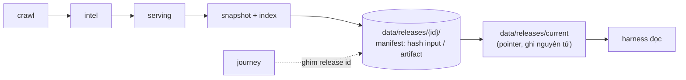
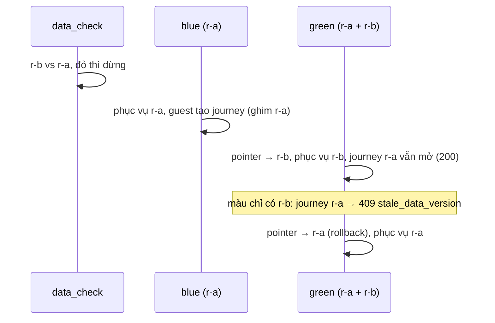
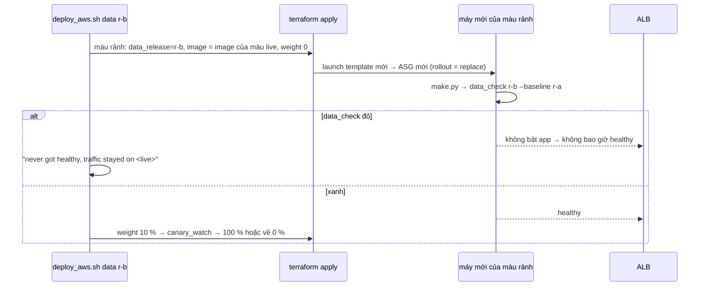

# 05. DataOps: dữ liệu mẫu, kiểm release, đổi release (T5, hohoangluan)

Đọc xong làm được: dựng dữ liệu mẫu được phép public, chặn một release dữ liệu hỏng trước khi dùng, đổi và lùi release dữ liệu theo blue/green giống như code.

## Ở TripGuardian đã có gì

Corpus đã có release bất biến (`docs/CORPUS.md`, mục release):

- `corpus.releases.rebuild` dựng release từ input đã lưu, không gọi mạng hay model. `publish` kiểm hash rồi mới đổi pointer, và lùi release cũng dùng `publish`.
- Journey ghim release. Release mất thì API trả 409 `stale_data_version` (`docs/ARCHITECTURE.md`).
- Dữ liệu thật nặng 274 GB và chứa nội dung crawl, nên **không** đưa lên repo public hay vào image.

## R1: harness cần gì để khởi động (#8)

`ops/nt548/r1_probe.sh` chạy harness thật hai lần trên cùng một Postgres: một lần với `DATA_DIR` rỗng, một lần với release mẫu `r-a`. Kết quả đo ngày 24/11 trên WSL, Python 3.12, Postgres 16:

| `DATA_DIR` | Lên sau | `/api/auth/guest` | `/api/harness/places` | Lỗi đầu tiên trong log |
|---|---|---|---|---|
| rỗng | 5,2 s | 200 | 500 | `FileNotFoundError: no .../snapshot/current` |
| `r-a` (40 nơi) | 6,0 s | 200 | 200, trả nơi mẫu | `ModuleNotFoundError: torch` (warmup encoder, không chặn) |

Kết luận: harness thật chạy được với dữ liệu tổng hợp, **không cần harness stub** cho API đọc. Các thứ cần có:

| Cần | Ghi chú |
|---|---|
| Postgres + `python -m db migrate` (`DATABASE_URL`) | đăng nhập, journey, event; migration cần extension `citext` (image `postgres:16` có sẵn) |
| `DATA_DIR/releases/current` + `releases/<id>/` | `manifest.json`, `serving/places.json`, `snapshot/<v>/dalat/*.lance` (8 bảng), `index/<v>/{places,styles}.json`, `intel/places/*.json`, `normalization.json`, `projection/serving.json`, `quality.json`; khoảng 900 KB cho 40 nơi |
| Không cần | GPU, `torch`, model, key. Thiếu encoder thì chỉ mất tìm kiếm bằng vector; tìm theo tên vẫn chạy |

Harness không ghi vào `DATA_DIR` khi phục vụ API đọc, nên mount `:ro` được (`ops/nt548/compose/app.yml`). Harness nạp `.env` ở gốc repo, nên chạy probe từ một checkout không có `.env`.

## Dữ liệu mẫu (#9)

`python ops/nt548/sample-data/make.py [--out DIR] [--seed 548] [--places 40] [--broken]` sinh input Maps **tổng hợp**: tên nơi gắn "(mẫu)", tọa độ trong vùng Đà Lạt, giờ mở cửa và một thuộc tính đều giả. Sau đó chính `corpus.releases.rebuild` dựng release, nên manifest, hash, snapshot và index có cùng định dạng với release thật. Thời gian dựng khoảng 3 s mỗi release.

| Thư mục | Nội dung |
|---|---|
| `<out>/r-a/` | 40 nơi |
| `<out>/r-b/` | `r-a` bỏ 2 nơi, thêm 3 nơi, đổi tên 1 nơi; `quality.json` so với `r-a` |
| `<out>/r-b-drop/`, `<out>/r-b-nocoords/` | chỉ khi có `--broken`: mất 20 % nơi / một nơi không có tọa độ; `data_check` phải chặn |
| `<out>/releases.json` | alias → release id, số nơi, sha256 của input |

Mỗi thư mục alias là một `DATA_DIR` (`releases/<id>/` + `releases/current`). Input có tính tất định (cùng seed → cùng sha256). Release id và timestamp thì không, vì `rebuild` đóng dấu mới như với release thật. Thư mục sinh ra nằm trong `.gitignore`.

## Kiểm release (#10)

`python ops/nt548/data_check.py <release | DATA_DIR> [--baseline <release đang chạy>] [--json]`, ngưỡng ở `ops/nt548/data_check.yaml`. Exit 0 = qua, 1 = chặn, 2 = sai tham số. Một kiểm đỏ thì các kiểm phụ thuộc phía sau báo `skip`, nên mỗi release hỏng chỉ ra một lý do rõ ràng.

| Kiểm | Bằng | Chặn khi |
|---|---|---|
| `manifest` | đọc `manifest.json` | thiếu, sai `release_id`, không có artifact, artifact thiếu `path` / `sha256` |
| `hashes` | sha256 từng artifact | artifact thiếu hoặc bị sửa |
| `release` | `corpus.releases.validate` | snapshot / index không khớp `eligible_ids` |
| `schema` | `corpus.snapshot` | nơi thiếu `id`, tên, `lat`, `lng`; ít hơn `min_places` |
| `coords` | `config/cities.yaml` | tọa độ không phải số, nằm ngoài vùng thành phố, hoặc thành phố không có vùng (`area`) để kiểm |
| `index` | `corpus.index` | nơi được phục vụ mà không có trong index |
| `drop` | so với `--baseline` | số nơi giảm quá `max_place_drop` (10 %) |

## Đổi và lùi release (#11)

`ops/nt548/data_release.py`:
- `stage <DATA_DIR> --release <thư mục>... --current <thư mục>` dựng `DATA_DIR` của một màu. `--release` và `--current` nhận **đường dẫn** thư mục `make.py` sinh ra (ví dụ `ops/nt548/sample-data/r-a`), không phải tên alias.
  - Trước khi đổi pointer, `stage` chạy `data_check` trên release sắp phục vụ, so với release mà `DATA_DIR` đang phục vụ. Đỏ thì dừng, pointer giữ nguyên. Vì vậy gọi tay cũng không đưa được release hỏng lên.
  - Qua gate thì đổi pointer bằng `corpus.releases.publish`. Chạy lại với `--current` cũ là lùi release, cũng qua gate.
  - `--skip-check` bỏ gate, chỉ dành cho lùi khẩn cấp về một release đã từng qua; lệnh in cảnh báo.
- `smoke <url> --expect <alias> [--not <alias>]` đăng nhập guest, tìm từng nơi của release theo tên. Nơi phải có thì phải trả về, nơi chỉ release kia có thì phải vắng. Thêm `--create-journey` / `--open-journey --want 200|409` để kiểm journey ghim release.

`ops/nt548/data_rehearsal.sh` diễn tập trên một máy với harness thật, hai màu dùng chung Postgres. Workflow `nt548-data-release.yml` chạy đúng script này trên GitHub runner, kèm service `postgres:16`. Workflow chạy khi gọi tay (`candidate`: `r-b`, `r-b-drop`, `r-b-nocoords`) và khi có PR đụng tới các file DataOps.

Journey ghim release cũ được xử lý bằng cách màu mới mount **cả hai** release, còn pointer trỏ release mới. Journey mới dùng release mới, journey cũ mở lại đúng dữ liệu của nó. Chỉ dọn release cũ khi không còn journey nào ghim nó. Kết quả đo ngày 24/11: cả chuỗi chạy trong 67 s, mỗi lần harness lên mất 6 s.

### Trên AWS

Lệnh `ops/nt548/deploy_aws.sh data <release>` chạy trên runner của lab, hoặc qua `nt548-deploy-aws` với `action=data`. Dữ liệu đi đúng đường của code (hợp đồng §7.1 ở `docs/plans/2026-11-20-nt548-devops-design.md`):

- **Thay một thứ, chép thứ còn lại.** Mỗi lần phát hành chỉ thay một thứ trên màu rảnh, thứ kia chép từ màu live:
  - `data` thay release dữ liệu, giữ image của màu live;
  - `deploy <sha>` thay image, giữ release dữ liệu của màu live.

  Trước đây, deploy code giữ release cũ của chính màu rảnh. Như vậy lần deploy code đầu tiên sau khi đổi dữ liệu sẽ đưa dữ liệu cũ trở lại.
- **Gate chạy ngay trên máy.** User-data của `app_asg` dựng release mẫu (kể cả `r-b-drop` và `r-b-nocoords`), rồi chạy `data_check` trên release của màu đó, kiểm mất nơi so với `r-a`, trước khi bật app. Release bị chặn thì app không chạy và target không bao giờ healthy, nên traffic ở lại màu live. Không cần cài thêm gì trên runner.
- **Lùi:** `deploy_aws.sh rollback` là một lần `apply` đổi trọng số về màu còn release cũ.
- **Xem:** `deploy_aws.sh status` in `data_blue` / `data_green`.
- **Kiểm không cần AWS:** `tests/nt548/test_deploy_aws.py` (terraform, aws, canary giả) và `terraform test` của `app_asg` (gate nằm trong user-data).
- **Còn phải chạy trên lab:**
  - `data r-b`: API trả nơi của `r-b`, journey `r-a` cũ trả 409 vì mỗi máy chỉ mount một release;
  - `data r-b-drop`: dừng ở gate, traffic không đổi;
  - `rollback`: về `r-a`.

## Nghiên cứu cho báo cáo (#12)

**DataOps** đưa cách làm của DevOps vào dữ liệu: dữ liệu có phiên bản bất biến, mỗi phiên bản đi qua kiểm tự động trước khi dùng, và được triển khai / lùi bằng cùng một quy trình như code (pipeline, canary, rollback). Mục tiêu là release dữ liệu hỏng không tới được người dùng, và nếu có tới thì lùi lại được trong vài phút.

| Ý tưởng | Ở TripGuardian | Công cụ ngoài tương ứng |
|---|---|---|
| Phiên bản theo nội dung | release id + sha256 từng artifact trong `manifest.json` | DVC: file `.dvc` giữ hash, dữ liệu nằm ở remote storage |
| Nhánh / commit dữ liệu, chuyển nguyên tử | pointer `releases/current` ghi bằng `os.replace` | lakeFS: branch, commit, merge trên object storage (S3), không chép dữ liệu |
| Kiểm chất lượng trước khi dùng | `corpus.releases.validate` + `data_check.py` | Great Expectations: bộ "expectation" chạy thành checkpoint, sinh báo cáo |
| Người dùng ghim phiên bản | journey ghim `corpus_binding`, mất thì 409 | lakeFS / DVC: đọc theo commit cố định |
| Dựng lại được | `rebuild` chỉ từ input đã lưu, ghi `inputs` + `fingerprint` | DVC pipeline (`dvc.yaml`, `dvc repro`) |

Nhóm chỉ viết kiểm nhỏ (`data_check.py`, khoảng 200 dòng) vì các lý do sau:
- Định dạng release đã có sẵn phiên bản, hash và pointer nguyên tử, nên DVC và lakeFS sẽ làm lại phần đã có.
- lakeFS cần thêm một server và S3, tốn ngân sách Learner Lab.
- Great Expectations kéo theo nhiều phụ thuộc và cấu hình, trong khi bảy kiểm cần có chỉ là: đọc `manifest.json` và hash file, đọc `config/cities.yaml`, và đọc snapshot / index qua public API của `corpus`.
- Dữ liệu mẫu khoảng 900 KB, kiểm chạy trong vài giây trong CI.

Nếu đưa dữ liệu thật 274 GB lên AWS, DVC (remote S3) là bước tiếp theo hợp lý để chép release giữa các máy.

## Kiểm thử

| Kiểm | Ở đâu | Đạt |
|---|---|---|
| Input tất định; `r-a`, `r-b` qua `validate`, harness bind được | `tests/nt548/test_sample_data.py` | xanh |
| `r-a`, `r-b` qua; sửa artifact / mất 20 % nơi / thiếu tọa độ / thiếu manifest bị chặn kèm lý do | `tests/nt548/test_data_check.py` | xanh |
| Gate, đổi r-a → r-b, journey ghim, 409, rollback trên harness thật | `ops/nt548/data_rehearsal.sh`, `nt548-data-release.yml` | xanh: 67 s trên WSL, job 1 phút 50 giây trên GitHub |
| `stage` không đổi pointer khi `data_check` đỏ; lùi release qua cùng gate; `--skip-check` | `tests/nt548/test_data_release.py` | xanh |
| Đổi dữ liệu trên AWS: màu rảnh nhận release mới + image của màu live, canary, promote / lùi; release bị gate chặn không bao giờ nhận traffic; deploy code sau đó giữ release mới | `tests/nt548/test_deploy_aws.py`, `terraform test` của `app_asg` | xanh (giả lập); chưa chạy trên lab |
| `r-b-drop`, `r-b-nocoords` dừng ở gate, không màu nào lên | như trên, `candidate=r-b-drop` | dừng, exit 1: `40 -> 32 places (20% drop, limit 10%)` ([run 24/11](https://github.com/LuanLuKim/tripguardian-nt548/actions/runs/45371363748)) |
