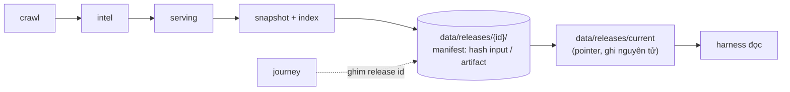
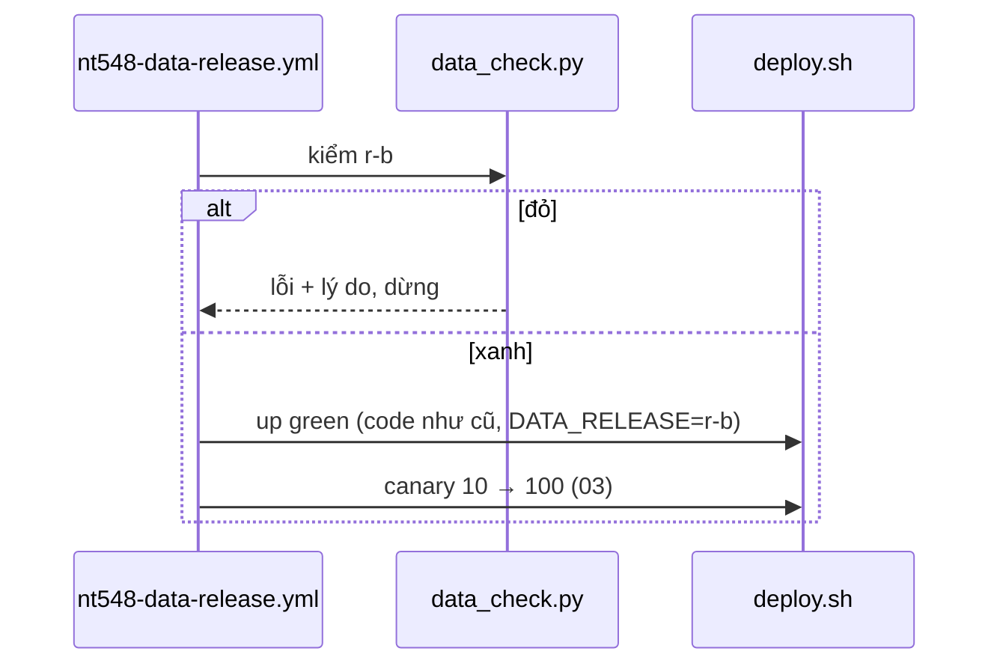

# 05. DataOps: dữ liệu mẫu, kiểm release, đổi release (T5, hohoangluan)

Đọc xong làm được: stack chạy với dữ liệu mẫu nhỏ được phép public; một release dữ liệu hỏng bị chặn trước khi dùng; đổi và lùi release dữ liệu theo cùng quy trình blue/green như code.

## Ở TripGuardian đã có gì

Corpus đã có release bất biến (`docs/CORPUS.md`, mục release):

- Journey ghim release; release mất thì API trả 409 `stale_data_version` (`docs/ARCHITECTURE.md`).
- Rollback dữ liệu = publish lại release cũ, không xóa artifact.
- Dữ liệu thật 274 GB, chứa nội dung crawl → **không** đưa lên repo public hay image.

## R1: dữ liệu mẫu (làm đầu tiên)

Câu hỏi: harness cần tối thiểu file nào để khởi động và trả lời các API đọc cơ bản?

1. Đọc `src/harness/__main__.py`, `corpus.snapshot`, `corpus.index` (public API) để liệt kê file harness mở lúc khởi động.
2. Thử chạy `python -m harness serve` với `DATA_DIR` trỏ vào thư mục rỗng, ghi lỗi đầu tiên, thêm đúng file đó, lặp lại.
3. Sinh dữ liệu **tổng hợp** (tên nơi, tọa độ, giờ mở cửa giả; không chép review / ảnh thật) bằng `ops/nt548/sample-data/make.py`, đủ cho 2 release `r-a`, `r-b` (khác nhau vài nơi). `tests/fixtures/` (7,4 MB) là nguồn tham khảo định dạng.
4. Không khởi động được trong 2 ngày công → ghi lại lý do, nhóm dùng harness stub (02) và mảng này chỉ làm `data_check` trên file mẫu.

Ghi kết quả R1 vào issue T5 sớm: T2, T3, T4 phụ thuộc nó.

## Kiểm release và đổi release

`ops/nt548/data_check.py <release dir>` kiểm (ngưỡng ở `ops/nt548/data_check.yaml`):

| Kiểm | Lý do |
|---|---|
| manifest có, hash từng artifact khớp | release bị sửa / chép thiếu |
| schema file serving / snapshot đúng (đọc bằng public API của `corpus`, không tự parse) | code đọc được |
| số nơi không giảm quá 10 % so với release đang chạy | crawl hỏng làm mất nơi |
| mọi nơi có trường bắt buộc (id, tên, tọa độ) | thẻ nơi không vỡ |
| index tồn tại cho mọi nơi trong serving | tìm kiếm không thiếu |

Mỗi màu đọc release theo `DATA_RELEASE` (mount `sample-data/<id>` vào chỗ harness đọc). Đổi dữ liệu = màu rảnh lên với release mới, chạy canary như code. Journey đã ghim `r-a` mà màu mới chỉ có `r-b` thì được 409: ghi cách xử lý vào báo cáo (mount cả hai release, pointer trỏ release mới).

## Nghiên cứu ghi vào báo cáo

DataOps là gì (dữ liệu có phiên bản, kiểm tự động, triển khai như code), so với cách TripGuardian đang làm, công cụ ngoài (DVC, Great Expectations, lakeFS) và vì sao nhóm chỉ viết kiểm nhỏ.

## Kiểm thử

| Kiểm | Đạt |
|---|---|
| `r-b` hỏng hash / mất 20 % nơi / thiếu tọa độ | `data_check` đỏ, workflow dừng |
| `r-a` → `r-b` qua canary, rồi lùi về `r-a` | API đọc trả đúng dữ liệu từng release |

## Xong khi

R1 có kết luận; `data_check` có test; `nt548-data-release.yml` chạy được với dữ liệu mẫu.
