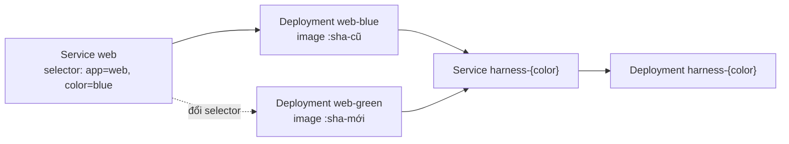

# 06. Demo Kubernetes bằng `kind` trong CI (T6, DontMadWhenBad)

Phần điểm cộng, làm sau khi 02 chạy. Thiếu thời gian thì bỏ, không ảnh hưởng phần chính.

Đọc xong làm được: một workflow dựng cluster `kind` trên runner GitHub, chạy blue/green bằng đổi `selector` của Service, scale bằng `kubectl scale`, rồi tự xóa cluster.

## Vì sao chỉ trong CI

Không có server, không có quota cloud. `kind` dựng cluster trong Docker của runner, mất khi job xong, không tốn tiền. Cùng ý tưởng với Compose (02): hai bản, đổi traffic, lùi; khác công cụ.

## Manifest

`ops/nt548/k8s/` viết YAML thẳng, không Helm, không Argo Rollouts (dễ đọc khi vấn đáp):

| File | Nội dung |
|---|---|
| `postgres.yaml` | StatefulSet 1 bản + Service |
| `web-blue.yaml`, `web-green.yaml` | Deployment, nhãn `color`, `readinessProbe` |
| `harness-blue.yaml`, `harness-green.yaml` | Deployment + Service theo màu (hoặc stub nếu 05 R1 không qua) |
| `web-service.yaml` | Service `web`, `selector.color` là chỗ đổi màu |

## Workflow `nt548-k8s-demo.yml`

`workflow_dispatch` + hằng tuần. Bước: `helm/kind-action` → `kind load docker-image` (image từ GHCR) → `kubectl apply` → chờ `rollout status` → kiểm `curl` qua `port-forward` trả `X-Color: blue` → `kubectl patch service web -p '{"spec":{"selector":{"color":"green"}}}'` → kiểm `green` → patch lại `blue` (rollback) → `kubectl scale deployment web-blue --replicas=3` → kiểm 3 pod Ready.

## Nghiên cứu ghi vào báo cáo

So Compose với K8s ở: khai báo trạng thái mong muốn, tự khởi động lại pod, readiness, scale. Vì sao nhóm không dùng K8s để chạy thật (một máy, GPU dùng chung, không quota). Argo Rollouts làm canary thế nào (chỉ mô tả).

## Đã làm (#6, 26/11)

- `ops/nt548/k8s/`:
  - `app-blue.yaml`, `app-green.yaml`: mỗi màu một Deployment. Pod có ba container (harness stub, web, edge) dùng chung network namespace của pod, giống `network_mode: service:harness` của `app.yml`. `readinessProbe` gọi `/api/harness/nt548-version` qua edge.
  - `web-service.yaml`: Service `web`; `spec.selector.color` là chỗ đổi màu.
  - `client.yaml`: một pod curl trong cluster. `kubectl port-forward` dính vào pod nó chọn lúc đầu, nên không thấy selector đổi.
- Khác thiết kế ban đầu: chưa có Postgres và harness thật, vì stub đủ để chứng minh đổi màu và scale; mỗi màu chung một pod thay vì tách Deployment web và harness. Lý do: web chỉ gọi harness trên `127.0.0.1`.
- `nt548-k8s-demo.yml`:
  - build image, `kind load`, `kubectl apply`;
  - kiểm 20 request liền đều về màu mong đợi: blue → patch green → patch lại blue;
  - `kubectl scale --replicas=3`;
  - xóa một pod, Deployment tự dựng lại.

  Chạy trên PR chạm `ops/nt548/k8s/**`, chạy tay, và hằng tuần. Bảng kết quả ở job summary.
- Đổi selector là đổi **tất cả** một lần, không chia theo %. Muốn chia % trên K8s cần service mesh, hoặc Argo Rollouts (Rollout có `steps: setWeight` và `analysis` giống `canary_watch`).

## Xong khi

Workflow xanh, log có đủ ba lần đổi màu và lần scale.
