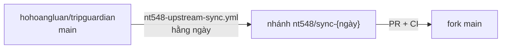

# 07. Sync TripGuardian và báo cáo cuối (T7, dinhlong06)

## Sync

Chức năng của fork phải giống TripGuardian. Phần NT548 chỉ nằm ở đường dẫn có tiền tố `nt548` nên merge không xung đột.

`nt548-upstream-sync.yml` (`schedule` hằng ngày + `workflow_dispatch`):
1. `git fetch https://github.com/hohoangluan/tripguardian main`.
2. Có commit mới → tạo nhánh `nt548/sync-<ngày>`, `git merge --no-ff`, push, mở PR (dùng `GITHUB_TOKEN`, `permissions: contents: write, pull-requests: write`).
3. Xung đột → không push, mở issue nhãn `nt548` kèm danh sách file xung đột. Xung đột ở file không có tiền tố `nt548` nghĩa là có người sửa file của TripGuardian: sửa lại theo quy tắc 1 trong `README.md` của thư mục này.

Cách làm (đã có từ 28/11):
- `ops/nt548/upstream_sync.sh [<url>] [<nhánh>]` chỉ đổi repo cục bộ. Nó in một trong ba kết quả `status=up-to-date`, `status=merged` (kèm `branch`, `commits`) hoặc `status=conflict` (kèm `files`). Có xung đột thì `merge --abort`, không để lại gì dở dang. Test: `tests/nt548/test_upstream_sync.py` dựng hai repo git tạm và chạy đủ ba trường hợp.
- `nt548-upstream-sync.yml` chạy lúc 08:00 giờ Việt Nam hằng ngày, chạy tay được, và chỉ dùng runner GitHub.
  - Kết quả `merged`: push nhánh, mở PR, rồi chạy `test` và `nt548-ci` trên nhánh đó qua `workflow_dispatch`. Lý do: PR mở bằng `GITHUB_TOKEN` không tự kích hoạt workflow nào, nên các check bắt buộc của `main` sẽ không có.
  - Kết quả `conflict`: một issue nhãn `nt548` liệt kê file xung đột. Chạy lại mà xung đột vẫn còn thì comment thêm vào issue đó.
- Điều kiện để workflow tự mở PR: bật "Allow GitHub Actions to create and approve pull requests" trong Settings → Actions → General. Lúc viết, cài đặt này đang tắt. Khi tắt, nhánh vẫn được push, và job summary có link compare để mở PR bằng tay.
- Giới hạn: upstream mà sửa `.github/workflows/` thì `GITHUB_TOKEN` không push được nhánh sync (thiếu quyền `workflow`). Khi đó job đỏ, phải merge bằng tay.

Thử bằng tay ngày 28/11: upstream có 3 commit mới (27/11, xóa thư mục công cụ agent / editor và bản nháp design, không đụng DataOps). Merge vào `main` của fork bị xung đột ở `README.md` và `.gitignore`. Nguyên nhân: README của fork lấy từ bản prod cục bộ (lần sync 20/11) nên mới hơn README trên GitHub. Lượt chạy đầu của workflow sẽ mở issue xung đột. Cách gỡ: giữ README của fork, gộp hai dòng `.gitignore`, merge bằng tay qua một PR `nt548/sync-<ngày>`.

Lưu ý: bản TripGuardian mới nhất có thể chưa lên GitHub (chủ dự án push từ máy khác). Lần sync 2026-11-20 lấy từ bản prod cục bộ (`a2f20126`). Workflow chỉ thấy được phần đã lên GitHub.

## Báo cáo cuối

`docs/nt548/REPORT.md` (tiếng Việt), mỗi mảng một mục, lấy từ phần "Nghiên cứu ghi vào báo cáo" của 01–06 và số đo trong `docs/reports/`:

| Mục | Nguồn |
|---|---|
| Bài toán, kiến trúc tổng | `README.md` thư mục này, thiết kế trong `docs/plans/` |
| CI/CD | 01 + ảnh chụp Actions |
| Blue/green, LB | 02 + log đổi màu |
| Canary, scale | 03 + bảng đo |
| AI ops | 04 + bảng `/metrics` |
| DataOps | 05 + kết quả R1 |
| K8s | 06 (nếu làm) |
| Phân công, khó khăn, hướng phát triển | cả nhóm |

Slide demo theo tiêu chí xong trong thiết kế (§8): mỗi tiêu chí một slide + một đoạn quay màn hình workflow.
