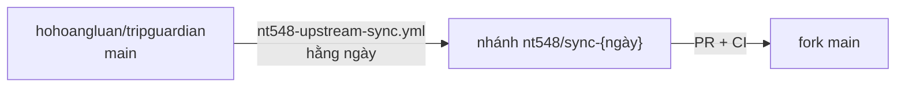

# 07. Sync TripGuardian và báo cáo cuối (T7, Đình Long)

## Sync

Chức năng của fork phải giống TripGuardian. Phần NT548 chỉ nằm ở đường dẫn có tiền tố `nt548` nên merge không xung đột.

`nt548-upstream-sync.yml` (`schedule` hằng ngày + `workflow_dispatch`):
1. `git fetch https://github.com/hohoangluan/tripguardian main`.
2. Có commit mới → tạo nhánh `nt548/sync-<ngày>`, `git merge --no-ff`, push, mở PR (dùng `GITHUB_TOKEN`, `permissions: contents: write, pull-requests: write`).
3. Xung đột → không push, mở issue nhãn `nt548` kèm danh sách file xung đột. Xung đột ở file không có tiền tố `nt548` nghĩa là có người sửa file của TripGuardian: sửa lại theo quy tắc 1 trong `README.md` của thư mục này.

Lưu ý: bản TripGuardian mới nhất có thể chưa lên GitHub (chủ dự án push từ máy khác). Lần sync 2026-11-20 lấy từ bản prod cục bộ (`a2f20126`). Workflow chỉ thấy được phần đã lên GitHub.

## Báo cáo cuối

`docs/nt548/REPORT.md` (tiếng Việt), mỗi mảng một mục, lấy từ phần "Nghiên cứu ghi vào báo cáo" của 01–06 và số đo trong `docs/reports/`:

| Mục | Nguồn |
|---|---|
| Bài toán, kiến trúc tổng | `README.md` thư mục này, thiết kế trong `docs/plans/` |
| CI/CD | 01 + ảnh chụp Actions |
| Blue/green, LB | 02 + log đổi màu |
| Canary, scale | 03 + bảng đo |
| AI ops | 04 + bảng `/metrics` |
| DataOps | 05 + kết quả R1 |
| K8s | 06 (nếu làm) |
| Phân công, khó khăn, hướng phát triển | cả nhóm |

Slide demo theo tiêu chí xong trong thiết kế (§8): mỗi tiêu chí một slide + một đoạn quay màn hình workflow.
