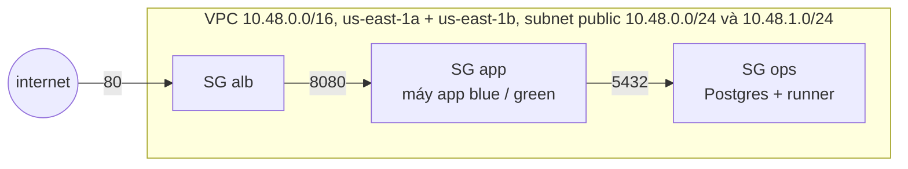

# 08. Hạ tầng AWS bằng Terraform (T8, dinhlong06)

Đọc xong làm được: dựng và xóa toàn bộ môi trường demo (mạng, ALB, hai ASG, monitoring) trên Learner Lab của mình, kể cả bootstrap. Phần `aws-up` / `aws-down` ghi tiếp vào đây khi xong.

Kiến trúc và lý do chọn: §5 của `docs/plans/2026-11-20-nt548-devops-design.md`. Hợp đồng với workflow deploy: §7.1 cùng file.

## Bố cục

```
ops/nt548/terraform/
  modules/network/     VPC, 2 subnet public, IGW, 3 security group (#23)
  modules/alb/         ALB, target group blue / green, listener chia theo trọng số (#24)
  modules/app_asg/     launch template + ASG + scale theo CPU, gọi một lần cho mỗi màu (#25)
  modules/monitoring/  dashboard, alarm ngưỡng cố định, SNS, log group của container (#26)
  modules/aiops/       alarm CloudWatch Anomaly Detection (#36)
  bootstrap/           mạng, bucket state, máy ops (Postgres + runner): dựng một lần cho mỗi lab (#22)
  envs/demo/           ALB, ASG, monitoring: dựng / xóa mỗi buổi; state trong bucket của bootstrap
```

Mỗi module có `tests/*.tftest.hcl` chạy bằng `mock_provider`, không cần tài khoản AWS. Workflow `nt548-terraform` chạy `fmt -check`, `validate` và `test` cho mọi thư mục trên mỗi PR.

## Mạng (#23)

Stack `bootstrap/` gọi module này (xem #22 bên dưới). `envs/demo` chỉ đọc lại mạng theo tên.



- Không có NAT Gateway, vì NAT khoảng 32 USD mỗi tháng, quá nhiều so với 50 USD của lab. Máy nhận IP public (`map_public_ip_on_launch`) và chỉ security group chặn đường vào.
- Mỗi tầng chỉ nhận tầng ngay trước nó. App chỉ nhận cổng `8080` từ SG của ALB, không nhận từ internet.
- Không mở SSH. Vào máy bằng SSM Session Manager hoặc EC2 Instance Connect.
- Mọi tài nguyên có tag `project = nt548`, và tên bắt đầu bằng `name_prefix`, nên hai lab không đụng nhau.

| Biến (`modules/network`) | Mặc định | Ghi chú |
|---|---|---|
| `name_prefix` | (bắt buộc) | ví dụ `nt548-dl` cho lab của dinhlong06, `nt548` cho bản demo chung |
| `cidr` | `10.48.0.0/16` | cắt thành /24, mỗi AZ một subnet |
| `azs` | `us-east-1a`, `us-east-1b` | ít nhất hai AZ, vì ALB cần hai |
| `app_port` | `8080` | cổng mà `ops/nt548/compose/app.yml` mở |

Xuất ra: `vpc_id`, `public_subnet_ids`, `sg_alb_id`, `sg_app_id`, `sg_ops_id`.

## ALB blue/green (#24)

`modules/alb` tạo một ALB trên hai subnet public, hai target group `<prefix>-blue` / `<prefix>-green` và một listener cổng 80. Listener chia người dùng mới theo trọng số: `weight_blue` sang blue, `100 − weight_blue` sang green. Một lần phát hành chỉ đổi `weight_blue`, bằng `terraform apply` (hợp đồng §7.1 của thiết kế).

| Biến (`modules/alb`) | Mặc định | Ghi chú |
|---|---|---|
| `weight_blue` | `100` | số nguyên 0–100 |
| `stickiness_seconds` | `300` | sticky theo target group: người dùng ở lại màu đầu tiên trong chừng ấy giây; `0` là tắt |
| `deregistration_delay` | `30` | giây một máy bị gỡ còn giữ request đang chạy |
| `idle_timeout` | `120` | agent trả lời dạng stream, nên dài hơn mặc định 60 s |
| `health_path` | `/` | health check `GET /` cổng `8080`, cần trả 200 |

Xuất ra: `alb_dns_name`, `alb_arn_suffix`, `target_group_arns` và `target_group_arn_suffixes` (map theo màu), `weights`. `envs/demo` xuất lại thành `target_group_arn_blue`, `target_group_arn_green` và `weight_blue`. Script deploy (#50) đọc `weight_blue` từ state để biết màu nào đang live.

Sticky và rollback vướng nhau. Sticky theo target group mạnh hơn trọng số: sau khi đổi `weight_blue`, người đã dính màu cũ vẫn vào màu cũ cho tới khi cookie hết hạn ([AWS DevOps Blog](https://aws.amazon.com/blogs/devops/blue-green-deployments-with-application-load-balancer)). Vì thế mặc định chỉ để 300 s.
- Rollback cần mọi người về ngay: apply thêm `-var stickiness_seconds=0`.
- Số đo rollback trên lab ghi rõ đã bật hay tắt sticky.

Kiểm trên lab:

```sh
cd ops/nt548/terraform/envs/demo
for w in 100 10 0; do
  terraform apply -auto-approve -var weight_blue=$w
  python ../../../lb_check.py --url "http://$(terraform output -raw alb_dns_name)" split --color green
done
```

`lb_check.py split` không gửi cookie `AWSALBTG` của ALB, nên mỗi request là một người dùng mới.
- Cần có ASG (#25) thì target group mới có máy trả lời. Trước đó ALB trả 503.
- Màu đọc từ `GET /api/harness/nt548-version`, nên app cần chạy harness stub hoặc image thật. Image giữ chỗ `traefik/whoami` không có đường này.

## ASG mỗi màu (#25)

`modules/app_asg` được `envs/demo` gọi hai lần, một lần cho mỗi màu. Mỗi lần tạo launch template `t3.small` (Amazon Linux 2023, `LabInstanceProfile`, chỉ IMDSv2), một ASG `<prefix>-<màu>` gắn vào target group của màu đó, và một chính sách target tracking theo CPU trung bình.

User-data của máy app làm các bước sau:
1. Cài Docker và git.
2. Không có `image_tag`: chạy `traefik/whoami` ở cổng `8080` (image giữ chỗ, hợp đồng §7.1), rồi dừng.
3. Có `image_tag`: checkout repo đúng commit đó, sinh dữ liệu mẫu bằng `sample-data/make.py` trong image harness, rồi `docker compose -f ops/nt548/compose/app.yml up -d` với `COLOR`, `IMAGE_TAG`, `DATA_RELEASE`.
4. Có `database_url`: chạy migration và harness thật (`python -m harness serve`). Không có thì chạy harness stub.
5. Có `log_group` (#26): một file compose thứ hai đổi log của mọi container sang driver `awslogs`, mỗi container một stream `<instance-id>/<tên container>`.

Log của chính user-data nằm ở `/var/log/nt548-app.log` trên máy (vào bằng SSM).

| Biến (`envs/demo`) | Mặc định | Ghi chú |
|---|---|---|
| `image_tag_blue`, `image_tag_green` | `""` | sha của image; rỗng là image giữ chỗ |
| `data_release_blue`, `data_release_green` | `r-a` | release dữ liệu mẫu (T5) |
| `database_url` | `""` | Postgres của máy ops (#22); truyền bằng `TF_VAR_database_url`, không ghi vào file |
| `min_size` / `max_size` | `1` / `3` | số máy mỗi màu |
| `cpu_target` | `50` | % CPU trung bình mà target tracking giữ |
| `instance_type` | `t3.small` | |

Xuất ra: `asg_name_blue`, `asg_name_green`. `envs/demo` cũng xuất lại `image_tag_*` và `data_release_*`, nên chỉ cần state là biết mỗi màu đang chạy gì.

Đổi `image_tag_<màu>` hay `data_release_<màu>` thì user-data đổi, nên có launch template version mới. ASG chạy **instance refresh**: dựng máy mới trước, máy mới healthy rồi mới bỏ máy cũ (min 100 %, max 200 %). Màu chỉ có một máy vẫn không lúc nào về 0 máy.

Refresh chạy sau khi `terraform apply` trả về. Trong lúc refresh, máy cũ vẫn healthy, nên chỉ thấy target group healthy chưa đủ để biết bản mới đã lên. Phải chờ refresh xong:

```sh
aws autoscaling describe-instance-refreshes --auto-scaling-group-name nt548-green \
  --query 'InstanceRefreshes[0].[Status,PercentageComplete]' --output text   # Successful 100
```

Script deploy (#29) cần thêm bước chờ này trước khi đổi trọng số.

Scale:
- Bật detailed monitoring (CPU theo phút, vài cent mỗi ngày). Với số đo 5 phút, target tracking phản ứng quá chậm cho buổi demo.
- `desired_capacity` để cho target tracking quản lý. `terraform apply` không kéo số máy về lại.

Kiểm trên lab:
1. Đo thời gian từ lúc đổi tag tới lúc refresh xong. Ghi vào bảng dưới.
2. Bắn tải bằng k6 vào URL ALB (`ops/nt548/load/`), xem ASG lên 2–3 máy rồi tự xuống:

   ```sh
   watch -n 15 "aws autoscaling describe-auto-scaling-groups --auto-scaling-group-names nt548-blue \
     --query 'AutoScalingGroups[0].[DesiredCapacity,length(Instances)]' --output text"
   ```

| Đo trên lab | Kết quả |
|---|---|
| Đổi tag → refresh xong | (chưa đo) |
| Tải k6 → số máy, p95 trước / sau | (chưa đo) |

## Monitoring (#26)

`modules/monitoring` tạo bốn thứ:
- dashboard CloudWatch tên `<prefix>`;
- alarm ngưỡng cố định cho từng màu;
- một SNS topic `<prefix>-alarms`;
- log group `/<prefix>/app-<màu>` giữ 7 ngày.

`envs/demo` gắn thêm `modules/aiops` (#36), alarm học từ dữ liệu (Anomaly Detection). Alarm của cả hai module báo về cùng topic, nên so được hai cách trên cùng một sự cố.

| Alarm | Metric (`AWS/ApplicationELB`, theo target group) | Kêu khi |
|---|---|---|
| `<prefix>-<màu>-5xx` | `HTTPCode_Target_5XX_Count` | quá `errors_per_minute` (5) mỗi phút, 2 trong 3 phút |
| `<prefix>-<màu>-p95` | `TargetResponseTime` p95 | quá `p95_seconds` (1,5 s) |
| `<prefix>-<màu>-unhealthy` | `UnHealthyHostCount` | có một máy trượt health check |
| `<prefix>-<màu>-no-healthy` | `HealthyHostCount` | màu không còn máy healthy (mất số đo cũng tính là kêu) |
| `<prefix>-alb-5xx` | `HTTPCode_ELB_5XX_Count`, cả ALB | ALB tự trả 502 / 503 / 504 |
| `<prefix>-<màu>-{latency,errors,requests}-anomaly` | như trên, ngưỡng là dải học được | ra khỏi dải 2 độ lệch chuẩn (#36) |

Hai alarm theo máy (`unhealthy`, `no-healthy`) lấp chỗ hở mà #39 chỉ ra: tắt một bản app chỉ gây 1 lỗi 5xx, nên metric 5xx không bắt được.

Dashboard có 7 ô:
- request, 5xx, p95, số máy healthy, mỗi màu một đường;
- CPU từng ASG, có vạch target;
- số máy đang chạy;
- trạng thái mọi alarm.

Log container vào log group của màu (driver `awslogs`, xem #25). Đọc log và alarm bằng công cụ AIOps:

```sh
python ops/nt548/aiops/log_patterns.py top --log-group /nt548/app-green --minutes 20
python ops/nt548/aiops/incident.py watch --prefix nt548- --log-group '/nt548/app-{color}'
```

Muốn nhận mail khi alarm kêu thì apply với `-var alarm_email=<địa chỉ>` và bấm link xác nhận trong mail AWS gửi. Chưa xác nhận thì không có mail nào.

Xuất ra: `dashboard_url`, `sns_topic_arn`, `log_group_names`, `alarm_names`.

Kiểm trên lab, chụp ảnh cho báo cáo:
1. Bắn tải k6, dashboard có số.
2. Dừng máy của một màu (`aws autoscaling set-desired-capacity` về 0 không được vì min 1, nên dừng container: `docker stop` qua SSM). `<prefix>-<màu>-unhealthy` kêu, mail tới.
3. `incident.py watch` mở issue `incident` từ alarm đó.

## Bootstrap và kiểm quyền (#22)

Hạ tầng chia làm hai stack theo vòng đời:

| Stack | Có gì | Sống bao lâu | Tốn tiền khi demo tắt |
|---|---|---|---|
| `bootstrap/` | mạng (`modules/network`), bucket S3 giữ state, máy ops `<prefix>-ops`, tham số SSM `/<prefix>/database-url` | suốt lab | ổ đĩa 20 GB của máy ops (đã dừng), khoảng 0,05 USD mỗi ngày |
| `envs/demo/` | ALB, hai ASG, monitoring, alarm AIOps | một buổi: `aws-up` dựng, `aws-down` xóa | không, vì đã xóa |

`envs/demo` tìm mạng theo tên (`<prefix>-vpc`, `<prefix>-public-*`, `<prefix>-alb`, `<prefix>-app`) và đọc URL database từ SSM. Vì vậy không cần truyền id nào giữa hai stack.

Máy ops (`t3.small`, Amazon Linux 2023, `LabInstanceProfile`) chạy ba thứ:
- Postgres 16 trong container ở cổng 5432, chỉ nhận từ SG app. Mật khẩu do Terraform sinh và cất trong SSM. Dữ liệu nằm trên ổ gốc, nên còn sau khi dừng rồi bật lại máy.
- Terraform 1.9.8, git, jq, python3 + boto3: công cụ của các job deploy.
- GitHub self-hosted runner `<prefix>-ops`, nhãn `nt548-aws`, chạy như service. Runner lấy credential AWS từ `LabInstanceProfile`, nên GitHub không giữ key nào.

Terraform không bao giờ thay máy ops khi apply lại (`ignore_changes` trên AMI và user-data), vì runner đang chạy Terraform từ chính máy đó. Muốn dựng lại thì làm có chủ đích: `-replace=aws_instance.ops`.

### Kiểm quyền LabRole (R2)

Chạy trước bootstrap, một lần cho mỗi lab:

```sh
ops/nt548/aws_r2_probe.sh --out r2.md
```

Script thử từng việc mà các stack cần:
- tạo / xóa: VPC, bucket S3, tham số SSM, target group, ALB, listener chia trọng số, launch template, ASG, chính sách target tracking, dashboard, alarm thường, alarm Anomaly Detection, SNS topic, log group;
- dry run: chạy `t3.small` với `LabInstanceProfile`.

Thứ gì tạo được thì xóa ngay. ALB chỉ sống vài giây, tốn chưa tới một cent. Bảng in ra dán vào issue #22. Mục nào **denied** thì phần đó chạy từ máy thành viên bằng credential tạm, và ghi vào báo cáo (thiết kế §5.2 bước 3).

Nên chạy hai lần:
1. từ máy mình với credential tạm;
2. từ máy ops sau bootstrap (qua SSM), vì runner dùng `LabInstanceProfile`.

| Kết quả R2 | Từ máy thành viên | Từ máy ops |
|---|---|---|
| (chưa chạy) | | |

### Chạy bootstrap

1. Start Lab, mở **AWS Details**, chép ba dòng `aws_access_key_id`, `aws_secret_access_key`, `aws_session_token` vào `~/.aws/credentials` (profile `default`). Credential hết hạn khi phiên lab kết thúc. Không đưa credential vào repo hay vào chat.
2. Lấy registration token của runner: GitHub → Settings → Actions → Runners → New self-hosted runner, chép token ở dòng `./config.sh --token …`. Token sống 1 giờ. Chỉ admin repo làm được bước này.
3. Dựng:

   ```sh
   cd ops/nt548/terraform/bootstrap
   terraform init
   TF_VAR_runner_token=<token> terraform apply -var name_prefix=nt548-dl
   ```

4. Kiểm:
   - VPC `nt548-dl-vpc`, bucket `nt548-dl-tfstate-<account>`, máy `nt548-dl-ops` đang chạy;
   - sau khoảng 3 phút, runner `nt548-dl-ops` hiện **Idle** trong Settings → Actions → Runners;
   - log của user-data: `/var/log/nt548-ops.log` trên máy ops (vào bằng SSM Session Manager).

State của bootstrap nằm ở `bootstrap/terraform.tfstate` trên máy người chạy, không vào git. Mất file này thì tài nguyên vẫn còn. Chạy lại thì Terraform báo trùng tên; khi đó `terraform import` bucket, VPC, máy ops theo tên, hoặc xóa tay rồi chạy lại.

Không truyền token thì máy ops lên không có runner. Thêm sau bằng `terraform apply -replace=aws_instance.ops -var runner_token=…`. Lệnh này dựng lại máy ops, nên Postgres bắt đầu trống.

### Dựng môi trường demo

```sh
cd ops/nt548/terraform/envs/demo
ACCOUNT=$(aws sts get-caller-identity --query Account --output text)
terraform init -backend-config=bucket=nt548-dl-tfstate-$ACCOUNT   -backend-config=key=envs/demo/nt548-dl.tfstate -backend-config=region=us-east-1
terraform apply -var name_prefix=nt548-dl            # thêm -var real_harness=false để chạy harness stub
```

Xóa cuối buổi: `terraform destroy -var name_prefix=nt548-dl`, rồi dừng máy ops. Phần tốn tiền là ALB và EC2; mạng thì miễn phí.

## Chi phí

| Buổi | Người | Dựng gì | Chi tiêu lab |
|---|---|---|---|
| | | | |
