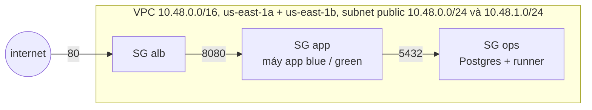

# 08. Hạ tầng AWS bằng Terraform (T8, dinhlong06)

Đọc xong làm được: dựng và xóa mạng, ALB và hai ASG của đồ án trên Learner Lab của mình. Các phần bootstrap, monitoring ghi tiếp vào đây khi xong.

Kiến trúc và lý do chọn: §5 của `docs/plans/2026-11-20-nt548-devops-design.md`. Hợp đồng với workflow deploy: §7.1 cùng file.

## Bố cục

```
ops/nt548/terraform/
  modules/network/     VPC, 2 subnet public, IGW, 3 security group (#23)
  modules/alb/         ALB, target group blue / green, listener chia theo trọng số (#24)
  modules/app_asg/     launch template + ASG + scale theo CPU, gọi một lần cho mỗi màu (#25)
  modules/aiops/       alarm CloudWatch Anomaly Detection (#36)
  envs/demo/           môi trường demo, gọi các module; state local cho tới khi có bootstrap (#22)
```

Mỗi module có `tests/*.tftest.hcl` chạy bằng `mock_provider`, không cần tài khoản AWS. Workflow `nt548-terraform` chạy `fmt -check`, `validate` và `test` cho mọi thư mục trên mỗi PR.

## Mạng (#23)



- Không có NAT Gateway, vì NAT khoảng 32 USD mỗi tháng, quá nhiều so với 50 USD của lab. Máy nhận IP public (`map_public_ip_on_launch`) và chỉ security group chặn đường vào.
- Mỗi tầng chỉ nhận tầng ngay trước nó. App chỉ nhận cổng `8080` từ SG của ALB, không nhận từ internet.
- Không mở SSH. Vào máy bằng SSM Session Manager hoặc EC2 Instance Connect.
- Mọi tài nguyên có tag `project = nt548`, và tên bắt đầu bằng `name_prefix`, nên hai lab không đụng nhau.

| Biến (`modules/network`) | Mặc định | Ghi chú |
|---|---|---|
| `name_prefix` | (bắt buộc) | ví dụ `nt548-dl` cho lab của dinhlong06, `nt548` cho bản demo chung |
| `cidr` | `10.48.0.0/16` | cắt thành /24, mỗi AZ một subnet |
| `azs` | `us-east-1a`, `us-east-1b` | ít nhất hai AZ, vì ALB cần hai |
| `app_port` | `8080` | cổng mà `ops/nt548/compose/app.yml` mở |

Xuất ra: `vpc_id`, `public_subnet_ids`, `sg_alb_id`, `sg_app_id`, `sg_ops_id`.

## ALB blue/green (#24)

`modules/alb` tạo một ALB trên hai subnet public, hai target group `<prefix>-blue` / `<prefix>-green` và một listener cổng 80. Listener chia người dùng mới theo trọng số: `weight_blue` sang blue, `100 − weight_blue` sang green. Một lần phát hành chỉ đổi `weight_blue`, bằng `terraform apply` (hợp đồng §7.1 của thiết kế).

| Biến (`modules/alb`) | Mặc định | Ghi chú |
|---|---|---|
| `weight_blue` | `100` | số nguyên 0–100 |
| `stickiness_seconds` | `300` | sticky theo target group: người dùng ở lại màu đầu tiên trong chừng ấy giây; `0` là tắt |
| `deregistration_delay` | `30` | giây một máy bị gỡ còn giữ request đang chạy |
| `idle_timeout` | `120` | agent trả lời dạng stream, nên dài hơn mặc định 60 s |
| `health_path` | `/` | health check `GET /` cổng `8080`, cần trả 200 |

Xuất ra: `alb_dns_name`, `alb_arn_suffix`, `target_group_arns` và `target_group_arn_suffixes` (map theo màu), `weights`. `envs/demo` xuất lại thành `target_group_arn_blue`, `target_group_arn_green` và `weight_blue`. Script deploy (#50) đọc `weight_blue` từ state để biết màu nào đang live.

Sticky và rollback vướng nhau. Sticky theo target group mạnh hơn trọng số: sau khi đổi `weight_blue`, người đã dính màu cũ vẫn vào màu cũ cho tới khi cookie hết hạn ([AWS DevOps Blog](https://aws.amazon.com/blogs/devops/blue-green-deployments-with-application-load-balancer)). Vì thế mặc định chỉ để 300 s.
- Rollback cần mọi người về ngay: apply thêm `-var stickiness_seconds=0`.
- Số đo rollback trên lab ghi rõ đã bật hay tắt sticky.

Kiểm trên lab:

```sh
cd ops/nt548/terraform/envs/demo
for w in 100 10 0; do
  terraform apply -auto-approve -var weight_blue=$w
  python ../../../lb_check.py --url "http://$(terraform output -raw alb_dns_name)" split --color green
done
```

`lb_check.py split` không gửi cookie `AWSALBTG` của ALB, nên mỗi request là một người dùng mới.
- Cần có ASG (#25) thì target group mới có máy trả lời. Trước đó ALB trả 503.
- Màu đọc từ `GET /api/harness/nt548-version`, nên app cần chạy harness stub hoặc image thật. Image giữ chỗ `traefik/whoami` không có đường này.

## ASG mỗi màu (#25)

`modules/app_asg` được `envs/demo` gọi hai lần, một lần cho mỗi màu. Mỗi lần tạo launch template `t3.small` (Amazon Linux 2023, `LabInstanceProfile`, chỉ IMDSv2), một ASG `<prefix>-<màu>` gắn vào target group của màu đó, và một chính sách target tracking theo CPU trung bình.

User-data của máy app làm các bước sau:
1. Cài Docker và git.
2. Không có `image_tag`: chạy `traefik/whoami` ở cổng `8080` (image giữ chỗ, hợp đồng §7.1), rồi dừng.
3. Có `image_tag`: checkout repo đúng commit đó, sinh dữ liệu mẫu bằng `sample-data/make.py` trong image harness, rồi `docker compose -f ops/nt548/compose/app.yml up -d` với `COLOR`, `IMAGE_TAG`, `DATA_RELEASE`.
4. Có `database_url`: chạy migration và harness thật (`python -m harness serve`). Không có thì chạy harness stub.
5. Có `log_group` (#26): một file compose thứ hai đổi log của mọi container sang driver `awslogs`, mỗi container một stream `<instance-id>/<tên container>`.

Log của chính user-data nằm ở `/var/log/nt548-app.log` trên máy (vào bằng SSM).

| Biến (`envs/demo`) | Mặc định | Ghi chú |
|---|---|---|
| `image_tag_blue`, `image_tag_green` | `""` | sha của image; rỗng là image giữ chỗ |
| `data_release_blue`, `data_release_green` | `r-a` | release dữ liệu mẫu (T5) |
| `database_url` | `""` | Postgres của máy ops (#22); truyền bằng `TF_VAR_database_url`, không ghi vào file |
| `min_size` / `max_size` | `1` / `3` | số máy mỗi màu |
| `cpu_target` | `50` | % CPU trung bình mà target tracking giữ |
| `instance_type` | `t3.small` | |

Xuất ra: `asg_name_blue`, `asg_name_green`. `envs/demo` cũng xuất lại `image_tag_*` và `data_release_*`, nên chỉ cần state là biết mỗi màu đang chạy gì.

Đổi `image_tag_<màu>` hay `data_release_<màu>` thì user-data đổi, nên có launch template version mới. ASG chạy **instance refresh**: dựng máy mới trước, máy mới healthy rồi mới bỏ máy cũ (min 100 %, max 200 %). Màu chỉ có một máy vẫn không lúc nào về 0 máy.

Refresh chạy sau khi `terraform apply` trả về. Trong lúc refresh, máy cũ vẫn healthy, nên chỉ thấy target group healthy chưa đủ để biết bản mới đã lên. Phải chờ refresh xong:

```sh
aws autoscaling describe-instance-refreshes --auto-scaling-group-name nt548-green \
  --query 'InstanceRefreshes[0].[Status,PercentageComplete]' --output text   # Successful 100
```

Script deploy (#29) cần thêm bước chờ này trước khi đổi trọng số.

Scale:
- Bật detailed monitoring (CPU theo phút, vài cent mỗi ngày). Với số đo 5 phút, target tracking phản ứng quá chậm cho buổi demo.
- `desired_capacity` để cho target tracking quản lý. `terraform apply` không kéo số máy về lại.

Kiểm trên lab:
1. Đo thời gian từ lúc đổi tag tới lúc refresh xong. Ghi vào bảng dưới.
2. Bắn tải bằng k6 vào URL ALB (`ops/nt548/load/`), xem ASG lên 2–3 máy rồi tự xuống:

   ```sh
   watch -n 15 "aws autoscaling describe-auto-scaling-groups --auto-scaling-group-names nt548-blue \
     --query 'AutoScalingGroups[0].[DesiredCapacity,length(Instances)]' --output text"
   ```

| Đo trên lab | Kết quả |
|---|---|
| Đổi tag → refresh xong | (chưa đo) |
| Tải k6 → số máy, p95 trước / sau | (chưa đo) |

## Chạy trên Learner Lab

1. Start Lab, mở **AWS Details**, chép ba dòng `aws_access_key_id`, `aws_secret_access_key`, `aws_session_token` vào `~/.aws/credentials` (profile `default`). Credential hết hạn khi phiên lab kết thúc. Không đưa credential vào repo hay vào chat.
2. Dựng mạng:

   ```sh
   cd ops/nt548/terraform/envs/demo
   terraform init
   terraform apply -var name_prefix=nt548-dl
   ```

3. Kiểm trên console VPC: VPC `nt548-dl-vpc`, hai subnet ở hai AZ, ba security group.
4. Xóa cuối buổi: `terraform destroy -var name_prefix=nt548-dl`.

Mạng không tốn tiền (VPC, subnet, IGW, security group đều miễn phí). Phần tốn tiền bắt đầu từ ALB và EC2.

## Việc tiếp theo

| Issue | Việc |
|---|---|
| #22 | Kiểm quyền `LabRole` (R2), ghi bảng quyền vào issue; bootstrap: S3 giữ state, máy ops `t3.small` (dùng `sg_ops_id`) + runner nhãn `nt548-aws` |
| #26 | `modules/monitoring`; gắn luôn `modules/aiops` (#36) vào `envs/demo` |
| #27 | `aws-up` / `aws-down`, tự xóa mỗi tối, bảng chi phí ở mục dưới |

## Chi phí

| Buổi | Người | Dựng gì | Chi tiêu lab |
|---|---|---|---|
| | | | |
