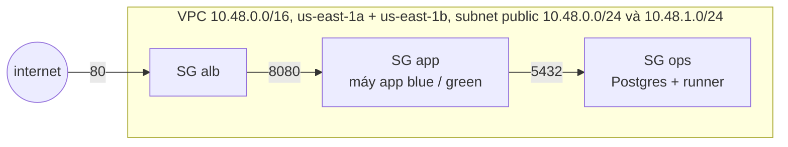

# 08. Hạ tầng AWS bằng Terraform (T8, dinhlong06)

Đọc xong làm được: dựng và xóa mạng của đồ án trên Learner Lab của mình. Các phần ALB, ASG, bootstrap, monitoring ghi tiếp vào đây khi xong.

Kiến trúc và lý do chọn: §5 của `docs/plans/2026-11-20-nt548-devops-design.md`. Hợp đồng với workflow deploy: §7.1 cùng file.

## Bố cục

```
ops/nt548/terraform/
  modules/network/     VPC, 2 subnet public, IGW, 3 security group (#23)
  modules/aiops/       alarm CloudWatch Anomaly Detection (#36)
  envs/demo/           môi trường demo, gọi các module; state local cho tới khi có bootstrap (#22)
```

Mỗi module có `tests/*.tftest.hcl` chạy bằng `mock_provider`, không cần tài khoản AWS. Workflow `nt548-terraform` chạy `fmt -check`, `validate` và `test` cho mọi thư mục trên mỗi PR.

## Mạng (#23)



- Không có NAT Gateway, vì NAT khoảng 32 USD mỗi tháng, quá nhiều so với 50 USD của lab. Máy nhận IP public (`map_public_ip_on_launch`) và chỉ security group chặn đường vào.
- Mỗi tầng chỉ nhận tầng ngay trước nó. App chỉ nhận cổng `8080` từ SG của ALB, không nhận từ internet.
- Không mở SSH. Vào máy bằng SSM Session Manager hoặc EC2 Instance Connect.
- Mọi tài nguyên có tag `project = nt548`, và tên bắt đầu bằng `name_prefix`, nên hai lab không đụng nhau.

| Biến (`modules/network`) | Mặc định | Ghi chú |
|---|---|---|
| `name_prefix` | (bắt buộc) | ví dụ `nt548-dl` cho lab của dinhlong06, `nt548` cho bản demo chung |
| `cidr` | `10.48.0.0/16` | cắt thành /24, mỗi AZ một subnet |
| `azs` | `us-east-1a`, `us-east-1b` | ít nhất hai AZ, vì ALB cần hai |
| `app_port` | `8080` | cổng mà `ops/nt548/compose/app.yml` mở |

Xuất ra: `vpc_id`, `public_subnet_ids`, `sg_alb_id`, `sg_app_id`, `sg_ops_id`.

## Chạy trên Learner Lab

1. Start Lab, mở **AWS Details**, chép ba dòng `aws_access_key_id`, `aws_secret_access_key`, `aws_session_token` vào `~/.aws/credentials` (profile `default`). Credential hết hạn khi phiên lab kết thúc. Không đưa credential vào repo hay vào chat.
2. Dựng mạng:

   ```sh
   cd ops/nt548/terraform/envs/demo
   terraform init
   terraform apply -var name_prefix=nt548-dl
   ```

3. Kiểm trên console VPC: VPC `nt548-dl-vpc`, hai subnet ở hai AZ, ba security group.
4. Xóa cuối buổi: `terraform destroy -var name_prefix=nt548-dl`.

Mạng không tốn tiền (VPC, subnet, IGW, security group đều miễn phí). Phần tốn tiền bắt đầu từ ALB và EC2.

## Việc tiếp theo

| Issue | Việc |
|---|---|
| #22 | Kiểm quyền `LabRole` (R2), ghi bảng quyền vào issue; bootstrap: S3 giữ state, máy ops `t3.small` (dùng `sg_ops_id`) + runner nhãn `nt548-aws` |
| #24 | `modules/alb`: ALB trên `public_subnet_ids`, SG `sg_alb_id`, target group blue / green, listener chia theo `weight_blue` |
| #25 | `modules/app_asg` gọi hai lần, SG `sg_app_id`; user-data chạy `app.yml` hoặc `traefik/whoami` |
| #26 | `modules/monitoring`; gắn luôn `modules/aiops` (#36) vào `envs/demo` |
| #27 | `aws-up` / `aws-down`, tự xóa mỗi tối, bảng chi phí ở mục dưới |

## Chi phí

| Buổi | Người | Dựng gì | Chi tiêu lab |
|---|---|---|---|
| | | | |
