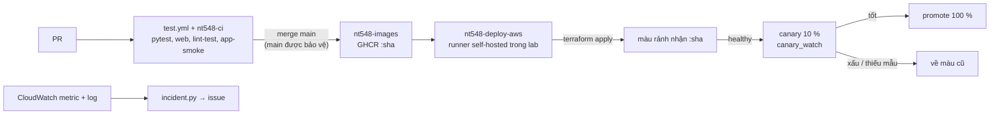

# Tổng kết đồ án NT548 nhóm 8: đã làm, đang làm, vận hành ra sao

> Ghi ngày 28/11/2026, hạn nộp 04/12/2026. Số đo và bằng chứng chi tiết nằm ở `REPORT.md`. File này trả lời bốn câu: dùng công nghệ gì, làm thế nào, DataOps và AIOps đang chạy ra sao, và còn lại việc gì. Tiến độ từng việc theo dõi trong GitHub issue.

## 1. Đồ án làm gì

TripGuardian là ứng dụng lập lịch du lịch: web Node, harness Python (FastAPI), các model gọi qua `scripts/model_gateway.py`. Đồ án **giữ nguyên chức năng sản phẩm**, chỉ làm phần vận hành:
- đưa sản phẩm lên AWS bằng code;
- phát hành an toàn bằng blue/green, canary và rollback;
- theo dõi hệ thống;
- quản lý dữ liệu như code (DataOps);
- dùng AI / ML để vận hành (AIOps).

Môi trường đích là AWS Academy Learner Lab (`us-east-1`, 50 USD mỗi người, không GPU, không tạo được IAM role / OIDC).

Mọi phần NT548 nằm dưới tiền tố `nt548`: `ops/nt548/`, `docs/nt548/`, `tests/nt548/`, `.github/workflows/nt548-*.yml`. Nhờ vậy, merge code mới từ TripGuardian về không đụng phần vận hành.

## 2. Công nghệ áp dụng

| Mảng | Công nghệ | Dùng để làm gì |
|---|---|---|
| Hạ tầng như code | **Terraform** (7 module, `terraform test` với provider giả) | VPC, ALB, ASG, CloudWatch, S3 state; dựng / xóa mỗi buổi lab |
| Cloud | **AWS**: VPC, ALB (weighted target group), EC2 Auto Scaling, CloudWatch (metric, log, alarm, Anomaly Detection), SNS, S3, SSM | chạy ứng dụng, chia traffic theo trọng số, tự scale, giám sát |
| CI/CD | **GitHub Actions** (11 workflow `nt548-*` + `test.yml`), **self-hosted runner** trên máy ops trong lab | test, build image, deploy, tắt lab hằng đêm, sync upstream |
| Container | **Docker**, **Docker Compose**, **GHCR** | image `harness`, `web`, `llm-fake` gắn tag `:sha`; một màu = một stack Compose |
| Phát hành | blue/green theo trọng số ALB, canary 10 %, `canary_watch.py` | đổi màu không mất request; bản lỗi tự lùi |
| Load balancer (Compose) | **Nginx** | blue/green khi diễn tập không cần AWS |
| Kiểm tải | **k6** | đo scale-out, đo lỗi khi đổi màu |
| Kubernetes (demo) | **kind**, `kubectl` | blue/green bằng đổi `selector`, scale, trong CI |
| AIOps | **numpy**, **scikit-learn** (Isolation Forest), EWMA, **Drain3**, CloudWatch Anomaly Detection, LLM tương thích OpenAI (tùy chọn) | phát hiện bất thường, gom mẫu log, tóm tắt sự cố thành issue |
| DataOps | release bất biến của `corpus` (manifest + sha256 + pointer nguyên tử), `data_check.py` + `data_check.yaml` | dữ liệu mẫu, kiểm release, đổi / lùi release theo blue/green |
| Test | **pytest**, `terraform test`, `ruff` | mọi script vận hành đều có test không cần AWS |

## 3. Cách thực hiện: đường đi của một thay đổi

- **Hai stack Terraform.**
  - `bootstrap/`: VPC, security group, bucket state, máy ops có Postgres và runner. Dựng một lần mỗi lab.
  - `envs/demo/`: ALB, 2 target group, 2 ASG, dashboard, alarm, log group. Chỉ sống trong một buổi: `aws.sh up` dựng, `aws.sh down` xóa.
- **Không giữ key AWS trên GitHub.** Learner Lab không cho OIDC, nên deploy chạy trên runner trong lab và dùng `LabInstanceProfile`.
- **Ba chỗ Learner Lab khác AWS thường**, chỉ lộ ra khi chạy thật (PR #87):
  - SCP chặn đọc Object Lock, nên bucket state được tạo bằng CLI;
  - SCP chặn instance refresh, nên đổi image bằng cách dựng ASG mới (`rollout = replace`);
  - runner `2.321.0` bị GitHub từ chối, nên dùng `2.338.2`.
- **Giữ chi phí thấp:**
  - `aws.sh down` cuối buổi;
  - lượt `nt548-aws` tự `down` lúc 23:00;
  - không có NAT Gateway;
  - công tắc `NT548_DEPLOY_ENABLED` chặn mọi job AWS khi lab tắt.

## 4. Trạng thái từng mảng

| Mảng | Người | Đã xong | Đang / còn lại |
|---|---|---|---|
| CI (T9, #1) | LuanLuKim | `test.yml` xanh trên checkout sạch: 5.542 test; `main` được bảo vệ | – |
| Image, Compose (#2) | DontMadWhenBad | 3 image, `app-smoke`, `app-real` (harness thật + Postgres) | – |
| Blue/green, canary Compose (#3) | DontMadWhenBad | tự rollback trong 17 s, màu cũ 0 lỗi; đổi màu 0 lỗi trên 5.726 request | – |
| Deploy lên AWS (#29) | LuanLuKim | merge → promote sau 11,5 phút, không ai bấm; rollback tay trong 31 s; canary tự lùi khi thiếu mẫu; lượt tự động không dựng lại môi trường đã tắt (#89) | trên lab: bản lỗi thật bị canary lùi (tiêu chí 4) |
| Hạ tầng AWS (T8, #21–#27) | dinhlong06 | bootstrap 54 s; `up` 208–337 s; `down` 147 s; scale-out 1 → 2 máy; tự lành; 35 test case AWS-xx | AWS-14 chạy lại với `main` mới; AWS-33 (lượt 23:00 gặp lab đang chạy); AWS-35 (người khác làm theo checklist) |
| Monitoring (#26) | dinhlong06 | dashboard 7 ô; alarm `unhealthy` kêu sau 299,5 s, `5xx` sau 290,8 s, có mail | ảnh chụp cho báo cáo |
| AIOps (T4, #4) | LuanLuKim, DontMadWhenBad | xem §6; chạy định kỳ đã merge (#90) | kiểm trên lab |
| DataOps (T5, #5) | hohoangluan | xem §5; bước AWS đã merge (#92) | chạy trên lab |
| K8s demo (#6) | DontMadWhenBad | `kind` trong CI: blue/green bằng `selector`, scale 3 pod | – |
| Sync upstream (#7) | dinhlong06 | `nt548-upstream-sync.yml` (#91) | lượt chạy đầu: gỡ xung đột `README.md`, `.gitignore` |
| Báo cáo, slide (#7) | cả nhóm | `REPORT.md` có §10 đối chiếu 10 tiêu chí (#88) | slide (DontMadWhenBad), số chi phí theo ngày, ảnh chụp |

## 5. DataOps đang vận hành ra sao (T5, hohoangluan)

**Dữ liệu là gì.** Harness đọc một *release* dữ liệu địa điểm, gồm:
- snapshot và index;
- `manifest.json` ghi sha256 của từng file;
- pointer `releases/current`, đổi bằng `os.replace` nên là thao tác nguyên tử.

Journey của người dùng ghim release tại lúc tạo. Dữ liệu thật nặng 274 GB và chứa nội dung crawl, nên đồ án dùng **dữ liệu mẫu tổng hợp**.

**Bốn bước, mỗi bước một công cụ:**

| Bước | Lệnh | Kết quả |
|---|---|---|
| 1. Dựng dữ liệu mẫu (#8, #9) | `python ops/nt548/sample-data/make.py [--broken]` | `r-a` (40 nơi) và `r-b` (bỏ 2, thêm 3, đổi tên 1 nơi). Với `--broken`: `r-b-drop` (mất 20 %) và `r-b-nocoords` (thiếu tọa độ). Dựng bằng chính `corpus.releases.rebuild`, nên cùng định dạng với release thật |
| 2. Kiểm release (#10) | `python ops/nt548/data_check.py <release> [--baseline <đang chạy>]` | 7 kiểm theo thứ tự: `manifest`, `hashes`, `release`, `schema`, `coords`, `index`, `drop` (giảm quá 10 % là chặn). Exit 1 thì không màu nào lên |
| 3. Đổi / lùi release trên một máy (#11) | `ops/nt548/data_release.py stage`, `ops/nt548/data_rehearsal.sh`, workflow `nt548-data-release` | gate chạy trước khi đổi pointer. Màu mới mount cả hai release, nên journey cũ vẫn mở (200); màu chỉ có release mới trả 409 `stale_data_version`. Cả chuỗi 67 s |
| 4. Đổi release trên AWS (#11, PR #92) | `deploy_aws.sh data r-b` hoặc `nt548-deploy-aws` với `action=data` | màu rảnh nhận `data_release=r-b` cùng image của màu live → máy mới chạy `data_check` trước khi bật app → healthy → canary 10 % → promote. Release bị chặn thì máy không bao giờ healthy, traffic ở lại màu cũ |

**Nguyên tắc vận hành.**
- Không ai đổi được pointer mà không qua gate, kể cả chạy tay. Lùi khẩn cấp có `--skip-check`, lệnh in cảnh báo.
- Dữ liệu đi đúng đường của code: cùng blue/green, cùng canary, cùng rollback.
- Mỗi lần phát hành chỉ thay một thứ: deploy code giữ release dữ liệu của màu live, đổi dữ liệu giữ image của màu live (sửa trong PR #92).
- Dọn release cũ chỉ khi không còn journey nào ghim nó.

**Còn phải chạy trên lab** (buổi lab sau, khoảng 20 phút):
1. `action=data data_release=r-b`, rồi kiểm API trả nơi của `r-b`;
2. `data_release=r-b-drop` phải dừng ở gate, traffic không đổi;
3. `rollback` về `r-a`.

**Kiểm repo gốc TripGuardian (28/11).** `hohoangluan/tripguardian` có 3 commit mới ngày 27/11:
- xóa thư mục công cụ agent / editor (`.claude/`, `.agents/`, `.cursor/`);
- xóa bản nháp design và `submission/research`.

**Không có thay đổi nào về dữ liệu hay DataOps.** Các nhánh còn lại trên upstream đều đã nằm trong `main` của upstream. Merge ba commit này vào fork bị xung đột ở `README.md` và `.gitignore`, vì README của fork lấy từ bản prod cục bộ, mới hơn bản trên GitHub. Từ giờ `nt548-upstream-sync.yml` (PR #91) kiểm việc này mỗi sáng; lượt chạy đầu sẽ mở issue xung đột.

## 6. AIOps đang vận hành ra sao (T4, LuanLuKim + DontMadWhenBad)

Chuỗi **quan sát → phát hiện → chẩn đoán → hành động**:

| Khâu | Công cụ | Trạng thái |
|---|---|---|
| Quan sát (#14, #15) | `model_gateway` chia trọng số `URL@weight`, endpoint `/metrics` kiểu Prometheus | xong |
| Phát hiện trên metric (#36) | `detect.py`: ngưỡng tĩnh, EWMA, Isolation Forest, `combined`. Module Terraform `aiops`: 6 alarm CloudWatch Anomaly Detection | xong. Isolation Forest là cách duy nhất bắt được rò rỉ chậm (15/20); EWMA không báo nhầm |
| Phát hiện trên log (#37) | `log_patterns.py` (Drain3): mẫu ERROR mới, hoặc tăng ≥ 3 lần | xong. Bắt sớm nhất: 5 s ở ca deploy lỗi |
| Bơm lỗi và đo (#39) | `fault_eval.py`: 5 kịch bản, MTTD / MTTR / báo nhầm | xong. Canary tự rollback bản lỗi sau 21,6 s; 0 báo nhầm |
| Chẩn đoán (#38) | `incident.py`: gom bằng chứng E1…En (alarm, metric, detector, mẫu log, deploy gần nhất), luật cố định + LLM tùy chọn, mở issue `incident` | xong; trên lab chỉ đúng màu green từ alarm thật |
| Chạy định kỳ (#38, **PR #90**) | `nt548-incident.yml` chạy 10 phút một lần trên runner của lab, chỉ khi lab bật | đã merge, chưa chạy trên lab. Mỗi lần alarm kêu (một *episode*) chỉ báo một lần, không spam issue |
| Hành động | chỉ `canary_watch` được tự rollback; lệnh khác chỉ gợi ý, người quyết định | xong |
| LLMOps (#16, #17) | eval gate (xong); canary model (#17) | **không bắt buộc**, chưa làm #17 (tiêu chí 8 "một phần") |

Rủi ro LLM bịa nguyên nhân được chặn như sau:
- LLM chỉ nhận danh sách bằng chứng.
- Mỗi giả thuyết phải dẫn mã bằng chứng có thật; sai thì bỏ cả câu trả lời và dùng luật cố định.
- Lệnh gợi ý chỉ đến từ luật cố định.

**Còn phải chạy trên lab:** bơm `NT548_FAULT=500@0.3` để alarm kêu, rồi xem issue `incident` tự mở trong khoảng 10 phút và không bị lặp.

## 7. PR ngày 28/11 (đã merge tối 28/11)

| PR | Tài khoản | Việc | Kiểm |
|---|---|---|---|
| #89 | dinhlong06 | lượt deploy tự động gặp state trống thì thoát, không dựng lại `envs/demo` (sự cố 28/11 18:50) | 14 test `deploy_aws` |
| #90 | DontMadWhenBad | `nt548-incident` chạy định kỳ, mỗi episode báo một lần | 35 test `incident` + `log_patterns` |
| #91 | dinhlong06 | `nt548-upstream-sync.yml` + `upstream_sync.sh` | 3 test trên repo git tạm |
| #92 | hohoangluan (script, docs), dinhlong06 (workflow) | đổi release dữ liệu trên AWS, gate `data_check` trên máy | 18 test `deploy_aws`, 12 `terraform test` |

#89 merge trước #92, vì cùng sửa `deploy_aws.sh`.

Cần chủ repo làm thêm một việc cho #91: bật Settings → Actions → General → "Allow GitHub Actions to create and approve pull requests".

## 8. Việc còn lại tới 04/12

| Việc | Ai | Cần lab | Ghi chú |
|---|---|---|---|
| Buổi lab demo chung (khoảng 2 giờ, khoảng 0,3 USD) | chủ dự án mở lab | có | trong một buổi: bản lỗi bị canary lùi (tiêu chí 4); `data r-b` / `r-b-drop` / rollback (tiêu chí 9); alarm → issue tự mở (#38); k6 chạy từ máy ops qua SSM; diễn tập demo từ đầu tới cuối, có quay màn hình |
| AWS-14, AWS-33, AWS-35 | dinhlong06 | lab `nt548-dl` | xem #81, #83 |
| Ảnh chụp cho báo cáo | dinhlong06 chụp, chủ dự án duyệt | – | trên Drive |
| Số chi phí theo ngày | chủ dự án | – | `REPORT.md` §8, `08-aws-infra.md` |
| Slide | DontMadWhenBad | – | mỗi tiêu chí ở `REPORT.md` §10 một slide |
| Cập nhật `REPORT.md` sau buổi lab | – | – | §4 (tiêu chí 4), §7 (DataOps trên AWS), §6 (#38 định kỳ) |

Quy tắc khi tắt lab: đặt `NT548_DEPLOY_ENABLED=false` **trước** khi `aws.sh down`. Từ #89, lượt deploy tự động không còn dựng lại môi trường, nhưng tắt công tắc trước vẫn là thói quen an toàn.
