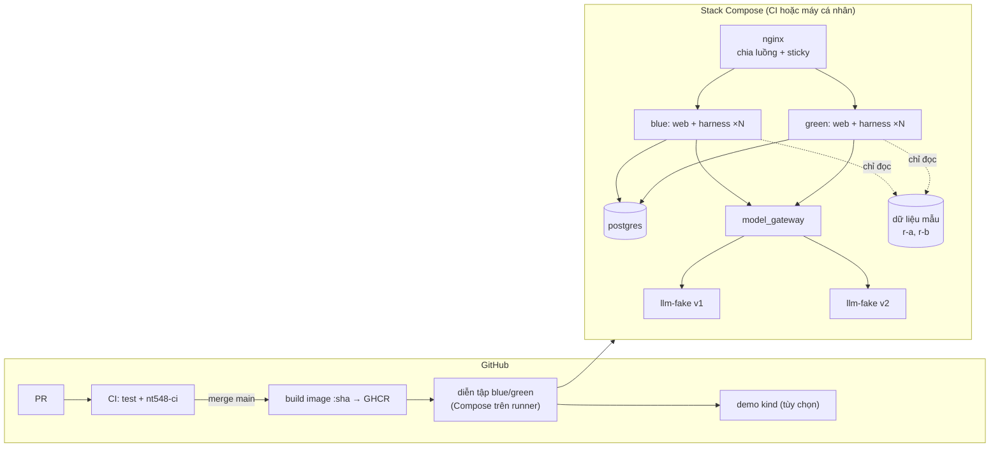

# NT548 nhóm 8: vận hành TripGuardian

Đồ án môn NT548 (DevOps). Sản phẩm là TripGuardian (lập lịch du lịch Đà Lạt, xem `README.md` ở gốc repo). Nhóm **không sửa chức năng sản phẩm**. Nhóm xây phần vận hành: CI/CD, load balancer, blue/green, canary, scale, AI ops, DataOps.

Thiết kế đã chốt: `docs/plans/2026-11-20-nt548-devops-design.md`. Đọc file đó trước nếu cần biết vì sao chọn cách này.

## Hệ thống đích



Không có server. Mọi thứ chạy trên runner GitHub (miễn phí với repo public) hoặc trên máy của từng người bằng Docker Compose.

## Chia việc

| Mã | Mảng | Người | Hướng dẫn | Cần xong trước |
|---|---|---|---|---|
| T1 | CI/CD, image GHCR, bảo vệ nhánh | LuanLuKim | [01-ci-cd.md](01-ci-cd.md) | — |
| T2 | Compose + Nginx blue/green, `deploy.sh` | Đình Long (`dinhlong06`) | [02-bluegreen-lb.md](02-bluegreen-lb.md) | T1 |
| T3 | Canary tự động, scale, đo tải | Quỳnh (`DontMadWhenBad`) | [03-canary-scale.md](03-canary-scale.md) | T2 |
| T4 | AI ops: LLM giả, chia luồng model, eval gate | LuanLuKim + Quỳnh | [04-aiops.md](04-aiops.md) | T2 |
| T5 | DataOps: dữ liệu mẫu, kiểm release, đổi release | hohoangluan + Đình Long | [05-dataops.md](05-dataops.md) | T1 |
| T6 | Demo Kubernetes `kind` | Quỳnh | [06-k8s-demo.md](06-k8s-demo.md) | T2 |
| T7 | Sync TripGuardian tự động, báo cáo, slide | Đình Long | [07-sync-report.md](07-sync-report.md) | T1–T6 |

Thứ tự: T1 → T2 → (T3, T4, T6 song song) → T7. T5 bắt đầu ngay sau T1, vì nó trả lời câu hỏi rủi ro nhất: harness có chạy được với dữ liệu mẫu không.

Mỗi mảng có một issue trên GitHub (nhãn `nt548`). T4 (#4, nhãn `aiops`) và T5 (#5, nhãn `dataops`) chia thành issue con, mỗi issue con một người. Ghi tiến độ vào issue, không ghi vào file này.

## Trạng thái (2026-11-20)

| Việc | Trạng thái |
|---|---|
| Fork sync với TripGuardian bản prod 2026-11-20 | xong (`a2f20126`) |
| GitHub Actions trên fork | bật; push **chưa** tự tạo run, phải bấm "Run workflow" (xem 01 §Bật Actions) |
| `test.yml` | web xanh; pytest đỏ khi nạp test vì `pyproject.toml` thiếu `trafilatura`, `cryptography`, `fastapi` (run `44743156261`) → việc đầu của T1 |
| `ops/nt548/`, workflow `nt548-*` | chưa có |

## Quy tắc của nhóm

1. **Chỉ thêm file có tiền tố `nt548`**: `ops/nt548/`, `docs/nt548/`, `tests/nt548/`, `.github/workflows/nt548-*.yml`. Nhờ vậy sync TripGuardian không bao giờ xung đột. Cần sửa file của TripGuardian (ví dụ `pyproject.toml`) thì mở PR lên TripGuardian, ghi số PR vào issue.
2. **Không đưa lên repo**: key model, token, `.env`, dữ liệu crawl (review, ảnh Maps, video TikTok). Repo này public.
3. Mỗi việc một nhánh `nt548/<mã>-<tên ngắn>` (ví dụ `nt548/t2-nginx`), mở PR vào `main`, một người khác review, CI xanh mới merge.
4. Tài liệu viết tiếng Việt; code, comment, tên file, commit message viết tiếng Anh (`RULE.md` §0).
5. Hướng dẫn trong `docs/nt548/` là kế hoạch: làm xong phần nào thì sửa file của mảng đó cho khớp với code thật (lệnh, cổng, tên file).

## Chạy thử sản phẩm trên máy mình

Cần Python 3.12, Node 24, Docker. Chưa có dữ liệu mẫu (T5) thì chỉ chạy được test và build web:

```sh
pip install -e ".[dev]" trafilatura cryptography fastapi   # ba gói cuối: tạm thời tới khi T1 sửa pyproject
python -m playwright install chromium
python -m pytest -q -x tests/planning                      # một nhóm test, nhanh
cd web && npm ci && npm run build
```

Lệnh trên chưa chạy thử trên máy sạch; ai chạy thì ghi kết quả vào issue T1.
