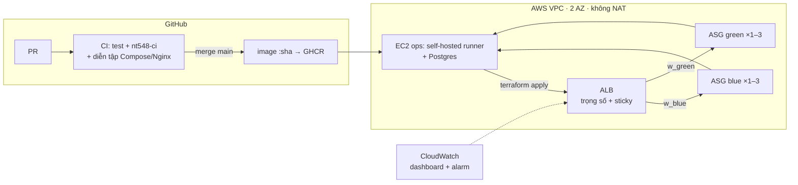

# NT548 nhóm 8: vận hành TripGuardian

Đồ án môn NT548 (DevOps). Sản phẩm là TripGuardian (lập lịch du lịch Đà Lạt, xem `README.md` ở gốc repo). Nhóm **không sửa chức năng sản phẩm**. Nhóm xây phần vận hành: CI/CD, load balancer, blue/green, canary, scale, AI ops, DataOps.

Thiết kế đã chốt: `docs/plans/2026-11-20-nt548-devops-design.md`. Đọc file đó trước nếu cần biết vì sao chọn cách này.

## Hệ thống đích

Triển khai thật lên **AWS Academy Learner Lab** (`us-east-1`, 50 USD mỗi người, không GPU), hạ tầng dựng và xóa bằng Terraform. Chi tiết và lý do: thiết kế bản 3 §5.



Mỗi máy app chạy một màu bằng Compose: web + harness + `model_gateway` + `llm-fake`, đọc dữ liệu mẫu `r-a` / `r-b`. GitHub không giữ key AWS: runner trong lab dùng `LabInstanceProfile`. Hết buổi chạy `nt548-aws-down` để giữ chi phí.

## Chia việc: khối × cặp

Hai cặp làm song song, chỉ gặp nhau ở **hợp đồng giữa khối** (thiết kế §7.1: tên image, `app.yml`, biến Terraform, thư mục dữ liệu mẫu, cổng LLM giả). Trong cặp, hai người tự chia issue con và review PR cho nhau.

| Cặp | Khối | Issue | Hướng dẫn |
|---|---|---|---|
| hohoangluan + Đình Long (`dinhlong06`) | T8. Hạ tầng AWS: Terraform, ALB, ASG + scale, CloudWatch, giữ chi phí | #21 (con #22–#27) | `08-aws-infra.md` (cặp viết khi làm) |
| | T5. DataOps: dữ liệu mẫu, `data_check`, đổi / lùi release | #5 (con #8–#12) | [05-dataops.md](05-dataops.md) |
| LuanLuKim + Quỳnh (`DontMadWhenBad`) | T9. CI/CD và phát hành: CI, GHCR, diễn tập blue/green, deploy lên AWS, canary, k6 | #28 (con #1, #2, #3, #29) | [01-ci-cd.md](01-ci-cd.md), [02-bluegreen-lb.md](02-bluegreen-lb.md), [03-canary-scale.md](03-canary-scale.md) |
| | T4. AI ops: LLM giả, trọng số + `/metrics` trong gateway, eval gate | #4 (con #13–#18) | [04-aiops.md](04-aiops.md) |
| Cả bốn | T7. Báo cáo, slide (mỗi người viết phần của mình) | #7 | [07-sync-report.md](07-sync-report.md) |
| — | T6. Kubernetes `kind` (không bắt buộc) | #6 | [06-k8s-demo.md](06-k8s-demo.md) |

Mốc chung: chốt hợp đồng giữa khối trước 23/11, ghép trên lab demo (của LuanLuKim) ngày 28/11, chạy thử demo 02–03/12, nộp **thứ Sáu 04/12**. Lịch từng cặp: thiết kế §7.

Mỗi việc một issue (nhãn `nt548` + `aws` / `cicd` / `aiops` / `dataops`). Ghi tiến độ vào issue, không ghi vào file này.

## Trạng thái (2026-11-20)

| Việc | Trạng thái |
|---|---|
| Fork sync với TripGuardian bản prod 2026-11-20 | xong (`a2f20126`) |
| GitHub Actions trên fork | bật; push **chưa** tự tạo run, phải bấm "Run workflow" (xem 01 §Bật Actions) |
| `test.yml` | web xanh; pytest đỏ khi nạp test vì `pyproject.toml` thiếu `trafilatura`, `cryptography`, `fastapi` (run `44743156261`) → việc đầu của T1 |
| `ops/nt548/`, workflow `nt548-*` | chưa có |

## Quy tắc của nhóm

1. **Chỉ thêm file có tiền tố `nt548`**: `ops/nt548/`, `docs/nt548/`, `tests/nt548/`, `.github/workflows/nt548-*.yml`. Nhờ vậy sync TripGuardian không bao giờ xung đột. Cần sửa file của TripGuardian (ví dụ `pyproject.toml`) thì mở PR lên TripGuardian, ghi số PR vào issue.
2. **Không đưa lên repo**: key model, token, `.env`, dữ liệu crawl (review, ảnh Maps, video TikTok). Repo này public.
3. Mỗi việc một nhánh `nt548/<mã>-<tên ngắn>` (ví dụ `nt548/t2-nginx`), mở PR vào `main`, một người khác review, CI xanh mới merge.
4. Tài liệu viết tiếng Việt; code, comment, tên file, commit message viết tiếng Anh (`RULE.md` §0).
5. Hướng dẫn trong `docs/nt548/` là kế hoạch: làm xong phần nào thì sửa file của mảng đó cho khớp với code thật (lệnh, cổng, tên file).

## Chạy thử sản phẩm trên máy mình

Cần Python 3.12, Node 24, Docker. Chưa có dữ liệu mẫu (T5) thì chỉ chạy được test và build web:

```sh
pip install -e ".[dev]" trafilatura cryptography fastapi   # ba gói cuối: tạm thời tới khi T1 sửa pyproject
python -m playwright install chromium
python -m pytest -q -x tests/planning                      # một nhóm test, nhanh
cd web && npm ci && npm run build
```

Lệnh trên chưa chạy thử trên máy sạch; ai chạy thì ghi kết quả vào issue T1.
