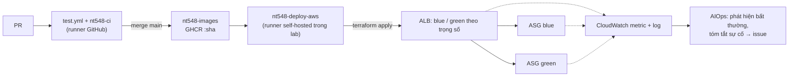

# Báo cáo đồ án NT548, nhóm 8: vận hành TripGuardian

> Báo cáo cuối kỳ (T7, #7), số liệu tới 28/11/2026. Mỗi mục ghi người làm, lệnh chạy lại được và số đo thật: từ CI, hoặc từ AWS Academy Learner Lab (`us-east-1`). Mã `AWS-xx` là test case trên lab (#79–#83). Tiến độ giữa kỳ: `midterm/MIDTERM.md`. Bảng đối chiếu tiêu chí xong: §10.

## 1. Bài toán và kiến trúc tổng

_LuanLuKim._

**Sản phẩm.** TripGuardian lập lịch trình du lịch cá nhân hóa: web (Node), harness (Python, FastAPI), các model gọi qua `scripts/model_gateway.py`. Đồ án **không đổi chức năng sản phẩm**. Đồ án chỉ làm phần vận hành: đưa sản phẩm lên AWS bằng code, phát hành an toàn, theo dõi, và dùng AI / ML để vận hành (AIOps).

**Ràng buộc định hình kiến trúc** (AWS Academy Learner Lab, `us-east-1`):

| Ràng buộc | Hệ quả |
|---|---|
| 50 USD mỗi thành viên, không GPU | Model thật được thay bằng `llm-fake` tương thích OpenAI. Hạ tầng tắt cuối mỗi buổi (`nt548-aws-down`) |
| Không tạo được IAM role / OIDC provider | GitHub không giữ key AWS. Deploy chạy trên **self-hosted runner** trong lab, dùng `LabInstanceProfile` |
| Tiền NAT Gateway | VPC 2 AZ chỉ có subnet public. Security group chỉ cho ALB → app → Postgres |
| Repo public | Image public trên GHCR; không secret, dữ liệu thật hay credential nào trong repo |

**Kiến trúc.** Chi tiết ở thiết kế bản 3 (`docs/plans/2026-11-20-nt548-devops-design.md` §5).

**Chia việc** (thiết kế §7): bốn khối, hai cặp làm song song, chỉ gặp nhau ở hợp đồng giữa khối (§7.1).
- hohoangluan + dinhlong06: hạ tầng AWS (T8) và DataOps (T5). Từ 24/11, dinhlong06 làm toàn bộ T8, hohoangluan làm toàn bộ T5.
- LuanLuKim + DontMadWhenBad: CI/CD (T9) và AIOps (T4).

## 2. Hạ tầng AWS bằng Terraform (T8, #21)

_dinhlong06._ Hướng dẫn chi tiết: `08-aws-infra.md`. Mọi số ở mục này đo trên AWS Academy Learner Lab thật, `us-east-1`: lab `nt548-dl` của dinhlong06 ngày 27–28/11 (#80–#83), và lab demo chung `nt548` ngày 28/11.

**Hai stack theo vòng đời.**

| Stack | Có gì | Sống bao lâu |
|---|---|---|
| `bootstrap/` | VPC 2 AZ (subnet public, không NAT), 3 security group, bucket S3 giữ state (versioning, mã hóa, chặn public), máy ops `t3.small` chạy Postgres + GitHub self-hosted runner, URL database trong SSM | suốt lab; dựng một lần |
| `envs/demo/` | ALB, target group blue / green, hai ASG, dashboard, alarm, SNS, log group | một buổi: `aws.sh up` dựng, `aws.sh down` xóa |

- Bảy thư mục Terraform (`network`, `alb`, `app_asg`, `monitoring`, `aiops`, `bootstrap`, `envs/demo`) đều có `terraform test` với provider giả. Workflow `nt548-terraform` chạy `fmt`, `validate`, `test` trên mỗi PR đụng Terraform.
- Security group theo tầng: internet → ALB (80) → app (8080) → Postgres (5432). Không mở SSH; vào máy bằng SSM.

**Kiểm quyền LabRole (R2).** Script `aws_r2_probe.sh` tạo rồi xóa thử từng loại tài nguyên. Kết quả: 19/19 API qua, cả từ máy cá nhân lẫn từ máy ops dùng `LabInstanceProfile` (AWS-01, AWS-04).

**Ba chỗ Learner Lab khác tài khoản AWS thường.** Cả ba chỉ lộ ra khi chạy thật; test với provider giả không bắt được.

| Gặp gì | Ảnh hưởng | Sửa (PR #87) |
|---|---|---|
| SCP chặn `s3:GetBucketObjectLockConfiguration` | resource `aws_s3_bucket` đọc API này sau mỗi lần tạo: bootstrap `apply` và `plan` đều đỏ (AWS-02, AWS-06) | tạo bucket bằng CLI một lần; Terraform chỉ quản lý versioning, mã hóa, chặn public |
| SCP chặn `autoscaling:StartInstanceRefresh` | đổi image một màu làm `apply` hỏng, nên không deploy được (AWS-14) | `rollout = replace`: đổi image thì dựng ASG mới, chờ healthy, rồi xóa ASG cũ |
| GitHub không nhận runner `2.321.0` (bản tối thiểu 2.329.0) | máy ops lên mà không có runner | runner `2.338.2` |

Sau khi sửa, bootstrap trên lab trống dựng 23 tài nguyên trong 54 s. `plan` ngay sau đó báo `No changes`. Runner `nt548-ops` online chưa tới 3 phút sau khi máy ops bật.

**Bật / tắt mỗi buổi (AWS-30, AWS-31).**

| Lệnh | Thời gian | Kết quả |
|---|---|---|
| `aws.sh up` (harness stub) | 208 s | 29 tài nguyên, hai target healthy, HTTP 200 |
| `aws.sh down` | 147 s | không còn ALB / ASG / target group; máy ops `stopped`; bucket còn |
| `aws.sh up` (harness thật) | 247 s | HTTP 200 ở `/` và `/api/auth/options`; Postgres còn dữ liệu ghi trước khi tắt |
| `aws.sh up` lab `nt548`, harness thật (28/11) | 337 s | `/` và `/api/auth/options` trả 200 qua ALB, mỗi màu 1 máy |

Máy ops dừng rồi bật lại vẫn giữ dữ liệu Postgres (AWS-07). Workflow `nt548-aws` chạy `down` lúc 23:00 giờ Việt Nam mỗi tối, phòng khi quên tắt.

## 3. Load balancer và scalability (T8, #21)

_dinhlong06._ ALB một listener cổng 80 chia người dùng mới giữa hai target group theo `weight_blue`. Sticky theo target group (cookie `AWSALBTG`, 300 s) giữ người dùng ở một màu. Mỗi màu là một ASG `t3.small`, min 1 / max 3, target tracking CPU trung bình 50 %.

| Mã | Kiểm | Kết quả trên lab |
|---|---|---|
| AWS-10 | `aws.sh up` từ lúc chưa có gì tới HTTP 200 đầu tiên | khoảng 212 s, 29 tài nguyên |
| AWS-11 | chia trọng số, 1.000 người dùng mới mỗi mức | `weight_blue` 100 / 90 / 0: green nhận 0 % / 10,2 % / 100 % |
| AWS-12 | sticky | 20/20 người dùng giữ màu qua 20 request liên tiếp |
| AWS-13 | rollback 10 → 100 về blue | 43,8 s khi tắt sticky, 46,1 s khi sticky 300 s; đạt mốc < 60 s |
| AWS-15 | scale-out | xem bảng dưới |
| AWS-16 | tự lành: terminate một máy green | máy thay healthy sau 235,9 s; blue 0 lỗi trên 19.208 request cùng lúc |
| AWS-17 | user-data | log máy kết thúc bằng `nt548 app <màu>: up` ở cả hai màu |

Scale-out bằng k6 vào URL ALB (AWS-15, 27/11):

| Lượt k6 | Máy blue healthy | Request | p95 | Lỗi HTTP |
|---|---:|---:|---:|---:|
| 10 VU, trước scale-out | 1 | 14.564 | 9,24 ms | 0 |
| 125 VU trong 6 phút | 1 lúc đầu | 1.127.180 | 44,4 ms | 57,23 % |
| 10 VU, sau khi có máy thứ hai | 2 | 17.608 | 6,64 ms | 0 |

- CPU blue lên 95 %. Target tracking tự đặt desired 1 → 2 lúc 22:27:37, và sau khi dừng tải thì tự về 1 lúc 22:45:06. Không ai chỉnh desired bằng tay.
- 125 VU vượt quá sức của nhóm máy: 57 % request trong lượt 6 phút bị lỗi. Bộ đo không tách lỗi theo trước / sau lúc máy thứ hai healthy, nên chưa biết máy thứ hai giảm lỗi bao nhiêu ở mức tải đó. Một máy mới cần khoảng 4 phút để healthy (235,9 s ở AWS-16), nên target tracking không đỡ được một cú tăng tải đột ngột. Hướng sửa ở §9.
- So với Compose trên một runner (`03-canary-scale.md`): ở đó thêm bản không tăng thông lượng, vì k6, Nginx và hai bản tranh nhau 4 vCPU. Trên AWS, mỗi máy có CPU riêng, nên máy thứ hai làm p95 giảm từ 9,24 ms xuống 6,64 ms ở cùng mức tải.

## 4. CI/CD và phát hành (T9, #28)

_LuanLuKim, DontMadWhenBad._ Hướng dẫn chi tiết: `01-ci-cd.md`. Phần của DontMadWhenBad (blue/green trên Compose + Nginx, canary tự rollback, k6) ghi tiếp ở đây khi xong.

**4.1 CI xanh (#1, LuanLuKim).**
- Lúc nhận repo, `test.yml` đỏ trên checkout sạch: thiếu dependency, và có test cần dữ liệu chỉ có trên máy prod (bị `.gitignore`).
- Sửa (#31, #42):
  - thêm dependency;
  - test thiếu file đầu vào thì tự skip;
  - marker `corpus` skip khi thiếu `data/snapshot/current`.
  Không đổi code sản phẩm.
- Kết quả: run của PR #47 (21/11) có `pytest` 5.542 qua, 0 đỏ, 433 skip trong 3 phút 46 giây; job `web` (type check + build) 23 giây.

**4.2 Image và stack một màu (#2, #44, đã merge 24/11).**
- `harness.Dockerfile`, `web.Dockerfile`, `ops/nt548/compose/app.yml` chạy cả stack một màu trên một máy, cổng `8080`.
- `nt548-ci` có job `app-smoke`: build 3 image, chạy `app.yml`, kiểm `GET /` trả 200. Job cũng kiểm stub báo đúng màu, gateway trả lời qua LLM giả, và image không chứa `.env` / `data/`.
- `nt548-images` đẩy `:sha` lên GHCR sau mỗi merge.
- `nt548-ci` có thêm job `app-real` (PR #63): cùng stack với **harness thật**. Dữ liệu mẫu do `make.py` dựng và qua `data_check`; Postgres chạy cạnh stack. Kết quả: 40/40 nơi của `r-a` tìm được qua `:8080`, nơi chỉ `r-b` có thì vắng, journey vẫn mở sau khi restart harness. Harness thật cần `APP_BASE_URL` bằng địa chỉ công khai, vì web đổi header `Host`; trên AWS là DNS của ALB.

**4.3 Deploy lên AWS (#29, #50, #84, #87).** `nt548-deploy-aws` gọi `ops/nt548/deploy_aws.sh`. Script chỉ thay đổi AWS qua `terraform apply` của `envs/demo`, theo hợp đồng với T8.

| Bước | Trọng số màu cũ / màu mới | Sang bước sau khi |
|---|---|---|
| Màu rảnh nhận image `:sha` | 100 / 0 | mọi target `healthy` |
| Canary | 90 / 10 | `canary_watch` (#3) qua |
| Promote | 0 / 100 | màu cũ giữ sha cũ để lùi |
| Canary hỏng | 100 / 0 | dừng, job đỏ |

- Rollback tay chỉ đổi trọng số.
- Workflow không có trigger `pull_request`, nên code của PR không chạy trên runner self-hosted.
- Workflow chỉ chạy khi admin bật `NT548_DEPLOY_ENABLED`. Dự phòng khi runner hỏng: chạy trên runner GitHub với credential tạm trong Environment `nt548-aws`.
- 7 test chạy script với `terraform` / `aws` giả: thứ tự trọng số, màu hỏng không nhận traffic, canary hỏng thì lùi, tag lạ bị từ chối.
- Learner Lab chặn instance refresh, nên màu rảnh nhận image bằng một ASG mới: `apply` dựng ASG mới, chờ healthy, rồi xóa ASG cũ (#87, §2).

**Chạy thật trên lab `nt548`, 28/11** (runner `nt548-ops`, harness thật, tải nền khoảng 8 request mỗi giây vào ALB):

| Lượt | Diễn biến | Kết quả |
|---|---|---|
| Deploy `920d9ac` lên green, tải 2 request / s ([run 46138307182](https://github.com/LuanLuKim/tripguardian-nt548/actions/runs/46138307182)) | `apply` thay ASG green trong 276 s; blue (live) trả 238/238 request 200 trong lúc đó. Canary 10 % chỉ được 35 request trên green | **tự rollback**: `not enough traffic: 35 requests on the new color, need 50`. Không đủ mẫu thì không promote |
| Deploy lại, tải 8 request / s ([run 46139379086](https://github.com/LuanLuKim/tripguardian-nt548/actions/runs/46139379086)) | canary 10 % trong 5 phút: green 172 request, 0 % 5xx, p95 17 ms; blue 1.806 request, 0 % 5xx, p95 8 ms | **promote** green 100 %, blue giữ sha cũ để lùi |
| Merge #87 vào `main`, không ai bấm gì ([run 46139982753](https://github.com/LuanLuKim/tripguardian-nt548/actions/runs/46139982753)) | `nt548-images` build `407c6ae`, deploy tự chạy sau 1 phút. Blue (rảnh) nhận ASG mới trong 283 s; canary: blue 179 request, 0 % 5xx, p95 19 ms; green 1.516 request, 0 % 5xx | **promote** blue lúc 18:38:18, 11,5 phút sau merge |
| Rollback tay `action=rollback` ([run 46140966501](https://github.com/LuanLuKim/tripguardian-nt548/actions/runs/46140966501)) | chỉ đổi `weight_blue` | script 10 s, cả job 31 s; traffic mới về hết màu kia sau 43,8 s (AWS-13) |

- Phía ALB, từ 11:20 tới 11:39 UTC (cả hai lượt promote): 8.454 request, 0 lỗi 5xx của ALB và của target, 0 kết nối bị từ chối.
- Bộ tải chạy trên máy một thành viên ghi 67 / 8.033 request (0,8 %) `Connection timed out` ở bước kết nối. Lỗi rải đều, kể cả lúc không deploy: lấy mẫu riêng ngoài lúc deploy vẫn hỏng 1 / 40. Vì vậy đây là lỗi mạng của máy đo, không phải do đổi màu. Muốn đo sạch thì chạy tải từ trong VPC.
- Ngưỡng "ít nhất 50 request mỗi màu" của `canary_watch` đã chặn một lần promote thật khi traffic quá thấp. Đó là đúng ý đồ: không đủ mẫu thì không kết luận bản mới tốt.

**4.4 Kiểm Terraform trong CI (#49).** Workflow `nt548-terraform` chạy `fmt -check`, `validate` và `terraform test` (provider giả) cho mọi module trong `ops/nt548/terraform`, kể cả module của T8 khi thêm vào.

## 5. Monitoring (T8, #21)

_dinhlong06._ `modules/monitoring` tạo:
- dashboard 7 ô: request, 5xx, p95, máy healthy theo màu, CPU từng ASG, số máy, trạng thái alarm;
- alarm ngưỡng cố định theo màu: 5xx, p95, `unhealthy`, `no-healthy`, cùng 5xx của chính ALB;
- SNS topic gửi mail;
- log group `/<prefix>/app-<màu>`; mọi container ghi log vào đây qua driver `awslogs`.

`modules/aiops` (#36) thêm 6 alarm Anomaly Detection: dải dự báo do CloudWatch học, cho độ trễ, lỗi và số request của từng màu.

Kết quả trên lab (#82):

| Mã | Kiểm | Kết quả |
|---|---|---|
| AWS-20 | dashboard có số khi có tải | 7 ô, 6 biểu đồ có cả blue và green; k6 14.564 request, 0 lỗi |
| AWS-21 | dừng container green qua SSM | `green-unhealthy` sang `ALARM` sau **299,5 s**, mail tới cùng giây; bật lại thì về `OK` và có mail `OK` |
| AWS-22 | bơm `NT548_FAULT=500@0.3` vào green đang nhận traffic | alarm `green-5xx` kêu sau **290,8 s**; alarm anomaly 5xx không kêu (xem §6) |
| AWS-23 | log container trên CloudWatch Logs | `log_patterns.py` đưa mẫu HTTP 500 lên đầu: 4.536 dòng trong ca lỗi, 0 lúc bình thường |
| AWS-24 | tóm tắt sự cố từ alarm thật | `incident.py` chỉ ra green, dẫn alarm và mẫu HTTP 500 |
| AWS-25, AWS-26 | báo nhầm khi tải bình thường | 61 phút tải đều: 6 alarm anomaly đều `OK`; 30 phút: 15 alarm, 0 lần đổi trạng thái |

MTTD khoảng 5 phút trên AWS, so với 5–20 s trên Compose (§6.4). Lý do: metric của ALB về CloudWatch theo phút, và alarm cần 2 trong 3 phút vượt ngưỡng. Muốn nhanh hơn thì phải đọc nguồn gần hơn (log container, như mẫu log trên Compose), đổi lại là tốn thêm công vận hành.

## 6. AI ops (T4, #4)

_LuanLuKim, DontMadWhenBad._ Hướng dẫn chi tiết: `04-aiops.md`.
- **AI ops của đồ án là AIOps** (chủ dự án chốt 21/11): dùng AI / ML để vận hành hệ thống, theo chuỗi quan sát → phát hiện → chẩn đoán → hành động.
- LLMOps (eval gate #16, canary model #17) không bắt buộc.

**6.1 Quan sát (#14, #15, đã merge).**
- `model_gateway` chia luồng theo trọng số `URL@weight`.
- Endpoint `/metrics` (Prometheus) đếm request theo upstream và mã trả về, đo histogram độ trễ, báo trạng thái cooldown và trọng số.
- 16/16 test của gateway qua.

**6.2 Phát hiện bất thường (#36, `detect.py` và module AWS #49 đã merge).** Bốn cách trên cùng chuỗi:
- ngưỡng tĩnh, như người vận hành đặt tay;
- EWMA z-score;
- Isolation Forest, trên giá trị, độ thay đổi, độ lệch so với trung bình trượt, và pha chu kỳ;
- `combined`: EWMA hoặc Isolation Forest.

Chạy lại bằng `python ops/nt548/aiops/detect.py compare --seeds 20`. Mỗi kịch bản có 20 chuỗi tổng hợp:

| Kịch bản | Ngưỡng tĩnh | EWMA | Isolation Forest | `combined` |
|---|---|---|---|---|
| Gai lớn (`spike`) | 18 / 20 | **20 / 20** | 16 / 20, 6 báo nhầm | **20 / 20**, 6 báo nhầm |
| Rò rỉ chậm (`drift`) | 0 / 20 | 0 / 20 | **15 / 20** (trễ ~117 điểm) | **15 / 20** |
| Gai dưới đỉnh chu kỳ (`seasonal_spike`) | 0 / 20 | 0 / 20 | **16 / 20**, 3 báo nhầm | **16 / 20** |
| Tăng nền +60 (`level_shift`) | 0 / 20 | **20 / 20** | 17 / 20 | **20 / 20** |
| Không lỗi (`quiet`): số báo nhầm | 0 | 0 | 6 | 6 |

Kết luận trên dữ liệu tổng hợp:
- Ngưỡng tĩnh chỉ bắt được gai lớn.
- EWMA nhanh và không báo nhầm, nhưng tự thích nghi theo rò rỉ chậm nên bỏ sót nó.
- Isolation Forest là cách duy nhất bắt được rò rỉ chậm và gai nằm trong chu kỳ. Cái giá là khoảng 6 lần báo nhầm trên 20 chuỗi.
- Trên AWS, module Terraform `modules/aiops` tạo alarm CloudWatch Anomaly Detection (dải dự báo do CloudWatch học) cho p95 độ trễ, 5xx và số request theo từng target group.
- Giới hạn: ALB bị xóa mỗi buổi, nên metric mới chưa có lịch sử và dải của CloudWatch kém tin cậy trong những giờ đầu. Vì vậy so sánh trên lab dựa vào `detect.py`.

**6.3 Chẩn đoán và hành động: tóm tắt sự cố (#38, #48, #60).** `incident.py` gom bằng chứng và đánh số E1…En:
- alarm;
- metric trước và sau alarm;
- detector nào bắt;
- mẫu log tăng;
- deploy trong 30 phút trước alarm.

Sau đó `incident.py` mở một issue nhãn `incident` cho mỗi alarm; alarm lặp lại thì comment vào issue đó.

Rủi ro chính của LLM trong xử lý sự cố là **bịa nguyên nhân**. Cách giảm:
- LLM chỉ nhận danh sách bằng chứng.
- Mỗi giả thuyết phải dẫn mã bằng chứng có thật. Không đạt thì bỏ cả câu trả lời và dùng luật cố định; issue ghi rõ lý do.
- Lệnh gợi ý chỉ lấy từ luật cố định và không bao giờ tự chạy.

Ba sự cố tổng hợp cho đúng nguyên nhân đã gài:

| Sự cố gài | Giả thuyết đầu tiên | Lệnh gợi ý |
|---|---|---|
| Deploy hỏng, 5xx tăng 32 lần | deploy `a1b2c3d` 7 phút trước alarm (high) | rollback qua `nt548-deploy-aws` |
| LLM chậm, deploy cũ 3 giờ trước | mẫu log timeout của gateway; không đổ lỗi deploy cũ | đọc `/metrics` của gateway |
| Tải tăng 4 lần, không deploy | tải tăng, không phải đổi code | kiểm hoạt động scale của ASG |

Thử với LLM thật ngày 24/11 (chạy trên máy, ba sự cố trên):

| LLM | Câu trả lời qua kiểm bằng chứng | Nhận xét |
|---|---|---|
| `gpt-6.1-sol` (qua 9router) | 3 / 3 | Tóm tắt đủ số liệu hơn mẫu cố định, nhưng rất thận trọng: một giả thuyết, độ tin `medium`, kể cả ca deploy hỏng |
| `llama-3.3-70b` (Cloudflare Workers AI) | 1 / 2 trước khi sửa, 10 / 10 sau | Lỗi ban đầu: Workers AI cắt câu trả lời ở 256 token nên JSON hỏng. Sửa bằng JSON mode + `max_tokens`. Kết luận quyết đoán hơn, đôi khi suy diễn yếu |

Vì vậy (#60) giả thuyết của luật luôn đứng đầu, và LLM chỉ viết tóm tắt và thêm giả thuyết, mỗi dòng ghi nguồn `rule` / `LLM`. Kiểm bằng chứng là phần không thể bỏ: không có nó, câu trả lời hỏng hoặc bịa của LLM sẽ đi thẳng vào issue.

**6.4 Bơm lỗi và đo (#37, #39, DontMadWhenBad).**
- `log_patterns.py` (#37) gom log container thành mẫu bằng Drain3. Một mẫu mức ERROR là bất thường khi nó mới xuất hiện, hoặc tăng ít nhất 3 lần so với cửa sổ trước. Mức log đứng đầu chuỗi đem gom: nếu không, Drain gộp dòng `200` với dòng `502` vì hai dòng chỉ khác một từ, và lỗi bị giấu trong mẫu của lượt thành công.
- `fault_eval.py` (#39) dựng stack blue (hai bản app) sau Nginx, chạy tải nền suốt buổi, rồi bơm lần lượt năm lỗi. Mỗi kịch bản có 90 s bình thường, sau đó là lỗi, rồi phục hồi. Chuỗi metric lấy từ access log của Nginx, mỗi ô 5 s. Alarm chỉ tính khi lỗi kéo dài 2 ô. MTTD tính từ lúc bơm lỗi tới khi alarm kêu.

Kết quả CI ngày 26/11 ([run 45827111505](https://github.com/LuanLuKim/tripguardian-nt548/actions/runs/45827111505), runner 4 vCPU; 96.522 request trong 22,6 phút, 0 lỗi kết nối):

| Kịch bản | Metric | Bình thường → đỉnh | Ngưỡng tĩnh | EWMA | Isolation Forest | Mẫu log | Phục hồi | 5xx người dùng thấy |
|---|---|---|---|---|---|---|---|---|
| LLM giả lỗi 30 % (`llm_errors`) | 5xx / 5 s | 0 → 48 | 20 s | 20 s | không bắt | **15 s** | tay: MTTD + người phản ứng + lệnh 23,5 s | 558 |
| LLM chậm thêm 2 s (`llm_slow`) | p95 (ms) | 5,5 → 2.008 | 20 s | 20 s | không bắt | không có dòng lỗi | tay: MTTD + người phản ứng + lệnh 24,9 s | 0 |
| Tắt một bản app (`instance_down`) | 5xx / 5 s | 0,1 → 1 | không bắt | không bắt | không bắt | không bắt | tay, lệnh 11,2 s | 1 |
| Deploy bản trả 500 (`bad_deploy`) | 5xx / 5 s | 0 → 11 | 7,9 s | 7,9 s | không bắt | **5 s** | **tự động, 21,6 s** (`canary_watch`) | 41 |
| Tải tăng 5 lần (`traffic_spike`) | request / 5 s | 377 → 1.895 | 10 s | 10 s | không bắt | – | hết tải | 0 |

Báo nhầm trong 5 phút không có lỗi: 0 với mọi cách, trên cả ba metric; mẫu log cũng 0.

Đọc kết quả:
- **Tự động hóa giảm MTTR và số lỗi người dùng thấy.** `bad_deploy` được `canary_watch` rollback sau 21,6 s, người dùng thấy 41 lỗi 5xx. `llm_errors` cần người chạy lệnh: 15 s phát hiện, cộng thời gian người phản ứng, cộng 23,5 s chạy lệnh. Bộ đo không có người thật, nên giữ lỗi 60 s thay cho lúc người phản ứng. Từ lúc bắt đầu bơm lỗi tới khi phục hồi xong mất 108 s, và trong đó người dùng thấy 558 lỗi.
- **Mẫu log phát hiện sớm nhất** khi lỗi có dòng log riêng: 5 s ở `bad_deploy`, 15 s ở `llm_errors`, so với 7,9 s và 20 s của metric. Mẫu mới hiện ra ngay ô đầu, còn metric phải đợi đủ hai ô. Khi lỗi không sinh dòng lỗi (`llm_slow`), chỉ metric bắt được.
- **`instance_down` gần như không ảnh hưởng người dùng.** Nginx chuyển request sang bản còn lại, chỉ 1 request lỗi. Muốn biết một bản đã chết thì cần health check theo từng máy (target health của ALB trên AWS), không phải metric 5xx.
- **Isolation Forest không bắt được ca nào trong lần chạy này.** Mô hình chỉ học 90 s đầu của mỗi kịch bản, và trong khoảng đó 5xx toàn là 0. Cây quyết định không tách được dữ liệu hằng số. Giá trị vượt khỏi khoảng đã học rơi vào cùng lá với điểm biên, nên không bị coi là lạ. Kết quả cũng không ổn định: ở lần chạy trước (run 45821363918) nó bắt được `traffic_spike` sau 10 s. Ngược lại, trên dữ liệu tổng hợp ở §6.2, Isolation Forest là cách duy nhất bắt được rò rỉ chậm. Hai kết quả không mâu thuẫn: Isolation Forest cần đoạn học dài và có biến động. `combined` (EWMA hoặc Isolation Forest), cái alarm của #38 nghe, vẫn bắt mọi ca EWMA bắt.
- Giới hạn: đoạn không lỗi chỉ dài 5 phút, nên 0 báo nhầm là bằng chứng yếu. Chạy lại với `quiet_s` dài hơn qua `workflow_dispatch`. Mọi số ở đây là trên một máy, với stub thay harness thật.

**Trên metric và log thật của lab (#82, §5).**
- Mẫu log đưa mẫu HTTP 500 lên đầu danh sách: 4.536 dòng trong ca lỗi, 0 lúc bình thường.
- `incident.py` chỉ đúng màu green từ alarm thật.
- 61 phút tải đều: 6 alarm anomaly đều `OK`; 30 phút: 0 báo nhầm trên 15 alarm.
- Alarm ngưỡng cố định bắt được lỗi 30 % sau 290,8 s, còn alarm anomaly 5xx thì không kêu. Đúng như giới hạn đã nêu ở §6.2: dải của CloudWatch cần lịch sử, mà ALB bị xóa mỗi buổi.

**LLMOps khác AIOps ở đâu** (ghi tiếp ở #18): AIOps dùng ML để vận hành *hệ thống*. LLMOps vận hành chính *model*: đánh giá phiên bản, canary model, theo dõi chất lượng câu trả lời.

## 7. DataOps (T5, #5)

_hohoangluan._ Hướng dẫn chi tiết: `05-dataops.md`.

**Bài toán.** Harness của TripGuardian đọc một "release" dữ liệu địa điểm: snapshot và index, có `manifest.json` ghi sha256 từng file, cùng một pointer `releases/current`. Journey của người dùng ghim release lúc tạo. Dữ liệu thật (274 GB, crawl) không đưa được lên repo public hay lab 50 USD, nên nhóm làm dữ liệu mẫu tổng hợp.

**Dữ liệu mẫu (#8, #9).** R1 xác định phần dữ liệu tối thiểu để harness thật khởi động. `sample-data/make.py` sinh tất định hai release: `r-a` (40 nơi) và `r-b`, khác nhau vài nơi để kiểm đổi release. Ngoài ra có các release hỏng cố ý: `r-b-drop` mất 20 % nơi, `r-b-nocoords` thiếu tọa độ.

**Gate `data_check` (#10).** Bảy kiểm chạy theo thứ tự: `manifest`, `hashes`, `release`, `schema`, `coords`, `index`, `drop` (so với release đang chạy, giảm quá 10 % là chặn). Một kiểm đỏ thì các kiểm phụ thuộc báo `skip`, nên mỗi release hỏng chỉ có một lý do rõ ràng. Không ai đổi được pointer mà không qua gate, kể cả chạy tay. Lùi khẩn cấp có `--skip-check`, lệnh in cảnh báo.

**Đổi và lùi release (#11).** `nt548-data-release` diễn tập trên harness thật với Postgres:

| Kiểm | Kết quả |
|---|---|
| Đổi `r-a` → `r-b` trên green | green phục vụ `r-b`; journey tạo lúc `r-a` vẫn mở (200), vì green mount cả hai release |
| Màu chỉ có `r-b` mở journey `r-a` | 409 `stale_data_version`: không lặng lẽ trả dữ liệu sai |
| Lùi về `r-a` | qua cùng gate, phục vụ lại `r-a` |
| Release mất 20 % nơi | gate chặn: `40 -> 32 places (20% drop, limit 10%)`, không màu nào lên |
| Cả chuỗi | 67 s; mỗi lần harness lên mất 6 s |

Trên AWS, đổi dữ liệu chỉ là đổi biến `data_release_<màu>`. Biến này nằm trong user-data, nên có launch template mới và ASG mới (§4.3): dữ liệu đi đúng đường blue/green và canary như code.

**Vì sao không dùng DVC, lakeFS, Great Expectations.** Định dạng release đã có sẵn phiên bản theo nội dung, hash và pointer nguyên tử. DVC và lakeFS sẽ làm lại phần đó, và lakeFS cần thêm server và S3. Great Expectations kéo nhiều phụ thuộc cho bảy kiểm chỉ khoảng 200 dòng. Nếu đưa dữ liệu thật lên AWS, DVC với remote S3 là bước tiếp hợp lý để chép release giữa các máy.

## 8. Chi phí

Ước tính một buổi 4 giờ (ALB, 2 máy app, máy ops, IPv4, CloudWatch): khoảng 0,45 USD. Khi demo đã tắt chỉ còn ổ đĩa 20 GB của máy ops, khoảng 0,05 USD mỗi ngày. Bảng giá theo thành phần: `08-aws-infra.md` §Chi phí.

Số **Used** đọc ở bảng Learner Lab (cộng dồn cả lab, cập nhật trễ vài giờ):

| Lab | Ngày | Dựng gì | Used (USD / 50) |
|---|---|---|---|
| `nt548-dl` (dinhlong06) | 27–28/11 | R2, bootstrap, 3 lượt up / down, scale-out, bơm lỗi, 61 phút tải đều | 3,90 |
| `nt548` (LuanLuKim) | 28/11 | bootstrap, `aws.sh up`, deploy qua runner | _ghi số Used cuối buổi_ |

Hai thói quen giữ chi phí thấp:
- `aws.sh down` cuối mỗi buổi, cộng lượt `down` tự động lúc 23:00;
- không có NAT Gateway, vì NAT khoảng 32 USD mỗi tháng.

## 9. Hạn chế và hướng mở rộng

**Hạn chế.**
- Learner Lab không cho tạo IAM role / OIDC, nên deploy chạy trên runner tự host. Runner nằm trên máy ops: máy tắt thì không deploy được. Dự phòng là workflow chạy trên runner GitHub với credential tạm của lab, do admin đặt trong Environment.
- LLM là bản giả tương thích OpenAI (lab không có GPU, và không đưa key model thật lên AWS). Số đo AIOps vì vậy không phản ánh độ trễ của model thật.
- Dữ liệu là dữ liệu mẫu tổng hợp (40 nơi), không phải 274 GB thật.
- Hạ tầng bị xóa mỗi buổi, nên alarm Anomaly Detection không có lịch sử dài để học dải. Đây có thể là lý do alarm anomaly 5xx không kêu ở AWS-22.
- Scale-out phản ứng chậm (khoảng 4 phút cho một máy mới), nên không đỡ được cú tăng tải đột ngột (§3).

**Hướng mở rộng.**
- Giữ min 2 máy cho màu live, dùng scale theo lịch, hoặc predictive scaling của ASG khi có lịch sử tải đủ dài.
- Kubernetes: manifest và demo kind đã có (#6). Trên AWS sẽ là EKS, nhưng EKS vượt ngân sách lab.
- Cloudflare trước ALB (DNS proxied, WAF) nếu có domain.
- Deploy kéo (GitOps, ví dụ Argo CD) thay vì runner đẩy.
- Dữ liệu và model thật: DVC remote S3 cho release dữ liệu; canary model thật qua gateway (#14, #16, #17).

## 10. Đối chiếu tiêu chí xong (thiết kế §8)

| # | Tiêu chí | Đạt | Bằng chứng |
|---|---|---|---|
| 1 | PR có test đỏ không merge được | ✅ | `main` được bảo vệ từ 28/11: phải qua `pytest`, `web`, `lint-test`, `app-smoke` |
| 2 | `aws-up` từ tài khoản trống tới URL chạy được, `aws-down` xóa sạch | ✅ | §2: bootstrap 54 s trên lab trống; `up` 208–337 s; `down` 147 s, không còn ALB / ASG / target group |
| 3 | Merge → image `:sha` → deploy màu rảnh, canary 10 %, promote | ✅ | §4.3: merge #87 tự lên AWS, promote 11,5 phút sau merge |
| 4 | Bản trả 500 → `canary_watch` tự rollback, màu cũ không thấy lỗi | ✅ Compose; một phần trên AWS | Compose: rollback 17 s, màu cũ 0 lỗi (§4, `MIDTERM.md` §4). AWS: canary tự rollback khi thiếu mẫu (§4.3); bơm lỗi 500 trên AWS thì alarm bắt (§5, AWS-22) |
| 5 | Rollback tay < 1 phút; không rớt request khi đổi màu | ✅ | AWS: job rollback 31 s, traffic về hết sau 43,8 s; phía ALB 0 lỗi suốt hai lần promote. Compose: 5.726 request, 0 lỗi |
| 6 | k6 tăng tải → ASG thêm máy; số trước / sau | ✅ | §3: 1 → 2 máy, p95 9,24 → 6,64 ms ở 10 VU; tự về 1 máy |
| 7 | Dashboard và một alarm bắn thật | ✅ | §5: `green-unhealthy` kêu sau 299,5 s, có mail; `green-5xx` sau 290,8 s |
| 8 | Canary 10 % cho `llm-fake v2`, eval gate chặn bản xấu | một phần | eval gate chặn bản lỗi 30 % và bản hỏng JSON (#16). Workflow canary model (#17) không bắt buộc, chưa làm |
| 9 | `data_check` chặn release hỏng; đổi `r-a` → `r-b` qua blue/green | ✅ | §7: chặn `r-b-drop`; đổi và lùi trên harness thật |
| 10 | Tổng chi phí AWS tới ngày nộp, kèm ảnh | đang ghi | §8 |

