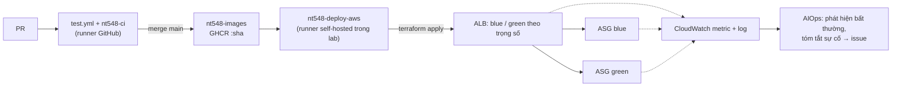

# Báo cáo đồ án NT548, nhóm 8: vận hành TripGuardian

> Khung báo cáo (T7, #7). Mỗi người viết mục của các issue mình làm, kèm lệnh chạy lại được và số đo thật. Cách ghép báo cáo: `07-sync-report.md`.

## 1. Bài toán và kiến trúc tổng

_LuanLuKim._

**Sản phẩm.** TripGuardian lập lịch trình du lịch cá nhân hóa: web (Node), harness (Python, FastAPI), các model gọi qua `scripts/model_gateway.py`. Đồ án **không đổi chức năng sản phẩm**. Đồ án chỉ làm phần vận hành: đưa sản phẩm lên AWS bằng code, phát hành an toàn, theo dõi, và dùng AI / ML để vận hành (AIOps).

**Ràng buộc định hình kiến trúc** (AWS Academy Learner Lab, `us-east-1`):

| Ràng buộc | Hệ quả |
|---|---|
| 50 USD mỗi thành viên, không GPU | Model thật được thay bằng `llm-fake` tương thích OpenAI. Hạ tầng tắt cuối mỗi buổi (`nt548-aws-down`) |
| Không tạo được IAM role / OIDC provider | GitHub không giữ key AWS. Deploy chạy trên **self-hosted runner** trong lab, dùng `LabInstanceProfile` |
| Tiền NAT Gateway | VPC 2 AZ chỉ có subnet public. Security group chỉ cho ALB → app → Postgres |
| Repo public | Image public trên GHCR; không secret, dữ liệu thật hay credential nào trong repo |

**Kiến trúc.** Chi tiết ở thiết kế bản 3 (`docs/plans/2026-11-20-nt548-devops-design.md` §5).

**Chia việc** (thiết kế §7): bốn khối, hai cặp làm song song, chỉ gặp nhau ở hợp đồng giữa khối (§7.1).
- hohoangluan + dinhlong06: hạ tầng AWS (T8) và DataOps (T5).
- LuanLuKim + DontMadWhenBad: CI/CD (T9) và AIOps (T4).

## 2. Hạ tầng AWS bằng Terraform (T8, #21)

_hohoangluan, dinhlong06._ VPC, subnet, security group, máy ops + self-hosted runner, giới hạn của Learner Lab (bảng quyền R2).

## 3. Load balancer và scalability (T8, #21)

_hohoangluan, dinhlong06._ ALB + target group blue/green, ASG + target tracking, số đo scale-out.

## 4. CI/CD và phát hành (T9, #28)

_LuanLuKim, DontMadWhenBad._ Hướng dẫn chi tiết: `01-ci-cd.md`. Phần của DontMadWhenBad (blue/green trên Compose + Nginx, canary tự rollback, k6) ghi tiếp ở đây khi xong.

**4.1 CI xanh (#1, LuanLuKim).**
- Lúc nhận repo, `test.yml` đỏ trên checkout sạch: thiếu dependency, và có test cần dữ liệu chỉ có trên máy prod (bị `.gitignore`).
- Sửa (#31, #42):
  - thêm dependency;
  - test thiếu file đầu vào thì tự skip;
  - marker `corpus` skip khi thiếu `data/snapshot/current`.
  Không đổi code sản phẩm.
- Kết quả: run của PR #47 (21/11) có `pytest` 5.542 qua, 0 đỏ, 433 skip trong 3 phút 46 giây; job `web` (type check + build) 23 giây.

**4.2 Image và stack một màu (#2, #44, đã merge 24/11).**
- `harness.Dockerfile`, `web.Dockerfile`, `ops/nt548/compose/app.yml` chạy cả stack một màu trên một máy, cổng `8080`.
- `nt548-ci` có job `app-smoke`: build 3 image, chạy `app.yml`, kiểm `GET /` trả 200. Job cũng kiểm stub báo đúng màu, gateway trả lời qua LLM giả, và image không chứa `.env` / `data/`.
- `nt548-images` đẩy `:sha` lên GHCR sau mỗi merge.
- `nt548-ci` có thêm job `app-real` (PR #63): cùng stack với **harness thật**. Dữ liệu mẫu do `make.py` dựng và qua `data_check`; Postgres chạy cạnh stack. Kết quả: 40/40 nơi của `r-a` tìm được qua `:8080`, nơi chỉ `r-b` có thì vắng, journey vẫn mở sau khi restart harness. Harness thật cần `APP_BASE_URL` bằng địa chỉ công khai, vì web đổi header `Host`; trên AWS là DNS của ALB.

**4.3 Deploy lên AWS (#29, draft #50).** `nt548-deploy-aws` gọi `ops/nt548/deploy_aws.sh`. Script chỉ thay đổi AWS qua `terraform apply` của `envs/demo`, theo hợp đồng với T8.

| Bước | Trọng số màu cũ / màu mới | Sang bước sau khi |
|---|---|---|
| Màu rảnh nhận image `:sha` | 100 / 0 | mọi target `healthy` |
| Canary | 90 / 10 | `canary_watch` (#3) qua |
| Promote | 0 / 100 | màu cũ giữ sha cũ để lùi |
| Canary hỏng | 100 / 0 | dừng, job đỏ |

- Rollback tay chỉ đổi trọng số.
- Workflow không có trigger `pull_request`, nên code của PR không chạy trên runner self-hosted.
- Workflow chỉ chạy khi admin bật `NT548_DEPLOY_ENABLED`. Dự phòng khi runner hỏng: chạy trên runner GitHub với credential tạm trong Environment `nt548-aws`.
- 7 test chạy script với `terraform` / `aws` giả: thứ tự trọng số, màu hỏng không nhận traffic, canary hỏng thì lùi, tag lạ bị từ chối.
- Chưa chạy thật: cần runner, ALB và `envs/demo` của T8.

**4.4 Kiểm Terraform trong CI (#49).** Workflow `nt548-terraform` chạy `fmt -check`, `validate` và `terraform test` (provider giả) cho mọi module trong `ops/nt548/terraform`, kể cả module của T8 khi thêm vào.

**Còn đo:** thời gian rollback tay trên lab (mục tiêu < 1 phút), k6 không rớt request khi đổi màu (#3).

## 5. Monitoring (T8, #21)

_hohoangluan, dinhlong06._ Dashboard, alarm, log; ảnh chụp một alarm bắn thật.

## 6. AI ops (T4, #4)

_LuanLuKim, DontMadWhenBad._ Hướng dẫn chi tiết: `04-aiops.md`.
- **AI ops của đồ án là AIOps** (chủ dự án chốt 21/11): dùng AI / ML để vận hành hệ thống, theo chuỗi quan sát → phát hiện → chẩn đoán → hành động.
- LLMOps (eval gate #16, canary model #17) không bắt buộc.

**6.1 Quan sát (#14, #15, đã merge).**
- `model_gateway` chia luồng theo trọng số `URL@weight`.
- Endpoint `/metrics` (Prometheus) đếm request theo upstream và mã trả về, đo histogram độ trễ, báo trạng thái cooldown và trọng số.
- 16/16 test của gateway qua.

**6.2 Phát hiện bất thường (#36, `detect.py` và module AWS #49 đã merge).** Bốn cách trên cùng chuỗi:
- ngưỡng tĩnh, như người vận hành đặt tay;
- EWMA z-score;
- Isolation Forest, trên giá trị, độ thay đổi, độ lệch so với trung bình trượt, và pha chu kỳ;
- `combined`: EWMA hoặc Isolation Forest.

Chạy lại bằng `python ops/nt548/aiops/detect.py compare --seeds 20`. Mỗi kịch bản có 20 chuỗi tổng hợp:

| Kịch bản | Ngưỡng tĩnh | EWMA | Isolation Forest | `combined` |
|---|---|---|---|---|
| Gai lớn (`spike`) | 18 / 20 | **20 / 20** | 16 / 20, 6 báo nhầm | **20 / 20**, 6 báo nhầm |
| Rò rỉ chậm (`drift`) | 0 / 20 | 0 / 20 | **15 / 20** (trễ ~117 điểm) | **15 / 20** |
| Gai dưới đỉnh chu kỳ (`seasonal_spike`) | 0 / 20 | 0 / 20 | **16 / 20**, 3 báo nhầm | **16 / 20** |
| Tăng nền +60 (`level_shift`) | 0 / 20 | **20 / 20** | 17 / 20 | **20 / 20** |
| Không lỗi (`quiet`): số báo nhầm | 0 | 0 | 6 | 6 |

Kết luận trên dữ liệu tổng hợp:
- Ngưỡng tĩnh chỉ bắt được gai lớn.
- EWMA nhanh và không báo nhầm, nhưng tự thích nghi theo rò rỉ chậm nên bỏ sót nó.
- Isolation Forest là cách duy nhất bắt được rò rỉ chậm và gai nằm trong chu kỳ. Cái giá là khoảng 6 lần báo nhầm trên 20 chuỗi.
- Trên AWS, module Terraform `modules/aiops` tạo alarm CloudWatch Anomaly Detection (dải dự báo do CloudWatch học) cho p95 độ trễ, 5xx và số request theo từng target group.
- Giới hạn: ALB bị xóa mỗi buổi, nên metric mới chưa có lịch sử và dải của CloudWatch kém tin cậy trong những giờ đầu. Vì vậy so sánh trên lab dựa vào `detect.py`.

**6.3 Chẩn đoán và hành động: tóm tắt sự cố (#38, #48, #60).** `incident.py` gom bằng chứng và đánh số E1…En:
- alarm;
- metric trước và sau alarm;
- detector nào bắt;
- mẫu log tăng;
- deploy trong 30 phút trước alarm.

Sau đó `incident.py` mở một issue nhãn `incident` cho mỗi alarm; alarm lặp lại thì comment vào issue đó.

Rủi ro chính của LLM trong xử lý sự cố là **bịa nguyên nhân**. Cách giảm:
- LLM chỉ nhận danh sách bằng chứng.
- Mỗi giả thuyết phải dẫn mã bằng chứng có thật. Không đạt thì bỏ cả câu trả lời và dùng luật cố định; issue ghi rõ lý do.
- Lệnh gợi ý chỉ lấy từ luật cố định và không bao giờ tự chạy.

Ba sự cố tổng hợp cho đúng nguyên nhân đã gài:

| Sự cố gài | Giả thuyết đầu tiên | Lệnh gợi ý |
|---|---|---|
| Deploy hỏng, 5xx tăng 32 lần | deploy `a1b2c3d` 7 phút trước alarm (high) | rollback qua `nt548-deploy-aws` |
| LLM chậm, deploy cũ 3 giờ trước | mẫu log timeout của gateway; không đổ lỗi deploy cũ | đọc `/metrics` của gateway |
| Tải tăng 4 lần, không deploy | tải tăng, không phải đổi code | kiểm hoạt động scale của ASG |

Thử với LLM thật ngày 24/11 (chạy trên máy, ba sự cố trên):

| LLM | Câu trả lời qua kiểm bằng chứng | Nhận xét |
|---|---|---|
| `gpt-6.1-sol` (qua 9router) | 3 / 3 | Tóm tắt đủ số liệu hơn mẫu cố định, nhưng rất thận trọng: một giả thuyết, độ tin `medium`, kể cả ca deploy hỏng |
| `llama-3.3-70b` (Cloudflare Workers AI) | 1 / 2 trước khi sửa, 10 / 10 sau | Lỗi ban đầu: Workers AI cắt câu trả lời ở 256 token nên JSON hỏng. Sửa bằng JSON mode + `max_tokens`. Kết luận quyết đoán hơn, đôi khi suy diễn yếu |

Vì vậy (#60) giả thuyết của luật luôn đứng đầu, và LLM chỉ viết tóm tắt và thêm giả thuyết, mỗi dòng ghi nguồn `rule` / `LLM`. Kiểm bằng chứng là phần không thể bỏ: không có nó, câu trả lời hỏng hoặc bịa của LLM sẽ đi thẳng vào issue.

**6.4 Bơm lỗi và đo (#37, #39, DontMadWhenBad).**
- `log_patterns.py` (#37) gom log container thành mẫu bằng Drain3. Một mẫu mức ERROR là bất thường khi nó mới xuất hiện, hoặc tăng ít nhất 3 lần so với cửa sổ trước. Mức log đứng đầu chuỗi đem gom: nếu không, Drain gộp dòng `200` với dòng `502` vì hai dòng chỉ khác một từ, và lỗi bị giấu trong mẫu của lượt thành công.
- `fault_eval.py` (#39) dựng stack blue (hai bản app) sau Nginx, chạy tải nền suốt buổi, rồi bơm lần lượt năm lỗi. Mỗi kịch bản có 90 s bình thường, sau đó là lỗi, rồi phục hồi. Chuỗi metric lấy từ access log của Nginx, mỗi ô 5 s. Alarm chỉ tính khi lỗi kéo dài 2 ô. MTTD tính từ lúc bơm lỗi tới khi alarm kêu.

Kết quả CI ngày 26/11 ([run 45827111505](https://github.com/LuanLuKim/tripguardian-nt548/actions/runs/45827111505), runner 4 vCPU; 96.522 request trong 22,6 phút, 0 lỗi kết nối):

| Kịch bản | Metric | Bình thường → đỉnh | Ngưỡng tĩnh | EWMA | Isolation Forest | Mẫu log | Phục hồi | 5xx người dùng thấy |
|---|---|---|---|---|---|---|---|---|
| LLM giả lỗi 30 % (`llm_errors`) | 5xx / 5 s | 0 → 48 | 20 s | 20 s | không bắt | **15 s** | tay: MTTD + người phản ứng + lệnh 23,5 s | 558 |
| LLM chậm thêm 2 s (`llm_slow`) | p95 (ms) | 5,5 → 2.008 | 20 s | 20 s | không bắt | không có dòng lỗi | tay: MTTD + người phản ứng + lệnh 24,9 s | 0 |
| Tắt một bản app (`instance_down`) | 5xx / 5 s | 0,1 → 1 | không bắt | không bắt | không bắt | không bắt | tay, lệnh 11,2 s | 1 |
| Deploy bản trả 500 (`bad_deploy`) | 5xx / 5 s | 0 → 11 | 7,9 s | 7,9 s | không bắt | **5 s** | **tự động, 21,6 s** (`canary_watch`) | 41 |
| Tải tăng 5 lần (`traffic_spike`) | request / 5 s | 377 → 1.895 | 10 s | 10 s | không bắt | – | hết tải | 0 |

Báo nhầm trong 5 phút không có lỗi: 0 với mọi cách, trên cả ba metric; mẫu log cũng 0.

Đọc kết quả:
- **Tự động hóa giảm MTTR và số lỗi người dùng thấy.** `bad_deploy` được `canary_watch` rollback sau 21,6 s, người dùng thấy 41 lỗi 5xx. `llm_errors` cần người chạy lệnh: 15 s phát hiện, cộng thời gian người phản ứng, cộng 23,5 s chạy lệnh. Bộ đo không có người thật, nên giữ lỗi 60 s thay cho lúc người phản ứng. Trong 84 s từ lúc bơm lỗi tới khi phục hồi xong, người dùng thấy 558 lỗi.
- **Mẫu log phát hiện sớm nhất** khi lỗi có dòng log riêng: 5 s ở `bad_deploy`, 15 s ở `llm_errors`, so với 7,9 s và 20 s của metric. Mẫu mới hiện ra ngay ô đầu, còn metric phải đợi đủ hai ô. Khi lỗi không sinh dòng lỗi (`llm_slow`), chỉ metric bắt được.
- **`instance_down` gần như không ảnh hưởng người dùng.** Nginx chuyển request sang bản còn lại, chỉ 1 request lỗi. Muốn biết một bản đã chết thì cần health check theo từng máy (target health của ALB trên AWS), không phải metric 5xx.
- **Isolation Forest không bắt được ca nào trong lần chạy này.** Mô hình chỉ học 90 s đầu của mỗi kịch bản, và trong khoảng đó 5xx toàn là 0. Cây quyết định không tách được dữ liệu hằng số. Giá trị vượt khỏi khoảng đã học rơi vào cùng lá với điểm biên, nên không bị coi là lạ. Kết quả cũng không ổn định: ở lần chạy trước (run 45821363918) nó bắt được `traffic_spike` sau 10 s. Ngược lại, trên dữ liệu tổng hợp ở §6.2, Isolation Forest là cách duy nhất bắt được rò rỉ chậm. Hai kết quả không mâu thuẫn: Isolation Forest cần đoạn học dài và có biến động. `combined` (EWMA hoặc Isolation Forest), cái alarm của #38 nghe, vẫn bắt mọi ca EWMA bắt.
- Giới hạn: đoạn không lỗi chỉ dài 5 phút, nên 0 báo nhầm là bằng chứng yếu. Chạy lại với `quiet_s` dài hơn qua `workflow_dispatch`. Mọi số ở đây là trên một máy, với stub thay harness thật.

**Còn lại:** chạy detector và mẫu log trên metric và log thật của lab (cần ALB #24, log group #26).

**LLMOps khác AIOps ở đâu** (ghi tiếp ở #18): AIOps dùng ML để vận hành *hệ thống*. LLMOps vận hành chính *model*: đánh giá phiên bản, canary model, theo dõi chất lượng câu trả lời.

## 7. DataOps (T5, #5)

_hohoangluan, dinhlong06._ Dữ liệu mẫu, `data_check`, đổi / lùi release dữ liệu; so sánh với DVC, Great Expectations, lakeFS.

## 8. Chi phí

Bảng chi tiêu Learner Lab theo buổi, tổng tới ngày nộp, ảnh Budget.

## 9. Hạn chế và hướng mở rộng

Kubernetes, Cloudflare, deploy kéo (GitOps), dữ liệu và model thật.
