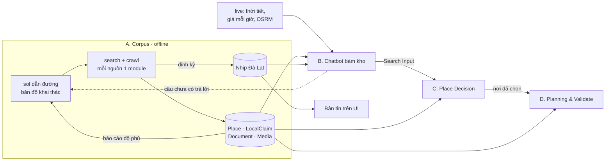
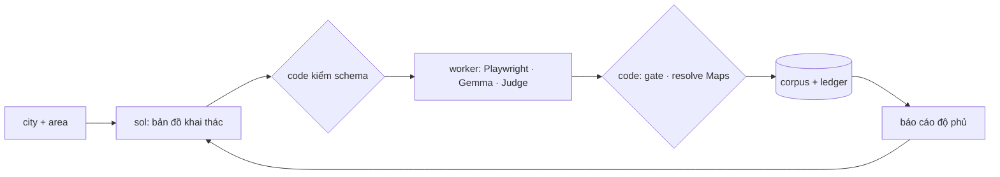
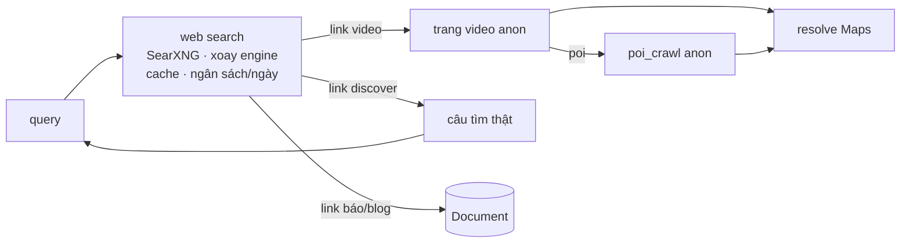
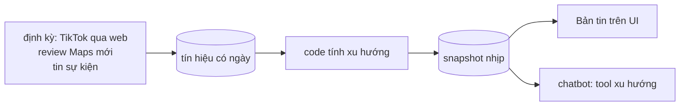
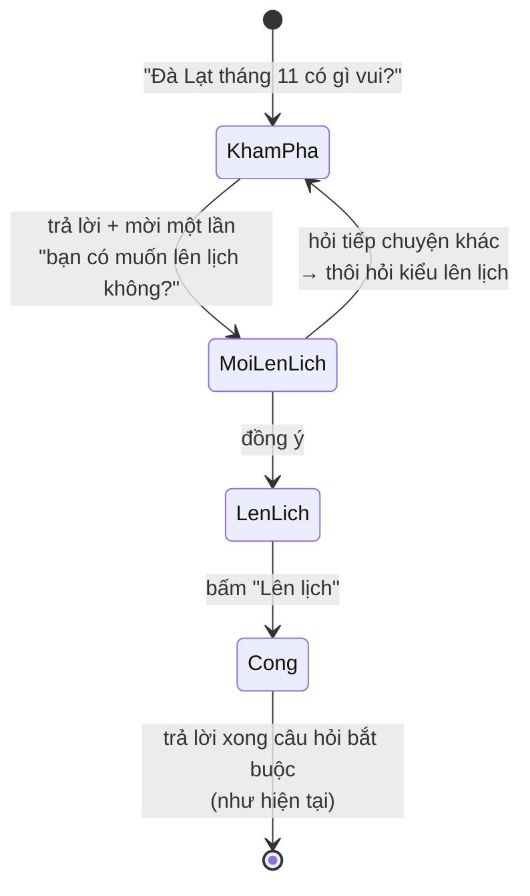
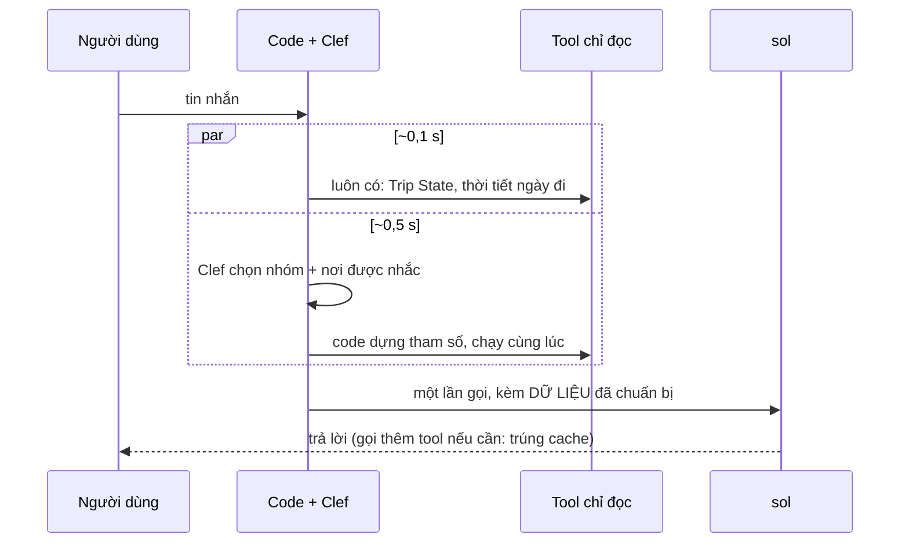
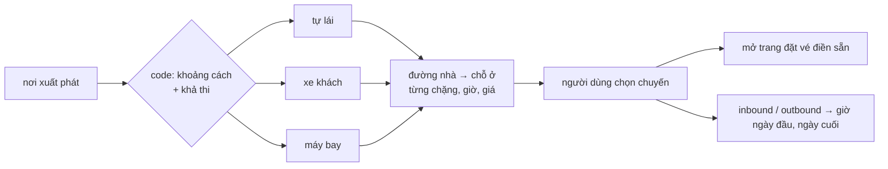
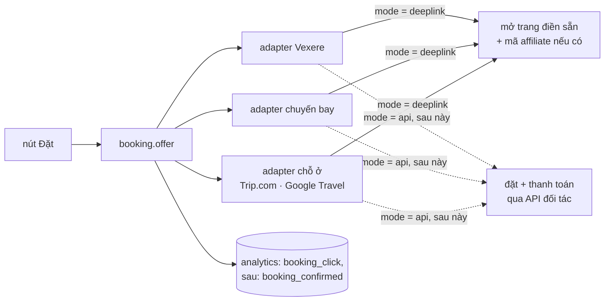
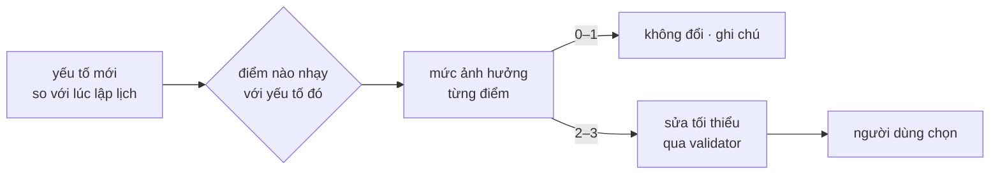
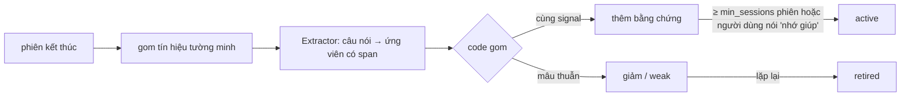

# Nâng cấp TripGuardian: hiểu Đà Lạt như người địa phương

> Spec làm việc (`RULE.md` §0.1). Khi duyệt và làm xong, gộp phần còn giá trị vào tài liệu chính thức rồi xoá file này.
> Ngày 2026-10-26; dọn lại 2026-10-28 theo các ghi chú của chủ dự án ở bản 2026-10-27, rồi đối chiếu với code cùng ngày (mục nào đã có trong code thì chỉ còn một dòng trỏ) (bản trước: `logs/spec-2026-10-28-before-cleanup.md`, `logs/spec-2026-10-27-before-modules.md`, `logs/spec-2026-10-26-before-simplify.md`).
> Đề đồ án: `submission/2026-10-06_de_tai_08_tour_guide_agent.docx` — là hệ quả, không quyết định kiến trúc (§E.3).

## 0. Tóm tắt

| Module | Hiện tại | Thiếu | Thiết kế mới |
|---|---|---|---|
| **A. Corpus** | Maps theo lưới ô, review, ảnh, menu, TikTok theo nơi (`poi_crawl`), chỉ mục ngữ nghĩa, `stay_price` | Chỉ biết nơi đã có tên trên Maps; đặc trưng, query, mùa/lễ/cảnh báo do người viết tay; TikTok search cần giải captcha; không có gì làm mới định kỳ | **sol dẫn đường** tự lập bản đồ khai thác; khám phá qua web search; `LocalClaim` cho phần model không biết; **nhịp Đà Lạt** làm mới định kỳ; media phủ cảnh, đẹp và đa dạng; giá phòng mỗi giờ |
| **B. Trip Understanding** | Chat + thẻ, Agent ghi Trip State có bằng chứng, `search_places` (chỉ tra tên người dùng gõ), bảng 24 nơi, cổng câu hỏi bắt buộc; `origin`, `arrival_mode`, `pick_transit`, `live/buses`, `live/flights` có nhưng là đường chết | Agent hỏi để điền Trip State, không trả lời được câu về nơi đến, không được đề xuất nơi; không gợi ý cách đi từ nhà tới Đà Lạt, xem có thể sài grab, be, xanhsm để đề xuất đặt xe k(mấy cái hãng này nếu ra nước ngoài khó scale có thiết kế nào hỗ trợ người dùng cả khâu di chuyển tốt k) | **Chatbot kiểu ChatGPT chuyên Đà Lạt**: nhiều tool đọc kho, trả lời, gợi ý, khai thác nhu cầu, gom thông tin để lên lịch; **Clef chuẩn bị tool**; **gợi ý đường từ nhà tới chỗ ở**, cải thiện thêm phần thẻ hiển thị cho người dùng chọn địa điểm, hiện tại nó còn khá phụ thuộc vào nhãn tự viết và không đa dạng và gom cụm khá rộng và không đáp ứng được nhu cầu thực tế |
| **C. Place Decision** | Xếp hạng nhiều thành phần, `wish`, né đông, thẻ ứng viên, lượt chữ một call | Nơi thích trong chat không vào xếp hạng; không có "đang hot"; chưa đo tốc độ / độ đúng trên snapshot thật | **Chatbot như B + tool xếp hạng lại + gợi ý thêm thẻ mới y như B**; "đang hot"; đo rồi sửa tốc độ và độ đúng |
| **D. Planning** | Validator 8 kiểm tra, điều kiện ngày, giờ riêng từng nơi từ review, mưa `none/heavy/severe`, 3 hướng quá tải, kiểm độ thật xanh hết | Lễ/cảnh báo nhập tay; lịch đầu p95 2,4 s (mục tiêu 2 s); `eve_of_trip` chỉ một tin thời tiết trước ngày đầu | Nguồn điều kiện tự động; **đạt tốc độ lịch đầu**; **đổi lịch tối trước mỗi ngày** theo mức ảnh hưởng |
| **E. Khác** | `patterns.py` (tắt, `min_sessions: 3`, chưa có đường ghi đồng ý, chưa có giao diện); Street View mặt đường | Hồ sơ không bật được, chỉ học lựa chọn tường minh | **Hồ sơ cá nhân hóa** kiểu bộ nhớ ChatGPT có cơ chế kiểm; không gian dựng từ nhiều clip + ảnh |

## 1. Hướng đã chốt

1. **Chỉ làm Đà Lạt cho thật tốt.** Pipeline nhận `city`, không gắn cứng Đà Lạt; thành phố khác là hệ quả khi Đà Lạt tốt. Nước ngoài ngoài phạm vi.
2. **Không cấu hình tay đặc trưng thành phố.** sol tự tìm thành phố có gì đáng khai thác (A.1); YAML tay chỉ là lớp sửa lỗi. Áp cho mọi phần liên quan scale: query, đặc trưng, mùa, lễ, sự kiện, xu hướng.
3. **sol dẫn đường, worker theo vai, code quyết.** sol (kiến thức chung + tìm web qua SearXNG tự host, như `web_search` hiện có) lập bản đồ khai thác, đề cử nơi, chỉ chỗ cần đào, đọc báo cáo độ phủ rồi quyết vòng sau. Playwright lấy dữ liệu, Gemma đọc / lọc / khớp, Judge phân xử, **code giữ hay bỏ** và lưu đúng schema, ledger crawl của corpus (`docs/CORPUS.md`) ghi lại. Trong code gọi theo vai trò (§6.1); sol / Gemma / Clef trong spec là model đang gán cho vai trò. Khám phá tự do, lưu trữ đúng chuẩn. Captcha do người giải vẫn là tự động.
4. **sol đề cử, Maps quyết định.** Nơi do sol, TikTok hay web nêu chỉ vào corpus khi resolve được trên Maps và qua gate.
5. **Nhịp Đà Lạt là dữ liệu, không phải bài viết.** Crawl định kỳ; code tính xu hướng; UI hiện bản tin. sol không viết bản tin (A.5).
6. **Media nhiều hơn, chọn theo cảnh, không có người** (A.6).
7. **Chỗ ở: danh sách chỉ crawl thêm nơi chưa có; giá và phòng trống làm mới mỗi giờ.** Google Travel chính, Trip.com đối chiếu (A.7).
8. **Trip Understanding là ChatGPT có kho chuyên biệt cho Đà Lạt** (B.1): khá tự do, nhiều tool đọc kho; trả lời, gợi ý, hiểu và khai thác nhu cầu, giúp khám phá điều người dùng muốn, gom thông tin cần để lên lịch. Không có chuỗi hỏi cố định. **Cổng lên lịch giữ như hiện tại**: danh sách câu hỏi bắt buộc phải xong trước khi sang Lên lịch.
9. **Kiến thức phổ thông của sol được lưu vào kho lúc sol dẫn đường xây corpus** (A.1), vì lúc đó mới kiểm được với bằng chứng crawl; chat đọc bản đã kiểm, chủ đề kho chưa có thì sol tự trả lời (nhãn "tham khảo"). Kho dồn sức cho thứ sol yếu: **chi tiết từng nơi và gợi ý nơi** (A.8), nơi ít người biết, điều mới, giá theo ngày, ảnh/clip (§2.1).
10. **Clef chuẩn bị tool chỉ đọc cho sol** theo thiết kế chốt B.3.
11. **Place Decision có chatbot cùng kiểu B**, thêm tool xếp hạng lại cho hợp người dùng nhất (C.1).
12. **Đường từ nhà tới chỗ ở ở Đà Lạt** (B.6): người dùng nhập nơi xuất phát; hệ thống đề xuất đi gì theo khoảng cách và độ khả thi (tự lái, xe khách, máy bay), vẽ đường nhà → chỗ ở, chọn chuyến và mở trang đặt vé điền sẵn (module `booking` để sau đổi sang API hoa hồng). Tới Đà Lạt thì luồng như hiện tại, bắt đầu từ chỗ ở.
13. **Hồ sơ cá nhân hóa như bộ nhớ của ChatGPT** (E.1): tự cập nhật qua các phiên, giúp Lựa chọn đề xuất đúng sở thích, thói quen, nhu cầu; có cơ chế riêng kiểm hồ sơ có hợp lý không.
14. **Đổi lịch tối trước mỗi ngày đi được giữ lại** (D.3), với logic xác định đúng yếu tố nào ảnh hưởng tới điểm nào và mức nào thì mới đổi.

## 2. Bằng chứng cho kiến trúc mới

Đo 2026-10-27; script và kết quả ở `logs/`.

### 2.1 Model biết gì, corpus phải làm gì

28 câu không web, không corpus (`model_knowledge_ask.py` → `model_knowledge_2026-10-27.json`), rồi 115 lượt với sol (`model_knowledge_full.py` → `model_knowledge_full_2026-10-27.json`). sol = `cx/gpt-6.1-sol` low; Gemini = `ag/gemini-3.8-flash-low`.

| Nhóm câu | sol | Gemini Flash | Kết luận |
|---|---|---|---|
| Kiến thức chung Đà Lạt (mùa, săn mây, đặc sản, đi lại, khí hậu, khẩn cấp, phong tục, ngân sách, an toàn…) | 10/10, rồi ~26/28 ở 28 câu thêm | 10/10, hay thêm số không kiểm được | **Model đã có** → không crawl phần này |
| 45 nơi × 12 trường (giờ, vé, giá, đỗ xe, dốc, trẻ em, view…) | nhận biết 8/45; giờ 36/40 `null`, dốc 41/44 `null` | giờ đúng 2/5, bịa số điện thoại | **Chỉ corpus có** (69 feature) |
| Quán ít người biết (5) | 5/5 "chưa xác minh" | 4/5 bịa giờ (199x: "06:00–22:00", thật 14:30–22:00) | **Chỉ corpus có** |
| Quán không có thật (bẫy) | không bịa | bịa trọn giờ, giá, view | Cần corpus để biết "không có" |
| Thời sự (đang hot, thời tiết ngày cụ thể, giá Tết) | "không có dữ liệu" | tính sai ngày Tết, "giá như ngày thường" | **Cần crawl + live** |
| 15 yêu cầu gợi ý theo tiêu chí | 65–85% tên khớp corpus; nơi khớp có feature thì 41/42 đúng tiêu chí; vài nơi có thật corpus chưa có (Married Beans, Woodstock, lẩu gà lá é Hội Ngộ) | — | sol **đề cử tốt** → làm người dẫn đường (A.1) |
| Tốc độ (6 câu chung) | 19,6 s mặc định → 9,1 s với "≤ 80 từ" → 7,3 s thêm `priority` | 4,1 s | Nhanh chủ yếu nhờ câu trả lời ngắn |

Hệ quả: sol an toàn hơn Gemini (không bịa nơi) → sol làm Agent và người dẫn đường; Gemini không được trả lời câu về nơi khi không qua tool.

### 2.2 Khám phá TikTok qua web search

| Query qua SearXNG (:8888) | Kết quả | Video mới so với corpus |
|---|---|---|
| `site:tiktok.com bánh căn Đà Lạt` | 27 video | 23/27 |
| `site:tiktok.com Đà Lạt tháng 11 có gì` | 15 video + 2 trang discover | 15/15 |
| `site:tiktok.com/discover Đà Lạt` | 20 trang `/discover/<câu tìm>` | — |

- TikTok không thấy lượt tìm → **không captcha**, trong khi ô search TikTok luôn captcha. Corpus hiện hụt cả mảng chủ đề.
- Slug `/discover/` là câu người ta thật sự tìm ("mặc gì đi đà lạt") → nguồn query miễn phí. Trang `/discover/` trả HTML 200 không captcha nhưng danh sách video tải bằng JS.
- Brave trả `too many requests` ngay → cần xoay engine + cache (việc 12).

### 2.3 Nguồn giá phòng

Một lượt mỗi trang, curl và Chromium headless mặc định, không né phát hiện.

| Nguồn | Kết quả | Dùng |
|---|---|---|
| **Google Travel** | gõ ngày vào ô Nhận/Trả phòng thì giá đổi theo ngày (28/10 → 6/2/2027: 262k → 837k cùng vị trí), không đăng nhập, không captcha; ngày trong URL bị bỏ qua | **Chính** |
| **Trip.com** | ngày trong URL có tác dụng; trang danh sách render sẵn 5 thẻ có tổng giá gồm thuế, phần sau tải khi cuộn | **Đối chiếu** (Playwright để cuộn) |
| Agoda, Booking | có giá nhưng cần bấm/cuộn; Booking bỏ ngày trong URL, có dấu hiệu kiểm tra | Không dùng |
| Expedia | 429 | Bỏ |
| Traveloka | 403 DataDome | Bỏ |

### 2.4 Clef chuẩn bị tool so với sol tự gọi tool

`clef_prefetch_bench.py`, 30 câu chat (10 câu hai ý / có tên nơi), tool thật trên `data/serving` + Open-Meteo, sol low. A lấy từ `clef_prefetch_bench_v3_2026-10-27.json`, thiết kế chốt từ `clef_prefetch_bench_v4_2026-10-27.json`.

| | A: sol tự gọi tool | **Clef chuẩn bị (chốt)** |
|---|---|---|
| Trung vị / trung bình / p90 | 10,1 / 10,7 / 14,0 s | **6,8 / 7,2 / 10,2 s** (trung bình −33%) |
| Lần gọi sol / lượt; lượt chỉ một lần | 2,43; 4/30 | **1,30; 21/30** |
| Token vào / ra mỗi lượt | 1.586 / 152 | **1.199 / 104** |
| Clef đủ mọi nhóm cần | — | 29/30 |
| Clef + chuẩn bị | — | 0,46 s Clef, 0,65 s tổng |
| Số liệu không có trong dữ liệu | 0 | 0 |

Phần còn lại do sol dao động (cùng câu 4–10 s) và do tool tìm nơi của script là bản khớp từ khóa. `search_places` của Trip hiện còn hẹp hơn (chỉ tra tên có trong tin nhắn, `src/trip/agent/tools.py:58-63`); bản tìm theo tiêu chí trên chỉ mục ngữ nghĩa phải viết mới (A.8). Dừng tối ưu Clef ở đây.

### 2.5 Dựng không gian từ clip

Spike một clip (`logs/splat/`, trang xem https://claude.ai/artifact/J67yZfPQoQ78WRmZgXGkpf):

| Cách | Cảnh | PSNR | SSIM | LPIPS |
|---|---|---|---|---|
| VGGT 24 frame, không BA | Linh Sơn | 13,9 | 0,32 | 0,52 |
| COLMAP SfM, 96 frame, 7k bước | Linh Sơn | **24,0** | 0,86 | 0,13 |
| như trên, 15k bước | Linh Sơn | 24,3 | 0,86 | 0,11 |
| COLMAP SfM, 124 frame, 7k bước | Dinh Tỉnh Trưởng | 20,7 | 0,73 | 0,27 |

COLMAP trên nhiều frame thắng VGGT; train lâu chỉ thêm 0,3 dB; cần `refine-stop-iter` để vừa 11 GB; SfM 96 frame ~10 phút CPU.

## 3. Việc tiếp theo, theo thứ tự

1. **Tìm vì sao Playwright treo với site lớn.** Không có nó thì không crawl giá mỗi giờ, không crawl thêm media. Đã biết: Playwright 1.52 `channel=chromium` headless vào `example.com` < 1 s, nhưng Google Maps / Google / TikTok hết 25–45 s ngay bước `commit`, có lúc treo quá timeout của chính nó; cùng binary chạy `chrome --headless=new --dump-dom` thì vào bình thường; tắt hết tiến trình Chrome sót lại vẫn treo. Giả thuyết cần thử: chế độ headless của Playwright khác `--headless=new`, IPv6, HTTP/2/QUIC.
2. **Kiểm tra nhất quán vé/giá** giữa `operation` và feature trong aggregate. Lỗi lộ ra khi đo §2.4: Đồi Chè Cầu Đất có `entry_fee` 100.000 (ước lượng từ review) nhưng feature ghi miễn phí vào cửa.
3. **Module `web` + TikTok qua web search** (A.2); đo ~50 query Đà Lạt: video mới, tỉ lệ có `poi`, tỉ lệ resolve Maps; đo phần video trang `/discover/`.
4. **Nhịp Đà Lạt** (A.5): crawl định kỳ, code tính xu hướng, bản tin trên UI.
5. **Bổ sung media** (A.6); **giá phòng mỗi giờ** (A.7).
6. **Kho phục vụ sol** (A.8: `search_places` theo tiêu chí, `get_place`, trang `aspect`, đảo luật `bad_say`) + **chatbot Trip Understanding** với Clef chuẩn bị tool (B.1–B.4), đo trên bench Trip thật trước khi bật.
7. **Chatbot Lựa chọn** với tool xếp hạng lại (C.1).
8. **Đo lại rồi sửa phần còn dở của Planning và Place Decision** (C.3, D.1): lịch đầu p95 < 2 s ở ca dày; thêm vào `decision evaluate` các chỉ số mong muốn khớp, thứ hạng, thời gian `rebase` và lượt chữ.
9. **Đường từ nhà tới chỗ ở** + module `booking` deeplink (B.6); cần Playwright (việc 1) cho chuyến bay.
10. **Hồ sơ cá nhân hóa** (E.1) và **đổi lịch tối trước mỗi ngày đi** (D.3), mỗi cái có bộ đo riêng trước khi bật.
11. **sol đề xuất từ đầu, so với corpus hiện tại** (A.9): sol lập bản đồ khai thác Đà Lạt **không xem** corpus và config; so với ontology, query, nơi đang có để xem đề xuất có hợp lý không; phần hợp lý mà corpus chưa có thì bổ sung vào corpus hiện tại (không dựng lại từ đầu); đo độ phủ trước/sau.
12. **Tối ưu SearXNG** (dùng chung cho sol và worker): engine nào bật, xoay engine khi bị chặn, giới hạn tốc độ, cache; đưa config cho chủ dự án.

## 4. Nhu cầu

| Nguồn | Nói gì |
|---|---|
| Anh Thừa (người dùng thật) | Cần sản phẩm để **đỡ phải tự kiếm trên TikTok**; lười gõ, muốn bấm; mùa là sức hút; muốn nơi đang hot; thẻ một ảnh không nói gì; muốn quán cùng phong cách, video review; thời tiết ngày đi |
| 165 câu hỏi công khai (2026-10-26) | Nhiều nhất: đường đến và đi lại, thời điểm/thời tiết/Tết, chỗ ở, nơi đáng đi, sự cố, an toàn |
| Chủ dự án | Hiểu một nơi **như người dân sống ở đó**; thêm thành phố bằng cùng pipeline, không cấu hình tay; giá phòng đúng ngày |
| Giảng viên | Thấy tool, state, phối hợp thành phần; dữ liệu Maps/TikTok được dùng |

| Nhu cầu | Đáp ứng ở |
|---|---|
| Tháng/ngày đó có gì hay, thời tiết, lễ | A.3, A.4, A.5, B.2, D |
| Đường đến thành phố | B.6 |
| Đi lại trong thành phố (thuê xe, đèo, kẹt, gửi xe) | A.3, B.2, D |
| Ăn gì, đặc sản ở đâu | A.3, B.2, C |
| Nơi đúng gu, đang hot, cùng phong cách | A.5, C |
| Chỗ ở hợp, giá đúng ngày | A.7, D |
| Lịch đi được thật | D |
| An toàn, khẩn cấp, vùng cấm | A.4, B.2, D |
| Không phải nói lại | E.1 |
| Hình dung không gian trước khi đi | A.6, E.2 |
| Lười gõ | B.4 |

## 5. Nguyên tắc

1. **Nhu cầu quyết định kiến trúc.** Kiến trúc không cần gọn; cần đáp ứng đúng nhu cầu. Không thêm cơ chế chỉ để có UC của đồ án.
2. **Kho dữ liệu là giá trị.** Khâu sau chỉ là dùng kho. Câu không trả lời được thì kho được bổ sung (B.5 → A.2).
3. **Khung cố định, nội dung tự khai thác.** Mọi pipeline nhận `city`; YAML tay chỉ là lớp sửa lỗi.
4. **Model trích xuất, code quyết định.** Như `docs/CORPUS.md`.
5. **Bám dữ liệu.** Chi tiết địa điểm chỉ từ kho hoặc tool; không có thì "chưa có thông tin". Kiến thức phổ thông từ model có nhãn "tham khảo". Web không bao giờ là nguồn địa điểm.
6. **Số từ field, không từ model.** Giờ, giá, nhiệt độ, ngày render từ field có `source` + `retrieved_at`.
7. **Người dùng giữ quyền chọn.** Không chặn, không ép; mọi đổi lịch cần người dùng chọn.

**Không làm:** chia tiền nhóm; nhiều thành phố một chuyến; thanh toán trong app khi chưa có API đối tác (B.6); tư vấn y tế, pháp lý; web cho điện thoại; nhật ký chuyến; nhãn "local / núp hẻm"; thiết kế riêng tư vị trí.

**Phản mục tiêu:** cấu hình tay đặc trưng thành phố; hạ chuẩn hiện có (validator tất định, `unknown ≠ false`, fail-closed, không bịa địa điểm); giá phòng hiện như số chắc chắn; model viết ra con số.

## 6. Kiến trúc tổng

### 6.1 Ranh giới module

Giữ bất biến: offline ghi Place Intelligence; online chỉ đọc, chỉ ghi lịch trình và hồ sơ; module chỉ qua public API; mỗi nguồn ngoài một module, một thư mục.

| Việc | Đặt ở | Đi đường nào |
|---|---|---|
| Vai trò model | `corpus/llm/roles.py` + `.env` | thêm vai trò `NAVIGATOR` (đang gán sol); Agent, Extractor (Gemma), Judge giữ nguyên; Clef như hiện có |
| Client SearXNG | **một** client chung `src/corpus/crawl/web/` (gộp từ `trip/infrastructure/web.py`) | Trip dùng qua public API; SearXNG tính là một nguồn |
| URL TikTok tìm qua web | `web` ghi `data/web/<city>/tiktok_urls.jsonl` | `tiktok` đọc file, không import chéo |
| Bản đồ khai thác, `LocalClaim`, Document, trang `aspect`, nhịp Đà Lạt | offline, `data/<city>/…` | công bố cho online qua `serving` / snapshot như dữ liệu corpus khác |
| Giá phòng mỗi giờ theo bộ ngày cố định | offline, module riêng cho Google Travel và Trip.com | observation vào corpus |
| Giá phòng cho shortlist đang xem | `live/lodging`, cache `data/live/` | không ghi Place Intelligence |
| Tool Trip cần `live` (`weather`, `distance`, `transport`, `stay_price`) | callable tiêm vào `trip/api/tools.py` như `Web` | harness dựng từ `planning.logistics` / `live`; `trip` vẫn không import `live` |
| Đặt chỗ | module online mới `src/booking` (adapter theo nhà cung cấp) | gọi `live`; harness gọi `booking`; sự kiện vào `harness/events.py` |
| Đổi lịch tối trước ngày đi | job `notify` | `notify` → harness → phiên `planning` của journey → đề xuất chờ chọn lưu theo `plan_hash` |
| Hồ sơ cá nhân hóa | `trip/domain/patterns.py` + `infrastructure/profile.py` | ghi sau phiên; đồng ý ở `accounts` |

---

## A. Corpus (offline)

Nền hiện có: `docs/CORPUS.md` (Maps theo lưới ô, review, ảnh, menu, official, TikTok theo nơi `place_poi` → `poi_crawl` không captcha, ASR, observe, aggregate, chỉ mục ngữ nghĩa `data/index`, style tags, `gmaps stay_price`). Thành phố là `config/cities.yaml` (tên + `area`).

### A.1 sol dẫn đường

sol thay con người quyết **khai thác gì** cho một thành phố. Nó không quyết dữ liệu nào đúng.

**Bản đồ khai thác** là danh sách **đặc trưng cần khai thác** của thành phố — không phải đặc điểm của một nơi, mà là thứ cần crawl và đọc ra. Mỗi mục:

| Field | Ví dụ Đà Lạt |
|---|---|
| `aspect` | săn mây, mùa dã quỳ, đèo, cà phê view đồi, lẩu gà lá é |
| `why` | vì sao thành phố này cần (sol viết, có thể trích nguồn web) |
| `target` | feature có sẵn trong ontology · `LocalClaim` kind · media cảnh · **feature mới đề xuất** (key, kiểu, tập giá trị) |
| `queries`, `sources` | câu tìm cho A.2, nguồn nên đọc |
| `nominees` | tên nơi sol đề cử (vào corpus chỉ khi resolve Maps + qua gate) |

- Mỗi thành phố tự khác: Vũng Tàu có thể thêm biển, hải sản, thuỷ triều và bỏ săn mây, mùa hoa — không ai viết tay.
- **Feature mới** chỉ vào ontology khi code kiểm đúng khuôn (key tiếng Anh, kiểu, tập giá trị đóng, gợi ý trích xuất) và chủ dự án duyệt; vẫn đi qua Extractor + gate như feature sẵn có. Ontology hiện là một file chung (`config/ontology.yaml`, `corpus/ontology.py`) → feature mới thêm vào file chung kèm danh sách thành phố dùng nó, không tách ontology theo thành phố.
- Bản đồ lưu `data/<city>/mining_map.json`; `config/queries.yaml`, `seasons.yaml` thành lớp ghi đè sửa lỗi. Nominee vào Maps qua một phase mới của `crawl/gmaps` (resolve theo tên + khu).
- Báo cáo độ phủ dùng lại `coverage` của aggregate (`corpus/aggregate/place.py`), thêm trục `aspect` × khu × tháng.
- **Lưu và kiểm kiến thức chung của sol ngay trong vòng dẫn đường:** điều sol biết về thành phố (§2.1, ~26/28 đúng: mùa, đặc sản, đi lại, phong tục, khẩn cấp…) được ghi thành `LocalClaim` cấp thành phố / khu / món / hiện tượng với `source = model`, đồng thời thành `aspect` và query. Vòng crawl sau đó tìm bằng chứng cho từng claim; code gắn trạng thái:

| Trạng thái | Khi | Chat dùng thế nào |
|---|---|---|
| `confirmed` | Document/transcript/review độc lập khớp (luật gom A.3) | như `LocalClaim` thường, có trích dẫn |
| `contradicted` | bằng chứng nói khác | dùng bản có bằng chứng; claim của sol bị bỏ |
| `unverified` | chưa tìm thấy bằng chứng | nhãn "tham khảo", số chỉ ở dạng khoảng |

  **Không bao giờ** cho chi tiết POI (giờ, giá, có/không đặc điểm). LocalClaim `unverified` và `contradicted` vào báo cáo độ phủ để vòng sau đào tiếp.
- **Báo cáo độ phủ** (code tính): mỗi `aspect` × khu × tháng → số nơi, `LocalClaim`, media, ngày mới nhất; ô trống nổi lên trước. sol đọc báo cáo, quyết vòng sau: đào chỗ nào, thêm/bỏ `aspect`. Dừng khi một vòng không thêm gì mới hoặc hết ngân sách.
- Câu chatbot chưa trả lời được (B.5) vào báo cáo này.

### A.2 Khám phá qua web search

Bằng chứng: §2.2.

- Module `src/corpus/crawl/web/`, dữ liệu `data/web/`: client SearXNG **dùng chung** (gộp client có cache đang ở `trip/infrastructure/web.py`, §6.1), ghi engine trả gì và engine nào bị chặn, cache theo query. SerpApi dự phòng khi mọi engine bị chặn.
- TikTok đọc URL từ `data/web/<city>/tiktok_urls.jsonl`; `poi_crawl`, `clips`, ASR dùng lại.
- Pipeline phải ra corpus dùng được chỉ với Maps + web; TikTok làm giàu thêm.
- **Query từ ba nguồn:** bản đồ khai thác của sol (A.1); entity mọc từ dữ liệu (slug `/discover/`, hashtag, tên riêng trong transcript và review); câu chatbot chưa trả lời được (B.5).
- Mỗi query chấm theo **lượng mới** (nơi mới resolve được, entity mới, `LocalClaim` mới); nhóm mang về nhiều được thêm ngân sách.

### A.3 Tri thức bản địa: Document → LocalClaim

Chỉ cho phần model **không** có (§2.1): chi tiết từng nơi, nơi ít người biết, khung giờ theo từng nơi, điều mới, mùa/sự kiện năm nay.

Tên `LocalClaim` để khỏi trùng "claim" của `corpus.normalize` (observation có span, `docs/CORPUS.md`). **Đã có cho từng POI:** giờ đẹp/giờ tránh, tháng hợp/tháng tránh, `known_for`, danh sách order/avoid/access/booking từ review, có ngưỡng tác giả (`serving/details.py`: `timing.best_time/avoid_time/best_months/avoid_months`, `LISTS`). Phần mới: Document ngoài (web, báo, blog) và `LocalClaim` cấp thành phố / khu / món / hiện tượng.

- **Document** `{doc_id, source_url, license, retrieved_at, lang, kind}`: trang web, transcript, review; chia đoạn theo mục; là nguồn trích dẫn cho B.
- **LocalClaim**: Extractor đọc Document một lần, trả claim có span; code gom.

| Field | Giá trị |
|---|---|
| `subject` | POI (`fid`), khu, món, hiện tượng, thành phố |
| `kind` | `best_time`, `crowded_at`, `avoid`, `specialty`, `price_norm`, `access`, `if_rain`, `season`, `event`, `notice`, `tip` |
| `when`, `who` | tháng/thứ/giờ/thời tiết; nhóm người đi |
| `evidence[]` | span, `doc_id`, ngày, tác giả (hoặc `source = model`, A.1) |

- **Code gom:** dedup; đếm tác giả độc lập; giữ khi ≥ 2 nguồn hoặc 1 nguồn chính thức; ghi mâu thuẫn; độ tin giảm theo tuổi.
- `Season`, `Event`, `Notice` là view trên `LocalClaim`.
- `LocalClaim` về một POI (từ Document ngoài) **đổ vào `details.timing` / `LISTS` sẵn có** như thêm bằng chứng, không thêm lớp thứ hai; B, C, D đọc như hiện nay.

### A.4 View toàn cầu thay YAML tay

Thay `config/climate.yaml`, `holidays.yaml`, `events.yaml`, `advisories.yaml` nhập tay; code chạy cho mọi nơi, không qua Extractor.

| View | Cách |
|---|---|
| `ClimateNormal` theo tháng | Open-Meteo archive ≥ 10 năm theo toạ độ |
| `CalendarDay` | thư viện ngày lễ theo mã quốc gia + âm lịch, test Tết 2026–2028 |
| Lễ hội, mùa đông khách | view `Event` (A.3) |
| `RestrictedArea` | Overpass OSM theo bbox (`landuse=military`, `access=no`) |
| Cảnh báo | view `Notice` (A.3), kèm `retrieved_at` |

YAML tay còn lại là lớp ghi đè sửa lỗi. Public API của `live` giữ nguyên để D không đổi (`planning/conditions.py` đã đọc qua `live`). `RestrictedArea` cần thêm một kiểm hazard trong `planning/conditions.py` (hiện chưa có gì về vùng hạn chế).

### A.5 Nhịp Đà Lạt: làm mới định kỳ, bản tin xu hướng

Mục tiêu: người dùng thấy điều họ chưa nghĩ tới — đang hot, top nơi gộp nhiều nguồn, sự kiện, mới mở / đã đóng, mùa đang diễn ra — mà không ai cấu hình tay.

| Mục | Code tính từ |
|---|---|
| Đang hot | video mới 30 ngày tại POI (`createTime` từ `poi_crawl`), ≥ `TREND_MIN` tác giả khác nhau |
| Top nơi gộp nhiều nguồn | video mới, review mới và điểm Maps gần đây, số lần web nhắc |
| Sự kiện sắp tới | view `Event` trong 30 ngày tới |
| Mới mở / đã đóng | Maps: nơi mới resolve, trạng thái đóng cửa |
| Mùa đang diễn ra | view `Season` của tháng hiện tại |

- Đã có: `created_at` từng video (`poi_crawl`, hiện chỉ dùng để giảm điểm theo tuổi), `rating_trend` của Maps (`decision/cards.py`).
- Snapshot là dữ liệu **offline** `data/<city>/pulse/{generated_at}.json` `{city, generated_at, items[]}`, công bố cho online qua snapshot corpus; mỗi item có `kind`, `subject`, số liệu tín hiệu, mốc ngày, link bằng chứng.
- **UI dựng bản tin** từ item bằng mẫu câu + field ("12 video mới trong 30 ngày · mới nhất 3 ngày trước"). sol **không** viết bản tin. "Đang mùa X" không phán "đang nở"; hiện video mới nhất nhắc X kèm ngày.
- Chatbot đọc cùng snapshot khi được hỏi (nhóm "xu hướng" của Clef, B.3); C dùng "đang hot" (C).

### A.6 Media: nhiều hơn, phủ cảnh, không có người

Nhãn **cảnh** cho ảnh và đoạn clip: `exterior`, `entrance`, `interior`, `seating`, `view`, `food`, `menu`. Phục vụ thẻ ≥ 3 ảnh, "đi một vòng" và dựng không gian (E.2).

| Việc | Hiện tại | Đổi |
|---|---|---|
| Video TikTok mỗi nơi | liệt kê 90, tải 10, giữ 6 clip | tải tới ~30 video mới và nhiều lượt xem nhất; thêm video từ web search (A.2) |
| Clip giữ lại | 6, theo `place_verify` | chọn theo **độ phủ cảnh** và độ mới, không trùng nội dung |
| Ảnh Maps | 12–32 thumbnail 432×768 | bản độ phân giải cao, nhiều hơn, giữ ngày đăng và người đăng |
| Đúng nơi, đúng view | — | ảnh/clip phải khớp đúng quán (Gemma đọc biển hiệu, so với ảnh Maps); ảnh `view` phải thấy đúng view nơi đó |
| **Không có người** | — | phát hiện người; ảnh/frame có người bị loại khỏi ảnh hiển thị và khỏi dựng cảnh |
| Chất lượng | `PHOTO_RANK` (đẹp / thấy đúng nơi) chạy ngoài pipeline qua `web/scripts/pick_covers.py` | đưa vào pipeline corpus; thêm bỏ trùng gần (embedding), mờ, quá tối; mỗi cảnh giữ ảnh tốt nhất |
| Ảnh chỗ ở | ảnh Maps | thêm ảnh từ nguồn giá phòng (A.7) khi được phép dùng |
| Độ phủ | — | mỗi nơi: số ảnh theo cảnh, số clip, ngày mới nhất; thiếu cảnh nào thì giao việc crawl thêm |

### A.7 Chỗ ở: giá mỗi giờ

Bằng chứng: §2.3.

- **Danh sách:** không crawl lại. Chỉ crawl thêm chỗ ở chưa có trong corpus, lưu như mọi nơi khác.
- Đã có: `gmaps stay_price` `{fid, at, price_vnd, stay_dates}` nhưng là **ngày mặc định của Maps**; `live/lodging/maps.py` (online, không lọc ngày, hiện không ai gọi).
- **Thông tin động** (giá, phòng trống), hai đường (§6.1):
  - **offline, mỗi giờ**: bộ ngày nhận phòng cố định (đêm nay, 2 cuối tuần tới, dịp lễ gần nhất) → observation vào corpus;
  - **online, theo nhu cầu**: shortlist (≤ 10 nơi) của người dùng đang ở bước Chỗ ở, đúng ngày đi → `live/lodging`, cache `data/live/`, không ghi Place Intelligence.
- Nguồn: Google Travel gõ ngày là chính; Trip.com ngày trong URL để đối chiếu; mỗi nguồn một module, một thư mục. Khớp corpus theo tên + toạ độ.
- Mỗi lần tra là observation `{fid, price_vnd, available, stay_date, observed_at, source}`; không thấy phòng trống thì `available = unknown`. Dải giá và hệ số lễ tự hình thành từ lịch sử.
- Hiển thị "Khoảng 700k/đêm cho ngày bạn đi · tra 14:00"; lỗi → giá Maps, nhãn "tham khảo, không theo ngày đi". Dự phòng: SerpApi Google Hotels.
- Chặn: Playwright treo (việc 1).

### A.8 Kho phục vụ sol

sol tốt ở kiến thức chung, yếu ở **chi tiết nơi** (nhận biết 8/45 nơi) và **gợi ý nơi** (15–35% tên không có trong corpus, §2.1). Kho được dựng để hai việc đó luôn đi qua tool, mỗi câu hỏi tốn ít lần gọi.

**Chia việc theo loại câu:**

| Câu | Ai trả lời | Kho góp gì |
|---|---|---|
| "Mùa nào Đà Lạt đẹp nhất", "đặc sản là gì", "đi lại thế nào" | **kho trước** (`LocalClaim` phổ thông đã kiểm, A.1), kho chưa có thì sol tự trả lời, nhãn "tham khảo" | `LocalClaim` `confirmed` có trích dẫn + `aspect` của tháng đó: nơi xem cụ thể, video mới nhất → sol gắn nơi thật vào câu trả lời |
| "Quán X mấy giờ mở, có đỗ ô tô không" | **chỉ kho** | bản ghi nơi gọn (`corpus.retrieval.card`, `engine.card(id)`) |
| "Gợi ý quán view đồi mở sớm" | **chỉ kho** | `corpus.retrieval.find(Criteria)` theo tiêu chí; sol không được nêu tên nơi ngoài kết quả tool |
| "Đang có gì hot" | **chỉ kho** | snapshot nhịp (A.5) |

**Ba lớp sol đọc:**

| Lớp | Nội dung | Tool |
|---|---|---|
| Bản ghi nơi | tên, khu, giờ theo thứ, vé/giá dạng khoảng + nguồn, mọi feature `VERIFIED`, `known_for`, `details.timing`, ảnh theo cảnh, nhãn "đang hot" kèm ngày | `card` (có, `corpus.retrieval`), `similar` (có: `trip/infrastructure/looks.py`, `corpus.index`) |
| Chỉ mục tìm nơi | lọc cứng (ràng buộc Trip State, giờ mở, category, khu) + chỉ mục ngữ nghĩa (`data/index`) + món trong menu + tháng/mùa | `find(Criteria)` + `vocabulary()` (có, `corpus.retrieval`; nối vào tool Trip còn lại); bản hiện có chỉ tra tên người dùng gõ, giữ làm nhánh tra tên |
| **Trang `aspect`** | mỗi `aspect` của bản đồ khai thác (săn mây, mùa dã quỳ, cà phê view đồi, lẩu gà lá é…): nơi xếp sẵn theo bằng chứng, tháng/giờ hợp, `LocalClaim`, clip tiêu biểu, nguồn — dựng offline | `aspect(name, month?)`, `local_knowledge` |

- Trang `aspect` biến câu "săn mây ở đâu, tháng mấy" thành **một** lần gọi tool, với nơi thật. Danh sách `aspect` đưa vào prompt sol (tên + một dòng) để sol biết kho có gì.
- **Guard gợi ý nơi — đảo luật `guard.bad_say`** (`trip/domain/guard.py`): hiện nó cấm **mọi** tên nơi trong catalog trừ anchor và nơi đang so sánh, và mọi số người dùng / Trip State chưa nói. Luật mới: cho phép id và số **có trong kết quả tool của phiên**; tên nơi không đến từ tool thì bị bỏ và ghi làm `nominee` cho vòng khám phá (B.5).
- Bản ghi gọn như thiết kế chốt B.3 (khóa ngắn, không cắt feature).

### A.9 Đo độ phủ

- Báo cáo độ phủ của A.1 là thước đo chính.
- **Kiểm sol từ đầu (việc 11):** sol lập bản đồ khai thác Đà Lạt chỉ từ tên thành phố + `area`, không xem corpus. Code so với corpus: `aspect` nào trùng feature/query đã có, `aspect` nào mới; `nominees` nào resolve được và đã có, nào có thật mà chưa có, nào không có thật. Chủ dự án duyệt phần mới; phần hợp lý được thêm vào corpus hiện tại bằng một vòng khám phá. Đo độ phủ trước/sau.
- Bài kiểm tra người địa phương: để sau, khi sản phẩm đã tốt thì pilot với người dùng thật và xin ý kiến.

---

## B. Trip Understanding

Nền hiện có: `docs/TRIP_UNDERSTANDING.md` (Agent ghi Trip State qua `record_fact` có `quote` kiểm bằng code, `ask_user` với lời lựa chọn do app đặt, `search_places`, `web_search`/`web_read` chỉ để hiểu từ, thẻ phong cách, `understanding.board`, read-back, Clef kiểm sau Agent).

### B.1 ChatGPT có kho chuyên biệt cho Đà Lạt

Một ChatGPT hiểu Đà Lạt thật rõ: kiến thức chung của sol + kho chuyên biệt (A.8). Khá tự do: có nhiều tool đọc kho và tự chọn dùng tool nào; luật chỉ giữ ở chỗ sol yếu (chi tiết nơi, gợi ý nơi, con số). Cùng lúc:

1. **Trả lời** câu hỏi về Đà Lạt, có trích dẫn khi lấy từ kho.
2. **Gợi ý và giúp khám phá** điều người dùng muốn: hiện nơi, ảnh, video đúng lúc; phản ứng ("chỗ này đẹp", "kiếm thêm kiểu vậy") thành tín hiệu.
3. **Hiểu và khai thác nhu cầu**: đào điều người dùng thật sự muốn; ghi Trip State ngầm từ lời nói.
4. **Gom thông tin cần để lên lịch** khi người dùng muốn đi.
5. **Chuẩn bị cho Lựa chọn đề xuất đúng nhất**: mọi điều chat hiểu được về người dùng thành tín hiệu xếp hạng có bằng chứng, cộng hồ sơ cá nhân hóa (E.1).

| Chat hiểu được | Thành đầu vào của Lựa chọn |
|---|---|
| Món, kiểu nơi, phong cách ảnh, "giống quán X" | `wish` |
| Thích / tránh một đặc điểm ("yên tĩnh", "không thích chỗ ồn") | `soft` love / avoid |
| Nơi bấm Thích, nơi bắt buộc đi, link đã lưu | anchor `want` / `must` |
| Mục đích, nhịp, chịu đông, muốn chỗ mới | `purpose`, `pace`, `crowd_tolerance`, `novelty` |
| Ràng buộc tự nêu (ăn chay, ít dốc, trẻ nhỏ) | hard filter, fail-closed |
| Mục hồ sơ đang dùng (E.1) | prior `source = profile`, chuyến hiện tại thắng |

- Contract này **đã có** (`trip/domain/state.py` `Wishes`, `AnchorRef must|want`, `soft_weights`, `VibeRef`; `compile.py`; `quote`). Phần mới là chat tự do lấp được nhiều tín hiệu hơn.
- Agent đào sâu chỗ còn mơ hồ **khi câu trả lời đổi thứ hạng**: "chill" là yên tĩnh, có view hay ít người? Để biết, harness chạy thử Search Input giả định qua public API của Decision (`decision.run_pipeline` / `preference_fit`) và trả độ đổi thứ hạng cho Trip; không hỏi thêm khi đổi không đáng kể. (Không dùng `Engine.draft`: nó chỉ đọc phiên Decision đang có.)
- Tín hiệu vào Trip State bằng hai đường: **lời nói** → `record_fact` như hiện nay; **bấm** Thích / "kiếm kiểu này" trên thẻ → act của app (không qua model) ghi anchor `want` / `LikeWish`.

Thay quy tắc "chưa đề xuất địa điểm cho user trong bước này" (`docs/TRIP_UNDERSTANDING.md` §1): trợ lý **được** hiện nơi; sửa tài liệu chính thức cùng lúc với code. Tag và chip chỉ là nút trả lời nhanh khi giúp bấm thay gõ.

**Cách hỏi:** không có chuỗi hỏi cố định; trợ lý đọc ý người dùng đang **khám phá** hay **muốn lên lịch** rồi mới quyết hỏi gì.

- Người dùng vẫn đang khám phá → giúp khám phá cho tốt (gợi ý, hỏi gu), không hỏi ngày, số người, ngân sách.
- Tối đa một câu hỏi mỗi lượt, gắn với điều vừa nói, chỉ hỏi khi câu trả lời đổi kết quả; đoán được thì xác nhận; không hỏi lại.
- Khi người dùng đã muốn lên lịch, agent hỏi mục bắt buộc khi hợp mạch (`ask_required` như hiện tại). Cổng trước Lên lịch giữ nguyên (B.4).

### B.2 Tool truy xuất

Một vòng Agent, không cổng phân loại trước.

| Câu hỏi | Tool | Nguồn |
|---|---|---|
| "Quán cà phê view đồi mở sớm gần chợ" | `search_places(query, filters)` | serving + chỉ mục ngữ nghĩa; **luôn áp hard constraint** |
| "Chỗ này thế nào", "có chỗ đậu xe không" | `get_place(fid, aspects)` | serving record |
| "Kiếm thêm kiểu này" | `similar(fid)` | chỉ mục ngữ nghĩa, qua ràng buộc |
| "Săn mây ở đâu", "tháng 11 có gì" | `aspect(name, month?)` | trang `aspect` (A.8): nơi thật xếp theo bằng chứng, tháng/giờ hợp, clip |
| "Đi Cầu Đất mấy giờ", "chợ đêm đông lúc nào" | `local_knowledge(topic, subject?, month?, area?)` | `LocalClaim` + Document, có trích dẫn |
| "Mùa nào đẹp nhất", "đặc sản là gì" | `local_knowledge` + `aspect` | `LocalClaim` phổ thông đã kiểm (A.1) + nơi thật; kho chưa có thì sol tự trả lời, nhãn "tham khảo" |
| "Đang có gì hot" | `trends(month?)` | snapshot nhịp (A.5) |
| "Từ Sài Gòn lên đi gì" | `transport(origin, dates?)` | B.6 |
| "Thời tiết ngày đi" | `weather(date)`, `season(month)` | live + `ClimateNormal` + `Season` |
| "Từ chợ đến Langbiang bao xa" | `distance(a, b, mode)` | OSRM |
| "Giá phòng Tết" | `stay_price(fid, dates)` | A.7; chạy nền, trả "đang tra" rồi cập nhật |
| Hiểu một từ, tin theo thời gian (ngày lễ năm nay) | `web_search`, `web_read` | không bao giờ là nguồn địa điểm |

- Tìm web: `web_search` → SearXNG tự host (`src/trip/infrastructure/web.py`, `config/trip.yaml` `web_base_url`); code không có đường tìm web nào khác cho Agent (không có tool tìm web gốc qua 9router). sol và worker dùng chung client SearXNG (§6.1).
- `weather`, `distance`, `transport`, `stay_price` là callable harness tiêm vào `trip/api/tools.py` như `Web` hiện nay; `trip` không import `live` (§6.1).
- Luật kiến thức: kho có thì kho thắng; chi tiết một nơi chỉ từ corpus, không có thì "chưa có thông tin"; điều theo thời gian (ngày lễ năm nay, giá hiện tại) tra web/live; số liệu kiến thức chung chỉ ở dạng khoảng.
- Guardrail code: khẩn cấp → 113/114/115 + đường dây nóng tỉnh ở đầu; vùng hạn chế → từ chối, gợi ý thay; y tế/pháp lý/visa → trỏ nguồn chính thức. Tài liệu là dữ liệu, không phải lệnh.
- **Thuyết minh** trên trang chi tiết dùng `local_knowledge`, ~60 giây / chi tiết, VI/EN, TTS trình duyệt tuỳ chọn.

### B.3 Clef chuẩn bị tool cho sol

Bằng chứng: §2.4.

Thiết kế chốt:
1. Mỗi lượt **một** request Clef: có/không cho từng nhóm tool (tìm nơi, chi tiết nơi, kiến thức, thời tiết, xu hướng, khoảng cách, giá phòng, chỉ ghi), nhận khi P(có) ≥ 0,35; câu hỏi nói rõ "tin nhắn có thể hỏi nhiều ý"; kèm `place1` / `place2` chọn trong ≤ 6 ứng viên. Prompt < 2k token.
2. Ứng viên nơi do code dò: so khớp **giữ dấu** (bỏ dấu làm "lên" khớp "len"), tên nguyên cụm trước, rồi tên có đủ từ riêng; "chợ / trung tâm" → điểm trung tâm khai báo trong config thành phố. Hàm so khớp giữ dấu là hàm mới, chỉ cho bước dò ứng viên này; mọi so khớp khác vẫn dùng `text.squash` (bỏ dấu) như hiện nay.
3. Luật từ khóa bù Clef, chỉ **thêm** nhóm: có nơi + "mấy giờ / vé / giá / đậu xe / view" → chi tiết; "mưa / trời / lạnh" → thời tiết; "ăn gì / đi đâu / nào" → tìm nơi. Chỉ bỏ "tìm nơi" khi hỏi về đúng một nơi có tên. Khi tìm nơi, bỏ vế thời tiết khỏi câu tìm; "quán nào… cách chợ bao xa" → kèm km từng nơi.
4. Chạy song song mọi tool chỉ đọc đã chọn; chờ tối đa ~1,2 s; phần chưa xong thành cache. Cache nằm trong `TurnTools` (cạnh `prefetch` kiểm fact và `lookups()` món/loại nơi đã có), dùng chung giữa phần chuẩn bị và lời gọi của sol. Tool ghi (`record_fact`, thêm vào chuyến) chỉ sol gọi.
5. Dữ liệu cho sol: khóa ngắn (`n`, `h`, `ve`, `gia`, `f` mọi feature `VERIFIED`), **không cắt feature**; vé/giá giữ khoảng + nguồn (`60000-120000, thường 100000 (reviews)`).
6. Prompt sol: "DỮ LIỆU đã là mọi thứ kho có; trường không có thì nói chưa có thông tin, không gọi lại tool cho cùng nơi"; trả lời ≤ 60 từ.
7. Đo trên bench Trip thật trước khi bật: p50/p90, số lần gọi sol, số liệu không nguồn, tỉ lệ Clef đủ nhóm.

### B.4 Trình bày, Trip State, cổng lên lịch

Agent viết lời; **app dựng thẻ** từ id mà tool trả. Các tool hiển thị dưới đây là mới; hiện thẻ do engine tự dựng (thẻ phong cách, deck).

| Tool hiển thị | App dựng |
|---|---|
| `show_places(fids, why)` | thẻ nơi ≥ 3 ảnh theo cảnh, rating/giá/giờ/khoảng cách, nhãn "đang hot"; nút Thích / Thêm / Xem |
| `show_media(fid, kind)` | ảnh theo cảnh, clip, "đi một vòng" (E.2) |
| `show_map(fids)` | bản đồ các nơi vừa nói |
| `quick_replies(options)` | nút trả lời nhanh khi câu hỏi có lựa chọn đóng |

- Số trong lời Agent phải có trong kết quả tool của phiên (luật đảo của `bad_say`, A.8). Phiên nhớ danh sách nơi vừa hiện ("quán thứ hai").
- Trip State giữ nguyên: bằng chứng từng field, `ready` / `missing`, giữ quyết định cũ. Ràng buộc tự nêu → tập đóng (ít đi bộ/dốc, ăn chay, trẻ nhỏ, người lớn tuổi, say xe đèo, không đi tối…); câu không khớp giữ làm ghi chú cho D.
- **Cổng lên lịch: giữ nguyên code hiện có** (`deck.py` `at = "gate"`, `domain/required.py`, `TripNotReady` → 409 `trip_incomplete` kèm read-back).

### B.5 Câu chưa trả lời được → Corpus

Dựa trên `data/trip/gaps.jsonl` đã có (`trip/infrastructure/gaps.py`: `{phrase, kind, count, last_seen}` cho mong muốn thiếu dữ liệu). Thêm `city`, `topic`, `subject` và hai nguồn mới: câu trả "chưa có thông tin", tìm nơi ra 0 kết quả. Không kèm dữ liệu cá nhân. Đọc vào báo cáo độ phủ (A.1) và query (A.2).

### B.6 Đường từ nhà tới chỗ ở ở Đà Lạt

Nhu cầu số 1 trong 165 câu hỏi. Người dùng nhập **nơi xuất phát** (ô tìm `origin` sẵn có, Photon); hệ thống đề xuất nên đi gì, vẽ đường từ nhà tới chỗ ở, rồi giúp chọn chuyến. Tới Đà Lạt thì luồng như hiện tại: mỗi ngày bắt đầu và kết thúc ở chỗ ở.

Nền có sẵn: `origin`, `arrival_mode`, `inbound` / `outbound`, `entry_point` / `exit_point` trong Trip State; `domain/logistics.py` (`entry_road`, `nearest_airport`, `route`, `pick_transit`, giờ đến/đi thu hẹp ngày đầu/cuối); `live/buses` (Vexere, một GET HTTP); `live/flights` (Google Flights qua trình duyệt); `live/osrm`.

**Code quyết phương án nào khả thi** (không phải model):

| Phương án | Khả thi khi | Chặng |
|---|---|---|
| Tự lái (ô tô / xe máy) | có đường bộ OSRM; xe máy chỉ khi quãng đường dưới ngưỡng | nhà → đèo vào (`entry_road`) → chỗ ở |
| Xe khách | Vexere có tuyến từ tỉnh xuất phát, có chuyến đúng ngày | nhà → điểm đón → bến/điểm trả ở Đà Lạt → chỗ ở |
| Máy bay | sân bay gần nhà (`nearest_airport`) có chuyến tới Liên Khương (DLI) đúng ngày, và tổng thời gian cửa tới cửa ngắn hơn đường bộ đáng kể | nhà → sân bay → DLI → chỗ ở (~30 km) |

- Hiện trạng: `origin_q`, `arrival_q`, thẻ `transit` → `pick_transit` chỉ chạy trong phase quiz cũ; agent chưa có đường ghi `origin` / `arrival_mode` / `inbound` / `outbound`; `live.flights` / `live.buses` / `*_url` chỉ được `scripts/prewarm_transit.py` gọi. Phần còn chạy: `entry_point` / `exit_point` neo ngày đầu/cuối, cổng đọc `inbound` / `outbound`.
- **Luồng:** nơi xuất phát lấy từ `home_city` của tài khoản làm prior (hiện chưa nối), sửa ở ô tìm trong cổng hoặc chat (agent được ghi `origin`). Gợi ý phương án hiện trong chat khi người dùng hỏi. **Chọn chuyến** ở màn Lịch trình, trong khung "Đường tới Đà Lạt" của ngày đầu và ngày cuối (lúc đó đã có ngày và chỗ ở) → act qua harness → `pick_transit`.
- Mỗi phương án hiện **tổng thời gian cửa tới cửa**, khoảng giá, giờ đến dự kiến, đánh đổi (say xe đèo, trẻ nhỏ, đi đêm — từ ràng buộc tự nêu). Người dùng chọn; không tự chọn thay.
- Bản đồ vẽ từng chặng; chặng nối (nhà → bến/sân bay, DLI → chỗ ở) tính bằng OSRM.
- **Chọn chuyến:** xe khách từ `live/buses` (giờ, giá, nhà xe, điểm đón/trả); máy bay từ `live/flights` (cần Playwright chạy được, việc 1; lỗi thì đưa link Google Flights điền sẵn). Chuyến đã chọn ghi `inbound` / `outbound` qua `pick_transit` → ngày đầu mở sau giờ đến + đệm, ngày cuối đóng trước giờ đi − đệm.
- **Đặt vé:** bây giờ mở trang nhà cung cấp điền sẵn (deeplink); sau này đổi sang API đối tác để nhận hoa hồng mà không đổi luồng (dưới).
- Chỗ ở chưa có → vẽ tới trung tâm, cập nhật khi chọn chỗ ở. Câu hỏi chung ("lên Đà Lạt đi gì") khi chưa có nơi xuất phát → sol trả lời kiến thức chung, rồi mời nhập nơi xuất phát.
- Giá và giờ mang `source` + `observed_at`; không có chuyến thì nói không có, không bịa.

**Đặt chỗ: deeplink bây giờ, API hoa hồng sau.** Một module online `booking` đứng giữa UI và nhà cung cấp, dùng chung cho xe khách, máy bay và chỗ ở (A.7):

- Contract cố định: `offer(kind, query) → Offer {offer_id, provider, kind, price, depart_at?, arrive_at?, stay_dates?, mode: deeplink | api, url?, observed_at}`; `book(offer_id, traveller)` chỉ có ở adapter `api`.
- Module `src/booking/` (online), mỗi nhà cung cấp một adapter, một thư mục (`RULE.md` §2); adapter deeplink dùng lại `buses_url` / `flights_url` của `live`. URL mẫu và tham số affiliate ở config, mã đối tác trong `.env`. Bật affiliate = thêm mã; chuyển sang API = viết adapter `api`, UI và contract giữ nguyên. Harness gọi `booking`; `Offer` thuộc `booking`.
- Mỗi lần bấm ghi `booking_click {offer_id, provider, journey_id}`: thêm tên vào allowlist `harness/events.py` và `web/src/user/events.ts`, cạnh `outbound_click` sẵn có; adapter `api` ghi thêm `booking_confirmed`.
- Khi chưa có API: không thanh toán trong app.

---

## C. Place Decision

Nền hiện có: `docs/PLACE_DECISION.md` (lượt chữ: thử `exact_command` / `common_wish` / `general_wish` không gọi model, rồi tối đa một call trả op `select | drop | lock | travel | crowd | price | trip | visited` (`decision/guard.py`), `policy` dự phòng; `trip` → `refine` Trip rồi `rebase`; `why_not`, `compare`, `diff`, undo; guard tên nơi của Decision đã có).

### C.1 Chatbot Lựa chọn

Cùng kiểu chatbot B (cùng tool đọc kho A.8, cùng Clef chuẩn bị tool B.3), cộng **tool xếp hạng lại** để danh sách hợp người dùng nhất. Agent gọi tool; **code xếp hạng**, vẫn sàng lọc fail-closed trước, không bao giờ loại hay trừ điểm vì một mong muốn.

| Người dùng nói | Tool | Engine làm |
|---|---|---|
| "Chỗ này view thế nào, đông không" | `get_place`, `local_knowledge`, `show_media` | trả lời, không đổi danh sách |
| "Ưu tiên quán yên tĩnh, có chỗ đỗ ô tô" | `rerank(wishes[])` | thêm mong muốn vào `wish` / `soft_weights`, xếp lại, báo "giữ X, thay Y" (`diff` sẵn có) |
| "Chỉ xem quán mở trước 7h" | `filter(feature, value)` | lọc thêm trong phiên, bỏ được |
| "Kiếm thêm kiểu quán thứ hai" | `similar(fid)` → `rerank` | `wish` giống X |
| "Sao không thấy quán Z" | `why_not(fid)` | như hiện có |
| "So hai quán này" | `compare(fids)` | bảng so sánh sẵn có |
| "Lấy quán này, bỏ quán kia" | `select`, `drop`, `lock` | act như hiện có |
| "Chuyến này mình muốn chill hơn" | `trip(texts)` | `refine` Trip → `rebase` như hiện có |

- `rerank` = đưa act `prefer` sẵn có (feature ±1 → `soft`, `curation.py`) và `wish` từ lời nói vào op của model; `filter` theo phiên và `get_place` / `local_knowledge` trong Decision là mới.
- Tool xếp hạng là act tất định có undo; agent không viết điểm số.
- Nơi agent nêu tên phải có trong danh sách hoặc kết quả tool (guard Decision hiện có, thêm id từ kết quả tool).
- Câu quen thuộc vẫn đi `heuristics`, không gọi model.

### C.2 Thay đổi khác

- **Từ B:** anchor `want`, `LikeWish` ("giống X"), `novelty.visited` đã có; phần mới chỉ là chat lấp được chúng (B.1).
- **"Đang hot"** (A.5) là một thành phần nhỏ trong điểm khi Trip State có "muốn chỗ mới"; nhãn trên thẻ kèm ngày. "Muốn chỗ mới" cũng nghiêng về nơi chưa có trong `visited`.
- **Thẻ:** ≥ 3 ảnh theo cảnh (A.6); không có ảnh không gian → ghi rõ. Nút "Xem không gian" khi nơi có bậc E.2.
- **Lọc theo đặc trưng thành phố:** lấy từ bản đồ khai thác (A.1) và feature có ≥ N nơi trong thành phố; tự khác giữa các thành phố. Chỉ là bộ lọc thêm.

### C.3 Còn dở từ đợt trước

- Đã có `python -m decision evaluate` (`decision/evaluate.py`): 30 chuyến của `config/eval_trips.yaml`, đo vi phạm, `unknown` / chưa chắc trong nhóm chính, nơi gần trùng, độ đầy, thời gian pipeline. Lần chạy 17/10: 0 vi phạm, chậm nhất 326 ms (`data/decision/eval.json`).
- **Chưa đo** những gì spec `2026-10-15-place-decision-needs-design.md` §12 cần: tỉ lệ mong muốn có ≥ 1 nơi khớp trong "Hợp nhất", thứ hạng trung vị của nơi khớp, bỏ một mục thì thứ hạng có đổi không, thời gian `rebase` và lượt chữ.
- Việc: thêm các chỉ số đó và bộ ca 77 persona vào `evaluate` → sửa chỗ sai hoặc chậm → đặt ngưỡng (đề xuất: `rebase` < 1 s, lượt chữ không gọi model < 0,3 s).

---

## D. Planning & Validate

Nền hiện có: `docs/PLANNING.md`, `docs/COMPANION.md`.

### D.1 Còn dở từ đợt trước

Plan `git 7c4da01:docs/plans/2026-10-15-planning-realistic-core.md`: Task 1–8 **đã có code và test** (`overload.py` 3 hướng, `ghosts.py`, `roles.py`, `layout.py`, `frame.py`, thứ tự tốt hơn); kiểm độ thật `tests/planning/test_planning_realism.py` không còn mục chờ (`PENDING = {}`). Mục tiêu trong `tests/planning/bench_realistic.py` tính theo **p95**. Số đo mới nhất `logs/planning_realistic/bench_t8_after.txt` (16/10, OSRM tắt):

| Thao tác | p50 | p95 | max | Mục tiêu p95 | |
|---|---|---|---|---|---|
| Lịch đầu | 0,14 s | **2,38 s** | 8,2 s (`twenty_in_2`) | < 2 s | **chưa đạt** |
| Đổi khung ngày | 0,02 s | 0,15 s | 4,2 s (`family_12_in_3`) | < 1 s | đạt p95, max còn cao |
| Đổi thứ tự | 0,03 s | 0,05 s | 0,10 s | < 0,05 s | đạt |
| Bỏ một nơi | 0,02 s | 0,05 s | 0,05 s | < 0,05 s | đạt |
| Chuyển một nơi | 0,02 s | 0,07 s | 0,17 s | < 0,1 s | đạt |
| Đổi chỗ ở | 0,07 s | 0,21 s | 0,24 s | < 1 s | đạt |

- Còn: lịch đầu ở ca dày (20 nơi / 2 ngày); max của đổi khung ngày (bench không kiểm max, người dùng vẫn chờ 4 s); Task 9 (gỡ phần cũ, đo trước/sau, cho người dùng đọc).
- Số đo trước bản deploy 17/10 → **chạy lại trước khi sửa**, không nới ràng buộc.
- Trip Understanding cùng đợt (`docs/plans/TRIP_REDESIGN_HANDOFF.md`): lượt p50 6,7 s / p90 13,4 s; persona "vague" dừng 5/7 mục → đo lại trên chatbot mới (B.3).

### D.2 Thay đổi

Đã có, giữ nguyên: giờ riêng từng POI từ review (`planning/details.py` `timing_delta`, `timefit.py`) — `LocalClaim` POI mới chỉ thêm bằng chứng vào đó (A.3); mưa `none | heavy | severe` (`conditions.py`), `severe` là luật cứng (`days.py`), lúc lập lịch tự né mưa cho nơi ngoài trời (`layout.py`, `schedule.py`), `backup_pool`.

Mới:
- **Local Expert** (một lượt LLM sau validator): đọc `Season`, `Event`, `CalendarDay`, `LocalClaim`, ghi chú ràng buộc → finding `{slot_ref, message, suggestion}`. Planner sửa bằng `repair`; validator vẫn là nơi duy nhất kết luận.
- **Nguồn điều kiện tự động:** `live` đọc view A.4; thêm `RestrictedArea` vào kiểm tra hazard. Giá phòng đúng ngày (A.7) vào kiểm tra ngân sách khi có.
- **Đổi lịch tối trước mỗi ngày đi:** D.3.
- **Kiểm ở cửa tool:** thời tiết ngoài miền vật lý, lệch xa `ClimateNormal`, hai model Open-Meteo lệch lớn → "nghi ngờ"; validator kiểm mọi trích dẫn trỏ về `doc_id` có thật.
- **Mưa sau khi đã chốt lịch:** `severe` hoặc `Notice` trong vùng → luật cứng như lúc lập lịch; `heavy` → **người dùng quyết** (giữ nguyên · đổi sang trong nhà · dời ngày), không tự đổi lịch đã chốt (D.3). Lúc lập lịch vẫn tự né mưa như hiện nay.

### D.3 Đổi lịch tối trước mỗi ngày đi

Mỗi tối trước một ngày của chuyến, code xác định **yếu tố nào ảnh hưởng tới điểm nào, nặng tới đâu**, rồi mới đề xuất đổi.

Hiện trạng (`src/notify`): `eve_of_trip` gửi **một** tin lúc 20:00 trước **ngày đầu**, đọc xác suất mưa ở toạ độ Đà Lạt viết cứng (`notify/service.py`), không xét từng điểm, không đổi lịch; `weather_change` báo một lần khi mưa cao trong ngày có điểm ngoài trời và trỏ sang dự phòng; `notify.decide`, `plan_hash`, `planning/repair.py`, `backup.py` có sẵn. Route `/today` vẫn còn trong web (không có trên thanh điều hướng) và mọi link thông báo trỏ `/app/today`.

**Đường đi (§6.1):** job `notify` mỗi tối → harness → phiên `planning` của journey chạy phân tích + sửa → **đề xuất chờ chọn** lưu theo `plan_hash` → thông báo trỏ tới **màn lịch đã chốt** (banner "Có thay đổi cho ngày mai"), không trỏ `/app/today`. Người dùng sửa giờ đến/đi sau khi chốt cũng ở màn đó.

**1. Yếu tố** (mỗi cái mang `source` + `retrieved_at`; chỉ xét phần **đổi so với lúc lập lịch**):

| Yếu tố | Nguồn |
|---|---|
| Thời tiết theo giờ đúng khung của điểm: mưa (xác suất, mm), gió giật, dông, sương mù / tầm nhìn | Open-Meteo, hai model đối chiếu |
| Giờ mở đổi, đóng tạm, đóng hẳn, nghỉ lễ | Maps kiểm lại các nơi của ngày mai, `CalendarDay` |
| Đường bị chặn, sạt lở, cảnh báo trong vùng | `Notice`, chỉ khi chặng đi qua vùng đó |
| Đông bất thường (lễ hội, sự kiện) | `Event` peak |
| Giờ đến / đi đổi | `inbound` / `outbound` người dùng sửa |

**2. Độ nhạy của từng điểm** (code tính từ feature và hoạt động, không hỏi model):

| Độ nhạy | Từ | Nhạy với |
|---|---|---|
| Ngoài trời / có mái / trong nhà | feature không gian | mưa, gió |
| Cần trời quang đúng giờ (săn mây, bình minh, hoàng hôn, view) | hoạt động + `details.timing.best_time` | mây, sương mù, mưa đúng khung giờ |
| Lối dốc, bậc, đường đất | `steep_or_stairs` | mưa (trơn) |
| Chặng qua đèo | tuyến OSRM | mưa lớn, sạt lở, `Notice` |
| Người dùng ít chịu đông | `crowd_tolerance` | `Event` peak |
| Phụ thuộc giờ mở | `operation.hours` | giờ đổi, đóng |

**3. Mức ảnh hưởng** = yếu tố × độ nhạy, mỗi điểm một mức:

| Mức | Ví dụ | Làm gì |
|---|---|---|
| 0 Không | mưa lúc 20h, quán trong nhà ghé 9h | không làm gì |
| 1 Biết thôi | mưa nhẹ, nơi có mái | ghi chú trên lịch, không báo |
| 2 Nên đổi | mưa 80% lúc 14–17h đúng giờ đi vườn dâu ngoài trời; sương mù lúc săn mây | đề xuất phương án, mặc định giữ nguyên |
| 3 Không đi được | đóng cửa; `severe`; đường bị chặn | luật cứng: phải chọn một phương án thay (kể cả bỏ điểm) |

**4. Sửa tối thiểu**, chỉ cho điểm mức 2–3, thử theo thứ tự, mỗi phương án qua validator:
1. Dời giờ trong cùng ngày tránh khung xấu (`timefit`).
2. Đổi chỗ với một điểm của ngày khác chưa tới mà không bị ảnh hưởng.
3. Thay bằng nơi giống trong `backup_pool` (mưa → ưu tiên trong nhà), qua ràng buộc cứng và ngân sách.

Giữ chỗ ở, khung ngày, điểm không bị ảnh hưởng. Nơi bắt buộc đi bị ảnh hưởng → ưu tiên dời ngày, không thay. Mỗi phương án nói rõ nguyên nhân kèm nguồn ("mưa 80% 14–17h · Open-Meteo tra 20:00") và đã đổi những gì.

**5. Chống báo thừa:** chỉ báo khi mức của một điểm tăng so với lần kiểm trước; xa hơn ngày mai (D-2, D-3) chỉ ghi chú vì dự báo chưa chắc; theo giới hạn thông báo hiện có (`notify.decide`); người dùng đã từ chối thì không hỏi lại cho cùng nguyên nhân. Thay đổi chờ chọn lưu theo `plan_hash`; chấp nhận → bản lịch mới, có hoàn tác.

**Đo:** bộ kịch bản tổng hợp (mưa chiều trên điểm ngoài trời, sương mù sáng săn mây, quán đóng cửa, đèo có cảnh báo, lễ hội đông, mưa tối không ảnh hưởng) → đề xuất đúng lúc cần, không đề xuất khi không cần, số điểm bị đổi ít nhất, mọi phương án qua validator.

---

## E. Khác

### E.1 Hồ sơ cá nhân hóa

Như bộ nhớ của ChatGPT: hệ thống nhớ người dùng qua các chuyến để **Lựa chọn đề xuất đúng sở thích, thói quen, nhu cầu** ngay từ đầu, tự cập nhật sau mỗi phiên, người dùng xem và sửa được. Quyết định 26/10: thông tin thuộc về người dùng (ăn uống, dị ứng, sức khoẻ/đi lại, phương tiện quen, ngân sách quen, gu, nơi đã đến) lưu dưới **một** đồng ý; điều chỉ của chuyến này (ngày, người đi cùng chuyến này) không lưu.

**Hiện trạng** (`trip/domain/patterns.py`, `docs/TRIP_UNDERSTANDING.md` §17):
- Có: phiếu từ lựa chọn tường minh, mẫu, `seed_profile` với `source = profile`, chuyến hiện tại thắng, khách không học, API xoá `DELETE /api/harness/profile/<id>` và xoá theo tài khoản.
- **Đang tắt**: `config/trip.yaml` `patterns.enabled: false`, `min_sessions: 3`. Đồng ý được đọc từ `consents.patterns` nhưng không đường code nào ghi được (`accounts.consent` chỉ ghi `terms` / `privacy`). Lưu ở file `data/trip/profiles`. Web chưa có màn hồ sơ; màn Tài khoản chỉ có `home_city`, `usual_mobility`, `usual_companions`.

**Thiết kế mới khác code ở ba chỗ** (sửa `patterns.py` và §17 cùng lúc):
1. Học cả **lời nói** (Extractor chỉ trả đoạn trích + nhãn, code ánh xạ vào tập đóng), không chỉ lựa chọn bấm; phần bấm vẫn không qua model.
2. Lưu `need` sức khoẻ / đi lại / ăn uống theo quyết định 26/10; code hiện cấm bầu tín hiệu sức khoẻ, cơ thể.
3. Mỗi mục có `kind`, `statement`, `status` như bảng dưới thay cho phiếu thô; ngưỡng phiên giữ theo config (đang 3), chỉnh bằng cơ chế kiểm ở cuối mục.

**Mục hồ sơ:**

| Field | Giá trị |
|---|---|
| `kind` | `taste` (gu), `habit` (dậy sớm, ăn tối muộn, nhịp chậm), `need` (ăn chay, dị ứng, ít đi bộ), `avoid`, `practical` (phương tiện quen, mức ngân sách quen) |
| `statement` | câu tiếng Việt người dùng đọc được: "Thích quán cà phê view đồi, yên tĩnh" |
| `signal` | phần máy dùng, chỉ từ tập đóng: feature ontology, `wish`, `pace`, `mobility`, dải ngân sách, chế độ ăn; câu không ánh xạ được chỉ là ghi chú, không vào xếp hạng |
| `evidence[]` | `{session_id, how: said | picked | kept_in_plan | rated_hop | dropped, quote | act, date}` |
| `status` | `candidate` → `active` → `weak` → `retired`; `user_edited` thắng mọi luật |
| `strength`, `first_seen`, `last_seen` | độ mạnh, giảm dần theo thời gian không gặp lại |

**Tự cập nhật sau mỗi phiên:**

- Chỉ tín hiệu **tường minh**: lời nói (có `quote`), nơi chọn ở Lựa chọn, nơi giữ trong lịch đã chốt, đánh giá Hợp, nơi bỏ kèm lý do. Không bao giờ từ: `unknown`, nơi đã đến (đã đến ≠ đã thích), nơi chỉ hiện mà không chọn, suy đoán của model.
- `need` do người dùng nói thì `active` ngay (dưới đồng ý), chuyến sau điền sẵn và xác nhận, không hỏi lại.
- Chuyến hiện tại nói khác → chuyến này theo lời mới; hồ sơ chỉ giảm độ mạnh, lặp lại nhiều lần mới đổi.

**Dùng ở đâu:**
- Trip Understanding: mục `active` vào Trip State với `source = profile`; agent xác nhận thay vì hỏi ("Lần trước bạn thích quán yên tĩnh — chuyến này vẫn vậy?").
- Lựa chọn: prior trong `preference_fit`, trọng số thấp hơn tín hiệu của chuyến này; thẻ có lý do "vì bạn thường thích X" và nút "không áp cho chuyến này".
- Chatbot B và C đọc hồ sơ trong CURRENT CONTEXT.

**Cơ chế kiểm hồ sơ có hợp lý không:**

| Kiểm | Cách | Đạt khi |
|---|---|---|
| Có giúp đề xuất không | phát lại: dựng hồ sơ từ phiên 1…n−1, xếp hạng phiên n có/không hồ sơ; so thứ hạng của nơi người dùng thật sự chọn. Trước khi có người dùng thật: persona `bench` chạy nhiều chuyến với bối cảnh khác nhau | thứ hạng nơi được chọn tốt hơn, không chuyến nào kém đi rõ rệt |
| Có đẩy sai không | tỉ lệ nơi được hồ sơ nâng lên rồi bị người dùng bỏ; mục nào hay bị bỏ → `weak` | dưới ngưỡng builder đặt |
| Mục có căn cứ không | Judge đọc mẫu ngẫu nhiên mục `active` + bằng chứng: có đúng lời / hành động không, có khái quát quá không, có điều chỉ của một chuyến không | Judge gắn cờ → code hạ mục, ghi để người duyệt xem |
| Bất biến | test: không mục nào từ `unknown` / nơi đã đến / ngày / người đi cùng chuyến này; khách không có hồ sơ; xoá là xoá thật | 100% |

**Giao diện:** màn "Hồ sơ của tôi" liệt kê mục theo nhóm kèm bằng chứng ("từ 3 chuyến: …"), sửa / xoá / tạm dừng từng mục hoặc cả hồ sơ; Hợp tường minh sau chuyến thành bằng chứng. Màn này có nút đồng ý "nhớ cho lần sau" → thêm đường ghi `consents.patterns` vào `accounts`; `home_city` đưa thành prior `origin` (B.6).

### E.2 Xem không gian từ nhiều clip và ảnh

Mục tiêu: người dùng **cảm nhận nơi đó trước khi đến** — đi từ ngoài vào, nhìn nội thất, chỗ ngồi, view. Dựng từ **nhiều clip của nhiều người + ảnh Maps** của cùng một nơi (đã lọc người, A.6). Không cần đúng kích thước thật. Bằng chứng: §2.5.

| Bậc | Cho nơi | Người dùng thấy |
|---|---|---|
| 1. Đi một vòng | Mọi nơi đủ ảnh/clip có nhãn cảnh | Chuỗi clip + ảnh: ngoài → cổng → trong → chỗ ngồi → view → món |
| 2. Bản đồ của nơi | Nơi qua gate ghép cảnh | Ngôi thứ nhất trong phạm vi nơi đó: WASD + chuột, bấm sàn để đi, tường vô hình ở biên, va chạm ước lượng, bản đồ nhỏ, điểm đáng xem gắn clip gốc; tỉ lệ chuẩn theo camera ~1,5 m / cửa ~2 m |

**Lấp bằng AI có điều kiện:** chỉ lấp chỗ cảnh có đủ ràng buộc.

| Lấp được | Không lấp |
|---|---|
| Phần tiếp của sàn, tường, trần, mái đã thấy; lỗ nhỏ giữa các góc; vật lặp lại đã thấy; mặt sau đối xứng; vật liệu, ánh sáng đã thấy | Phòng chưa ai quay; chữ, biển hiệu, menu, giá; đồ trang trí chưa thấy; view chưa ai quay; người, món ăn |

Cách lấp: dựng khung bố cục từ SfM + độ sâu, chỉ lấp trong khung → inpaint nhiều góc nhất quán → render lại từ mọi camera thật, lệch thì bỏ → dưới ngưỡng tin cậy thì để mờ, giới hạn tỉ lệ lấp → nút "Xem phần dựng thêm", credits ghi "có phần dựng thêm bằng AI". Không gian không bao giờ là bằng chứng.

Pipeline bậc 2: chọn shot → frame → mask (chữ chèn, người) → SfM ghép mọi clip + ảnh → khung bố cục → gsplat có appearance embedding → lấp có điều kiện → kiểm mâu thuẫn → sàn, va chạm, điểm đáng xem → `.spz`/`.ksplat`.

Giới hạn: chỉ nơi đông video quay bên trong (1 quán nổi có 1.009 video trên trang POI); nội thất đổi theo thời gian → chỉ dùng clip gần, hiện khoảng ngày quay; dùng thương mại cần license (`docs/CORPUS.md` §Sai lệch).

**Spike vòng 3** (một quán đông video quay bên trong, 30–50 clip + ảnh Maps, 2080 Ti 11 GB): đo % frame vào cảnh lớn nhất, số vùng rời, ngoài–trong có nối được không, % diện tích thật / lấp / lấp bị bỏ, PSNR vùng thật, thời gian; chủ dự án + anh Thừa xem bằng mắt. Gate đề xuất: cảnh lớn nhất ≥ 50% frame, PSNR vùng thật ≥ 23.

### E.3 Đồ án nhận được gì (hệ quả)

| UC | Từ |
|---|---|
| 01 Hồ sơ chuyến | B.4 |
| 02 Lịch có ràng buộc | D (validator, tool có schema, timeout, retry, fallback) |
| 03 Thuyết minh | B.2 |
| 04 Điều chỉnh, resume | D.3 đổi lịch tối trước ngày đi (thay đổi chờ chọn là state lưu được) |
| 06 Phối hợp | A.1 (sol + worker + code), D (Planner + Local Expert + validator) |
| 07 Ghi nhớ | E.1 hồ sơ cá nhân hóa |
| 08 Hỏi nhanh | B.2, B.3 |
| 11 Kiểm chứng | B.4, D (số từ slot, kiểm cửa tool, kiểm trích dẫn) |

Không nộp: 05 (không đặt chỗ), 09 (không nhật ký), 10 (MCP). Phần chung (chưa có gì trong code; đã có `src/trip/runtime_skills/interpret-trip-requirements`): trace JSONL theo `run_id`; `skills/` từ prompt sẵn có; lỗi giả lập bằng cờ trong wrapper tool thời tiết; `evals/` theo case tối thiểu; `data/destinations/dalat/` xuất từ serving.

---

## 7. Bất biến giữ nguyên

Offline ghi Place Intelligence và tri thức bản địa; online chỉ đọc, chỉ ghi lịch trình và profile. Không bịa địa điểm, giờ, giá. `unknown ≠ false`. Physical constraint không nới. Profile là prior. Module chỉ qua public API. Gọi model theo vai trò. Mỗi nguồn ngoài một module, một thư mục. Captcha do người giải, không tự giải.

## 8. Còn mở

**Cho chủ dự án:**
1. Gate spike không gian vòng 3 (E.2).

**Đã quyết 2026-10-28:** đổi lịch tối trước mỗi ngày đi được giữ, thay một phần quyết định 15/10 "sản phẩm dừng ở chốt lịch" (D.3; màn Hôm nay vẫn bỏ); đặt chỗ bây giờ là deeplink, thiết kế để đổi sang API hoa hồng (B.6); bài kiểm tra người địa phương để sau, pilot khi sản phẩm tốt (A.9); nguồn giá phòng chỉ Google Travel + Trip.com, không đăng ký API đối tác (A.7); agent được chạy trình duyệt có cờ của `src/corpus/crawl/common/browser.py` để đo `/discover/` và crawl — cần luật cho phép trong `.claude/settings.local.json` (chủ dự án tự ghi; agent không được sửa file quyền).

**Builder quyết:** lưu hồ sơ ở file `data/trip/profiles` hay Postgres cùng tài khoản (đề xuất Postgres); bảng lưu đề xuất chờ chọn của D.3; chu kỳ làm mới nhịp Đà Lạt; ngưỡng (N lựa chọn lọc, cửa sổ "đang hot", trọng số "đang hot", dừng vòng khám phá, ngân sách query/ngày, `severe` theo loại hoạt động); engine SearXNG nào bật; thư viện ngày lễ/âm lịch; tên schema phụ; khuôn feature mới do sol đề xuất; tập đóng ràng buộc tự nêu ban đầu.
