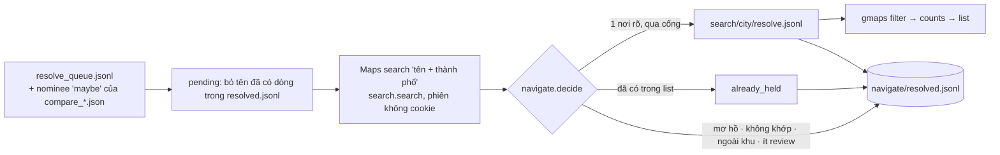

# P7a — `gmaps resolve`: nominee của sol → Google Maps → kho (2026-10-28)

Spec A.1 ("sol đề cử, Maps quyết định"), roadmap P7 dòng "Resolve nominee". Ledger: `.superpowers/sdd/2026-10-28-resolve-p7/progress.md`.

## Nguyên tắc

- Nơi chỉ vào kho khi Maps trả **đúng một nơi rõ ràng** và nơi đó qua các cổng có sẵn (trong khu vực, không phải chỗ ở trừ khi vào danh sách chỗ ở, `min_reviews`, bộ lọc Extractor `gmaps filter`, gộp bản sao `gmaps list`).
- Mơ hồ, không thấy, thiếu bằng chứng → **ghi lại thành đề xuất**, không bao giờ kết luận "nơi này không tồn tại" (không có trạng thái đó), không bịa nơi.
- `resolve` không ghi thẳng vào `list`. Nó ghi một bản ghi **cùng khuôn với `search`** (`data/gmaps/search/<city>/resolve.jsonl`); `filter` → `counts` → `list` chạy như mọi nơi khác nên cổng cuối vẫn là code có sẵn.

## Luồng

## Trạng thái (một dòng sổ cho mỗi nominee, `resolved.jsonl`)

| status | nghĩa | vào search file? |
|---|---|---|
| `resolved` | một nơi khớp tên, trong khu vực, đủ review | có |
| `pending_count` | một nơi khớp, có rating nhưng thẻ giấu số review; `counts` đọc, `list` quyết | có |
| `already_held` | nơi khớp đã có trong `list` (giải quyết luôn các nominee `maybe`) | không |
| `ambiguous` | ≥ 2 nơi khác nhau khớp ngang nhau (chuỗi nhiều chi nhánh…) | không |
| `unresolved` | Maps không có nơi nào khớp tên đủ ngưỡng (không phải "không tồn tại") | không |
| `rejected` | khớp nhưng `reason` ∈ outside_area · few_reviews · no_rating | không |

Lỗi trang (timeout, captcha) không ghi dòng sổ: lần sau thử lại.

## Việc

1. `src/corpus/navigate/resolve.py` (public: `pending`, `decide`, `record`) + khối `resolve:` trong `config/navigate.yaml` (margin, limit). Test thuần (không trình duyệt): `tests/navigate/test_navigate_resolve.py`.
2. `src/corpus/crawl/gmaps/resolve.py` (`run(city, headed, limit, sessions, searcher)`), dùng `search.search`, ghi `search/<city>/resolve.jsonl`; `PHASES["gmaps"]["resolve"]` trong `__main__.py`. Test bằng searcher giả: `tests/crawl/gmaps/test_resolve.py`.
3. `docs/CORPUS.md` mục Vietnamese, `docs/log/DEV_LOG.md`, ledger (lệnh chạy thật + profile).

## Chạy thật (không chạy trong track này)

`python -m corpus gmaps resolve --city dalat [--limit N] [--headed]` rồi `gmaps filter`, `gmaps counts`, `gmaps list`. `resolve` dùng phiên không cookie (`open_sessions`), **không cần profile Google**; chỉ `counts` (nếu có `pending_count`) cần profile đã đăng nhập, chạy sau `COVERAGE_CHAIN_DONE` trong `logs/gmaps_coverage_dalat_stay.log`.
