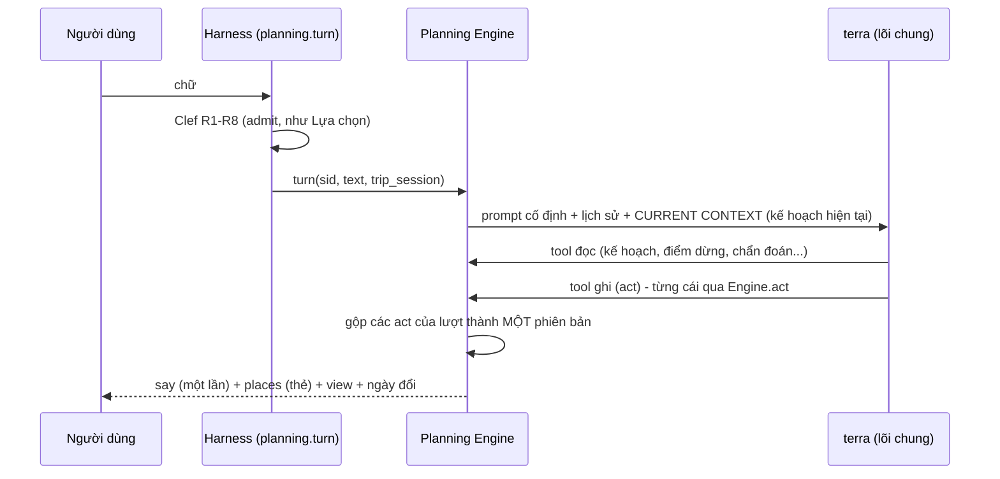

# Trợ lý Lịch trình (Planning) trên lõi chung

> Spec ngắn, 2026-10-30. Chủ dự án duyệt thêm trợ lý cho Lịch trình như Tìm hiểu và Lựa chọn. Theo đúng mẫu `2026-10-29-assistant-tools-design.md` §5.9 và R1–R8 (§4). Không thêm logic lập lịch mới: mọi thay đổi đi qua `Engine.act` mà nút bấm đang dùng.

## 1. Luồng một lượt

## 2. Bộ tool

| Loại | Tool | Nguồn có sẵn |
|---|---|---|
| Đọc | `plan(day?)` | `view.itinerary`, `metrics`, `lodging`, `overload`, `warnings` |
| Đọc | `stop(place)` | giờ đến-đi, chặng trước, `time_suitability`, vai trò (anchor / locked), đã ghim chưa |
| Đọc | `why_here(place)` | vì sao nơi này nằm ở ngày này / vì sao không nằm trong lịch (`unplaced`, `plan_dropped`, ghim) |
| Đọc | `diagnostics()` | `violations`, `robustness`, `time_suitability`, `day_conditions`, `crowd_tips`, `travel_load` |
| Đọc | `options()` | `variants` + thẻ quá tải (3 hướng đánh đổi có thứ tự bỏ cố định) |
| Đọc | `spare_places()` | `backups`, `unplaced`, `ghosts`, gợi ý trống giờ: nơi thêm được mà engine chấp nhận |
| Đọc | `preview_edit(...)` | `Engine.preview_act` (đề xuất thử, không lưu): chênh lệch, vi phạm, `make_room` |
| Đọc | `local_facts()` | `expert.facts_for` (mùa, sự kiện, lễ, thời tiết "nghi ngờ", claim đã giữ), không gọi model |
| Ghi | `move_place`, `reorder_day`, `swap_place`, `add_place`, `remove_place`, `lock_place`, `unlock_place`, `set_pace`, `set_day_window`, `set_visit_minutes`, `extend_days`, `pick_option`, `undo` | act cùng tên của `session.apply_act` |
| Đọc dùng chung | `get_place`, `place_evidence`, `distance`, `weather`... | `Trip TurnTools` qua `Engine.trip_reader` (cùng đường với Lựa chọn) |

Không đưa cho trợ lý: `relax` (ràng buộc vật lý không có đường nới), đổi chỗ ở (hỏi xác nhận, làm bằng thẻ), `recommend` (một lượt model thứ hai, vẫn là nút), `confirm` (sản phẩm dừng ở bước chốt, người dùng bấm).

## 3. Một phiên bản mỗi lượt

- Mỗi tool ghi gọi `Engine.act` (kiểm tra, dàn lại ngày, validator như nút bấm) và trả `effect` (ngày nào đổi, giờ mới, chênh số phút / vi phạm).
- Cuối lượt `Engine.collapse` gộp các phiên bản của lượt thành một: log là `{"type": "batch", "acts": [...]}`, `_compute_results` phát lại lần lượt từng act. Một lần hoàn tác lấy lại cả lượt.
- Act làm xuất hiện vi phạm **mới** (kể cả vật lý): tool hoàn tác chính act đó, trả `error` kèm vi phạm, không lưu. Hard constraint fail-closed. Vi phạm có từ trước không chặn act khác.
- Lịch đã chốt (`outputs.planning`) bị bỏ khi sửa, như `act` (đường harness có sẵn).

## 4. Guard

- Mọi tool ghi có `quote` nằm nguyên văn trong tin nhắn; nơi được gọi phải do người dùng nêu tên hoặc chỉ ("chỗ này", "cái đầu", "ngày 2") (R-chung với Lựa chọn); id lạ, id ngoài lịch = `error`, không đoán.
- `say` chỉ nêu nơi có trong lịch hoặc kết quả tool; số chỉ khi người dùng, CURRENT CONTEXT hoặc kết quả tool đã nói (giờ `08:30` = 8 và 30). Câu vi phạm: cắt từng câu, hết thì câu cố định.
- Không chặn, không đẩy lựa chọn của người dùng. Khi quá tải, trợ lý nêu 3 hướng có sẵn theo thứ tự cố định, không tự chọn hộ.
- Con số về thời gian / chi phí chỉ lấy từ kết quả tool; thiếu = "chưa rõ".
- Câu quen thuộc không cần model: không có (khác Lựa chọn); lỗi model → `policy` từ khóa như cũ.

## 5. Dùng chung Trip / Decision

- Lõi `src/agents/assistant` (vòng tool, `REGISTRY`, cửa sổ lịch sử, Clef ở harness) không đổi.
- Tool đọc dữ liệu địa điểm = cùng `Trip TurnTools` Lựa chọn dùng: harness gán `planning.engine.trip_reader = trip.read_turn`; `dispatch` truyền `trip_session` vào lượt Planning (sau khi kiểm payload chỉ có `text`). Không có phiên Trip → không có tool đọc dùng chung.
- Tool riêng Planning đăng ký `action_tool("planning", ...)` (đọc và ghi đều là tool của stage, không rò sang Trip / Decision).

## 6. UI

Panel trợ lý của Lựa chọn (`ui/Assistant.tsx`) gắn vào màn Lịch trình, không fork: `say`, `places` (thẻ), `view` mới. Thẻ "ngày đã đổi" tóm tắt từ `diff.affected_chunks` / hiệu ngày của `effect`; bấm thì cuộn tới ngày. Hoàn tác một lượt = nút Hoàn tác có sẵn.

## 7. Cổng đo (như spec §6)

`python -m planning bench --live` trên `config/bench_planning_assistant.yaml` (≥ 20 ca): p50 ≤ 7,5 s, p90 ≤ 11 s, 0 số không có nguồn, 0 ràng buộc vật lý bị phá, 0 câu chặn / lên lớp, đúng tool ≥ 90 % mỗi nhóm.
