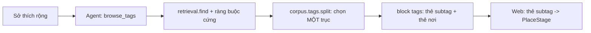
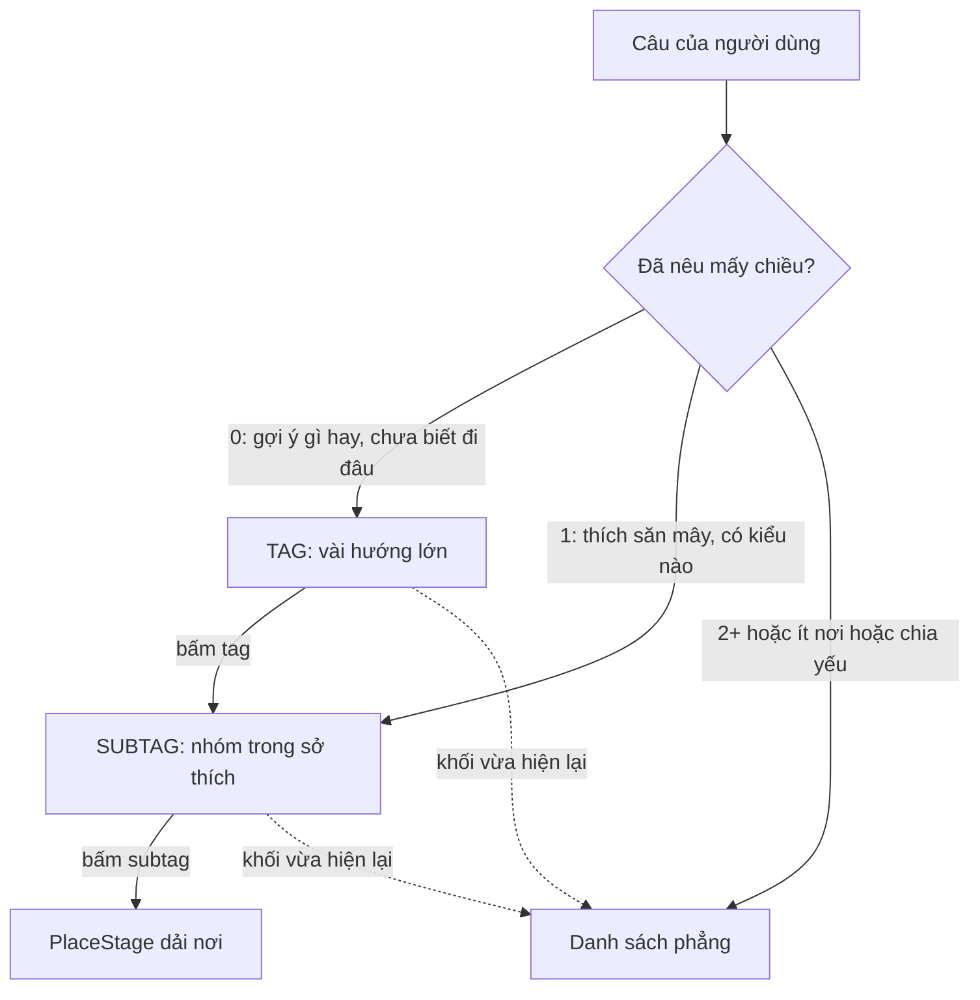
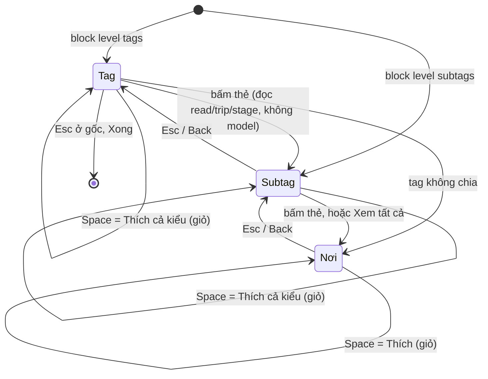

# Tag và subtag (2026-10-30)

Chủ dự án: khi người dùng nói một sở thích rộng ("tui thích săn mây, có kiểu nào hay gợi ý"), danh sách phẳng kém hơn **một vài kiểu** (subtag), mỗi kiểu là nhóm nơi cùng loại, hiện thành thẻ; bấm thẻ mở dải thẻ nơi của kiểu đó. Phải **tổng quát** cho mọi sở thích, không riêng săn mây. Chủ dự án giữ trang chủ như cũ: tag và subtag chỉ dùng ở Tìm hiểu chuyến đi và Lựa chọn.

## Trục chia (`src/corpus/tags/`, từ điển ở `config/tags.yaml`)

| Trục | Nguồn bằng chứng | Nhãn |
|---|---|---|
| `category` | `category_group` của Maps | tên nhóm; ghép tính năng đã hỏi: "Quán cà phê săn mây" |
| `experience` | feature `present` VERIFIED / OUTDATED (cloud_hunting, sunset_view, flower_garden, …) | nhãn riêng; ghép danh từ khi query đã cố định một nhóm |
| `style` | style tag đọc từ ảnh (`config/styles.yaml`) | "Quán cà phê kiểu Hàn" |
| `dish` | món trên thực đơn, đơn trong review, tên quán | tên món; hỏi một món thì chia theo biến thể ("Bánh căn trứng cút") |

Quy tắc chọn trục (`split`):
1. Bỏ trục mà query đã cố định (hỏi theo nhóm thì không chia theo nhóm; hỏi `cloud_hunting` thì không có subtag "Săn mây"; hỏi món thì chỉ còn món con và biến thể).
2. Một trục đạt khi có 3–6 nhóm, mỗi nhóm ≥ 3 nơi, nhóm không quá 70 % tập, hợp các nhóm phủ ≥ 50 % tập, chia đều (entropy ≥ 0,6), tỉ lệ nơi nằm ở hai nhóm ≤ 50 % (trừ biến thể món).
3. Trục điểm cao nhất thắng: phủ × đều × (1 − chồng) × hệ số trục. Không trục nào đạt hoặc tập < 12 nơi → danh sách phẳng.
4. Một nơi vào nhóm **chỉ khi có bằng chứng**; `unknown` không vào nhóm nào; phần còn lại không thành nhóm giả (UI có "Xem tất cả").
5. Không có tên khu vực trong dữ liệu (`area-N` không có nhãn) nên chưa có trục khu vực; giờ mở cửa chưa dùng làm trục.

## Tool và khối

- `browse_tags(criteria)` (nhóm `places`): tiêu chí như `find_places` (không `near_place`, `price_max`, `sort`, `page`). Kết quả cho Agent: `mode`, `why`, nhãn, số nơi, 3 nơi ví dụ. Thẻ nằm trong block `tags`, không gửi thẻ phẳng.
- Prompt: dùng cho sở thích / tâm trạng rộng và xin ý tưởng; câu cụ thể (tên nơi, giá, khoảng cách, "thêm nữa") giữ `find_places`. `covered_tools: write` vẫn để `browse_tags` được gọi.
- Block `tags`: `{level (tags | subtags), sig, title?, axis, total, other, subtags[{id, label, count, place_ids ≤ 8, cover[≤ 3 ảnh]}], all[], cards[]}`; lưu trong transcript như block `dish`.

## Khi nào tag, subtag, danh sách (2026-10-30, v2)

Chủ dự án: "subtag dùng đúng lúc, lúc thì tag lúc thì subtag, tối ưu UX". Quyết định bằng code (`src/trip/domain/tag_policy.py`, ngưỡng `config/tags.yaml` `policy`), Agent chỉ đưa điều người dùng đã nói.

| Chiều | Tính là | Không tính |
|---|---|---|
| nhóm Maps | `groups` | `open_at`, `opens_by`, `month` |
| tính năng bắt buộc | mọi `must` (một chiều) | `prefer` (tâm trạng) |
| món | `dish` | |
| từ khóa | `text` | |

- **Tag** (`corpus.tags.kinds`): các hướng lớn của các nơi hợp lệ (nhóm Maps, trải nghiệm), 3–6 hướng, mỗi hướng ≥ 4 nơi và ≤ 60 % tập, bỏ hướng gần trùng nơi (Jaccard > 0,75) và hướng người dùng đã bấm. Cần ≥ 40 nơi hợp lệ.
- **Subtag:** `split` như ở mục Trục chia.
- **Danh sách phẳng:** từ 2 chiều ("cho xem thêm quán cà phê săn mây"), ít nơi, không trục chia tốt, hoặc đúng khối đó vừa hiện trong 2 khối tag / subtag gần nhất (`sig` = cấp + điều đã cố định + id các hàng).
- **Bấm tag / subtag:** đi xuống một cấp trên sân khấu (mục dưới), không model, không lượt chat.
- **Câu hỏi ảnh cùng chủ đề:** lượt có khối tag / subtag thì thẻ ảnh (drill) cùng lượt bị đóng; web không tự mở `PhotoStage` phủ khối.
- **Lựa chọn:** tool `group_list` chia một tab dài theo kiểu (`docs/PLACE_DECISION.md` §20).

## Sân khấu tag -> subtag -> nơi (2026-10-30, v3)

Chủ dự án: tag và subtag phải trông như thẻ chọn nơi (thẻ ảnh lớn trên vòng xoay `StageRing`), không phải hàng nhỏ che ảnh; bấm thẻ thì thẻ chạy mượt vào bộ bài cấp nhỏ hơn; chọn được NHIỀU thứ.

- **Một sân khấu cho ba cấp**, mở ngay khi lượt có block `tags`; chat chỉ giữ một dòng gập mở lại đúng cấp và giỏ ("Săn mây · 3 nơi, 1 kiểu đã chọn · bấm để mở lại").
- **Thẻ:** tag / subtag = ảnh bìa lớn, tên, "61 nơi", dạng chồng bài (hai mép sau không ảnh), nút tròn là mở; thẻ nơi như cũ (tim). Mỗi thẻ của một cấp có ảnh bìa **khác nhau** (`domain/covers.assign`, tham lam theo nhóm ít ứng viên trước; test `tests/trip/test_covers.py`); trùng chỉ khi mọi nơi của nhóm đã dùng hết.
- **Đi xuống:** ~450 ms, chỉ `transform` / `opacity`: thẻ bên cạnh gập vào thẻ vừa bấm, thẻ nâng lên, rồi các thẻ con tỏa ra; Back đảo lại; `prefers-reduced-motion` thì mờ dần. Khi thẻ ra giữa, web đọc trước con và tải trước ảnh nên không có spinner giữa chừng (chỉ ánh sáng quét nhẹ khi mạng chậm).
- **Điều hướng:** đường dẫn dưới nhãn ("Tất cả › Săn mây › Quán cà phê", bấm được), nút Quay lại, Esc / Backspace lên một cấp (Esc ở gốc thì đóng), vị trí vòng của mỗi cấp được nhớ; "Xem tất cả" là thẻ cuối của cấp khi backend có.
- **Chọn nhiều:** giỏ thay ghi chú chân sân khấu, sống qua mọi cấp; thẻ chồng có chip "N đã chọn"; chọn nơi = Thích (anchor `want`, không model), "Thích cả kiểu này" = `KindWish` mềm (`wishes.kinds`, các nơi của nút), không bao giờ là lọc cứng; không chặn, không nhắc, không số tối thiểu.
- **Backend:** `GET read/trip/stage?block=<sig>&path=<ref>/<ref>` (`Engine.tag_stage`, `Browse.stage`), chỉ đọc, `state.hard` và nơi ẩn áp dụng; turn `like` có `qid: stage` và turn `wish`.
