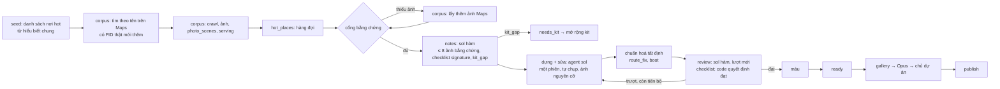

# Thiết kế: dựng 3D hàng loạt cho địa điểm nổi tiếng Đà Lạt, chế độ lai, thành quy trình tự động

Ngày 2026-11-09. Khi xong, thay ba file bàn giao 3D ngày 11-04 (`SPACE_3D_HANDOFF.md`, `DIORAMA_BATCH_HANDOFF.md`, `AUTO3D_WORKFLOW_HANDOFF.md`); số liệu và bài học trong đó vẫn đúng, file này chỉ nêu lại phần cần để quyết định.

## 1. Mục đích

Chủ dự án (11-09):
- "làm hạng A, hạng B và nếu cần thì hạng C, hybrid đi, miễn sao vừa tối ưu token vừa dễ scale và chất lượng làm ra phải tốt, làm được thành quy trình automation thì càng tốt";
- "chất lượng đạt được tốt nhất vẫn hơn là tiết kiệm token quá"; ngân sách không giới hạn, mục tiêu là kết quả tốt nhất, dễ scale, tự động, và **tự làm được cho địa điểm mới**;
- hạng C chưa crawl, nhưng dựa vào hiểu biết chung về Đà Lạt để thêm những nơi hot người ta thường đi mà hiện chưa có;
- chuyển code 3D vào git; model con dùng sol, hoặc terra khi cần.

Một "mô hình 3D" là một `place.json` trên kit có sẵn (engine `index.template.html`, kit trong `kits/`): tour 5–7 điểm dừng, màu theo ảnh thật, hiện trong viewer `web/space3d`. Mô hình phải nhận ra được ngay từ đặc điểm nhận diện (signature) và đúng với ảnh thật.

## 2. Hiện trạng (kiểm 11-09)

- 29 nơi đã dựng và tô màu, đã build vào viewer, **chưa deploy**.
- Hàng đợi `batch/hot_places.py` (≥ 1000 review, 228 nơi): hạng A 17, B 58, C 134. Đã chạy thử 3 nơi hạng A (Dinh I gần đạt, Đường Hầm Điêu Khắc tạm, Quảng trường Lâm Viên yếu vì kit `garden` không có hồ và công trình lớn). Còn **14 nơi hạng A chưa làm**.
- **Corpus thiếu nơi nổi tiếng.** Lưới quét Maps (zoom 14) chưa bao giờ thấy: Biệt thự Hằng Nga (Crazy House), Nhà thờ Domaine de Marie, Đại học Đà Lạt, Cao đẳng Sư phạm (Lycée Yersin), Thác Pongour, Vườn quốc gia Bidoup Núi Bà, Đường hầm đất sét (Tà Nung), trại bò sữa Dalat Milk, Dinh II. Một số nơi rất hot có trong corpus nhưng thiếu ảnh ngoại thất nên rơi vào hạng C: Chợ Đêm (19k review), ZooDoo, Mê Linh Coffee Garden, Langfarm, Làng Nấm, XQ Sử Quán, Dapa Hill, Đồi Thông Hai Mộ.
- Đã đo 11-04: ảnh gốc 768 px ≈ 400 token mỗi tấm, `contact.jpg` thu nhỏ làm mất chi tiết; 9router không có cache và không nhớ giữa các lượt; sol tự chấm bản của chính nó thì điểm không phân biệt; agent một phiên cho chất lượng tốt hơn workflow hàm ở bước dựng và sửa.
- Hạ tầng: sandbox Codex dùng được, 9router sống, bridge chụp chưa chạy.
- Code 3D nằm ở `logs/splat/diorama/` (1 GB, `logs/` bị `.gitignore`) nên không có trong git. Code, dữ liệu và ảnh nằm lẫn nhau; vài script có đường dẫn cứng `/workingspace_aiclub/…` (symlink tới repo).

## 3. Mục tiêu, không phải mục tiêu, tiêu chí hỏng

**Mục tiêu**
- Mọi nơi hot của Đà Lạt có ảnh đủ bằng chứng đều có mô hình đạt: hạng A, hạng B, những nơi hot bị thiếu (§4.5) và nơi hot hạng C khi đã có thêm ảnh.
- Chất lượng trên "đề thi" không thấp hơn Con Gà / Dinh III; chất lượng ưu tiên hơn token.
- Một lệnh chạy cả hàng đợi, chạy lại thì tiếp chỗ dở, không cần người trông. Thêm một nơi mới bằng tên là một lệnh, đi qua corpus rồi tự vào hàng đợi.
- Code trong git, dữ liệu ngoài repo.

**Không phải mục tiêu**
- Không deploy (`RULE.md` §0.2): dừng ở build web + check + poster; chủ dự án xem ảnh rồi mới deploy.
- Không làm lại 29 nơi đã có (trừ khi lỗi); không thêm tính năng engine ngoài phần kit cảnh quan; không dùng Gemma.

**Tiêu chí hỏng** (dù chạy xong về kỹ thuật)
- Mô hình đẹp mà không giống nơi thật, hoặc có chi tiết ảnh không cho thấy (`AGENTS.md`: không bao giờ bịa địa điểm). Hiểu biết chung của model chỉ dùng để **gợi ý nơi nào cần thêm**, không dùng làm bằng chứng cho hình dáng.
- Online ghi Place Intelligence: thêm nơi mới phải đi qua corpus (offline).
- Đưa lên web nơi chưa qua cổng chất lượng.

## 4. Thiết kế

### 4.1 Cổng bằng chứng (trước khi tốn token)
Một nơi chỉ vào dựng khi có ≥ 8 ảnh `exterior` + `view` đúng nơi (sau `drop_photos`). Thiếu thì lấy thêm ảnh qua phase ảnh của corpus. Lấy rồi vẫn thiếu thì ghi `skip: no_exterior_evidence`. Quán ăn / chỗ ở chỉ có ảnh trong nhà không dựng mô hình ngoại thất.

### 4.2 Ai làm gì
| Bước | Ai | Lý do |
|---|---|---|
| prep, chuẩn hoá, boot, route_fix, shoot, màu theo quy tắc, build web, hàng đợi, trạng thái | script, không token | tất định, ổn định |
| notes | sol hàm | trả `evidence` ≤ 8 ảnh, `signature` (id + ảnh), `kit`, `kit_gap` |
| dựng + sửa | **agent sol, một phiên** (effort medium, high với nơi lớn) | nhớ những gì đã thử, tự chụp, xem ảnh gốc nguyên cỡ; đây là chỗ agent hơn hàm |
| review | sol hàm, lượt mới | người chấm khác người viết; checklist từng mục (ok / yếu / thiếu / sai, lỗi do data hay do kit); **code** tính đạt: ≥ 80 % mục ok, không mục chặn sai |
| màu | `auto_colormap.py` + `colour_by_model.py` | đã hiệu quả |
| terra | dự phòng, chỉ cho những vai đề thi chứng minh terra đạt | 11-04 terra trượt 4/4 khi viết `place.json` |
| xem | Opus xem `gallery`; chủ dự án duyệt trước deploy | |

Brief của agent dùng lại luật trong `BRIEF_place.template.md`, **dán sẵn** danh mục kit và ví dụ (agent không phải đi đọc), đính kèm ảnh bằng chứng nguyên cỡ.

### 4.3 Dừng theo chất lượng, không theo token (quyết định của tôi)
Không đặt trần cứng về token. Vòng dựng / sửa tiếp tục khi điểm checklist còn tăng. Hai vòng liên tiếp không tăng, hoặc tới 5 vòng, thì dừng ở `needs_human` kèm checklist và ảnh để Opus xem. Lý do: trần token chặn đúng những nơi khó mà đáng làm nhất, còn "không tiến bộ" mới là dấu hiệu thật của việc đốt token vô ích. Token vẫn được ghi theo từng bước và từng đợt để báo cáo và tối ưu prompt, nhưng không dùng để dừng.

`kit_gap` rõ (hồ lớn, đồi nhiều tầng, đỉnh núi, cáp treo, công trình lớn) thì dừng ở `needs_kit`, không sửa vòng nào (bài học Quảng trường Lâm Viên).

### 4.4 Kit cảnh quan (cho hạng B)
Một lượt agent sol high mở rộng `nature` / `garden`: hồ lớn, đồi nhiều tầng, đỉnh núi, rừng thông, thác nhiều bậc, cáp treo, điểm ngắm. Thử trên Datanla, Thung lũng Tình Yêu, Langbiang; Opus xem 100 % ba nơi này rồi mới chạy cả hạng B. Các nơi đang ở `needs_kit` (Quảng trường Lâm Viên…) chạy lại sau bước này. Kit mới phải giữ nguyên render của 29 nơi đã có (kiểm bằng `shots_space3d.mjs check`).

### 4.5 Thêm nơi hot còn thiếu, và nơi mới bất kỳ
- `seed`: một danh sách có tên (config, có lý do ngắn cho từng nơi) gồm các nơi nổi tiếng bị thiếu ở §2 và nơi hot khác do tôi gợi ý từ hiểu biết chung. Danh sách chỉ là **gợi ý tìm**.
- Corpus thêm một phase tìm theo tên trên Google Maps. Chỉ nơi trả về FID thật, đúng tên, trong `area` mới vào danh sách, rồi đi tiếp chuỗi crawl → ảnh → `photo_scenes` → `serving` như mọi nơi khác. Không ra FID thì ghi `not_found` và không làm gì thêm.
- Nơi hot hạng C có trong corpus nhưng thiếu ảnh ngoại thất: lấy thêm ảnh Maps cho đúng những nơi này (ưu tiên theo review), rồi để cổng bằng chứng quyết định.
- Lệnh cho nơi mới: `add "<tên>"` = ghi vào seed → chạy phase tìm theo tên + chuỗi corpus cho nơi đó → vào hàng đợi 3D. Phần corpus là offline, đúng bất biến của `AGENTS.md`.
- Bước nào cần đăng nhập hoặc captcha Maps thì quy trình dừng và báo chủ dự án, không tự lách.

### 4.6 Code vào git, dữ liệu ra ngoài repo
- Code (`batch/`, `kits/`, `bridge/`, `index.template.html`, `build.py`, `check_place.mjs`, các `.mjs`) chuyển vào chỗ được theo dõi; đề xuất `scripts/diorama/`, theo `RULE.md` §0.3, nhóm ghi ở `scripts/README.md`.
- Dữ liệu (`places/`, ảnh, `out_*`, `bridge/out`, log) chuyển sang `tripguardian-store/diorama/`. Một biến cấu hình trỏ tới đó; bỏ mọi đường dẫn cứng.
- Làm **trước** khi chạy hàng loạt. Kiểm hồi quy: 29 nơi build lại và qua `shots_space3d.mjs check`, ba nơi thử boot được.
- Các file `BRIEF_*` đã dùng xong và bản `.bak` không vào git (lưu NAS theo `RULE.md` §0.3).

## 5. Thứ tự làm

1. **Chuyển code / dữ liệu** (§4.6) và kiểm hồi quy.
2. **Hạ tầng**: bridge 3 worker, HTTP 8471 / 8472, 9router.
3. **Workflow v2 + đề thi**: viết lại `auto3d.py` theo §4 (cổng bằng chứng, notes có `evidence` / `signature` / `kit_gap`, dựng + sửa bằng agent, review checklist, dừng theo tiến bộ). Chạy trên bản sao của Con Gà và Dinh III, so với `place.json` đã duyệt. Đồng thời so chế độ hàm v2 (ảnh nguyên cỡ, sửa bằng bản vá) cho bước dựng: hàm v2 đạt ngang agent thì dùng hàm (rẻ, chạy song song dễ hơn), không thì dùng agent. Đề thi cũng là kiểm hồi quy mỗi lần đổi prompt.
4. **Hạng A**: 14 nơi còn lại + làm lại Đường Hầm Điêu Khắc và Dinh I. Opus xem 100 % 10 nơi đầu, sau đó mẫu 10 % và mọi nơi trượt hoặc `needs_*`.
5. **Kit cảnh quan** (§4.4), thử 3 nơi, rồi **hạng B** theo số review; chạy lại các nơi `needs_kit`.
6. **Nơi hot còn thiếu và hạng C hot** (§4.5): seed, tìm theo tên, lấy thêm ảnh, rồi đi hàng đợi.
7. Sau mỗi đợt: `gallery` → chủ dự án xem → `publish` → deploy khi chủ dự án yêu cầu. Cuối cùng gộp ba file bàn giao 3D thành một tài liệu chính thức và xoá file plan này (`RULE.md` §0.1).

Đo: token theo bước, số vòng sửa, tỉ lệ `ready` / `needs_kit` / `needs_human` / `skip`, thời gian mỗi nơi (nút cổ chai là bridge chụp ≈ 1,5 phút / nơi, 3 song song).

## 6. Ràng buộc kế thừa
Màu theo ảnh thật, rực rỡ, không đơn sắc, không lạnh (11-04). Ảnh `frontend_images/space3d-*` để chủ dự án xem trước khi deploy. Không commit / push khi chưa được yêu cầu; đọc `git status` trước vì nhiều phiên cùng sửa cây làm việc. Trước khi phát agent: `ps -eo stat,args | awk '$1~/D/' | grep -E "mount|bwrap"` phải rỗng. Tài liệu tiếng Việt; code, comment, identifier tiếng Anh. Phần corpus mới tuân `docs/CORPUS.md` (mỗi phase một module, giao tiếp qua public API).

## 7. Để người xây tự quyết
Tên file, schema JSON của `evidence` / `signature` / checklist, ngưỡng điểm chi tiết, cách ghép ảnh render với ảnh thật trong review, định dạng sổ token, mức song song, tên chính xác của thư mục trong `scripts/` và `tripguardian-store/`, nội dung chi tiết danh sách seed (chủ dự án xem lại khi duyệt đợt 6).
