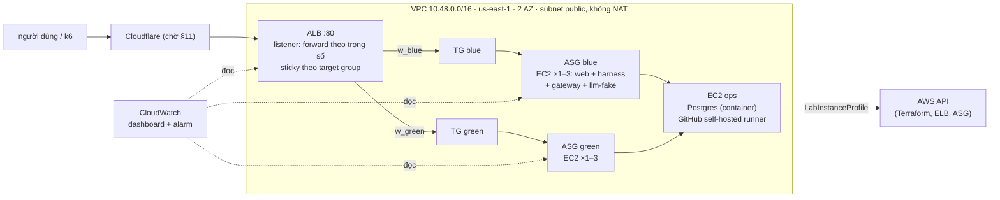
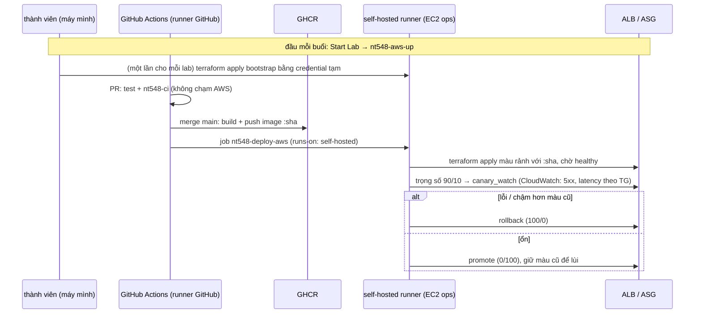

# Thiết kế: vận hành TripGuardian cho đồ án NT548 (nhóm 8)

> Spec làm việc (`RULE.md` §0.1). Trạng thái: **bản 3** (2026-11-21): thêm triển khai thật lên AWS Academy Learner Lab, chia việc theo khối × cặp. Bản 2 (chỉ Compose trên runner, không cloud) còn giữ làm phần diễn tập trong CI. Hướng dẫn từng mảng: `docs/nt548/`.
> Repo: fork `LuanLuKim/tripguardian-nt548` (public) của TripGuardian. Hạn nộp: **thứ Sáu 04/12/2026**.

## 1. Mục đích

NT548 (DevOps) lấy TripGuardian làm sản phẩm và xây phần vận hành quanh nó. Chức năng sản phẩm giữ y TripGuardian; phần đồ án là hạ tầng và quy trình: Infrastructure as Code, load balancer, scalability, blue/green + canary + rollback, CI/CD, monitoring, AI ops, DataOps.

Chủ dự án chốt:
- 20/11: chỉ làm trên nền TripGuardian, phần NT548 nằm ở đường dẫn có tiền tố `nt548`.
- 21/11: triển khai lên **AWS Academy Learner Lab** (50 USD, không GPU). Cloudflare: chờ chủ dự án trả lời (§11). Kubernetes chỉ làm nếu còn thời gian.
- 21/11: chia theo **khối**, mỗi khối do **một cặp hai người** làm trọn; hai cặp làm song song, không chờ nhau. Mỗi người tự viết phần báo cáo cho phần mình làm. Mỗi thành viên có Learner Lab riêng.

## 2. Mục tiêu, không làm, thất bại

| | |
|---|---|
| Mục tiêu | (1) PR nào cũng qua CI; merge `main` → image `:sha` lên GHCR. (2) Toàn bộ hạ tầng AWS dựng và xóa bằng Terraform. (3) ALB chia tải cho nhiều EC2 trong Auto Scaling Group, tự scale theo tải, có số đo. (4) Blue/green + canary bằng trọng số target group của ALB; rollback một lệnh < 1 phút, không rớt request. (5) Deploy từ GitHub Actions, không có key AWS trong repo. (6) Dashboard + alarm CloudWatch. (7) AI ops: canary model trong `model_gateway`, chặn bằng eval. (8) DataOps: kiểm release dữ liệu, đổi / lùi release qua blue/green. |
| Không làm | Không đổi hành vi sản phẩm. Không GPU, không model thật, không dữ liệu thật. Không EKS, NAT Gateway, RDS (tốn tiền, §3). Không chạy gì trên gpu156. |
| Thất bại dù chạy được | Secret (key model, token, credential AWS) lên repo public. Dữ liệu crawl lên repo / image. Hết 50 USD trước ngày demo. Fork lệch TripGuardian tới mức sync bị xung đột. |

## 3. Ràng buộc

| Ràng buộc | Hệ quả |
|---|---|
| Learner Lab: credential tạm, hết theo phiên lab; không tạo được IAM role / user / OIDC provider, chỉ có `LabRole` + `LabInstanceProfile` dựng sẵn | GitHub Actions không giữ được quyền AWS lâu dài → deploy qua **self-hosted runner trên EC2** dùng `LabInstanceProfile` (§5.2) |
| Learner Lab: chỉ `us-east-1` / `us-west-2`; EC2 chỉ cỡ nano → large | Chọn `us-east-1`; app `t3.small` (lên `t3.medium` nếu R1 đo harness cần > 1,5 GB RAM), ops `t3.small` |
| 50 USD cho cả đồ án | Mọi thứ dựng bằng Terraform để **xóa sau mỗi buổi** (§5.4). Không NAT Gateway (subnet public, security group chặn cổng vào), không EKS, Postgres chạy container trên máy ops thay cho RDS |
| Không dữ liệu thật (274 GB, có nội dung crawl, không được public) | Stack chạy **dữ liệu mẫu tổng hợp** (T5, R1). Dữ liệu mẫu nằm trong image hoặc kéo từ repo |
| Không key model, không GPU | **LLM giả** tương thích OpenAI sau `model_gateway` (T4); embedder chạy CPU (`config/index.yaml` `online_device: cpu`) |
| Phiên Planning sống trong RAM harness (`src/planning/session.py`) | Bật stickiness ở ALB (cookie theo target group); bản mới dựng lại phiên từ Postgres |
| Harness chưa có `/healthz` | Health check của ALB gọi một route GET nhẹ có sẵn; đề xuất `/healthz` lên TripGuardian |
| Hai màu chung một Postgres | Migration tương thích ngược |
| Repo public + self-hosted runner: PR từ fork có thể chạy code lạ trên máy AWS | Runner chỉ nhận job của `push` lên `main` và `workflow_dispatch`; job của `pull_request` luôn chạy trên runner GitHub. Bật "Require approval for all external contributors" |
| `pyproject.toml` thiếu `trafilatura`, `cryptography`, `fastapi` | CI pytest đỏ; sửa là việc đầu (D1), PR lên TripGuardian |

## 4. Hướng đã cân nhắc

| Hướng | Chọn? | Lý do |
|---|---|---|
| Chỉ Compose trên runner (bản 2) | Giữ làm diễn tập trong CI | Không có hạ tầng thật để chấm IaC, ALB, ASG |
| **AWS Learner Lab: Terraform + ALB + ASG + EC2, deploy qua self-hosted runner** | **Chọn** | Đủ các phần DevOps cần chấm; vừa 50 USD nếu xóa sau mỗi buổi |
| Deploy bằng credential tạm dán vào GitHub secret mỗi phiên | Dự phòng | Phải dán tay mỗi 4 giờ; chỉ admin repo đặt được secret. Dùng khi runner hỏng |
| Deploy kéo (EC2 tự đọc trạng thái mong muốn từ repo, kiểu GitOps) | Không | Đúng ý tưởng nhưng phải tự viết agent; nêu trong báo cáo như hướng mở rộng |
| EKS / Kubernetes trên AWS | Không | Control plane khoảng 0,10 USD/giờ, ăn hết credit; `kind` trong CI nếu còn thời gian (T6) |
| Nginx blue/green trên một máy (bản 2) thay cho ALB | Chỉ cho CI | ALB làm được chia tải giữa nhiều máy, health check, trọng số, sticky ngay trong dịch vụ |

## 5. Kiến trúc

### 5.1 Hạ tầng



- Security group: ALB nhận 80 từ internet; app chỉ nhận từ ALB; ops (Postgres 5432) chỉ nhận từ app. Không mở SSH: vào máy bằng SSM Session Manager hoặc EC2 Instance Connect.
- Mỗi màu là một ASG dùng launch template riêng; user-data cài Docker, kéo image `ghcr.io/luanlukim/tripguardian-nt548/*:<sha>` (public, không cần đăng nhập) và chạy compose của app.
- Scale: target tracking theo CPU trung bình của ASG (ví dụ 50 %), min 1 / max 3 mỗi màu.

### 5.2 Deploy (đã chốt cho Learner Lab)



1. **Bootstrap** (một người, một lần cho mỗi tài khoản lab): chạy `ops/nt548/terraform/bootstrap` từ máy mình bằng credential tạm (bảng "AWS Details" của Learner Lab). Bootstrap tạo S3 bucket chứa Terraform state và máy ops; user-data của máy ops đăng ký runner bằng registration token (admin repo tạo, sống 1 giờ).
2. **Sau đó mọi thay đổi hạ tầng và deploy chạy trên runner đó.** Runner dùng `LabInstanceProfile`, lấy credential qua instance metadata, nên GitHub không giữ key AWS nào.
3. **Kiểm sớm (R2, ngày đầu):** từ máy ops, `LabRole` có tạo được ALB, ASG, target group, dashboard CloudWatch không. Thiếu quyền ở đâu thì phần đó chạy từ máy thành viên bằng credential tạm, ghi vào báo cáo.
4. **Dự phòng:** runner hỏng thì admin dán credential tạm vào GitHub Environment `nt548-aws` và chạy cùng workflow trên runner GitHub.

### 5.3 Diễn tập trong CI (giữ từ bản 2)

Compose + Nginx + hai màu chạy trên runner GitHub cho mỗi PR: kiểm `deploy.sh`, `canary_watch`, eval gate, `data_check` mà không tốn credit AWS.

### 5.4 Giữ chi phí

| Thành phần (us-east-1, giá ước tính, kiểm lại) | USD/giờ |
|---|---|
| ALB | ~0,023 + LCU |
| EC2 `t3.small` ×3 (2 app + ops) | ~0,062 |
| IPv4 public ×5 (ALB 2 AZ + 3 máy) | ~0,025 |
| **Tổng một buổi 4 giờ** | **~0,45** |

- Bật suốt 13 ngày ≈ 35 USD: quá sát. Vì vậy quy tắc là **`nt548-aws-down` cuối mỗi buổi**. Workflow này xóa ALB và ASG, còn bucket state và máy ops (đã dừng) được giữ.
- Khoảng 20 buổi làm cộng đo tải thì hết khoảng 10–15 USD.
- Không biết chắc Learner Lab dừng EC2 lúc hết phiên hay không, và ALB vẫn tính tiền khi máy dừng, nên không dựa vào việc hết phiên.
- Workflow `schedule` mỗi tối chạy `nt548-aws-down` nếu ai quên. Runner phải đang chạy thì mới làm được.
- Mỗi thành viên thử phần mình trên Learner Lab của chính mình. Terraform nhận biến `name_prefix`. Tài khoản lab của LuanLuKim dùng làm bản demo chung.

## 6. Bố cục file (tiền tố `nt548` để sync không xung đột)

```text
ops/nt548/terraform/  bootstrap/ (state bucket + máy ops + runner), modules/{network,app_asg,alb,monitoring}, envs/demo/
ops/nt548/            deploy.sh (local + aws), canary.yaml, canary_watch.py, data_check.py, nginx/, compose/, llm_fake/, loadtest/, k8s/
.github/workflows/nt548-*.yml
tests/nt548/          test cho code ops (không cần GPU / AWS / dữ liệu thật)
docs/nt548/           tài liệu đồ án: README (tổng quan + chia việc) và một file nghiên cứu + thực hiện cho mỗi mảng
docs/plans/2026-11-20-nt548-devops-design.md   file này
```

File của TripGuardian chỉ sửa qua PR lên TripGuardian. Ngoại lệ hiện có: `workflow_dispatch` trong `.github/workflows/test.yml`; hai dòng trỏ tới `docs/nt548/` trong `README.md`.

## 7. Chia việc: khối × cặp

Bốn khối, hai cặp. Mỗi cặp làm trọn hai khối; hai cặp làm song song và chỉ gặp nhau ở **hợp đồng giữa khối** (§7.1), nên không cặp nào phải chờ cặp kia. Trong cặp, hai người tự chia issue con và review PR cho nhau. Mỗi người tự viết phần báo cáo cho phần mình làm.

| Cặp | Khối | Issue |
|---|---|---|
| **hohoangluan + `dinhlong06`** | **T8. Hạ tầng AWS:** Terraform (bootstrap, VPC, ALB + 2 target group, ASG mỗi màu + scale theo CPU), monitoring CloudWatch, giữ chi phí | #21 (con #22–#27) |
| | **T5. DataOps:** dữ liệu mẫu (R1), `data_check`, đổi / lùi release dữ liệu trên AWS | #5 |
| **LuanLuKim + `DontMadWhenBad`** | **T9. CI/CD và phát hành:** CI xanh, image GHCR, compose của app, diễn tập blue/green trong CI, workflow deploy lên AWS qua runner, canary tự rollback, đo tải k6 | #28 (con #1, #2, #3, #29) |
| | **T4. AI ops = AIOps** (chủ dự án 21/11): phát hiện bất thường trên metric, gom mẫu log, tóm tắt sự cố, bơm lỗi đo MTTD / MTTR; nền là LLM giả + trọng số + `/metrics` trong `model_gateway`. Eval gate, canary model: không bắt buộc | #4 |
| Cả bốn | **T7. Báo cáo, slide** | #7 |

Không bắt buộc: T6 Kubernetes `kind` (#6), Cloudflare (chờ §11).

### 7.1 Hợp đồng giữa khối (chốt trước ngày 23/11, đổi phải báo cặp kia)

| Ranh giới | Bên cung cấp | Hợp đồng |
|---|---|---|
| Image → máy app | T9 → T8 | `ghcr.io/luanlukim/tripguardian-nt548/{harness,web,llm-fake}:<sha>` (public) và `ops/nt548/compose/app.yml` chạy cả stack một màu trên một máy, nghe cổng `8080`, health check `GET /` trả 200. Trong lúc chờ, T8 dùng image giữ chỗ `traefik/whoami` ở cổng `8080` |
| Terraform → workflow deploy | T8 → T9 | `ops/nt548/terraform/envs/demo` nhận biến `image_tag_blue`, `image_tag_green`, `weight_blue` (0–100), `data_release_blue`, `data_release_green`; xuất `alb_dns_name`, `target_group_arn_{blue,green}`, `asg_name_{blue,green}`. Workflow chỉ gọi `terraform apply -var …`, không tự gọi API ELB |
| Dữ liệu mẫu → app | T5 → T9 | `ops/nt548/sample-data/<release>/` mount chỉ đọc vào harness qua biến `DATA_RELEASE`. Chưa có (R1 chưa xong) thì harness stub |
| LLM | T4 → T9 | `llm-fake` tương thích OpenAI ở cổng `8000`; harness trỏ `*_BASE_URL` vào `model-gateway` |

Mỗi cặp thử trên Learner Lab của mình bằng biến `name_prefix`. Lab của LuanLuKim là bản demo chung, chỉ ghép ở mốc 28/11.

### Lịch

| Ngày | hohoangluan + dinhlong06 | LuanLuKim + DontMadWhenBad |
|---|---|---|
| 21–23/11 | R2 quyền `LabRole`, bootstrap, VPC · R1 (#8) | CI xanh (#1), Dockerfile + GHCR, `app.yml` · LLM giả (#13), trọng số gateway (#14) |
| 24–27/11 | ALB + ASG với image giữ chỗ, scale CPU · `data_check` (#10), dữ liệu mẫu (#9) | Diễn tập blue/green trong CI (#2), `nt548-deploy-aws` trên lab của mình · `/metrics` (#15), eval gate (#16) |
| 28/11 | **Ghép trên lab demo:** image thật chạy sau ALB thật | |
| 29/11–01/12 | Dashboard + alarm, giữ chi phí · đổi release dữ liệu (#11) | Canary tự rollback + k6 đo scale-out (#3) · canary model (#17) |
| 02–03/12 | Báo cáo, slide, chạy thử demo hai lần từ đầu (`aws-up` → demo → `aws-down`) | |
| 04/12 | Nộp | |

Rủi ro lớn nhất:
- **R1:** harness có khởi động được với dữ liệu mẫu không. Không được thì dùng harness stub. Mọi phần hạ tầng vẫn làm được, vì không phụ thuộc nội dung trả lời.
- **R2:** `LabRole` thiếu quyền. Xử lý theo §5.2 bước 3.

## 8. Tiêu chí xong (demo)

1. PR có test đỏ không merge được.
2. `nt548-aws-up` từ tài khoản trống tới URL chạy được, toàn bộ bằng Terraform; `nt548-aws-down` xóa sạch.
3. Merge → image `:sha` → `nt548-deploy-aws` đưa màu rảnh lên, canary 10 %, promote.
4. Bản cố ý trả 500 → `canary_watch` tự rollback; người ở màu cũ không thấy lỗi.
5. Rollback tay < 1 phút; k6 không thấy request rớt trong lúc đổi màu.
6. k6 tăng tải → ASG thêm máy → độ trễ về lại ngưỡng; bảng số trước / sau.
7. Dashboard CloudWatch và một alarm bắn thật khi có lỗi.
8. Canary 10 % cho `llm-fake v2` trong gateway, eval gate chặn bản xấu.
9. `data_check` chặn một release hỏng; đổi `r-a` → `r-b` qua blue/green.
10. Tổng chi phí AWS tới ngày nộp, kèm ảnh Budget.

## 9. Đưa về TripGuardian

PR từ fork: dependency thiếu (D1), `/healthz` `/readyz`, trọng số và `/metrics` trong `model_gateway` (#14, #15).

## 10. Để người làm tự quyết

Cổng, công cụ bắn tải, định dạng log, cách sinh dữ liệu mẫu, cấu trúc Dockerfile, cấu trúc module Terraform bên trong mỗi module.

## 11. Còn chờ chủ dự án

- Cloudflare: có domain / zone không; đặt trước ALB (DNS proxied + WAF) hay bỏ.
