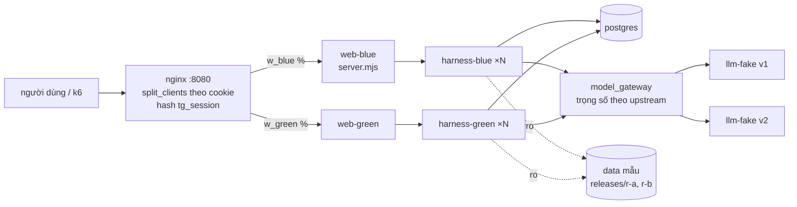
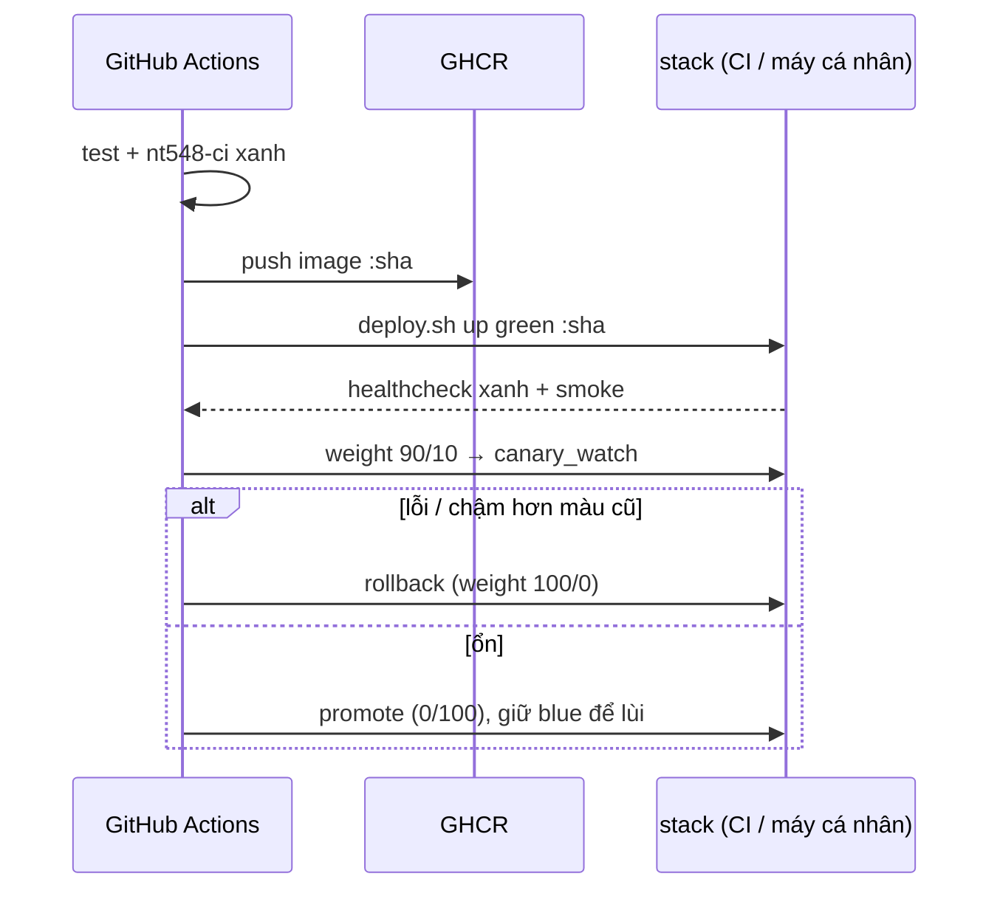

# Thiết kế: vận hành TripGuardian cho đồ án NT548 (nhóm 8)

> Spec làm việc (`RULE.md` §0.1). Trạng thái: bản 2 (2026-11-20, bỏ triển khai lên server); chủ dự án cho đưa lên GitHub để nhóm làm tiếp. Hướng dẫn từng mảng: `docs/nt548/`.
> Repo: fork `LuanLuKim/tripguardian-nt548` (public) của TripGuardian.

## 1. Mục đích

NT548 (DevOps) lấy TripGuardian làm sản phẩm và xây phần vận hành quanh nó: CI/CD bằng GitHub Actions, load balancer, phân luồng traffic, blue/green để update và rollback, scale cơ bản, AI ops, DataOps. Bốn thành viên làm qua fork.

Chủ dự án chốt (20/11):
- Chức năng giữ y TripGuardian; chỉ phần vận hành là riêng của NT548. Sync TripGuardian trước rồi mới tách phần đồ án.
- **Không triển khai lên server** (gpu156). Không Kubernetes thật, không tốn quota cloud. K8s chỉ là demo trong CI (điểm cộng).
- Sản phẩm của đồ án: tài liệu md nghiên cứu + hướng dẫn thực hiện, và code vận hành chạy được trên máy cá nhân / runner GitHub.

## 2. Mục tiêu, không làm, thất bại

| | |
|---|---|
| Mục tiêu | (1) PR nào cũng qua CI. (2) Merge `main` → build image, đẩy lên GHCR theo sha. (3) Stack Docker Compose: Nginx + hai màu blue/green; canary chia luồng; rollback một lệnh < 1 phút; diễn tập đủ chuỗi trong CI. (4) Scale web / harness lên N bản, có số đo. (5) AI ops: chia luồng theo trọng số giữa các upstream model trong `model_gateway`, chặn promote bằng eval. (6) DataOps: kiểm một corpus release trước khi dùng, đổi / lùi release dữ liệu qua blue/green. (7) Demo `kind` trong CI. |
| Không làm | Không đổi hành vi sản phẩm. Không chạy gì trên gpu156. Không K8s / cloud trả phí. |
| Thất bại dù chạy được | Secret (key model, token) lên repo public. Dữ liệu crawl (review, ảnh Maps, tài khoản TikTok) lên repo / image public. Fork lệch TripGuardian tới mức sync bị xung đột. |

## 3. Ràng buộc

| Ràng buộc | Hệ quả |
|---|---|
| Không server, không dữ liệu thật (274 GB, có nội dung crawl, không được public) | Stack chạy với **dữ liệu mẫu**: `tests/fixtures` (7,4 MB) + snapshot nhỏ tự sinh. Việc đầu của mảng dữ liệu: tìm harness cần tối thiểu những file nào để khởi động (§7, R1) |
| Không key model trong CI công khai | Một **LLM giả** tương thích OpenAI (trả lời cố định, độ trễ / lỗi chỉnh được) đứng sau `model_gateway`. Đủ để thử định tuyến, canary, lỗi; không đo chất lượng câu trả lời |
| Phiên Planning sống trong RAM harness (`src/planning/session.py`, `Store._mem`) | LB sticky theo cookie `tg_session` (`src/harness/server.py:58`); bản mới dựng lại phiên từ Postgres (cơ chế có sẵn) |
| Harness chưa có `/healthz` / `/readyz` | Đề xuất lên TripGuardian (khớp GĐ2 `production-restructure`); trong lúc chờ, compose healthcheck gọi một route GET nhẹ có sẵn |
| Hai màu chung một Postgres | Migration tương thích ngược |
| Embedder: `online_device: cpu` chạy được (`config/index.yaml:6`) | Mọi container chạy CPU |
| `pyproject.toml` thiếu `trafilatura`, `cryptography`, `fastapi` | CI pytest đỏ khi nạp test (run `44738562042`); sửa là việc đầu (T1), PR lên TripGuardian |
| Push lên fork không tự tạo run | Kiểm lại sau khi bật Actions trên giao diện; tạm gọi `workflow_dispatch` |

## 4. Hướng đã cân nhắc

| Hướng | Chọn? | Lý do |
|---|---|---|
| Deploy trên gpu156 bằng self-hosted runner | Không | Chủ dự án bỏ server |
| K8s trên cloud | Không | Quota, khó hiểu |
| **Compose + Nginx + image GHCR, diễn tập trong CI** | **Chọn** | Không tốn tiền; ai cũng chạy được; image theo sha cho rollback thật |
| + `kind` trong CI | Làm sau cùng | Điểm cộng, bỏ được |

Tách phần đồ án: **một nhánh `main`, phần NT548 chỉ nằm ở đường dẫn có tiền tố `nt548`** (bảng §6). Nhánh riêng `nt548` song song với `main` bị loại: hai nhánh dài hạn, PR và CI chia đôi, người chấm mở repo thấy nhánh mặc định không có đồ án.

## 5. Kiến trúc





- `deploy.sh {up <color> <tag>|weight <blue%>|promote|rollback|status}`: sửa file trọng số rồi `nginx -s reload`, không rớt kết nối.
- `canary_watch.py`: đọc access log JSON của Nginx, so màu mới với màu cũ (5xx, p95, tối thiểu 50 request); ngưỡng ở `canary.yaml`.
- Image: `ghcr.io/luanlukim/tripguardian-nt548/{harness,web}:<sha>`. Rollback = chạy lại màu cũ với tag cũ.

## 6. Bố cục file (tiền tố `nt548` để sync không xung đột)

```text
ops/nt548/            deploy.sh, canary.yaml, canary_watch.py, data_check.py, nginx/, compose/, llm_fake/, k8s/
.github/workflows/nt548-*.yml
tests/nt548/          test cho code ops (không cần GPU / dữ liệu thật)
docs/nt548/           tài liệu đồ án: README (tổng quan + chia việc) và một file nghiên cứu + thực hiện cho mỗi mảng
docs/plans/2026-11-20-nt548-devops-design.md   file này
```

File của TripGuardian chỉ sửa qua PR lên TripGuardian. Ngoại lệ hiện có: `workflow_dispatch` trong `.github/workflows/test.yml`; hai dòng trỏ tới `docs/nt548/` trong `README.md`.

## 7. Chia việc

| Mã | Mảng (file hướng dẫn) | Người | Phụ thuộc |
|---|---|---|---|
| T1 | CI: dependency thiếu, test ASR tự skip, tách test chậm, `nt548-ci.yml`, build + push image GHCR, bảo vệ nhánh (`docs/nt548/01-ci-cd.md`) | LuanLuKim | — |
| T2 | Compose + Nginx blue/green, `deploy.sh`, diễn tập trong CI (`02-bluegreen-lb.md`) | Đình Long (dinhlong06) | T1 |
| T3 | Canary watch + scale N bản + đo tải k6 (`03-canary-scale.md`) | Quỳnh (DontMadWhenBad) | T2 |
| T4 | AI ops: LLM giả, trọng số trong `model_gateway`, eval gate (`04-aiops.md`) | hohoangluan | T2 |
| T5 | DataOps: dữ liệu mẫu (R1), `data_check.py`, đổi release qua blue/green (`05-dataops.md`) | hohoangluan | T1 |
| T6 | K8s `kind` demo (`06-k8s-demo.md`) | Quỳnh | T2 |
| T7 | Sync TripGuardian tự động, báo cáo + slide (`07-sync-report.md`) | Đình Long | T1–T6 |

R1 (rủi ro lớn nhất, làm sớm trong T5): harness có khởi động được với dữ liệu mẫu không. Không được thì CI dùng harness stub trả đúng các route web gọi, ghi rõ trong báo cáo; mọi phần LB / blue/green / canary vẫn làm được vì không phụ thuộc nội dung trả lời.

## 8. Tiêu chí xong (demo)

1. PR có test đỏ không merge được.
2. Merge → image `:sha` trên GHCR → workflow diễn tập: green lên, canary 10 %, promote.
3. Bản cố ý trả 500 → `canary_watch` tự rollback; người ở màu cũ không thấy lỗi.
4. Rollback tay < 1 phút; không request nào rớt trong lúc đổi màu (k6).
5. Bảng đo 1 vs 2 bản harness.
6. Canary 10 % cho `llm-fake v2` trong gateway; số liệu theo upstream.
7. `data_check` chặn một release hỏng; đổi `r-a` → `r-b` qua blue/green.
8. `kind`: đổi selector blue → green → blue.

## 9. Đưa về TripGuardian

PR từ fork: dependency thiếu (T1), `/healthz` `/readyz`, trọng số `model_gateway` (T4).

## 10. Để người làm tự quyết

Cổng, công cụ bắn tải, định dạng log, cách sinh dữ liệu mẫu, cấu trúc Dockerfile.
