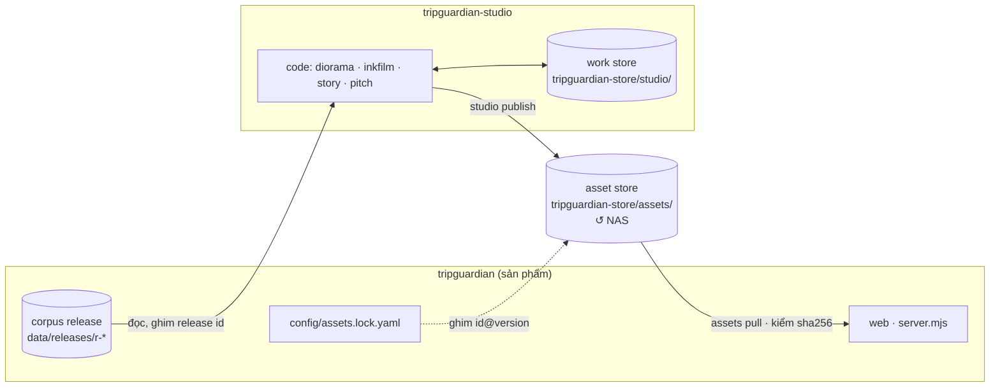

# Thiết kế: tái cấu trúc TripGuardian cho production

Spec làm việc (`RULE.md` §0.1), 2026-11-20, chờ chủ dự án duyệt. Repo này là repo sản phẩm riêng, không theo khuôn đồ án.

## 1. Hiện trạng: chỗ nào làm production yếu

| # | Vấn đề | Bằng chứng | Hậu quả |
|---|---|---|---|
| P1 | Deploy từ cây làm việc dùng chung, không từ commit | 509 file chưa commit; nhiều tính năng ghi "trên prod, chưa commit" | Không biết prod chạy code nào; mất việc khi cây hỏng; không tái lập được bản đang chạy |
| P2 | Máy khởi động lại = tự deploy việc dở | crontab `@reboot ... ./run.sh prod` (đông cứng `src/` hiện tại) | Một lần reboot đưa code nửa vời của mọi phiên lên prod |
| P3 | Chỉ `src/` đông cứng | `config/`, `data/` prod đọc thẳng từ repo (`docs/OPERATIONS.md` §1) | Sửa một file yaml lúc dev là đổi prod ngay, không qua kiểm |
| P4 | Không ai giữ tiến trình sống | `nohup`; "tiến trình chết giữa chừng không tự lên lại" | Harness chết lúc 2 giờ sáng thì site chết tới khi có người thấy |
| P5 | Repo trộn sản phẩm với xưởng nội dung | `scripts/diorama` 32 MB, `inkfilm`, `pitch_pptx`, `pitch-deck-slides/`, file mp4/pdf/pptx ở gốc, `submission/` | Repo nặng, CI và agent đọc lan sang thứ không phải sản phẩm; dễ deploy nhầm |
| P6 | File quá lớn ở lõi | `planning/engine.py` 2.441 dòng, `trip/api/engine.py` 2.305, `corpus/llm/tasks.py` 2.208, `harness/dispatch.py` 1.328 | Sửa một chỗ phải đọc cả nghìn dòng; nhiều phiên cùng sửa một file → xung đột |
| P7 | Test một tầng, chậm, có test đo giờ | ~6.300 test, chạy tuần tự > 40 phút; 8 test thời gian đỏ khi máy tải cao | Không ai chạy đủ trước deploy; đỏ giả làm quen mắt với đỏ thật |
| P8 | Nợ ranh giới chưa có máy chặn | `docs/ARCHITECTURE.md` §3 liệt kê 8 chỗ import sâu | Ranh giới mòn dần theo thời gian |

Thứ đang tốt, giữ nguyên: bốn giai đoạn tách package; corpus đã có release bất biến (`data/releases/r-*` + `current`); journey pin release; prod-check / prod-rollback; smoke và ma trận E2E sau deploy; config từ chối khóa lạ.

## 2. Đích: ba vùng tách nhau

```text
dev tree (repo hiện tại)        release (bất biến)                    prod (chạy)
─────────────────────────       ─────────────────────────────          ───────────────────────
nhánh, worktree, việc dở   ──►  releases/<ngày>-<sha>/            ──►  current → releases/<…>
                    git tag      src/  config/  web/dist/                systemd --user
                    + CI xanh    migrations/  RELEASE.json               harness, web, notify,
                                 (sha, tag, corpus release, build)       analytics, tunnel
```

Nguyên tắc:
1. **Prod chỉ chạy một commit đã tag.** Không còn đường nào đưa file chưa commit lên prod.
2. **Một release là bất biến** và gồm mọi thứ code đọc: `src/`, `config/`, `web/dist/`, `migrations/`. Dữ liệu corpus đi theo release pointer có sẵn; dữ liệu người dùng ở Postgres.
3. **Đổi bản = đổi một symlink.** Rollback về bất kỳ bản nào trong N bản gần nhất, không chỉ bản trước.
4. **Máy giữ tiến trình sống**, không phải người.

## 3. Bố cục repo đích

```text
tripguardian/                    repo sản phẩm
  src/                           giữ nguyên tên package (đổi tên = sửa hàng nghìn import và 427 chỗ trỏ tài liệu, không đáng)
  web/                           giữ nguyên
  config/                        chỉ cấu hình sản phẩm, đi theo release
  migrations/
  ops/                           MỚI: mọi thứ vận hành
    deploy/                      release.sh, switch, rollback, check (tách từ run.sh)
    systemd/                     unit cho harness, web, notify, analytics, tunnel, 9router
    cron/                        crontab chuẩn (một file, có nhãn `# tripguardian-*`)
    models/                      gemma_server.sh, vllm_*, model_gateway.py, clef_server.py, gpu_lease.sh
  scripts/                       chỉ còn script sản phẩm: corpus job, eval, journey_sim, pack_data, local_stack
  tests/
  docs/
  run.sh                         chỉ còn dev: start / stop / db

tripguardian-studio/             REPO MỚI: xưởng nội dung, không deploy
  diorama/  inkfilm/  pitch/  story/  brochure/  submission/
  → sản phẩm chỉ nhận đầu ra đã dựng (web/public/space3d, video) qua một lệnh export có ghi phiên bản
```

`.prod_src/` và `.prod_src.prev` biến mất, thay bằng `../tripguardian-releases/` (ngoài repo, cạnh `tripguardian-store/`).

## 3b. Chia module: một khuôn cho mọi package

### Hiện trạng

| Package | Bố cục bên trong |
|---|---|
| `trip` (68 file) | đã chia tầng: `agent/ api/ domain/ infrastructure/` |
| `decision` (38 file) | phẳng, 38 file một thư mục |
| `planning` (55 file) | phẳng, 55 file một thư mục |
| `corpus` | chia theo bước pipeline (`crawl/ observe/ aggregate/ serving/ …`), trong `crawl/` chia theo nguồn: tốt |
| `live`, `journey` | chia theo nhà cung cấp (`osrm/ weather/ lodging/ …`): tốt |

Ba giai đoạn online lặp lại cùng một bộ file (`agent`, `assistant`, `tools`, `tool_schemas`, `guard`, `policy`, `session`, `server`, `settings`, `bench`, `evaluate`) nhưng mỗi package đặt một kiểu. Người mới mở `planning/` thấy 55 file ngang hàng, không biết file nào là thuật toán, file nào là I/O, file nào là agent.

### Khuôn chung cho giai đoạn online (`trip`, `decision`, `planning`)

```text
<stage>/
  __init__.py        public API duy nhất (RULE §2); docstring 5 dòng: package làm gì, vào ra gì
  contracts.py       schema vào / ra công khai (Search Input, Decision Output, Plan Output)
  settings.py        đọc config/<stage>.yaml
  domain/            logic thuần: không I/O, không model, không mạng → test nhanh, dễ đọc
  app/               điều phối use case: engine, session, khóa phiên; gọi domain + adapters
  agent/             agent, assistant, tools, tool_schemas, guard, policy, skills.yaml
  adapters/          mọi I/O: đọc corpus, gọi live, lưu trữ (trip gọi là infrastructure/, đổi tên cho đồng bộ)
  api/               server.py (HTTP độc lập), cli.py (__main__ chỉ gọi vào đây)
  eval/              evaluate, bench: không ai trong package import ngược vào đây
```

Luật phụ thuộc trong package, máy kiểm bằng `import-linter`:

```text
api, eval  ──►  app, agent  ──►  domain
                 app       ──►  adapters  ──►  (package khác qua public API)
domain     ──►  (không gì ngoài contracts, settings)
```

Áp vào `planning` (ví dụ, danh sách cuối chốt khi làm):

| Thư mục | File hiện có |
|---|---|
| `domain/schedule/` | `schedule`, `days`, `route`, `timefit`, `layout`, `optimize`, `repair`, `overload`, `travel` |
| `domain/validate/` | `validate`, `robustness`, `safety`, `conditions`, `pets`, `diet` |
| `domain/lodging/` | `lodging`, `stayprice` |
| `domain/` | `model`, `frame`, `objectives`, `traits`, `roles`, `places`, `scope`, `variants` |
| `app/` | `engine` (sau khi tách, §4 GĐ5), `session`, `cache`, `build`, `proposal`, `backup`, `eve`, `expert` |
| `agent/` | `agent`, `assistant`, `tools`, `tool_schemas`, `guard`, `policy` |
| `app/view/` | `output`, `summary`, `details`, `artifacts`, `recommendations`, `ghosts`, `composer`, `placename` |
| `eval/` | `evaluate`, `bench` |

`decision` làm tương tự (`domain/`: `screen`, `fit`, `rank`, `diversify`, `feasibility`, `filters`, `wishes`, …).

Vì public API (`__init__.py`) không đổi, package khác không phải sửa gì; chỉ import nội bộ và test import sâu phải sửa (cơ học, `git mv` giữ lịch sử).

### Mở rộng theo bốn hướng

| Hướng mở rộng | Hiện tại | Thiết kế |
|---|---|---|
| **Thêm thành phố** (HCM, Vũng Tàu đang làm) | 180 chỗ ghi cứng `"dalat"` / "Đà Lạt" trong `src/` | Mọi thứ theo thành phố đi qua `config/cities.yaml` + một `CityContext` truyền vào từ journey; prompt nhận tên thành phố làm biến. Test chặn: grep `"dalat"` trong `src/` phải bằng 0 (trừ fixture) |
| **Thêm nguồn dữ liệu** | `corpus/crawl/<nguồn>/`, `observe/<nguồn>/`: đã đúng | Ghi thành giao diện `Source` (crawl → raw, observe → observation) trong `docs/CORPUS.md`; nguồn mới = một thư mục + một dòng đăng ký |
| **Thêm tính năng / giai đoạn** | mỗi giai đoạn tự đặt bố cục | Khuôn ở trên; tính năng mới vào đúng tầng, không tạo file ngang hàng mới ở gốc package |
| **Thêm người dùng** | một tiến trình harness; phiên Planning giữ trong RAM | Giữ một tiến trình tới khi đo thấy nghẽn. Đường mở rộng khi cần: trạng thái phiên vào Postgres (journey đã ở đó) → chạy N harness sau `web/server.mjs`; việc nặng (overload, gợi ý) đã chạy process pool, tách thành worker riêng nếu cần |

### Agent: định tuyến hai tầng, giữ nguyên hướng

Hiện tại (đọc code 2026-11-20):

```text
màn hình (stage)  ──►  harness.router: không model, stage quyết module
  chat chung (home + Lựa chọn), mỗi tin nhắn:
    decision.heuristics.route (regex, không model) ──► "decision" | "trip" | "unsure"
    "unsure" ──► Clef, một câu hỏi zero-shot ~0,3 s ──► decision / trip (lỗi thì về trip)
  Lịch trình ──► Planning agent
mỗi agent chuyên: một vòng LangGraph, model tự chọn trong bộ tool của mình (Trip ≤ 6 call, Decision / Planning ≤ 4)
Clef chạy song song, không đứng trước agent: guard R1–R8, chọn nhóm dữ liệu đọc trước, bác fact không có trong câu
```

Giữ mô hình này: luật rẻ và đoán trước được ở trên; agent chuyên với bộ tool hẹp ở dưới. Không gộp thành một agent ôm mọi tool (danh sách tool dài làm model nhỏ chọn sai, prompt to, mất prompt cache, khó guard). Không đưa Clef lên chặn trước mọi tin (thêm một bước cho cả những tin luật đã phân được).

Sửa cho dễ quản lý:
- [ ] Gom định tuyến chat vào một chỗ `harness/chat_router.py` (hiện nằm rải ở `decision/heuristics.route`, `decision/engine.route`, `harness/dispatch._chat`): luật → Clef → mặc định, mỗi quyết định ghi `trace {route, by}`.
- [ ] Bộ đánh giá định tuyến: `config/eval_routes.yaml` (tin nhắn → agent đúng), chạy trong test unit, phần Clef trong `perf`.
- [ ] Thêm agent mới = một package theo khuôn trên + một dòng luật trong router; không sửa agent khác.

### `tripguardian-store`: không đưa vào repo

Kho này 299 GB: ComfyUI 104 GB, trọng số model 66 + 18 GB, venv 30 GB, dữ liệu phim / 3D 49 GB. Đó là môi trường máy, không phải mã nguồn; đưa vào git thì repo không clone nổi. Giữ ngoài repo (`RULE.md` §0.3), nhưng repo phải giữ **công thức** dựng lại kho:
- [ ] `ops/store/manifest.yaml`: model nào, revision nào, venv nào dùng cho dịch vụ nào.
- [ ] `ops/store/bootstrap.sh`: dựng kho trên máy mới từ `uv.lock` + manifest.
- [ ] Phần của xưởng nội dung (`tools/ComfyUI`, `inkfilm`, `splat`, `comfy-venv`, `imggen-venv`, blender) đi theo repo studio, không thuộc kho của sản phẩm.

## 3c. Tài liệu dễ đọc

Kế hoạch chi tiết (cây đích, ánh xạ nội dung cũ → mới, máy kiểm, thứ tự): `docs/plans/2026-11-11-docs-restructure-plan.md`, đọc §11 (cập nhật 2026-11-20) trước. Tóm tắt:

Theo `docs/plans/2026-11-11-docs-restructure-plan.md` (đọc theo tầng) và skill `viet-docs`. Gắn với khuôn module:

| Người đọc cần | Đọc | Giới hạn |
|---|---|---|
| Hệ thống làm gì | `README.md` | 1 màn hình + ảnh |
| Toàn hệ thống | `docs/ARCHITECTURE.md`: một sơ đồ, bảng package, luật phụ thuộc | ≤ 12 KB |
| Một giai đoạn | `docs/<stage>/README.md`: sơ đồ luồng, bảng "tầng → thư mục → file chính", public API, cách test | ≤ 10 KB |
| Một thuật toán | `docs/<stage>/<chủ đề>.md` + docstring đầu file code | ≤ 20 KB |
| Tra cứu (config key, CLI, schema) | `docs/<stage>/reference.md` | không giới hạn |
| Vận hành | `docs/OPERATIONS.md` viết lại theo release + systemd | |

Mỗi thư mục tầng trong code có docstring `__init__.py` một đoạn: tầng này chứa gì, không được chứa gì. Người đọc code đi từ docstring, không cần mở tài liệu.

## 4. Các giai đoạn

Mỗi giai đoạn chạy được độc lập và ship riêng. Prod không tắt quá thời gian một lần restart.

### Giai đoạn 0 — Cầm máu (nửa ngày, làm ngay)

- [ ] Đổi `@reboot` sang `./run.sh prod-restart` (chạy lại bản đã đông cứng, không đông cứng cây hiện tại). Sửa `docs/OPERATIONS.md` §4 cùng lúc.
- [ ] Gom 509 file dở thành commit theo tính năng, dựa vào các file bàn giao trong `docs/plans/` và memory: mỗi tính năng một commit hoặc một nhánh. Cái gì đã lên prod thì vào `main`; cái gì dở thì vào nhánh `wip/<việc>`. Xóa file rác ở gốc (mp4, pdf, pptx, docx) sau khi chuyển sang NAS hoặc repo studio.
- [ ] Tag bản prod đang chạy: so `.prod_src/` với commit vừa gom; khớp thì tag `prod-2026-11-20`.

Xong khi: `git status` sạch trên `main`; prod đang chạy đúng một tag.

### Giai đoạn 1 — Release bất biến (1–2 ngày)

- [ ] `ops/deploy/release.sh <tag>`: `git worktree` ở tag → build web → chép `src/ config/ web/dist migrations/` vào `../tripguardian-releases/<ngày>-<sha>/` → ghi `RELEASE.json` → `config_check.py` + import check trên chính bản đó.
- [ ] `switch`: migrate DB (sao lưu trước) → đổi symlink `current` → restart dịch vụ → chờ warm → smoke. Smoke đỏ thì tự đổi symlink về bản cũ.
- [ ] Code đọc `config/` theo `TG_RELEASE_DIR` (mặc định repo khi dev). Chỗ nào dùng `Path(__file__).parents[N]` để tìm repo thì gom vào một hàm `paths.root()`.
- [ ] `web/server.mjs` phục vụ `current/web/dist`, không phục vụ `web/dist` trong repo nữa. Build web không bao giờ ghi vào chỗ prod đang đọc.
- [ ] Từ chối release khi tag chưa có CI xanh (đọc trạng thái qua `gh`), trừ khi truyền `--force` kèm lý do ghi vào `RELEASE.json`.
- [ ] Giữ 10 release gần nhất; `rollback [<release>]`.

Xong khi: deploy, rollback về hai bản trước, rồi deploy lại, đều không cần sửa tay; sửa `config/` trong repo không đổi prod.

### Giai đoạn 2 — Giữ tiến trình sống (1 ngày)

- [ ] Unit `systemd --user` cho harness, web, notify worker, analytics, 9router, SearXNG, tunnel (máy đã bật `Linger=yes`). `Restart=on-failure`, `WorkingDirectory=%h/.../tripguardian-releases/current`, env từ `.env`.
- [ ] `/healthz` (sống) và `/readyz` (đã warm, DB nối được) cho harness; tunnel chỉ bật sau `readyz`.
- [ ] Cron `keepalive.py` đổi thành cảnh báo: harness không `ready` 3 phút liên tiếp thì gửi thông báo cho chủ dự án (kênh có sẵn: mail hoặc web push).
- [ ] Log qua journald hoặc `logrotate` cho `logs/` (hiện 2,6 GB).

Xong khi: `kill -9` harness thì nó tự lên lại trong < 1 phút và site trả lời lại sau warm-up.

### Giai đoạn 3 — Tách studio, nối bằng asset pack (2 ngày)



| Khối | Nội dung |
|---|---|
| Asset pack | `<kind>/<id>/<version>/` + `manifest.json`: `kind` (`scene3d`, `film`, `poster`, `image`, `deck`), `place_id`, `city`, `files[{path, sha256, bytes}]`, `corpus_release`, `studio_commit`. `version` = sha ngắn của nội dung: không bao giờ ghi đè |
| Asset store | `tripguardian-store/assets/` (ổ còn 4,4 TB), sao NAS mỗi đêm. `index.json` liệt kê mọi pack. Sau này đổi sang R2 / S3 + CDN chỉ bằng `ASSET_STORE_URL` |
| Sản phẩm dùng gì | `config/assets.lock.yaml`: danh sách `id@version`. `scripts/assets.py pull` tải + kiểm sha256 vào `web/public/{space3d,media/landing,…}` (gitignore). Release (GĐ1) chép kèm. Đổi / lùi asset = sửa một dòng lock |
| Studio đọc dữ liệu | Chỉ qua corpus release đã ghim, bằng public API `corpus.snapshot` / `corpus.serving`; cài sản phẩm như thư viện theo tag (`tripguardian @ git+file://…@prod-<ngày>`) |
| Work store | `tripguardian-store/studio/<dự án>/`: khung hình, render, ComfyUI, trọng số. Không vào git |

Cây repo studio:

```text
tripguardian-studio/
  diorama/  inkfilm/  story/  pitch/  brochure/  submission/
  publish/            pack.py · publish.py · gc.py
  docs/               mỗi xưởng một README: sơ đồ + lệnh
  .agents/skills/     inkfilm-story · interactive-film · story-film
```

Việc:
- [ ] Tạo repo, chuyển code bằng `git filter-repo --path` (giữ lịch sử): `scripts/{diorama,inkfilm,pitch_pptx}`, `tests/{diorama,inkfilm}`, `pitch-deck-slides/`, `docs/design/*` (trừ `readme/`), `submission/`, file pitch / mp4 / docx ở gốc, 26 plan studio (§11.7 kế hoạch tài liệu), skill phim.
- [ ] `publish/`: đóng pack, tính sha, ghi `index.json`; `gc.py` xóa pack không lock nào (của 10 release gần nhất) trỏ tới.
- [ ] Sản phẩm: `scripts/assets.py pull | verify`, `config/assets.lock.yaml`; chuyển 219 file `web/public/space3d/*` và phim landing đang trong git thành pack đầu tiên rồi bỏ khỏi git.
- [ ] `prod-check` chạy `assets.py verify`.
- [ ] Đợi phiên phim (`tripguardian-02`) tới điểm dừng rồi mới chuyển `scripts/inkfilm`.

Xong khi: repo sản phẩm không còn file nhị phân > 1 MB, không còn code studio; xóa `web/public/space3d` rồi `assets.py pull` dựng lại y hệt.

Mở rộng: thêm thành phố / nơi = thêm pack, không đụng code sản phẩm. Nhiều phiên studio chạy song song = mỗi phiên publish pack riêng, không tranh một cây làm việc.

### Giai đoạn 4 — Test phân tầng và CI (1–2 ngày)

| Tầng | Marker | Chạy khi | Ngân sách |
|---|---|---|---|
| unit | (mặc định) | mỗi PR, CI | < 5 phút với `pytest-xdist -n auto` |
| integration | `pg`, `corpus` | CI có Postgres service; local trước release | < 15 phút |
| perf | `perf` (mới) | đêm, máy rảnh; trước release | so với ngưỡng, không chạy song song |
| e2e | `prod_journey_e2e.py` | sau mỗi switch | ma trận đầy đủ |

- [ ] Gắn `perf` cho mọi test đo giờ (8 test đang đỏ khi máy tải cao nằm ở đây); bỏ khỏi lần chạy mặc định.
- [ ] Thêm `pytest-xdist`; sửa test nào phụ thuộc thứ tự / dùng chung file.
- [ ] `import-linter` với contract lấy đúng đồ thị ở `docs/ARCHITECTURE.md` §3; chạy trong CI. Sửa 8 chỗ nợ ranh giới hoặc ghi ngoại lệ có tên.
- [ ] `ruff` (chỉ lỗi thật: F, E9, import thừa) trong CI. Không format lại toàn repo.

Xong khi: PR đỏ khi phá ranh giới hoặc thêm import thừa; CI xanh trong < 10 phút.

### Giai đoạn 5 — Tách file lớn (mỗi file một PR, xen kẽ việc khác)

Chỉ tách theo đường nối có sẵn, không đổi hành vi, test giữ nguyên và phải xanh trước/sau.

| File | Tách thành |
|---|---|
| `planning/engine.py` | phiên + khóa / hành động người dùng / gợi ý + nền / xuất view |
| `trip/api/engine.py` | lượt hội thoại / thẻ và câu hỏi / chuyển giai đoạn |
| `corpus/llm/tasks.py` | một file task theo vùng (crawl, observe, judge, local, navigate, trip) + registry |
| `harness/dispatch.py` | theo stage (trip, decision, planning) + phần journey chung |

Thứ tự: file có nhiều phiên sửa đồng thời nhất trước (đọc `git log --since`).

### Giai đoạn 5b — Áp khuôn module (mỗi package một PR)

- [ ] `decision` → khuôn §3b (nhỏ nhất trong ba, làm mẫu).
- [ ] `planning` → khuôn §3b, sau khi tách `engine.py`.
- [ ] `trip`: đổi `infrastructure/` → `adapters/`, gom `bench`, `evaluate` vào `eval/`.
- [ ] Contract `import-linter` cho luật phụ thuộc trong package.
- [ ] Bỏ chữ `dalat` ghi cứng theo §3b (đi cùng việc mở HCM / Vũng Tàu).

Mỗi PR: chỉ `git mv` + sửa import, không đổi một dòng logic; toàn bộ test xanh trước và sau.

### Giai đoạn 6 — Tài liệu theo bố cục mới

Chạy kế hoạch `docs/plans/2026-11-11-docs-restructure-plan.md` sau giai đoạn 3 (để không viết tài liệu cho code sắp chuyển đi). `docs/OPERATIONS.md` viết lại theo release + systemd ở giai đoạn 1–2.

## 5. Không làm

- Không đổi tên package cấp cao `src/*` hay gom thành một package `tripguardian`: public API giữ nguyên, chỉ sắp lại bên trong (§3b).
- Không chuyển sang Kubernetes / Docker cho harness: một máy, GPU dùng chung, systemd đủ và dễ gỡ lỗi hơn.
- Không tách microservice: bốn giai đoạn đã giao tiếp qua public API trong một tiến trình; tách mạng chỉ thêm độ trễ.
- Không đổi `data/` sang chỗ khác trong đợt này (78 GB, có release pointer rồi); chỉ thêm `TG_DATA_DIR` nếu giai đoạn 1 cần.

## 6. Rủi ro

| Rủi ro | Cách chặn |
|---|---|
| Gom 509 file sai tính năng, commit lẫn | Mỗi commit kèm file bàn giao tương ứng; chạy test nhóm liên quan trước mỗi commit; chủ dự án duyệt danh sách nhóm trước |
| Code tìm repo bằng `parents[N]` vỡ khi chạy từ release | Giai đoạn 1 grep toàn bộ, gom vào `paths.root()`, test chạy từ một release thử trước khi switch |
| Nhiều phiên agent vẫn sửa cây chung | Sau giai đoạn 0: mỗi phiên làm trên worktree / nhánh riêng; `AGENTS.md` ghi rõ |
| systemd user bị máy dùng chung tắt | `@reboot` vẫn giữ, gọi `ops/deploy/start` (bật lại release `current`, không build) |
