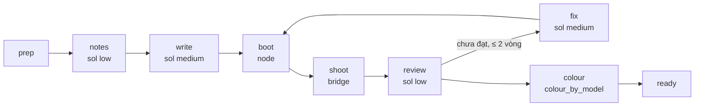

# Bàn giao: workflow tự động dựng 3D — làm cho đẹp, chất lượng ngang agent, tối ưu token (2026-11-04 22:30)

Chủ dự án (11-04 22:20): "chuyển cho session khác làm tiếp; hình như chất lượng không bằng mấy cái cho sol Codex làm agent; workflow phải làm thật đẹp, thật tối ưu token cho tôi."

**Việc của phiên mới:** đưa `batch/auto3d.py` từ "chạy được" lên "đẹp bằng nơi agent làm, rẻ hơn, chạy ổn định", rồi chạy hàng đợi nổi tiếng. Đọc trước: `DIORAMA_BATCH_HANDOFF.md` §0000 (hàng đợi, màu), file này.

## 1. Hiện trạng

- Code: `logs/splat/diorama/batch/` — `auto3d.py` (điều phối, trạng thái `places/<slug>/auto3d.json`, chạy lại thì tiếp từ bước dở), `ask_model.py` (gọi sol/Gemma như hàm: prompt + ảnh → JSON, qua 9router `/v1/responses`), `colour_by_model.py`, `auto_colormap.py`, `colour_inventory.mjs`, `eyedrop.py`, `set_colormap.py`, `write_colour_notes.py`, `hot_places.py`.
- Lệnh: `python3 batch/auto3d.py queue --tier A --n 3 --parallel 3 | run <fid|slug> [--kit K] | status | gallery | publish <slug…>`.
- Thử 11-04 (3 nơi hạng A, log NAS `logs/auto3d_pilot_20261104.log`, ảnh `frontend_images/space3d-auto3d-pilot-3-noi.jpg`):

| Nơi | Kit | sol tự chấm | Vòng sửa | Token | Opus xem |
|---|---|---|---|---|---|
| Đường Hầm Điêu Khắc | garden | 7 (chưa đạt) | 2 | 148k | cổng đất đỏ + tượng đầu người có, chưa đối chiếu ảnh |
| Quảng trường Lâm Viên | garden | 7 (đạt) | 1 | 154k | **yếu**: nền xám trống, chỉ một khối mái; thiếu hồ và công trình lớn |
| Dinh I Bảo Đại | villa | 4 (chưa đạt) | 2 | 140k | **gần đạt**: dinh vàng mái đỏ, vườn hoa, lối đá đúng; sol chấm quá khắt |

- Phân bổ token mỗi nơi: notes 5k, write 21–27k, **fix 80–95k (2 lượt)**, review 13–19k, màu ≈ 13k. Lượt sửa đắt vì gửi lại cả danh mục kit (15–32k) và cả `place.json`.
- **Cả ba chưa lên web, chưa commit.** `ready` nghĩa là qua hết bước, không phải đã duyệt.

## 2. Vì sao chất lượng thấp hơn lượt agent (giả thuyết, chưa kiểm — phiên mới đo)

Số agent đã đo trước đó (handoff §000): một nơi dùng kit có sẵn ≈ **80–220k token sol**, một lượt dựng + một lượt sửa, đạt ngang Linh Sơn / Con Gà. Tức token workflow hiện nay (140–154k) **không đắt hơn**; thiếu là chất lượng. Nghi ngờ theo thứ tự:

1. **Mắt kém.** Agent mở từng ảnh gốc trong `photos/` để giải quyết một nghi vấn; workflow chỉ đưa một `contact.jpg` đã thu nhỏ về 1400 px (sheet 2280 px, mỗi ảnh còn rất nhỏ). Chi tiết kiến trúc (số vòm, hình mái, tỉ lệ) mất.
2. **Vòng lặp một ảnh.** Agent tự chụp, tự xem, tự sửa tới 3 vòng trong một ngữ cảnh liền mạch (nhớ nó đã thử gì). Workflow mỗi lượt sửa là một lời gọi mới, không nhớ lượt trước, nên sửa chỗ này làm hỏng chỗ khác.
3. **Người chấm = người viết.** sol chấm render của chính sol, điểm ít phân biệt (4 cho Dinh I trông ổn, 7 "đạt" cho Quảng trường trống).
4. **Nơi cảnh quan không hợp kit.** Quảng trường Lâm Viên (hồ, công trình lớn) rơi vào `garden`, kit không có; sol "xấp xỉ" bằng khối nhỏ. Cần `kit_gaps` rõ và một lượt mở rộng kit, không phải 2 vòng sửa.
5. Brief của agent (`BRIEF_place.template.md`) có luật trả giá mà prompt hàm chưa chép đủ: đặt tên `route` đúng định dạng, "Plan layout once", "không đọc kit/template", danh mục ảnh bỏ. Đối chiếu từng dòng.

## 3. Việc cần làm (thứ tự đề xuất)

1. **Đo trước khi sửa.** Chạy lại Dinh I và Quảng trường bằng agent cũ (`run_agent.sh sol … medium`, `make_place_brief.py`) làm mốc so sánh **nếu sandbox sống** (mục 4); nếu không, dùng nơi đã đạt (Con Gà, Dinh III) làm "đề thi": chạy workflow trên ảnh của chúng, so với `place.json` đã duyệt về số công trình, vị trí, màu. Đây là bộ kiểm hồi quy chất lượng để tối ưu không làm tụt.
2. **Cho sol thấy ảnh tốt hơn.** Bước notes chọn ~6 ảnh **bằng chứng** (số `gNN`); các bước write / fix / review gửi chính các ảnh đó ở độ phân giải đầy đủ (≈ 1024 px) thay cho contact thu nhỏ; contact chỉ để định hướng. Đo xem token ảnh tăng bao nhiêu (ảnh ≈ 1–1,5k token mỗi tấm).
3. **Lượt sửa rẻ và có trí nhớ.** (a) Gửi `place.json` hiện tại + chỉ các mục danh mục liên quan loại đồ vật đang dùng (không gửi cả 15–32k danh mục); (b) trả về **bản vá** (danh sách đồ vật / hotspot đổi, thêm, xoá) thay cho cả file, code ghép lại; (c) đưa lịch sử các lần sửa trước vào prompt ("đã thử X, review nói Y") để khỏi lặp. Mục tiêu: lượt sửa ≤ 25k thay vì 80–95k mỗi nơi.
4. **Giữ cache.** Phần đầu prompt giống nhau giữa các nơi cùng kit (luật + danh mục + ví dụ) đặt lên đầu, phần riêng (ảnh, ghi chú) xuống cuối; kiểm 9router có báo `cached_tokens` trong `usage` không, nếu có thì sắp xếp để trúng cache.
5. **Chấm có điểm neo.** Review không cho sol tự do chấm; đưa checklist từ `signature` (ghi ở notes): mỗi mục "có / không / sai chỗ", pass = ≥ 80 % mục có và không có lỗi chặn khung. Nơi vào kit không hợp thì notes trả `kit_gap` và workflow dừng ở `needs_kit` thay vì đốt 2 vòng sửa.
6. **Cổng người xem rẻ.** `gallery` ra một ảnh nhiều nơi kèm điểm checklist; Opus / chủ dự án chỉ xem ảnh này và các nơi `needs_kit` / trượt.
7. **Màu**: giữ nguyên `colour_by_model.py` (đã hiệu quả, ≈ 13k token / nơi), nhưng kiểm lại ví dụ "photo → input" qua `precomp`.
8. **Chạy hàng đợi** theo `DIORAMA_BATCH_HANDOFF.md` §0000: đợt 1 hạng A (17 nơi ≥ 1000 review), rồi kit cảnh quan, rồi crawl ảnh hạng C.

**Mục tiêu đo được:** trên bộ đề thi (mục 3.1) chất lượng không thấp hơn lượt agent; token mỗi nơi ≤ ~100k (hiện 140–154k); số vòng sửa trung bình ≤ 1; Opus chỉ xem `gallery`.

## 4. Hạ tầng: sandbox Codex đang chết

- Mount NFS `10.206.3.12:/aiclub_students → /run/nas-test` của root treo ở trạng thái D (11-04 22:30: **6 giờ 14 phút**, từ ~16:15). Mọi `bwrap --ro-bind / /` treo → `run_agent.sh` (Codex agent) không dùng được, kể cả chế độ landlock (vẫn cần bwrap). Cần quyền root để gỡ (`umount -l /run/nas-test` hoặc khởi động lại NFS client) — báo quản trị máy.
- **Workflow hàm không cần sandbox**, nên chạy bình thường. Đó là lý do nó tồn tại; nhưng khi mount được gỡ, nên thử **chế độ lai**: bước write/fix bằng agent (có công cụ, tự chụp, nhớ ngữ cảnh) và phần còn lại do script, rồi so với chế độ hàm trên cùng bộ đề thi.
- Kiểm trước khi phát lượt agent: `ps -eo stat,args | awk '$1~/D/' | grep -E "mount|bwrap"` phải rỗng; `batch/wait_sandbox_then.sh` chờ.
- Bridge chụp: 3 worker (`bridge/serve.py`; đã sửa 11-04 để một yêu cầu lỗi không giết worker, bản cũ `serve.py.bak_20261104c`). `ps -eo args | grep "[b]ridge/serve.py"` phải có ≥ 3 dòng. HTTP: `python3 -m http.server 8471 --bind 127.0.0.1` (trong `logs/splat/diorama`) và `:8472 -d web/public` cho viewer web.
- 9router :20128 phải sống (`curl -s http://127.0.0.1:20128/v1/models`); khởi động lại như `run.sh`.

## 5. Ràng buộc từ chủ dự án

- **Chỉ dùng sol** (11-04: "Gemma không làm được thì bỏ"). Gemma hỏi mở dao động (đã thử Bon Tơr Nun), hỏi hẹp ổn định; chỉ dùng lại nếu chủ dự án hỏi hoặc quota là vấn đề. Lane `lan`/`uit` còn trong `ask_model.py` (UIT cần certifi CA — đã xử lý).
- **Tiết kiệm token của điều phối (Opus) nhất**: phiên điều phối không xem từng ảnh nhỏ; chỉ xem `gallery` và nơi trượt.
- Chưa duyệt = chưa deploy (`RULE.md` §0.2): ảnh `frontend_images/space3d-*` chủ dự án xem trước. `publish` chỉ cập nhật `web/space3d/places.json` + build + check + poster, **không** triển khai production.
- Không commit/push khi chưa được yêu cầu (nhiều phiên cùng sửa cây làm việc; đọc `git status` trước).
- Màu theo ảnh thật, rực rỡ, không đơn sắc, không lạnh (chủ dự án 14:40); công cụ màu ở §0000 của `DIORAMA_BATCH_HANDOFF.md`.

## 6. Tệp liên quan

| Thứ | Chỗ |
|---|---|
| Workflow, prompt | `logs/splat/diorama/batch/auto3d.py` (prompt `NOTES_PROMPT`, `WRITE_PROMPT`, `FIX_PROMPT`, `REVIEW_PROMPT`) |
| Brief agent cũ (luật trả giá) | `batch/BRIEF_place.template.md`, `batch/INTERIOR_RULES.md`, `batch/make_place_brief.py`, `batch/make_fix_brief.py` |
| Danh mục kit | `kits/catalog/<kit>.md`, ví dụ `kits/examples/<kit>.place.json` |
| Nơi đã đạt (đề thi) | `places/conga/`, `places/dinh3/`, `places/camly/`, `places/linhphuoc/` |
| Ba nơi thử | `places/{duonghamdieukh,quangtruonglam,dinhibaodai}/` (`auto3d.json`, `NOTES_coord.md`, `place.json`, `COLOURS.md`) |
| Log pilot | NAS `/AIClub_NAS/luanhh/tripguardian/splat/diorama/logs/auto3d_pilot_20261104.log` |

## 7. Phiên 11-04 22:10 (dừng vì máy sắp reboot)

Chủ dự án: "nếu workflow không được thì dùng agent cũng được, nhưng phải là automation" → được phép **chế độ lai**: `auto3d.py` vẫn điều phối; bước write/fix gọi `run_agent.sh sol …` tự động khi sandbox sống. Reboot sẽ gỡ mount `/run/nas-test` treo → kiểm lại `ps -eo stat,args | awk '$1~/D/' | grep -E "mount|bwrap"`.

Đã đo:
- **Ảnh rẻ, tính theo điểm ảnh:** sol ≈ 1 token / 840 px, không thu nhỏ (contact 2280×1296 cạnh 1400 = 1,3k token; cạnh 2048 = 2,8k). Ảnh gốc `photos/gNN.jpg` chỉ 768 px ≈ 400 token mỗi tấm → gửi 6–8 ảnh bằng chứng nguyên cỡ ≈ 3k token. Contact cạnh 1400 làm mỗi ảnh con còn ~175 px: giả thuyết "mắt kém" (§2.1) đúng.
- **9router không báo `cached_tokens` và bỏ qua `previous_response_id`** (gọi lần 2 "không có câu trả lời trước"). Muốn rẻ phải gửi ít đi thật sự; trí nhớ giữa các lượt sửa phải tóm tắt vào prompt. Mỗi lời gọi có ≈ 2,5k token chi phí cố định của router.
- Danh mục kit ≈ 7–8k token, ví dụ ≈ 3,5k.

Đã viết, **chưa chạy thử**: `logs/splat/diorama/batch/route_fix.mjs <slug> [--all]` — build nơi, raster hoá mặt lát 0,25 m, kéo `walk` của điểm dừng về mặt lát gần nhất (≤ 8 m), dựng lại chặng hỏng bằng A* + thẳng hoá; thay lượt sol sửa lỗi boot "Walking route has no paved ground" (pilot tốn 2 × 30k). Thư mục thử `places/x_rt/` có thể xoá. Bản cũ workflow: `batch/auto3d_v1_20261104.py`.

Kế hoạch v2 (chưa code): notes trả `signature` có id + ảnh + loại kit đại diện, và `evidence` ≤ 8 ảnh; write gửi ảnh bằng chứng nguyên cỡ + trả `signatureMap`; chuẩn hoá tất định trước boot (tên ảnh `gNN.jpg`, id trùng, route_fix); lỗi boot còn lại → sol vá không gửi danh mục/ảnh; review = lượt mới, checklist từng mục (ok/yếu/thiếu/sai, nguyên nhân data|kit), ghép mỗi điểm dừng render ↔ ảnh của nó; code quyết định đạt; fix trả **bản vá** + lịch sử lượt trước; mục `must` trượt vì kit → `needs_kit`; `exam` chạy lại trên bản sao `x_<slug>` của nơi đã duyệt để so.

Lưu ý: `logs/` bị `.gitignore` → toàn bộ code 3D (`logs/splat/diorama/`) **không có trong git**, chỉ nằm trên đĩa.
