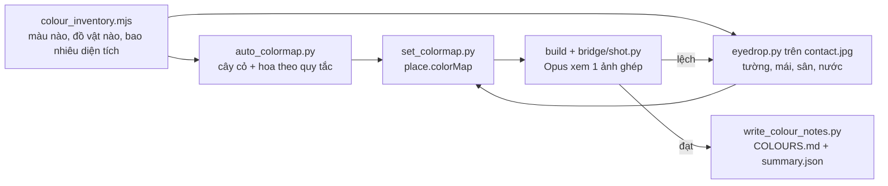
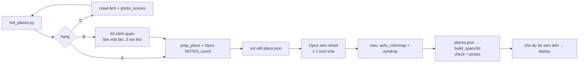
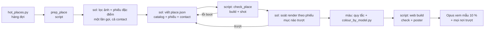
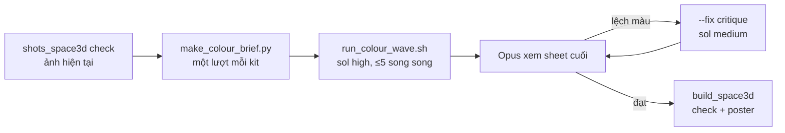
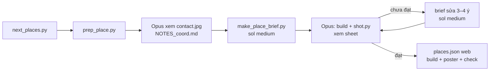
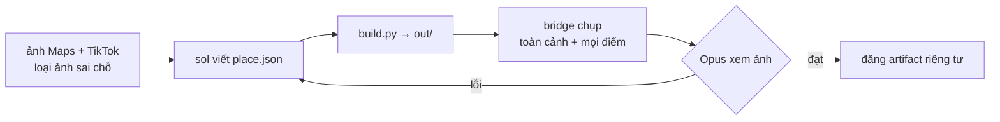
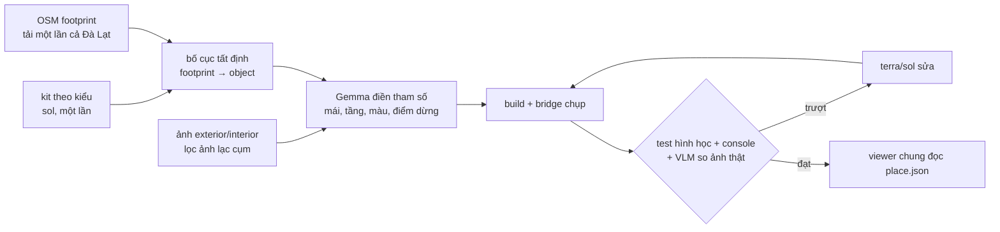

# Bàn giao: "Khám phá 3D" dạng mô hình kiến trúc — làm hàng loạt Đà Lạt bằng kit (2026-11-04)

> **Phiên mới làm workflow tự động: đọc [AUTO3D_WORKFLOW_HANDOFF.md](AUTO3D_WORKFLOW_HANDOFF.md) trước** (11-04 22:30: workflow `auto3d.py` chạy được nhưng chất lượng chưa bằng lượt agent; nhiệm vụ = làm đẹp + tối ưu token).

## 0000. LUỒNG SCALE 3D CHO CÁC ĐỊA ĐIỂM NỔI TIẾNG ĐÀ LẠT — đọc đầu tiên (2026-11-04 tối)

Chủ dự án (11-04 tối): "làm full màu sắc cho các địa điểm còn lại, kiểm tra còn lỗi không", rồi "rút thành cách thức để scale cho full địa điểm Đà Lạt, tối thiểu là các địa điểm nổi tiếng".

**Màu đã xong cho cả 29 nơi** (27 nơi lượt `ccm1` + Linh Phước, Linh Ẩn từ trước). Ảnh trước/sau trên viewer web: `frontend_images/space3d-mau-27-noi-truoc-sau-1.jpg`, `-2.jpg`. Viewer web đã build lại (`web/public/space3d`), 29/29 qua `shots_space3d.mjs check`, poster mới. **Chưa deploy** — chờ chủ dự án xem ảnh (`RULE.md` §0.2).

### Cách đổi màu mới (không cần model con, Opus tự làm ≈ 4–5 ảnh/nơi)

Lượt màu bằng sol bị chặn cả buổi chiều: mount NFS `/run/nas-test` của root treo (trạng thái D từ ~15:50) làm mọi `bwrap` treo, kể cả chế độ landlock của Codex (vẫn cần bwrap). Thay bằng một cơ chế tất định:

- `index.template.html` → `applyColorMap`: `place.colorMap` `{"#cũ": "#mới"}` đổi màu sau khi dựng xong, trên màu vật liệu, màu instance và vertex color. Không có map = render y cũ (Linh Phước, Linh Ẩn chụp lại lệch ≤ 0,35/255). Bản template trước khi sửa: NAS `splat/diorama/index.template.before_colormap_20261104.html`. Không phải sửa kit nào.
- `batch/colour_inventory.mjs <slug> [min%] [--json]`: boot trong node, liệt kê màu theo diện tích kèm `loại:id` đồ vật.
- `batch/auto_colormap.py <slug> [--apply]`: cây cỏ xanh xám → xanh đậm đã duyệt (v×0,65, s×2,7, mảng ≥ 3 % diện tích tối đa s 0,38); hoa trong `colors`/`flowerColor(s)` → cùng sắc, bão hòa như hoa thật; hoa gần trắng giữ trắng; bỏ qua mọi màu khai báo ở trường kết cấu (roof/wall/glass/frame/plinth…).
- `batch/eyedrop.py <ảnh> x,y[,r] …`: in màu ảnh và cột **input** = màu đã bù ngược lớp `grade` (grade nhân bão hòa 1,87 với màu nhạt, 1,32 với màu đậm). Ghi thẳng màu ảnh vào map là sai: ra cam/xanh chuối (đã gặp ở Cam Ly, Mai Anh, Bích Câu).
- Lỗi đã gặp, đã chặn trong công cụ: màu vách nội thất trùng màu cây (Bon Tơr Nun `#a7b29a`); mái/kính/bệ của kit garden bị coi là cây; bọt nước `#d4d7c5` bị nhuộm ô liu; cỏ đã đậm sẵn bị đẩy thành xanh chuối (Linh Sơn).
- Còn lệch nhỏ (ghi ở `COLOURS.md` từng nơi): vách trong Mai Anh hồng (ảnh kem, chung khóa với tường ngoài); mái tôn Bon Tơr Nun còn hơi xanh; mái Chợ Mới xanh lá (ảnh không thấy mái); nền rừng thông Chùa Tàu là mặt đế kem (cần thêm đồ vật nền, không phải việc màu).

### Hàng đợi địa điểm nổi tiếng

`python3 batch/hot_places.py [min_reviews] [--json out]` xếp mọi nơi đang phục vụ theo số review, gắn hạng ảnh:

| Hạng | Điều kiện | ≥ 1000 review (11-04) | Làm gì |
|---|---|---|---|
| done | đã có trên web | 17 | — |
| A | ≥ 8 ảnh `exterior` | 17 (điểm tham quan 6, cà phê 6, chỗ ở 2…) | quy trình §000 "một nơi" với kit có sẵn |
| B | `exterior` + `view` ≥ 8 | 58 (điểm tham quan 21, cà phê 13…) | cảnh quan: Datanla, Thung lũng Tình Yêu, Langbiang, Mongo Land, Cáp treo, Thung Lũng Vàng, Hoa Sơn Điền Trang, Fresh Garden… |
| C | ít hơn | 134 (phần lớn quán ăn / chỗ ở chỉ có ảnh trong) | crawl lại 30 ảnh/nơi trước; ưu tiên Chợ Đêm, ZooDoo, Langfarm, Làng Nấm, Dapa Hill |

Cổng cũ (`inventory.json`, chỉ đếm `exterior`) bỏ sót gần hết điểm cảnh quan nổi tiếng nhất vì ảnh của chúng được gán `view`. Với ngưỡng ≥ 300 review: 707 nơi (A 51, B 121, C 509).

**Thứ tự đợt**
1. **Đợt 1 — hạng A ≥ 1000 review (17 nơi):** Đường Hầm Điêu Khắc, Quảng trường Lâm Viên, Dinh I, Terracotta, Đồi Mộng Mơ, Ana Mandara, IXORA, Xuân Hương Garden, Vườn Địa Đàng, QUÊ Garden, Núi Voi, Làng hoa Vạn Thành, Hoàng Long Ohayo, BBQ Mọ Tề, Chênh Vênh, Euro Garden, Thị Trấn Nobi. 9 nơi kit `landmark`: thử xếp vào kit có sẵn trước (quảng trường → `garden`/`market`, dinh → `villa`, đường hầm → `garden` + phù điêu).
2. **Đợt 2 — kit cảnh quan** (một lượt sol `high` mở rộng `nature`/`garden`: hồ lớn, đồi nhiều tầng, đỉnh núi, rừng thông, cáp treo, điểm ngắm), thử trên Datanla, Thung lũng Tình Yêu, Langbiang → rồi 58 nơi hạng B theo review.
3. **Đợt 3 — crawl ảnh** cho hạng C nhóm tham quan (cửa sổ đăng nhập Maps, captcha do chủ dự án giải), rồi `photo_scenes`, chạy lại `hot_places.py`.
4. Mỗi đợt: chỉ dùng `sol` (terra trượt 4/4), ≤ 8 model con cùng lúc (bridge 3 worker), Opus xem 100 % 10 nơi đầu mỗi kit rồi mẫu 10 %, màu luôn làm bằng công cụ trên ngay sau khi hình đạt.

### Tự động hóa: ai làm gì (đề xuất 11-04 tối, chờ chủ dự án duyệt pilot)

Chủ dự án: "sol vẫn tốn quota; Gemma UIT và Gemma LAN không tốn, tận dụng hai đứa"; "dùng sol điều phối Gemma để dễ scale?".

Đã thử (11-04):
- `batch/ask_model.py`: gọi model như **một hàm** (prompt + ảnh → JSON), không agent, không shell, nên không cần sandbox. Lane `lan` (192.168.20.150:8900), `uit` (cần bộ CA certifi), `gemma` = LAN rồi UIT, `sol` = 9router (trả phí). sol đọc ảnh: 5,6 s, ≈ 4 nghìn token/câu.
- **Gemma hỏi mở thì dao động**: `batch/colour_by_model.py` (Gemma tự soát "chỗ nào sai màu") trên Bon Tơr Nun: vòng 1 đòi làm nhạt cây, vòng 2 đòi làm đậm lại, không thấy mái tôn. Đã trả về bản cũ.
- **Gemma hỏi hẹp thì ổn định**: "màu mái tôn sảnh ăn" × 3 lần × 2 lane → `#7a7a7a`–`#8b8b8b` cả 6 lần, đúng ảnh.

**Chủ dự án chốt (11-04 tối): "Gemma không làm được thì bỏ, dùng sol thôi".** Gemma không nằm trong luồng (lane vẫn còn trong `ask_model.py`, chỉ dùng khi chủ dự án yêu cầu lại).

Thử sol hàm trên Bon Tơr Nun (`batch/colour_by_model.py`, mặc định `--model sol`): hai lượt soát, mỗi lượt vài nghìn token, tìm đúng các lỗi Opus và Gemma bỏ sót (mái tôn xám kẽm, cầu thang + lan can vàng g05/g10, sàn sảnh xám bóng g14, lối vào đá xám, cột gỗ nâu sẫm). Đã giữ kết quả, build web, `check` ok.

Kết luận: **người điều phối là script (máy trạng thái), sol là công nhân dạng hàm**. Để sol làm agent điều phối thì mỗi bước tốn token dò file, kém ổn định hơn code, và chế độ agent đang bị chặn (bwrap). Mỗi lần gọi sol chỉ hỏi một việc, trả JSON cố định; script build, chụp, kiểm rồi gửi ảnh lại.

| Bước | Ai | Việc (JSON cố định) |
|---|---|---|
| Hàng đợi, trạng thái, thử lại, build, chụp, web | script `auto3d.py` (chưa viết) | trạng thái mỗi nơi ở `places/<slug>/auto3d.json` |
| Lọc ảnh + phiếu đặc điểm | sol, một lần gọi, effort low | ảnh nào đúng nơi / bỏ (nơi bên cạnh, người, lễ); checklist theo kit (số tháp, kiểu mái, số tầng, hướng cổng, màu từng bề mặt) kèm số ảnh → `NOTES_coord.md` tự động, thay việc Opus xem `contact.jpg` |
| Viết / sửa `place.json` | sol, effort medium | catalog kit + ví dụ + phiếu + contact → `place.json`; lỗi boot và mục checklist trượt gửi lại, ≤ 3 lượt |
| Soát render | sol, effort low | ảnh render + phiếu → danh sách mục trượt có số ảnh |
| Màu | quy tắc + sol | `auto_colormap.py`, rồi `colour_by_model.py` (sol đọc màu ảnh, code bù grade và áp), ≤ 2 vòng |
| Duyệt | Opus | xem 10 % + mọi nơi có mục trượt; chủ dự án duyệt ảnh trước deploy |

Nút cổ chai là bridge chụp (3 worker, ≈ 1,5 phút/nơi). sol dạng hàm ước 30–80 nghìn token/nơi (không tốn token dò file như agent; một lượt soát màu ≈ 5–8 nghìn).

Pilot đề xuất: viết `auto3d.py`, chạy 3 nơi hạng A (Đường Hầm Điêu Khắc, Dinh I, Đồi Mộng Mơ), đo token sol, số vòng; Opus xem 100 % trước khi mở rộng.

**Trước khi phát model con:** `ps -eo stat,args | awk '$1~/D/' | grep -E "mount|bwrap"` phải rỗng. Nếu mount còn treo: Opus vẫn làm được mọi bước không cần sol (chọn nơi, NOTES, màu, build web, kiểm); bước viết `place.json` thì chờ (`batch/wait_sandbox_then.sh`) hoặc Opus tự viết cho nơi ưu tiên cao. Gỡ mount cần quyền root (báo quản trị máy).

**Chi phí ước:** dựng một nơi bằng kit có sẵn ≈ 80–220 nghìn token sol; màu ≈ 4–5 ảnh Opus/nơi. Đợt 1 ≈ 2–4 triệu token sol; 58 nơi hạng B ≈ 6–12 triệu + một lượt kit ≈ 0,9 triệu.

## 000. BÀN GIAO BƯỚC CHẠY HÀNG LOẠT — đọc đầu tiên (2026-11-04 14:00)

Chủ dự án (11-04): "đạt chất lượng cao nhất, bổ sung kit hết đủ", rồi "xong kit thì chuyển giao bước scale cho session khác". Kit đã xong; **việc của session mới = dựng 233 nơi còn lại**, chất lượng ngang Linh Sơn / Con Gà, ít token nhất.

**Màu (chủ dự án 2026-11-04 14:40): "màu sắc rực rỡ, đúng màu của ảnh, không đơn sắc, không lạnh"** — thay quyết định "nền kem, cây xám mút xốp, mái trầm" ở §1.
- Đã làm chung cho mọi kit trong `index.template.html`: bảng `palette` ấm và đậm hơn, nắng ấm + đèn phụ xanh trời, exposure .96, bỏ bước pha xám mái, thêm `grade` (ShaderPass sau `OutputPass`: tăng bão hòa chỉ trên mặt có màu, kéo xanh ô liu về xanh lá, ấm nhẹ, tương phản 1,07). Bản cũ: NAS `splat/diorama/index.template.before_color_20261104.html`.
- `batch/BRIEF_place.template.md` và `kits/README.md` giờ yêu cầu lấy màu tường, mái, viền, sân từ ảnh, ghi màu thật (không pha xám).
- Đổi màu từng nơi theo ảnh, thử trên Linh Phước + Linh Ẩn (15:00–16:10): `BRIEF_kc_colour.md` (sol high, 194k token, cả hai chùa một lượt vì chung kit) → Opus xem → `BRIEF_kc2_colour.md` (sol medium, 89k: nội thất Linh Phước gỗ sơn mài + vàng, ngói jade đậm hơn, tường Linh Ẩn kem). Đạt: `out_linhphuoc/sheet_kc2lp2.jpg`, `out_linhan/sheet_kc2la2.jpg`; trước/sau `frontend_images/space3d-mau-chua-truoc-sau.jpg`. Kit `pagoda` có thêm trường màu (mặc định = cũ; Chùa Tàu, Trúc Lâm lệch < 0,6/255). Mỗi nơi ghi màu lấy mẫu ở `places/<slug>/COLOURS.md`. ≈ 140k token / nơi.
- Chủ dự án duyệt cách này (16:20) và giao làm 27 nơi còn lại theo đúng quy trình dưới. Đợt 11-04: 9 lượt (`batch/colour_wave_20261104.txt`, log NAS `logs/colour_wave_20261104.log`), Linh Sơn chạy riêng sau cùng.

**Quy trình đổi màu theo ảnh (dùng cho mọi nơi đã dựng mà còn màu nhạt)**

1. `node web/scripts/shots_space3d.mjs http://127.0.0.1:8472 check` (ghi `web/shots/space3d/<slug>-0/1.png` = ảnh "trước").
2. `cd logs/splat/diorama && python3 batch/make_colour_brief.py <kit> <tag> <slug,slug,…>` → `BRIEF_<tag>_colour.md` (từ `batch/BRIEF_colour.template.md`) + in lệnh chạy. Một lượt gom mọi nơi cùng kit; tự lấy nơi cùng kit ngoài lượt làm regression. Kit `template` (Linh Sơn, builder trong `index.template.html`) chạy **một mình**, không cạnh lượt nào khác.
3. Chép các lệnh in ra vào một file, `setsid nohup bash logs/splat/diorama/batch/run_colour_wave.sh <file> 5`. Model con tự so ảnh ↔ render, ghi `places/<slug>/COLOURS.md` (chỗ sai + hex + số ảnh), thêm trường màu cho kit (mặc định = cũ), ≤ 3 vòng chụp.
4. Opus xem sheet cuối mỗi nơi (`out_<slug>/sheet_<tag>…jpg`), so với `contact.jpg`. Lỗi hay gặp ở lượt đầu: nội thất chép họa tiết ngoài trời, mái quá sáng (mint), tường ngả mù tạt. Có lỗi → viết 2–4 ý có số ảnh vào file, `make_colour_brief.py … --fix critique.md`, chạy (sol medium).
5. Đạt → `node web/scripts/build_space3d.mjs` → `shots_space3d.mjs … check <slug…>` (phải `ok`) → `… poster x <slug…>` → ảnh trước/sau vào `frontend_images/` cho chủ dự án.

Chi phí đo được: ≈ 140k token sol / nơi (lượt chính ~95k/nơi khi gom 2 nơi, lượt sửa ~45k/nơi). Nơi mới dựng từ nay đã lấy màu theo ảnh ngay trong `BRIEF_place.template.md`, không cần lượt riêng.

**Trạng thái**
- Đủ 8 kit + `station` (`kits/*.js`, danh mục từng kit `kits/catalog/<kit>.md`, ví dụ `kits/examples/<kit>.place.json`). Đợt mở rộng 11-04 (sol `high`, 0,52–0,88 triệu token mỗi kit) thêm: tượng Quan Âm / Phật ngồi / Di Lặc / hộ pháp, cổng tam quan, chính điện thấp (`pagoda`); mặt tiền ba vòm, đầu hồi hai màu, cầu thang đôi, dãy vòm nhiều tầng, vòng Đức Mẹ (`church`); nhà phố hẹp mansard, sân hiên, nhà hàng xóm, hàng rào, bonsai (`stay`); mái tôn lớn, nhà sàn, chum, cổng lá, thác đá, cỏ cong, cây già (`storefront`); cụm nhà chữ A, khách sạn mansard, hồ / hồ bơi, sảnh piano (`villa`); địa hình thung lũng, ruộng hoa, cầu bàn tay, cầu thang trời, phù điêu (`garden`); toà chợ nhiều tầng lam gạch, dãy nhà phố, dù, lều tôn, nội thất chợ (`market`); lều safari / chuông / cabin kính / dome, suối đá, dây đèn, bếp lửa (`nature`).
- 29 nơi trong `web/space3d/places.json`, Opus đã xem ảnh từng nơi (16 nơi mới: `frontend_images/space3d-kit-moi-1.jpg`, `-2.jpg`); cả 29 qua `shots_space3d.mjs check`, 13 nơi cũ giữ nguyên sau khi mở rộng kit. **Chưa lên production**: chủ dự án chưa duyệt ảnh tab 3D (`frontend_images/space3d-*`, `RULE.md` §0.2); bản build tạm `web/.deploy-build` đã cũ.
- Còn lại: `python3 batch/next_places.py [kit] [n]` (trừ nơi đã có trên web và `batch/skip.json`). 11-04: stay 57, storefront 53, landmark 36, pagoda 23, church 20, villa 18, garden 18, market 5, nature 2, chưa xếp 3 (Vườn nhiệt đới khủng long, Vườn dâu Khải farm 2, Trại Mát → xếp tay).

**Quy trình một nơi (đã đo trên 24 nơi)**

1. `python3 batch/next_places.py <kit> 8` → `../../../.venv/bin/python batch/prep_place.py <slug> <fid>`.
2. Opus xem `places/<slug>/contact.jpg` (một ảnh), viết `places/<slug>/NOTES_coord.md` 4–6 dòng: đặc trưng nhận diện kèm số ảnh, bố cục / hướng cổng, ảnh bỏ (ảnh nơi bên cạnh, người, lễ). Nơi không có ảnh kiến trúc → thêm vào `batch/skip.json` kèm lý do.
3. `python3 batch/make_place_brief.py <slug> <kit> <tag> places/<slug>/NOTES_coord.md [--interior]` (`--interior` khi ≥ 4 ảnh nội thất và kit có nội thất). Chạy `bash logs/splat/agents/run_agent.sh sol logs/splat/diorama/BRIEF_<tag>_place.md <NAS log> medium logs/splat/diorama/places/<slug>/contact.jpg` (nền, `setsid nohup`, thêm `echo EXIT=$?` vào log). Lượt này chỉ viết `place.json`: 35–140 nghìn token.
4. Opus tự chụp (không tin ảnh của model con): `python3 build.py places/<slug>/place.json out_<slug>/` + `../../../.venv/bin/python bridge/shot.py z<slug> --out out_<slug>` → xem `out_<slug>/sheet_z<slug>.jpg`. Ghép nhiều nơi vào một ảnh để tiết kiệm token xem.
5. Chưa đạt → viết 3–4 nhận xét cụ thể có số ảnh vào một file, `python3 batch/make_fix_brief.py <slug> <kit> <tag> <critique.md> out_<slug>/sheet_z<slug>.jpg [--interior]`, chạy như bước 3 kèm ảnh sheet thay contact (mẫu: `BRIEF_pmc_place.md`). 40–80 nghìn token. Đa số đạt sau một lượt sửa.
6. Đạt → thêm dòng vào `web/space3d/places.json` → `node web/scripts/build_space3d.mjs` → `python3 -m http.server 8472 -d web/public` → `node web/scripts/shots_space3d.mjs http://127.0.0.1:8472 poster x <slug…>` → `… check web/shots/space3d <slug…>` (phải `ok`).

**Luật đã trả giá mới học**
- Chỉ dùng `sol`. `terra` medium cùng token nhưng trượt 4/4 nơi thử.
- Brief phải để model con chạy `node check_place.mjs <slug>` trước khi chụp (lỗi định dạng `route` từng làm 4 nơi dựng mù) và **không đặt timeout cho `bridge/shot.py`** (model con tự đặt 55 s nên không bao giờ thấy ảnh). Cả hai đã nằm trong `batch/BRIEF_place.template.md`.
- `shot.py` ghi ảnh ghép vào `out_<slug>/` vì `bridge/out` là NAS ngoài sandbox của model con.
- Cầu chụp có 3 worker: chạy tối đa ~8 model con cùng lúc; hơn nữa thì chụp xếp hàng 10–15 phút.
- Thiếu sót lặp lại ≥ 3 nơi trong `summary.json` `kit_gaps` → một lượt mở rộng kit (`batch/BRIEF_kitext.template.md`, sol `high`), kèm danh sách nơi đang dùng kit để chụp trước/sau. Không chạy hai lượt sửa cùng một file kit. Không build web viewer khi một kit đang sửa dở (mọi kit chung một bundle).
- `node check_place.mjs gadalat` báo lỗi `document is not defined` do kit `station` nạp ảnh tường; không phải hồi quy, kiểm Ga bằng trình duyệt.
- Một mount NFS treo trên máy (11-04 15:50: root `mount.nfs4 … /run/nas-test`, trạng thái D) làm mọi sandbox Codex (`bwrap --ro-bind / /`) treo, kể cả `/bin/true`: 5 lượt màu đốt 217k token không làm được gì. Trước khi phát một đợt: `ps -eo stat,args | awk '$1~/D/' | grep -E "mount|bwrap"` phải rỗng; `batch/wait_sandbox_then.sh <phút> <lệnh>` chờ hết treo rồi mới chạy. Brief màu có luật "SANDBOX HUNG" để dừng sớm.
- `landmark` (36 nơi) không có kit chung: thử xếp vào kit có sẵn trước (dinh, quảng trường, đường hầm điêu khắc…); nơi nào không vừa mới làm kit riêng như `station` (sol `high`, 1–2 lượt).

**Chi phí đo được**: nơi dùng kit có sẵn ≈ 80–220 nghìn token sol (một lượt dựng + một lượt sửa); 233 nơi ≈ 25–45 triệu token sol, chưa tính landmark làm riêng.

## 00. Cập nhật 2026-11-04 08:35 — web production

Chủ dự án: "các địa điểm có 3D lên UI production, xem ở một tab trong Xem chi tiết". Việc 2 và 5 của §0 đổi thành: **không đăng artifact nữa, lên web**. Việc 1 của §0 đã xong: sáu lượt kit kết thúc, Opus xem ảnh, 6 nơi đại diện đã vào `web/space3d/places.json` (tổng 13 nơi).

- Viewer chung xong: `web/space3d/` (giao diện, `scroll.js` = tham quan bằng lăn chuột), `web/scripts/build_space3d.mjs` (lấy `index.template.html` + `kits/` ở đây, vá bằng bảng PATCH, thoát lỗi nếu mã cảnh không còn khớp). Xem `docs/Role_Web_Functional_Design.md` §6.
- Thêm một nơi: duyệt ảnh → thêm dòng vào `web/space3d/places.json` → `build_space3d.mjs` → `shots_space3d.mjs <base> poster x <slug>` → `shots_space3d.mjs <base> check` → triển khai web theo `build_web` trong `run.sh`. `<base>` = `python3 -m http.server 8472 -d web/public`.
- Không build khi một kit đang được sửa dở: mọi kit nằm chung một bundle, lỗi cú pháp ở một kit làm hỏng cả viewer.
- Còn thô: Thác Prenn điểm 4 "Sau màn nước" có vòm đá khối lớn che một góc; Vườn hoa toàn cảnh thưa.
- Chưa lên production: chờ chủ dự án duyệt ảnh `frontend_images/space3d-*` (`RULE.md` §0.2); `web/.deploy-build` đã cũ, phải build lại.

## 01. Thử quy trình rẻ 2026-11-04 09:30 (8 nơi, 4 kit)

Quy trình: `prep_place.py` → Opus xem `contact.jpg`, viết `NOTES_coord.md` → `batch/make_place_brief.py <slug> <kit> <tag> <notes> [--interior]` (brief `batch/BRIEF_place.template.md`: chỉ viết `place.json`, đọc `kits/catalog/<kit>.md` + ví dụ, `node check_place.mjs <slug>` trước khi chụp, `bridge/shot.py` ra một ảnh ghép `out_<slug>/sheet_<tag>.jpg`) → `run_agent.sh sol … medium` → Opus xem ảnh ghép, ghi 3–4 nhận xét → một lượt sửa `sol` → Opus xem.

| Nơi | Kit | Kết quả | Token tổng |
|---|---|---|---|
| Nhà thờ Mai Anh | church | tạm đạt (đầu hồi chưa hai màu) | 186k |
| Chùa Tàu | pagoda | tạm đạt | 155k |
| Bon Tơr Nun | storefront | tạm đạt | 136k |
| Kỳ Hòa | stay | tạm đạt (sân còn lát xám nhiều) | 139k |
| Bích Câu | storefront | tạm đạt | 168k |
| Thánh Tâm | church | trượt: kit nhà thờ không có mặt tiền kem ba vòm nhọn | — |
| Ami Hotel | stay | trượt: nhà phố hẹp, khung toàn cảnh cắt nhà | — |
| Linh Ẩn | pagoda | trượt: kit không có dáng tượng Quan Âm | — |

- `sol` medium đạt hơn `terra` medium với token như nhau → chỉ dùng `sol`.
- Lượt đầu tốn token vô ích vì `shot.py` ghi ảnh vào `bridge/out` (NAS, ngoài sandbox) và model con tự đặt timeout 55 s; đã sửa cả hai. Quy trình đúng ước ≈ 110–150k token / nơi (so với ≈ 1,1 triệu trước).
- 5 nơi đạt tạm đã vào `web/space3d/places.json` (18 nơi). Việc tiếp: bổ sung kit (tượng Quan Âm, mặt tiền nhà thờ ba vòm, nhà phố hẹp) trước khi chạy hàng loạt các nhóm đó.

## 0. BẮT ĐẦU Ở ĐÂY — bàn giao 2026-11-04 07:35 (phiên Opus trước)

Chủ dự án (11-04): "làm full kit để tiết kiệm token cho 3D; ngưỡng release tạm thời không chỉnh; 3D làm tới đâu đủ ảnh thì làm, hoặc crawl thêm; bàn giao".

**Đang chạy** (sol, nền; log `/AIClub_NAS/luanhh/tripguardian/splat/diorama/logs/run_<tag>_kit.log`, xong khi có dòng `EXIT=`): 6 lượt làm kit, mỗi lượt một nơi đại diện, giao kèm danh mục kit (`kits/README.md` mục mới, `kits/examples/<kit>.place.json`, `places/<slug>/summary.json`). Brief `BRIEF_<tag>_kit.md` từ `batch/BRIEF_kit.template.md`.

| Tag | Kit | Nơi đại diện (`places/<slug>`) | Phủ |
|---|---|---|---|
| `sf` | `storefront` | Gạch Since 1988 (`gach1988`) | 56 nơi |
| `st` | `stay` | Khách sạn Dalat Palace (`dalatpalace`), có nội thất | 60 |
| `vh` | `garden` | Vườn hoa Đà Lạt (`vuonhoa`) | 21 |
| `mk` | `market` | Chợ Lạc Nghiệp (`cholacnghiep`) | 8 |
| `nt` | `nature` | Thác Prenn (`thacprenn`) | 5 |
| `pg` | `pagoda` (mở rộng `kits/pagoda.js`, giữ Linh Phước) | Thiền viện Trúc Lâm (`truclam`) | 28 |

Đã có kit: `church` (Cam Ly A-frame + Con Gà basilica, 24 nơi), `villa` (Cadasa + Dinh III, 22), `station` (Ga, landmark riêng), `pagoda` (Linh Phước). `landmark` (37) làm riêng từng nơi.

**Việc tiếp theo, theo thứ tự:**
1. Khi 6 lượt xong: build lại + chụp đủ bộ mỗi nơi (`python3 build.py places/<slug>/place.json out_<slug>/` rồi `python3 bridge/request.py z<tag> --out out_<slug>`), Opus xem mọi ảnh (ghép bảng như các mục trên), chụp lại các nơi đã đạt để chắc không đổi (so pixel `00_initial` với `bridge/out/zcl`, `zcd`, `zgd`, `zlp`, `zcg2`, `zd32`). Lỗi → một lượt sửa theo `batch/BRIEF_r2.template.md`.
2. **Đăng**: Cadasa (`out_cadasa`), Con Gà (`out_conga`), Dinh III (`out_dinh3`) đạt nhưng chưa đăng — lần đăng Cadasa bị bộ kiểm quyền chặn ("chưa được yêu cầu"); hỏi chủ dự án trước khi đăng. Trước khi đăng phải đọc hết template + kit + `place.json` (luật artifact). Đã đăng: Cam Ly, Ga, Linh Phước (link ở bảng §6).
3. **Làm hàng loạt bằng kit** (tiết kiệm token): mỗi nơi = `prep_place.py` → Opus liếc `contact.jpg`, viết `NOTES_coord.md` 4–6 dòng → `make_brief.py` → một lượt chỉ viết `place.json` theo danh mục kit, **thử `terra` hoặc `sol` effort `medium`** trước (đo token/chất lượng trên 3 nơi đầu mỗi kit) → Opus xem → đăng hoặc một lượt sửa. Danh sách nơi: `batch/inventory.json` (264 nơi; đã có kit gợi ý + footprint OSM `osm_how`). Ưu tiên theo `reviews`.
4. **Crawl thêm ảnh** để mở rộng: 734 nơi đang phục vụ có 4–7 ảnh exterior (khách sạn 305, quán ăn 119, cà phê 95, điểm tham quan 34, vườn 34…); 1.151 nơi trước đây chỉ crawl `wanted` 12 ảnh. Crawl lại với 30 ảnh / nơi (`src/corpus/crawl/gmaps/photos.py` `photos_per_place`, job `logs/fill_photos.sh`, cửa sổ đăng nhập Maps; captcha do chủ dự án giải — xem memory "crawl" và `.superpowers/sdd/2026-10-30-corpus-fill/HANDOFF.md`), rồi `photo_scenes` (Gemma; LAN :8900 và UIT cùng không trả lời lúc 02:15 11-04 — kiểm lại), rồi tính lại `inventory.json` (≥ 8 exterior). Ưu tiên nhóm tham quan / vườn / tôn giáo trước khách sạn.
5. **Viewer chung**: thay một HTML mỗi nơi bằng một viewer nạp `places/<slug>.json` lúc chạy (template + mọi kit), rồi gắn vào trang địa điểm web (chủ dự án chưa duyệt phần web — hỏi trước).

**Ngưỡng release**: KHÔNG đổi (chủ dự án 11-04). Cổng `min_evidence` đã làm rồi gỡ; patch lưu ở `batch/release_gate_min_evidence.patch`, chỉ áp khi được yêu cầu.

**Hạ tầng**: bridge chạy 3 worker song song (`bridge/serve.py`, nhận việc bằng đổi tên file `req/*.json` → `.taken<pid>`, mỗi yêu cầu chụp từ bản sao `out_local_<slug>__<tag>` riêng); http.server :8471; 9router :20128. Ảnh chụp ở `bridge/out/<tag>/`.

Đọc file này trước. Lịch sử splat (đã bỏ) ở `docs/plans/SPACE_3D_HANDOFF.md`, chỉ đọc khi cần.

## 1. Đã chốt với chủ dự án

| Điều | Quyết định |
|---|---|
| Dạng | Mô hình kiến trúc thu nhỏ (Three.js), kéo xoay, cuộn phóng; nền kem. Màu: từ 2026-11-04 rực rỡ, đúng màu ảnh, ấm (xem §000); trước đó cây xám mút xốp, mái trầm |
| Xem | Tuyến tham quan có mũi tên trên mặt đất + thanh "← Trước · n/N · Tiếp →", nút "Bắt đầu tham quan"; bấm số trên mô hình cũng được |
| Bỏ | Khung ảnh thực tế, cột số bên trái |
| Bên trong | Làm nơi có ảnh nội thất thật: điểm ngoài nhấc mái (cắt lớp) → điểm "Bên trong …" camera tầm mắt, trần, đồ thờ/nội thất theo ảnh. Không có ảnh thì để đóng |
| Kiểm chất lượng | Opus (điều phối) tự xem ảnh chụp mọi góc; chủ dự án chỉ xem bản đạt |
| Mẫu đạt | Chùa Linh Sơn: https://claude.ai/artifact/FBd9hmbBXh1tatFiTx8dXN (version 1793729176-1a9d), mã nguồn bản đó ở `logs/splat/diorama/snap/c16/` |

## 2. Quy trình một địa điểm

1. Ảnh: `data/gmaps/places/<fid>/photos/` + `data/gmaps/photo_scenes/<fid>.json` (scene exterior/interior). **Xem bảng ảnh trước**: corpus có ảnh gán nhầm (Linh Sơn lẫn 4 ảnh chùa Linh Phước). Chép ảnh dùng được vào `photos/` của địa điểm.
2. Bố cục: sol đọc ảnh, viết `<place>.json` (site, hill, objects, hotspots theo thứ tự đi). Lối đi, hướng cổng, vị trí công trình phải theo ảnh — brief tự đặt đường chữ S cho Linh Sơn là sai, ảnh g16/g22 cho thấy lối thẳng.
3. Vòng sửa: mỗi lượt sol **một chủ đề hẹp** (bố cục → công trình đặc trưng → bên trong → sửa lỗi), ≥ 5 vòng dựng–chụp–xem.
4. Opus xem: toàn cảnh, 6 góc xoay, từng điểm dừng, bên trong 3 góc lệch; console sạch (chỉ favicon 404).
5. Đăng `out/index.html` + `summary.json` bằng `mcp__claude-artifacts__publish_files` (artifact mới cho mỗi nơi).

## 3. Công cụ

| Thứ | Cách dùng |
|---|---|
| Subagent | `bash logs/splat/agents/run_agent.sh <sol\|terra> <brief.md> <log> <low\|medium\|high> [ảnh…]` (Codex CLI qua 9router :20128, `service_tier` priority nhờ `models.json`). Chạy nền bằng `setsid nohup`. Nếu 9router chết: `PATH=$HOME/node/bin:$PATH setsid nohup 9router -n -l --skip-update -H 127.0.0.1 -p 20128` |
| Cầu chụp ảnh | Subagent không chạy được Chromium trong sandbox. Ngoài sandbox chạy: `cd logs/splat/diorama && python3 -m http.server 8471 --bind 127.0.0.1` và `.venv/bin/python logs/splat/diorama/bridge/serve.py`; subagent gọi `python3 bridge/request.py <tag> [views.json]` |
| Dựng | `python3 build.py <place>.json out/` (nhúng JSON vào `index.template.html`) |
| Brief mẫu | `logs/splat/diorama/BRIEF_*.md` theo thứ tự r3 → r16; dòng đầu phải là "AUTONOMOUS RUN…" (không thì skill brainstorming khiến sol dừng hỏi) |
| Lưu trữ | Ảnh chụp, bản lưu, log → NAS `/AIClub_NAS/luanhh/tripguardian/splat/diorama/` (đã symlink). NFS repo từng hết quota → file 0 byte |

## 4. Bài học

- Đổi bảng màu sang kiểu mô hình kiến trúc thật tạo bước nhảy lớn nhất; thêm chi tiết hình học tăng chậm.
- Terra chấm độc lập dừng ở 5/10 với chuẩn "xưởng cao cấp"; dùng để bắt lỗi, không dùng làm cổng đạt.
- Viết brief bằng công cụ Write, không dùng heredoc không trích dẫn (backtick bị shell chạy).
- Không `pkill -f` theo chuỗi có trong lệnh của chính mình (giết luôn shell); kill theo PID.
- Một lượt sol tốn 0,5–0,9 triệu token Codex, mất 15–40 phút.

## 5. Việc tiếp theo

1. **Gỡ phần gắn cứng Linh Sơn khỏi `index.template.html`** (sol, một lượt): tiêu đề trang và `tour-title` ("Một vòng Linh Sơn"), chữ bảng cổng `fillText("CHÙA LINH SƠN")`, các id `chanh-dien` / `bia-da` / `quan-am` / `lau-chuong` trong logic cắt lớp và hệ số khung hình. Chuyển thành dữ liệu trong JSON (vd. `place.tourTitle`, `gate.sign`, `hotspot.cutaway: <objectId>`, `hotspot.interior`, `hotspot.fill`). Kiểm: build lại Linh Sơn, ảnh chụp giống `snap/c16`.
2. **Địa điểm A — Nhà thờ Giáo xứ Cam Ly** (`0x31716cd3e112cd97_0x93fee45aa30cad50`, 13 ảnh ngoài, 7 ảnh trong): kiến trúc khác hẳn chùa (mái dốc, tháp chuông) → thử độ tổng quát của primitive; có bên trong.
3. **Địa điểm B — Khu biệt thự cổ Cadasa** (`0x317113181050bdf3_0x61c4706ede7cc1af`, 18 ảnh ngoài, 5 ảnh trong): cụm biệt thự Pháp trên đồi thông.
4. Với mỗi nơi: chạy đủ quy trình §2, đăng artifact riêng tư, ghi `summary.json` (số lượt, lỗi còn lại, thời gian, token). Rồi tổng kết: primitive nào phải thêm, lượt nào lặp lại được tự động → cơ sở làm hàng loạt.

### Tiến độ §5 (2026-11-04)

- 5.1 xong: run 17 (`snap/r17`), template không còn literal Linh Sơn; trường mới `tourTitle`, `kits`, `gate.sign`, `hotspot.cutaway/fill/building`, `building.cutaway.lift`, `building.interior.kit/lights` (`NOTES.md` Run 17). Linh Sơn chụp lại lệch ≤ 0,27 % pixel so với `c16`.
- Kit riêng mỗi kiểu kiến trúc: `kits/<tên>.js`, `place.kits` liệt kê, `build.py` nhúng vào. Dữ liệu mỗi nơi: `places/<slug>/` (`place.json`, `photos/`, `PHOTOS.md`, `osm_footprints.json`).
- Bridge nhận `--out out_<slug>` → chụp song song nhiều nơi. Cam Ly (`cl1`, `kits/church.js`) và Cadasa (`cd1`, `kits/villa.js`) chạy song song.

## 6. Mở rộng toàn Đà Lạt (chủ dự án chốt 2026-11-04)

Chỉ nơi đủ ảnh mới có 3D: nơi đang phục vụ + ≥ 8 ảnh `exterior` → `batch/inventory.json` (264 nơi, 11-04). Ngưỡng release của corpus giữ nguyên (xem §0).

| Kit (`batch/inventory.json`) | Số nơi | Nguồn kit |
|---|---|---|
| `stay` (khách sạn khối) | 48 | mới |
| `storefront` (quán, spa, tiệm) | 47 | mới |
| `landmark` (Dinh Bảo Đại, Ga Đà Lạt, quảng trường…) | 32 | không đồng dạng → sol từng nơi, ưu tiên cao |
| `villa` | 18 | `kits/villa.js` (Cadasa) |
| `garden` (vườn hoa, dâu, công viên) | 18 | mới |
| `church` | 17 | `kits/church.js` (Cam Ly) |
| `pagoda` | 16 | tách từ template Linh Sơn |
| `market` | 7 | mới |
| `nature` | 3 | mới |
| chưa xếp | 8 | xem tay |

OSM (Geofabrik `vietnam-261102.osm.pbf` trên NAS `/AIClub_NAS/luanhh/tripguardian/osm/`, cắt bằng `batch/osm_extract.py` → `batch/osm_dalat.json` 10.475 way, `batch/footprints/<fid>.json`): có footprint chính cho 81/214 nơi — nhà thờ 13/17, chùa 10/16, chỗ ở 20/48, quán 10/47, vườn 1/18, điểm đặc biệt 10/32. Nơi không có footprint: quán / chỗ ở một khối thì bố cục từ ảnh (một nhà + sân), vườn / điểm đặc biệt thì sol từng nơi.

Ảnh: chỉ lọc theo nhãn cảnh (`exterior` / `view` / `interior` / `room`), không lọc ảnh gán nhầm tự động (chủ dự án 2026-11-04: ảnh từ trang Maps của nơi đó; thử 5 cách trên Linh Sơn đều ≤ 1/4). Opus liếc `contact.jpg` khi viết ghi chú ảnh và ghi ảnh cần bỏ vào brief (Linh Phước: `g13`–`g20`, `g37`, `g38` là quán bên cạnh).

**Mẫu nhỏ trước (chủ dự án 2026-11-04): nơi nổi bật, nhiều review nhất**, tối ưu quy trình rồi mới làm hàng loạt.

| Nơi | Review | Kit | Thử gì | Trạng thái |
|---|---|---|---|---|
| Nhà thờ Cam Ly | 221 | `church` | kit nhà thờ đầu tiên | đạt (`cl3g`, 3 lượt ≈ 2,2 tr token); https://claude.ai/artifact/M27EmZpoqMxjtELkPbsEzQ ; còn: khối hàng rào hộp rải lộn xộn |
| Biệt thự Cadasa | — | `villa` | kit biệt thự đầu tiên | đạt (`cd3f`, 3 lượt ≈ 1,8 tr); **chưa đăng** (bộ kiểm quyền chặn, chờ chủ dự án) |
| Ga Đà Lạt (`gadalat`) | 4.667 | `landmark` (`kits/station.js`) | điểm đặc biệt làm riêng | đạt (`gd2g`, 2 lượt ≈ 1,6 tr); https://claude.ai/artifact/GSiC87whyu17JwHf5hKfVA |
| Chùa Linh Phước (`linhphuoc`) | 11.021 | `pagoda` (`kits/pagoda.js`) | chùa thứ hai, khác Linh Sơn | tạm đạt (`lp2g`, 2 lượt ≈ 1,9 tr); https://claude.ai/artifact/2BAGBaYtjMwaE8UT7EWdxX ; còn: tổng thể nhạt, tượng Quan Âm trơn, điểm hộ pháp bị mép mái |
| Nhà thờ Con Gà (`conga`) | 8.071 | `church` | tái dùng kit Cam Ly | đạt (`cg2f`, 2 lượt ≈ 1,1 tr: lượt 1 đạt ngay, lượt 2 màu + nội thất vòm); chưa đăng |
| Dinh III Bảo Đại (`dinh3`) | 9.635 | `villa` | tái dùng kit Cadasa | đạt (`d32h`, 2 lượt ≈ 1,1 tr); chưa đăng |

Tái dùng kit: nơi dùng lại kit đạt ngay sau lượt 1, nơi làm kit cần sửa lớn → bớt ≈ 1 lượt (≈ 0,6–1 tr token) mỗi nơi; Cam Ly / Cadasa chụp lại lệch ≤ 0,15 % pixel sau khi kit mở rộng.

Đo được (4 nơi đầu): mỗi lượt sol 0,5–1,3 triệu token, 35–60 phút; 2–3 lượt / nơi khi phải làm kit mới; 4 lượt chạy song song qua một bridge được. Lượt 2 dùng chung `batch/BRIEF_r2.template.md` + `batch/INTERIOR_RULES.md`.

Quy trình một nơi mới: `python batch/prep_place.py <slug> <fid>` (ảnh theo cảnh, `contact.jpg`, footprint, `meta.json`) → Opus xem `contact.jpg`, viết `places/<slug>/NOTES_coord.md` (đặc trưng, ảnh bỏ, gợi ý điểm dừng) → `python batch/make_brief.py <slug> <kit> <tag> places/<slug>/NOTES_coord.md [kit_file] [kit_note]` → `run_agent.sh sol BRIEF_<tag>_r1.md …` → Opus xem ảnh → lượt 2 (chi tiết + bên trong) → đăng. Mục tiêu đo: số lượt, token, phút mỗi nơi; nơi tái dùng kit phải ít lượt hơn nơi làm kit.

Thứ tự:
1. Cam Ly, Cadasa đạt → đo phần kit dùng lại / phần riêng từng nơi (`summary.json`).
2. Tải OSM một lần cho khung Đà Lạt; bộ lọc ảnh gán nhầm bằng `frame_vectors`; script bố cục tất định footprint → `place.json` khung.
3. Kit còn thiếu (`pagoda` tách, `storefront`, `stay`, `garden`, `market`, `nature`), mỗi kit thử trên 3 nơi trước.
4. Viewer chung tải `places/<slug>.json` lúc chạy (thay một HTML mỗi nơi), gắn vào trang địa điểm web.
5. Chạy hàng loạt theo kit; Opus xem 100 % 10 nơi đầu mỗi kit, sau đó mẫu 10 %.
