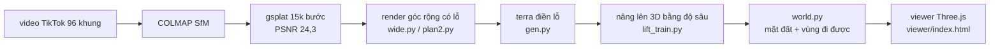
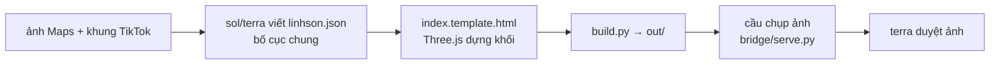

# Bàn giao: xem 3D từng địa điểm (spike Chùa Linh Sơn, 2026-11-03)

Đọc file này trước. Chỉ đọc thêm thứ được trỏ tới. Spec gốc: `docs/plans/2026-10-26-production-and-course-upgrade-design.md` §E.2 (còn bản cũ, mục dưới đây thay thế các điểm "nút xem phần dựng thêm" và "để mờ").

## 1. Việc cần làm và tiêu chuẩn "xong"

Làm ra bản **đẹp nhất, xuất sắc nhất** của "Khám phá 3D" cho **một địa điểm mẫu** (Chùa Linh Sơn, Đà Lạt), **tự kiểm tra trước khi đưa chủ dự án xem**. Chủ dự án đã xem bản vòng 1 và chê: lá, cỏ nát vụn, mảng mờ lớn, nền xám trống. Bản đó **không đạt**, đừng xem là điểm xuất phát tốt.

Quyết định của chủ dự án (không mở lại):

| Điều | Quyết định |
|---|---|
| Phạm vi | Mỗi địa điểm riêng, vào từ trang chi tiết ("Khám phá 3D"). Chỉ desktop |
| Di chuyển | Ngôi thứ nhất, WASD + chuột, **bước lên được bậc thang** |
| Chỗ thiếu dữ liệu | AI **tạo thêm thoải mái** cho đủ, không để lỗ. **Không** biển "chưa có dữ liệu", **không** nút bật/tắt phần AI |
| Ràng buộc duy nhất khi tạo | Khớp khung hình thật và điều kiện của chính địa điểm đó (giữ pixel thật, cảnh tạo thêm phải liền mạch với ảnh thật) |
| Mục đích | Chỉ để tham khảo, không phải bằng chứng |
| Kiểm chất lượng | Mẫu đầu: tự duyệt bằng mắt (Opus điều phối, sol 6.1 / terra 6.1 làm subagent). Đạt thì rút thành cổng tự động cho các nơi sau |

Tiêu chuẩn đạt (tự chụp, tự xem, không đạt thì chưa đưa chủ dự án xem):
- Chụp ≥ 10 tư thế đứng rải trên vùng đi được, gồm đầu bậc thang, giữa bậc thang, nhìn quanh 4 hướng, nhìn xuống sàn. Không tư thế nào có lá/cỏ nát vụn, mảng mờ lớn, vùng nền trống, vật nổi lơ lửng.
- Đi thử WASD từ đầu đến cuối đường bậc thang, không kẹt, không xuyên sàn.
- Đối chiếu với ảnh thật cùng góc: kiến trúc, màu, vật liệu cùng một nơi.
- Ghi số đo (xem §5) vào file kết quả cạnh bản đăng.

## 2. Đã làm (cho phiên kế)

Kết quả vòng 1 (số thật):
- 44 góc nhìn có lỗ, terra điền, **38/44** qua cổng (PSNR vùng đã biết giữa khung điền và render ≥ 15 dB, sai số độ sâu ≤ 0,2).
- Tinh chỉnh 6.000 bước, 3,73 triệu Gaussian: PSNR khung thật giữ riêng **24,28 → 23,28**.
- Vòng 2: dựng 139 góc nhìn dọc đường quay (kể cả lệch hai bên); terra điền được 43 khung rồi token Codex bị thu hồi (401). **Chưa điền xong**, 44/139 khung có (`logs/splat/fill/linhson_r2/gen`).
- FLUX.2 Klein 4B (Apache 2.0) chạy local trên 11 GB, 30–50 s/khung, nhưng khung điền kém terra (có lúc bịa hồ, núi không có thật). SDXL inpaint local: tải weight hỏng, bỏ.
- Gemini `ag/gemini-3.8-flash` điền 1 khung thử được (14 s) nhưng ảnh ra nhỏ hơn (1264×848).

## 3. Vì sao bản vòng 1 xấu (giả thuyết, chưa kiểm hết)

1. **Cắt còn 440.000 Gaussian** để vừa giới hạn file đăng (20 MiB/file, `.splat` 32 B/điểm). Bản huấn luyện có 3,7 triệu; cắt theo "độ mờ × thể tích" giữ lại các điểm to, bỏ mất chi tiết nhỏ → mảng nát và mờ. Cần định dạng nén (`.spz`/`.ksplat`) hoặc chia nhiều phần, hoặc huấn luyện ít điểm hơn nhưng sạch.
2. **Khung AI không nhất quán giữa các góc**: mỗi khung bịa một rừng cây khác, nâng lên 3D thành "mảnh lá". Cần điền **theo vòng lặp**: điền → huấn luyện → render lại chỗ còn lỗ từ góc kế tiếp → điền tiếp, mỗi lần điều kiện hóa theo render đã có; hoặc ít khung điền hơn, góc nhìn cách xa nhau hơn.
3. **Độ sâu chỗ điền** ước lượng bằng Depth Anything V2 rồi khớp affine theo pixel biết; xa mép lỗ sai nhiều. Cân nhắc dựng sàn/bậc thang bằng mặt phẳng + bậc (từ lưới cao độ đã có) thay vì Gaussian, và vòm trời cố định cho nền trống.
4. Điểm đứng ở rìa vùng có dữ liệu, camera nằm trong tán lá. Chỉ cho đi trong vùng chất lượng đạt.
5. Một clip quay đi dạo là dữ liệu mỏng. Cân nhắc cảnh có nhiều clip/ảnh hơn (vòng 3 với 10 clip địa điểm Lung Chung chỉ ghép được 10% khung vào cảnh lớn nhất bằng COLMAP; thử MASt3R-SfM) hoặc nguồn thế giới sinh 3D làm nền, rồi ràng buộc bằng ảnh thật.

Hướng đề xuất: sửa 1 và 2 trước (đo bằng số + mắt), rồi 3–4. Nếu vòng lặp điền vẫn không sạch, nói thẳng với chủ dự án thay vì đưa bản xấu.

## 4. Chạy lại

Mọi thứ trong `logs/splat/` (gitignored). Dữ liệu lớn nằm ở **NAS** `/AIClub_NAS/luanhh/tripguardian/` (quy tắc: weight, checkpoint, venv nặng để ở đó; NFS repo từng đầy quota, file ra toàn byte 0).

| Thứ | Vị trí |
|---|---|
| Cảnh COLMAP + checkpoint gốc | `logs/splat/linhson/v2_sfm/{scene,gs20k/ckpts/ckpt_14999_rank0.pt}` (ckpt là symlink sang NAS) |
| Script | `logs/splat/fill/`: `wide.py` (vòng 1), `plan2.py` + `frame.py` (vòng 2), `gen.py` (điền; `FILL_MODE=full KNOWN_ALPHA=0.85` cho vòng 2), `gen_klein.py`, `lift_train.py`, `world.py`, `compare.py`, `run.sh` |
| Dữ liệu vòng 1/2 | NAS `splat/linhson_wide`, `splat/linhson_r2` (symlink từ `logs/splat/fill/`), checkpoint tinh chỉnh `splat/linhson_fill_terra/ckpt.pt` |
| Thế giới đi bộ | NAS `splat/world_r1` (`scene.splat` 440k, `world.json`: đường đi, lưới cao độ, ô đi được) |
| Viewer | `logs/splat/fill/viewer/index.html` (thay `__WORLD__` bằng nội dung `world.json`; splat nạp từ `scene.splat.bin.wav` hoặc `scene{k}.splat.bin.wav` khi `parts>1`), `shot.py` chụp ảnh |
| Venv gsplat | `.cache/splat/venv` (py3.10, torch 2.4 cu121). Chạy qua `GPU=<n> logs/splat/fill/run.sh <script.py> <args>` |
| Venv sinh ảnh local | NAS `imggen-venv` (py3.12, torch 2.8 cu128, diffusers 0.42.1), cache model `HF_HOME=/AIClub_NAS/luanhh/tripguardian/hf` (có FLUX.2 Klein 4B, Depth Anything V2 Large) |
| Tạo ảnh | 9router `127.0.0.1:20128` `/v1/images/generations`, `cx/gpt-6.1-terra` (tốt nhất), `cx/gpt-6.1-sol`; ảnh tham chiếu qua trường JSON `image` (data URL). Token Codex có lúc bị thu hồi (401) → báo chủ dự án cập nhật key, rồi thử lại. Nếu 9router chết: khởi động như `run.sh router_start` |
| Trang đã đăng | https://claude.ai/artifact/FBd9hmbBXh1tatFiTx8dXN (slug `72dba83e-3f76-4aee-9502-57ec017b03f9`, version 1793498312-96ba = vòng 1 xấu). Đăng bằng `mcp__claude-artifacts__publish_files` (mode `replace`); splat đặt tên `*.splat.bin.wav` để qua bộ lọc loại file; CSP chỉ cho script từ jsdelivr |

Chụp kiểm tra bằng Chromium đầy đủ (không phải headless shell): `shot.py <url> <tiền_tố> '[[x,z,yaw,pitch],...]'`, pose qua `window.__pose`. Phần mềm GL (swiftshader) chậm: chờ ≥ 25 s mỗi tư thế, hoặc dùng bản splat rút gọn khi chỉ cần xem bố cục.

## 5. Số đo cần ghi

Lưu cạnh bản đăng (`summary.json`): PSNR/LPIPS khung thật giữ riêng trước–sau; số khung điền được giữ/bỏ và lý do; % diện tích vùng đi được có dữ liệu thật; số Gaussian đưa lên web; kết luận từng tư thế chụp kiểm tra (đạt/không, lý do).

## 6. Quy tắc làm việc

- **Điều phối:** Opus điều phối khi cần; việc nặng giao subagent **sol 6.1 hoặc terra 6.1** (chủ dự án chốt 2026-11-03). Việc nhìn ảnh chấm chất lượng giao subagent xem ảnh, không tự khen.
- **GPU:** tối đa 3 card, kiểm `nvidia-smi` trước, không đụng tiến trình người khác. Hôm 11-01 dùng GPU 1, 2, 7.
- **Một phiên duy nhất làm spike này.** Đầu phiên: `pgrep -af "fill/|lift_train|simple_trainer"`; hôm 11-01 từng có bản sao của phiên chạy song song trong cùng thư mục, đã tắt theo lời chủ dự án.
- Không commit, không push (cây làm việc dùng chung). Tài liệu viết tiếng Việt, code/comment tiếng Anh.
- Chỉ đăng lên chủ dự án khi qua tiêu chuẩn §1; báo thẳng số đo và chỗ còn xấu.

## 7. Cập nhật 2026-11-03 tối: đổi sang mô hình kiến trúc 3D

Chủ dự án đổi hướng giữa phiên: không còn đi bộ WASD trong splat; thay bằng **mô hình kiến trúc thu nhỏ** (xoay, phóng to), **bấm điểm → camera bay tới + ảnh thật** ở đó. Mẫu ảnh phong cách: `logs/splat/diorama/refs/`.

- Code: `logs/splat/diorama/` (`index.template.html`, `linhson.json`, `build.py`, `NOTES.md`, các `BRIEF_*.md` từng lượt). Ảnh chụp, bản lưu, log nằm trên NAS `splat/diorama/` (symlink).
- Cầu chụp ảnh: subagent Codex không chạy được Chromium trong sandbox → `bridge/serve.py` chạy ngoài (cần `python3 -m http.server 8471` ở thư mục diorama); subagent gọi `python3 bridge/request.py <tag>`.
- Subagent: `logs/splat/agents/run_agent.sh <sol|terra> <brief> <log> <effort> [ảnh…]` (Codex CLI, `service_tier` priority qua `models.json`). Brief phải có dòng "AUTONOMOUS RUN" (nếu không, skill brainstorming khiến nó dừng hỏi).
- Đã đăng bản c13: https://claude.ai/artifact/FBd9hmbBXh1tatFiTx8dXN (version 1793721119-aaad), `summary.json` kèm điểm.
- Điểm duyệt độc lập (terra): v1 3 → r5f 4 → c9 5 → c11 5 → c13 5/10, vẫn FAIL theo chuẩn "xưởng mô hình cao cấp". Còn yếu: cây cách điệu, chi tiết cổng/trụ/tượng giản lược, mái trơn khi nhìn gần, cụm chùa nhỏ so với đồi.
- Không dùng GPU. NFS repo hết quota lúc ~22:10 → file 0 byte; đã chuyển ảnh/log sang NAS.

### 7.1 Cập nhật 2026-11-04: tuyến tham quan + bên trong chánh điện

Theo góp ý chủ dự án: bỏ khung ảnh thực tế và cột số; thêm tuyến đi 9 điểm (mũi tên đất nung trên mặt đất, thanh "← Trước | n/9 | Tiếp →", nút "Bắt đầu tham quan", phím ←/→/Esc); điểm "Chánh điện" nhấc mái (cắt lớp), điểm "Bên trong chánh điện" camera tầm mắt, trần gỗ, khám thờ theo ảnh g24/g26. Đăng version 1793729176-1a9d (bản lưu `snap/c16`). Chỉ chánh điện có nội thất; nhà phụ để đóng vì không có ảnh bên trong. Duyệt: Opus xem toàn cảnh + 9 điểm + 3 góc bên trong, console sạch; chưa chấm lại bằng terra.
