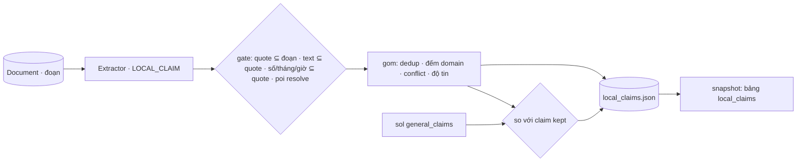

# P4 — Document → `LocalClaim`

> Plan làm việc (`RULE.md` §0.1). Spec §A.3, §A.1 (claim `source = model`); roadmap `2026-10-28-corpus-module-a-roadmap.md` §P4. Ledger: `.superpowers/sdd/2026-10-28-claims-p4/progress.md`. Không commit (cây làm việc chung).

## Đích

Document web (`data/web/<city>/documents/*.json`, P2) → `LocalClaim` có trích dẫn; claim chung của sol (`corpus.navigate.general_claims`, P3) được gắn `confirmed` / `contradicted` / `unverified`; bảng `local_claims` vào snapshot (đường release/serving). Không rebuild, không publish release.

## Quyết định

| Mục | Chọn |
|---|---|
| Module | `src/corpus/local/` (public `__init__.py`), dữ liệu `data/<city>/local/` |
| Nguồn độc lập | domain (Document không có tác giả); chính thức = domain `.gov.vn` |
| Trạng thái claim Document | `kept` (≥ 2 domain hoặc 1 chính thức) · `unverified` (1 nguồn) · `conflict` (cùng subject + kind, tháng hoặc khoảng giá không giao) |
| Trạng thái claim sol | `confirmed` (khớp claim `kept`) · `contradicted` (trái claim `kept`) · `unverified` (không có) |
| So claim sol | chỉ code: subject khớp (fold, Jaccard token ≥ 0,5 hoặc chứa nhau) + cùng `kind`; trái khi tháng / khoảng giá không giao; khớp khi giao, hoặc khi không có số thì Jaccard nội dung ≥ ngưỡng; không đủ → `unverified` |
| Fact | chỉ `kept`, `confirmed`. Claim trượt gate không vào bảng |
| Độ tin | `0.5 ** (tuổi / nửa đời)`, nửa đời 365 ngày (`notice`, `event` 30); tuổi tính từ `retrieved_at` |
| POI chưa resolve | `subject_kind = poi_unresolved`, ghi `poi_unresolved.jsonl` (đề xuất cho P7); POI resolve → `poi_claims.json` (aggregate đọc sau, không trong P4) |

## Task

1. **Task `LOCAL_CLAIM`** (`llm/tasks.py`, vai trò Extractor): một đoạn → `claims[]` `{subject_kind, subject_text, kind, text, quote, amount_min_vnd, amount_max_vnd, when{months, days, hours, weather}, who}`. Test: schema, render.
2. **Gate** `local/gate.py`: quote ⊆ đoạn, text ⊆ quote, số tiền / tháng (cả khoảng "tháng A đến tháng B") / giờ có trong quote, poi resolve qua `retrieval.search_names`. Test từng lý do loại.
3. **Extract** `local/extract.py`: chia Document thành đoạn ≤ `chunk_chars`, gọi task (client giả trong test), cache `data/<city>/local/extracted/<doc_id>.json` theo hash đầu vào. Test fake LLM: gọi một lần, chạy lại không gọi.
4. **Gom** `local/group.py`: dedup Jaccard ≥ 0,6 theo (subject, kind), đếm domain, `kept` / `unverified` / `conflict`, độ tin; `check_model` cho claim sol. Test.
5. **Run + CLI** `python -m corpus local <extract|group> --city --limit --docs`: ghi `local_claims.json`, `poi_claims.json`, `poi_unresolved.jsonl`, `stats`. Test fake LLM + `DATA_DIR` tạm.
6. **Công bố**: `snapshot.tables(..., local_claims=)` → bảng `local_claims`; `compile_snapshot` đọc `data/<city>/local/local_claims.json` (region = city); `Region.local_claims` (snapshot cũ không có bảng → rỗng = chưa biết); `retrieval.local_knowledge(region, subject?, kind?, month?)`; `releases` ghi file vào `inputs`. Test.
7. **Mẫu thật** ≤ 40 Document (Extractor, song song thấp vì lane Gemma bận): đo số claim, tỉ lệ qua gate, span 100 %, precision tự kiểm tay, tỉ lệ `confirmed` / `contradicted` / `unverified` của 26 claim sol. Bảng mẫu vào ledger.
8. **Tài liệu**: `docs/CORPUS.md` mục "Tri thức bản địa" + dòng CLI; `docs/LLM_PROVIDER.md` nếu bảng task cần; `docs/log/DEV_LOG.md`.

## Kiểm

`.venv/bin/python -m pytest --collect-in-virtualenv tests/local tests/snapshot tests/retrieval tests/navigate -q`
