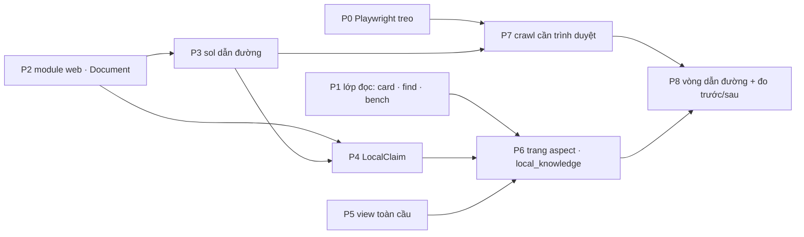

# Module A Corpus — lộ trình thực hiện

> Plan làm việc (`RULE.md` §0.1). Spec: `docs/superpowers/specs/2026-10-26-production-and-course-upgrade-design.md` §A, §3, §8. Mỗi phase là một plan con có test và số đo riêng; phase chi tiết nằm ở file riêng khi bắt đầu làm.
> Đích chung (chủ dự án 2026-10-28): corpus xây để **khâu khác dùng** — sol và Place Decision truy xuất nhanh, dễ RAG, mọi giá trị có nguồn.

## Thứ tự và phụ thuộc

| Phase | Spec | Chạy được ngay? | Xong khi (số đo) |
|---|---|---|---|
| **P0** Playwright treo với site lớn | §3 việc 1 | cần chủ dự án cho chạy Chromium ngoài sandbox | Maps / TikTok / Google Travel mở trang < 10 s, 10/10 lần |
| **P1** lớp đọc cho sol + Decision | A.8 (phần nơi), §3 việc 2, A.9 | có — `2026-10-28-corpus-serving-for-sol-and-decision.md` | `find` p95 ≤ 30 ms, `card` p95 ≤ 2.000 ký tự, 18 ca đúng 100 %, recall 1,0 |
| **P2** module `web` + Document | A.2, §3 việc 3, 12 | có (HTTP) | 50 query Đà Lạt: video mới, tỉ lệ có trang báo/blog, engine bị chặn, cache hit |
| **P3** sol dẫn đường | A.1, A.9 việc 11 | có (sol HTTP) | bản đồ khai thác qua kiểm schema; so corpus: `aspect` trùng/mới, nominee có/chưa có/không thật |
| **P4** Document → `LocalClaim` | A.3, A.1 (claim `source = model`) | có (Extractor) | claim có span 100 %; tỉ lệ `confirmed` / `contradicted` / `unverified` của claim sol |
| **P5** view toàn cầu | A.4 | có (Open-Meteo, Overpass); thư viện lễ cần cài | Tết 2026–2028 đúng; `ClimateNormal` 12 tháng ≥ 10 năm; `RestrictedArea` có ở bbox Đà Lạt |
| **P6** trang `aspect` + `local_knowledge` | A.8 (lớp 3), A.1 báo cáo độ phủ | sau P1, P3, P4 | mỗi `aspect` một lần gọi; báo cáo `aspect` × khu × tháng |
| **P7** crawl cần trình duyệt | A.1 resolve nominee, A.2 video, A.5, A.6, A.7 | sau P0 | nominee resolve rate; video mới/nơi; ảnh theo cảnh/nơi; giá phòng mỗi giờ |
| **P8** vòng dẫn đường + đo trước/sau | A.1 vòng lặp, A.9 | sau P6, P7 | độ phủ trước/sau; vòng dừng khi thêm < 5 % mới |

Song song được: P0 (chờ chủ dự án) ‖ P1 ‖ P2 → P3 → P4; P5 độc lập.

## Phase

### P0. Playwright treo (§3 việc 1)

- Giả thuyết theo thứ tự: chế độ headless của Playwright (`--headless=old` / shell) khác `--headless=new`; IPv6; HTTP/2/QUIC (`--disable-quic`, `--disable-http2`); proxy env; `commit` chờ DNS.
- Script `logs/pw_probe.py`: mỗi biến thể × {example.com, google.com/maps, tiktok.com, google.com/travel/hotels} × 3 lần, ghi thời gian `goto(commit)`; giết cây tiến trình của chính nó sau timeout (`agent-browser-limits`).
- Chặn: Chromium trong Bash sandbox không ra được mạng; cần chủ dự án cho chạy ngoài sandbox, chỉ cờ mặc định (không UA giả, không `AutomationControlled`).
- Sửa vào `src/corpus/crawl/common/browser.py` (cờ launch) + test launch có sẵn.

### P1. Lớp đọc cho sol + Place Decision

Plan chi tiết: `docs/superpowers/plans/2026-10-28-corpus-serving-for-sol-and-decision.md` (sửa vé mâu thuẫn, `card`, `find(Criteria)`, `vocabulary`, `python -m bench retrieval`, release không publish).

### P2. Module `web` + Document

- `src/corpus/crawl/web/` (một nguồn, một thư mục `data/web/<city>/`):
  - `client.py`: chuyển `Web` từ `src/trip/infrastructure/web.py` sang đây (giữ hành vi: cache đĩa, chặn host nội bộ, `trafilatura`); thêm ghi engine trả gì / bị chặn (`unresponsive_engines` của SearXNG) vào `data/web/engines.jsonl`, ngân sách `daily_queries` (300) đếm theo ngày, nghỉ `min_interval_s` (2,0) giữa hai query. `src/trip/infrastructure/web.py` còn là lớp mỏng import từ public API `corpus.crawl.web` (Trip không đổi hành vi; test Trip hiện có phải pass).
  - `discover.py` phase `web search`: đọc query (P3 `mining_map.json`, rồi slug `/discover/`, rồi `data/trip/gaps`), ghi `search/<query_hash>.json`; tách link: video TikTok → `tiktok_urls.jsonl` `{url, video_id, query, found_at}`; `/discover/<slug>` → `discover_slugs.jsonl` (slug → query mới); còn lại (báo, blog, trang du lịch; bỏ mạng xã hội, OTA) → `doc_urls.jsonl`.
  - `documents.py` phase `web documents`: tải trang trong `doc_urls.jsonl` bằng `client.read` → `documents/<doc_id>.json` `{doc_id, source_url, domain, title, retrieved_at, lang, kind: "web", sections: [{heading, text}]}`; `doc_id` = hash URL; chia đoạn theo heading; trang > 40.000 ký tự cắt và ghi `cut`.
- Chấm query theo lượng mới (video mới so với `data/tiktok`, doc mới, slug mới) → `query_yield.jsonl`; nhóm query mang về ≥ 2 lần trung vị được gấp đôi ngân sách vòng sau.
- CLI: `python -m corpus web <search|documents|all> [--city dalat] [--limit N]`.
- Đo: `logs/web_probe_50.py` 50 query (25 từ `DISC`/`GEN` của `logs/model_knowledge_full.py`, 25 slug `/discover/`): video mới/tổng, doc/tổng, engine bị chặn, thời gian.

### P3. sol dẫn đường

- Vai trò `NAVIGATOR` trong `src/corpus/llm/roles.py` (`.env`: `NAVIGATOR_*`, mặc định trỏ cùng 9router sol `low`); `docs/LLM_PROVIDER.md` thêm dòng.
- `src/corpus/navigate/` (module mới, public `__init__.py`):
  - `schema.py`: pydantic `MiningMap{city, generated_at, model, aspects: [Aspect]}`, `Aspect{key (snake_case tiếng Anh), name_vi, why, target: {kind: feature|local_claim|media|new_feature, ref, new_feature?: {key, type, values, hint}}, queries: [str] (≤ 8), sources: [str], nominees: [{name, area_hint}] (≤ 15), months: [1..12]}`; code bỏ mục sai khuôn kèm lý do.
  - `plan.py`: một lượt sol, đầu vào chỉ `city.name` + `area` (+ báo cáo độ phủ từ vòng 2); ghi `data/<city>/navigate/mining_map_<ts>.json` và `mining_map.json` (bản mới nhất). Kiến thức chung sol nêu (mùa, đặc sản, đi lại, phong tục, khẩn cấp) → `general_claims[]` `{subject, kind, text, when}` → P4 lưu thành `LocalClaim source=model`.
  - `compare.py` (A.9 việc 11): so với `config/ontology.yaml`, `config/queries.yaml`, `config/seasons.yaml`, serving: `aspect` ↔ feature/query trùng (fold + token Jaccard ≥ 0,5) hay mới; nominee ↔ tên trong corpus (`corpus.retrieval.search_names`) có / chưa có; chưa có → hàng đợi resolve P7. Báo cáo `data/<city>/navigate/compare_<ts>.json` + bảng cho chủ dự án duyệt phần mới (feature mới chỉ vào ontology khi chủ dự án duyệt).
- CLI: `python -m corpus navigate <plan|compare> [--city dalat]`.

### P4. Document → `LocalClaim`

- `src/corpus/local/` (public `__init__.py`), dữ liệu `data/<city>/local/`:
  - Task Extractor `LOCAL_CLAIM` (`src/corpus/llm/tasks.py`): một đoạn Document → `[{subject_kind: poi|area|dish|phenomenon|city, subject_text, kind ∈ {best_time, crowded_at, avoid, specialty, price_norm, access, if_rain, season, event, notice, tip}, text, quote, when: {months, days, hours, weather}, who}]`.
  - Gate (như `observe/details_gate.py`): `quote` là chuỗi con của đoạn; `text` ⊆ quote; số tiền / tháng / giờ có trong quote; subject `poi` phải resolve qua `search_names` (không thì giữ `subject_kind = poi_unresolved`, vào nominee P7).
  - Gom (code): dedup token Jaccard ≥ 0,6 theo (subject, kind); đếm domain/tác giả độc lập; `kept` khi ≥ 2 nguồn độc lập hoặc 1 nguồn chính thức (`.gov.vn`, trang của chính nơi đó); mâu thuẫn (cùng subject+kind, tháng/giá không giao) → `conflict`; độ tin giảm nửa sau 365 ngày (`notice`, `event`: 30 ngày).
  - Claim `source = model` (P3 `general_claims`): khớp với claim Document đã giữ → `confirmed`; trái → `contradicted`; không có → `unverified` (chat hiện "tham khảo", số chỉ dạng khoảng). Không bao giờ cho chi tiết POI.
  - View: `Season`, `Event`, `Notice` = lọc theo `kind`.
  - Claim POI đã resolve → thêm bằng chứng vào `details.timing` / `LISTS` qua aggregate (`aggregate/details.py` đọc thêm `data/<city>/local/poi_claims.json`), không thêm lớp thứ hai.
- Công bố: `local_claims` vào release/snapshot (bảng mới `local_claims` trong `snapshot/tables.py`), đọc qua `corpus.retrieval.local_knowledge(subject?, kind?, month?)`.

### P5. View toàn cầu

- `src/corpus/views/` (offline, chạy cho mọi thành phố, không qua Extractor):
  - `climate.py`: Open-Meteo archive 2015–2025 theo tâm `area` → `ClimateNormal` theo tháng (nhiệt độ min/max trung vị, xác suất ngày mưa ≥ 1 mm, ngày sương mù nếu có) → `data/<city>/views/climate.json`.
  - `calendar.py`: thư viện `holidays` (VN) + `lunardate` cho lễ âm lịch → `CalendarDay`; test Tết 2026 (17/2), 2027 (6/2), 2028 (26/1). Cài: chủ dự án chạy `uv pip install --python .venv/bin/python holidays lunardate`.
  - `restricted.py`: Overpass theo bbox `area` (`landuse=military`, `access=no`, `military=*`) → `RestrictedArea` GeoJSON.
- `live/holidays.py`, `live` climate đọc view này trước, YAML tay thành lớp ghi đè; public API `live` không đổi. Kiểm hazard `RestrictedArea` trong `planning/conditions.py` (nơi nằm trong vùng → cảnh báo, không tự loại).

### P6. Trang `aspect` + báo cáo độ phủ

- Offline (`src/corpus/navigate/pages.py`): mỗi `aspect` của `mining_map.json` → trang `{key, name_vi, months, places: [{id, why: ["fid=value" | "dish:..." | claim_id], score}] (dùng `find` của P1 với `target`), local_claims, clips (top 3 theo `poi_crawl` score), sources}`; công bố như `local_claims`.
- `corpus.retrieval.aspect(key, month=None)`, `aspects()` (tên + một dòng, cho prompt sol).
- Báo cáo độ phủ (`src/corpus/navigate/coverage.py`): mỗi `aspect` × khu (`serving/groups.areas`) × tháng → số nơi, claim, clip, ngày mới nhất; ô trống trước. Câu chat chưa trả lời (`data/trip/gaps`) gộp vào.

### P7. Crawl cần trình duyệt (sau P0)

| Việc | Code | Đo |
|---|---|---|
| Resolve nominee | phase mới `gmaps resolve`: search `<tên> <thành phố>` (dùng `search.search`), khớp tên fold + trong `area`; qua gate `filter`/`list` như nơi khác | resolve rate; nơi mới vào list |
| Video từ web | phase mới `tiktok web_videos`: đọc `data/web/<city>/tiktok_urls.jsonl`, mở trang video anon, lấy `poi` → `place_poi` / `poi_crawl` có sẵn; tải → `asr` … `clips` như hiện tại | video mới/nơi, % có `poi` |
| Nhịp Đà Lạt (A.5) | `src/corpus/pulse/`: tín hiệu có ngày (video mới 30 ngày ≥ 3 tác giả, review mới, nơi mới / đóng, `Event` 30 ngày tới, `Season` tháng này) → `data/<city>/pulse/<ts>.json`; job định kỳ 24 h | số item mỗi loại |
| Media (A.6) | nhãn cảnh (`exterior` … `menu`) + có người + bỏ trùng gần (SigLIP2 cos ≥ 0,95) + mờ/tối, chạy trên ảnh/frame đã có trước; `PHOTO_RANK` vào pipeline; tải ~30 video/nơi | ảnh theo cảnh/nơi; % nơi ≥ 3 cảnh |
| Giá phòng (A.7) | module `crawl/gtravel` (gõ ngày), `crawl/tripcom` (ngày trong URL); bộ ngày cố định mỗi giờ → observation `{fid, price_vnd, available, stay_date, observed_at, source}` | % chỗ ở có giá đúng ngày |

### P8. Vòng dẫn đường

- `python -m corpus navigate round`: báo cáo độ phủ (P6) → sol chọn ô cần đào, thêm/bỏ `aspect` → query mới (P2) → Document/claim (P4) → nominee (P7) → aggregate → serving → báo cáo mới. Dừng khi một vòng thêm < 5 % nơi/claim mới, hoặc hết ngân sách (300 query, 2.000 call Extractor mỗi vòng).
- Đo trước/sau trên `python -m bench retrieval` (P1) + báo cáo độ phủ.

## Quyết định builder (spec §8)

| Mục | Chọn |
|---|---|
| Ngân sách query/ngày | 300; nghỉ 2 s giữa query |
| Dừng vòng khám phá | thêm < 5 % mới |
| "Đang hot" | 30 ngày, ≥ 3 tác giả |
| Chu kỳ nhịp | 24 h |
| Thư viện lễ | `holidays` + `lunardate` |
| Giữ `LocalClaim` | ≥ 2 nguồn độc lập hoặc 1 chính thức; nửa đời 365 ngày (`notice`, `event` 30) |
