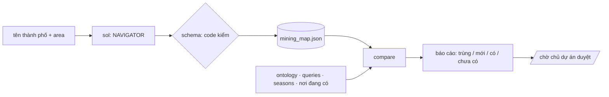

# P3 — sol dẫn đường (module `corpus.navigate`)

Spec: `docs/superpowers/specs/2026-10-26-production-and-course-upgrade-design.md` A.1, A.9 việc 11. Roadmap: `docs/superpowers/plans/2026-10-28-corpus-module-a-roadmap.md` §P3. Ledger: `.superpowers/sdd/2026-10-28-navigator-p3/progress.md`.

## Quy tắc lõi



- sol **không thấy** corpus, ontology, config. Đầu vào duy nhất: tên thành phố + `area`.
- `compare` chỉ **đọc** ontology / config / corpus. Phần mới là đề xuất, mọi hàng mới có `approval = pending`. Không có đường code nào ghi ontology, `config/*.yaml` hay corpus.
- Nominee chưa có → `data/<city>/navigate/resolve_queue.jsonl` (đề xuất cho P7 resolve Maps; sol đề cử không phải bằng chứng nơi có thật).
- sol không bao giờ nêu chi tiết POI: `general_claims` không có `poi`, không giờ, không giá của một nơi.

## Vai trò

`NAVIGATOR` trong `src/corpus/llm/roles.py`: `.env` `NAVIGATOR_API_KEY`, `NAVIGATOR_BASE_URL`, `NAVIGATOR_MODEL`, `NAVIGATOR_REASONING_EFFORT`. Thiếu khóa nào thì lấy khóa `AGENT_*` tương ứng (cùng 9router `127.0.0.1:20128`, `cx/gpt-6.1-sol`, `low`). Code chỉ hỏi vai trò, không biết tên model. Task `NAVIGATOR_PLAN` ở `src/corpus/llm/tasks.py` (mọi prompt ở đó). `Task.ask` gửi thêm `reasoning_effort` + `prompt_cache_key` khi vai trò có mức suy nghĩ.

## Hợp đồng `MiningMap` (`schema.py`)

```
MiningMap{city, generated_at, model, aspects[Aspect], general_claims[GeneralClaim], rejected[{path, reason}]}
Aspect{key, name_vi, why, target{kind, ref, new_feature?}, queries[<=8], sources[], nominees[{name, area_hint}] (<=15), months[1..12]}
  key         snake_case tiếng Anh, duy nhất, 3-40 ký tự
  target.kind feature | local_claim | media | new_feature
  target.ref  feature: id snake_case sol đoán; local_claim: kind LocalClaim; media: tên cảnh; new_feature: key mới
  new_feature {key, type presence|rating|category, values (đóng), hint} — chỉ khi kind = new_feature
  sources     tập con của {maps, tiktok, web, official, news}   (web search đọc "tiktok" để thêm query site:tiktok.com)
```

**`GeneralClaim` — hợp đồng cho P4 (LocalClaim `source = model`):**

```
GeneralClaim{claim_id, subject_kind, subject, kind, text, when, source = "model"}
  claim_id      sha1[:12] của (subject_kind, fold(subject), kind, fold(text))
  subject_kind  city | area | dish | phenomenon          (không bao giờ poi)
  subject       tên ngắn: "Đà Lạt", "Cầu Đất", "lẩu gà lá é", "săn mây"
  kind          best_time | crowded_at | avoid | specialty | price_norm | access | if_rain | season | event | notice | tip
  text          một câu tiếng Việt, không chi tiết POI
  when          {months: [1..12], days: [weekday|weekend|holiday], hours: "" | "05:00-08:00", weather: "" | sunny|rainy|foggy|cold}
  source        luôn "model"; trạng thái confirmed/contradicted/unverified do P4 gán, không phải P3
```

Code bỏ (ghi `rejected` kèm lý do): key sai khuôn / trùng, thiếu `name_vi`/`why`, query rỗng sau lọc, `new_feature` sai khuôn (key không snake_case, `presence` mà values khác `[present]`, `rating` khác `[good, mixed, poor]`, `category` ngoài 2-6 giá trị), claim `kind` ngoài danh sách, claim mà `subject` trùng tên nominee (là nơi, không phải kiến thức chung), claim `text` rỗng hoặc > 300 ký tự.

## Việc (TDD, LLM giả trong test)

1. **Vai trò + task + `Task.ask` reasoning.** Test: role fallback AGENT; `ask` gửi `reasoning_effort` khi có; không gửi khi không. `tests/navigate/test_role.py`.
2. **`schema.py`**: `parse_answer(city, raw, model, now) -> MiningMap` + kiểm khuôn + rejected. `tests/navigate/test_schema.py`.
3. **`plan.py`**: `plan(city, client=, model=, now=, latest=True)` một call, đầu vào chỉ tên + area; ghi `mining_map_<ts>.json` (+ `mining_map.json` nếu `latest`). Test: prompt không chứa ontology/query; file ghi; web `mining_queries` đọc được file. `tests/navigate/test_plan.py`.
4. **`compare.py`**: `config/navigate.yaml` (ngưỡng). Aspect ↔ ontology feature (id đúng, hoặc fold + Jaccard ≥ 0,5 trên id / hint / claims), ↔ query trong `config/queries.yaml`, ↔ `config/seasons.yaml`, ↔ nhãn cảnh `config/scenes.yaml`; nhãn `covered_feature` | `covered_query` | `new`. Nominee ↔ `search_names` trên `data/serving/places.json`: `held` | `maybe` | `missing`. Ghi `compare_<ts>.json`, `resolve_queue.jsonl` (chỉ `missing`, không trùng), in bảng tiếng Việt. Test kiểm: không file nào ngoài `data/<city>/navigate/` bị ghi. `tests/navigate/test_compare.py`.
5. **`__init__.py` + CLI** `python -m corpus navigate <plan|compare> [--city dalat] [--map FILE] [--no-latest]`. Test CLI parse + `run`. `tests/navigate/test_cli.py`.
6. **Docs**: `docs/CORPUS.md` mục "sol dẫn đường" (tiếng Việt), `docs/LLM_PROVIDER.md` thêm dòng vai trò + biến `.env`, `docs/log/DEV_LOG.md`.
7. **Một call thật** sol `low` cho Đà Lạt; ghi vào ledger (thời gian, số aspect, rejected, token nếu có). Chạy `compare` trên kết quả.

Chạy test: `.venv/bin/python -m pytest --collect-in-virtualenv tests/navigate tests/test_llm_task.py -q`.
